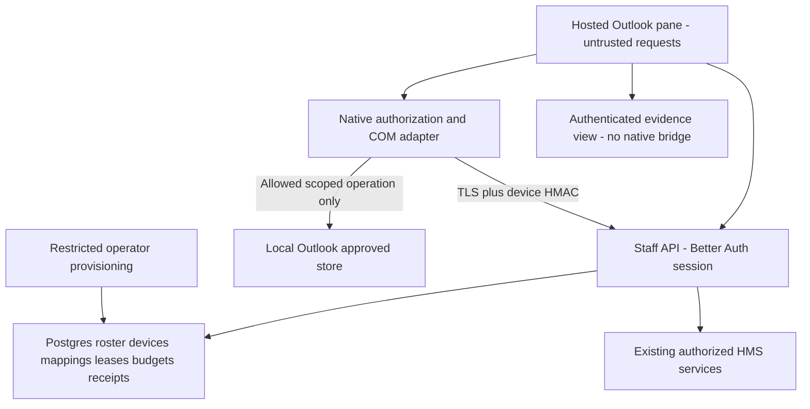
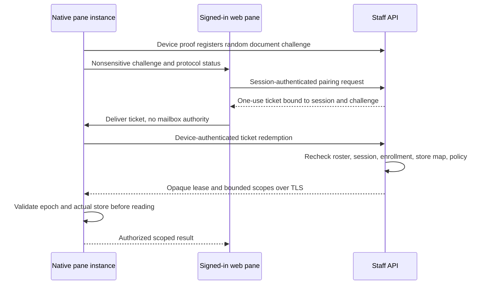
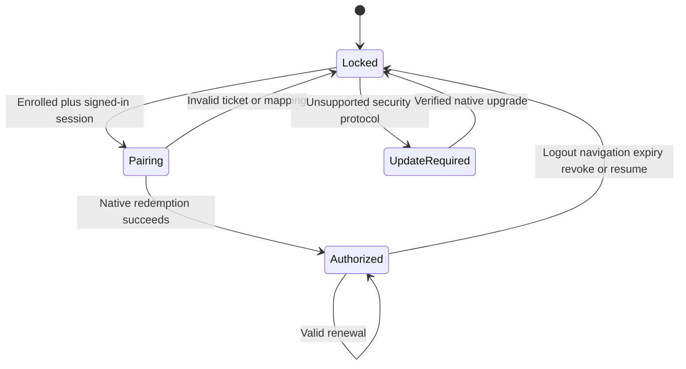
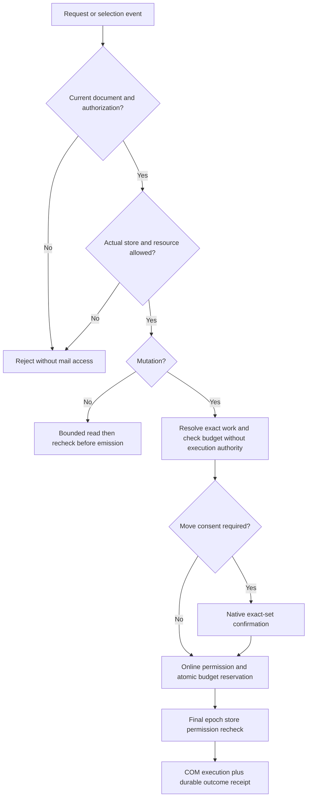

# Outlook Pilot Security Implementation Plan

## Goal Capsule

- **Objective:** Deliver the security commitments in Ansh's email to Darren across the native Outlook add-in, hosted pane, pilot APIs, background workers, release pipeline and enrolled pilot PCs, without replacing the hosted interface.
- **Current authority:** Planning only. This document does not authorize implementation, deployment, account provisioning, key creation, client installation or production mutation now.
- **Future execution posture:** Once explicitly activated, execute the dependency-ordered units autonomously with test-first security contracts, independent review, safe deployment and evidence-based recovery. The mandate below applies only after that activation.
- **Preserve:** Outlook embedding; centrally updated UI; mail/attachment reads; draft creation, editing and attachments; manual Outlook Send; approved triage moves; HMS workflows; enlarged screenshot/evidence views.
- **Remove:** Nava-driven pilot mail sending and mail deletion, including native commands and equivalent pilot server/worker paths. Ordinary staff actions in Outlook remain available.
- **Completion:** Code-ready, server-deployed and fleet-verified are separate milestones. Full completion requires every in-scope installation upgraded or disabled; publishing an EXE is not installation proof.
- **Baseline:** Zero branch `feat/centurion-dashboard-tools`, HEAD `9ad4a2dfebba56eddfbe6ec786cbbdfca853b8e1`; VSTO gitlink `190f350acccfb1312adbbfcf09e9c05c27d72676`. Revalidate both when execution starts.

### User Clarifications: 2026-09-26

- Staff sessions expire after **24 hours**, not 12. Native short-lived permissions renew automatically during that session; they do not require repeated login or device enrollment.
- Target one supervised installation/update containing the complete retained native capability set. Routine screens, AI behaviour, HMS workflows and approved-folder policy update centrally within those capabilities.
- No paid publisher registration or commercial certificate purchase is required or authorized. Prefer existing IT code-signing infrastructure; otherwise use a stable pilot signing certificate explicitly trusted during initial setup, subject to IT policy. No fresh trust root per build.
- Do not impose arbitrary new attachment-size/count or ordinary document-type restrictions. Preserve supported attachments and existing mail limits, with safe handling and bounded resource use. Flag any necessary reduction before release.
- No custom updater in this implementation. A future native bugfix or genuinely new native capability may still need a native update; do not promise the installed binary can never require replacement.
- Additional hardening must support the email commitments without silently reducing retained functionality or making routine UI releases depend on client installation.

---

## Product Contract

### Summary

Retain the server-hosted Outlook pane while making the installed add-in the final authority over local Outlook access. Bind access to provisioned users, enrolled Windows installations, approved native mailbox stores and narrow actions. Automate verified web/API releases; keep the initial native security update supervised as promised in the email.

### Problem Frame

HTTPS host checks and web login exist, but they do not establish native authorization. The current add-in can expose selected-mail metadata before login and execute privileged requests from any accepted same-host page. Device diagnostic strings are not credentials. Native and server capabilities are broader than the pilot needs, and existing deployment mechanics do not publish web assets and CSP as a matched release.

This plan is preventive hardening, not a claim that an attack occurred. Same-origin XSS remains able to abuse whatever the logged-in pane is permitted to do; stronger identity and device controls do not make it harmless.

### Requirements

**Retained workflow and trust boundary**

- R1. Keep the UI hosted and embedded in Classic Outlook; routine interface changes must not require an installer.
- R2. Permit native mail access only from the exact approved HTTPS pane document, never a sibling page, frame, popup or external document.
- R3. Before reading or exposing mail, require an active authorization for the user, enrolled Windows installation, approved native store and requested action; include unsolicited events and cached results.
- R4. Preserve reading mail/attachments, drafting with attachments, opening the Outlook composer, approved triage moves and HMS/evidence flows.

**Identity and least privilege**

- R5. Provision named Centurion/DaVinci pilot users administratively; disable public signup and automatic account creation for the hardened pilot, including alternate provider routes.
- R6. Enroll each Windows-user installation with a separate revocable credential outside JavaScript; workstation names and reported email addresses are descriptive only.
- R7. Remove native `SEND_DRAFT`, `DELETE_EMAIL` and `DELETE_EMAIL_PERMANENTLY`; deny moves to Deleted Items and its descendants, Outbox and all other non-approved destinations.
- R8. Confirm bulk or unusually numerous moves in native UI against the exact resolved work; prevent bypass through sequential calls, reloads, multiple panes or devices.
- R9. Enforce the pilot no-send/no-mail-delete policy at server API, tool/service and background delivery boundaries; preserve draft discard and non-pilot behaviour.

**Content and operations**

- R10. Show pane email text by default; sanitize rich content at rendering boundaries, including native-origin content and generated drafts, while preserving useful formatting and attachments.
- R11. Generate allowed inline-script hashes from each production web build and publish HTML/assets/CSP together; normal React buttons, lazy routes and central updates must work under enforcement.
- R12. Keep evidence popouts bridge-free and authenticated; bound attachment/template access and resource consumption without removing normal attachment workflows.
- R13. Deploy an attributable, signed native release; safely replace/disable all old pilot installations and enroll approved stores, without forcibly terminating Outlook.
- R14. Automate compatible release publication, verification, revocation and fail-closed recovery; preserve hotel and remote-admin ingress isolation and production-data safety.
- R15. Record additional recommendations, retained residual risks and actual rollout evidence without secrets, mail content or misleading completion claims.

### Acceptance Examples

- AE1. Starting Outlook or changing selection before sign-in produces no mail, account email, subject, folder, signature or attachment metadata in the page; only nonsensitive bootstrap/auth status is available.
- AE2. A provisioned user on an enrolled installation can read an approved message, create an attached reply draft, open it in Outlook and send manually. Nava itself never calls Send.
- AE3. Raw send/delete messages, moves to Deleted Items/Outbox, wrong-store item IDs and corresponding pilot API requests fail before side effects, even when the UI is bypassed.
- AE4. A reload, account switch, navigation or logout invalidates the old pane generation. A late response cannot repopulate the pane with previous-user mail.
- AE5. Native consent for a particular move set cannot authorize changed items or destinations. Sequential single-item calls consume the same shared budgets.
- AE6. A normal central UI release updates buttons/screens without an installer; an invalid CSP manifest cannot be published, and rollback restores a matching safe release.
- AE7. Revoking a device/session prevents new online mutation approvals immediately and stops further native reads within the documented lease bound; native Outlook itself still works.
- AE8. Fleet completion is refused if even one active pilot installation still has the old unrestricted bridge, irrespective of server health or download hash.

### Scope Boundaries

- Scope is the Legacy pilot and its shared application/release code, not every unrelated service in the monorepo. Shared security fixes must preserve explicitly non-pilot behaviour.
- No replacement desktop UI, standalone application, move away from Outlook, mailbox-provider migration, or generic agent/tool expansion.
- No restriction on staff manually sending/deleting in Outlook. Deleting a Nava draft or cleaning a temporary attachment is not deleting mailbox messages.
- No tests using client mail credentials or pilot/production databases. Windows end-to-end testing uses disposable mail/profile fixtures; real-PC enrollment is operational validation with staff.

#### Deferred to Follow-Up Work

- **Native self-updater:** not required for centrally updated UI and not currently implemented. A later managed-deployment/ClickOnce decision needs IT approval, publisher trust, safe shutdown and rollback design. Do not build a custom remote-code-execution updater into this security patch.
- **TPM attestation, enterprise SSO, mandatory MFA for every staff login:** worthwhile future options, not prerequisites for this scoped remediation. Restrict privileged enrollment/revocation to existing authenticated operators now; never create a public admin bypass.
- **Office/Windows platform upgrade:** Legacy IT owns endpoint servicing. Outlook 2016 support ended on 2025-10-14; record the actual installed version and require IT migration planning or explicit residual-risk acceptance before describing the environment as supported.
- **Automatic approval of arbitrary future dependency upgrades:** deferred. CI can detect advisories; changes still pass the security/regression gates before release.

---

## Global Constraints

- Preserve user work. The current worktree has tracked pane/onboarding edits and extensive unrelated untracked HMS work. Never reset, clean, broadly stage or silently ship that work.
- Native source belongs to `kufupa/nava-outlook-addin`. All native paths below are expressed through its Zero gitlink prefix `apps/server-pilot/vsto/`; publish a native commit before updating the root gitlink.
- The submodule is uninitialized in this worktree. Planning inspected the pinned native source read-only through GitHub; implementation must obtain that exact source and follow any native repository guidance.
- Use built-in cryptography and existing Better Auth, Drizzle, sanitizers and deployment wrappers where appropriate; do not introduce a second auth framework or general-purpose policy engine.
- No compatibility fallback may restore unauthenticated v2/v3 native reads or removed mutations. Incompatible clients get an update-required state.
- All authorization failures are fail-closed. An outage may pause Nava assistance; it must not disable ordinary Outlook or discard staff drafts.
- Never force-push protected branches, bypass hooks, expose credentials, silently install a trust root or run destructive git against shared worktrees.
- Do not purchase certificates, register a paid publisher account or introduce a commercial signing service as a prerequisite. Explicit one-time IT approval of a stable pilot signer is distinct from buying public certificate trust.
- `.cursor/rules/pilot-rds-safety.mdc` overrides older docs: never run any test runner against pilot/production RDS, never use `VITEST_ALLOW_PILOT_RDS=1`, and never source production env into tests. DB tests require a disposable database.

---

## Autonomous Execution Mandate

**Inactive until the user explicitly requests execution of this plan.** Once activated, choose safe reversible implementation details, run verification and repair failures without routine user checkpoints. Preserve the Product Contract; log substantive design deviations. Missing access is not authority to bypass controls.

### Decision and recovery authority

- Use standard non-fast subagents for independent implementation/review where available; otherwise work inline. Keep one owner per overlapping file set.
- Follow the loop: reproduce a failure minimally, identify the mechanism, choose the smallest correct fix, rerun focused and integration checks, then resume. Do not skip gates or treat a failed build as a reason to ask routine questions.
- Keep progress and evidence outside this decision document. Record the release commits, native artifact, test results and unresolved operational prerequisites in one handoff report.
- Future activation permits the scoped safe deployment steps here when credentials and approved targets are available; it does not authorize destructive migrations, real guest mail sends, new public ingress, forced Outlook closure or credential/trust bypass.

### Infrastructure boundary

| Resource | Existing deployment contract |
| --- | --- |
| EC2 | `i-008f737974a9ba9b3`, region `af-south-1` |
| RDS | `nava-zero-mail-pilot`, Postgres 16; production runtime only |
| S3 | `nava-zero-mail-845242190536-af-south-1` |
| Deployment entry | `apps/server-pilot/deploy/ops-deploy.sh`; additive schema changes use its migration path |
| Restart/reboot | `apps/server-pilot/deploy/ops-restart.sh`, `ops-reboot.sh`; only when needed for this release |
| Safety references | `.cursor/skills/overnight-autonomous-zero/SKILL.md`, `.cursor/rules/pilot-rds-safety.mdc` |

Use instance-role secret retrieval, read-only SSM/health inspection and existing ops wrappers. Preserve both ingress planes and VPN routing. Before test runners, remove inherited production DB/legacy test-override variables and prove the disposable target. No hotel Exchange/VPN/real-mail credential use for tests; no bulk seed/password rotation as a deployment shortcut.

If the execution tool backend fails, distinguish tool outage from application failure. Use bounded recovery attempts and fresh state inspection; never invent an app root cause or retry a possibly completed mutation blindly.

### True blockers

- Missing private-repository/signing/secret access, approved pilot roster/store mapping, or authorized Windows/IT access.
- Required human-only installation, consent or publisher-trust approval.
- Ambiguous irreversible/production-data effect, violation of a safety rule, or infrastructure outage preventing required proof.
- A retained product capability cannot be preserved safely within the chosen architecture.

Continue independent safe work around a blocked rollout item. Report precisely whether code, server or fleet is blocked; do not claim full completion. Binary completion criteria are the Definition of Done below.

---

## Planning Contract

### Verified Baseline and Implications

| Surface | Source finding | Planning consequence |
| --- | --- | --- |
| Web identity | `src/lib/auth.ts` enables email/password but permits allowlisted signup and an open-signup override | Harden/provision existing auth; do not build auth from scratch |
| Session lifetime | `apps/server-pilot/src/lib/auth-profile.ts` legacy profile uses 400 days plus one-hour cookie cache; remote profile is separate | Add explicit pilot profile and independently validate sessions for native grants |
| Native guard | `TaskPaneControl.cs` trusts HTTPS host, not exact path; selected-mail events and `PING` can expose metadata before login | Gate inbound, outbound, bootstrap and asynchronous/cache paths |
| Browser bridge | `apps/mail/lib/workstation/use-outlook-bridge.ts` initiates active-mail reads and supports legacy fallback | Replace with authorization-first state machine |
| Sanitization | `apps/mail/lib/email-utils.ts` uses DOMPurify; `apps/server-pilot/src/mail/sanitize-email-html.ts` already sanitizes ingest | Reuse and verify existing boundaries; cover native/generated content bypassing ingest |
| Alternate mutations | `src/trpc/routes/mail.ts` and `src/mail/send/outbound-queue.ts` provide backend sends/deletes | Pilot policy at API and execution boundaries, including previously queued deliveries |
| Publication | `deploy-ec2.sh` copies SPA into live root before validating Nginx | Immutable web/CSP release pair with coordinated switch and safe rollback |
| Multiple ingress planes | LAN `http` and isolated `remote-http` share deployed web assets | Test both; remote session must not become a staff-native grant |
| Native distribution | Native workflow uses transient self-signed trust; installer can force-kill Outlook; root CI can skip absent native source | Stable approved signing, safe installer, mandatory separate native proof and fleet receipts |

Source paths abbreviated in the table's first two server rows are expanded in implementation units. These are source findings, not new live-EC2 or installed-PC measurements. No tests/builds were run during this planning pass.

### Key Technical Decisions

- KTD1. **Keep hosted WebView2; distrust page requests.** Use exact-document checks plus a shared native authorization service. A pathname is not a browser isolation boundary against compromised same-origin content; scoped native enforcement remains essential.
- KTD2. **Opaque native leases, not browser JWTs.** The native add-in receives permissions directly from the trusted HTTPS server and holds them in memory. Server-held handles bind the original Better Auth session and policy. This avoids custom token verification/key distribution while meeting the email's short-lived permission commitment.
- KTD3. **Purpose-specific HMAC device authentication.** Generate a 256-bit per-installation secret, protect it with DPAPI CurrentUser and restrictive file ACLs; encrypt the server copy under a separate versioned wrapping key retrieved using instance IAM. Never reuse HMS proof keys, Better Auth secrets or a fleet-wide device secret. HMAC authenticates; TLS encrypts.
- KTD4. **Administrator-approved store mappings.** Bind device + Outlook profile + actual StoreID/account association to a server mailbox transport. Do not infer it from From addresses, store display names, `Session.CurrentUser`, page parameters or a default-store fallback. Each PC's POP/PST copy has its own local IDs.
- **Folder policy updates:** Store approved triage destinations in server-owned policy, not a hardcoded installer list. Existing native folder-resolution capability supports operator-approved folder changes without reinstalling; Deleted Items/Outbox and cross-store prohibitions remain enforced natively.
- KTD5. **Native read lease, online mutation permission.** Reads use a short local lease to avoid a network roundtrip per selection. Each mutation or bounded batch requires a fresh server decision and a final native check. No offline mutation queue.
- KTD6. **Remove capability, not just button.** Delete native send/delete implementations and dispatch paths; pilot API/service/worker policy denies equivalent actions. Draft save/discard stays distinct. Do not simulate Outlook Send from a popout or alternative tool.
- KTD7. **Consent is bound to work.** Native confirmation covers a finite item/store/destination set, not a general period of unrestricted moving. Aggregate server budgets cover user/device and logical mailbox; native coordination covers multiple panes and aliases.
- KTD8. **Build-derived CSP for this static SPA.** Hash final inline script bytes; no static reusable nonce, no blanket script disable, no `unsafe-eval`. Initially retain necessary inline styles independently. Keep approved built script assets available without treating user uploads as executable same-origin content.
- KTD9. **Release sets, not mutable live assets.** Stage immutable HTML/assets/CSP with source digests; point each Nginx worker generation at a matching root/header pair. Retain prior content-addressed chunks for open clients. Never roll back to an unauthenticated bridge or restore removed actions.
- KTD10. **Machine credentials are not attestation.** DPAPI does not stop same-user malware; reported version is not proof of installed code. Short leases bound revocation delay, not the lifetime of a stolen device secret. Rotation/revocation and actual endpoint update verification remain necessary.

### Concrete Protocol and Policy Defaults

These are implementation defaults, not measurements of current production behaviour. Tighten them safely; do not loosen a security bound silently to make tests pass.

| Item | Decision |
| --- | --- |
| Pilot user session | Dedicated staff pilot auth profile; 24-hour absolute session, no sliding renewal or cookie auth cache; retain separate remote-admin cookie/session table and its existing policy |
| Enrollment | Operator issues a single-use 10-minute enrollment code, bound to approved installation record; native setup redeems over TLS, then operator approves native-observed store association |
| Device request proof | HMAC-SHA256 over versioned unambiguous length-delimited method, path, exact-body SHA-256, device/key ID, timestamp and server-issued one-use nonce; constant-time comparison |
| Replay window | Nonce expires after 60 seconds; atomic consumption stored in Postgres; timestamp tolerance 30 seconds; wrong origin/redirect is rejected |
| Pairing | Native registers a per-pane/navigation random challenge through device-authenticated API; logged-in browser requests one-use ticket bound to that challenge and exact staff session; ticket expires in 60 seconds |
| Native lease | Opaque server handle plus native-only scope snapshot; valid at most 60 seconds, renew around 30 seconds; no persisted live authority; monotonic elapsed time prevents clock rollback extension |
| Mutation permission | Single operation/digest or exact batch, expires within 15 seconds of server decision; check again immediately before COM side effect; never returned to JavaScript as reusable authority |
| Revocation bound | New permission issuance denied after policy/session/device revocation commits; already-issued read leases may last up to 60 seconds and mutation permissions up to 15 seconds; local logout/navigation or observed revocation invalidates immediately; committed COM effects cannot be undone by revocation |
| Native move consent | Every explicit multi-item batch; single calls exceed 10 unconfirmed moves/60 seconds or 100/24 hours in any independent user, device or logical-mailbox bucket require native consent for a specified next set; one batch at most 100 items |
| Limits survive restart | Server reservations persist across process restart; offline mutation is forbidden; completed retries do not consume budget twice, uncertain operations keep their reservation |
| Credential lifecycle | Explicit per-device revoke/rotate; rotate invalidates old key versions and all leases; wrapping-key version retained only until device records are safely rewrapped |
| Logs | Opaque IDs, release/policy IDs, action, denial reason, counts and outcome; no subjects, addresses, bodies, attachment bytes, URLs with tokens or credential material |

Native mutation permission is valid only inside its current read authorization and navigation epoch. Network request timeout/unknown response never means permission granted. A user signs in again after session expiry; no passwords are stored by the add-in.

### High-Level Technical Design

The diagrams cover component ownership, pairing sequence, authorization lifecycle and final execution gates. Obtain required batch consent before the short mutation-permission request so staff deliberation does not consume the 15-second execution window. Final permission binds the confirmed set and rechecks budgets; changed budgets may require consent rather than silently authorize. A cancellation goes directly to denial without COM work.

### Additional Recommendations and Trade-offs

| Recommendation beyond literal native-command removal | Decision | Reason and visible impact |
| --- | --- | --- |
| Pilot backend/queued-send restrictions | Include, R9 | Closes alternate paths; pilot web Send/Delete and scheduling become unavailable, while Outlook manual Send and draft discard remain |
| Block moves into Outbox | Include, R7 | Avoids alternate sending path; approved triage folders remain |
| Shorten existing 400-day staff sessions | Include, R5 | Staff sign in again after 24 hours; permission refresh inside that session is automatic |
| Template path confinement | Include, R12 | Prevents arbitrary local/UNC template access; unused template commands remain unadvertised, required templates use approved-root opaque handles |
| Safe attachments and protected temporary files | Include, R12 | Preserve supported files/existing mail limits; reject arbitrary filesystem access and unsafe active previews, not ordinary PDF/Office/image attachments |
| Stable pilot signing and safe Outlook-close handling | Include, R13; no paid certificate requirement | Reuse IT signing or explicitly trust one stable pilot certificate at initial setup; no publisher subscription, fresh per-build root or forced Outlook closure |
| Security-specific CI, dependency advisory check and operation audit | Include, R14/R15 | Prevents false-green native skips and aids revocation; no new enterprise monitoring platform |
| New custom native auto-updater | Defer | Adds a privileged update attack surface; not needed for rapid hosted UI changes |
| Standalone/local UI rewrite | Do not adopt | Does not itself solve authorization and conflicts with iterative pilot UI delivery |
| Outlook/Windows support upgrade | IT-owned dependency | Cannot be fixed by Nava code; record version/support risk and coordinate outside autonomous application changes |

### Assumptions and Execution-Time Prerequisites

- The email is the approved product scope. Additional bypass-closing recommendations above are included under the user's explicit request to identify and decide other important changes.
- Approved named users, mailbox transports, triage destinations and pilot PC list will be supplied through an operator-controlled roster, not inferred from arbitrary existing emails/accounts.
- The initial native installation remains supervised. “Autonomous” means later agent implementation and safe server release, not unattended access to unapproved client PCs or perpetual self-modifying security.
- Actual installed Office/WebView2 versions, local store associations, effective EC2 config, signing access and IT deployment permissions must be measured at execution/rollout. Their absence does not prevent code work but blocks the associated release milestone.
- Attachment byte/count limits must retain currently supported workflows and existing mail/provider limits. The previously proposed arbitrary 20 MiB/file, 25 MiB total and 20-file ceilings are withdrawn. Identify the existing contract and representative supported files before finalizing bounded transfer limits; use chunking/streaming where needed instead of silently lowering supported size. Policy limits are centrally configurable within tested native transfer capacity. If no supported bound can be established safely, record that release prerequisite rather than inventing one or permitting unbounded allocation.
- Existing sanitizer libraries and dependency versions must be checked against advisories during implementation; no claim of a vulnerability merely from a version string.

---

## Implementation Units

| Unit | Deliverable | Primary files | Depends on |
| --- | --- | --- | --- |
| U1 | Pilot policy and persistent security records | Server schema/policy | None |
| U2 | Named-user/session provisioning | Auth profile/operator tools | U1 |
| U3 | Device enrollment, pairing and native permissions | Workstation HTTP/service | U1, U2 |
| U4 | Native document/auth boundary | Native pane/dispatcher | U3 |
| U5 | Native action/resource limits and consent | Native mail operations | U4 |
| U6 | Authorization-first pane and capability UX | Browser bridge/pane | U3, U4, U5 |
| U7 | Pilot API/worker no-send/no-delete parity | Mail routes/queue/tools | U1, U2 |
| U8 | Safe rich content, attachments and evidence views | Sanitizers/HTTP/views | U5, U6 |
| U9 | Matched web/CSP publication | Build/deploy/Nginx | U6, U8 |
| U10 | Signed, non-destructive native package | Native installer/CI | U4, U5, U8 |
| U11 | Coordinated rollout and verification automation | Ops/CI/runbook | U1-U10 |

### U1. Define pilot policy and persistent security records

- **Goal / requirements:** One server-owned policy and durable state for R3, R5-R9, R14-R15.
- **Dependencies:** None.
- **Files:** Create `apps/server-pilot/src/db/schema/workstation-security.ts`, `apps/server-pilot/src/workstation/security-policy.ts`, `apps/server-pilot/tests/pilot-security-policy.test.ts`, `apps/server-pilot/tests/workstation-schema-migration.test.ts`; modify `apps/server-pilot/src/db/schema/index.ts` and add the next ordered migration plus metadata under `apps/server-pilot/drizzle/`.
- **Approach:** Add records for pilot roster, installation/key versions, approved native-store mappings, one-use challenges/tickets, session-bound native handles, operation receipts/budget reservations and metadata-only audit. Use FKs, unique keys, atomic compare-and-consume and bounded retention. Pilot classification comes from transport policy, never request headers. Credential ciphertext carries wrapping-key version; plaintext never enters ordinary query/log projections.
- **Patterns:** Existing `mailboxAccess` schema, Drizzle migrations, `src/hms/requester-authorization.ts` revalidation principles, existing outbound operation fencing. Do not reuse HMS-specific credentials.
- **Execution note:** Test-first policy and migration/concurrency contracts.
- **Test scenarios:** Unknown user/device/store/action denies; cross-transport lookup denies; duplicate enrollment or nonce consumption cannot succeed twice; same op ID/digest is idempotent but changed digest rejects; revocation/version changes invalidate handles; migration preserves existing mailbox/auth data and retries safely; expired transient records are pruned without erasing unresolved operation tombstones.
- **Verification:** Disposable Postgres tests prove durable policy/replay semantics. Existing non-pilot mailbox-access tests remain green.

### U2. Provision named staff and bounded sessions

- **Goal / requirements:** R5 with revocation semantics needed by R3/R6.
- **Dependencies:** U1.
- **Files:** Modify `apps/server-pilot/src/lib/auth.ts`, `apps/server-pilot/src/lib/auth-profile.ts`, `apps/server-pilot/src/lib/auth-providers.ts`; create `apps/server-pilot/scripts/provision-pilot-security.ts`; extend `apps/server-pilot/tests/auth-signup-guard.test.ts`, `apps/server-pilot/tests/auth-session-profile.test.ts`, `apps/server-pilot/tests/auth-trusted-origins.test.ts`, `apps/server-pilot/tests/remote-session-revocation.test.ts`; create `apps/server-pilot/tests/pilot-provisioning.test.ts`.
- **Approach:** Add a hardened staff profile rather than modifying the separate remote profile blindly. Disable signup/OAuth auto-provision/account-link bypasses for that profile. Operator tooling accepts an approved roster, provisions idempotently using Better Auth password hashing/account semantics, and grants explicit transport access. Never use one shared staff password, dump credentials or rotate established passwords on every deploy. Initial-password delivery/reset is an approved operator flow. Require fresh staff login at cutover; old long-lived sessions cannot mint native leases.
- **Patterns:** Existing auth profiles and remote revocation tests; existing seed/provisioning shapes without wholesale seed/reset.
- **Test scenarios:** Direct signup and alternate provider auto-create reject even if old open-signup env is set; approved provisioned login succeeds; unprovisioned existing account cannot access pilot mail; staff session remains valid before 24 hours and expires at 24 hours without renewal; logout/reset/revocation prevents lease renewal; remote cookie cannot authenticate staff pairing; provisioning rerun neither duplicates access nor resets passwords.
- **Verification:** Real HTTP auth tests against disposable DB, not only injected authenticated test contexts. Document one-time re-login impact.

### U3. Enroll devices and issue native-only permissions

- **Goal / requirements:** R3, R6, R8, R14-R15.
- **Dependencies:** U1, U2.
- **Files:** Extend `apps/server-pilot/src/trpc/routes/workstation.ts`; create `apps/server-pilot/src/http/workstation-security.ts`, `apps/server-pilot/src/workstation/device-auth.ts`, `apps/server-pilot/src/workstation/authorization.ts`; mount in `apps/server-pilot/src/main.ts`; tests `apps/server-pilot/tests/workstation-enrollment.test.ts`, `apps/server-pilot/tests/workstation-grants.test.ts`, `apps/server-pilot/tests/workstation-device-auth.test.ts`, and existing `apps/server-pilot/tests/workstation-router-contract.test.ts`.
- **Approach:** Separate operator enrollment, browser session-pairing and device-authenticated endpoints. Native registers the pane challenge before browser pairing. A one-use ticket represents the exact verified staff session, not caller-provided user IDs. Device redemption checks active session, roster, mapping, protocol and policy, then returns an opaque native lease over TLS. Renewal rechecks the original session through authoritative DB state, not cookie cache. Mutation permissions bind operation ID, exact payload digest, resources, budget and expiry. Return nonsensitive status to the browser; never a generic signing endpoint.
- **Interface:** Enrollment/revoke/rotate is operator-only; browser pairing is staff-session and same-origin/CSRF checked; native nonce/proof/redeem/renew/authorize/result paths use device proof and strict request schemas. Remote-admin HTTP does not issue staff-native grants. Body/nonce/rate limits apply before expensive crypto/DB work.
- **Patterns:** Hono HTTP handlers, tRPC `privateProcedure`/`mailboxProcedure`, Node built-in crypto, DB transactional fences.
- **Test scenarios:** Forged/replayed/expired nonce or wrong method/path/body rejects; concurrent ticket redemption has one winner; wrong pane/device/session/store pairing rejects; lost redemption response is recoverable only by same authenticated binding or a fresh pairing; revoked session/device/key fails renewal; endpoint redirect never forwards proof/secret; malformed/oversize requests bounded; cross-language C#/Node HMAC vectors match; read lease never exceeds 60 seconds; counters aggregate logical mailbox across devices.
- **Verification:** API integration and restart/concurrency tests prove no browser-only path can mint native authority; credentials/tokens absent from logs and error payloads. Test server revocation immediately after lease/permission issuance: no new permission issues, and the previously issued authority expires within its explicit 60/15-second bound, never falsely reported as instant revocation.

### U4. Put all native access behind document and authorization gates

- **Goal / requirements:** R2, R3, R6 and AE1/AE4/AE7.
- **Dependencies:** U3.
- **Files:** Modify `apps/server-pilot/vsto/NavaOutlookAddin/TaskPaneControl.cs`, `apps/server-pilot/vsto/NavaOutlookAddin/ThisAddIn.cs`, `apps/server-pilot/vsto/NavaOutlookAddin/OutlookBridgeDispatcher.cs`, `apps/server-pilot/vsto/NavaOutlookAddin/NavaOutlookAddin.csproj`; create `apps/server-pilot/vsto/NavaOutlookAddin/BridgeOriginPolicy.cs`, `apps/server-pilot/vsto/NavaOutlookAddin/BridgeAuthorization.cs`, `apps/server-pilot/vsto/NavaOutlookAddin/DeviceCredentialClient.cs`, `apps/server-pilot/vsto/NavaOutlookAddin/EnrollmentDialog.cs`; tests `apps/server-pilot/vsto/tests/BridgeOriginPolicyTests.cs`, `apps/server-pilot/vsto/tests/BridgeAuthorizationTests.cs`, `apps/server-pilot/vsto/tests/DeviceCredentialProtocolTests.cs`, `apps/server-pilot/vsto/tests/EnrollmentDialogTests.cs`, existing `apps/server-pilot/vsto/tests/BridgePolicyTests.cs`.
- **Approach:** Keep device credentials shared only within the enrolled Windows profile; authorization is per pane and navigation generation. Exact scheme/host/default-port/path validation rejects userinfo, encoded path ambiguity and non-approved query semantics. Check sender and current committed document. Invalidate immediately on navigation start, logout, session replacement and suspend/resume. Subscribe explicitly to frame/popup/download/permission events; do not expose privileged host objects. `PING` and capabilities before auth contain no account/mail data.
- **Boundary:** Gate before COM property access, cache lookup and background serialization, including selection notifications, signatures/templates and direct helper calls. Recheck after awaited work and before posting results. Use monotonic lease lifetime; no cached authority after process restart. Signing out revokes all local panes sharing that staff session.
- **Enrollment UX:** One minimal native dialog available from the locked add-in accepts the one-use enrollment code outside JavaScript. States: code entry, submitting, pending operator/store approval, enrolled, expired/invalid code, connectivity failure and revoked. Offer bounded retry or support with an opaque diagnostic reference. Normal upgrades preserve valid enrollment; profile replacement requires reenrollment. Keyboard operation, Cancel and focus return to Outlook must work. The web pane sees status only, never code or secret.
- **Patterns:** Existing dispatcher/operation cache; Microsoft WebView2 security guidance. Make COM adapters require checked context so tests can prove denied calls never reach them.
- **Test scenarios:** Covers AE1/AE4/AE7. Wrong scheme/port/path/frame/source denies; hostname prefixes and encoded paths deny; approved navigation stays locked until redemption; revoked/expired lease blocks cache replay; late selection/result from old generation is discarded; clock rollback cannot extend lease; new Inspector is not implicitly authorized; page cannot request arbitrary HMAC signing or change native API URL.
- **Enrollment scenarios:** Expired/invalid code rejects without exposing it; pending approval remains locked; connectivity retry cannot redeem twice; Cancel restores Outlook focus; ordinary upgrade preserves enrollment; a replacement Windows profile requires reenrollment; the hosted page never receives enrollment code/credential bytes.
- **Verification:** Pure Windows C# policy tests plus fake-COM adapter tests; actual WebView2/Outlook proof remains U11. No plaintext credential in WebView storage or messages.

### U5. Remove dangerous native commands and constrain retained operations

- **Goal / requirements:** R4, R7, R8, R12 and AE2/AE3/AE5.
- **Dependencies:** U4.
- **Files:** Modify `apps/server-pilot/vsto/NavaOutlookAddin/OutlookBridgeDispatcher.cs`, `apps/server-pilot/vsto/NavaOutlookAddin/OutlookMailOperations.cs`, `apps/server-pilot/vsto/NavaOutlookAddin/NavaOutlookAddin.csproj`; create `apps/server-pilot/vsto/NavaOutlookAddin/OutlookResourceAuthorization.cs`, `apps/server-pilot/vsto/NavaOutlookAddin/MoveAuthorizationPolicy.cs`; tests `apps/server-pilot/vsto/tests/OutlookResourceAuthorizationTests.cs`, `apps/server-pilot/vsto/tests/MoveAuthorizationPolicyTests.cs`, `apps/server-pilot/vsto/tests/AttachmentAndTemplatePolicyTests.cs`, `apps/server-pilot/vsto/tests/OutlookBridgeIntegrationTests.cs`, existing `apps/server-pilot/vsto/tests/BridgePolicyTests.cs`.
- **Approach:** Remove send/delete handlers, methods, capabilities and mutation-cache entries. Refactor the misleading draft-location validator `EnsureCanSendDraft` instead of deleting checks needed by draft updates/attachments. Make both create and reply draft flows support saving and opening the Outlook composer without Send.
- **Resource checks:** Resolve actual item/store/folder identities and check every conversation member, source attachment, draft destination and move target. No selected-item/default-store fallback for explicit mutations. Resolve Deleted Items through Outlook's special-folder identity and check bounded ancestry; ambiguity/cycle/truncation denies. `MOVE_TO_SPAM` must use the same checked boundary. Permit only approved same-store triage destinations; Outbox and Sent are denied, with authorized Drafts placement reserved for internal draft creation.
- **Consent/retry:** One native coordinator serializes budgets/consent across panes. Dialog shows actual mailbox, count, items and destinations; binds digest and expires after two minutes. Browser cannot claim approval. Obtain short operation permission after consent. Store a durable reserved/started/completed/uncertain receipt before/after COM effects; after crash or ambiguous effect, inspect/reconcile or require explicit recovery, never rerun automatically. Return sensitive cached outcomes only under current authorization. Bound dialogs and pending requests to prevent prompt flooding.
- **Long batches:** Check permission before each item's side effect. If the 15-second permission expires mid-batch, pause and renew only for the exact unattempted remainder under still-valid consent and current session/policy; never repeat attempted items. Expired consent requires a new exact-remainder confirmation. Native Cancel and keyboard rejection are safe defaults.
- **Files/attachments:** Attachment operations accept authorized object handles or bounded bytes, not arbitrary paths/URLs; validate sizes before decode/allocation, use restricted temp storage and cleanup. Templates use native-issued opaque handles under approved local roots; reject UNC, device paths and reparse escapes. No arbitrary `CreateItemFromTemplate(path)` from page input.
- **Patterns:** Existing incomplete-traversal and ambiguous-mutation protections from the pinned native commit; retain their semantics.
- **Test scenarios:** Covers AE2/AE3/AE5. All raw send/delete variants reject before COM; renamed/localized Deleted Items and descendants reject; Outbox and other-store folders reject; drafts/attachments retain validations; repeated single calls/reloads/restarts/devices consume shared limits; changed batch invalidates consent; cancel makes zero moves; partial batch reports exact completed/failed/uncertain items; same op retry neither repeats effects nor double-charges; path traversal/UNC/oversize base64 rejects before I/O.
- **Verification:** Pure policy tests and adapter-level zero-side-effect assertions pass; native code has no reachable send/delete bridge methods. Normal draft and approved folder scenarios remain executable.

### U6. Make pane startup and UI follow native authorization

- **Goal / requirements:** R1-R4, R7-R8 and AE1/AE2/AE4.
- **Dependencies:** U3-U5.
- **Files:** Modify `apps/mail/lib/workstation/bridge-protocol.ts`, `apps/mail/lib/workstation/use-outlook-bridge.ts`, `apps/mail/app/(routes)/outlook-pane/page.tsx`; tests `apps/mail/tests/workstation-bridge-protocol.test.tsx`, `apps/mail/tests/outlook-pane-auth.test.tsx`, `apps/mail/tests/outlook-pane-onboarding.test.tsx`; create `apps/mail/tests/outlook-bridge-authorization.test.tsx`.
- **Approach:** Implement locked, pairing, authorized, expired/revoked and update-required states. Do not automatically fetch active email during public handshake. Remove legacy read fallback and removed command wrappers/types. UI capability state is informational; native remains authoritative. Sign-in stays within the allowed pane or an explicitly unprivileged auth flow. Retain draft/HMS cards, attachment interactions and onboarding edits already in the worktree.
- **Data lifetime:** Partition requests/caches by session, pane generation and approved store. Logout/account/store changes cancel pending work, clear mail and previews, revoke object URLs and ignore late events. No persistent unencrypted pane mail cache. Expiry shows a recoverable sign-in/reconnect state without discarding drafts already saved in Outlook.
- **Patterns:** Existing bridge request correlation and truthful incomplete/uncertain result UI, Better Auth hooks.
- **Test scenarios:** Hook performs no mail requests before native authorized state; old protocol displays update-required without fallback; late old-user events ignored; two panes cannot inherit unrelated access; draft opens with attachments and no Send call; backend/native policy denials never become success banners; reload/reconnect pairs safely; existing staff onboarding and screenshot affordances remain.
- **Verification:** Component tests exercise real bridge state transitions rather than mocking the hook entirely; retained UI tests pass.

### U7. Enforce pilot action policy through API, tools and workers

- **Goal / requirements:** R9 and AE3.
- **Dependencies:** U1, U2.
- **Files:** Modify `apps/server-pilot/src/trpc/routes/mail.ts`, `apps/server-pilot/src/trpc/routes/connections.ts`, `apps/server-pilot/src/mail/send/outbound-queue.ts`, `apps/server-pilot/src/trpc/trpc.ts`, `apps/mail/hooks/use-undo-send.ts`, `apps/mail/components/mail/mail-content.tsx`; inventory affected callers under `apps/server-pilot/src/ai/` and `apps/mail/`; create `apps/server-pilot/tests/pilot-mail-action-policy.test.ts`, `apps/server-pilot/tests/pilot-tool-capability-policy.test.ts`, `apps/mail/tests/pilot-held-send-status.test.tsx`; extend `apps/server-pilot/tests/outbound-queue.test.ts`, `apps/server-pilot/tests/mail-router-isolation.test.ts`, `apps/server-pilot/tests/auth-context.test.ts`.
- **Approach:** Shared policy service guards send, scheduled/undo sends, delete/bulkDelete, move-to-bin, TRASH label aliases and clearSpam. Recheck at actual worker dispatch, not only enqueue. Atomically hold existing pending pilot deliveries with an auditable reason; preserve jobs and ambiguous SMTP fencing. Do not undo an already-sent message or replay an uncertain delivery. Deny application routes that could alter pilot membership/transport configuration without operator authority.
- **UI/tools:** Derive pilot web buttons/hotkeys/tool schemas from server capabilities, while direct calls still deny. Do not remove generic non-pilot features globally. Model output and email instructions cannot authorize a tool; requester/mailbox authority is resolved server-side. Preserve AI draft generation and HMS approval rules.
- **Held-send disposition:** Reconcile cutover deliveries as definitely not attempted, confirmed delivered or uncertain. Existing message/draft status must show held/not-sent truthfully. Only definitely unattempted mail may be recovered as an Outlook draft for staff review; uncertain attempts have no blanket resend action and need operator reconciliation. Preserve payload/attachment integrity; never imply a server-held draft already exists in local Outlook. This extends existing status UI, not a new queue dashboard.
- **Patterns:** `mailboxProcedure`, existing send queue attempt fences, AI worker's no-send boundary.
- **Test scenarios:** Direct endpoint/alias bypasses deny before state changes; queued send created before cutover is held; policy revoked after enqueue denies dispatch; unauthorized transport header grants nothing; agent tools cannot invoke forbidden mutations; non-pilot send/delete unchanged; draft discard remains; label-based filing to approved user folders remains distinct from native COM move; in-flight send transition is fenced during cutover.
- **Held-send UI scenarios:** Render held/not-sent and confirmed-delivered distinctly; uncertain outcome exposes no resend action; safe draft recovery preserves body/recipients/attachments and reports local Outlook draft creation only after a confirmed native result. Test failed/expired native authorization during recovery without losing the server-held message.
- **Verification:** Disposable-DB HTTP/service/worker tests demonstrate no pilot SMTP invocation or mail deletion from any reachable application path. Audit inventory names every discovered entrypoint and its enforcing policy.

### U8. Close content, attachment and evidence-view gaps

- **Goal / requirements:** R4, R10, R12.
- **Dependencies:** U5, U6.
- **Files:** Modify `apps/mail/lib/email-utils.ts`, `apps/mail/components/create/quote-history-expander.tsx`, `apps/mail/app/(routes)/outlook-pane/page.tsx`, `apps/mail/components/mail/mail-content.tsx`, `apps/server-pilot/src/mail/sanitize-email-html.ts`, `apps/server-pilot/src/http/inline-attachment.ts`; create `apps/mail/tests/outlook-pane-content-security.test.tsx`, `apps/mail/tests/outlook-evidence-view-security.test.tsx`; extend `apps/server-pilot/tests/sanitize-email-html.test.ts`, `apps/server-pilot/tests/attachment-access.test.ts`, `apps/server-pilot/tests/inline-attachment-http.test.ts`. Extend any additional rich-content sink found by the required inventory without broad unrelated refactoring.
- **Approach:** Inventory dangerous HTML/URL sinks and reuse existing sanitizers. Plain text stays plain React text; sanitize rich HTML after interpolation and before sink/native draft insertion. Native-origin signatures/templates/quoted bodies are equally untrusted. Preserve tables, legitimate links and CID attachments; restrict active content, event handlers, dangerous schemes and unauthorized remote resource loads. Do not destroy useful stored mail to implement display policy.
- **Evidence:** Preserve modal/enlarged view and genuine popouts using a bridge-disabled host or isolated browser context; authenticate artifact access against requester/mailbox/run. No arbitrary page-supplied URL shell execution. No active HTML/SVG attachment served executable under an allowed script source; unsupported active previews download safely. Private responses avoid shared caching; already downloaded bytes cannot be retroactively revoked.
- **Test scenarios:** Script/event/SVG/javascript-URL fixtures remain inert; same mail through ingest/native/draft preview gets equivalent safety; tables/CID/normal attachments survive; cross-user artifact IDs and expired links deny; popup has no COM bridge/opener authority; logout clears previews; generated draft HTML cannot fetch arbitrary network resources during native processing; authorized screenshots/HMS evidence still enlarge.
- **Verification:** Sink inventory is accounted for; sanitizer regressions and browser negative fixtures pass. No new global format loss hidden behind “security.”

### U9. Generate CSP and publish matched web releases

- **Goal / requirements:** R1, R11, R14 and AE6.
- **Dependencies:** U6, U8.
- **Files:** Create `apps/mail/scripts/build-csp-manifest.mjs`, `apps/mail/tests/build-csp-manifest.test.ts`, `apps/server-pilot/deploy/publish-web-release.mjs`, `apps/server-pilot/tests/web-release-publication.test.ts`; modify `apps/mail/package.json`, `apps/server-pilot/deploy/nginx.conf`, `apps/server-pilot/deploy/deploy-ec2.sh`; extend `apps/server-pilot/tests/deploy-config.test.ts`, `apps/server-pilot/tests/outlook-addin-installer-nginx.test.ts`.
- **Approach:** Parse final production HTML after all transformations; emit SHA-256 hashes for legitimate inline bootstrap/theme scripts and bind manifest to HTML/assets/source digest. Remove script `unsafe-inline`; enforce `script-src-attr 'none'`, `object-src 'none'`, constrained `base-uri`/`form-action`, existing framing restrictions and explicit resource directives. Retain necessary style allowance independently. Do not hash user-generated HTML or make uploads executable.
- **Publication:** Build in staging, validate manifest and candidate config, then switch a release-specific Nginx configuration with matching immutable root and CSP on both ingress planes. Keep installer downloads separate. Publish content-addressed chunks before HTML and retain previous chunks for open tabs; reject filename collisions with different bytes. Reload failure restores the previous paired release. Cleanup never targets current/previous referenced assets or downloads.
- **Patterns:** Existing dual-plane Nginx guard, React Router static SPA build (`ssr: false`), build artifacts, immutable asset caching.
- **Test scenarios:** Whitespace/script changes regenerate hashes; missing/tampered manifest fails closed; no inline event handlers execute; React sign-in/buttons/theme/lazy chunks still work; upload cannot serve JS under trusted asset path; interrupted/rejected publication leaves old pair valid; both hosts receive intended CSP; old tab chunk load survives deployment; rollback returns correct matching hashes; installer URL unchanged.
- **Verification:** Enforced-policy browser tests on production build; no report-only policy accepted as final proof. Native WebView2 test repeats key flows in U11.

### U10. Build a trustworthy native installer without losing staff work

- **Goal / requirements:** R13, R15 and AE8.
- **Dependencies:** U4, U5, U8.
- **Files:** Modify `apps/server-pilot/vsto/.github/workflows/outlook-vsto.yml`, `apps/server-pilot/vsto/installer/setup.iss`, `apps/server-pilot/vsto/installer/RegisterTrust.cs`, `apps/server-pilot/vsto/installer/install.cmd`, `apps/server-pilot/vsto/installer/register-trust.cmd`, `apps/server-pilot/vsto/NavaOutlookAddin/Properties/AssemblyInfo.cs`; create `apps/server-pilot/vsto/tests/InstallerSecurityTests.ps1`; modify `.github/workflows/ci.yml`, `apps/server-pilot/tests/vsto-source-contract.test.ts`, `apps/server-pilot/tests/outlook-addin-installer-nginx.test.ts` and native gitlink after its commit exists.
- **Approach:** No paid publisher registration or certificate purchase. Reuse an available IT-issued code-signing certificate, or use one stable self-signed pilot code-signing certificate with its fingerprint explicitly approved by IT during initial setup. Protect its private key in CI; sign relevant native/installer artifacts and verify signer plus digest at publication. Use timestamping when supported by the selected approved signing route; do not introduce a paid service. This provides integrity relative to the locally approved key, not automatic public trust or guaranteed absence of SmartScreen warnings. IT may forbid self-signed trust; that is an explicit deployment prerequisite, not permission to buy a certificate or disable validation silently. Do not mint/import a new root each build or strip security markers as a substitute for trust.
- **Install safety:** Replace forced Outlook termination with detection and clear save/close/retry behaviour. Preserve draft data and approved settings; re-enroll if Windows profile or credential protection context changes. Check prerequisites and Evergreen runtime availability; updates take effect after safe restart. Remove obsolete advertised installer versions without deleting forensic provenance.
- **CI:** Native source/tests must be available and pass for a security release; a warning-and-skip is failure. Keep manifest linking native commit, root gitlink, assembly/installer version, protocol, SHA-256 and publisher verification. Retain release artifacts beyond ephemeral CI expiry.
- **Test scenarios:** No forced taskkill; failed/cancelled installation leaves prior registration recoverable but not marked secure; tampered/unsigned/unapproved signer fails; stable IT-approved pilot certificate works without paid public trust; no silent root-store write or new per-build certificate; exact gitlink builds successfully; x86/x64 Classic Outlook prerequisites covered; native test omission fails release; downgrade below security floor rejected by release policy; credentials absent from package.
- **Verification:** Native Windows CI and disposable Windows install/upgrade tests pass; signer access and target-PC trust confirmed before pilot publication.

### U11. Automate coordinated release, rollout evidence and recovery

- **Goal / requirements:** R1-R15, with AE6-AE8 as release gates.
- **Dependencies:** U1-U10.
- **Files:** Modify `apps/server-pilot/deploy/ops-deploy.sh`, `apps/server-pilot/deploy/deploy-ec2.sh`, `apps/server-pilot/deploy/sync-ec2-git-bundle.sh`, `apps/server-pilot/deploy/write-ec2-env.sh`, `apps/server-pilot/deploy/write-ec2-remote-env.sh`, `apps/server-pilot/deploy/pm2.config.cjs`, `.github/workflows/ci.yml`; create `apps/server-pilot/deploy/security-release-verify.mjs`, `apps/server-pilot/tests/security-release-manifest.test.ts`, `apps/server-pilot/tests/security-rollout-contract.test.ts`, `apps/mail/playwright.outlook-security.config.ts`, `apps/mail/tests/e2e/outlook-pilot-security.spec.ts`, `apps/server-pilot/vsto/tests/WindowsSecurityAcceptance.ps1`, `docs/runbooks/outlook-pilot-security.md`.
- **Approach:** Release manifest pins exact root/native commits, migration level, web/CSP digests, installer publisher/hash, native protocol and policy floor. Use clean immutable staging; never let existing bundle defaults silently deploy `main`, reset shared checkout changes or include all untracked files. Extend ops wrappers for that staging contract rather than bypass them. Add dedicated security CI with disposable DB and mandatory native result; inspect dependencies/advisories without blindly upgrading unrelated packages.
- **Secrets/config:** Provision purpose-specific wrapping-key references and narrow instance-role access; secret values go through protected retrieval/files, not SSM text or logs. Deliberately extend remote env allowlist only for shared policy metadata it needs. Keep native grants on staff plane, remote admin isolation, VPN and current HMS processes intact.
- **Tests:** New manifest mismatch/native-skip/config-loss fixtures; additive schema rehearsal; wrong branch/native artifact rejects; candidate missing one ingress plane rejects; production test target refuses; auth-profile fallback refuses; rollback cannot lower security floor; installed-device inventory cannot mark download as installation; unsupported client stays locked; app/kernel/Office version metadata never treated as cryptographic attestation.
- **Verification:** Execute the Verification Contract and staged rollout below. Report clean code verification, safe server activation, then fleet coverage separately. No full-success message while a required PC or retained workflow lacks proof.

---

## Operational Rollout and Recovery

1. **Establish release inputs:** preserve dirty work, select reviewed immutable branch commits, obtain native source, approved roster/store mappings and signing access. Record both source revisions; do not automatically merge unrelated current-branch experiments into production.
2. **Prove in isolated environments:** disposable Postgres, fixture mail, Windows test profile and production web build. No client mailbox sends/deletes for tests. Rehearse additive migrations and paired web rollback.
3. **Prepare a closed cutover:** stage release, purpose-specific secrets and additive schema. Pause pilot outbound delivery through a verified operational fence while switching worker policy; hold queued pilot sends rather than delete them. Preserve uncertain SMTP-attempt state. Do not mistake `--quiesced` assets-only mode for mail-worker maintenance.
4. **Activate safe server/web policy:** deploy compatible API/worker and matched CSP/web release on both ingress planes; enable hardened staff profile, disable signup and require new native protocol. New native clients remain locked until enrollment; old clients remain outside that enforceable boundary until upgraded or disabled. Staff/IT must safely close/disable old add-ins before declaring a closed native cutover. Intermediate server rollout is not fleet protection. Migration rollback keeps additive tables; never remove safety controls to recover availability.
5. **Publish native artifact:** verify approved signer, native commit, root gitlink and downloaded SHA-256; publish atomically through the established installer URL and retire old downloadable release aliases from normal use.
6. **Install and enroll with staff/IT:** save/close Outlook safely, upgrade, restart, verify loaded native version, enroll installation and explicitly approve actual Outlook stores. Confirm pre-login silence, reads/draft/attachments/triage, manual Outlook Send workflow and evidence views. Record an operational receipt; telemetry alone is not proof against a malicious machine.
7. **Close fleet coverage:** every approved pilot Windows profile is upgraded/verified or the old add-in is disabled. Old native binaries cannot be made safe solely by new server gates. Do not claim protection while an old pane remains loaded.
8. **Resume routine operation:** ordinary web releases continue centrally through automatic CSP generation, paired publish, both-plane health/security checks and bounded rollback. Monitor denied operations, renewal failures and fleet version drift without mail content.

**Recovery rule:** roll back only to a release satisfying the established security floor. If none is available, leave Nava bridge/pilot mutations disabled and restore ordinary Outlook usability. Never downgrade to unrestricted native commands or resume held sends automatically. Keep valid drafts and immutable evidence; reconcile ambiguous operations instead of replaying them.

**Release vs endpoint automation:** build, checks, server publication and evidence collection can run autonomously after activation. Initial PC installation, roster approval and trusted-publisher decisions may require people. WebView2 Evergreen has its own update mechanism; adoption requires process restart and permitted endpoint update policy. This plan does not silently install a permanent native self-updater.

---

## Verification Contract

No execution proof is claimed by this planning document. Use package-local scripts and harnesses that exist at execution time; root `@zero/server` package naming can be ambiguous, so target the actual `apps/server-pilot` workspace.

| Gate | Environment / files | Required outcome |
| --- | --- | --- |
| Server policy/auth/schema | Disposable Postgres; U1-U3/U7 test files; existing server `test`/`build` scripts | Signup closed, isolation/revocation/replay/queue fencing proven; migrations preserve data |
| Browser bridge | `apps/mail` Vitest `test` and production `build`; U6/U8 tests | No pre-auth reads/late-user leaks; retained workflows and capabilities truthful |
| Native pure policy | Native Windows workflow plus U4/U5 test files | Origin/grant/store/command/consent/cache contracts pass; denial reaches no COM |
| Native integration | Disposable Classic Outlook Windows profile with synthetic PST/mail; x86/x64 where supported | Real WebView2 navigation, actual store ancestry, drafts/attachments, consent and retry behaviour proven |
| CSP/publication | Production SPA under enforced Nginx candidate; U9 tests | Bootstrap and retained UI work; injected script blocked; matching releases/rollback on both hosts |
| Artifact provenance | Native CI, root gitlink, signing and release manifest | Exact binary/source association, valid approved publisher, no skipped native gate |
| Deployment safety | Ops contract tests and isolated rollout rehearsal | No shared-checkout wipe; no wrong-branch publish; no pilot DB test runner; no ingress/secret boundary regression |
| Live server verification | Purpose-built read-only SQL/API/health/config inspection, not test runner | Correct release/profile/security policy, both ingress planes and worker holds; no real mail send/delete |
| Pilot fleet | Staff-supervised installation/enrollment receipts | All in-scope installations upgraded or disabled, actual mailbox mapping approved |
| Independent review | Security/bypass review plus code/regression review | No unresolved high-impact policy bypass; automated review alone is not security assurance |

### Cross-Boundary Adversarial Scenarios

- An authenticated page on the same host but not the pane cannot access COM; injected code inside the actual pane still cannot exceed policy.
- A malicious email asks the AI to send/delete/export another mailbox: prompts provide no authority, and tool/native/API policy rejects it.
- User A's ticket, device B's proof and store C's item cannot be combined into access.
- Local logout/navigation or observed revocation during an attachment read or queued mutation invalidates pending work immediately. Unobserved server revocation prevents new permission issuance, while previously issued authority remains bounded by the 60-second read lease or 15-second mutation permission. Tests prove both cases, including expiry before emission/effect.
- A valid device credential without valid user pairing cannot read mail; a valid web session without an enrolled native installation cannot obtain COM authority.
- Multiple panes/PCs cannot multiply unconfirmed move budgets; retries and partial batches preserve exact outcome truth.
- A removed action cannot return through legacy negotiation, raw bridge messages, API aliases, background jobs, drag-to-Outbox or a popup.
- Malformed rich content/attachment filenames/template handles do not execute script, open arbitrary files, contact UNC hosts or escape temporary roots.
- A UI deploy cannot serve new HTML with old CSP; a failed deploy cannot make removed capabilities available again.

### Performance and Usability Proof

- Native authorization checks on a valid read lease add no network request per selection. Record local-check overhead with synthetic fixtures; target less than 20 ms p95 excluding existing COM reads.
- Measure pairing/renewal and mutation authorization on the pilot network; surface bounded timeout/retry status rather than freezing Outlook. Run 30 simulated devices with normal renewal cadence to prove no connection-pool starvation.
- Native batch approval is one prompt per exact batch, not per email. Threshold-based prompts are deliberately additional friction and must be shown during pilot acceptance.
- Demonstrate a second ordinary web build changing visible UI under generated CSP without changing the native installer. Demonstrate screenshot enlargement and draft attachment use after that update.
- Demonstrate a centrally approved triage-folder policy change without reinstalling the add-in, and automatic lease renewal without a staff prompt during the 24-hour login session. Supported PDF, Office, image and other existing attachment fixtures must retain read/add/save behaviour; active preview restrictions must not remove ordinary attachment handling.

---

## Definition of Done

- Every R1-R15 requirement and AE1-AE8 has corresponding recorded verification evidence.
- New native boundary rejects unauthorized reads/events/cached results and all removed actions; no insecure protocol fallback remains.
- Named-user/device/store enrollment, logout/revocation, key rotation and wrong-principal tests pass; no secret reaches JS, Git, logs or CI artifacts.
- Pilot API and worker bypasses are closed; pending pilot sends held without deletion/replay; non-pilot regressions excluded.
- Draft creation/edit/discard, attachments, manual Outlook Send, approved triage, HMS and enlarged evidence views remain usable.
- Production web/CSP pairs publish and roll back safely on both ingress planes; future routine UI deploy does not require installer distribution.
- Signed native artifact matches pinned source; no forced Outlook termination or silent trust-root bypass.
- Every pilot Windows installation is upgraded/verified or disabled; real missing PC access is reported as a fleet blocker.
- Pilot/production data remains intact; no forbidden tests or real guest sends were used as proof.
- Independent review findings affecting the goal are resolved; abandoned experimental code and temporary authority exceptions are absent.
- Handoff records source/build/migration/policy/fleet evidence and any IT-owned residual platform risk. Full completion is not asserted while rollout prerequisites remain unmet.

---

## Sources and Research

- Native pinned source: `https://github.com/kufupa/nava-outlook-addin/tree/190f350acccfb1312adbbfcf09e9c05c27d72676`; files identified in U4/U5/U10.
- Microsoft WebView2 security: `https://learn.microsoft.com/en-us/microsoft-edge/webview2/concepts/security` — validate source before native exchange, constrain navigation, avoid generic proxies and use structured JSON.
- OWASP CSP: `https://cheatsheetseries.owasp.org/cheatsheets/Content_Security_Policy_Cheat_Sheet.html` — exact-byte hashes for required inline scripts; CSP is defense in depth, not a sanitizer replacement.
- OWASP XSS prevention: `https://cheatsheetseries.owasp.org/cheatsheets/Cross_Site_Scripting_Prevention_Cheat_Sheet.html` — contextual encoding, safe sinks and sanitization around framework escape hatches.
- OWASP transaction authorization: `https://cheatsheetseries.owasp.org/cheatsheets/Transaction_Authorization_Cheat_Sheet.html` — meaningful exact-operation consent, anti-replay, expiry and final execution check.
- Better Auth email/password: `https://www.better-auth.com/docs/authentication/email-password` — existing account/session framework; implementation must use pinned `1.6.26` APIs and verify reset/revocation behaviour rather than assume current docs match every option.
- Microsoft DPAPI: `https://learn.microsoft.com/en-us/dotnet/api/system.security.cryptography.protecteddata?view=netframework-4.8.1` — CurrentUser protection depends on Windows profile; not hardware attestation.
- Microsoft runtime distribution: `https://learn.microsoft.com/en-us/microsoft-edge/webview2/concepts/distribution` — Evergreen updates are separate from native application updates and require safe runtime restart to take effect.
- Microsoft VSTO deployment: `https://learn.microsoft.com/en-us/visualstudio/vsto/deploying-an-office-solution?view=visualstudio` — ClickOnce can centrally update VSTO; an updater is a distribution choice, not proof that local UI always requires manual reinstall.
- Microsoft Office solution trust: `https://learn.microsoft.com/en-us/visualstudio/vsto/granting-trust-to-office-solutions?view=visualstudio` — manifests identify their signer; target-machine trust can be granted through administrator policy or a supported explicit trust decision. Public commercial certificate purchase is not the only trust route; endpoint policy still controls what is accepted.
- Microsoft Outlook 2016 lifecycle: `https://learn.microsoft.com/en-us/lifecycle/products/outlook-2016` — extended support ended 2025-10-14.
- `docs/solutions/security-issues/outlook-webview2-no-autoauth.md` — never authenticate based on COM-reported email.
- `docs/solutions/workflow-issues/remote-admin-legacy-only-nginx-wipe-502.md` — preserve both ingress planes.
- `docs/solutions/workflow-issues/ec2-pilot-autonomous-deploy-and-ssm-gotchas.md` and `docs/solutions/integration-issues/workflow-nav-flag-lost-across-ec2-deploys.md` — actual branch/artifact and durable env propagation matter.
- `docs/solutions/database-issues/vitest-production-pilot-db-wipe.md` plus `.cursor/rules/pilot-rds-safety.mdc` — production-data safety takes precedence over stale opt-in examples.

Research date: 2026-09-25. Local source inspection and official documentation support these design choices; actual implementation, effective deployment configuration and Windows behaviour remain execution gates.
