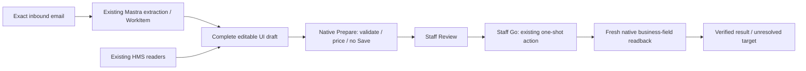

# Zero staff pane: finish the product around the existing HMS tools

- **Author:** kufupa
- **Status:** Final proposed design — adversarial findings independently verified; product implementation not started
- **Date:** 2026-11-04
- **Code baseline:** `9d388ab7510eb86d613d316b42fb42479cdc85b9`, inspected in `/home/orca/.codex/worktrees/4f10/zero`
- **Predecessor:** [existing CE plan](docs/plans/2026-11-04-002-feat-nava-pane-prefill-rate-parity-plan.md), [research](docs/research/2026-11-04-nava-pane-prefill-rates-research.md), latest owner conversation
- **Drafting:** EGM Draft + CE Plan, repaired against independent Sol High source reviews and owner urgency. One UI owner, small connected patches, no section gates. Keep the existing first-effect fence; price drift safely holds UNKNOWN. Remove redundant baseline Save and initial framework/history/new-native prerequisites. The canonical plan owns P01–P58 for the entire programme, exclusive files, proof sequence and explicit conditional native discoveries. First pilot and complete plan are separate milestones.

## Overview

Staff should read a reservation email, see the matching booking or new-booking form, edit the proposed values, approve an actual HMS operation, and see whether that operation persisted. Their normal work should fit inside the pane. A generated summary or a prepared change without execution does not meet this goal.

The deterministic tools already do substantial work. Quote reads native availability; Create stages an existing-profile reservation, checks availability and can save; Amend stages saved-stay changes and can save; Cancel handles native reasons and a separate fee decision; Filing uploads a chosen PDF and reads the document list. The task is to connect those capabilities to a usable, trustworthy staff journey. It is not to replace the native tools because their surrounding UI is awkward.

The initial delivery should prove the smallest real journey through that connection: a pending amendment from a normally ingested email, its exact saved booking, the requested values visible/editable in the pane, native Prepare and staff Go, and fresh business-field readback. This is the first delivery checkpoint, not the definition of the whole product. Quote/Create/Cancel/Filing UI, complete editable prefill and useful native rate choices remain part of the requested programme.

The previous plan made the first redesigned Amend release wait for broad routing, persistence, rates and shared UI contracts. Some of those changes matter for broad staff coverage, but their necessity for a single pending date-change journey was not established. The design must state which defect blocks that journey, which defect blocks broader coverage, and which work improves the product without blocking either. Otherwise every useful enhancement becomes a prerequisite. The first backend proof can precede the UI release, but is never labelled the complete staff product.

## The Problem

### 1. The email body and pane can disagree about selection

The owner saw a triaged booking email with body and subject visible while the pane still asked them to click an email. The body can render a thread without the pane having an exact canonical inbound message. The normal mail-row handler clears `sourceMessageId`; the bridge can require an explicit inbound selection; `WebPanePanel` mounts the workflow only after that selection is ready.

Evidence: [normal row selection](https://github.com/kufupa/Zero/blob/9d388ab7510eb86d613d316b42fb42479cdc85b9/apps/mail/components/mail/mail-list.tsx#L1079), [source bridge](https://github.com/kufupa/Zero/blob/9d388ab7510eb86d613d316b42fb42479cdc85b9/apps/mail/lib/workstation/web-pane-bridge.ts#L122), [pane mount](https://github.com/kufupa/Zero/blob/9d388ab7510eb86d613d316b42fb42479cdc85b9/apps/mail/components/nava-pane/web-pane-panel.tsx#L49).

This is a source-supported explanation, not a reproduced diagnosis of that exact email. Fixing it means making the displayed inbound message and the pane source agree. It does not mean picking an unrelated email merely to make the empty state disappear. Threads containing several inbound requests need an explicit message choice. The draft will trace the normal row, keyboard navigation and thread-message choice separately; the similarly named draft composer handler is not the booking-row handler.

**Business consequence:** this is a zero-value product until staff can reliably open the request. A better rate recommendation cannot compensate for an absent pane.

### 2. A tool's input support is wider than the form's durable state

UI across all five workflows is a top priority. The owner allows a full visual redesign: fields, sequence and interactions come from deterministic native tasks and Infor parity, not the old component layout. Existing backend contracts/state are reuse opportunities, not visual constraints.

Current WorkItem field edits already survive re-extraction for dates, occupancy, room type, board and contact fields. This is useful machinery to extend. The general field route accepts a narrow scalar union, including `true` but not `false`, and it does not yet persist all native rate, selected profile, party and CMS fields. Other choices remain in local UI state.

Evidence: [durable path model](https://github.com/kufupa/Zero/blob/9d388ab7510eb86d613d316b42fb42479cdc85b9/apps/server-pilot/src/ai/work-items.ts#L80), [field edit input](https://github.com/kufupa/Zero/blob/9d388ab7510eb86d613d316b42fb42479cdc85b9/apps/server-pilot/src/trpc/routes/work-items.ts#L85), [Amend local choices](https://github.com/kufupa/Zero/blob/9d388ab7510eb86d613d316b42fb42479cdc85b9/apps/mail/components/quote-workflow/amend-lookup-panel.tsx#L1234).

**Business consequence:** staff cannot trust prefill if a field is present but omitted from the submitted form, or if a later lookup replaces an edit. Complete prefill means every supported fact that can be attributed to this request or current booking reaches the actual form. Missing facts remain marked for staff; invented phone numbers, profile identities and contract rates are not completeness.

**Why not a new form store:** the existing event/path model already solves part of this problem. A second store would create another place for extracted values, UI choices and submitted values to disagree. The next section must map the actual missing fields into this existing path and hydration machinery, not merely say “persist the form.”

### 3. Routing hints and executable actions are not the same thing

There is full-source extraction and a shorter post-extraction classifier. The pane also has local correction/display concepts. Current Cloud Amend source checks require both work-item and extraction top-level kinds to be `amendment` and reject whole-item done/dismissed states.

Evidence: [native source check](https://github.com/kufupa/Zero/blob/9d388ab7510eb86d613d316b42fb42479cdc85b9/apps/server-pilot/src/ai/pane-cloud-amend.ts#L57).

**Business consequence:** a displayed “Amend” label can disagree with what the native approval path will accept; a message with several asks can lose a pending action when the whole message is completed.

**Delivery distinction:** broad per-stay correction and multi-ask routing matter for broad coverage. A correctly extracted, single-stay pending Amend may already pass today's source guard. We must check that before treating a cross-workflow routing rewrite as a prerequisite for its first Go. Any narrower first release must visibly restrict unsupported cases rather than loosen source checks.

### 4. Staff operate in rate codes, but the UI does not explain them well

The owner wants to type a code or choose one, see its native meaning and current price, change it, and know whether it can be used. Historical frequency helps ordering; native availability determines current eligibility. These are different responsibilities.

The existing types already carry native rate options and availability rows. RatePlanSelect.ratePlanChoices already merges native options with the static catalogue, including native-only codes; the existing Amend local form already passes its chosen ratePlan into CloudAmendRequest. This is existing code selection, not a missing tool from scratch. Before adding another API, the technical section must trace how those outputs reach Quote, Create and Amend and identify the missing consumer. A new `rateCandidates` API is justified only if an existing contextual read cannot supply the editable form; its name in a plan is not evidence that another service is needed.

Evidence: [existing rate output types](https://github.com/kufupa/Zero/blob/9d388ab7510eb86d613d316b42fb42479cdc85b9/apps/mail/lib/quote-workflow/types.ts#L351), [rate/history research](docs/research/2026-11-04-nava-pane-prefill-rates-research.md).

**Why history is not the first gate:** native code selection and validation deliver the requested staff control without installing a private snapshot or calling an LLM. Recommendation can follow independently. The recent E-Mail cohort's top five codes cover 459/492 records; no single code covers 90%. Agency history suggests relevance, not a negotiated native contract or permission to use an unavailable rate.

**Why retain comparison details:** the current grid also represents room/rate/board alternatives and dated prices. A selected-room dropdown can become the main control while the useful comparison remains collapsed. Deleting those dimensions would break existing quoting rather than merely simplify its appearance.

### 5. Backend persistence proof did not prove the staff journey

| Capability | Existing evidence | What that does not prove |
|---|---|---|
| Quote | Recent native read returned usable rates | Every selected-source form and quote offer is coherent; no reservation Save occurs |
| Create | Labtest Save/readback on earlier deployed head | A fresh actual new-booking email reaches all fields in the staff form |
| Amend | Final-head fake persistence independently read back; real-source Prepare passed | The real source still had a pending change; the original uncertain journal became a clean success |
| Cancel | Native cancellation persisted; charged dialog observed | Fee acceptance works; every reason/decision is visible in the pane |
| Filing | Native document metadata readback | Stored PDF bytes were independently compared; real upload or multi-PDF choice works |
| Native amount override | Prior saved-stay Wizard changed one night | Current Quote amount changes HMS; populated Create has a pre-Save setter; multi-night/tax behavior is proven |
| New profile | Existing guest-profile record read/search and native New fields inspected | New profile Save, duplicate behavior and returned ID are proven |

Source: [overnight retro](docs/research/2026-11-04-big-fat-4-hour-chat-retro.md), [native amount evidence](/home/orca/orca/workspaces/zero/u7-native-nightly-20261104/RESEARCH.md), [profile evidence](/home/orca/orca/workspaces/zero/u8-native-profile-20261104/RESEARCH.md).

The proof gap calls for a pending request and a connected journey. It does not establish that all the proven native tools must be rebuilt. A concrete counterexample to “frontend only”: the current native continuation matcher contains an Extend key differing from the prior capture and a No-choice mapping that may reject the native response. One current-contract check can confirm a narrow fix; this is an actual possible first-action blocker, unlike a general rewrite. [Matcher](https://github.com/kufupa/Zero/blob/9d388ab7510eb86d613d316b42fb42479cdc85b9/apps/server-pilot/tooling/hms-cloud/pane-amend-session.mjs#L191).

## Why this design exists

The owner asked for an immediately usable staff product, then provided concrete examples: empty pane, incomplete prefill, rate-code entry and an Amend current→requested view. Those examples describe failures across the whole product. They should guide a shared visual language for all workflows, not become eight unrelated new frameworks.

The overnight run delivered useful tool work in about4h30, longer than its2h15–3h15 forecast. The later fifty-minute planning turn produced five visible Orca research/review chats, native/profile findings and a repaired CE execution plan. It changed no product code. Some review output used the behind-main root checkout and had to be rejected; worker launch/readiness problems also consumed time. That work improved the evidence, but did not deliver a staff-visible milestone.

The prior plan recorded file lists, owners and forecasts without enough causal explanation. A fresh worker still had to rediscover why each file or service was needed. This draft should remove that rediscovery by recording: current mechanism → observed gap → required outcome → proposed smallest change → reason alternatives cost more or lose behavior. Detailed implementation will include each file's purpose and consumer, not only its name.

There are81 open PRs,49 drafts at this review. Relevant candidates include #1000 Create pricing, #987 Amend and #968 additional Create fields; source-identity and per-stay action branches also exist. These are reuse leads, not evidence of shipped behavior. Compare their remaining delta against the inspected main before recreating a fix. Do not merge old branches wholesale or disturb their owners.

## Goals

1. **Whole-workflow UI priority:** redesign all five forms around actual native tasks and supported fields; reuse existing visual components only where they fit the chosen design.
2. **First connected native action:** a normally ingested pending amendment opens under its exact source, displays the current booking and requested change, accepts staff edits, runs existing native Prepare/Go, and returns a fresh result. Read-only preparation alone fails this goal.
3. **Visible incremental value:** during execution, each checkpoint produces a concrete boundary result, a reviewable UI change or a verified native operation. No two-hour silence waiting for the entire redesigned form.
4. **Complete supported forms:** Quote/Create/Amend expose all supported known values; required gaps are obvious. Staff edits survive relevant reads/reload; source changes cannot carry approvals to another request.
5. **Useful rate control:** editable valid code, native meaning, current price/availability when read. Separate later history/LLM suggestions from native pricing authority. Native nightly override is its own advertised capability, not inferred from Quote override.
6. **Whole-workflow consistency:** Amend shows current→requested; Create follows native staff field order; Quote preserves alternatives/documents; Cancel exposes reasons/fees; Filing binds the chosen PDF and exact target.
7. **Truthful outcomes:** one Go per approved operation; unknown results reconcile before retry. Fresh native business-field readback earns Verified. Partial Create/override/profile outcomes remain separate.
8. **Reuse and bounded checks:** extend existing stores, readers, Prepare/Go and components. Retain source/target locks, native write fences and checks. No generic allocator, pricing engine, broad profile census, test harness or extra release ritual.


## Critical User Journeys — acceptance examples

### CUJ1: pending amendment, actual native action

- **Given:** a normally ingested inbound email requests a departure extension; the exact existing booking/profile is found; the request is pending and passes the current source checks. Values below are illustrative, not the current Labtest target state.
- **When:** staff open the email and see “HMS booking found”, then “Departure:18Feb →19Feb”. Arrival, room, occupants and current rate are already filled from the bound request/booking. Staff can edit supported fields; More fields exposes unchanged supported fields. They review the actual submitted change and choose Go.
- **Then:** existing native Amend changes the exact booking once. Fresh readback displays the new departure and checked business fields. No summary-only or prepare-only result counts as delivery.
- **Why this example:** it exercises selection, lookup, carried prefill, human correction, native execution and result presentation without requiring a new profile, agency-rate recommendation or arbitrary nightly-price setter.
- **Limit:** one successful date-only case does not prove changed-rate, mixed-ask, charged-Cancel or new-Create coverage. The product must name those limits rather than advertise the whole programme as done.

### CUJ2: displayed email has no unambiguous executable source

- **Given:** the thread body is visible, but it contains multiple inbound messages or the selected message lacks a bindable Message-ID.
- **When:** staff open it.
- **Then:** the pane explains the precise missing choice and offers the actual inbound choices. It cannot run a mutation against a different message merely because that one is classified as actionable.
- **Why:** changing the selected email changes the requested operation and approval identity. This is the reason the selection check stays even when it prevents a quick demo.

### CUJ3: staff change rate code

- **Given:** a saved/new form has a selected rate code and current native options for its dates, room and occupants.
- **When:** staff type a code or choose it from code/name options.
- **Then:** the selected code reaches native Prepare; current native validity/price is shown when read. Changing its context invalidates old prices. An unavailable code cannot be silently replaced by a historical favourite.
- **Why:** the code is staff's normal business control. Frequency/party recommendation improves that control but is not required for entering it. A rand amount in Quote remains Quote-only until native U7 is released.

### CUJ4: incomplete or uncertain work remains visible

- **Given:** a profile cannot be resolved, required information conflicts, or a native write result is uncertain.
- **When:** staff attempt review/action.
- **Then:** unresolved required fields/identity stop the action. An uncertain write retains its target/submitted values and offers reconciliation before another Save. Creating a new profile and retrying another Save are separate operations.
- **Why:** broad “never touch Infor” coverage remains the product goal. Existing-profile/rate-code delivery is a defined first cohort; U7/U8 and unresolved recovery limits must stay visible until built and proved.

## Delivery pieces: why each exists, what can wait

These are the chosen delivery boundaries. Stable CE unit IDs are retained in the reconciled executor plan; first connected delivery and whole-product delivery are distinct.

| Unit | Problem it earns its place by solving | Existing mechanism to reuse | First-journey boundary / later scope |
|---|---|---|---|
| U1 source/intake | Staff cannot act on an email the pane has not selected | Mail selection, source bridge, WorkItem lookup; existing fake-POP3 intake | Exact source is first. Separate snapshot viewer is later unless needed to remove an actual action leak; no admin clicking framework |
| U2 routing/prefill | Proposed/submitted values disagree or edits disappear | Extraction + existing WorkItem events/path state + current native input mapper | Carry requested values and missing required fields for the chosen first Amend. Full profile/party/CMS persistence and multi-ask resolver extend coverage; not assumed first-case blockers |
| U3 rates | Staff cannot select the native code/price confidently | Existing options/availability + native form validation | Valid code editing and current price states first when the change requires them. History snapshot deployment, recommendation service and LLM can follow; new API must earn its necessity |
| U4 Amend UI/native seams | Request is hard to approve; reviewed values can diverge at Save | SavedStayAmendEditor, existing bound Prepare/Go, native continuations/readback | Inline current→requested is the first visual change. Fix a native continuation only when current contract confirms the mismatch. Reprice correctness remains a gate for advertised repricing, not a blanket native rewrite |
| U5 Create/Quote UI | Existing native capabilities are awkward or incompletely exposed | Native tool contracts, Prepare/Go, state and document outputs | Full redesign, based on native task order and complete supported fields; old layout does not constrain it. Same UI owner as other workflows; no shared-shell prerequisite |
| U6 Cancel/Filing/release | Required fee/PDF choices or results can be hidden | Existing Cancel, attachment binding, document reads, approval cards | Same UI owner, independent backend fixes; no tool rewrite. Release the finished journey with required checks; do not wait for all5 UI changes to show first value |
| U7 native nightly amount | Quote numeric override does not alter HMS | Proven saved-stay Wizard + dated native readback | Independent saved-stay capability. Pre-Save Create amount and multi-night/tax limits remain evidence gates; no automatic composite write |
| U8 profiles | New guest cannot be selected without a native guest-profile record | Existing profile lookup + inspected FSGSPF New | Later independent profile Go/readback, then reservation Go. Missing-profile bookings remain outside the first release |

### Execution checkpoints, not fabricated completion ETAs

- **First checkpoint, target15m:** exact email selection boundary and source/target result. A miss names the edge; this is not a claim that the fix has shipped.
- **Second, target30m:** pending intake/extraction linked plus existing native unsaved Prepare, or a narrow diagnosed blocker. Existing backend unsaved staging is the checkpoint; no early live Save.
- **Each following20–30m:** reviewable current→requested UI, durable-field seam or rate-control change from the responsible Orca lane. Candidate visual/code output is labelled separately from deployed delivery.
- **First shipped staff journey:** requires final-head focused checks/review, merge/deploy and native Save/readback. Working target and uncertainty are specified in the final canonical patch plan; the old2–3h25 and3–5h50 figures describe the broader bundle, not this newly challenged first slice.

Recorded comparators: source/Filing UI candidate14m14, Create candidate22m34, Filing candidate19m57; deployment segment9m01. They support small candidate checkpoints. They do not establish a calibrated30-minute staff-ready release. [Timing evidence](docs/research/2026-11-04-nava-plan-readiness-review.md).

## Non-Goals

- No replacement of the current HMS tool layer, generic form store, native pricing engine or target-allocation service.
- No hotel-knowledge FAQ, generic reply generation, broad billing/refund workflow, group-booking or OCR/XLSX expansion in this tranche.
- No profile creation blocking existing-profile delivery; no name-only profile identity; no automatic duplicate/supervisor/fee acceptance.
- No claim of Outlook-PC verification from webmail/backend work. Staff have paused use; normal Nava webmail and backend Labtest evidence are the available validation path.
- No destructive DB operations, real guest Save/send/charge, product code changes or deployments during this design discussion.


## Technical Plan (Architecture)

[Hosted design review](https://hermes.trynava.io/designs/nava-hms-pane-2026-11-04.html). Public HTTPS200 and exact artifact hash verified. The revised version is published after owner feedback: realistic staff pane on the right; example navigation, actual tool→field mapping and rationale on the left; small outside Illustrative badge. Prototype is not an HMS execution surface. No browser-render verification is claimed.

### 1. Product boundary: redesign the UI, reuse the deterministic action paths

The UI may be redesigned entirely. Existing component placement, native-tab layout and the old price grid do not define the new interface. The native tools define which values can be read and written, the required decisions and the operation result. Staff task order defines what appears first. This is the difference between preserving useful infrastructure and preserving an awkward screen.

Build one consistent visual language across Quote/Create/Amend/Cancel/Filing: source header, booking/person context, editable business fields, current native price/availability, Review and a clear operation result. Required/missing/requested fields stay open; unchanged optional fields sit under More fields. Reusing Field/Section/Button primitives is fine where they fit. A new generic workflow framework, shared shell or store must not block the first actual screen.

The native sequence and UI sequence are related, but not identical. The browser tool must obey HMS's required order, such as selecting a guest and checking availability before Save. The form should group the same business decisions so staff understand the booking. It must not mirror every implementation click or tab solely because the automation uses it.



Mastra remains the agent framework for extraction/inference. It supplies proposals, never native authority to write. The separate HMS guest-profile record is not “Mastra creation.” Infor's **Stay Wizard** is the vendor's saved-booking edit dialog; it is not a new AI component or a feature we invented.

### 2. Full form coverage: tool-supported fields, not invented parity

| Workflow | Prominent field groups in staff order | Write/read boundaries |
|---|---|---|
| Amend | Exact HMS booking/person/status → requested current→proposed changes → dates/nights → room/occupants/child ages → rate code and Keep/Reprice → guest/booker contact → confirmation decision → Review/Go | Current Cloud tool supports arrival/departure, adults/children/ages, roomType/ratePlan, first/last name, guestEmail, bookerName/bookerContact and CMS send/template/recipient. Agency/company/source/Track/guarantee/note changes are not exposed as working Amend controls unless their native setters are added/proved |
| Create | Existing guest-profile choice → dates/nights → each room/type/occupants/ages → agency/company → rate code/native price → source/Track/guarantee/note → confirmation → Review/Go | Existing profile nativeId/first/last names; stay arrival/departure/adults/childAges; roomType/ratePlan; guaranteeType; native source; exact agency/organisation IDs; note; booker name/contact; Track; CMS. Selecting another profile is not silently editing an existing guest-profile record |
| Quote | Email/parties → dates → room counts/types/occupants/ages → board and rate alternatives → prices/totals → optional Quote amount/reason → document offer selection → Make quote | Preserve multiple room/rate/board offers and existing PDF/Excel output. Quote is not a reservation Save. The numeric amount control affects Quote output until U7 explicitly supplies a native amount action |
| Cancel | Exact booking/status → current native policy/deposit/fee facts → native reason/note → Review cancellation → Go | Use native reasons; expose any native fee prompt as a separate explicit charge decision. A free cancellation proof does not prove charged cancellation |
| Filing | Exact email/PDF choice → confirmation+arrival or surname+arrival search → explicit target booking → selected document summary → Review/Go | Bind selected attachment identity/bytes/digest to selected target. Success means the fresh HMS document list contains the expected metadata; no assertion of PDF-byte equality |

Create currently proves **Reserved** status in its native readback. We will display the actual status; “provisional” does not mean a different Tentative/Inquiry status has been implemented. Guarantee is a separate native decision. If the business wants a different reservation status, it becomes a specific native-tool gap, not an inferred UI label.

Native-derived Create Market Segment remains read-only; guest opt-in remains false where the tool only supports false. Native-derived board is not offered as an independent saved-booking write. Required fields cannot be hidden under More. Infor parity means the actual staff decisions supported by the tools are available and ordered well; missing native writes are named gaps, not falsely enabled controls.

Decisive contracts: [Create mapper](https://github.com/kufupa/Zero/blob/9d388ab7510eb86d613d316b42fb42479cdc85b9/apps/server-pilot/src/ai/pane-create-cloud-input.ts), [Amend schema](https://github.com/kufupa/Zero/blob/9d388ab7510eb86d613d316b42fb42479cdc85b9/apps/server-pilot/src/ai/pane-cloud-amend.ts#L33), [Create status readback](https://github.com/kufupa/Zero/blob/9d388ab7510eb86d613d316b42fb42479cdc85b9/apps/server-pilot/tooling/hms-cloud/labtest-create-readback.mjs#L39).

### 3. Amend interaction: explain the change before displaying the whole form

The first card identifies the exact found booking: confirmation, native guest/profile, status and current dates. Beneath it, show the email's requested changes as inline current→editable-proposed pairs. A requested departure extension is immediately visible; unchanged arrival does not compete with it. An Edit control expands the affected field. More fields exposes other supported changes.

Rate context appears beside affected stay fields. Keep/Reprice is an explicit business choice. Reprice shows native observed amount/total; a changed native price before Save stops the Save and keeps any existing operation hold. Automatic renewed Review follows only after real reconciliation; it is not implemented as a fake no-dispatch receipt. Keep shows the current rate instruction and nightly basis; it does not invent a guaranteed final total for extended dates. Final totals come from native readback.

The summary says what will change and what target will receive it. Source, target, submitted values and operation result remain visible after Go. Screenshots are supplemental; their absence cannot hide an approval button, fee decision or unresolved result.

The narrow native continuation check remains necessary: current No/Extend mapping differs from a prior capture. Confirm the current contract, then correct the specific keys; no pinning of entire request bodies or field counts. This is tool repair when needed, not an Amend rewrite.

### 4. Rate control: one selected code, honest prices and separate recommendations

**Control:** searchable/typed combobox. Main option line: `CODE | native meaning`; second line: native currency/nightly price, board, availability/reason when actually returned. Selected summary carries stay total with collapsed dated prices. Collapsed comparison preserves room/rate/board alternatives. Offer inclusion for Quote documents is a separate selection; changing the displayed rate must not delete alternative offers.

**Typing:** local filtering while typing; Enter checks a typed code once. It must reach the same selected rate state as a clicked option. Native Prepare validates the actual chosen code on the bound target. No browser per dropdown row or per keystroke.

**First delivery data mechanism:** reuse existing native availability readers and RateOption/AvailabilityBoardRow projections plus selected-code native Prepare. No new rate API is required to enter/check a code in first Amend. **Later editable-context enhancement:** Extend hms-jobs and rate projection at the missing consumer. For fresh editable contexts, expose one thin `quoteWorkflow.rateCandidates` route in the existing router; it adapts existing readers, not a new rate service. Inputs bind source/stay/room, dates, room type, occupants/ages, board and selected native party IDs. The server derives property/mailbox. Returned observation includes its exact context and observation time.

General background availability is not proof of negotiated agency/company eligibility. Only return contextual eligibility when the native reader actually checked it; otherwise say Not checked. Contract code validation happens through the selected native Prepare path where necessary. Missing from a returned subset means Not checked, never Unavailable.

**State:** Checking / Not checked / Available / Unavailable with native reason / Could not check / Stale. Native observation older than5m is stale; source/context edits invalidate it immediately. Go performs the necessary fresh native check. Unavailable rates can remain visible with reasons, but cannot be silently replaced or used.

**Ordering:** staff choice and explicit requested code first; unchanged Amend keeps current code; then attributed agency/company history; then property E-Mail frequency. Tie by code. Native labels beat static mock descriptions. Unread labels show code without inventing a description. Cricket codes already exist in the static catalogue; contextual eligibility, not a historical absence, decides whether they can be used.

**Memory/Mastra:** existing property-private booking history supplies recommendation evidence. Agency/company IDs must be selected natively; a similar name is only a suggestion. Explicit email code and staff edits win. Optional bounded model inference can recommend only supplied native candidate codes and evidence; error/timeout falls back to deterministic ordering. It never supplies native price or write permission. Recommendation is a later/parallel enhancement, not a prerequisite for typing a valid code.

**Native numeric amount:** Quote override remains clearly Quote-only. U7 provides a separate saved-booking action using Infor Stay Wizard, beginning with the proved single inclusive night. Multi-night/tax/authorization and pre-Save Create amount remain explicit evidence gates. A successful reservation followed by a failed override stays a successful reservation with an unresolved second action; no atomic composite claim.

### 5. One effective draft: baseline, extracted proposal, staff edits

Use the existing WorkItem event/path state and existing stable stay/row/room identities. Do not copy the same field into independent native, UI and persistence stores.

```text
For each supported form field:
  baseline := bound HMS/profile value, if read
  proposal := attributed value requested by the selected email
  display := persisted staff edit, else proposal, else baseline, else known default
  missing/ambiguous := explicit human decision

On a native read or re-extraction:
  apply only if source/target/request/context still match
  rebase untouched baseline/proposal
  preserve staff-edited value

On source or target change:
  invalidate old review and dependent prices
  retain old operation result separately
```

Extend the current field allowlist/validators, native-ID choices and hydration: row/stay ratePlan, attributed guest/booker fields, supported source/Track/guarantee/note, exact profile/party objects, CMS send/template/recipient and Cancel/Filing choices. `false` must persist as a meaningful CMS edit. Objects are strict and path-specific; no arbitrary JSON or parallel generic form schema.

Native names/profile IDs are matched; a booker's phone/address is not assigned to the guest by guess. Dates imply coherent nights; child count matches ages. The full Create UI must not advertise a field the mapper refuses or discards. Every submitted business value is present in Review.

Operational action uses the selected effective stay/action, with explicit persisted correction before extracted values. Classification labels and local TreatAs are not native approval authority. Keep dismissed/history exclusions. A single properly classified Amend can ship before broader mixed-ask routing; broader coverage requires the consistent resolver and per-stay completion, not loosened guards.

### 6. Source, action and readback are different boundaries

Normal webmail list/body/pane share the exact selected inbound identity. Ambiguous threads require a real choice; missing Message-ID remains a named non-actionable state. Normal webmail is the staff action surface. Genuine snapshot preview uses presentational data only; it does not mount workflow hooks that autoqueue or mutate. Do not build another auth/router platform to achieve that separation.

Reuse existing source digests, native target binding, locks and one-shot claims. Review binds the actual submitted business fields and observed native state. Changing source, booking, PDF, dates, occupancy, rate, party or other submitted fields invalidates dependent approval. Go is used once; a lost response is not permission for another Save.

**Fresh readback is a native read, not a DB status query.** `cloudAmendState` reports bound stored state. Current client.reread reruns Prepare; it refuses resumed uncertainty and is not an UNKNOWN reconciliation solution. The scope review's suggested post-Go client.reread must not be promoted to general fresh-read proof.

Normal successful writes reuse the tool's fresh business-field readback, surfaced in the result. One final Labtest proof reopens the native booking/document state after the patched release. There is no extra baseline Save to finish the source before the UI is built.

For price drift or uncertainty after the first effect, disarm Save, drain callbacks, close the writer and keep UNKNOWN plus the spent grant. An unchanged native booking does not prove native staging/inventory was released. The first pilot deliberately has no automatic held-operation retry or ledger extension. Later a narrow recorded-operation native reader/reconciler may verify current business fields and close a hold only with genuine dispatch/session/hold cleanup evidence. Current client.reread rebinds Prepare and cannot serve that purpose.

No new allocator or lock service. One release owner alone assigns and writes Labtest targets; coding lanes only read/stage in separate sessions. Amend→readback→Filing→readback→Cancel on A; Create has B. Native uncertainty pauses that target, not independent UI work.

### 7. Execution: one UI owner, independent backend ownership

The initial split across Create, Amend/Cancel and Quote/Filing was rejected by the owner. They are linked: shared rate controls, persisted draft/hydration, recipient choices, undo/redo, Review/Go and result states would otherwise have multiple writers. Git worktrees isolate files; they do not solve conflicting product/state design. One UI writer owns every workflow and common mail/client component. Independent read-only exploration is still useful; it never becomes a second shared-UI writer.

| Lane | Model | Concrete exclusive output |
|---|---|---|
| A · UI | Terra High | Exact source and complete redesigned Quote/Create/Amend/Cancel/Filing; all shared mail fields, rate/recipient controls, undo/redo and native result presentation |
| B · prefill/routing | Terra High | Effective form values, durable edits/hydration, extraction/action routing and Create mapper alignment |
| C · rates | Terra High | Contextual native rate observations, history/frequency and optional bounded suggestion; no picker/component edits |
| N · native actions | Terra High; unresolved complex task directly to Sol XHigh | Existing Amend continuation/final price/recovery seams, exact selected-PDF backend lookup and required existing Cancel repairs |
| R · coordinator | Terra High recommended for routine coordination | Shared server routes/API integration, final checks/review/merge/deploy and serial native Saves |

A builds the first screen while B/N produce the first consumed contracts. C takes N's active slot after the initial native patch; use at most three active workers plus coordinator. Prepared worktrees remain separate, visible Orca conversations; they need not all reason simultaneously. Existing shared payload agreement is the starting point, not another contract PR. U7/U8 take freed B/C slots if still requested; A/R integrate their UI/API changes.

The owner can open and talk to each actual Orca worktree/chat. Prepared chats were previously launched on Sol High; this update changes routing policy, not the live model setting. Default to Terra High; an unresolved complex task goes directly to GPT-6.1 Sol XHigh with objective, exact paths/functions/call chain/contracts, worktree/base/diff, observed/expected behaviour, error/evidence, all previous attempts/results, held operation state, remaining unknowns and ownership. No Terra XHigh step or Terra Max default. Luna Max supports bounded corpus searches, field inventories and mechanically specified patches; its advantage is cost, not a presumed speed or reliability equivalence. Every LLM/child prompt explicitly says `Use $caveman ultra always for chat, progress, research and handoffs; preserve technical facts/code/evidence/blockers; code/commits/PRs remain normal language.` Read the installed caveman skill and carry the owner-selected ultra instruction into delegation. R owns the shared-file and release queue, not access to workers. Product implementation remains paused pending owner resume.

Owner-requested delivery forecast: first supported deployed Amend about1–2h; full five-workflow existing-profile pilot plus complete prefill/contextual rates about2.5–4.5h. Entire retained native/profile/recovery programme about3.5–7h only under favourable, supported native contracts. These are task-budget hypotheses anchored to historical stages, not calibrated percentiles or Terra High speed measurements. The canonical plan's whole-scope forecast gives task groups, three-worker slot rotation, serial UI totals, release overlap, raw-session timing checks and counterevidence. A native failure/unsupported cleanup invalidates the affected tail rather than producing false retry authority.

### 8. Short checkpoints and a soft readiness statement

- Target15–30m: exact source/Prepare boundary result and reviewable UI prototype/candidate. Evidence: recent source/UI and native candidate tasks completed in14–23m. Not a deployed-ready promise.
- Each following20–30m: a connected UI/field/rate patch, its focused check or a native proof result. A missed checkpoint names its current boundary and next check.
- First releasable connected journey: exact source, full fields for that advertised action, Review/Go, focused final-head checks/review, current-main merge/deploy, real-source unsaved stage plus one Labtest Save/fresh readback.
- Whole staff-ready product: coherent supported forms and native outcomes for all advertised workflows, with U7/U8 limitations explicit. A date-only backend proof is not full UI parity.

**Working target:** first full supported Amend roughly1–2h, low confidence. The previous2–4h five-workflow headline was a narrower reuse/basic-rate scenario, not the entire programme; it omitted full contextual rates/memory and new native capabilities. The expanded P01–58 plan specifies all work, but entire-plan completion has no calibrated ETA before native contracts and first full candidate timings are observed. The owner's2–3h pilot goal remains an optimization target. One connected PR and overlapped final-head checks/review remain. Revise from actual coding/native receipts, not an invented fixed tail or blanket6–9.5h claim.

Existing required checks stay: targeted tests with DB env unset, approved remote typecheck only, final-head Greptile/fallback before merge, current-main merge gate, clean bundle deploy and per-workflow native readback. New tests are allowed for meaningful boundaries; no test framework or coverage ritual. The cuts are unnecessary scope, duplicate research and blocking shared scaffolding—not source/target identity or uncertain-write fences.

*Drafted with EGM + CE Plan. Per-section gates waived by owner; one final design review.*

## Practitioner workflow evidence — source correction applied

The owner requested recent practitioner posts/coding practice rather than studies. The Exa Agent had already started on the earlier broader question; academic results are excluded from the recommendation below. No second expensive Agent run was started.

| Practitioner | Primary account / observed practice | Implication here / limit |
|---|---|---|
| Lauren Tan (@poteto) | [Her current pstack source](https://github.com/cursor/plugins/tree/main/pstack): less code, higher quality; deep/verifiable engineering enables parallelism. [Her authored launch post](https://www.linkedin.com/posts/laurenelizabethtan_cursor-pstack-the-skills-behind-10000-activity-7465439429042737152-ADbv) describes why/how skills, prototypes, typed boundaries, persistent learning and multi-model review | Preserve causal context and verifiable product outcomes; use situational skills, not every framework on every task. Repo is current mutable source. Recent Aug/Sep X article URLs were found, but their direct content could not be fetched, so no quotations from them |
| Boris Cherny | [June8 official interview](https://www.youtube.com/watch?v=Hth_tLaC2j8): recursive agent trees, failures written into instructions/skills, and agents actually running the product; product/design roles make direct changes. [Jan31 authored3–5 worktree tip](https://www.threads.com/@boris_cherny/post/DUMZsVuksVv) | Parallelism is useful; Jan's3–5 is not a universal/current ceiling. Use independent files, runnable outputs and persistent corrections. No audited throughput multiplier inferred |
| Tibo (Thibault Sottiaux, likely intended account @thsottiaux) | [Oct5 first-person interview](https://www.youtube.com/watch?v=MM-C3JqCXBk): teams expand for frontier tasks, shrink with stronger/faster models; he does not want users endlessly tuning loops/graphs | Do not get attached to ten agents or a heavy orchestrator. Preserve owner flow, product taste and visible finished outputs. Identification is contextual; if owner meant another Tibo, that row must be replaced |

**Local diagnosis:** repeated plan/review turns bought little staff-visible output; initial Orca completion reporting failed and hid a finished8m56 worker behind “dispatched.” The new UI task did deliver a prototype with an accepted completion receipt. The cure is a clear outcome plus independent writers and a reliable product/native feedback loop, with the owner reviewing UI/fields while R coordinates.

**Strongest alternative:** many agents can be worthwhile when there are enough independent tasks and review capacity. Boris's June account supports much more than five sessions. Conversely, a coordinator can add latency and lose detail. The final four writer lanes are a file-ownership choice, not proof of an optimal count; the earlier multi-UI proposal was superseded by one UI owner.

**What not to copy wholesale:** a new verification framework, broad skill eval suite, feature-map census, repo-wide tests or maximal preplanned task graph. Existing approved focused checks and native readers are the verification route here. Prove the pending connected workflow; improve the specific broken boundary; persist the useful correction; continue independent work.

**Research accounting:** Exa Agent high, run `agent_run_7ec77c82d5374355b131740cc61b4c0b`, completed with iteration-limit stop;60 searches,2 compute units,$0.5001 reported. Supplemental primary searches/fetches were used after the source correction; two advanced calls reported$0.007 each. Other search/fetch and local Luna/Terra dollar costs were not exposed; complete total cannot be reported. This is supplementation, not an Agent auth/quota fallback.

**95 threshold:** met for the supported practical operating-model claims; no calibrated worker-count optimum, productivity multiplier or staff-ready ETA established. Independent contradiction check: primary Tibo account shrinks teams and primary Lauren account insists on depth/verification, contradicting “more sessions/less planning always wins.” Earlier study search is excluded from the case per owner direction.


## Alternatives Considered

| Choice | Selected solution | Rejected approach / why |
|---|---|---|
| UI ownership | One writer across every workflow; backend contract work in parallel | Multiple workflow UI writers share picker/draft/approval state, add visual drift and integration work. Worktrees do not remove that coupling |
| UI architecture | Full redesign using native supported fields and staff decisions; reuse useful state/tool plumbing | Reorder the existing screen only: preserves awkward layout. Generic workflow framework first: delays the actual product |
| First delivery | Existing pending Amend proof plus a separately labelled full supported Amend UI release | Wait for all routing/history/UI enhancements to prove one date change. Conversely, label date-only backend proof whole-product parity |
| Rate selection | One typed/searchable code picker, honest native observation and collapsed detail/comparison | Large default grid: hides the primary staff decision. Delete all comparison: loses Quote room/rate/board alternatives and dated amounts |
| Rate recommendation | Deterministic explicit code → bound-party history → frequency; optional bounded inference later | LLM chooses price or silently changes saved Amend code. History/LLM deployment blocks entering a valid native code |
| Persistence | Extend existing WorkItem edit paths/events and hydration | Parallel form store: creates three inconsistent copies. Arbitrary JSON fields: weakens native identity and field validation |
| Native execution | Existing Prepare/Go/one-shot claim and business-field readback, narrow specific repairs | Prepare-only product: does not perform staff's task. Tool rewrite or full request-body pinning: adds code and blocks on irrelevant HMS drift |
| Recovery | Exact recorded-operation native read/reconcile, no automatic rearm | Current client.reread treated as fresh proof: actually rebinds Prepare and refuses resumed uncertainty |
| Testing | Existing focused suites, meaningful boundary additions, one backend real unsaved stage + deployed Labtest Save/read | Admin clicking campaign, numbered probe loops or a new testing framework: consumes time without proving the specific boundary |
| Profile / native amount | Independent saved-stay amount/profile operations later; one action outcome retained at a time | Automatic Create→Wizard/profile composite: unproved atomicity and unsafe retry semantics |
| Design review | One concrete final review with realistic hosted UI and tool mapping | Per-section EGM approval turns were explicitly waived; no more gate ceremony |

## Detailed Implementation Plan

The [canonical CE executor plan](docs/plans/2026-11-04-002-feat-nava-pane-prefill-rate-parity-plan.md) owns exact paths, budgets, checks and U1–U8/R1–R16 acceptance IDs. The table below supplies causal context so a fresh worker does not repeat the same investigation.

| Piece / owner | How to change it | Why this is the smallest complete change | Dependency / proof |
|---|---|---|---|
| U1 source / A | Fix normal `mail-list.tsx` handleMailClick near1079, not draft handler783; retain displayed inbound DB message ID through thread selection/bridge/WebPanePanel into NavaPane. Ambiguous sources get an explicit choice. True snapshot preview mounts presentation without mutation hooks | Body visibility and pane selection currently use different identity paths. A different email's correct extraction cannot solve this | No backend redesign. Existing source-selection checks; R normal intake receipt and native target bind |
| U2 first supported form / B+A | Extend exact field paths and validators in `work-items.ts`/route; hydrate rate/contact/CMS values from effective baseline/proposal/edits. A replaces local-only Amend choices with persisted controlled values | Dates already persist. Reuse those events; add only missing supported values. Preserve false CMS edits and attributed guest/booker identity | B produces schema/payload; A consumes it. Reload/late-read/staff-edit boundary cases |
| U2 broad coverage / B | One effective selected-stay action resolver used by folder/pane/native guards; extend remaining profile/party/row/business fields and per-stay completion. Preserve dismissed/history exclusions | Whole-item legacy kind and local TreatAs can disagree with executable intent. A completed ask must not hide another pending ask | Same stored WorkItem model; exact selected source/stay/target retained. Existing source signatures preserved for first slice; ambiguity blocked rather than a guessed s_1 fallback |
| U3 rates / C+A | C projects existing native RateOption/AvailabilityBoardRow and, where edit context needs it, adds a thin contextual reader via R's existing router. A owns code/meaning/price/status control and Enter-to-check | Existing options already contain much needed data. Missing negotiated eligibility must be checked, not inferred from static code or a historical booking | Exact dates/room/occupancy/board/party context. Unsupported eligibility = Not checked; selected native Prepare validates |
| U3 history / C | Build existing property-private memory once; validate scoped native parties and distinct E-Mail code frequency. Optional existing Luna adapter returns candidate enum/evidence IDs only | Gives a useful recommendation without becoming a new memory service or price authority | Independent after core picker. Missing history is an explicit fallback, not a broken form |
| U4 native / N | Inspect current No/Extend continuation. Correct matching controller keys only. Before each applicable native Save compare Reprice currency/total/average with approved observation. Keep authorization before availability. Drift aborts Save and retains UNKNOWN/spent grant; no first-release ledger negative resolution or automatic retry | Existing tool already stages/saves/reads. Actual defect is the final Save seam; no full Amend rebuild | UNKNOWN held; later automatic recovery additionally requires proven native staging/inventory cleanup. Browser closure and unchanged booking do not establish it |
| U4 UI / A | Show exact HMS target/status, then requested current→editable-proposed changes. Expose all supported fields; unsupported writes shown read-only with explanation outside design-review pane. Review binds every submitted value | Staff's daily task is changing the booking, not interpreting a generated summary. Full field coverage and Go make this a usable action | B form/C rate/N native result payloads; existing successful native readback surfaced |
| U5 Create / A+B | A redesigns full profile→stay/rooms→party/rate→business→CMS form. B aligns Track/note requirements with actual mapper, rejects discarded unsupported controls; R wires API | Native tool has substantially more fields than durable UI. Reserved status is actual evidence, not invented provisional/Tentative semantics | Existing native profile required. Unsaved real request then separate B Labtest Save/readback |
| U5 Quote / A | Preserve room/rate/board alternatives, selected offers and existing PDF/Excel output. Show code/native price; numeric amount+reason is Quote-only. Existing recipient/document behavior is inventoried and retained | Quote is an offer/document workflow; it does not Save a native reservation. Replacing grid must not delete alternatives or export capabilities | Tool/output inventory in visible UI chat; native rate reads and focused current Quote checks |
| U6 Cancel / A+N | A exposes native reason, policy/fee facts and explicit fee decision without dependence on a screenshot. N changes existing backend only for a demonstrated missing seam | Cancel already exists. A generic rewrite would spend effort outside the actual missing staff controls | Exact target/readback; charged-flow proof separate from free cancellation |
| U6 Filing / A+N | A shows eligible PDFs, selected file and exact target search/selection. N reads only selected attachment facts/bytes; R adds attachmentId route shape. Changing file/target invalidates Review | First-PDF shortcuts can act on the wrong document. Digest/target binding already exists and should be reused | Fresh native Documents metadata proves filing; no asserted PDF-byte equality |
| U7 saved amount / retained native worker+A | Fence OSSTWZ.UpdateStayWizard explicitly; build reviewed OVER service-night range, amount/currency/reason; exact nightly/total/tax readback. A adds separate amount action later | Generic Save regex misses Wizard Submit. Saved native action exists; populated New Record setter does not yet | One-night historical proof is limited. Multi-night/tax/authority require current proof; reservation outcome survives override failure |
| U8 profiles / retained native worker+A | FSGSPF New with verified required native fields, explicit duplicate decision, separate profile Go/readback returning exact native ID, then independent reservation action | Name matches are not identity and New fields differ from old profiles. Keep unsupported new profiles outside first cohort | Missing returned ID stays unresolved; no name-only UNKNOWN success or automatic duplicate approval |

### Hosted review screen is product design, not product chrome

The right side must represent components we can implement in the actual React pane: compact field controls, native-code picker, current→proposed edits, saved/default/custom recipient controls, CMS template/send, genuine undo/redo state, Review/Go and the current native result. Do not hide supported features because an earlier mock omitted them. Any planned capability must be identified outside the pane so it is not mistaken for a currently implemented native action.

The left side is explicitly a review aid: choose an email/workflow example; see actual backend route/tool names, supported input/output fields and how each frontend field maps; read the short rationale and concrete gap. Workflow-switch tabs and broad process explanations belong here. The only in-review marker is a small Illustrative badge at the upper right of this outside wrapper. No large fake-data warning, no implementation internals or compliance copy in staff's pane.

Current client-authorised private data storage/logging remains permitted by owner direction. Existing realistic examples are sufficient for layout review; fetching more client data is not a design prerequisite. Hosting review does not alter production HMS behavior. Exact existing recipient/undo/export feature behavior is checked by the UI worker rather than guessed.

### Remaining uncertainty is a named execution check

| Evidence missing today | Single diagnostic / owner | Build consequence |
|---|---|---|
| The specific top clicked booking email | A reproduces from exact selected inbound identity if available | Mechanism found, exact incident not claimed reproduced |
| Current flags/runtime source extraction | R reads all four effective processes and links one normal intake receipt | Names transport/admission/extraction/binding edge; no seeded fake classification |
| Current Labtest target status/claims | R exact fresh native booking/profile read before first Save | Held/closed/cancelled target stops its proof; never borrow another session's active target |
| Negotiated/cricket rate context | C current native batch + selected typed-code Prepare | Unchecked stays unchecked; no static-code absence claim |
| Current Continue key and final native price | N unsaved native stage then precise Save fence | Specific native repair only; no broader body/key-set pinning |
| Current UI saved-recipient/undo/redo/export behavior | A targeted source inventory; results attached to outside tool/feature map | Preserve implemented behavior, distinguish a new control from a missing one |
| Recovery adapter for an uncertain recorded Amend | N read-only recorded-target diagnostic; R API integration | UNKNOWN held until exact dispatch/session evidence supports reconciliation; never rebind/retry Save blindly |
| U7 range/tax and U8 duplicate/server rules | Retained native chats' next scoped stage/proof | Later capability held; initial existing-profile workflow continues |

R alone assigns native targets: A candidate1618525656-1 must fresh-read HRCEN/Labtest/Reserved and no claim; B Create uses independently verified existing profile and2028-02-16→18. Saves are serial. A sequence is Amend→readback→Filing→Documents read→Cancel→status read. One short external state records the current slot/SHA/receipt; no allocator service. Coding/native-read lanes keep going while a target is held.

### Review and execution boundary

Final review material: this design, canonical file-level plan, hosted realistic pane/tool map, and the concrete Orca chat ownership. Owner's last scope direction wins. No per-section approval gates, additional design phases, new retro or orchestration framework. When the single review is complete, continue from the first incomplete connected unit and show an actual candidate or named blocker every15–30m. Typecheck/review/merge/deploy/native proof remain existing required release checks, not work to duplicate for unchanged heads.


## Shared payload agreement — final design; execution paused

**Status:** field names, boundaries, storage paths and consumer ownership settled at the owner's request. This is a design contract; no product implementation, worker dispatch, runtime proof or deployment is authorized by completing it. Pause after presenting it. Native contextual pricing, override and profile support remain the named runtime discovery gates; their failure replies are specified below.

### S1. Reuse the actual boundaries

Keep workItems.getByMessage/open for reads/opening, workItems.recordEvent for edits, existing action-specific preparation/approval/state routes, existing WorkItem/event/native dispatch storage. No shared-package migration, universal executor, new database table or separate contract PR. The mail app's AppRouter points at upstream @zero/server; pilot features already use hand-written/validated *FromTrpc adapters. Preserve that boundary: B/C/N define server values, R validates route wiring, A owns matching mail adapters. Do not import server-pilot runtime code into the browser.

Existing references at9d388ab751: server work-items.ts StoredWork; pane-cloud-amend.ts selection/binding/changes schemas; mail backend-bind.ts and hms-write.ts; server rate-options.ts; Create mapper and pane-stay-save.ts field limits; voucher-filing-contract.ts byte rules. Their source-level existence is not fresh runtime proof.

### S2. Canonical identity and revisions

```ts
type SourceSelection = {
  threadId: string;
  messageId: string;        // canonical DB message ID, never Outlook EntryID
  sourceHash: string;       // server-produced lowercase SHA-256
};
type BoundSource = SourceSelection & { extractionId: string }; // server UUID
type RevisionCursor = {
  revision: number;
  revisionHead: number;
  revisionSeq: number;      // monotonic even through undo/redo
};
type RequestSelection = {
  requestId: string;        // server SHA-256 of immutable ask identity
  stayId: string;
  rowId: string | null;     // required for a room-group action
  roomIndex: number | null; // zero-based; required for one physical Create room
};
type DraftBinding = {
  workItemId: string;
  source: SourceSelection;
  request: RequestSelection;
  expectedSeq: number;
};
```

Canonical IDs reuse current native source bounds (trimmed, non-control, up to200 characters); sourceHash is64 lowercase hex; WorkItem/extraction IDs are UUIDs. Existing wider legacy locator schemas remain unchanged. Extraction stay/row IDs reuse existing admitted40-character IDs; never invent s_1, infer identity from array position or substitute a confirmation for an extraction ID. Native outcome IDs retain their existing schemas.

Actor, session, active mailbox and property are server-owned. A keeps user/mailbox/selectionEpoch/request-generation locally and uses existing inMailbox context. Outlook locator remains {storeId,entryId,folderEntryId?}; resolve it to canonical source first. The client chooses a message, not extractionId/property/authority. Server revalidates selected source, extraction, access, WorkItem and revision before preparing/dispatching.

Request identity is SHA-256 of canonical JSON {messageId,sourceHash,stayId,slot}. slot is primary, filing:<sourceAttachmentId> for a specifically requested file, or filing:unresolved for a general unresolved Filing ask. The slot describes the source ask and does not change when staff select a target/file or correct its action. Effective action, draft values, selected target, revision and price are NOT request-ID ingredients; they affect proposal/preparation digests instead. Distinct required PDFs have distinct Filing slots; do not create a task for every incidental attachment.

roomIndex differentiates physical-room execution within a request, not the source ask ID. A completed/held room must not be reassigned by shifting indexes. Existing explicit room/stay creation/removal semantics and native identity guards apply.

### S3. Additive stored-read payload

Keep StoredWork statuses none/failed/ready and every existing ready field (analysis/contact/refs/stays/stayPreviews/fieldProvenance/cursors). Add these fields to ready:

```ts
type DraftProjection = {
  draftContractVersion: 1;
  source: BoundSource;
  draftStays: StoredAnalysis['stays']; // existing structure, effective form values
  workflowRequests: WorkflowRequest[];
  draftFieldMeta: Record<string, FieldMeta>; // keyed by validated edit path
  unappliedEdits: UnappliedEdit[];
};
type Workflow = 'quote' | 'create' | 'amend' | 'cancel' | 'filing';
type WorkflowRequest = {
  requestId: string;
  stayId: string;
  slot: string;                    // immutable source-ask slot
  action: MailAction;               // existing action-labels enum
  workflow: Workflow | null;        // null = unsupported/unresolved
  status: 'pending' | 'in_progress' | 'completed' | 'dismissed' | 'blocked';
  proposalDigest: string;           // server effective-business-field digest
  fields: WorkflowFields | null;   // discriminated by kind below
  issues: DraftIssue[];
  operations: OperationView[];      // projected existing records, not new store
};
type WorkflowFields =
  | { kind: 'quote'; value: QuoteFields }
  | { kind: 'create'; value: CreateFields[] } // one record per physical room
  | { kind: 'amend'; value: AmendFields }
  | { kind: 'cancel'; value: CancelFields }
  | { kind: 'filing'; value: FilingFields };
type FieldMeta = {
  origin: 'staff' | 'email' | 'hms' | 'default' | 'missing';
  attributedTo: 'guest' | 'booker' | 'agency' | 'organization' | null;
  evidence: { messageId?: string; attachmentId?: string; nativeId?: string;
              readAt?: string; excerpt?: string } | null;
};
type DraftIssue = {
  code: 'missing' | 'invalid' | 'conflict' | 'target_required' |
        'not_checked' | 'unsupported' | 'identity_changed';
  fieldPath: string | null;
  message: string;                 // staff-facing business explanation
  blocksPrepare: boolean;
  blocksGo: boolean;
};
type UnappliedEdit = {
  fieldPath: string;
  value: FieldEditValue;            // allowlisted value type, defined in S5
  reason: 'request_removed' | 'identity_changed' | 'unsupported_field';
};
```

Existing workItemId/cursors may be null before open creates the WorkItem. The read can display then; edits/Prepare/Go require a real item/cursor. fields can be null for an unsupported/unresolved draft, with a blocking issue; absence never means there was no request. Rollout provides the strict fields for each implemented workflow, with existing adapter behavior for legacy replies. Missing draftContractVersion hides new draft-dependent controls; it does not grant new write authority or silently fabricate v1 values.

Use existing MailAction values: quote_availability→quote, new_booking→create, amend→amend, cancel→cancel. payment_proof→filing only when existing document-filing admission qualifies; billing/group_event/other_actionable remain unsupported unless explicitly corrected to a supported action. no_action makes no pending primary action. Folder and dispatcher consume this server projection, not independent UI guesses.

Value precedence is own-property-sensitive: persisted staff value (including false/0/null) → explicitly attributed current email proposal → matched native/profile baseline → known default → missing. For shared stay values with room overrides, explicit room staff edit beats explicit stay staff edit before email/native fallbacks. A conflict is not resolved by choosing the first profile/confirmation.

Current extraction IDs incorporate requested dates/room type. Re-extraction can therefore change IDs. Do not blindly migrate by row position/name: retain edits under their old paths and return unappliedEdits/identity_changed for explicit rebind when identity no longer matches. New-source or new-extraction work invalidates approvals. Old operation results remain bound to the recorded original target. Late reads for an older source/revision cannot replace the current draft.

### S4. Business fields and exact native mapping

All nullable draft values can be shown/editable where supported; Prepare rejects missing required values. These definitions are draft DTOs; final action input uses the existing native mapper and validators. Native/profile IDs are never manufactured from labels.

| Workflow | Exact fields | Mapping/coverage rule |
|---|---|---|
| QuoteFields | stay/row identity, arrival/departure, room quantity, requestedRoomType/roomTypeCode, adults/childAges, board, agency/organization selection, ratePlan, selectedOfferIds, amountOverride | Keep existing QuoteAnalysis/offers/outputs. amountOverride is {amountMinor,currency,reason:string|null,offerId}; affects Quote only. Offer IDs must belong to current prepared quote/context. |
| CreateFields | rowId/roomIndex, guestProfile, firstName,lastName, arrival,departure,adults,childAges,roomType,ratePlan,bookingAgency,organization,sourceOfBusiness,track,guaranteeType,reservationNote,bookerName,bookerEmail,cms | guestProfile {nativeId,firstName,lastName}; parties {nativeId,name,code?}. Exact current source/track/guarantee choices and mapper; per-room overrides bind that physical room. |
| AmendFields | target, arrival,departure,adults,children,childAges,roomType,ratePlan,retainRates,firstName,lastName,guestEmail,bookerName,bookerContact,cms | target {confirmation,arrival} uses BOOKED arrival; fields.arrival is PROPOSED arrival. All changes map to existing CloudAmendChanges; omit unchanged optional setters at dispatch. ratePlan/retainRates/CMS must be resolved. |
| CancelFields | target,reason,cancellationNote,feeDecision | Native reason code required at Go; feeDecision {previewDigest,accepted:boolean,amountMinor,currency} only after the native fee challenge. No fee acceptance inferred from a free-cancel proof. |
| FilingFields | selectedAttachmentId,target,firstName,lastName,documentKind | Document kind voucher/proof_of_payment. target {confirmation,arrival}; lookup alternatives explicit. Facts from only selected PDF; server seals bytes/provenance below. |

CMS is one draft shape: {send:boolean,messageId:string|null,recipient:{mode:'self'|'client'|'custom',address:string}|null}. self means authenticated staff email, client means explicitly selected source/booker recipient, custom means staff-entered address. Saved preference supplies a default, not authority. Create maps to confirmationSendMail/cmsMessageId/confirmationRecipient; Amend maps to cmsSend/cmsMessageId/cmsRecipient. send=false stays false and does not require message/address. send=true requires a native-valid message and valid resolved address. No automatic resend after a booking Save.

Native code fields are uppercase alphanumeric1–12 for current Create/Amend room/rate wrappers. Typed code is persisted but not assumed eligible; native Prepare validates. Dates are real ISO calendar days, checkout exclusive, departure>arrival. Adults≥1 for native Create/Amend; child ages0–17, count matches ages when both supplied; unknown ages=null, explicit no children=[]. Preserve action-specific bounds rather than applying Quote's30-night limit to Amend. Multiple-room counts/occupancy must reconcile; never invent distribution from headcount.

Current Create caps: reservationNote2000, bookerName50, bookerEmail80, native party ID40, marketSegment80, CMS message ID8, confirmation address255. Reuse native note/track/guarantee validators; fix the route's optional note mismatch and permit omitted track only where the existing Cloud mapper supports it. Native-derived Market Segment stays read-only until its setter is proven. Create title/guest comments and opt-in=true are unsupported. New reservations currently Reserved; no assumed Tentative flag.

Current Amend editableText cap1000 remains action-specific; native field metadata may be stricter and is checked at staging. Cancel reason≤120 and no leading dash; cancellationNote≤200. Filing preserves existing name/filename/native target limits and10MiB PDF byte cap. Profile minimal fields are given in S9. Draft text must not contain control characters. Validity is field-specific, not a single global200-character truncation.

Exact adapters: candidate rateCode→draft/native ratePlan; guest.profile.nativeId→CreateFields.guestProfile.nativeId→createSelection.nativeGuestId→native tool guest.profileId. Canonical board room_only/bb/dbb maps to existing native board aliases; legacy RateOption dinner_bb remains compatible and is converted only at its adapter. Saved target arrival is never replaced by proposed arrival. Shape/native identity validation occurs on selection; current native restaging/read checks run outside the database transaction, with source/epoch recheck at its existing dispatch fence.

### S5. Flat edit paths; no phantom stays

Keep existing contact.* and structural paths: stays[SID].requested.arrival/departure, totalAdults/totalChildren, removed, rows[RID].count/adults/roomType/childAges/board/removed. Source roomType text and selected native roomTypeCode are distinct; never send raw “Single” as an assumed native code.

New nonstructural edits use requests[REQ] namespace. REQ is the server64-hex request ID. formStays does not parse it, so rate/contact/CMS changes cannot synthesize a Quote row. No nested state.requests store is created: these remain flat WorkItem event keys, alongside existing native state.stays commits.

| Path suffix after requests[REQ]. | Allowed value / meaning |
|---|---|
| action | Existing MailAction string; changes effective workflow and proposal digest, not request ID |
| target | Strict {confirmation,arrival}; both selected together; exact native lookup verification required |
| ratePlan, retainRates | Native rate string/null; yes/no/null respectively |
| guest.profile | Strict {nativeId,firstName,lastName}/null; atomic selection; names/ID freshly checked |
| firstName,lastName,guestEmail,guestMobile,bookerName,bookerEmail,bookerContact | Field-specific string/null; role attribution retained |
| parties.agency, parties.organization | Strict {nativeId,name,code?}/null; server verifies native identity, never trusts display name alone |
| sourceOfBusiness,track,guaranteeType,reservationNote | Native code/text/null using workflow validator |
| cms.send,cms.messageId,cms.recipient | boolean; native message string/null; strict {mode,address}/null |
| cancel.reason,cancel.note | Native reason string/null; bounded note string/null |
| filing.attachmentId | Source-owned attachment ID/null; selected file/target change invalidates preparation |
| quote.selectedOfferIds,quote.amountOverride | Existing-current offer ID array; strict amount/currency/reason/offerId object or null |
| rows[RID].ratePlan,rows[RID].roomTypeCode | Row-level native code/null; overrides request-wide defaults |
| rows[RID].rooms[INDEX].<Create-field> | Same strict per-field types for physical-room guest/profile/rate/party/business/CMS overrides |

INDEX is nonnegative and must refer to an admitted current room. These are explicit grammar/field allowlists, not arbitrary object paths. IDs/order/removed rows cannot be edited through workflow leaf fields. Request-only keys with no current request become unapplied edits, never new requests/stays. Explicit structural additions use existing Add controls; removed/committed rooms are not resurrected.

```ts
type FieldEventV1 = {
  workItemId: string;
  source: SourceSelection;
  expectedSeq: number;
  type: 'field.edit' | 'field.accept' | 'field.reject';
  fieldPath: string;
  value?: FieldEditValue;
  msSinceOpen?: number;
};
// FieldEditValue: scalar string/number/boolean/null, admitted age/offer arrays,
// or the exact guest/party/target/CMS/Quote-amount object for THAT field path.
// No Record<string, unknown> mutation payload; strict object schemas reject extras.
```

Extend existing workItems.recordEvent. Current route only accepts true; new route accepts both booleans and validates value against the selected path, with field-specific caps. field.edit supplies a value. field.reject supplies null or explicit edited replacement and does not silently fall back. field.accept carries no value: remove the staff override and recompute current proposal/baseline, preserving existing event meaning. own-property null stays explicit clearing; required null blocks Prepare, optional native text normalizes to empty only if its setter supports clearing.

New-contract edits recheck source/request/current revision. Keep existing recorded response (aiValue,value,previousSeq,seq,revision,revisionHead,workItemExtractionId). Add stale_source/conflict refusals with currentSeq; preserve invalid_path/invalid_value/not_found. On ambiguous lost response, read current source/seq/value before another send; current desired value already present requires no duplicate event. Do not blindly replay a stale edit. A serializes queued field sends per item, keeps existing800ms coalescing, flushes before Prepare, and retains local unsaved edits on refusal. These edit retries never authorize HMS writes.

### S6. Rate query/job contract

Keep existing priced RateOption returned by executeStaffQuote unchanged. New rateCandidates returns richer RateCandidate, including unpriced/restricted rows; older consumers must not receive null prices where their existing RateOption requires numbers.

```ts
type RateCandidatesInput =
  | { kind: 'start'; binding: DraftBinding; typedRatePlan?: string;
      forceRefresh?: boolean }
  | { kind: 'read'; binding: DraftBinding; jobId: string };
type RateContext = {
  propertyCode: string;          // resolved server-side
  workflow: 'quote' | 'create' | 'amend';
  arrival: string; departure: string;
  roomCode: string; quantity: number;
  adults: number; childAges: number[];
  board: 'room_only' | 'bb' | 'dbb' | null;
  currency: string;
  agencyId: string | null; organizationId: string | null;
  guestProfileId: string | null;
  sourceOfBusiness: string | null; track: string | null;
  guaranteeType: string | null;
  typedRatePlan: string | null;
  savedTarget: { confirmation: string; bookedArrival: string;
                 nativePreimageDigest: string } | null;
  retainRates: 'yes' | 'no' | null;
};
type RateCandidatesReply = {
  status: 'queued' | 'running' | 'ready' | 'blocked' | 'failed' | 'stale';
  requestId: string;
  jobId: string | null;
  contextKey: string | null;
  context: RateContext | null;
  observedAt: string | null;
  expiresAt: string | null;
  coverage: { candidateList: 'complete' | 'partial' | 'unknown'; reason: string | null };
  options: RateCandidate[];
  recommendation: RateRecommendation | null;
  issues: DraftIssue[];
};
```

Route is quoteWorkflow.rateCandidates.mutate for both modes; start may enqueue existing read work, read never enqueues another browser. Context is reconstructed from bound effective fields/native identities, not accepted as arbitrary client authority. Start deduplicates same in-flight context; forceRefresh bypasses completed cache only. Client subsequently reads returned jobId. Five-minute server display TTL; any material context mismatch makes the result stale immediately. Enter/Refresh starts once, not every keystroke. Keep existing queue/property/browser resource policy; no new background service.

contextKey is server canonical digest of all RateContext fields, including saved target/preimage and Keep/Reprice. A matches current source/request and local generation before applying. Unrelated contact edits may reuse a matching pricing context after server revision checks, but all business edits still invalidate approved form. Cached rates are observations; selected Prepare/Go retains its fresh native checks. A broader native room batch is usable when returned row IDs/occupancy and applied parties match the requested context; filter to the selected room. Contextual party-binding failure yields blocked+unsupported context, never an empty-context public-rate fallback. Candidate-list truncation/filter coverage is explicit; catalogue omission alone does not prove unavailable.

### S7. RateCandidate and recommendation

```ts
type RateCandidate = {
  id: string; groupId: string;
  rateCode: string; rateLabel: string | null;
  roomCode: string; roomLabel: string | null;
  board: 'room_only' | 'bb' | 'dbb' | null; boardLabel: string | null;
  state: 'available' | 'unavailable' | 'restricted' | 'unchecked' | 'failed';
  reasons: string[];
  contract: boolean | null;      // native negotiated flag, not guessed from name
  matchesRequest: boolean;
  minRoomsAvailable: number | null;
  coverage: { nightsExpected: number; nightsObserved: number;
              eligibilityVerified: boolean; nativePartyIdsMatched: boolean };
  price: {
    currency: string;
    averagePerNightMinor: number | null;
    totalMinor: number | null;   // includes requested quantity; basis explicit
    totalBasis: 'native' | 'nightly_sum';
    taxMinor: number | null; feesMinor: number | null;
    nightly: Array<{ date: string; amountMinor: number }>;
    priced: 'full' | 'summary';
  } | null;
  observedAt: string | null;
  hint: 'event_rate' | null;
};
type RateRecommendation = {
  rateCode: string | null;
  basis: 'explicit_request' | 'unchanged_hms' | 'bound_party_history' |
         'email_frequency' | 'full_frequency' | 'none';
  explanation: string;
  evidenceCount: number;
  historyDigest: string | null;
  historyAsOf: string | null;
  validation: 'verified_for_context' | 'needs_native_check' | 'none';
};
```

available requires native eligibility and complete relevant context/coverage; native rejection or insufficient inventory may say unavailable with reason; explicit entitlement/rule limitation says restricted. Catalogue-only/omitted rows say unchecked. Transport/parser failure says failed. None of these uses a fabricated zero price. Positive summary observations remain summary; displayed arithmetic is not an official native total. Monetary numbers use existing exact minor-unit helpers (HRCEN/ZAR cents), no floating-point approval math or invented FX conversion. Never approve a rounded displayed average instead of the exact native approvedPrices.

Catalogue ordering uses the verified E-Mail cohort by default, full snapshot fallback, deterministic code tie-break.892 successful distinct reads/492 E-Mail; E-Mail leading204/95/63/52/45 codes NGOVDB/NCOR1B/NGOVB/NCOR2B/BAR. Negotiated-party history can elevate a recommendation but never assert entitlement. Staff/email explicit code remains selected even while unchecked; it needs native check before Go. Unchanged Amend keeps its HMS code. Native-valid party recommendation wins over general frequency only when identity/context matches. No new LLM agent is required solely for sorting; existing extraction can propose explicit rates. GNC3B/GNC4B catalogue presence is not eligibility evidence.

A displays code left/meaning right, price/status and reason, plus explained recommendation. Selection writes ratePlan (wire candidate name rateCode maps to draft/native ratePlan). Comparison/nightly details remain collapsed, including multiple room/board offers; one average row does not erase those dimensions. Historical counts/digests are backend evidence, not a product implementation banner.

### S8. Preparation, approval and operation result

Keep existing action routes and their response fields. Add request identity/expectedSeq checks and a typed operationView projection where needed. No generic executeTool endpoint. Existing bound CloudAmend response still contains previewDigest/formDigest/readAt; existing approval contains server grant/run/read/expiry IDs. Server-generated hashes are echoed by the client, never authored by it.

| Action | Exact route seam |
|---|---|
| WorkItem draft | Existing workItems.getByMessage/open/recordEvent and existing undo/redo/reset |
| Rates | New quoteWorkflow.rateCandidates start/read above |
| Quote | Existing workstation.executeStaffQuote and PDF/Excel/draft paths; no reservation Save |
| Create | Existing quoteWorkflow.previewStay/commitStay routes call previewPaneCloud/commitPaneCloud; mapper fields unchanged |
| Amend | hmsApproval.bindCloudAmend/approveCloudAmend/cloudAmendState/reviewCloudAmend/evidence |
| Cancel | Existing previewCancel/approveCancel and fee-challenge client; separate fee Go |
| Filing | Existing voucherFind/bindAttach/previewAttach/approve/state; chosen attachment sealed |
| U7 later | hmsApproval.previewRateOverride/approveRateOverride/rateOverrideState |
| U8 later | quoteWorkflow.previewProfile/commitProfile/profileState |

OperationView is a read projection of existing preparations, grants/runs/claims, never another persistence layer:

```ts
type OperationView = {
  kind: 'create' | 'amend' | 'cancel' | 'attach_document' |
        'rate_override' | 'profile_create';
  request: RequestSelection;
  state: 'editing' | 'preparing' | 'needs_input' | 'choice_required' |
         'ready' | 'queued' | 'running' | 'verified' | 'partial' |
         'held' | 'failed_before_dispatch';
  runId: string | null;
  formDigest: string | null; previewDigest: string | null;
  preparedAt: string | null; expiresAt: string | null;
  effectState: 'none' | 'possible' | 'confirmed';
  businessWriteState: 'none' | 'possible' | 'confirmed';
  retryAllowed: boolean;         // authoritative server value
  target: SavedTarget | CreateTarget | ProfileCreateTarget | null;
  result: OperationResult | null;
  issues: DraftIssue[];
};
```

SavedTarget is current {propertyCode,confirmation,bookedArrival,nativeStayId?}; CreateTarget is existing source-bound per-room guest/arrival target; ProfileCreateTarget is property plus approved identity before an ID exists. OperationResult is discriminated by kind and carries existing native readback: reservation fields/confirmation for Create/Amend; status/fee for Cancel; attached file metadata/digest for Filing; all affected/unaffected dated rates for override; exact native ID/name/contact for profile. Include readAt and verification entries {field,method:'fresh_readback'|'native_selection'|'unavailable',matched:boolean|null}; reuse native verifier, never downgrade its required matches.

OperationResult exact common fields are {kind,recordedAt,readAt,target,after,verification,warnings}. recordedAt is the server receipt time; readAt is nullable until independent native read succeeds. after is the corresponding typed shape below, never an unvalidated generic mutation payload:

| kind | after fields |
|---|---|
| create/amend | reservation {confirmation,nativeStayId,status,arrival,departure,roomType,ratePlan,adults,children,childAges:number[]|null,firstName,lastName,guestEmail,bookerName,bookerContact,cms:{sendRequested,messageId,recipient,delivery:'confirmed'|'unknown'},price:{currency,totalMinor,averagePerNightMinor}|null}; nullable values mean not exposed, not zero/empty success |
| cancel | reservation {confirmation,nativeStayId,bookedArrival,status}; cancellation {reasonCode,fee:{amountMinor,currency}|null} |
| attach_document | target; document {nativeDocumentId:string|null,filename,addedAt:string|null,sourceSha256}; sourceSha256 is the server-verified uploaded source hash, not a claimed hash supplied by Documents readback |
| rate_override | target; rates {currency,nightly:Array<{date,amountMinor}>,subtotalMinor:number|null,taxMinor:number|null,feesMinor:number|null,totalMinor:number|null}; includes unaffected service nights |
| profile_create | profile {nativeId,firstName,lastName,mobile:string|null,email:string|null}; exact native ID is mandatory for verified |

verification entries have {field,method,matched}; warnings are {code,fieldPath:string|null,message}. CMS delivery confirmed requires explicit native delivery/queue evidence sufficient for that claim; saved checkbox/settings alone leave delivery unknown. Required missing or mismatched fields cannot become verified merely because an HTTP request succeeded. Partial status preserves an attributable successful business write and outstanding warning/required work, rather than replaying the operation.

New draft clients pass request/expectedSeq as sibling binding fields on action inputs, not inside existing SourceSelection or native changes. Server form metadata includes validated request identity/proposalDigest beside existing source binding; helper positional signatures stay unchanged. Legacy stored forms can still be read with existing parsers; missing new request identity requires reprepare before a new-contract Go, never a blind s_1 fallback. Already submitted operations retain their recorded original binding and authoritative result handling.

Fresh saved age bands may not expose exact input ages. Preserve current tool verification limits/warnings; native-selection confirmation is not falsely labelled fresh exact-age readback. Booking persisted but CMS mismatch is partial with existing saved receipt, not another Create. Required incomplete work stays visible; no reservation retry to repair an email.

Prepare occurs only after A flushes persisted edits; B/R reject stale source/seq/action/target. Server builds business form/approved native price, stores snapshot and generates hashes. Review means those prepared values shown in the pane, not a mandatory extra page/modal/approval ceremony; a still-valid prepared form can expose its direct staff action button. Go revalidates source/revision/target/native preimage/prices/access, consumes existing one-use authority and dispatches through the existing durable first-effect boundary. Check Availability can stage inventory before Save; effectState and businessWriteState are intentionally distinct. Zero reservation Saves is not proof of zero native effects. Changed Reprice after a possible effect means held/UNKNOWN, retryAllowed=false. Automatic renewal remains unavailable before P53/P54 cleanup proof. No browser-close-only or unchanged-booking-only rearm.

For reservation/Filing actions, source/target/date/room/occupancy/party/rate/Keep-Reprice/contact/CMS/attachment edits invalidate the approved form; only matching-price-context display observations may remain. Undo/redo increments seq and invalidates that preparation. Profile Go uses the identity-only fingerprint exception specified in S9. Source change aborts client work but does not pretend to cancel an already submitted HMS operation. Preserve recorded target/result; A never reruns Go to recover it. Continue known native modal requests only under the action's proven reviewed business decision; unexpected prompts keep held state.

### S9. Later native-action payloads

```ts
type RateOverrideFields = {
  target: { confirmation: string; bookedArrival: string };
  startDate: string; endDate: string; // inclusive SERVICE nights, not checkout
  amountMinor: number; currency: string; reasonCode: string;
};
type ProfileFields = {
  firstName: string | null; lastName: string | null;
  mobile: string | null; email: string | null;
  choice: { kind: 'use_existing'; nativeId: string } |
          { kind: 'create_distinct'; candidateDigest: string } | null;
};
```

Both Prepare/state use DraftBinding and recorded child-operation identity. Override Go uses DraftBinding plus formDigest/previewDigest. Profile Go uses {workItemId,source,request,formDigest,profileIdentityDigest,candidateDigest} rather than requiring an unrelated whole-item expectedSeq: fingerprint current source/extraction, actor/action/room identity, approved name/mobile/email, native defaults and duplicate decision. Compare that footprint and fresh candidates at its fence; a date-only edit can keep profile approval, but identity/contact/source/action changes invalidate it. Do not weaken the source/epoch/native-target checks. Native override uses OSSTWZ OVER/range/reason and actual UpdateStayWizard Submit; current reservation must already be saved. Validate range within saved service nights, amount as nonnegative safe integer and native admissible charge, current native currency and reason. No authoritative proposed tax/total derived from a stale Wizard grid. Multi-night advertised support follows P45 proof; different amounts use separate reviewed ranges. Core reservation success is not erased by later override failure.

Profile uses FSGSPF New; nonblank first/last/mobile for current observed minimal form, email optional, field length from validated native form metadata at preparation. Native Active code is server-resolved; profile ID/audit/consents are not client-authored; opt-ins stay false. Complete current candidate coverage is required before create_distinct; truncated/failed search is not no match. Lost new ID/name-only match yields held, never verified. Native duplicate confirmation not covered by the reviewed/proven contract stops; no automatic duplicate Save continuation. Profile success leads to independent reservation review/Go; date-only reservation changes do not alter profile identity approval, while identity/contact/source changes do. Native support unavailable returns blocked+unsupported, with existing-profile reservations still usable.

### S10. Filing bytes and invalidation

quoteWorkflow.voucherFind adds selectedAttachmentId and returns eligible files plus selected-file facts. On file switch, invalidate facts/cache/target preparation; parse only chosen bytes. Seal source {transportId,messageId,attachmentId,filename,mimeType,sha256,snapshotDigest,extractorVersion} server-side, using existing filing receipt/cache; verify PDF signature, size≤10MiB and exact hash immediately before dispatch. Foreign/stale file is rejected even if its filename matches. Cache key uses source/file SHA/extractor version, not selected filename. Client chooses IDs, never approved bytes/hash/provenance.

### S11. Completion, rollout and exact ownership

Request completion requires matching source/request/proposal and recorded outcome or explicit dismissal. Multi-room verified rooms remain completed; unknown/remaining rooms stay pending. Secondary Filing does not disappear when a reservation is completed. Quote document generation alone does not silently mark email answered; reuse existing Quote completion/explicit dismissal. Re-extraction/new asks do not reuse completed-operation authority. New prepared values for a completed native reservation require a distinct supported action, never another Create.

| Producer/owner | Authoritative files / consumers |
|---|---|
| B | work-items.ts/effective-work.ts/extraction, field-path/event projection, draft/request/completion types. A owns the corresponding backend-bind/types/use-work-item adapter. |
| C | hms-availability/hms-jobs/native availability reader/rate-options/recommendation types and context. R owns rateCandidates route; A owns picker/client. |
| N | native setters/readers, action runner/dispatch, operation/result observations and hms-labtest-dispatch. R owns hms-approval.ts route/approval API integration; B owns shared worker registration. |
| R | API schemas/integration, compatible-head checks, merge/deploy, flags and serial Labtest write proof. No other lane edits its shared API files. |
| A | Every mail UI/client/type adapter, including new override/profile cards. U7/U8 workers only native modules/captured contracts; no shared ledger/API/UI exceptions. |

First-Amend implementation adds the primary request identity and its fields only through existing WorkItem/source helpers; no broad folder/history/profile prerequisite. Later workflows implement their discriminated fields and pending requests. Minimal shared shape can be settled without a separate K0 PR. Current legacy route responses remain accepted through existing adapters; new draft-only controls require valid version/shape. Existing final-head checks verify the actual server/client mirror. This design freeze authorizes no code now: owner explicitly requested pause after agreement.

### S12. Concrete acceptance examples for the agreement

| Example | Required behavior |
|---|---|
| Staff turns CMS off, reloads | false survives; no fallback to prior true; no address/message required to keep send off |
| Staff selects native agency | Exact typed object accepted atomically; native ID is verified, name-only quote cannot assert contract pricing |
| Rate read returns after room changes | Old generation/context dropped; its price cannot enter current Review/Go |
| Two tabs edit same item | stale expectedSeq refuses overwrite; local edit retained; current value read before retry |
| Retriaged Amend→Cancel | Same primary request ID/edit history; new proposal/digest; old Amend approval unusable |
| New extraction changes stay IDs | Old edits retained as unapplied; no first-row migration or phantom stay; explicit rebind required |
| One room Saves, next is unknown | First receipt retained, second held, remaining rooms pending; no batch replay |
| Price drift before Save after availability | businessWriteState none, native effect possible/confirmed; held; no fake not_dispatched or fresh Go |
| Staff selects PDF2 after PDF1 preparation | PDF2 facts/bytes/hash/target preparation bind together; PDF1 cache cannot supply guest/confirmation |
| Profile Save response loses ID | held; matching name alone never resolves; booking is not automatically started |

These are implementation acceptance expectations, not tests run in this agreement turn. Product coding, live HMS/DB actions, worker dispatch and deployment remain paused for owner review.

## Final delivery correction after adversarial verification

The final execution map is the linked canonical plan, not historical RESEARCH.md proposals. No second EGM stack/review loop is needed. EGM organizes rationale; scope comes from exact existing functions, consumers and failure seams. P01–58 cover first Amend, full shared fields/triage, contextual rate/memory, Quote/Create/Filing/Cancel, native nightly/profile capabilities, held-operation recovery and delivery. Conditional native units name exact discovery and proof gates. Changed-line bands are sizing hypotheses, not a conversion into minutes. Completion ETA for the whole programme remains uncalibrated.

**Accepted:** native No/Extend mismatch; first-effect/price-drift trap; ingest-only fixture worker; explicit client/server ownership; flat state projection hazard; Quote-dependent Amend selection; supported-only Create mapping; server-bound selected PDF. **Rejected or narrowed:** moving first authorization after availability without proving staging-hold cleanup; treating old UI memos as rogue instructions; nonexistent worktree directory despite explicit display mapping; wrong OSRESV.RATE/GUEST description of selected U7/U8 tools; onlyCreate/pure90mceremony/calibrated ETA assertions.

The first pilot executes real deterministic tools. Normal paths Save and fresh-read. Exceptional price drift stops Save and holds the operation for support/reconciliation, without automatically running another Save. This is a concrete limited first-release behavior, not a prepare-only product or claim of complete automatic exception recovery. That later capability must prove native staging cleanup before the append-only hold can be released.

**Ceremony cut:** no baseline M2Save, forced backend/mail PR split, generic shared frame, repeated source/corpus research, duplicate same-head tests/typechecks/reviews, per-patch deployments, history/LLM install or U7/U8 before first screen. Keep final-head checks/review, exact-head merge and native proof. ops-deploy.sh includes the mail SPA; verify served /pane-version.json and loaded nava-pane-build meta, not merely backend restart.

**Where elapsed time went:** this planning conversation built documents and a realistic prototype, not a product patch. Repeated reviews and widened first-release prerequisites delayed coding. The remedy is to execute the now-specific patches and report actual candidates, not generate another design standard. Historical overnight268m included ten PRs, three release builds and specific late defects; it is not a fixed overhead tax on a reused native-tool workflow.
