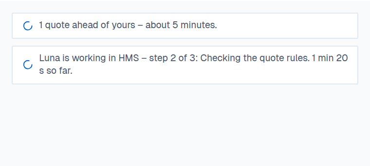
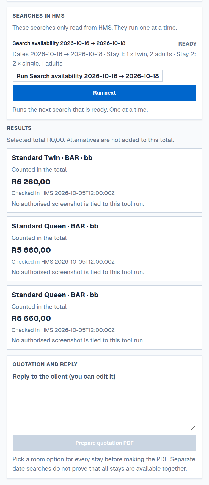
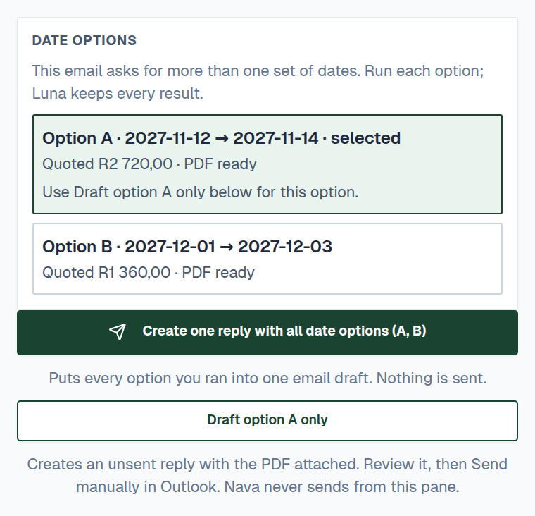
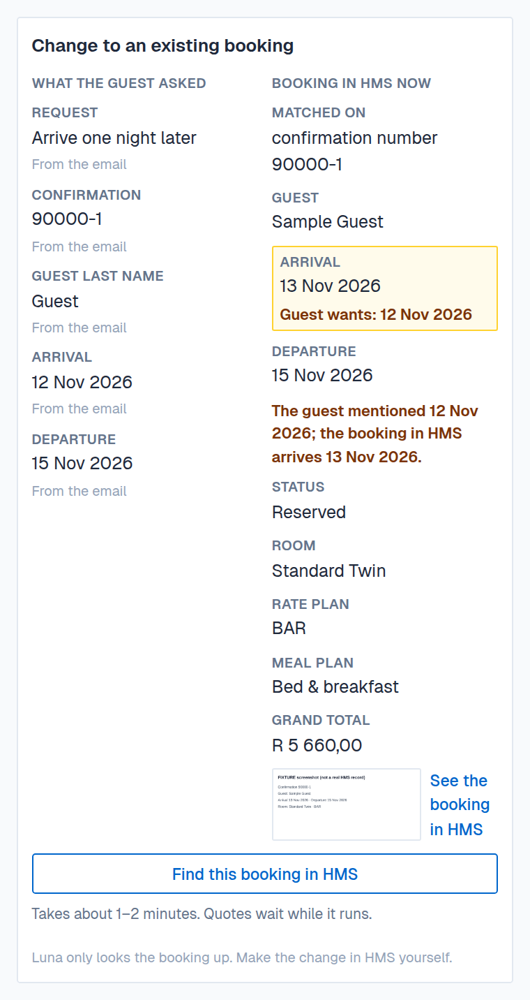

# Luna in Outlook: how to use it

For reservationists. Read it once before your first use. Keep it open next to Outlook.

Use test emails only in training. Never type real guest names, emails or phone numbers into a test.

---

## What Luna does

Luna is a helper in the Nava pane, inside Outlook. Luna can:

- Read the email you have open. Luna can also read new emails in advance, so results often appear as soon as you click.
- List what a quote needs.
- Run quote searches in HMS. One at a time.
- Make a PDF for the room option you pick.
- Make an unsent draft reply in Outlook, with the PDF attached.
- Look up a booking in HMS when you click **Find this booking in HMS**. This is read-only and takes about 1–2 minutes.
- Show you a screenshot of what it did in HMS.

---

## What Luna does NOT do

- **Luna never sends email.** You press Send in Outlook. Every time.
- **Luna never books, changes or cancels in HMS on its own.** You make every change by hand in HMS.
- **Luna never invents prices.** Prices come from HMS. If HMS gives no usable total, Luna says so.

---

## Coming soon (built, but not switched on)

These buttons are in the pane but switched off. Your manager will switch them on later.

- **Preview**, **Book in HMS** and **Save draft** on booking emails. They are greyed out. You will see: "Saving from this pane is coming soon. For now, copy each field into HMS."
- **Preview cancellation** and **Cancel booking in HMS** on cancellation emails. You will see: "Cancelling from here is switched off for now."

Until they are switched on, copy booking fields into HMS by hand, and cancel by hand in HMS (see "Change or cancel email").

---

## Step 1. Open an email

1. Open Classic Outlook.
2. Click the **Nava** tab, then **Nava Assistant**.
3. Click an email in Outlook. Luna reads it. This can take a minute, or it may be ready at once.
4. Look at the top of the Luna panel. You will see **Luna reads this as**, then one label:

| Label you see | What it means | What to do |
|---|---|---|
| **Quote** | The guest wants rooms and a price. | Go to Step 2. |
| **Booking** | The guest wants a booking made. | Go to "Booking email". |
| **Change to booking** | The guest wants to change an existing booking. | Go to "Change or cancel email". |
| **Cancellation** | The guest wants to cancel an existing booking. | Go to "Change or cancel email". |
| **Other** | Luna is not sure, or it is something else. | Read the note under the label. Handle it by hand if needed. |

Hold the mouse over **Change to booking** or **Cancellation** to read what Luna thinks. For example: "Luna thinks the guest wants to change an existing booking."

If you see **Read without AI**, Luna could not use AI for this email. Check every field by hand.

---

## Step 2. Quote email

### 2a. Check the details first

1. Read **Check before sending**. This is Luna's list of things to check.
2. If you see **Needs your answer**, type the answer into the fields below. Or use **Tell Luna** (see "Luna got it wrong?").
3. Check the stay details: Arrival, Departure, Rooms, Room type, Adults, Children ages, Meal plan, Company or agency, Special requests.
4. Check the **Quote header**. The text says: "These exact values go on the PDF. Leave Agency blank if there is none."
   - Rate type: BAR (best available rate) or Government rate.
   - Company, Agency, Attention, Client email, Client telephone.
   - Dinner allowance (ZAR / person / night), Shuttle requested, Shuttle amount (ZAR).
5. Correct anything wrong. Do this before you run any search.

### 2b. Run the search

1. Find the box called **Searches in HMS**. It says these searches only read from HMS, and they run one at a time.
2. Click **Run next**. Or click the **Run** button for one stay, for example "Run Search availability 2026-10-16 → 2026-10-18".
3. **Run next** is greyed out while a run is going. It is also greyed out while a step waits for another option's PDF.

A normal quote run takes about 5 minutes.

### 2c. Watch the progress line

The progress line appears under the searches while a quote run is going. You will see one of these:

| What the line says | What it means |
|---|---|
| **1 quote ahead of yours – about 5 minutes.** | Another quote is first. Wait. |
| **HMS is busy with another run – about 5 minutes.** | HMS is in use. Wait. |
| **Waiting for HMS to become free.** | Your run is in line. Wait. |
| **Luna is working in HMS – step 2 of 3: Checking the quote rules. 1 min 20 s so far.** | Your run is going. The steps are: 1 Searching rates, 2 Checking the quote rules, 3 Saving the quote. |
| **HMS is not responding. Try again in a few minutes.** (red box) | Go to "If HMS is busy or not responding". |

Keep the pane open, and keep the same email selected, until the run finishes.

### 2d. Pick the room option

1. Under **Results**, a successful run already selects the room option it found. Check it is the one you want. To change it, click the option you want. Clicking the selected option again clears the selection and turns off PDF creation.
2. Check **Selected total**. It does not include alternatives.
3. Cards marked **Counted in the total** are in the total.
4. Cards marked **Alternative — not counted in the total** are not in the total.

### 2e. See what Luna did in HMS

1. Click the picture with the words **See what Luna did in HMS**.
2. Check that the stay, dates, room and total match the email.
3. Use the arrows (‹ and ›) to see the other screenshots.
4. Press **Close**, or the Esc key, to go back.

If you see **The HMS screenshot could not be loaded**, or **No HMS screenshot for this quote**, or a result card says there is no screenshot, check the quoted details and the PDF before you send.

### 2f. Make the PDF

1. Under **Quotation and reply**, read the reply in the box **Reply to the client (you can edit it)**. Edit it if needed.
2. Click **Prepare quotation PDF**.
3. The button is greyed out until you pick a room option for every stay.
4. When it is ready, you will see **Prepared PDF** and the file name.

### 2g. Make the Outlook draft

1. Click **Insert draft in Outlook**.
2. Wait. You will see **Creating the Outlook draft. Please wait…**
3. When it works, you will see: **Draft opened in Outlook. Check it, then send it yourself.**
4. In Outlook, check the draft. Check the client, the numbers and the PDF attachment.
5. **You press Send.** Nava never sends from this pane.

**If you see "Outlook may have created the draft but did not confirm it":**

1. Do not click the button again yet.
2. Open **Drafts** in Outlook and look for the draft.
3. Only click **Insert draft in Outlook** again if there is no draft there. A retry reuses the same PDF. This stops you making two drafts.

**If you see "Draft saved in Outlook but did not open. Find it in Outlook Drafts.":** open **Drafts** in Outlook and find the draft there.

**If the button is greyed out, or you see "This Outlook add-in is too old to attach the PDF":**

1. Do not try to work around it.
2. Ask the operator (see "Who to contact").

**Shared mailboxes:** on a shared mailbox that is not the default Drafts store, the pane cannot make the reply draft. The button may be greyed out, or you will see an error. Reply by hand in Outlook, and tell the operator.

---

## Multi-date quotes (two or more date options in one email)

1. Under **Date options**, you will see each option, for example "Option A · 2026-11-02 → 2026-11-04". Each option shows **PDF ready** or **PDF not built**.
2. Click **Run next**, or the **Run Search availability** button for that option. Clicking an option under **Date options** only selects it.
3. Wait for the run to finish. Pick the room option for that stay.
4. Click **Prepare PDF for option A**. Each option has its own PDF.
5. Luna will not start the next option until the current option has its PDF. You will see: "Option A has no PDF yet. Prepare its PDF before running another option."
6. Repeat for each option.
7. When two or more options have a PDF, the reply buttons show **Create one reply with all date options (A, B)**. Click it to make **one** draft with every option. You will see: "Puts every option you ran into one email draft. Nothing is sent." Edit the reply box above the buttons first if you need to; the draft uses your edits while the options stay the same.
8. To draft one option only, click **Draft option A only**.
9. In Outlook, check every PDF in the draft. Then press Send yourself.

---

## Booking email

1. Click the email. Luna reads it as **Booking**.
2. Find the box called **Booking draft**. There is one block for each room: "Room 1", "Room 2" and so on.
3. Read the line at the top: "Saving to HMS from this pane is off for now. Click Copy next to each field, then paste it into HMS Guest Stay."
4. Click **Copy** next to a field. The button says **Copied** for a moment.
5. Switch to HMS Guest Stay. Paste the value into the matching box.
6. Repeat for each field. The fields are:
   - Arrival, Departure, Nights
   - Adults, Children
   - Room type, Rate code, Meal plan
   - Last name, First name
   - Company or travel agent
   - Source of business, Track, Guarantee (choose the option in the drop-down first, then click Copy)
   - Special requests
7. If a field says **Not set**, Luna did not find it. Look in the email and type it into HMS.
8. Read the warning boxes before you book. Examples:
   - "Company rate not applied: the booking has no company attached. Check the rate in HMS before booking."
   - "Rooms for all stays are not proven to be free together. Check availability in HMS before booking."
   - Near the top of the Booking draft, a rate check line says either "Price matches the email" or "Price differs from the email". If it differs, check the rate in HMS before you book.
9. **Preview**, **Book in HMS** and **Save draft** are greyed out. This is coming soon. Copy the fields into HMS.

---

## Change or cancel email

Change and cancel emails show the label **Change to booking** or **Cancellation** at the top. The panel below the label is called **Change to an existing booking** or **Cancellation request**.

1. Read the left side, **What the guest asked**: Request, Confirmation, Guest last name, Arrival, Departure. Each one says "From the email".
2. Click **Find this booking in HMS**.
   - The button is greyed out if the email has no HMS booking number, for example an agency or voucher reference such as 9999SH999999. A number of 6 to 10 digits, such as 57291630, is read as its first stay, 57291630-1.
   - If the email has no HMS booking number, Luna offers 'Find by guest name': check the surname and dates, press Search HMS (about 1 minute), then pick the booking.
   - It takes about 1–2 minutes. The text under the button says: "Takes about 1–2 minutes. Quotes wait while it runs."
   - Do not start a quote while a find is running.
3. Read the right side, **Booking in HMS now**: Matched on, Guest, Arrival, Departure, Status, Room, Rate plan, Meal plan and Grand total (when HMS shows them).
4. **Arrival does not match:** if HMS holds the booking on a different arrival date, you will see:
   - An amber box on the Arrival row, with "Guest wants" and the date from the email.
   - The line: "The guest mentioned 12 Nov 2026; the booking in HMS arrives 13 Nov 2026."
   - If HMS will not match the booking on the arrival date, you will see: "HMS shows this booking on another arrival date from the email. Check the dates in HMS directly."
5. Click **See the booking in HMS** to see the HMS screenshot.
6. Make the change in HMS yourself. The footer says: "Luna only looks the booking up. Make the change in HMS yourself."

**Cancellation emails:** after a successful find, you will see a cancel note, not buttons:

- "Cancelling from here is switched off for now. Cancel it in HMS: open the booking number, Actions → Cancel Reservation."
- Cancel by hand in HMS, using those steps.

**If the find does not work, you may see:**

- "Luna couldn't find a booking number in the email. Find the booking by guest name below."
- "No booking with that number in HMS. Check the number in the email or find the booking by guest name below."
- "HMS needs one exact booking number from the latest email. Check the email or find the booking by guest name below."
- "HMS matched more than one booking for that number. Check HMS directly."
- "HMS is busy with another quote or lookup. Try again in a minute."
- "Luna could not read the HMS result. Try again in a minute."
- "Waiting for this email to sync before the HMS lookup can start."
- "The HMS lookup is not connected in this session. Search HMS by hand."
- "Luna can't reach HMS right now. Tell the Nava team."

**If Find by guest name does not find the booking, you may see:**

- "No booking for Mokoena arriving 12 Oct 2026 in HMS. Check the spelling or dates."
- "Many matches — add the departure date."
- "Check the surname and dates, then search again."
- "Luna could not read the HMS search. Try again in a minute."

**Note on a change or cancel email:** you may see "Luna can find the booking; make the change in HMS yourself." This means the same thing as the panel. Use **Find this booking in HMS**, then make every change by hand in HMS.

---

## Luna got it wrong?

### The type of email is wrong

If Luna says "Luna thinks this is not a quote request, so no quote was started", you will see:

- **This is a quote request**
- **This is a booking**

Click the one that is right. The line under the buttons says: "Use if Luna sorted this email wrong."

### The details are wrong

1. Find the box **Tell Luna what's wrong**.
2. Type what is wrong. Example:

   > 3 nights from 12 Nov, 2 adults, dinner included

3. Click **Re-read with your note**.
4. Luna reads the email again. Your note wins over the email.
5. Check the fields again.

---

## If HMS is busy or not responding

HMS runs one search at a time. Other people may be using it too. A lookup and a quote cannot run at the same time.

1. **If you see "busy", "ahead of yours" or "Waiting":** wait. Keep the pane open. Do not click **Run next** again.
2. **If you see "HMS is busy with another quote or lookup. Try again in a minute.":** wait one minute. Then try once more.
3. **If you see "HMS is not responding. Try again in a few minutes.":**
   1. Wait about 5 minutes.
   2. Try once more.
   3. If it says "not responding" again, stop. Call the operator. Tell them the time.
4. **If you see "Luna can't reach HMS right now. Tell the Nava team.":** tell the operator.
5. Do not keep clicking. Extra clicks do not make HMS faster.

---

## Before you press Send

- [ ] Dates and number of nights match the email.
- [ ] Rooms, room types, adults and children match the email.
- [ ] Rate type and company or agency are right.
- [ ] The total matches HMS (see the screenshot).
- [ ] The PDF is attached, and it is the right stay. For several options, every PDF is right.
- [ ] The reply text reads right and names the right guest.
- [ ] Then **you** press Send in Outlook.

---

## Who to contact

| For | Who | Phone |
|---|---|---|
| Sign-in problems, device code, pane not working, HMS not responding | **[PLACEHOLDER – operator name]** | **[PLACEHOLDER – operator phone]** |
| How to use Luna, questions, feedback | **[PLACEHOLDER – founder name]** | **[PLACEHOLDER – founder phone]** |
| Antivirus warnings, installer warnings | **[PLACEHOLDER – IT contact name]** | **[PLACEHOLDER – IT phone]** |

**Placeholders:** replace every item in square brackets with a real name and number before you give this guide to staff.
