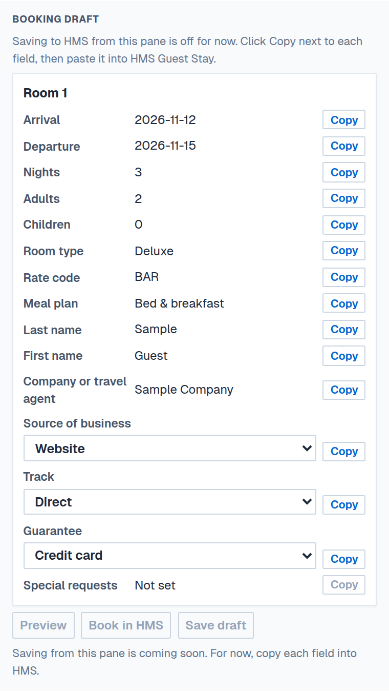
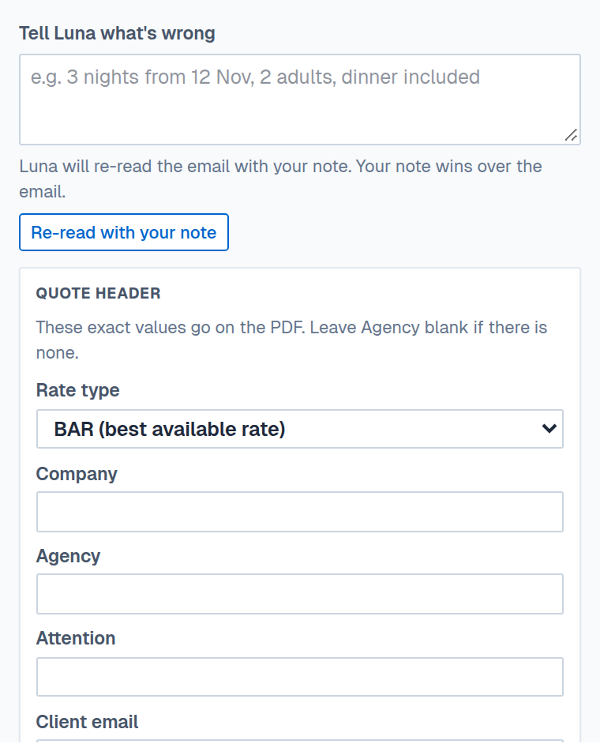

# Luna in Outlook: how to use it

For reservationists. Read it once before your first use. Keep it open next to Outlook.

Use test emails only in training. Never type real guest names, emails or phone numbers into a test.

---

## What Luna does

Luna is a helper in the Nava pane, inside Outlook. Luna can:

- Read the email you have open.
- List what the quote needs.
- Run quote searches in HMS. One at a time.
- Make a PDF of the room option you pick.
- Make an unsent draft reply in Outlook, with the PDF attached.
- Show you a screenshot of what it did in HMS.
- Look up a booking in HMS for change and cancel emails (newer build only).

---

## What Luna does NOT do

- **Luna never sends email.** You press Send in Outlook. Every time.
- **Luna never books or cancels on its own.** Every change in HMS needs a click from you.
- **Luna never invents prices.** Prices come from HMS. If HMS gives no usable total, Luna says so. It does not guess.
- **Luna does not save bookings to HMS from the pane yet.** The buttons Preview, Book in HMS and Save draft are greyed out. You copy each field into HMS by hand.

---

## Step 1. Open an email

1. Open Classic Outlook.
2. Click the **Nava** tab, then **Nava Assistant**.
3. Click an email in Outlook. Luna reads it. This can take a minute.
4. Look at the top of the Luna panel. You will see **Luna reads this as**, then one label:

| Label you see | What it means | What to do |
|---|---|---|
| **Quote** | The guest wants rooms and a price. | Go to Step 2. |
| **Booking** | The guest wants a booking made. | Go to "Booking email". |
| **Other** | Luna is not sure, or it is something else. | Read the note under the label. Handle it by hand if needed. |
| **Change to booking** (newer build) | The guest wants to change an existing booking. | Go to "Change or cancel email". |
| **Cancellation** (newer build) | The guest wants to cancel an existing booking. | Go to "Change or cancel email". |

Hold the mouse over a label to read what Luna thinks. In the current build, change and cancel emails show as **Other**, with a note such as "Changing or cancelling a booking is not supported yet." In the newer build, the panel says **Change to an existing booking** or **Cancellation request**.

If you see **Read without AI**, Luna could not use AI for this email. Check every field by hand.

---

## Step 2. Quote email

### 2a. Check the details first

1. Read **Check before sending**. This is Luna's list of things to check.
2. If you see **Needs your answer**, type the answer into the fields below. Or use "Tell Luna" (see below).
3. Check the stay details: Arrival, Departure, Rooms, Room type, Adults, Children ages, Meal plan, Company or agency, Special requests.
4. Check the **Quote header**. These exact values go on the PDF:
   - Rate type: BAR (best available rate) or Government rate.
   - Company, Agency, Attention, Client email, Client telephone.
   - Dinner allowance, Shuttle requested, Shuttle amount.
   - Leave **Agency** blank if there is none.
5. Correct anything wrong. Do this before you run any search.

### 2b. Run the search

1. Find the box called **Searches in HMS**. It says these searches only read from HMS, and they run one at a time.
2. Click **Run next**.
3. Do not click it again. It is greyed out while the run is going.

A normal run takes about 5 minutes.

### 2c. Watch the progress line

A line under the searches tells you what is happening. You will see one of these:

| What the line says | What it means |
|---|---|
| **1 quote ahead of yours – about 5 minutes.** | Another quote is first. Wait. |
| **HMS is busy with another run – about 5 minutes.** | HMS is in use. Wait. |
| **Waiting for HMS to become free.** | Your run is in line. Wait. |
| **Luna is working in HMS – step 2 of 3: Checking the quote rules. 1 min 20 s so far.** | Your run is going. The steps are: 1 Searching rates, 2 Checking the quote rules, 3 Saving the quote. |
| **HMS is not responding. Try again in a few minutes.** (red box) | Go to "If HMS is busy or not responding". |

Keep the pane open, and keep the same email selected, until the run finishes.

### 2d. Pick the room option

1. Under **Results**, click the room option you want.
2. Check **Selected total**.
3. Cards marked **Counted in the total** are in the total.
4. Cards marked **Alternative — not counted in the total** are not in the total.

### 2e. See what Luna did in HMS

1. Under **Results**, click the picture with the words **See what Luna did in HMS**.
2. Check that the stay, dates, room and total match the email.
3. Use the arrows (‹ and ›) to see the other screenshots.
4. Press **Close**, or the Esc key, to go back.

If you see **The HMS screenshot could not be loaded**, check the quoted details and the PDF before you send. If you see **No HMS screenshot for this quote**, or a result card says there is no screenshot, do the same.

### 2f. Make the PDF

1. Under **Quotation and reply**, read the reply in the box **Reply to the client (you can edit it)**. Edit it if needed.
2. Click **Prepare quotation PDF**.
3. The button is greyed out until you pick a room option for every stay.
4. When it is ready, you will see **Prepared PDF** and the file name.

### 2g. Make the Outlook draft

1. Click **Insert draft in Outlook**.
2. Wait. You will see **Creating the Outlook draft. Please wait…**
3. When it works, you will see: **Draft opened in Outlook. Check it, then send it yourself.**
4. In Outlook, check the draft. Check the client, the numbers and the PDF attachment.
5. **You press Send.** Nava never sends from this pane.

**If you see "Outlook may have created the draft but did not confirm it":**

1. Do not click the button again yet.
2. Open **Drafts** in Outlook and look for the draft.
3. Only click **Insert draft in Outlook** again if there is no draft there. This stops you making two drafts.

**If the button is greyed out, or you see "This Outlook add-in is too old to attach the PDF":**

1. Do not try to work around it.
2. Ask the operator (see "Who to contact").

---

## Multi-date quotes (several date ranges in one email)

1. Luna lists each date range under **Which stay to quote**.
2. Pick one date range. Start with the first one.
3. Click **Run next**. Wait for the run to finish.
4. Pick the room option for that stay, then prepare the PDF for that stay.
5. Each stay keeps its own quote. Luna cannot put two stays into one PDF. The pane says: "A combined PDF is blocked, so prepare the PDF for one stay at a time."
6. For the other date options, follow the instruction from your founder. Luna's own note says: "Several date options: quote the first, add the others by hand."
7. Check the price of each stay before you send anything.

---

## Booking email

1. Click the email. Luna reads it as **Booking**.
2. Find the box called **Booking draft**. There is one block for each room: "Room 1", "Room 2" and so on.
3. Read the line at the top: "Saving to HMS from this pane is off for now. Click Copy next to each field, then paste it into HMS Guest Stay."
4. Click **Copy** next to a field. The button says **Copied** for a moment.
5. Switch to HMS Guest Stay. Paste the value into the matching box.
6. Repeat for each field. The fields are:
   - Arrival, Departure, Nights
   - Adults, Children
   - Room type, Rate code, Meal plan
   - Last name, First name
   - Company or travel agent
   - Source of business, Track, Guarantee (choose the option in the drop-down first, then click Copy)
   - Special requests
7. If a field says **Not set**, Luna did not find it. Look in the email and type it into HMS.
8. Read the warning boxes before you book. Examples:
   - "Company rate not applied: the booking has no company attached. Check the rate in HMS before booking."
   - "Rooms for all stays are not proven to be free together. Check availability in HMS before booking."
   - Near the top of the Booking draft, a rate check line says either "Price matches the email" or "Price differs from the email". If it differs, check the rate in HMS before you book.
9. The buttons **Preview**, **Book in HMS** and **Save draft** are greyed out. Do not wait for them. Copy the fields into HMS.

---

## Change or cancel email

This part is in the newer build only. If you see "Changing or cancelling a booking is not supported yet. Handle it by hand in HMS.", do the change in HMS yourself.

In the newer build, the panel is called **Change to an existing booking** or **Cancellation request**.

1. Read the left side, **What the guest asked**: Request, Confirmation, Guest last name, Arrival, Departure.
2. Click **Find this booking in HMS**. Luna looks up the booking. This usually takes under a minute.
3. Read the right side, **Booking in HMS now**: Matched on, Guest, Arrival, Departure, Status, Room.
4. An amber box means HMS does not match what the guest asked. Check it.
5. Make the change in HMS yourself. Luna only looks the booking up.

**Cancellations:**

- **Preview cancellation** reads the cancellation fee from HMS. It cancels nothing.
- **Cancel booking in HMS** is not on for real bookings in this pilot. If you see "Cancelling from here is switched off for now" or "Cancelling from here only works on test bookings right now", cancel by hand in HMS:
  1. Open the booking number.
  2. Click **Actions**, then **Cancel Reservation**.

**If the lookup does not find the booking, you may see:**

- "Luna couldn't find a booking number in the email. Search HMS by name instead."
- "No booking with that number in HMS. Check the number in the email or search HMS by guest name."
- "HMS matched more than one booking for that number. Check HMS directly."
- "HMS is busy. Try again in a minute."

---

## Luna got it wrong?

### The type of email is wrong

If Luna says "Luna thinks this is not a quote request, so no quote was started", two buttons appear:

- **This is a quote request**
- **This is a booking**

Click the one that is right.

### The details are wrong

1. Find the box **Tell Luna what's wrong**.
2. Type what is wrong. Example:

   > 3 nights from 12 Nov, 2 adults, dinner included

3. Click **Re-read with your note**.
4. Luna reads the email again. Your note wins over the email.
5. Check the fields again.

---

## If HMS is busy or not responding

HMS runs one search at a time. Other people may be using it too.

1. **If you see "busy", "ahead of yours" or "Waiting":** wait. Keep the pane open. Do not click **Run next** again.
2. **If you see "HMS is not responding. Try again in a few minutes.":**
   1. Wait about 5 minutes.
   2. Try once more: click **Run next** one time.
   3. If it says "not responding" again, stop. Call the operator. Tell them the time.
3. Do not keep clicking. Extra clicks do not make HMS faster.

---

## Before you press Send

- [ ] Dates and number of nights match the email.
- [ ] Rooms, room types, adults and children match the email.
- [ ] Rate type and company or agency are right.
- [ ] The total matches HMS (see the screenshot).
- [ ] The PDF is attached, and it is the right stay.
- [ ] The reply text reads right and names the right guest.
- [ ] Then **you** press Send in Outlook.

---

## Who to contact

| For | Who | Phone |
|---|---|---|
| Sign-in problems, device code, pane not working, HMS not responding | Operator: [name] | [number] |
| How to use Luna, questions, feedback | Founder: [name] | [number] |
| Antivirus warnings, installer warnings | IT: [name] | [number] |

Fill in the names and numbers before you use this guide.
