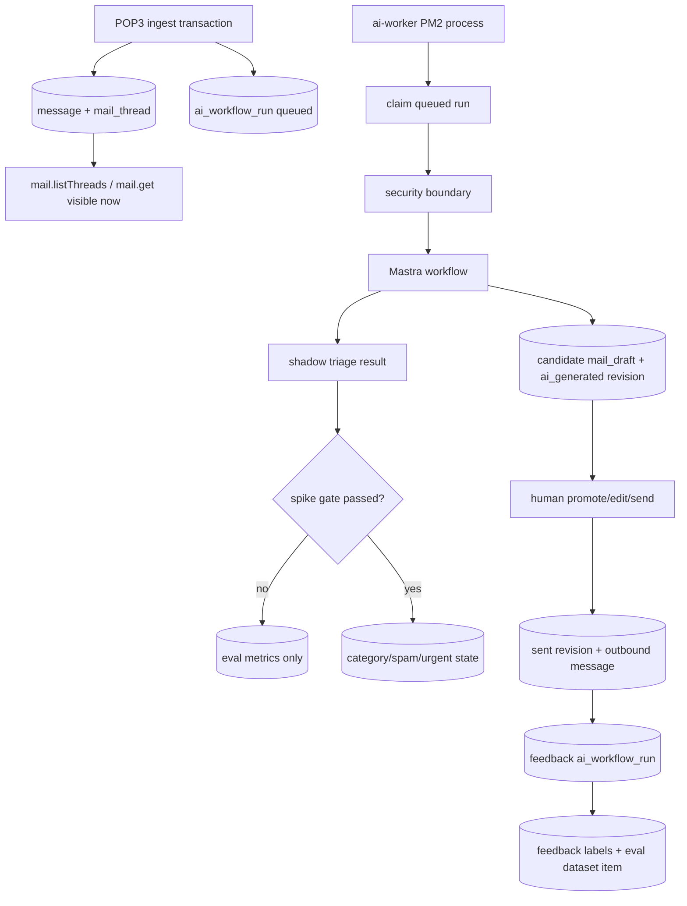
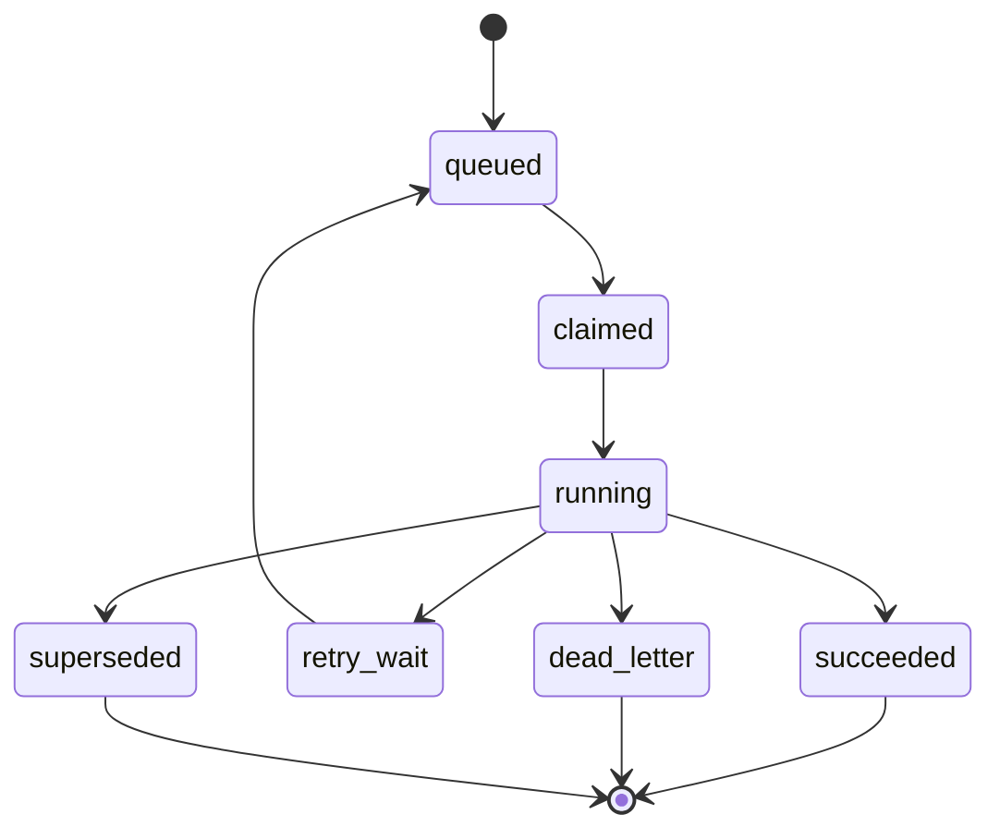

# feat: Add server-pilot AI mail pipeline

## Summary

Add a self-hosted AI mail pipeline to `apps/server-pilot` for async triage, AI candidate drafts, human edit feedback, and Mastra evals without Langfuse or hosted Mastra. The plan keeps mail ingestion and inbox visibility independent of AI health, stores product truth in app Postgres, and treats overnight autonomous execution safety as part of the design.

---

## Problem Frame

The mail pilot already has POP3/S3/Postgres ingest, mailbox-scoped tRPC, hotel categories, spam state, draft candidate promotion, stale draft protection, and EC2/RDS/S3 deploy gates. The missing layer is an AI employee that runs after mail is safely persisted: classify the thread, mark spam or urgent where appropriate, generate a candidate reply when useful, and learn from the final human-edited sent email through eval datasets.

The previous plan correctly chose Mastra and rejected Langfuse, but it still needed consolidation around prior autonomous-run failures. This plan makes app-owned state, explicit worker boundaries, shadow-first triage, persisted verification gates, and no parallel edits to the same file core requirements rather than execution afterthoughts.

---

## Requirements

**Platform And Hosting**

- R1. The AI pipeline must run self-hosted on the existing AWS stack: EC2 process, RDS Postgres, S3, and Bedrock.
- R2. The server-pilot package must reject Langfuse, LangSmith, hosted Mastra platform exporters, and hosted-observability tokens.
- R3. Bedrock model invocation must go through a small local adapter with `amazon.nova-lite-v1:0` as the cheap pilot default and a configurable model id.

**Mail Pipeline Behavior**

- R4. Inbound mail must be visible through existing mail routes as soon as the ingest transaction commits, regardless of AI worker health.
- R5. AI triage must classify into the frontend hotel vocabulary: `internal`, `individual`, `group`, `travel-agents`, `spam`, with `urgent` as an overlay flag.
- R6. Triage must run in shadow/eval mode first and only write durable category, spam, or urgent state after the spike gate passes.
- R7. Durable triage writes must use existing product state: `mail_category`, `mail_thread_category`, `mail_thread.spam_at`, and the chosen urgent overlay representation.

**Drafts And Feedback**

- R8. AI reply generation must persist only candidate drafts and immutable `ai_generated` draft revisions; it must not insert pseudo-messages or send email.
- R9. Human promotion, editing, stale-draft confirmation, and final send must keep using the existing draft lifecycle and send route.
- R10. Feedback extraction must compare the first AI-generated revision to the final sent revision asynchronously and store eval labels or metrics without creating active memory.

**Security And Isolation**

- R11. Inbound email body, headers, and attachments must be treated as hostile prompt input.
- R12. App policy must own security: schema validation, prompt-injection fixtures, tool allowlists, no-send tools, and structured outputs are mandatory even when Bedrock Guardrails are enabled.
- R13. The AI workflow runner must not receive SMTP/POP3 secrets and must have app-level guards preventing send-capable imports or code paths.
- R14. Mastra traces and app support exports must redact secrets, credentials, auth tokens, and system prompts. Full guest email content may remain in product tables for the pilot.

**Autonomous Execution**

- R15. Implementation must be task-gated: no parallel edits to the same file, run persisted local gates after each task, run a shrink/truncation sweep before advancing, and commit only after the gate is genuinely green.
- R16. EC2 verification must use existing SSM, bundle sync, explicit RDS migration, deploy, health, fixture-loopback, and optional wire gates where applicable.

---

## Key Technical Decisions

- **App DB owns product truth:** `ai_workflow_run`, mail category state, candidate drafts, feedback labels, and prompt metadata live in app-owned tables. Mastra traces and scorer records are runtime evidence, not the source of record.
- **Mastra wraps stable primitives:** Add app-owned schema and deterministic service functions before wiring Mastra. Workflows call primitive triage, draft, feedback, and security services so tests can prove side effects without a live LLM.
- **Shadow-first triage rollout:** The first autonomous run records classifier output and eval scores without mutating folders. Durable triage writes are enabled only after the spike gate proves category, spam, urgent, JSON, and policy compliance.
- **No AI send day one:** Candidate drafts and feedback are in scope; autonomous outbound send is deferred. This preserves the human approval boundary while still generating the data needed for future auto-send policy.
- **Bedrock is provider-adapted, not embedded:** The app gets a narrow model and guardrail interface. Azure Foundry or another provider can replace the adapter later without rewriting Mastra workflows or app tables.
- **No hosted observability:** Mastra local storage/exporter and app tables are enough for the pilot. ClickHouse, Langfuse, hosted Mastra, and vector DBs stay out unless data volume or eval needs prove Postgres is insufficient.
- **Autonomous safety is design scope:** Prior patch-fragment truncation and false-green failures require file ownership boundaries, on-disk gates, and shrink checks in the plan itself.

---

## High-Level Technical Design

The AI run lifecycle should be claimable and idempotent:

---

## Scope Boundaries

### In Scope

- Backend AI pipeline in `apps/server-pilot`.
- Mastra runtime, workflows, datasets, experiments, scorers, and local storage/exporter where needed.
- Bedrock adapter, guardrail application, and deterministic fake adapter for tests.
- App-owned AI run ledger, candidate draft generation, feedback labels, and spike/eval reports.
- EC2 autonomous verification against RDS/S3 using fixture and optional wire gates.

### Deferred To Follow-Up Work

- Full Playwright/HMS browser MCP tools. This plan can define future tool-contract boundaries, but it should not automate the PMS yet.
- Active memory proposals and approved memory tables. Store feedback labels first; promote repeated patterns to memory only after real edit data proves value.
- Autonomous outbound send. Future auto-send needs policy gates, confidence thresholds, rollback posture, and hotel approval.
- Dedicated AI ops tRPC routes or dashboard. Start with DB rows, eval reports, traces, and docs.
- ClickHouse, vector DB, promptfoo, or another eval platform.

### Out Of Scope

- Langfuse, LangSmith, or hosted Mastra platform.
- Sending mail from `ai-worker`.
- Real Exchange credential use during autonomous test gates.
- Storing raw SMTP/POP3 secrets or system prompts in traces.

---

## System-Wide Impact

- **Data model:** Adds AI run, feedback, and prompt/eval records while reusing existing mail, category, draft, and revision tables.
- **Mail routing:** AI classification eventually writes visible folder/category state, so rollout must be shadow-first and reversible.
- **Security:** The app gains a new hostile-input surface. Tool allowlists, no-send boundaries, and trace redaction must be tested, not documented only.
- **Operations:** PM2 gains an `ai-worker`; EC2/RDS gates must prove migrations, build, worker startup, health, and no duplicate candidate generation.
- **Agent workflow:** Implementation tasks must be narrow enough for subagents to edit safely without clobbering large files.

---

## Implementation Units

### U1. AI Dependency And Env Guardrails

- **Goal:** Add AI configuration without allowing hosted observability or accidental legacy AI resurrection.
- **Requirements:** R1, R2, R3, R15
- **Dependencies:** None
- **Files:** `apps/server-pilot/package.json`, `apps/server-pilot/src/env.ts`, `apps/server-pilot/tests/env.test.ts`, `apps/server-pilot/tests/package-contract.test.ts`, `apps/server-pilot/src/lib/driver/types.ts`, `apps/server-pilot/src/trpc/routes/brain.ts`
- **Approach:** Add only the Mastra and AWS Bedrock packages actually used by runtime/evals. Extend env parsing for AI enablement, model id, guardrail id/version, and local Mastra storage. Reject Langfuse, LangSmith, Mastra platform token/exporter env keys when AI is enabled. Keep capability flags disabled until U7 passes the spike gate.
- **Patterns to follow:** `apps/server-pilot/tests/package-contract.test.ts` for package assertions; `apps/server-pilot/src/env.ts` parser style.
- **Test scenarios:** Env accepts Bedrock/Nova Lite defaults; env rejects Langfuse or hosted Mastra keys; package contract rejects Langfuse/LangSmith dependencies; capability flags remain inert before rollout.
- **Verification:** Server-pilot env/package tests pass and no hosted observability dependency appears in the package graph.

### U2. App-Owned AI Run Ledger

- **Goal:** Create the durable queue, run ledger, retry state, and idempotency contract for AI work.
- **Requirements:** R4, R6, R10, R15
- **Dependencies:** U1
- **Files:** `apps/server-pilot/src/db/schema/mail.ts`, `apps/server-pilot/src/db/schema/index.ts`, `apps/server-pilot/drizzle/*.sql`, `apps/server-pilot/tests/schema-contract.test.ts`, `apps/server-pilot/tests/ai-workflow-run-contract.test.ts`
- **Approach:** Add `ai_workflow_run` with transport, thread, trigger message, run kind, idempotency key, prompt/model metadata, state, claim owner, attempts, retry time, Mastra trace/scorer ids, generation id, metrics, error, and timestamps. Keep `ai_draft_generation` focused on draft provenance rather than queue state.
- **Patterns to follow:** Existing Drizzle schema and migrations; `message_ingest_uidl_uidx` and `mail_draft_one_active_thread_uidx` partial uniqueness style.
- **Test scenarios:** Duplicate enqueue returns the existing run; two concurrent claim attempts produce one owner; retry increments attempts and respects next-run time; dead-letter state stops claims; transport scoping prevents cross-mailbox lookup.
- **Verification:** Schema export tests and AI run contract tests pass against test DB.

### U3. Atomic Enqueue Points

- **Goal:** Enqueue AI work inside the same product transactions that create inbound and final sent evidence.
- **Requirements:** R4, R9, R10
- **Dependencies:** U2
- **Files:** `apps/server-pilot/src/mail/ingest/store.ts`, `apps/server-pilot/src/trpc/routes/mail.ts`, `apps/server-pilot/tests/ingest-store.test.ts`, `apps/server-pilot/tests/mail-send.test.ts`, `apps/server-pilot/tests/ai-enqueue-contract.test.ts`
- **Approach:** In inbound persistence, insert a triage/draft run in the transaction that inserts `message`. On send, after SMTP succeeds and inside the DB transaction that writes outbound message and sent revision, enqueue feedback extraction. Do not call LLMs on ingest or send request paths.
- **Patterns to follow:** Ingest safety order in `apps/server-pilot/src/mail/ingest/store.ts`; draft send transaction and `mailDraftRevision` writes in `apps/server-pilot/src/trpc/routes/mail.ts`.
- **Test scenarios:** Stored inbound creates one AI run; duplicate UIDL does not create a second run; quarantined messages do not enqueue draft runs unless explicitly chosen; send creates sent revision and feedback run together; SMTP failure creates no feedback run.
- **Verification:** Ingest and send tests prove inbox/send behavior stays independent of AI worker availability.

### U4. Deterministic AI Domain Services

- **Goal:** Implement testable service functions for triage output, candidate draft persistence, and HITL feedback extraction before Mastra wraps them.
- **Requirements:** R5, R6, R7, R8, R9, R10
- **Dependencies:** U2, U3
- **Files:** `apps/server-pilot/src/ai/triage.ts`, `apps/server-pilot/src/ai/drafts.ts`, `apps/server-pilot/src/ai/feedback.ts`, `apps/server-pilot/tests/ai-triage-contract.test.ts`, `apps/server-pilot/tests/draft-ai-promotion-contract.test.ts`, `apps/server-pilot/tests/draft-eval-schema-contract.test.ts`, `apps/server-pilot/tests/ai-feedback-contract.test.ts`
- **Approach:** Define structured triage output with category, spam, urgent, confidence, rationale, and policy flags. Persist shadow triage results to metrics first; durable state writes are gated by U7. Candidate draft persistence creates `ai_draft_generation`, `mail_draft(status='candidate', origin='ai')`, and `mail_draft_revision(kind='ai_generated')` in one transaction. Feedback extraction compares AI-generated revision to sent revision and stores labels for evals.
- **Patterns to follow:** Existing draft lifecycle in `apps/server-pilot/src/trpc/routes/drafts.ts`; existing `mailDraftRevision` append-only model.
- **Test scenarios:** Triage validates known frontend demo categories; spam result can map to `spam_at` only after write gate; candidate creation is idempotent by generation and reply parent; existing active human draft wins over candidate promotion; feedback labels capture tone, factual, recipient, subject, and missing-info edits; raw edits do not become active memory.
- **Verification:** Domain service tests pass without live Bedrock or Mastra.

### U5. Security Boundary And Bedrock Adapter

- **Goal:** Add hostile-input controls, trace redaction, structured output validation, and provider abstraction.
- **Requirements:** R3, R11, R12, R13, R14
- **Dependencies:** U1, U4
- **Files:** `apps/server-pilot/src/ai/security/*`, `apps/server-pilot/src/ai/bedrock/*`, `apps/server-pilot/tests/ai-security-contract.test.ts`, `apps/server-pilot/tests/bedrock-adapter-contract.test.ts`
- **Approach:** Introduce a model adapter interface, deterministic fake adapter, Bedrock implementation, guardrail application hook, prompt-injection fixtures, maximum input limits, JSON schema validation, and redaction processor for secrets and system prompts. Keep app policy authoritative when Bedrock Guardrails are absent or inconclusive.
- **Patterns to follow:** Fake/real transport separation used by POP3/SMTP; zod validation at existing tRPC boundaries.
- **Test scenarios:** Malicious email cannot override system policy; model output with extra fields is rejected; forbidden tool request is rejected; SMTP/POP3 secrets and system prompts are redacted from trace payloads; fake adapter can run spike fixtures deterministically.
- **Verification:** Security tests fail closed and do not require live AWS credentials.

### U6. Mastra Runtime And AI Worker

- **Goal:** Wire Mastra workflows and a least-privilege runner around the app-owned queue and services.
- **Requirements:** R1, R2, R4, R8, R13, R15
- **Dependencies:** U2, U4, U5
- **Files:** `apps/server-pilot/src/ai/mastra.ts`, `apps/server-pilot/src/ai/workflows/mail-triage.ts`, `apps/server-pilot/src/ai/worker.ts`, `apps/server-pilot/deploy/pm2.config.cjs`, `apps/server-pilot/tests/ai-worker-contract.test.ts`, `apps/server-pilot/tests/deploy-config.test.ts`
- **Approach:** Configure local Mastra storage/exporter with `mastra_*` tables. Add `ai-worker` as a thin process that claims `ai_workflow_run` rows, calls Mastra workflows, records trace/scorer ids, and updates run state. Enforce no SMTP/POP3 env keys and no send-capable imports in worker paths.
- **Patterns to follow:** Existing PM2 singleton `worker`; app-owned worker loops and bounded claim style from ingest worker.
- **Test scenarios:** Worker claims queued run and marks succeeded; worker retry creates no duplicate candidate draft; worker cannot import SMTP send module; PM2 config includes `ai-worker`; `ai-worker` env excludes SMTP/POP3 secrets.
- **Verification:** Worker contract and deploy config tests pass.

### U7. Spike Gate, Evals, And Shadow-To-Write Switch

- **Goal:** Prove classifier and draft behavior on fixtures before durable triage writes are enabled.
- **Requirements:** R5, R6, R7, R10, R12, R15
- **Dependencies:** U4, U5, U6
- **Files:** `apps/server-pilot/tests/fixtures/ai-spike/*`, `apps/server-pilot/src/ai/eval-runner.ts`, `apps/server-pilot/src/ai/scorers/*`, `apps/server-pilot/package.json`, `apps/server-pilot/tests/ai-eval-runner.test.ts`
- **Approach:** Seed fixtures from `apps/mail/lib/demo-data/centurion-threads.json` for positive hotel cases and add red-team prompt-injection/spam cases. Use Mastra datasets, experiments, and scorers for category accuracy, spam, urgent, JSON validity, forbidden tool use, draft quality, latency, token, and cost. Keep durable triage writes disabled until the gate passes.
- **Patterns to follow:** Existing fixture transport and fixture-loopback gate tiering.
- **Test scenarios:** Demo `spam`, `group`, `individual`, `internal`, and `travel-agents` cases classify correctly; urgent overlay is detected; malicious fixture cannot trigger send or credential leakage; failed eval keeps write gate closed; passing eval allows write-gated triage service to mutate category/spam/urgent state.
- **Verification:** Spike report includes pass/fail, trace ids, scorer ids, model id, prompt version, and cost/latency metrics.

### U8. Documentation, EC2 Gates, And Autonomous Safety

- **Goal:** Make implementation runnable overnight without repeating truncation or false-green failures.
- **Requirements:** R15, R16
- **Dependencies:** U1 through U7
- **Files:** `docs/server-pilot-ai.md`, `apps/server-pilot/deploy/*.sh`, `docs/superpowers/plans/handoff-reports/*`, `CONCEPTS.md`
- **Approach:** Document architecture, env, no-Langfuse policy, no-send boundary, run states, failure states, trace lookup, eval gate, and future auto-send path. Add any missing gate script needed to run AI tests on EC2. Update concepts only for new durable terms that matter to the project glossary.
- **Patterns to follow:** EC2 SSM guidance in `docs/solutions/workflow-issues/ec2-pilot-autonomous-deploy-and-ssm-gotchas.md`; fixture loopback gate docs.
- **Test scenarios:** EC2 gate applies migrations explicitly, builds server, runs AI tests with `NODE_ENV=test`, restarts PM2, checks health, and proves no duplicate drafts after worker restart; shrink sweep is run before task handoff; gate report records real command outcomes.
- **Verification:** Local and EC2 gates are recorded in handoff report with no unverified green claims.

---

## Risks & Dependencies

- **Mastra package/API churn:** Use only the runtime, storage, workflow, dataset, experiment, and scorer APIs required by this plan. Avoid broad framework coupling.
- **Bedrock IAM gap:** EC2 role may need Bedrock model and guardrail permissions. Fake adapter tests must keep local gates useful before IAM is updated.
- **RDS migration risk:** AI schema changes require explicit migration on EC2 before deploy. Do not hide migration inside deploy.
- **Classifier false positives:** Spam and urgent state affect staff workflows. Shadow-first rollout and reversible writes reduce damage.
- **Trace privacy:** Full guest emails are acceptable in product DB for pilot verification, but system prompts and secrets must not enter trace/support exports.
- **Autonomous edit risk:** Large schema/router edits are truncation-prone. The SDD plan must split file ownership, gate every task, and hard-stop on first red.

---

## Documentation / Operational Notes

- `docs/server-pilot-ai.md` should be the runbook for env, architecture, run states, no-send policy, eval gate, trace lookup, EC2 commands, and future auto-send prerequisites.
- `CONCEPTS.md` should gain only durable terms such as AI workflow run, shadow triage, AI candidate draft, HITL feedback label, and AI workflow runner if they are missing after implementation.
- EC2 verification should use `sync-ec2-git-bundle.sh`, `ssm-run-command.sh`, explicit `db:migrate`, `deploy-ec2.sh`, health curl, and fixture loopback or AI gate scripts.

---

## Sources & Research

- `apps/server-pilot/src/db/schema/mail.ts`: existing categories, draft statuses, AI draft generation, draft revisions, spam state, and indexes.
- `apps/server-pilot/src/mail/ingest/store.ts`: safe ingest transaction point for atomic AI enqueue.
- `apps/server-pilot/src/trpc/routes/drafts.ts`: atomic AI candidate promotion pattern.
- `apps/server-pilot/src/trpc/routes/mail.ts`: send transaction and folder/category state patterns.
- `docs/solutions/workflow-issues/autonomous-agent-file-truncation-patch-fragment.md`: prior autonomous truncation failure and shrink-check prevention.
- `docs/solutions/workflow-issues/false-green-gate-unpersisted-tsc-fixes.md`: on-disk gate verification requirement.
- `docs/solutions/workflow-issues/ec2-pilot-autonomous-deploy-and-ssm-gotchas.md`: SSM, RDS migration, deploy, and remote test constraints.
- `docs/solutions/logic-errors/mail-draft-refresh-data-loss-and-lifecycle.md`: draft lifecycle and promotion invariants to reuse.
- `docs/solutions/architecture-patterns/mail-transport-mode-fixture-vs-real.md`: fixture, wire, real verification tiers.
- `docs/solutions/architecture-patterns/nava-fixture-loopback-e2e-harness.md`: EC2 fixture-loopback gate pattern.
