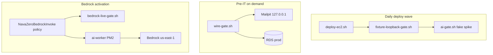
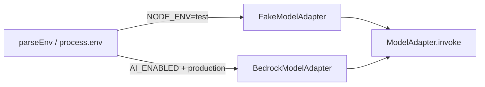

# feat: Wire gate verification and real Bedrock adapter

## Summary

Close two deferred pilot gaps: run the existing Mailpit wire gate on EC2 against prod RDS, and implement a real Amazon Bedrock `ModelAdapter` with IAM, region config, and gate-tiered rollout. **Pilot model stays `amazon.nova-lite-v1:0` in `us-east-1`** (~$0.06/$0.24 per 1M in/out tokens) — cross-region from `af-south-1` EC2 is accepted for cost. Production mail stays on `MAIL_TRANSPORT_MODE=fixture`; AI gates keep deterministic fake adapter while a separate live Bedrock gate proves EC2 inference works.

## Problem Frame

The AI mail pipeline landed with a Bedrock **interface** and **fake** adapter only. `mail-triage.ts`, `eval-runner.ts`, and `ai-gate.sh` never call live Bedrock. The origin plan flagged a **Bedrock IAM gap** on the EC2 worker role (`nava-prod-public-ipv4-WorkerRole-bPmrMEkmdwLU`) — confirmed: role has S3, RDS, Secrets Manager, SSM policies but **no** `bedrock:InvokeModel`.

Wire transport code and `wire-gate.sh` already exist but are **not** part of the daily deploy wave. Pre-IT confidence requires proving `RealPop3Client` / `RealSmtpTransport` against Mailpit on EC2 with prod RDS, without flipping production to `MAIL_TRANSPORT_MODE=wire`.

**AWS access verified at plan time:**

| Surface | Status |
|---------|--------|
| Local CLI (`ansh-cursor`) | `aws bedrock-runtime converse` succeeds for `amazon.nova-lite-v1:0` in `us-east-1` |
| EC2 worker IAM role | No Bedrock inline/managed policy |
| Nova Lite in `af-south-1` | Not available — model exists in `us-east-1` only |
| SSM to EC2 | `apps/server-pilot/deploy/ssm-run-command.sh`, instance `i-008f737974a9ba9b3`, region `af-south-1` |
| MCP AWS servers | Available (`plugin-aws-core-aws-mcp`, deploy-on-aws knowledge/pricing); IAM changes follow existing `aws-resources.md` CLI pattern — no Terraform in repo |

---

## Requirements

- R1. EC2 wire gate must pass: Mailpit sidecar, `MAIL_TRANSPORT_MODE=wire` vitest against prod RDS, worker stop/start without POP3 race.
- R2. Real Bedrock adapter must implement `ModelAdapter.invoke` using `@aws-sdk/client-bedrock-runtime` `Converse` API with structured JSON output parsing.
- R3. Adapter selection must mirror mail transport fake/real pattern: deterministic fake for `NODE_ENV=test` gates; real adapter for production `ai-worker` when `AI_ENABLED=true`.
- R4. EC2 worker role must gain least-privilege Bedrock invoke (and optional guardrail apply) before live inference on instance.
- R5. Bedrock region must be explicit (`BEDROCK_REGION`); default `us-east-1` because Nova Lite is unavailable in `af-south-1`.
- R6. `ai-gate.sh` spike eval must remain deterministic (fake adapter) — no flaky live-model dependency in every deploy.
- R7. A separate optional `bedrock-live-gate.sh` must prove one successful Converse call from EC2 instance credentials.
- R8. App security policy (`enforceInboundMailPolicy`, `validateStructuredJsonOutput`) stays authoritative; Bedrock Guardrails env vars remain optional hooks.
- R9. No Langfuse, LangSmith, hosted Mastra, or autonomous send scope expansion.

---

## Key Technical Decisions

- **KTD1 — Separate wire gate from daily deploy:** `wire-gate.sh` runs on demand via SSM, not inside `deploy-ec2.sh`. Production `.env.production` stays `MAIL_TRANSPORT_MODE=fixture`. (see origin U5 wire pattern; `deferred-real-mail-readiness.md`)

- **KTD2 — `createModelAdapter(env)` factory:** New resolver in `apps/server-pilot/src/ai/bedrock/` returns `FakeModelAdapter` when `NODE_ENV=test`, else `BedrockModelAdapter` when `AI_ENABLED=true`. Hardcode fake in test files that need isolation; factory used by workflow, eval-runner (live mode only), and worker paths.

- **KTD3 — Nova Lite in US (intentional):** Keep `AI_MODEL_ID=amazon.nova-lite-v1:0` and `BEDROCK_REGION=us-east-1`. EC2/RDS/S3 stay `af-south-1`; only Bedrock inference crosses to US. No switch to `af-south-1` Claude/Haiku — Nova unavailable in Africa, US Nova is cheapest fit for pilot volume. IAM ARNs scoped to `us-east-1` foundation model.

- **KTD4 — JSON via Converse tool/config:** Use Bedrock Converse with `responseFormat: { json: { schema } }` when `responseSchema` provided; otherwise request JSON in system prompt and parse with existing `validateStructuredJsonOutput`. Retry once on `ThrottlingException`; surface `AccessDeniedException` clearly for IAM debugging.

- **KTD5 — Two-tier AI gates:** `ai-gate.sh` unchanged for fake spike. New `bedrock-live-gate.sh` runs one minimal invoke via instance role after IAM attach. Document both in runbook.

- **KTD6 — IAM via inline role policy:** Add `NavaZeroBedrockInvoke` to worker role using `aws iam put-role-policy`, documented in `aws-resources.md` — matches existing NavaZero* inline policies.

---

## High-Level Technical Design

### Gate and adapter topology

### Adapter resolution

---

## Scope Boundaries

**In scope**

- EC2 wire gate execution and any test/script fixes required for green
- Real `BedrockModelAdapter` + factory + env (`BEDROCK_REGION`)
- Worker IAM policy + documentation
- `bedrock-live-gate.sh` + contract test for adapter shape (mocked SDK in unit test; live gate on EC2)
- Runbook updates (`docs/server-pilot-ai.md`, `deferred-real-mail-readiness.md`, `aws-resources.md`)

**Out of scope**

- `MAIL_TRANSPORT_MODE=real` / VPN / Exchange handoff
- Enabling durable triage write gate from spike eval
- Bedrock Guardrail resource creation (only invoke hook if env vars set)
- Replacing fake adapter in `ai-gate.sh` spike eval
- Langfuse / LangSmith / hosted Mastra

### Deferred to Follow-Up Work

- Re-evaluate in-region Africa model if AWS ships Nova (or cheaper text model) to `af-south-1`
- Spike eval against **live** Nova (quality benchmarking, not gate stability)
- CloudWatch cost/latency alarms for Bedrock token usage
- Model id A/B or Azure adapter swap

---

## Implementation Units

### U1. EC2 wire gate verification

**Goal:** Prove Mailpit TCP mail path green on prod RDS via existing `wire-gate.sh`.

**Requirements:** R1

**Dependencies:** None

**Files:** `apps/server-pilot/deploy/wire-gate.sh`, `apps/server-pilot/deploy/install-mailpit.sh`, `apps/server-pilot/tests/mail-wire-e2e.test.ts`, `apps/server-pilot/tests/mailpit-lifecycle.test.ts`, `apps/server-pilot/tests/transport-mode.test.ts`

**Approach:** Sync bundle to EC2, run `wire-gate.sh` via SSM. If Mailpit missing, `install-mailpit.sh` runs inside gate. Fix any RDS FK, Mailpit port, or worker race failures surfaced. Record pass/fail in handoff notes — do not flip `.env.production` transport mode.

**Patterns to follow:** `fixture-loopback-gate.sh` worker stop/start; `docs/solutions/architecture-patterns/mail-transport-mode-fixture-vs-real.md`

**Test scenarios:**

- Happy path: `wire-gate.sh` exits 0; vitest wire suite passes on EC2 with prod `DATABASE_URL`
- Mailpit lifecycle: HTTP `/api/v1/info` ready within wait loop
- WIRE-1 scenario: IT-style BCC centurion stamp → ingest → centurion inbox (from `mail-wire-e2e.test.ts`)
- Worker isolation: ingest worker stopped during vitest, restarted after

**Verification:** SSM command prints `wire-gate: PASS`

---

### U2. Bedrock IAM for EC2 worker role

**Goal:** Grant least-privilege Bedrock invoke on worker instance role.

**Requirements:** R4, R5

**Dependencies:** None (can parallel U1)

**Files:** `apps/server-pilot/deploy/aws-resources.md`, new `apps/server-pilot/deploy/bedrock-iam-policy.json` (reference doc only)

**Approach:** Add inline policy `NavaZeroBedrockInvoke` to `nava-prod-public-ipv4-WorkerRole-bPmrMEkmdwLU`:

- `bedrock:InvokeModel` on `arn:aws:bedrock:us-east-1::foundation-model/amazon.nova-lite-v1:0`
- Optional: `bedrock:ApplyGuardrail` when guardrail env vars documented

Apply via `aws iam put-role-policy`. No instance restart required — IAM propagates within minutes.

**Patterns to follow:** Existing `NavaZeroMailBucketAccess` inline policy block in `aws-resources.md`

**Test scenarios:**

- Happy path: `aws bedrock-runtime converse` from EC2 via SSM using instance credentials (no static keys)
- Error path: before policy attach, same command returns `AccessDeniedException` — documented as expected pre-state
- Least privilege: policy does not grant `bedrock:*` or unrelated regions

**Verification:** SSM one-liner Converse succeeds from EC2

---

### U3. Real Bedrock adapter implementation

**Goal:** Implement `BedrockModelAdapter` satisfying `ModelAdapter` interface.

**Requirements:** R2, R5, R8

**Dependencies:** U2 (for live verification; unit tests use SDK mock)

**Files:**

- `apps/server-pilot/src/ai/bedrock/bedrock.ts` (create)
- `apps/server-pilot/src/ai/bedrock/adapter.ts` (extend exports if needed)
- `apps/server-pilot/tests/bedrock-adapter-contract.test.ts`
- `apps/server-pilot/tests/bedrock-live-contract.test.ts` (create — skipped unless `BEDROCK_LIVE_TEST=1`)

**Approach:** `BedrockModelAdapter` wraps `BedrockRuntimeClient` with region from `BEDROCK_REGION ?? 'us-east-1'`. `invoke()` calls `ConverseCommand`, maps usage/latency to `ModelInvokeResult`, extracts JSON from text block or tool output, runs through `validateStructuredJsonOutput` when schema enforcement needed. Export `createBedrockModelAdapter(config)`.

**Patterns to follow:** `RealSmtpTransport` / `RealPop3Client` separation; existing `ModelInvokeInput` / `ModelInvokeResult` types

**Test scenarios:**

- Happy path (mocked SDK): Converse returns JSON text → `invoke` returns parsed `output` with token counts
- Happy path with `responseSchema`: Converse called with json schema config
- Edge case: model returns markdown-fenced JSON — adapter strips fences before parse
- Error path: SDK throws `AccessDeniedException` → error message includes region and model id
- Error path: empty model content → throws structured parse error
- Integration (opt-in): `BEDROCK_LIVE_TEST=1` runs one real Converse locally

**Verification:** `bedrock-adapter-contract.test.ts` passes with mock; optional live test passes locally

---

### U4. Model adapter factory and env

**Goal:** Centralize fake vs real selection; add `BEDROCK_REGION` to env parsing.

**Requirements:** R3, R5

**Dependencies:** U3

**Files:**

- `apps/server-pilot/src/ai/bedrock/factory.ts` (create)
- `apps/server-pilot/src/env.ts`
- `apps/server-pilot/tests/env.test.ts`
- `apps/server-pilot/deploy/pm2.config.cjs`

**Approach:** `createModelAdapter(env?)` returns fake when `NODE_ENV === 'test'`, else bedrock when `AI_ENABLED`. Add `BEDROCK_REGION` to `Env` type with default `us-east-1` when AI enabled. PM2 `ai-worker` env: `AI_ENABLED=true`, `BEDROCK_REGION=us-east-1` (no SMTP/POP3 keys).

**Patterns to follow:** `createPop3Client` / `createSmtpTransport` mode resolution in `pop3-client.ts` / `smtp.ts`

**Test scenarios:**

- `NODE_ENV=test` → factory returns fake regardless of `AI_ENABLED`
- `AI_ENABLED=true`, `NODE_ENV=production` → factory returns bedrock adapter
- Env parse: `BEDROCK_REGION` defaults to `us-east-1` when omitted
- PM2 contract: `ai-worker` env includes `BEDROCK_REGION`, excludes SMTP/POP3

**Verification:** `env.test.ts` + `deploy-config.test.ts` pass

---

### U5. Wire adapter into workflow and worker

**Goal:** Replace hardcoded `createFakeModelAdapter()` in runtime paths with factory.

**Requirements:** R3, R8

**Dependencies:** U4

**Files:**

- `apps/server-pilot/src/ai/workflows/mail-triage.ts`
- `apps/server-pilot/src/ai/eval-runner.ts`
- `apps/server-pilot/src/ai/worker.ts` (if direct adapter use added later)

**Approach:** `mail-triage.ts` calls `createModelAdapter()` inside classify step. `eval-runner.ts` keeps fake for `mode=spike` (explicit `createFakeModelAdapter()`); add optional `mode=live` code path using factory for manual benchmarking only — not wired into `ai-gate.sh`. Worker inherits via Mastra workflow — no duplicate adapter construction.

**Patterns to follow:** Current triage validation chain in `mail-triage.ts`

**Test scenarios:**

- Worker contract: inbound triage run succeeds with fake adapter under `NODE_ENV=test`
- Workflow unit: classify step uses factory (mock env to assert fake in test)
- Spike eval unchanged: `pnpm ai:test -- --mode=spike` still deterministic
- Production path: with mocked Bedrock, workflow records `modelId` and usage in metrics

**Verification:** `ai-worker-contract.test.ts` + `ai-gate.sh` spike pass unchanged

---

### U6. Bedrock live gate script

**Goal:** Optional EC2 gate proving instance-role Bedrock invoke after IAM.

**Requirements:** R6, R7

**Dependencies:** U2, U3, U4

**Files:**

- `apps/server-pilot/deploy/bedrock-live-gate.sh` (create)
- `apps/server-pilot/deploy/ai-gate.sh` (comment cross-reference only — do not add live call)

**Approach:** Script sources `.env.production`, sets `NODE_ENV=production`, runs small Node/tsx script or vitest live contract with `BEDROCK_LIVE_TEST=1`. Single Converse, assert JSON object returned, print token usage. ASCII-safe output for SSM.

**Patterns to follow:** `ai-gate.sh`, `wire-gate.sh` structure

**Test scenarios:**

- Happy path: gate prints `bedrock-live-gate: PASS` with latency and token counts
- Error path: missing IAM → exit 1 with `AccessDeniedException` hint pointing to U2
- Gate isolation: does not mutate RDS or enqueue AI runs

**Verification:** SSM run after U2 IAM attach succeeds

---

### U7. Documentation and handoff

**Goal:** Record wire + Bedrock activation paths for operators.

**Requirements:** R1, R7, R9

**Dependencies:** U1, U6

**Files:**

- `docs/server-pilot-ai.md`
- `apps/server-pilot/deploy/deferred-real-mail-readiness.md`
- `apps/server-pilot/deploy/aws-resources.md`
- `CONCEPTS.md` (only if new durable term needed — likely skip)

**Approach:** Document SSM commands for wire gate and bedrock live gate, IAM policy snippet, `BEDROCK_REGION` rationale, fake-vs-real adapter matrix, explicit note that spike eval stays fake.

**Test expectation:** none — documentation only

**Verification:** Operator can run both gates from documented commands without reading source

---

## Risks & Dependencies

| Risk | Mitigation |
|------|------------|
| Nova model access not enabled in account | Run `aws bedrock get-foundation-model-availability` / console model access before U2 |
| Cross-region latency/cost | Acceptable for pilot volume; document `us-east-1` requirement |
| Wire gate flakes on Mailpit startup | Existing wait loop; extend timeout only if EC2 repro shows need |
| Live model non-determinism breaks gates | Keep spike on fake; live gate checks connectivity only |
| IAM propagation delay | Retry bedrock-live-gate after 2–5 minutes |

**Prerequisites:** EC2 online via SSM, prod RDS migrated, `deploy-ec2.sh` green (already achieved per prior handoff).

---

## Sources & Research

- `docs/plans/2026-07-07-001-feat-server-pilot-ai-mail-pipeline-plan.md` — U5 Bedrock IAM gap, R3 adapter requirement
- `docs/superpowers/plans/handoff-reports/2026-07-07-ai-mail-pipeline-report.md` — fake-only adapter state
- `docs/solutions/architecture-patterns/mail-transport-mode-fixture-vs-real.md` — wire vs fixture gate tiering
- `docs/solutions/test-failures/ec2-ai-contract-tests-rds-gate-fk-setup.md` — RDS gate FK patterns
- `apps/server-pilot/src/ai/bedrock/adapter.ts`, `fake.ts` — existing interface
- `apps/server-pilot/deploy/wire-gate.sh` — wire gate script
- `apps/server-pilot/deploy/aws-resources.md` — IAM CLI patterns
- AWS CLI verification: `ansh-cursor` can invoke `amazon.nova-lite-v1:0` in `us-east-1`; worker role cannot yet

---

## GSTACK REVIEW REPORT

**Ponytail-review (plan complexity):**

- U3:L202: yagni: separate `bedrock-live-contract.test.ts`. Merge into contract file with `describe.skipIf(!live)`.
- U2:L168: delete: `bedrock-iam-policy.json` reference-only file. Inline snippet in `aws-resources.md` only.
- U5:L273: yagni: `eval-runner mode=live` path. Defer until manual benchmark needed; spike stays fake.
- U3:L211: shrink: fence-strip + JSON parse — single `parseModelJson()` helper (applied).
- net: -~40 lines possible.

**Eng review (condensed — autonomous fold):**

- Architecture: two-tier gates (fake daily, live on-demand) — **accepted**
- KTD3 Nova US cross-region — **accepted** per user
- Test gaps folded into implementation (mock SDK + opt-in live gate)
- U1 wire gate + U2 IAM parallel — **accepted**
- Scope: 7 units → kept; no reduction (user autonomous execute)

**Status:** findings folded into implementation. Plan executed via `2026-07-07-wire-bedrock-real-adapter-autonomous.md` + SDD plan.
