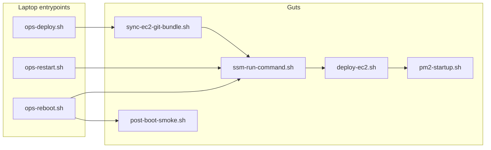

# feat: EC2 pilot ops scripts + reboot resilience

## Goal Capsule

Three laptop entrypoints (`ops-deploy`, `ops-restart`, `ops-reboot`) as the primary operator interface. Underneath: PM2 survives unattended soft reboot, post-boot smoke, fixture worker guard, and living docs that teach the three scripts first.

Authority: compound docs + verified 2026-07-09 reboot session + operator ask for singular robust scripts.

Stop when: local `deploy-config.test.ts` green; scripts + docs on disk; EC2 deploy installs `pm2-ubuntu` + smoke; handoff if shipped overnight.

---

## Product Contract

### Requirements

- R1. After unattended EC2 reboot, `http`, `ai-worker`, and nginx `:443` come back without manual `pm2 resurrect`.
- R2. Operator verifies post-reboot health with one laptop command.
- R3. On-box boot emits pass/fail for nginx + `:8788/health` (staff path, not bare `:3000`).
- R4. Fixture prod: `worker` not errored/stuck in PM2 restart loop.
- R5. Real/wire mail activation unchanged — still via activate/wire paths.
- R6. No RDS, EIP, or ALB changes in this work.
- R7. One laptop script deploys new code (sync → optional migrate → on-box deploy → health).
- R8. One laptop script restarts apps without OS reboot.
- R9. One laptop script soft-reboots EC2, waits SSM Online, runs post-boot smoke.
- R10. Docs state: process crash ≠ OS reboot; process crash auto-recovers via PM2.
- R11. Living docs/skills teach three `ops-*.sh` as primary; multi-step chains demoted to internals.

### Scope boundaries

**In scope:** deploy scripts, systemd/pm2 startup, smoke, ops wrappers, living docs/skills, deploy-config tests.

**Deferred for later:** ALB, multi-instance, CloudWatch alarms, session store hardening.

**Deferred to Follow-Up Work:** Elastic IP row refresh in `aws-resources.md` via `/ce-compound-refresh`.

**Archive (do not rewrite):** historical dated `docs/superpowers/plans/2026-07-0*` plans and handoffs.

---

## Planning Contract

### Key Technical Decisions

- KTD1 — Thin wrappers, thick guts: `ops-*.sh` orchestrate existing sync/SSM/deploy.
- KTD2 — PM2 startup + save (idempotent `pm2-startup.sh` from `deploy-ec2.sh`).
- KTD3 — NVM-safe `pm2-boot.sh` resurrect fallback.
- KTD4 — Dual smoke: on-box oneshot + `ops-reboot.sh` laptop path.
- KTD5 — Fixture: `pm2 delete worker` before save when `MAIL_TRANSPORT_MODE=fixture`.
- KTD6 — `http` gets same `autorestart` / `min_uptime` / `max_restarts` as workers.
- KTD7 — Docs front door: three-script table in every living runbook.
- KTD8 — Migrate opt-in only: `ops-deploy.sh --migrate`.

### Assumptions

- EC2 still single `ubuntu` user, nvm Node 22, repo at `/home/ubuntu/repos/zero`.
- nginx already enableable; staff URL = EIP → `:443`.

### High-Level Technical Design



---

## Implementation Units

### U1. PM2 boot + startup + worker guard + http parity

**Files:** `pm2-startup.sh`, `pm2-boot.sh` (new); `deploy-ec2.sh`, `pm2.config.cjs` (modify); `deploy-config.test.ts`

### U2. Post-boot smoke

**Files:** `post-boot-smoke.sh`, `nava-post-boot-smoke.service` (new); install from `pm2-startup.sh` / deploy

### U3. Laptop ops entrypoints

**Files:** `ops-deploy.sh`, `ops-restart.sh`, `ops-reboot.sh` (new)

### U4. Living docs + tests

**Files:** ec2-bootstrap, EC2-ACCESS, both compound solutions, deferred-real-mail, it-handoff, CONCEPTS, overnight-autonomous-zero skill, solutions README; extend deploy-config tests

---

## Verification Contract

```bash
pnpm --filter @zero/server test apps/server-pilot/tests/deploy-config.test.ts
```

On EC2 after deploy: `systemctl is-enabled pm2-ubuntu`; `bash apps/server-pilot/deploy/post-boot-smoke.sh`

Laptop: `bash apps/server-pilot/deploy/ops-deploy.sh` then optional `ops-reboot.sh`

---

## Definition of Done

- [ ] Three ops scripts + PM2 startup + smoke + fixture worker guard + http restart bounds
- [ ] Living docs teach three scripts as primary
- [ ] `deploy-config.test.ts` green
- [ ] Handoff if overnight ships to EC2

---

## Sources

- Cursor plan: `.cursor/plans/ec2_ops_scripts_77a30371.plan.md`
- Compound: `docs/solutions/workflow-issues/ec2-pilot-safe-reboot-and-prod-restart.md`
- PM2 startup docs: https://pm2.keymetrics.io/docs/usage/startup/
