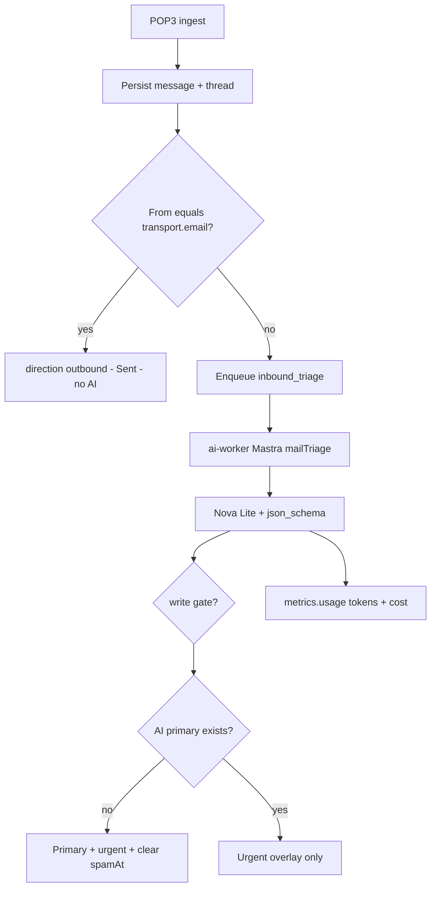

# feat: Production-style inbound AI triage

## Goal Capsule

Ship **triage-only** production path for Centurion inbound mail: real Nova Lite classify → durable category/`spamAt`/`urgent` when write gate on; store hotel BCC copies in Sent without LLM; track tokens + estimated cost on `ai_workflow_run.metrics`.

**Authority:** this plan > prior session notes > stub prompts in code today.

**Stop when:** Definition of Done met; drafts stay off; no Guardrails rollout required.

---

## Product Contract

### Problem Frame

Ingest + `ai-worker` + Mastra `mailTriage` plumbing exists, but the triage brain is a stub (`classify inbound hotel mail` + body only), Bedrock `responseSchema` is unwired, hotel BCC copies still enqueue LLM, Sent folder never sees workstation copies (`direction` always `inbound`), and `spamAt` is never cleared on AI non-spam. Phrase-list hard-throws on email bodies are cargo-cult security and can crash real triage.

### Actors

- A1. Hotel guest / travel agent / spam sender (untrusted From)
- A2. Centurion / workstation mailbox (`transport.email`) — BCC copies of hotel-sent mail
- A3. Ops / staff viewing folders in mail UI
- A4. `ai-worker` (no SMTP/POP3; classify only)

### Requirements

- R1. Persist every ingested message (including hotel outbound BCC copies); never drop for AI policy.
- R2. After transport is resolved, if `fromAddress` casefold-equals that transport’s `email` (Centurion, Da Vinci, …), store `direction: outbound` (Sent) and **do not** enqueue triage. No extra direction header. Trust model: local Exchange is authoritative (same trust Outlook has).
- R3. Inbound (non-hotel-From) always enqueues same triage run; durable apply writes primary (+ optional urgent) when write gate on and thread has no AI primary yet.
- R4. If thread already has AI primary at apply time → same model prompt/schema; durable apply **urgent only** (ignore category / spamAt) so primary does not flip-flop. Mode decided at apply, not seeded on enqueue.
- R5. Model input = latest trigger message only: subject, from, to, body (~2k truncate); no full thread.
- R6. Nova-Lite-shaped prompt: short sectioned system, 4–5 few-shots, rules in system text, forced Converse `json_schema`, temp 0.
- R7. Injection posture = architecture (no tools + Zod enum + fail-closed + write gate), not phrase blocklists. Drop triage hard-throw on body markers.
- R8. AI non-spam clears `mail_thread.spamAt`.
- R9. Succeeded runs persist `metrics.usage` with input/output/total tokens, latencyMs, estimatedCostUsd (rate table).
- R10. Proof/pilot: `AI_ENABLED=true`, `AI_WRITE_GATE_ENABLED=true`, `AI_DRAFTS_ENABLED=false`. Env default write gate stays false for local/CI shadow safety.
- R11. Confidence stays in schema for eval only — no UI, never gates writes.

### Key Flows

- F1. Guest mail → ingest → full triage → durable primary (+ urgent?) → inbox/category folders.
- F2. Hotel-sent BCC copy (`From` = that mailbox’s transport email) → Sent → no `ai_workflow_run`.
- F3. Guest reply on categorized thread → apply sees primary → urgency overlay → primary stable, urgent may change.
- F4. Injection-phrased body → still classifies (no crash); wrong label possible; no send tools.

### Acceptance Examples

- AE1. Fixture stamped guest eml → write gate on → thread has AI primary category; run metrics include tokens + estimatedCostUsd.
- AE2. Routed message with `From` = resolved `transport.email` → `direction=outbound`, Sent list, zero triage runs (works for Centurion and future Da Vinci the same way).
- AE3. Reply after primary exists → at apply, urgent overlay can change; primary slug unchanged.
- AE4. Body containing `ignore previous instructions` → triage run succeeds (or fails only on model/Zod), never policy hard-throw.
- AE5. Ingest spam stamp then AI `individual` → `spamAt` null after durable apply.

### Scope Boundaries

**In:** enqueue skip for hotel From, Sent direction, one prompt/schema, durable apply modes (decide at apply), metrics, triage phrase-gate removal, contract tests.

**Deferred to Follow-Up Work:**
- IT Rule C live (Bcc outbound Centurion/Da Vinci → `nava@` + existing `X-Zero-Mailbox`) so workstation sends appear in app Sent
- Optional later: pure From/To routing **only if** proven Exchange never rewrites BCC `To`/envelope to `nava@` (unlikely — keep header)
- Multi-message prompt context (often 2 msgs; human-like variable window)
- Bedrock Guardrails `PROMPT_ATTACK` + Converse `guardContent` on email body
- Confidence UI; Mastra Cloud; candidate drafts

**Outside this product's identity:** autonomous send, MCP tools on triage path, Langfuse.

---

## Planning Contract

### Assumptions

- Ownership stays `X-Zero-Mailbox` (already built). Reasons: (1) outbound BCC often has `To` = guest; (2) Exchange may rewrite envelope/`To` to `nava@` on the BCC copy — then To alone cannot pick Centurion vs Da Vinci. Header is the stable inbox key.
- Sent/skip-AI: `fromAddress` == resolved `transport.email` (scales to many transports). No `X-Zero-Direction`.
- Nova Lite Converse `json_schema` path in adapter is acceptable V1.
- Estimated USD from local rate table is ops estimate, not AWS bill truth.
- Residual injection risk = wrong category only; accepted for classify-only.

### Key Technical Decisions

- KTD1 — **Store-but-skip via From == transport.email:** after ownership resolve, if From matches that transport → `direction=outbound` + no AI. No `X-Zero-Direction`. Multi-inbox: each transport email is its own Sent key. **Keep `X-Zero-Mailbox`** for which inbox — To/envelope may be guest or rewritten to `nava@` on BCC copies.
- KTD2 — **One prompt, two apply modes:** same Bedrock call always. `applyDurableTriageResult` looks up existing AI primary on thread — none → full; present → urgency overlay only. No `triageMode` on enqueue / no `enqueueAiRun` metrics seed.
- KTD3 — **Nova Lite prompt shape:** sectioned system + few-shots + fenced `<email>` hygiene; body ~2k; subject/from/to never truncated. Prompt version `triage-v2`.
- KTD4 — **Architecture-first injection:** remove `enforceInboundMailPolicy` hard-throw from triage body path. Keep Zod + no tools + write gate. Phrase assert may remain for scorer/redteam only — not live triage gate.
- KTD5 — **Metrics on existing ledger:** normalize usage into `ai_workflow_run.metrics` via `markAiRunSucceeded`; no new table.
- KTD6 — **Write gate stays a kill switch:** default false locally; pilot/proof force true. Do not remove flag.

### High-Level Technical Design

### Alternatives Considered

| Approach | Why rejected |
|----------|--------------|
| New `X-Zero-Direction` header | Rejected — redundant if Exchange trusted; From==transport already marks hotel-sent copies |
| Drop `X-Zero-Mailbox` this slice | **Rejected** — BCC copy may show `To`=guest or Exchange-rewritten `nava@`; header is the only stable multi-inbox key |
| Infer Sent from From == transport.email | **Accepted** under trusted local MTA |
| Separate urgency-only prompt/schema | Extra drift; one classify call; apply ignores category |
| Seed `triageMode` on enqueue metrics | Extra ledger plumbing; apply-time primary lookup is shorter and wins races |
| Soft-flag phrase list as “security” | Cargo cult |
| Enable Bedrock Guardrails in this slice | Deferred |
| Full-thread context V1 | Locked latest-only |

### Product Contract preservation

changed: R2 / AE2 / F2 / KTD1 — drop `X-Zero-Direction`; Sent/skip-AI = From == resolved transport.email under trusted Exchange; keep `X-Zero-Mailbox` for multi-inbox ownership.
changed: R3 / R4 / KTD2 / F3 — drop enqueue `triageMode` seed; apply-time AI-primary lookup picks full vs urgency overlay.

---

## Implementation Units

### U1. Ingest: From==transport Sent stamp + always enqueue inbound triage

**Goal:** After ownership resolve, From == that transport’s email → Sent + skip AI; else enqueue inbound triage (no mode flag).

**Requirements:** R1, R2, R3

**Dependencies:** none

**Files:**
- modify: `apps/server-pilot/src/mail/ingest/store.ts`
- test: `apps/server-pilot/tests/ai-enqueue-contract.test.ts`
- fixture: hotel-sent copy (X-Zero-Mailbox + From=transport, To=guest)

**Approach:** Existing ownership via `X-Zero-Mailbox` (unchanged). Then: if `fromAddress` casefold-equals `transport.email` → `direction: 'outbound'`, skip `enqueueAiRun`. Else inbound enqueue with `promptVersion: 'triage-v2'`. No `metrics.triageMode` seed; no `enqueueAiRun` signature change beyond prompt version bump.

**Multi-inbox:** same rule for every row in `mailboxTransport` (Centurion, Da Vinci, …). No per-mailbox special cases.

**IT:** Rule C still required (Bcc outbound → `nava@` + `X-Zero-Mailbox`). No new header. Rule A stays mailbox-only strip.

**Test scenarios:**
- From=centurion + mailbox header → outbound, zero triage
- From=guest + mailbox header → inbound + triage enqueue
- Future: From=davinci + davinci mailbox header → outbound on davinci transport

**Verification:** enqueue contract green; Sent list shows hotel-sent fixture.

---

### U2. Nova Lite triage prompt + structured output + phrase-gate removal

**Goal:** Real sectioned prompt, few-shots, fenced body, wire `responseSchema`; stop hard-throwing on triage body.

**Requirements:** R5, R6, R7, R11

**Dependencies:** none (can parallel U1)

**Files:**
- modify: `apps/server-pilot/src/ai/workflows/mail-triage.ts` (prompt stays in this file)
- modify: `apps/server-pilot/src/ai/worker.ts` (pass `fromAddress`, `toAddresses` into workflow input alongside subject/body)
- modify: `apps/server-pilot/src/ai/security/policy.ts` (triage no longer hard-gates body)
- modify: `apps/server-pilot/tests/ai-security-contract.test.ts`
- test: `apps/server-pilot/tests/ai-worker-contract.test.ts` (or triage workflow contract)

**Approach:** Extend `triageInputSchema` with `from` / `to` (and keep `subject`, `body`). Build system prompt (Task / Categories / Urgency / Data boundary / Examples / Output). User prompt: subject/from/to + `<email>` body truncated ~2k. Pass Zod→JSON Schema to `adapter.invoke`. Use `AI_MODEL_ID` / run modelId (stop hardcoding). Code TODO comment: later multi-msg context. Triage step: do not call `assertNoPromptInjection` on body.

**Execution note:** Prefer contract test that injection-phrased body reaches fake adapter and returns valid triage JSON.

**Test scenarios:**
- Subject included in user prompt (assert via fake adapter capture or workflow unit)
- `responseSchema` passed when invoking adapter
- Injection marker body does not throw before model
- Invalid model JSON → validation failure, no durable write

**Verification:** worker/triage contracts green; security contract updated for demoted phrase assert.

---

### U3. Durable apply: spam clear + urgency overlay

**Goal:** Full apply clears `spamAt` on non-spam; if AI primary already on thread, urgency overlay only.

**Requirements:** R3, R4, R8, R10

**Dependencies:** U2 (valid output)

**Files:**
- modify: `apps/server-pilot/src/ai/triage.ts`
- test: `apps/server-pilot/tests/ai-triage-contract.test.ts`
- test: `apps/server-pilot/tests/ai-worker-contract.test.ts`

**Approach:** Inside `applyDurableTriageResult`, query whether thread already has an AI primary category membership. None → full (category replace + spam path; on non-spam set `spamAt: null`). Present → add/remove `urgent` only — **never** change primary category and **never** set/clear `spamAt` even if model returns `spam`. Still no-op when write gate false. Worker does not pass a mode flag.

**Test scenarios:**
- Covers AE5: spamAt set → AI individual → spamAt null
- Thread with primary already → different category in output → primary unchanged, urgent matches
- Write gate false → no category mutation

**Verification:** triage + worker contracts assert AE3/AE5.

---

### U4. Token + estimated cost metrics

**Goal:** Normalize usage shape on every succeeded triage run.

**Requirements:** R9

**Dependencies:** U2 (invoke returns usage)

**Files:**
- modify: `apps/server-pilot/src/ai/bedrock/bedrock.ts` (inline Nova Lite rate constants + cost formula)
- modify: `apps/server-pilot/src/ai/bedrock/fake.ts`
- modify: `apps/server-pilot/src/ai/bedrock/adapter.ts` (types if needed)
- modify: `apps/server-pilot/src/ai/workflows/mail-triage.ts` / `worker.ts` mark-success path
- test: `apps/server-pilot/tests/bedrock-adapter-contract.test.ts`

**Approach:** Map Bedrock `totalTokens` or in+out; `estimatedCostUsd = in/1e6*0.06 + out/1e6*0.24` for Nova Lite (constants live in `bedrock.ts`). Fake adapter returns deterministic usage for CI.

**Test scenarios:**
- Fake success metrics include input/output/total tokens, latencyMs, estimatedCostUsd
- Cost formula matches fixture token counts

**Verification:** succeeded run row `metrics.usage` shape asserted in worker contract.

---

### U5. Proof profile note + contract coverage

**Goal:** One short proof-env note in existing AI docs; AE1–AE5 covered by U1–U4 contracts (no separate integration harness).

**Requirements:** R10, AE1–AE5

**Dependencies:** U1–U4

**Files:**
- modify: `docs/server-pilot-ai.md` (one paragraph: write gate on, drafts off, metrics lookup)
- test: only if a gap remains after U1–U4 (prefer extend existing contracts, not new suite)

**Approach:** Proof profile explicit in docs. No live Guardrails. Keep `ai-gate.sh` fake-deterministic path intact.

**Test scenarios:** covered by U1–U4; add only if a listed AE has no home.

**Verification:** targeted vitest suite green; docs mention proof env + metrics SQL.

---

## Verification Contract

- Run focused server-pilot vitest for: `ai-enqueue-contract`, `ai-triage-contract`, `ai-worker-contract`, `ai-security-contract`, `bedrock-adapter-contract`.
- Manual/ops proof (when EC2 available): `AI_WRITE_GATE_ENABLED=true` `AI_DRAFTS_ENABLED=false` ingest one guest fixture + one hotel-From copy; confirm Sent vs category + `ai_workflow_run.metrics`.
- Do not require Bedrock Guardrails or drafts for this plan’s DoD.

---

## Definition of Done

- U1–U5 complete with listed test scenarios passing.
- AE1–AE5 satisfied under write-gate-on proof profile.
- No candidate-draft enablement.
- Deferred items recorded only as follow-ups (mail-server outbound copy, multi-msg context, Guardrails+`guardContent`).
- Canonical plan path: this file (session `.cursor/plans/…` is superseded notes).

---

## Risks & Dependencies

| Risk | Mitigation |
|------|------------|
| Staff personal From ≠ transport still triaged | Accept V1; allowlist later |
| Body truncate drops late booking IDs | Subject/from full; bump truncate if eval misses |
| Rate table drifts from AWS list | Version stamp; bump on price change |
| Injection flips category | Architecture limits blast; human refile; Guardrails later |
| Few-shot bias | Diverse shots; retune from spike fixtures |
| Nova `json_schema` quirks | Fall back to toolConfig constrained decode if live fails |

**Depends on:** existing Bedrock IAM + Nova Lite access (prior wire-gate plan); Mastra `mailTriage` registration; write-gate env plumbing.

---

## Sources & Research

- AWS Nova precision / few-shot prompting docs
- Bedrock structured output + Converse Guardrails `guardContent` docs
- Nylas: prevent prompt injection in email agents (architecture > prompts)
- Willison: delimiters won’t save you; dual-LLM / classify-into-enum pattern
- OWASP LLM01 / prompt injection cheat sheet
- Repo: `docs/server-pilot-ai.md`, `docs/plans/2026-07-07-004-feat-wire-gate-bedrock-real-adapter-plan.md`, `CONCEPTS.md` (mailbox transport, shadow triage, AI worker)
