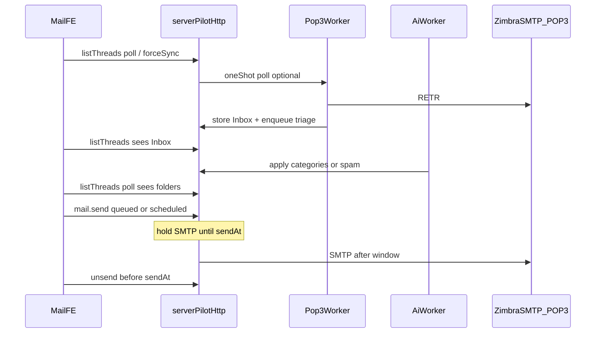

# feat: Live pilot production parity - Plan

## Goal Capsule

Make deployed `EC2-pilot` (FE `apps/mail` + `apps/server-pilot` + POP3/AI workers) a production hotel mailbox end-to-end.

**Already true (ops, 2026-07-22+):** real Zimbra send + receive works for `navaai@` when transport/`MAIL_TRANSPORT_MODE=real` + VPN are healthy. Do not re-plan basic SMTP/POP3 cutover.

**Still broken / incomplete (this plan):** login Invalid origin risk, attachments both ways, undo + schedule, near-realtime UI (no F5), inbox-first + AI hotel folders, reply header/reply-all proof, UX honesty, safeties, EC2 Playwright real-mail UI gate.

**Authority:** this plan > prior Cursor audit plan > stale Jul early bug-hunt OPEN tables.

**Stop when:** Definition of Done met. Multi-user Centurion BCC stamp, Rocketseed, full AI chat/brain, and real admin analytics stay deferred.

---

## Global Constraints

- Branch: `EC2-pilot`. All verification on EC2 `i-008f737974a9ba9b3` (`af-south-1`), not laptop-only green.
- Real mail stays `MAIL_TRANSPORT_MODE=real` for the UI gate (navaai@ Zimbra). Do not flip back to fixture for the reply loopback smoke.
- Primary deploy: `apps/server-pilot/deploy/ops-deploy.sh` (`--migrate` when schema). Bounce: `ops-restart.sh`. Reboot: `ops-reboot.sh`.
- Existing `playwright-ec2-gate.sh` defaults `ZERO_DEMO_FRONTEND_ONLY=1` — **wrong for this gate**. Real-mail UI smoke must force frontend-only **off** and hit nginx SPA + live API.
- Near-realtime without F5 is in-scope (R5 / U4), not optional polish.

## Overnight Autonomous Execution Mandate

**User granted full autonomy.** No blocking questions overnight. No manual login. No "which approach?" pause. Ship U1–U9 green on EC2 with real mail.

### Communication

- Orchestrator + every subagent: **Respond `/caveman ultra`. Technical terms exact.**

### AWS / infra (use freely)

| Resource | ID / path |
|----------|-----------|
| EC2 | `i-008f737974a9ba9b3` (`af-south-1`) |
| RDS | `nava-zero-mail-pilot` (Postgres 16) |
| S3 | `nava-zero-mail-845242190536-af-south-1` |
| Repo on EC2 | `/home/ubuntu/repos/zero` |
| **Primary deploy** | `apps/server-pilot/deploy/ops-deploy.sh` (`--migrate` when schema) |
| **Primary app bounce** | `apps/server-pilot/deploy/ops-restart.sh` |
| **Primary box reboot** | `apps/server-pilot/deploy/ops-reboot.sh` |
| Guts (fallback) | `sync-ec2-git-bundle.sh`, `deploy-ec2.sh`, `ssm-run-command.sh` |

**Allowed:** ops wrappers, bundle sync, deploy, migrate (via `ops-deploy --migrate`), seed (no `--rotate` unless fix requires), SSM remote tests, Playwright on-box against `https://nava.legacy.local` / `https://127.0.0.1`, PM2 logs, health curl, RDS vitest on EC2.

**Forbidden:** force-push main, `--no-verify`, destructive git, IT Exchange/VPN/real mail creds rotation outside existing stage scripts.

### RCA loop (mandatory on any red)

FAIL → reproduce → root cause (file:line) → fix → test → commit → resume. Do not stop at first failure.

### Divergence authority

Better path to done criteria → take it. Log in handoff report under `docs/superpowers/plans/handoff-reports/`.

### Done criteria

- [ ] U1–U8 implemented + committed on `EC2-pilot`
- [ ] U9 EC2 Playwright gate green via SSM: compose self (AE7) + reply self (AE8) + Force Sync path (AE9); no F5
- [ ] `ops-deploy` (migrate if needed) + workers online with poll logs
- [ ] Handoff report written
- [ ] No open blockers for R1–R11 / AE1–AE9
- [ ] Overnight order honored: U1→U4→U9a → U6→U9b → rest

## Execution Mode

Autonomous overnight — no user checkpoint. REQUIRED SUB-SKILL: superpowers:subagent-driven-development (or ce-work equivalent). Do not ask "which approach?"

---

## Product Contract

### Problem Frame

Fork from `FE-demo-minimal` kept UI code. LIVE mode against `server-pilot` leaves many surfaces looking finished while lying (attachments dropped, download dead, sync forever, schedule/undo shapes unmet, PartyKit Do_State never fed). Ingest marks unstamped direct-To as spam before AI runs, fighting the intended inbox-first → triage model. Operators must refresh manually because default mail list polling is off. Existing Playwright EC2 gate proves button visibility under frontend-only demo — not real send/receive/reply.

### Actors

- A1. Pilot operator (`navaai@legacyhotels.co.za`) using `https://nava.legacy.local`
- A2. POP3 ingest worker + SMTP path (Zimbra over VPN)
- A3. Single `ai-worker` (triage only; drafts stay off)
- A4. Hotel guests / agents as email counterparts (external)

### Requirements

- R1. Login at SPA origin succeeds (no Invalid origin); session cookies work behind nginx.
- R2. Compose, Reply, Reply-All deliver real SMTP with correct to/cc and selected-message threading headers.
- R3. Attachments round-trip: outbound via SMTP; inbound open/download via signed URL path.
- R4. Undo send and schedule send work end-to-end (not demos); FE already expects `{queued|scheduled:true}` shapes.
- R5. Near-real-time mailbox UX: new inbound appears without manual full-page refresh; Force Sync actually triggers ingest + list refresh; sync indicator not stuck forever.
- R6. Inbound lands in Inbox first; single AI triage then assigns hotel categories (and may move true spam); hotel folder nav + colors work on live path.
- R7. Category chip filter uses category IDs, not Gmail label IDs.
- R8. Hide or disable dead stubs (Live Support without token, fake Saves) rather than fake success — except features in R4–R6 which must be real.
- R9. Safety: print XSS escape, seed/wipe gates, auth trustedOrigins, CSP honesty for what we keep.
- R10. Nava branding on login (remove user-facing Zero copy on pilot auth screens).
- R11. EC2 automated UI gate (ephemeral OK): login as navaai → (a) **compose** new navaai→navaai + (b) **reply** on a thread → both land in Inbox **without full-page refresh**; prove **poll path** and **Force Sync path** separately.

### Key Flows

- F1. Login → inbox list poll → open thread → reply-all with attachment → undo window → commit send.
- F2. External/self mail → POP3 store → Inbox → AI triage → travel-agents (or other) folder + optional spam.
- F3. Schedule send → appears as scheduled → fires at time → Sent.
- F4. EC2 Playwright compose: login → compose To=navaai unique marker → send → wait poll ≤20s **no F5** → marker in inbox.
- F5. EC2 Playwright reply: login → open/create thread → reply navaai→navaai unique marker → wait poll ≤20s **no F5** → marker visible.
- F6. EC2 Playwright forceSync: after send, click Force Sync (no F5) → list updates within one-shot ingest (covers AE4 forceSync arm).

### Acceptance Examples

- AE1. `BETTER_AUTH_URL=https://nava.legacy.local` + trusted origin → email/password login works from SPA.
- AE2. Reply-All with two Cc recipients + one PDF → Zimbra/recipient sees all + attachment.
- AE3. Undo within window cancels SMTP; after window, unsend does not claim success falsely.
- AE4. Within ~15s of POP3 DELE+store (or Force Sync), inbox list shows new thread without F5.
- AE5. New inbound appears in Inbox immediately; after AI write-gate apply, also under correct hotel folder; spam only when triage says spam (not merely missing `X-Zero-Mailbox` on direct-To navaai).
- AE6. Print hostile subject does not execute script in print iframe.
- AE7. SSM Playwright: **browser login** + compose self-mail; marker in inbox without F5 within **≥60s** poll budget (or forceSync-assisted).
- AE8. After U6: browser session + reply self-mail; marker without F5 within ≥60s (headers correct for selected message).
- AE9. After send, Force Sync mutation completes with counts; marker appears without F5; proof not attributable solely to background poll (pause poll or correlate).

### Scope Boundaries

**In**
- Auth origin/cookies, core mail send/receive/reply, attachments, undo/schedule queue, near-realtime list refresh + real forceSync, inbox-first routing + AI hotel folders, UX honesty, safeties listed.
- EC2 overnight autonomy + ephemeral Playwright real-mail UI gate (not a permanent product test suite requirement).

**Deferred to Follow-Up Work**
- Multi-mailbox Centurion BCC + trusted re-stamp
- Rocketseed banners, Secrets Manager mail passwords
- Full AI compose/chat/brain/notes/templates/BIMI
- Real admin dashboard metrics backend
- True websocket/PartyKit parity (polling + forceSync is the pilot bar)
- Long-term CI Playwright product suite (U9 may live as deploy script only)

**Outside this product's identity**
- Cloudflare `apps/server` Graph/Outlook production path

### Key Decisions

- KD1. Undo + schedule must work, not be hidden. (session-settled: user-directed — chosen over hide-stubs-only: critical mailbox features)
- KD2. Near-real-time UI updates required for connected FE vs POP3 pipeline. (session-settled: user-directed — chosen over manual refresh: original fork had live updates)
- KD3. Hotel folders required via inbox-first then AI triage. (session-settled: user-directed — chosen over spam-at-ingest for unstamped direct-To)
- KD4. Single AI worker/model fine for now. (session-settled: user-approved — chosen over multi-model/multi-worker)
- KD5. Extra safeties in scope. (session-settled: user-approved — chosen over defer safety)
- KD6. Prove end-to-end on EC2 via automated UI gate; ephemeral scripts OK. (session-settled: user-directed — chosen over local-only / affordance-only Playwright)
- KD7. Full overnight scope = U1–U9 (eng-review option A); critical order U1→U4→U9 first. (session-settled: user-directed — chosen over cut-scope B/C)
- KD8. U9 includes **compose new self-mail** as its own Playwright case (not only reply). (session-settled: user-directed)
- KD9. U9 proves **both** poll-without-F5 and Force-Sync-without-F5. (session-settled: user-directed — overnight has time for both)
- KD10. U9 / pilot gate uses **undoSeconds=0** (immediate SMTP); human product undo stays ~15–30s. Avoids false-red from undo hold. (session-settled: user-approved eng-review Arch#1 option A — chosen over longer wait / ship-U9-before-U3)

---

## Planning Contract

### Summary

Ship production-bar pilot mailbox on EC2 overnight: auth, attachments, undo/schedule, near-realtime polling + forceSync, inbox-first + AI categories, honesty/safety, plus Playwright real-mail UI gate (login → reply self → see without F5). Do not rebuild PartyKit; do not re-enable full AI chat.

### Key Technical Decisions

- KTD1. Set `BETTER_AUTH_URL` default/write path to `https://nava.legacy.local` and add `trustedOrigins` (plus optional `BETTER_AUTH_TRUSTED_ORIGINS`) per Better Auth CSRF model — chosen over disabling origin checks. (session-settled inheritance from KD1 login needs)
- KTD2. Near-realtime = default `VITE_MAIL_POLL_MS` to **15000** (existing policy min in `thread-polling-policy.ts`) + `mail.forceSync` triggers one-shot POP3 poll and returns counts; FE invalidates list queries and drives sync indicator from real worker/list signals — chosen over restoring PartyKit/Do_State this pass. (session-settled: user-directed KD2; PartyKit deferred)
- KTD3. Undo/schedule = persist outbound as `queued`/`scheduled` with `sendAt`, SMTP only after window/time via existing worker or small send-flush in POP3/AI sibling loop — return FE shapes in `email-utils.ts` — chosen over immediate SMTP + fake undo. (session-settled: user-directed KD1)
- KTD4. Unstamped direct-To matching active transport → Inbox (no `spamAt` at ingest); AI triage may set `spamAt` / categories after — chosen over current spam-at-ingest. (session-settled: user-directed KD3)
- KTD5. Attachments: extend SMTP payload + pass from `mail.send`; FE download uses `mail.getAttachment` signed URL — chosen over stuffing base64 into list API.
- KTD6. Keep `AI_DRAFTS_ENABLED=false`; require `AI_WRITE_GATE_ENABLED=true` in real-mail activate/env for durable categories — single ai-worker. (session-settled: user-approved KD4)
- KTD7. Hide Live Support when token null; apply live folder colors; fix CategoryDropdown → `categoryIds`; Nava login copy; escape print fields; gate `seed:prod` / wipe scripts.
- KTD8. EC2 UI proof = new `playwright-real-mail-ui-gate.sh` (or flag on existing gate) with `ZERO_DEMO_FRONTEND_ONLY=0`, `PLAYWRIGHT_BASE_URL=https://nava.legacy.local` (or https://127.0.0.1), navaai credentials from SM/pilot-users — ephemeral OK. Specs: (1) compose To=self unique marker → poll ≤20s no F5; (2) reply unique marker → poll ≤20s no F5; (3) one of those (or third) after send → Force Sync → assert update no F5. (session-settled: user-directed KD6–KD9)
- KTD9. Overnight order: **U1 → U4 → U9a** (browser login + compose AE7 + Force Sync AE9) → **U6 → U9b** (reply AE8) → U2/U3/U5 → U7/U8. Do not declare overnight done until AE7–AE9 pass. (session-settled: user-directed KD7; Terra P1 reply-before-U6)
- KTD10. Undo window: product default ~15–30s → `{queued:true,sendAt}`. Gate/`UNDO_SEND_SECONDS=0` uses **same outbound queue row** with `sendAt=now` then **synchronous flush** on send path (return `{sent:true}` after SMTP) — not a separate bypass state machine. Must be set in **PM2/`write-ec2-env.sh` + `ops-restart`**, not only Playwright shell env. (session-settled: user-approved KD10; Terra P0 env+queue hardening — safe/complete)
- KTD11. U9 must exercise **real SPA login form** (email/password in browser against nginx origin) for AE1/R1. Cookie mint alone is insufficient — may green while Invalid origin still breaks humans. (Terra P0 — do the work)
- KTD12. Timing: AE7/AE8 wait budget **≥60s** (15s poll + SMTP/POP3/VPN slack). AE9: after send, either pause list poll for that test **or** assert only after `forceSync` mutation resolves with `{triggered,processed}` and unique marker — no race with background poll false-green. (Terra P0 — safe)
- KTD13. U3 durable send: single worker owner + row claim, wakeup on sendAt, retries with backoff, SMTP idempotency key / sent-once guard, PM2 log lines for flush success/fail. (Terra P0 — do the work)
- KTD14. `forceSync`: mailbox-scoped lock, timeout, skip/wait if POP3 cycle in flight; return real counts. (Terra P1 — do the work)
- KTD15. Inbox-first stays; if `AI_WRITE_GATE` unhealthy / worker down → degraded policy: rate-limit or soft-quarantine unauthenticated external after bounded lag (document threshold). No unbounded spam dump. (Terra P1 — safe containment; product KD3 preserved)
- KTD16. U9 deploy assert: SPA `index.html`/build hash mtime fresher than gate start (or curl cache-bust) so nginx is not serving stale FE against new API. (Terra P2 — do the work)

### Assumptions

- Real send/receive already works in production pilot (user-confirmed 2026-07-23). U1 still hardens auth origin for SPA login; U2+ do not re-litigate SMTP/POP3 connectivity.
- One pilot user `navaai@` is enough; Centurion transport may remain seeded but switcher stays off until multi-user work.
- External MX proof remains ops AE if not already done; self-send+POP3 sufficient for engineering DoD if documented.
- Product Contract preservation: added R11/F4–F6/AE7–AE9/KD6–KD9; prior R1–R10 meaning unchanged.
- Overnight autonomy applies; executor uses EC2 for deploy + UI gate; navaai password from existing pilot-users/SM.
- Undo window ~15–30s for humans; U9 uses `UNDO_SEND_SECONDS=0` in PM2 env → same queue + sync flush → `{sent:true}` (Arch#1 A + Terra harden).
- Admin: hide or empty placeholder OK tonight.

### High-Level Technical Design



### Risks and Dependencies

- Undo/schedule needs durable queue + worker flush; race if http and worker both flush — use row claim.
- Inbox-first change alters spam semantics vs older smoke docs — update runbooks.
- Polling burns API load — cap interval ≥10s; pause when tab hidden (already `refetchIntervalInBackground: false`).
- Attachment size vs nginx `client_max_body_size` already 35m — keep.
- UNDO_SEND_SECONDS must live in PM2 env; shell-only = false confidence (Terra).
- U9 curl-mint ≠ browser login proof (Terra).
- AE9 vs 15s poll race without correlation (Terra).

---

## Implementation Units

### U1. Auth origin + deploy env defaults

**Goal:** Login from `https://nava.legacy.local` never Invalid origin due to `127.0.0.1` baseURL.

**Requirements:** R1, AE1

**Dependencies:** none

**Files:**
- `apps/server-pilot/src/lib/auth.ts`
- `apps/server-pilot/deploy/write-ec2-env.sh`
- `apps/server-pilot/tests/` (auth trusted-origin contract test — add/extend)
- `apps/mail/app/(auth)/zero/login/page.tsx`
- `apps/mail/app/(auth)/login/login-client.tsx`

**Approach:** Default/write `BETTER_AUTH_URL=https://nava.legacy.local`; pass `trustedOrigins` including that origin and env CSV; Nava login headings.

**Test scenarios:**
- Trusted origin matching SPA → origin check passes.
- Mismatched origin (e.g. evil.com) still rejected.
- Login copy does not say Zero on pilot pages.

**Verification:** Login AE1 on deployed box or local nginx mimic.

---

### U2. Attachment send + download

**Goal:** Files leave via SMTP; inbound files open/download.

**Requirements:** R3, AE2

**Dependencies:** U1 optional

**Files:**
- `apps/server-pilot/src/mail/send/smtp.ts`
- `apps/server-pilot/src/trpc/routes/mail.ts`
- `apps/server-pilot/src/trpc/wire-compat.ts`
- `apps/mail/hooks/use-attachments.ts`
- `apps/mail/components/mail/mail-display.tsx` (download/open paths)
- `apps/server-pilot/tests/` (smtp attachment + getAttachment wire)
- `apps/mail/tests/` (download uses signed URL / blob fetch)

**Approach:** Nodemailer attachments from FE serialized payload; persist outbound attachment rows; FE calls `getAttachment` then fetch URL (not `atob(empty)`).

**Execution note:** Start with failing test that send payload includes attachment buffer reaching transport mock.

**Test scenarios:**
- Happy: one PDF on send → transport receives filename+content.
- Inbound: getMessageAttachments metadata + getAttachment URL opens.
- Error: missing attachment id → FORBIDDEN/NOT_FOUND not empty toast lie.

**Verification:** AE2 manual or integration against FakeSmtp capturing attachments.

---

### U3. Undo send + schedule send queue

**Goal:** FE undo toast and schedule picker drive real delayed SMTP.

**Requirements:** R4, AE3, F1, F3

**Dependencies:** U2 for attachment-on-flush

**Files:**
- `apps/server-pilot/src/trpc/routes/mail.ts` (`send`, `unsend`)
- `apps/server-pilot/src/db/schema/` (outbound status / sendAt columns or table)
- `apps/server-pilot/src/mail/send/` (flush helper)
- Worker entry used for flush (POP3 worker tick or dedicated — prefer reuse worker loop)
- `apps/mail/lib/email-utils.ts` / undo hooks (consume returned shape)
- `apps/server-pilot/tests/` undo window + schedule flush

**Approach:** `mail.send` always inserts outbound pending row (`queued`/`scheduled`). Default undo ~15–30s → return `{queued:true,sendAt}`; flush owner = existing worker loop with **row claim**, wakeup, retries, **sent-once** guard, structured logs. `UNDO_SEND_SECONDS=0` (PM2): same row with `sendAt=now` then **sync flush before HTTP returns** → `{sent:true}` (KTD10/KTD13). Attachments snapshotted on queue insert (bytes/S3 key), not live draft URLs at flush (Terra P1).

**Test scenarios:**
- Undo before sendAt → no SMTP call; row gone/cancelled.
- After sendAt → SMTP called once; crash mid-flush → retry does not double-send (idempotency).
- scheduleAt future → no SMTP until clock; then send.
- undoSeconds=0 → sync flush; `{sent:true}`; FE does not arm undo toast.
- Worker down → scheduled rows remain claimable after restart.

**Verification:** Unit with fake clock + FakeSmtp; UI undo toast arms on live send.

---

### U4. Near-realtime list + real forceSync + sync indicator

**Goal:** Operators see new mail without manual refresh; sync UI honest.

**Requirements:** R5, AE4

**Dependencies:** none (parallel with U2/U3)

**Files:**
- `apps/mail/lib/mail/thread-polling-policy.ts`
- `apps/mail/hooks/use-threads.ts`
- `apps/server-pilot/deploy/deploy-ec2.sh` / FE env for `VITE_MAIL_POLL_MS`
- `apps/server-pilot/src/trpc/routes/mail.ts` (`forceSync`)
- `apps/server-pilot/src/mail/ingest/worker.ts` (export one-shot poll)
- `apps/mail/components/ui/nav-user.tsx` / `use-do-state.ts` or replacement sync state
- `apps/mail/hooks/use-stats.ts` (folder badges from list/stats API or drop fake Party counts)
- Tests: `apps/mail/tests/thread-polling-policy.test.ts`, forceSync contract test

**Approach:** Change `resolveThreadPollingMs` so missing env defaults to 15000 (keep min 15s); bake `VITE_MAIL_POLL_MS=15000` in deploy FE build; `forceSync` runs one POP3 cycle under **mailbox lock** (wait/skip if worker cycle in flight, timeout), returns `{triggered:true, processed, listed}` (KTD14); FE invalidates `mail.listThreads` / drafts; replace Do_State-dependent “Syncing…” with lastSyncAt / isSyncing from mutation+poll.

**Test scenarios:**
- Undefined env → 15000 (not null).
- forceSync increments processed when FakePop3 has mail.
- Sync indicator green when not syncing and storage/lastSync known.

**Verification:** AE4 with poll env set on deployed FE build.

---

### U5. Inbox-first ingest + AI hotel folders live UX

**Goal:** Direct-To navaai → Inbox; AI write-gate categorizes; folders colored; chip filter works.

**Requirements:** R6, R7, AE5

**Dependencies:** AI worker + write gate ops (KTD6)

**Files:**
- `apps/server-pilot/src/mail/ingest/store.ts` (remove spam-at-ingest for direct-To)
- `apps/server-pilot/scripts/activate-real-mail.sh` / `write-ec2-env.sh` (AI_WRITE_GATE_ENABLED=true)
- `apps/mail/config/navigation.ts` (`buildLiveCategoryNavItems` colors)
- `apps/mail/hooks/use-categories.ts` / `components/mail/mail.tsx` CategoryDropdown → categoryIds
- `apps/server-pilot/tests/` store routing + triage apply
- `apps/mail/tests/` category filter contract

**Approach:** Align with existing triage plan: AI may set spam later; until then Inbox. Ensure categories seeded; FE live colors from palette or `category.color`. If AI write-gate/worker unhealthy beyond bounded lag → **degraded soft-quarantine or rate-limit** for unauthenticated external (KTD15); do not leave infinite unfiltered dump.

**Test scenarios:**
- Direct-To transport email → stored inbound, `spamAt` null, triage enqueued.
- After triage travel-agents → thread in category filter; still in Inbox unless product says category-only (keep Inbox + category multi-select as today).
- CategoryDropdown sets categoryIds → non-empty when rows exist.

**Verification:** AE5 on real or fixture+AI path.

---

### U6. Reply selected-message headers + reply-all proof

**Goal:** Reply headers match clicked message; reply-all Cc survives; tests prove SMTP recipients.

**Requirements:** R2, AE2

**Dependencies:** U3 if send goes through queue (headers on flush)

**Files:**
- `apps/server-pilot/src/trpc/wire-compat.ts` / `mail.ts` (accept inReplyTo/references or replyToMessageId)
- `apps/mail/components/mail/reply-composer.tsx` / `email-composer.tsx` (Cc panel)
- `apps/mail/tests/reply-recipients.test.ts` (extend)
- `apps/server-pilot/tests/` send header + cc arrays

**Approach:** Prefer explicit FE headers or resolve from message id; do not always use latest thread message.

**Test scenarios:**
- Reply to older message → inReplyTo = that Message-ID.
- Reply-all → SMTP to+cc match deriveReplyRecipients.

**Verification:** Integration assert on FakeSmtp envelope.

---

### U7. Honesty + branding leftovers

**Goal:** No dead Live Support; no fake notification/security save; Nava copy; orphan routes handled.

**Requirements:** R8, R10

**Dependencies:** none

**Files:**
- `apps/mail/lib/demo/support-links.ts` / `nav-main.tsx`
- `apps/mail/app/(routes)/settings/notifications/page.tsx`
- `apps/mail/app/(routes)/settings/security/page.tsx`
- Settings nav / routes for connections|signatures (hide or wire)
- Admin allowlist: include `navaai@` or keep hidden with clear empty state

**Approach:** Hide support without token; disable fake Save buttons or mark “not available in pilot”; prefer hide over fake metrics for admin unless allowlisted with banner “placeholder”.

**Test scenarios:**
- `shouldShowSupportLinks` false when no token / pilot.
- Notifications save does not toast success without persistence (or page hidden).

**Verification:** Manual nav pass on deployed SPA.

---

### U8. Safeties: print XSS, seed/wipe gates, CSP/docs

**Goal:** Hostile content and ops scripts cannot quietly destroy trust/data.

**Requirements:** R9, AE6

**Dependencies:** none

**Files:**
- `apps/mail/components/mail/thread-display.tsx` / `mail-display.tsx` (escape subject/tags/filename in print)
- `apps/server-pilot/scripts/seed-prod.ts` / `deploy/pilot-db-wipe.sh` (markers + CONFIRM + optional DB allowlist)
- `apps/server-pilot/deploy/nginx.conf` / `deploy-config.test.ts` (align CSP expectations; do not open Intercom if hidden)
- Runbook notes under `apps/server-pilot/deploy/` or `docs/solutions/` for inbox-first + poll env

**Test scenarios:**
- Print HTML escapes `<script>` in subject.
- seed-prod refuses without wipe marker / confirm when non-pilot users exist.

**Verification:** AE6 + dry-run wipe refusal.

---

### U9. EC2 Playwright real-mail UI gate (ephemeral)

**Goal:** On EC2, prove browser login + compose self + reply self + inbox update without F5 via poll and Force Sync — timing/correlation hardened.

**Requirements:** R1, R5, R11, AE1, AE4, AE7, AE8, AE9, F4, F5, F6 — cites KTD2, KTD8–KTD16, KD7–KD10

**Dependencies:** U1+U4 before U9a (login/compose/forceSync); **U6 before U9b** (reply AE8)

**Files:**
- `apps/server-pilot/deploy/playwright-real-mail-ui-gate.sh` (new; refuse `ZERO_DEMO_FRONTEND_ONLY=1`)
- `apps/server-pilot/deploy/write-ec2-env.sh` (`UNDO_SEND_SECONDS=0` for gate wave + restart)
- `apps/mail/tests/e2e/real-mail-browser-login.spec.ts` (AE1 — form submit, not curl-only)
- `apps/mail/tests/e2e/real-mail-compose-self-loopback.spec.ts` (AE7)
- `apps/mail/tests/e2e/real-mail-reply-loopback.spec.ts` (AE8 — after U6)
- `apps/mail/tests/e2e/real-mail-force-sync-loopback.spec.ts` (AE9)
- Handoff: `docs/superpowers/plans/handoff-reports/YYYY-MM-DD-live-pilot-parity-overnight.md`

**Approach:**
1. `ops-deploy` + ensure `UNDO_SEND_SECONDS=0` in **PM2 env** via `write-ec2-env` + `ops-restart` (KTD10). Assert SPA build freshness (KTD16).
2. **Browser login (AE1/KTD11):** open login page → type navaai credentials → submit → land in mailbox. Curl mint may assist other specs but must not be sole auth proof.
3. **Compose (AE7):** Compose To=navaai + unique marker → Send → **no F5** → wait **≥60s** for poll **or** click Force Sync then assert (KTD12).
4. **Force Sync (AE9):** after send, pause polling if needed → click Force Sync → wait for mutation `{processed}` → assert marker (no poll false-green).
5. **Reply (AE8):** only after U6; reply to **compose result / selected message**, not “any thread”; unique marker; ≥60s or forceSync-assisted.
6. Fail without F5 → fix U4. Scripts disposable.

**Execution note:** U9a before U6; U9b after U6. Screenshots on fail.

**Test scenarios:**
- Covers AE1. Browser login succeeds at nginx origin.
- Covers AE7. Compose self → inbox without F5 (≥60s or sync-assisted).
- Covers AE8. Reply selected message → inbox without F5 (post-U6).
- Covers AE9. Force Sync path correlated, not poll race.
- Frontend-only / stale SPA / missing PM2 UNDO=0 → gate refuses.

**Verification:** SSM exit 0 for AE1+AE7+AE8+AE9 + handoff.

---

## Verification Contract

- Unit/integration: server-pilot vitest for send attachments, undo/schedule, forceSync, store inbox-first, reply headers.
- FE: thread-polling default, category filter, support-link gate, print escape.
- Deploy smoke on EC2: `ops-deploy` + PM2 worker poll logs.
- **U9 Playwright real-mail UI gate via SSM** (browser login + compose + reply + forceSync).
- Do not treat old `playwright-ec2-gate.sh` with frontend-only=1 as proof.

## Definition of Done

- [ ] R1–R11 satisfied on EC2 pilot build with real transport.
- [ ] AE1–AE9 evidenced (logs/screenshots/SSM output).
- [ ] U9 gate green: compose + reply + Force Sync loopbacks without F5.
- [ ] No Live Support / fake Save / stuck Syncing in default pilot UI.
- [ ] Runbooks updated for inbox-first + `VITE_MAIL_POLL_MS` + AI write gate + real-mail UI gate.
- [ ] Overnight handoff report written.
- [ ] Deferred items explicitly not started.

## Sources and Research

- Session full-surface audits (tRPC matrix, FE routes, ops, leftover CSP/print/seed).
- Better Auth docs: `trustedOrigins` + explicit `BETTER_AUTH_URL` for reverse proxy (exa 2026).
- Prior: `docs/plans/2026-07-10-001-feat-production-ai-triage-plan.md`, `docs/production-readiness/2026-07-06-fe-server-pilot-drift-audit.md`, `docs/solutions/runtime-errors/pm2-esm-is-cli-entry-and-unref-sleep.md`.
- Overnight pattern: `docs/superpowers/plans/2026-07-04-nava-fixture-loopback-autonomous-e2e.md`; deploy: `apps/server-pilot/deploy/playwright-ec2-gate.sh` (defaults to flip).
- Overlay skill: `.cursor/skills/overnight-autonomous-zero/SKILL.md`.


---

## Decision Policy (session-settled — eng-review)

- Safe vs unsafe → **always safe** (recommended).
- Skip work vs do work → **do the work**.
- Do **not** block user on trivia. Log in chat/handoff: question → chose recommended → why → continue.

---

## GSTACK REVIEW REPORT

**Mode:** FULL_REVIEW (plan doc) · Scope: **A** full U1–U9 · Branch: `EC2-pilot`  
**Date:** 2026-07-23

### Step 0

- Scope **A** accepted; order U1→U4→U9 first, then U2/U3/U5/U6, then U7/U8.
- Complexity smell acknowledged; user chose full lake.
- Reuse: real SMTP/POP3, `forceSync` stub, `playwright-ec2-gate.sh` (flip defaults), poll policy, FakeSmtp, ops-deploy/SSM.
- Branch design doc = search parity (unrelated) — not SoT here.

### Architecture (auto after policy)

| # | Finding | Decision | Why |
|---|---------|----------|-----|
| 1 | U3 undo delay false-reds U9 | `UNDO_SEND_SECONDS=0` → `{sent:true}` for gate | Safe; user approved A |
| 2 | U3 flush ownership | Reuse worker tick + row claim; undo=0 bypasses queue | Boring/safe |
| 3 | Playwright gate | New `playwright-real-mail-ui-gate.sh`; refuse frontend-only=1 | Don't poison demo gate |
| 4 | Admin metrics | Hide / placeholder | Honesty |

### Code Quality (auto)

| # | Finding | Decision |
|---|---------|----------|
| 1 | Poll test expects `undefined → null` | Flip test + default 15000 |
| 2 | `atob(empty)` download | Full `getAttachment` path (U2) |
| 3 | Duplicate gate shell | Shared mint/health helpers |
| 4 | Fake Saves | Hide/disable |

### Test coverage sketch

```
U4 poll/forceSync     → unit + AE7/AE8/AE9 E2E
U1 auth               → contract + AE1
U3 undo               → unit (gate uses undo=0)
U2/U5/U6/U8           → unit/integration per plan
REGRESSION: poll default change must update thread-polling-policy.test.ts same commit
```

### Performance (auto)

- Keep poll ≥15s; background refetch already off.
- forceSync vs worker: claim/skip if in-flight if race appears.
- nginx 35m attach — keep.

### What already exists

Real navaai send/recv · `forceSync` stub · poll policy (null unset) · frontend-only Playwright gate · FakeSmtp · ops-deploy/SSM overnight pattern.

### NOT in scope

PartyKit · Centurion BCC · Rocketseed · full AI chat/drafts · real admin metrics · long-term CI Playwright suite · search design-doc work.

### Parallelization

Lane A (U1→U4→U9) serial critical → then B(U2,U6)+D(U5) → C(U3) → E(U7,U8).

### Implementation Tasks

- [ ] **T1 (P0)** U4 poll default + test flip + FE env
- [ ] **T2 (P0)** U4 real forceSync + FE invalidate
- [ ] **T3 (P0)** U1 trustedOrigins + BETTER_AUTH_URL
- [ ] **T4 (P0)** U9 compose+reply+forceSync; UNDO=0; refuse frontend-only
- [ ] **T5 (P1)** U3 undo/schedule + undo=0 path
- [ ] **T6 (P1)** U2 attachments
- [ ] **T7 (P1)** U5 inbox-first + categories
- [ ] **T8 (P1)** U6 reply headers
- [ ] **T9 (P2)** U7 honesty
- [ ] **T10 (P2)** U8 safeties

### Outside voice

- Codex: auth failed (bad API key).
- [Terra plan review](b2af78f8-38ff-4a5e-8c12-0dd23aedac2a) (gpt-5.6-terra-medium): **accepted under decision policy** — folded into KTD10–KTD16 + U3/U4/U5/U9.

**Terra P0 folded**
1. Browser login required (not curl mint alone) → KTD11 / U9
2. ≥60s wait budget → KTD12 / AE7–AE8
3. Force Sync correlation / no poll false-green → KTD12 / AE9
4. UNDO=0 in PM2 + same queue + sync flush → KTD10
5. U3 claim/retry/idempotency/logs → KTD13

**Terra P1 folded**
6. Reply E2E after U6 → KTD9 / U9b
7. forceSync lock/timeout → KTD14
8. Inbox-first degraded containment → KTD15
9. Attachment snapshot on queue → U3
10. External MX still deferred (self-loopback = eng proof)

**Terra P2 folded**
11. Stale SPA assert → KTD16
12. Rollback = existing ops-restart

**Cross-model tensions — auto (safe/complete)**
- Undo=0: **same queue + sync flush** (not alien bypass) — safer; still `{sent:true}` for FE.
- Poll vs Force Sync: **AE9 on forceSync completion**; AE7/AE8 ≥60s poll UX proof.
- Inbox-first: keep KD3; add **degraded quarantine/rate-limit** if AI gate unhealthy.

### Auto-decisions log

1. undo=0 for gate — safe (user A)
2. Terra harden: same-queue sync flush + PM2 env — safer
3. worker flush + claim + idempotency — do work
4. new real-mail gate + browser login — do work
5. hide admin fakes — honesty
6. full attach download + queue snapshot — do work
7. update poll unit test — do work
8. poll + Force Sync E2E — user; AE9 correlated
9. compose + reply E2E — user; reply after U6
10. ≥60s wait / degraded AI containment / SPA freshness — safe Terra

### Implementation Tasks (updated)

- [ ] **T1 (P0)** U4 poll default + test flip + FE env
- [ ] **T2 (P0)** U4 real forceSync + lock/timeout + FE invalidate
- [ ] **T3 (P0)** U1 trustedOrigins + BETTER_AUTH_URL
- [ ] **T4 (P0)** U9a: browser login + compose + forceSync; PM2 UNDO=0; SPA freshness
- [ ] **T5 (P0)** U3 queue durability (claim/retry/idempotency) + undo=0 sync flush
- [ ] **T6 (P1)** U6 reply headers then U9b reply E2E
- [ ] **T7 (P1)** U2 attachments + queue snapshot
- [ ] **T8 (P1)** U5 inbox-first + categories + AI degraded mode
- [ ] **T9 (P2)** U7 honesty
- [ ] **T10 (P2)** U8 safeties

### Completion summary

- Step 0: **A accepted** (ordered)
- Architecture / CQ / Perf: folded
- Tests: AE1 + AE7–AE9 hardened
- Outside voice: Terra folded (0 unresolved)
- Unresolved user decisions: **0**
