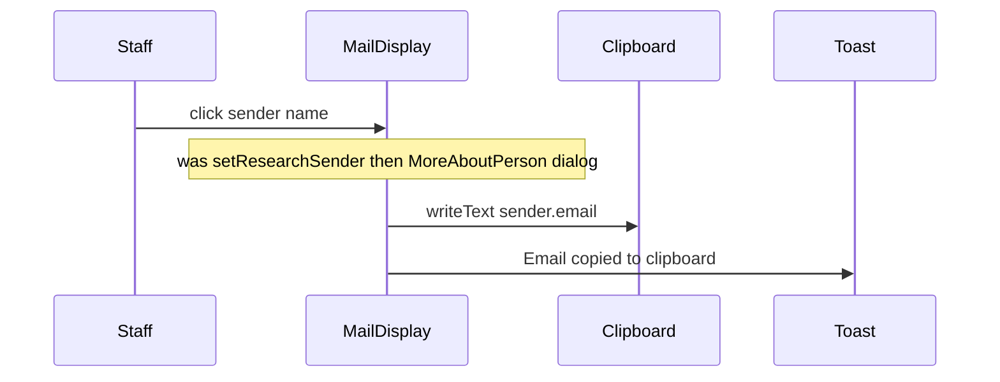

# feat: Sender click copies email instead of web-search dialog

## Goal Capsule

**Objective:** When staff click a message sender name in thread detail, copy that address to the clipboard and show the existing success toast — do not open the “More about …” web-search dialog (blank overlay + “Web search is unavailable in pilot mode.”).

**Authority:** Session request; live `apps/mail/components/mail/mail-display.tsx` behavior.

**Stop when:** Sender name click copies email + toast; More-about person dialog gone; dead `MoreAboutQuery` path removed from mail-display; demo-backend-guards web-search tests for `resolveMailDisplayWebSearch` updated/removed; no pilot AI web-search UI left on that click path.

---

## Product Contract

### Problem Frame

Pilot disables AI web search. Clicking the sender still opens `MoreAboutPerson`, which calls `ai.webSearch` and surfaces a modal with overlay (“blank screen”) and the stub copy. Staff want a one-click copy of the email instead. Clipboard + toast already exist for the recipient-chip copy icon.

### Requirements

- **R1.** Clicking the sender display name (`MailboxInline` hit target in the message header) copies `emailData.sender.email` to the clipboard.
- **R2.** On success, show the existing toast: `Email copied to clipboard` (reuse `handleCopySenderEmail` — do not invent a second toast string).
- **R3.** Do not open `MoreAboutPerson` / any “More about …” dialog on that click.
- **R4.** Empty/missing sender email: no clipboard write and no success toast (same guard as today’s `handleCopySenderEmail`).
- **R5.** Recipient people chips (`renderPerson` popover + copy icon) keep current behavior.
- **R6.** Remove unused mail-display web-search UI for this surface (`MoreAboutPerson`, dead `MoreAboutQuery`/`searchQuery`, and helpers only used by them) so the overlay path cannot regress.

### Actors

- **A1.** Hotel staff reading a thread in live pilot.

### Key Flows

- **F1.** Open thread → click sender name → clipboard holds email → toast confirms → no modal.
- **F2.** Open thread → hover recipient chip → click copy icon → same toast (unchanged).

### Acceptance Examples

- **AE1.** Given a message from `aurora@example.com` displayed as a friendly name, when the staff clicks the sender name, then the clipboard contains `aurora@example.com` and a success toast appears; no dialog with “More about” or “Web search is unavailable in pilot mode.”
- **AE2.** Given sender email is empty, when the staff clicks the sender name, then nothing is copied and no success toast appears.
- **AE3.** Given a recipient chip in the people row, when the staff uses the existing copy icon, then behavior remains copy + toast (no regression).

### Scope Boundaries

**In:** Sender-name click handler and removal of mail-display “More about” web-search dialog stack tied to that UX.

**Out / deferred:** Re-enabling real web search; changing `ai.webSearch` stub on server; ElevenLabs voice tools that call `webSearch`; command-palette search; BIMI/avatar click behavior; toast wording changes beyond the existing string.

**Product Contract preservation:** Product Contract unchanged (bootstrap this run).

---

## Planning Contract

### Session-settled decisions

- Replace “More about” dialog with clipboard copy on sender click `(session-settled: user-directed — chosen over keep disabled-search card: card is dead UX in pilot)`.
- Reuse existing toast `Email copied to clipboard` via `handleCopySenderEmail` `(session-settled: user-approved — chosen over new “Email name copied” string: already implemented)`.
- Delete dead `MoreAboutQuery` / `searchQuery` path with the person dialog `(session-settled: user-directed max-completeness on downstream — never set non-null)`.

### Key Technical Decisions

1. **Wire sender click to `handleCopySenderEmail`** — Same helper as the recipient-chip copy icon (`navigator.clipboard.writeText` + `toast.success('Email copied to clipboard')`). Stops `setResearchSender`.
2. **Remove mail-display web-search dialog stack** — Delete `MoreAboutPerson`, `MoreAboutQuery`, `useMailDisplayWebSearchMutation`, and exported `resolveMailDisplayWebSearch` from `mail-display.tsx` once unused; drop `researchSender` / `searchQuery` state and related JSX. Prevents overlay regression.
3. **Leave server `ai.webSearch` stub alone** — Still used by `elevenlabs-tools.ts`; not part of this click UX.
4. **Optional dead-code:** `demoWebSearch` in `apps/mail/lib/demo/local-actions.ts` may become unused after export removal — delete only if nothing else imports it; otherwise leave for a later cleanup.

### High-Level Technical Design

### Assumptions

- Secure-context clipboard API works in the live pilot SPA (same as existing copy icon).
- Staff always want the raw email address on clipboard, not the display name.

### Alternatives Considered

- **Keep dialog with static “search disabled” copy** — Rejected; user asked to remove the card.
- **Popover with Reply / Copy actions (Nextcloud-style)** — Deferred; user asked for one-click copy, not a new menu.
- **New toast string “Email name copied”** — Rejected; reuse proven toast.

---

## Implementation Units

### U1. Sender click copies email; remove More-about dialog

**Goal:** Sender name click copies email + toast; no web-search modal.

**Requirements:** R1–R4, R6; AE1–AE2

**Dependencies:** none

**Files:**
- Modify: `apps/mail/components/mail/mail-display.tsx`
- Test: `apps/mail/tests/demo-backend-guards.test.ts` (cleanup in U2; U1 may add a small unit test for click→copy helper if extracted — prefer keeping `handleCopySenderEmail` and covering via guard-test cleanup + manual smoke)

**Approach:**
- On sender `MailboxInline` wrapper `onClick`, call `handleCopySenderEmail(emailData?.sender?.email || '')` instead of `setResearchSender(...)`.
- Remove `researchSender` state, `MoreAboutPerson` render, and the `MoreAboutPerson` component.
- Remove dead `searchQuery` / `MoreAboutQuery` and helpers only used by the dialogs (`resolveMailDisplayWebSearch`, `useMailDisplayWebSearchMutation`, `StreamingText` if solely used there, `demoWebSearch` import).
- Keep `handleCopySenderEmail` and recipient-chip copy icon.

**Execution note:** Prefer a focused unit test around `resolveMailDisplayWebSearch` removal (delete tests) rather than brittle React click tests; smoke AE1 manually or in Playwright later if desired.

**Patterns to follow:** Existing `handleCopySenderEmail` at ~899–904; recipient chip copy icon ~1300–1304.

**Test scenarios:**
- Happy: sender email present → clipboard write + success toast (behavior of `handleCopySenderEmail`).
- Edge: empty email → early return, no toast.
- Integration: sender click no longer mounts dialog / no `ai.webSearch` call from this path.

**Verification:** Click sender in thread detail → toast + paste email; no “More about” overlay.

---

### U2. Update demo-backend-guards web-search tests

**Goal:** Tests match removed `resolveMailDisplayWebSearch` export.

**Requirements:** R6

**Dependencies:** U1

**Files:**
- Modify: `apps/mail/tests/demo-backend-guards.test.ts`

**Approach:**
- Remove import of `resolveMailDisplayWebSearch`.
- Remove the four mail-display web-search tests (~585–679) and unused `ai.webSearch` mock wiring only used by them.
- Keep other demo-backend guard coverage intact.

**Test scenarios:**
- Happy: remaining demo-backend-guards suite still passes.
- Edge: no dangling import/reference to `resolveMailDisplayWebSearch`.

**Verification:** `pnpm exec vitest run tests/demo-backend-guards.test.ts` in `apps/mail` green.

---

### U3. Optional orphan `demoWebSearch` cleanup

**Goal:** No unused demo web-search helper left if U1 removed the only consumer.

**Requirements:** R6 (hygiene)

**Dependencies:** U1

**Files:**
- Modify (conditional): `apps/mail/lib/demo/local-actions.ts`

**Approach:** Grep for `demoWebSearch` usages; if only defined locally and unused, remove the export/function. If still referenced elsewhere, skip.

**Test expectation:** none — dead-code removal; covered by build/typecheck if export was imported.

**Verification:** Repo grep shows no orphan imports; typecheck/tests green.

---

## Verification Contract

- `apps/mail`: vitest `tests/demo-backend-guards.test.ts` passes after U2.
- Manual / AE smoke: sender click copies email + toast; no More-about dialog; recipient chip copy still works.
- Grep: no `setResearchSender` / `MoreAboutPerson` remaining in mail-display.

## Definition of Done

- [ ] Sender name click copies email and shows `Email copied to clipboard`
- [ ] “More about …” dialog and pilot web-search card gone from this path
- [ ] Dead `MoreAboutQuery` path removed from mail-display
- [ ] demo-backend-guards updated; suite green
- [ ] Recipient chip copy unchanged
- [ ] Server `ai.webSearch` stub untouched (ElevenLabs still ok)

## System-Wide Impact

- **Staff:** faster, useful click; no blank overlay.
- **Pilot honesty:** removes a disabled-AI dead end from primary mail reading UX (aligned with hide-fake-surfaces posture).
- **AI surface:** no change to capabilities flags; only FE click path.

## Risks and Mitigations

| Risk | Mitigation |
|------|------------|
| Clipboard denied in insecure context | Same as existing copy icon; optional follow-up: `toast.error` on catch (deferred) |
| Accidental removal of ElevenLabs webSearch | Do not touch `elevenlabs-tools.ts` / server stub |
| Test suite still imports removed export | U2 deletes those tests first or with U1 |

## Sources & Research

- Code: `apps/mail/components/mail/mail-display.tsx` (sender click ~1444, `MoreAboutPerson` ~592, `handleCopySenderEmail` ~899, pilot message ~383)
- Tests: `apps/mail/tests/demo-backend-guards.test.ts`
- External: Nextcloud/Mail and Zero upstream treat sender copy as a valued affordance; this plan chooses one-click copy over a research modal given pilot AI is off
- Institutional: live-pilot honesty docs discourage fake/disabled AI surfaces in the primary UI

---

## GSTACK REVIEW REPORT

**Skill:** plan-eng-review  
**Date:** 2026-07-23  
**Mode:** FULL_REVIEW (overnight auto-decide)  
**Target:** this plan (`docs/plans/2026-07-23-002-feat-sender-click-copy-email-plan.md`)  
**Status:** issues_open → folded into `docs/superpowers/plans/2026-07-23-sender-click-copy-email.md`

### Auto-decisions (overnight)

| ID | Finding | Choice |
|----|---------|--------|
| S0 | Scope OK — reuse `handleCopySenderEmail`; ≤3 files | Accept as-is |
| A1 | Clipboard fail silent | Include try/catch + `toast.error` |
| A2 | Discoverability / stopPropagation | Keep stopPropagation; `cursor-pointer` + `title`/`aria-label` |
| A3 | Details popover From: not clickable | Wire same copy on that `MailboxInline` |
| A4 | a11y | `role="button"` + `tabIndex={0}` + Enter/Space |
| CQ1 | `renderPerson` empty deps | Fix deps to include copy handler |
| T1 | Deleting tests leaves zero positive coverage | Extract testable helper + unit tests; one commit with UI+guards |
| OV1 | U1/U2 split mid-CI red | Merge into sequential writing-plans tasks (helper first, then UI) |
| OV2 | Keep web-search stub for re-enable | Reject — user wants card gone; rebuild later if needed |
| OV3 | Dual header vs chip UX | Accept — document; chip keeps icon path |

### Completion summary

- Step 0: Scope Challenge — scope accepted as-is (minimal reuse path)
- Architecture Review: 4 issues → all auto-accepted into superpowers plan
- Code Quality Review: 1 issue → deps fix accepted
- Test Review: gaps → helper unit tests + guards cleanup
- Performance Review: 0 issues
- Outside voice: Claude subagent — material points folded or deferred as above
- Parallelization: Sequential implementation, no parallelization opportunity
- Lake Score: 8/8 recommendations chose complete option

Executable plan: `docs/superpowers/plans/2026-07-23-sender-click-copy-email.md`
