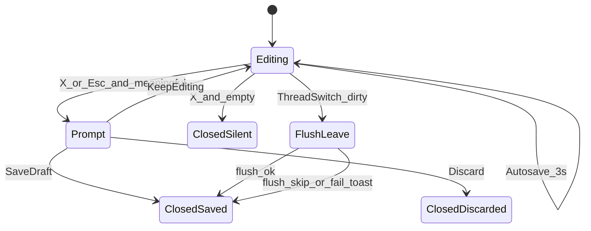

# fix: Compose close draft honesty and silent thread-switch save

## Goal Capsule

**Objective:** Make reply/compose close and leave behavior honest and Outlook-familiar: explicit **Save draft** / **Discard** / **Keep editing** on intentional close when there is meaningful content; real lifecycle discard via `drafts.delete`; silent save-and-leave when switching threads; silent close when empty/near-empty. Keep existing refresh-safe autosave and draft lifecycle.

**Authority:** Session-settled product choices (2026-07-24); RCA of `email-composer` / draft persistence / thread navigation; Classic Outlook close prompt parity for hotel staff.

**Stop when:** X with meaningful content shows three honest actions that match outcomes; Discard marks draft `discarded` and hides it; Save draft persists then closes; Keep editing dismisses dialog; empty close is silent with no new draft clutter; dirty thread switch flushes save then leaves without dialog and without losing typed content; Escape and beforeunload align with the same meaningful-content gate; Vitest covers close decision + persistence flush helpers.

---

## Product Contract

### Summary

Hotel staff coming from Classic Outlook see a lying "Discard message? / changes will be lost" dialog whose Leave button only closes the UI while a prior 3s autosave often left an `active` draft on the server. Switching threads while composing can lose text that never flushed. This plan fixes copy/actions, wires Discard to lifecycle discard, flush-saves on thread leave, and skips the dialog for empty replies.

### Problem Frame

Two related defects:

1. **Dialog honesty bug.** Title/description claim data loss; Leave calls `onClose` only. Autosave (`shouldPersistDraft` + 3s debounce) or a pre-existing server draft means content often survives — user sees Drafts after refresh and feels lied to.
2. **Thread-switch data loss.** `mail-list` / `clearComposeContext` clear `mode` / `draftId` with no dialog and no unmount flush. Autosave timer is cleared on unmount, so dirty text under 3s is lost.

Drafts themselves are desirable (CONCEPTS: refresh-safe draft persistence, draft lifecycle). The product gap is exit UX, not persistence infrastructure.

### Requirements

- R1. Intentional close (composer X) with meaningful content opens a dialog whose actions are **Save draft**, **Discard**, and **Keep editing**.
- R2. Dialog copy must not claim changes will be lost when Save draft or Discard are available; copy must match outcomes (save keeps `active`; discard abandons).
- R3. **Save draft** persists via existing `saveDraft` / `drafts.create` upsert path, then closes the compose UI.
- R4. **Discard** calls existing lifecycle discard (`optimisticDeleteDraft` → `drafts.delete` → `status='discarded'`), then closes. Draft must not reappear in Drafts or thread draft cards.
- R5. **Keep editing** dismisses the dialog and leaves the composer open (replaces Stay).
- R6. Empty / near-empty close (no meaningful content per shared gate aligned with `shouldPersistDraft` inputs) closes silently with no dialog and does not create a new draft.
- R7. Dirty thread switch (list click, keyboard thread nav, thread next/prev, archive/move clear-compose) silently flush-saves when persistable, then leaves — no dialog, no typed-content loss.
- R8. Keep 3s autosave and `chooseDraftEditorState` dirty-wins behavior unchanged for in-composer editing.
- R9. Dialog chrome uses existing shadcn `Dialog` + `Button` variants and matches adjacent compose dialogs (attachment warning, stale-send).

### Actors

- A1. Hotel staff composing a reply or new message in the live pilot SPA.

### Key Flows

- F1. Reply → type meaningful body → X → choose Save draft → composer closes → draft visible in Drafts / thread draft card.
- F2. Reply → type → X → Discard → composer closes → draft not listed; status `discarded`.
- F3. Reply → type → X → Keep editing → dialog closes; composer still open with content.
- F4. Reply → no typing (or whitespace only) → X → silent close; no new draft.
- F5. Reply → type → click another thread before 3s autosave → draft saved for original thread; new thread opens; typed content recoverable from Drafts / reopening original thread draft.

### Acceptance Examples

- AE1. Type "Thanks" in reply, wait for autosave indicator path, hit X, click Discard → Drafts folder does not show that draft after refresh.
- AE2. Type "Thanks", hit X immediately, click Save draft → Drafts shows the draft.
- AE3. Type "Thanks", click another inbox thread within 1s → return to original thread / Drafts → body "Thanks" still present.
- AE4. Open Reply, type nothing, hit X → no dialog; Drafts unchanged.

### Scope Boundaries

#### In scope

- `EmailComposer` leave dialog + close decision gate
- Discard wiring via `optimisticDeleteDraft`
- Silent flush-save before compose-context clear on thread navigation
- Align Escape / empty-close with the same meaningful-content gate
- Pure helpers + Vitest; light composer behavior tests if practical

#### Deferred to Follow-Up Work

- Create-new-mail dialog shell / compose hotkey paths that bypass `handleClose` (same honesty later)
- Pop-out compose windows
- Autosave-interval settings UI
- Esc remapping to Classic Outlook shortcuts
- AI candidate draft product redesign (Discard of a reply that only has an AI candidate without user edits — keep current ensure/promote behavior unless Discard is explicit)

#### Outside this product's identity

- Full Gmail minimize-draft UX
- Disabling autosave entirely

---

## Planning Contract

### Key Technical Decisions

- KTD1. Three-button close dialog: Save draft / Discard / Keep editing `(session-settled: user-directed — chosen over Stay/Leave lying dialog: honest Classic-Outlook-style exit)`.
- KTD2. Dirty thread switch = silent save-and-leave `(session-settled: user-directed — chosen over same Save/Discard prompt on every thread click: less friction while composing across mail)`.
- KTD3. Empty / near-empty = silent close, no dialog `(session-settled: user-approved — chosen over always prompting: avoid Drafts clutter from accidental Reply+X; gate shares `shouldPersistDraft` meaningful-content inputs)`.
- KTD4. Discard uses lifecycle `drafts.delete` → `status='discarded'`, not "close UI and hope" — reuses `optimisticDeleteDraft`.
- KTD5. Leave does not mean discard; Save draft is explicit persistence + close. Do not invent a fourth "Leave without saving" that drops dirty text without Discard.
- KTD6. Extract pure close-decision helpers next to `draft-persistence.ts` so Vitest owns the gate without mounting TipTap.
- KTD7. Thread-switch flush: module-level `compose-flush-registry` (`registerComposeFlush` / `flushComposeBeforeLeave`). EmailComposer registers on mount; mail-list and thread-display await flush before clear. Enables SDD Wave-2 parallel agents on disjoint files without prop-drilling through reply-composer. Prefer registry over `useImperativeHandle`. Fire-and-forget without await is insufficient for dirty text under the 3s autosave window.
- KTD9. Execution: SDD with parallel Wave 2 — see `docs/superpowers/plans/2026-07-24-compose-close-draft-honesty.md`. Do not parallel-edit `email-composer.tsx`.
- KTD8. Dialog design: reuse `DialogContent`/`DialogFooter` patterns from attachment-warning and stale-send; Keep editing = `variant="outline"`; Save draft = default primary; Discard = `variant="destructive"`; order left-to-right Keep editing → Save draft → Discard (destructive last). Wire existing i18n `common.actions.saveDraft` where present; add Discard / Keep editing keys as needed.

### Assumptions

- Preloaded reply quoted/AI HTML that equals `initialHtml` and has no new user text does not count as meaningful dirty content for the close prompt (same as `shouldPersistDraft` HTML-unchanged skip).
- Opening Reply then X without edits must not discard an existing active draft from a prior session.
- Classic Outlook "save as draft?" Yes/No is the parity target for intentional close; Gmail X-autosave is the parity target for thread navigate.

### High-Level Technical Design



Close decision (directional):

```
if !meaningfulContent(gateInputs): closeSilent()
else if intent == threadSwitch: await flushSave(); clearCompose()
else if intent == userClose: showDialog(SaveDraft | Discard | KeepEditing)
```

### System-Wide Impact

- End users: honest exit; fewer phantom drafts from Leave; fewer lost replies when scanning other mail.
- Drafts folder / thread draft cards: Discard correctly removes from visible queries (`active|candidate` only).
- AI path: Discard of user-edited reply discards that draft id; do not broaden to mass-discard candidates unless that id is the editable active.

### Risks and Dependencies

| Risk | Mitigation |
|------|------------|
| Async flush on unmount races React teardown | Flush from navigation handlers *before* clearing mode, not only in composer cleanup |
| Discard of wrong id | Only discard known `draftId` / response id from last save; if never persisted, close without delete |
| Save draft fails | Toast error; keep dialog open or keep composer open so text is not lost |
| Keyboard nav leaves stale `draftId` | Include `setDraftId(null)` in all clear-compose paths (known gap in `handleNavigateToThread`) |
| Create-dialog bypass | Deferred; document as residual |

### Sources and Research

- Repo RCA: `apps/mail/components/create/email-composer.tsx` (leave dialog, autosave, unmount warn); `apps/mail/lib/mail/draft-persistence.ts`; `apps/mail/components/mail/mail-list.tsx` thread click; `apps/server-pilot/src/trpc/routes/drafts.ts` delete lifecycle; `optimisticDeleteDraft`.
- Institutional: `docs/solutions/logic-errors/mail-draft-refresh-data-loss-and-lifecycle.md`; SDD contract in `docs/superpowers/plans/2026-07-06-server-pilot-contract-convergence-sdd.md` (thread switch = first-class persistence surface).
- External: Classic Outlook asks save-as-draft on close (Microsoft Q&A citing Save or delete drafts); New Outlook / Gmail often autosave on navigate and use trash Discard for delete — MVP blends Classic close honesty + silent navigate save.

**Product Contract preservation:** N/A (ce-plan-bootstrap; no upstream brainstorm).

---

## Implementation Units

### U1. Pure compose-close decision helpers

**Goal:** Shared, tested gate for meaningful content and close intent outcomes.

**Requirements:** R6, R7 (decision inputs), R8 alignment with `shouldPersistDraft`

**Dependencies:** None

**Files:**
- Modify: `apps/mail/lib/mail/draft-persistence.ts` (or adjacent `compose-close.ts` if file grows)
- Test: `apps/mail/tests/draft-persistence.test.ts` (or new `compose-close.test.ts`)

**Approach:** Add pure helpers, e.g. `hasMeaningfulComposeContent` / `resolveComposeCloseAction({ intent, ...PersistDecisionInput, draftId })` returning `closeSilent | prompt | flushAndLeave`. Reuse the same meaningful-content predicates as `shouldPersistDraft` (dirty + html changed + text/subject/to). Do not prompt solely because quoted HTML is non-empty at mount.

**Patterns to follow:** Existing pure helpers + Vitest in `draft-persistence.test.ts`.

**Test scenarios:**
- Happy: dirty body text + userClose → `prompt`
- Happy: dirty body + threadSwitch → `flushAndLeave`
- Edge: whitespace-only body, empty subject/to → `closeSilent`
- Edge: html unchanged from initialHtml → `closeSilent` even if editor has quoted text
- Edge: never dirty, existing draftId, userClose → `closeSilent` (do not auto-discard prior draft)
- Error: N/A for pure helper

**Verification:** New unit tests pass; `shouldPersistDraft` existing tests still pass.

---

### U2. Honest three-button close dialog + Discard/Save wiring

**Goal:** Replace Stay/Leave lie with Save draft / Discard / Keep editing and wire real outcomes.

**Requirements:** R1–R5, R9

**Dependencies:** U1

**Files:**
- Modify: `apps/mail/components/create/email-composer.tsx`
- Modify: `apps/mail/messages/en.json` (+ other locales as repo convention requires for new keys)
- Test: `apps/mail/tests/draft-persistence.test.ts` and/or focused composer unit if extractable; extend integration coverage if a thin harness exists

**Approach:**
- `handleClose` uses U1 gate: silent vs prompt.
- Dialog title/description honest (e.g. close draft / choose how to leave — not "changes will be lost").
- Keep editing → dismiss (cancelLeave).
- Save draft → `await saveDraft()` then `onClose`; on failure toast and stay open.
- Discard → if `draftId` (or last saved id) present, `optimisticDeleteDraft`; then `onClose`. If never saved, just `onClose`.
- Escape path uses same gate as X (remove `!draftId` Escape special-case that skips prompt when draft already exists).
- Pass discard dependency via existing hooks already used in mail surfaces.

**Execution note:** Prefer characterizing current Leave behavior with a failing unit on the pure gate first, then UI wiring.

**Patterns to follow:** Attachment-warning dialog footer; `optimisticDeleteDraft` from thread draft card / drafts folder.

**Test scenarios:**
- Happy: prompt actions map to save / discard / keep (helper + handler tests)
- Edge: Discard with null draftId closes without delete call
- Error: saveDraft rejection keeps composer open
- Integration: Discard invalidates draft list visibility (mock trpc if pattern exists)

**Verification:** Manual AE1–AE2; unit tests green; dialog matches UI variants.

---

### U3. Silent flush-save on thread switch / clear-compose

**Goal:** Never lose persistable dirty text when navigation clears compose context.

**Requirements:** R7, R8

**Dependencies:** U1, U2 (`saveDraft` flush capability)

**Files:**
- Modify: `apps/mail/components/create/email-composer.tsx` (imperative flush / register)
- Modify: `apps/mail/components/mail/mail-list.tsx` (`handleMailClick`, `handleNavigateToThread`)
- Modify: `apps/mail/components/mail/thread-display.tsx` (`clearComposeContext` callers)
- Modify: `apps/mail/lib/thread-utils` or `reply-compose-context.ts` if clear helpers need a pre-clear hook
- Test: `apps/mail/tests/reply-compose-context.test.ts` and/or new flush helper tests

**Approach:** Task 1 adds module `compose-flush-registry`. Task 2 `EmailComposer` registers flush on mount. Wave 2 parallel: `mail-list` and `thread-display` each await `flushComposeBeforeLeave` via `runComposeLeaveFlush` before clearing compose URL state. Always clear `draftId` on keyboard thread nav. No dialog on navigate. Flush failure: toast from saveDraft, still navigate.

**Patterns to follow:** Send path already `await saveDraft()` before send; refresh-safe persistence solution doc; SDD "thread switch must persist".

**Test scenarios:**
- Happy: dirty &lt;3s + simulated thread switch invokes flush then clear
- Edge: not dirty → clear without save call
- Edge: aiBlocked → skip persist (same as `shouldPersistDraft`)
- Error: flush failure → toast; still allow navigation (prefer not trapping user on a thread) but log; document choice in verification

**Verification:** AE3 manual; unit tests for flush ordering; keyboard nav clears `draftId`.

---

### U4. Empty-close alignment and residual close-path audit

**Goal:** Empty/near-empty silent close; document deferred bypasses; Escape/beforeunload consistency.

**Requirements:** R6, residual of R1

**Dependencies:** U1, U2

**Files:**
- Modify: `apps/mail/components/create/email-composer.tsx` (`beforeunload` / Escape)
- Test: extend U1 tests for beforeunload gating inputs if extracted

**Approach:** Drive `beforeunload` off meaningful-content gate (not raw `getText().length` alone) so subject-only dirty still warns on browser leave, and quoted-only empty does not. Audit create-email DialogClose / compose hotkey — leave as deferred with explicit comment or tracking note in Scope Boundaries (already listed).

**Test scenarios:**
- Happy: empty → no dialog on X
- Edge: subject-only dirty → prompt on X; beforeunload engaged
- Edge: quoted initial html only → silent X

**Verification:** AE4; Escape matches X for reply composer.

---

## Verification Contract

- Unit: `apps/mail` Vitest for draft-persistence / compose-close helpers (primary).
- Manual: AE1–AE4 on live or local mail SPA with real drafts API.
- Regression: existing `draft-persistence.test.ts`, `stale-draft-send-flow.test.ts`, `reply-compose-context.test.ts` still pass.
- Do not require new Playwright gate for MVP; optional smoke if real-mail UI gate is already running.

## Definition of Done

- [ ] U1–U4 landed with cited tests
- [ ] Dialog shows Save draft / Discard / Keep editing with honest copy and matching UI variants
- [ ] Discard removes draft from visible Drafts after refresh
- [ ] Thread switch within 1s of typing does not lose body
- [ ] Empty Reply+X is silent
- [ ] No new lying "changes will be lost" copy on Leave-that-saves
- [ ] CONCEPTS draft lifecycle terms still accurate (no glossary conflict)

## Appendix

### RCA brief

Leave never called `saveDraft`. Perceived save = 3s autosave or pre-existing row. Thread switch unmounts without flush. `drafts.delete` already exists for explicit draft-card delete only.

## GSTACK REVIEW REPORT

**Mode:** FULL_REVIEW (autonomous — user-directed pipeline; AskUserQuestion unavailable, recommended options auto-applied)
**Target:** `docs/plans/2026-07-24-001-fix-compose-close-draft-honesty-plan.md`
**Date:** 2026-07-24

### Step 0 — Scope

- Files touched ~6–8; no new services/classes beyond pure helpers. Complexity smell does not trigger hard reduce.
- Minimum viable: U1+U2 alone fix dialog honesty; U3 required for stated thread-switch bug; U4 is alignment not scope creep.
- **What already exists:** `shouldPersistDraft`, `saveDraft`, `optimisticDeleteDraft`, Dialog shell, i18n `saveDraft` key — plan reuses all; does not rebuild draft API.
- **NOT in scope (confirmed):** create-dialog / compose-hotkey bypass, pop-out windows, autosave settings UI, Esc remaps, AI candidate mass-discard.

### Architecture

1. **[P1] (confidence 9/10)** Flush mechanism — auto-applied KTD7 to callback registration instead of `useImperativeHandle` (no composer ref pattern in mail today).
2. **[P2] (confidence 8/10)** Flush failure must not block navigation — recorded in U3 approach.
3. No new backend endpoints required — discard/create already wire-compatible.

### Code quality

1. **[P1] (confidence 9/10)** Escape `!draftId` skip is a real bug — already in U2.
2. **[P2] (confidence 8/10)** Close gate must share `shouldPersistDraft` predicates — already U1; do not use `getText().length` alone.

### Tests

Coverage gaps to force into SDD plan: prompt vs silent vs flush intents; Discard with null id; save failure keeps open; flush ordering before clearCompose; keyboard nav clears draftId. No composer E2E required for MVP (manual AE1–AE4).

### Performance

No issues — single await flush on navigate when composing is fine.

### Outside voice

Skipped (Codex not required for autonomous pipeline; local RCA already load-bearing).

### Implementation Tasks (from review)

- T1 (P1): Pure close-decision helpers + Vitest
- T2 (P1): Three-button dialog + Discard/Save wiring
- T3 (P1): Register-flush + await before clear-compose (incl. keyboard draftId clear)
- T4 (P2): Escape/beforeunload/empty alignment

**Lake score:** 4/4 recommendations chose complete option (full flush + discard lifecycle, not copy-only fix).
