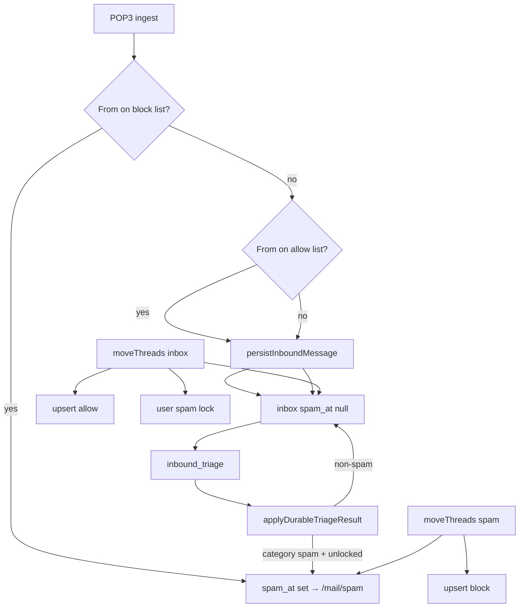

<!-- /autoplan restore point: /c/Users/gamin/.gstack/projects/kufupa-Zero/EC2-pilot-autoplan-restore-20260727-000350.md -->
---
title: "feat: Spam MVP — folder truth, persistence, flood ops"
date: 2026-07-27
type: feat
artifact_contract: ce-unified-plan/v1
artifact_readiness: implementation-ready
product_contract_source: session research (95-exa-subag) + live pilot spam weirdness
execution: code
origin: user report (spam chip in inbox; spam folder unclear) + Gmail/Outlook parity research
---

# feat: Spam MVP — folder truth, persistence, flood ops

## Goal Capsule

Make spam behavior honest and Gmail/Outlook-shaped for the hotel ops pilot: **classified spam leaves the inbox**, user mark-spam / not-spam **persists and sticks**, flood ops get **bulk empty + purge + block/allow**, and the confusing **legacy `SPAM` label chip in inbox** dies.

**Authority:** this plan > stale docs that say direct-To→spam or SPAM-label routing.

**Stop when:** Definition of Done met; soft-in-inbox observe mode either deferred or gated as short canary only; no Bayesian ML.

---

## Product Contract

### Problem Frame

Pilot spam today is split-brain:

1. **Truth** = `mail_thread.spam_at` (system folder `/mail/spam`). AI triage + `moveThreads` set/clear it.
2. **Noise** = seeded `mail_label` name `SPAM` + possible `labelIds` residue → inbox chip via `useThreadLabels` even when `spam_at` is null.
3. **Soft path** = `soft-quarantine` label when write gate off (stays inbox) — easy to misread as "spam."
4. **No persistence beyond thread** — no block/allow sender lists; user "not spam" can be re-spammed by AI if thread unsettled.
5. **No flood ops** — no `deleteAllSpam` on server-pilot; no auto-purge; no rate/mailbomb banner.

User mental model request (explore): keep a spam *mark* without a spam *folder* until enough data. Research (Gmail/Outlook) + hotel flood risk argue **folder is MVP default**; soft-in-inbox is observe-only.

### Actors

- A1. Hotel ops / staff (Centurion, Navaai, …) reading inbox under load
- A2. Untrusted external senders (spam, phish, newsletters)
- A3. AI triage worker (Nova) when write gate on
- A4. User correcting AI (mark spam / not spam)

### Requirements

- R1. **Folder truth:** Thread with `spam_at IS NOT NULL` never appears in inbox (or any non-spam folder list). Already coded; keep and harden.
- R2. **No spam chip in inbox** for folder-spam or legacy label: strip `SPAM` from `labelIds` on read/migrate; stop seeding user-visible SPAM chips; never render `SPAM` as a hotel/user label in inbox.
- R3. **Mark spam** → set `spam_at` + leave inbox immediately (optimistic UI). Block upsert default-on for unknown senders with **5s Undo** (KTD2′); allow-listed / same-domain → block off by default. Address-only.
- R4. **Not spam** → clear `spam_at` + add sender to **allow list** + set `spam_user_locked_at` so AI cannot re-set `spam_at` on that thread (urgency overlay only).
- R5. **AI spam** (write gate on, unsettled, not allow-listed) → set `spam_at` (current). Allow-listed senders never auto-spam.
- R6. **Block-listed senders** on ingest → set `spam_at` immediately (skip soft inbox wait) OR enqueue with forced spam apply — prefer set `spam_at` at persist for flood defense.
- R7. **Empty spam** — `deleteAllSpam` (or `emptySpam`) on server-pilot: trash or hard-delete all `spam_at` threads for transport; wire FE if strings exist.
- R8. **Auto-purge** spam after **30 days** (`spam_at` older than 30d → trash or delete). Document retention.
- R9. **Bulk mark spam** already via multi-select `moveThreads`; verify works; add bulk not-spam from spam folder.
- R10. **Suspected ≠ spam:** If observe/canary needed, use separate `suspected` / keep `soft-quarantine` — never named `SPAM`. Default product = folder (R1), not soft-in-inbox.
- R11. **Spam view honesty:** In `/mail/spam`, show banner reason when available (user vs AI vs block list) — minimal MVP: source enum on thread or derived.
- R12. Write gate remains kill switch; when off, do not pretend folder spam from AI.

### Key Flows

- F1. Inbound unknown → inbox → AI `spam` → `spam_at` set → disappears from inbox → visible in Spam.
- F2. User mark spam from inbox → `spam_at` + block sender → gone from inbox.
- F3. User not spam from Spam → `spam_at` null + allow sender + settled → back in inbox; future from sender not auto-spammed.
- F4. Block-listed sender inbound → lands in Spam (not inbox).
- F5. Flood → Empty spam + 30d purge + blocks shrink future volume.
- F6. Legacy SPAM label residue → stripped; no inbox chip.

### Acceptance Examples

- AE1. Thread with `spam_at` set → absent from `listThreads(folder=inbox)`; present in `folder=spam`.
- AE2. Thread with legacy `labelIds` containing spam label id but `spam_at` null → no SPAM chip in inbox UI; optional one-shot migration clears ids.
- AE3. `moveThreads` destination `spam` → `spam_at` set + sender on block list.
- AE4. `moveThreads` destination `inbox` from spam → `spam_at` null + sender on allow list; subsequent AI triage cannot set `spam_at` on that thread.
- AE5. New message from blocked sender → `spam_at` set at ingest (or first apply) without sitting in inbox.
- AE6. `emptySpam` → zero threads with `spam_at` (or all moved to bin per KTD); spam list empty.
- AE7. Thread with `spam_at` older than 30d → purge job moves to bin or deletes (per KTD).

### Scope Boundaries

**In:** label chip cleanup; block/allow tables + apply on mark/ingest; user-settled spam lock; empty spam; 30d purge job/cron; FE wiring for empty spam; tests; doc fix for stale direct-To→spam.

**Deferred:**
- Soft-in-inbox observe mode flag (`SPAM_PLACEMENT=observe`) — product taste; default off
- Confidence hybrid (low → suspected chip, high → folder)
- Mailbomb banner / Sweep-by-sender UI
- Bayesian / global ML training
- Phishing report pipeline / CFBL
- Provider Junk folder sync (POP3 has none)
- Domain-wide block UI (address-first MVP; domain optional in same table)

**Outside:** Quarantine (`mail_ingest_quarantine`) remains routing failure, not spam.

---

## Planning Contract

### Assumptions

- Gmail/Outlook users expect mark-spam → leave inbox; badge-in-inbox for classified spam is wrong.
- Hotel ops flood risk makes soft-label-forever unsafe without auto-hide caps.
- Existing `spam_at` + `moveThreads` are the right primitives; extend, don't replace with Gmail label emulation.
- `modifyLabels` already strips `SPAM` — keep that; cleanup is data + UI display.

### Key Technical Decisions

- KTD1 — **Folder is product truth** (`spam_at`). Soft-in-inbox is not MVP default.
- KTD2 — See **KTD2′** below (post-autoplan): mark spam ≠ silent permanent block; Undo toast.
- KTD3 — **User-settled lock:** `spam_user_locked_at` on mark-spam and not-spam; triage settled includes lock (survives clearing `spam_at`).
- KTD4 — **Empty spam** = confirm → set `trashed_at` (recoverable); copy says Trash.
- KTD5 — **30-day purge** = same as empty but age filter; run from worker tick or cron on EC2.
- KTD6 — **Legacy SPAM label:** migration clears `SPAM` from `labelIds`; hide label name `SPAM` in `useThreadLabels` / label list; do not delete seed row if needed for wire-compat — just never show.

### High-Level Technical Design



### System-Wide Impact

- Inbox quieter after AI/block spam.
- Spam sidebar stays Management system folder (not hotel category).
- Ingest path gains block check before/at persist.
- New tables: `mail_sender_preference` (or `mail_blocklist` / `mail_allowlist`).
- Worker gains purge tick.

### Risks and Dependencies

| Risk | Mitigation |
|------|------------|
| False positive AI spam hides guest mail | Not-spam + allow list; settled lock; spam folder review habit |
| Block list blocks legitimate shared mailbox | Allow overrides; per-address not domain by default |
| Purge deletes needed evidence | Soft-trash first (KTD4); 30d only |
| Observe-mode request returns | Flag deferred; document why folder won |
| Legacy chip confusion persists | AE2 migration + UI hide |

### Sources and Research

- Code map: `spam_at` in `apps/server-pilot/src/db/schema/mail.ts`; `moveThreads` / list filter in `trpc/routes/mail.ts`; triage apply in `ai/triage.ts`; soft-quarantine in `mail/ingest/store.ts`; FE `FOLDERS.SPAM` / context menu moves.
- Vendor: Gmail report spam (leave inbox, 30d purge); Outlook Junk + Safe/Blocked senders; Proton spam/block/allow tiers.
- Prior plans: `2026-07-10-001` triage/`spamAt`; `2026-07-23-001` inbox-first ingest.

---

## Implementation Units

### U1. Strip legacy SPAM chip (inbox honesty)

**Goal:** Inbox never shows SPAM label chip when thread is not in spam folder.

**Requirements:** R2, AE2

**Files:**
- Modify: `apps/server-pilot` migration or one-shot cleanup of `label_ids`
- Modify: `apps/mail/hooks/use-labels.ts` and/or label render path to filter system `SPAM`
- Test: unit for filter + contract if listLabels exposes SPAM

### U2. Sender block/allow + apply on move/ingest

**Goal:** Persist user spam decisions beyond one thread.

**Requirements:** R3–R6, AE3–AE5

**Files:**
- New schema + drizzle migration
- Modify: `moveThreads`, `persistInboundMessage`, `applyDurableTriageResult`
- Tests: ingest block → spam_at; allow → skip AI spam; move upserts lists

### U3. User spam settled lock

**Goal:** AI cannot flip user-corrected spam/ham folder state.

**Requirements:** R4, AE4

**Files:**
- Modify: `ai/triage.ts` settled logic
- Schema: lock column or feedback enum
- Tests: after not-spam, AI category spam → urgency_only / no spamAt

### U4. Empty spam + 30-day purge

**Goal:** Flood escape hatch + retention.

**Requirements:** R7–R8, AE6–AE7

**Files:**
- `mail.emptySpam` tRPC on server-pilot
- Worker/cron purge
- FE: wire Empty spam control on `/mail/spam`
- Tests: empty + age purge

### U5. Docs + stale claim cleanup

**Goal:** Docs match inbox-first + folder truth.

**Requirements:** planning contract

**Files:** touch stale drift-audit / loopback notes that still say direct-To→SPAM label

---

## Definition of Done

- [ ] AE1–AE7 green in unit/contract tests
- [ ] No SPAM chip on inbox rows for non-spam_at threads
- [ ] Mark spam / not spam update lists and lock
- [ ] Empty spam works on pilot
- [ ] Purge documented + job exists (can be manual trigger in MVP if cron deferred one unit)
- [ ] Stale "direct-To → spam label" docs corrected or marked superseded

---

## Open Premises (for /autoplan gate)

1. **Folder-first MVP** (not soft-label-in-inbox) is correct for hotel ops despite earlier explore preference.
2. **Block on mark-spam / allow on not-spam** is enough persistence (no ML).
3. **Empty spam = soft-trash** (not hard delete).
4. **30-day retention** matches Gmail/iCloud, not Outlook.com’s 10-day.
5. **Observe/soft mode deferred** out of this plan.

---

## /autoplan Phase 0 intake

- Plan file: `docs/plans/2026-07-27-001-feat-spam-mvp-placement-and-persistence-plan.md`
- Branch: `EC2-pilot` | Base: `staging`
- UI scope: **yes** (Empty spam control, chip filter, spam folder UX)
- DX scope: **yes** (tRPC API, schema, worker job, implement/error paths)
- Mode (autoplan default): **SELECTIVE EXPANSION**
- Codex: available
- Restore point: see HTML comment at file top

### Working summary

Spam honesty MVP on top of existing `spam_at` folder model: kill legacy SPAM chip, add block/allow + user lock, empty spam + 30d purge. Soft-in-inbox deferred.

---

## /autoplan Phase 1 — CEO (in progress)

### 0A. Premise challenge

| # | Premise | Evaluation |
|---|---------|------------|
| P1 | Right problem = spam UX honesty + flood defense, not "build ML spam filter" | **Valid.** User pain = chip-in-inbox weirdness + unclear folder; hotel flood is real. Proxy would be soft-label forever. |
| P2 | Folder-first matches Gmail/Outlook; soft-label was explore preference | **Challenges user explore direction.** Soft-label without auto-hide fails under flood. Recommend folder; soft only as deferred canary. |
| P3 | Doing nothing leaves split-brain (spam_at vs SPAM label vs soft-quarantine) | **Real pain** — already observed in prod UI. |
| P4 | Block/allow lists beat "ML training" for MVP persistence | **Valid.** Outlook Safe/Blocked pattern; POP3 owns filter. |
| P5 | Empty=soft-trash, 30d purge | **Valid taste.** Recoverable ops; Gmail-like retention. |

**Do nothing cost:** Ops keep seeing SPAM chips in inbox; AI spam may re-hit after not-spam; no escape hatch under mail flood.

### 0B. Existing code leverage

| Sub-problem | Existing | Plan action |
|-------------|----------|-------------|
| Spam folder membership | `mail_thread.spam_at` + `listThreads` filter | Keep as truth |
| Mark spam / not spam | `mail.moveThreads` | Extend with list upserts |
| AI spam apply | `applyDurableTriageResult` + settled KTD2 | Extend settled for user lock |
| Soft containment | `soft-quarantine` label | Keep degraded path; never call it SPAM |
| SPAM label seed | `seedSpamLabel` | Hide/strip chips; don't rebuild Gmail labels |
| deleteAllSpam | legacy `apps/server` Gmail only | **New** on server-pilot |
| Auth allowlist pattern | `lib/auth.ts` allowlist parse | Reuse normalize pattern, not same table |
| FE moves | `thread-context`, `optimisticMoveThreadsTo` | Reuse; add Empty spam |

Not rebuilding `spam_at`. Extending.

### 0C. Dream state

```
CURRENT                         THIS PLAN                      12-MONTH IDEAL
split spam_at / SPAM chip /     honest folder + block/allow    confidence hybrid +
soft-quarantine; no flood ops   + empty + 30d purge; lock      Sweep; mailbomb banner;
                                user corrections               suspected≠spam observe
```

### 0C-bis. Approaches (autoplan auto-decide pending premise confirm)

**APPROACH A: Chip cleanup only (minimal)**
- Summary: Migration + UI filter; no lists/purge.
- Effort: S | Risk: Low | Completeness: 3/10
- Pros: Fast honesty fix for AE2. Cons: No flood ops; AI re-spam remains.

**APPROACH B: Folder truth + lists + empty/purge (recommended)**
- Summary: Plan as written (U1–U5).
- Effort: M | Risk: Med | Completeness: 9/10
- Pros: Matches Gmail/Outlook; flood defense; persists corrections. Cons: New table + worker tick.

**APPROACH C: Soft-label observe-first**
- Summary: Suspected chip in inbox; folder later.
- Effort: M | Risk: High under flood | Completeness: 5/10 (wrong product shape)
- Pros: Matches early user explore preference; easy AI audit. Cons: Fails hotel flood; fights vendor UX; more states.

**LOCKED (user max-completeness policy + D1=A):** Approach **B**.

### Name freeze (DX P0 — implement here only)

| Surface | Canonical name |
|---------|----------------|
| Empty spam API | `mail.emptySpam` (FE i18n may say deleteAllSpam — alias once) |
| Preference table | `mail_sender_preference(transport_id, email, kind)` `kind ∈ block\|allow` |
| User lock column | `mail_thread.spam_user_locked_at` |
| Implement tree | **`apps/server-pilot` only** — do NOT copy `apps/server` Gmail `deleteAllSpam` |

### KTD revisions (post-review, max completeness)

- **KTD2′ — Mark spam vs block:** Mark spam always sets `spam_at`. Block upsert is **default-on for unknown senders** with **5s Undo toast** (undo = clear spam_at + remove block). Allow-listed / same-transport-domain senders: block checkbox **off** by default. Address-only (no silent domain block).
- **KTD3′ — Lock:** `spam_user_locked_at` set on user mark-spam **and** not-spam. Triage settled += lock column (survives `spam_at` clear).
- **KTD4′ — Empty spam:** Confirm modal → soft-trash (`trashed_at`). Copy says Trash, not delete forever.
- **KTD7 — soft-quarantine display:** Internal slug stays; UI display = `Held for review` (never Spam red).
- **KTD8 — spam_source:** Optional thread meta enum `user | ai | block` for spam row / banner (R11).

### Build sequence (CEO+Eng)

```
U1 chip strip + soft-quarantine display rename  (parallel-safe)
  → U3 spam_user_locked_at + triage gate       (before/with U2)
  → U2 mail_sender_preference + moveThreads + ingest block
  → U4 mail.emptySpam + 30d purge tick + FE confirm
  → U5 docs + solutions one-pager
  → U6 UI polish: spam header, retention footnote, state matrix, undo toasts
```

### Cherry-picks INCLUDED (SELECTIVE EXPANSION, max completeness)

| ID | Item | Why |
|----|------|-----|
| CP1 | Undo toast on mark-spam / block | Completeness 10 — false-positive escape |
| CP2 | Empty spam confirm + Trash copy | Destructive safety |
| CP3 | soft-quarantine display rename | Trust / chip honesty |
| CP4 | `listSenderPreferences` + `removeSenderPreference` | Operator escape hatch |
| CP5 | Spam header + 30d retention footnote | Design litmus |
| CP6 | Interaction state matrix in DoD | Design gap close |
| CP7 | Ingest/purge structured logs | Ops observability |
| CP8 | Archive-from-spam: **keep** `spam_at` (stop clearing) | Close silent un-spam bug |

### Cherry-picks DEFERRED (TODOS)

| ID | Item | Why defer |
|----|------|-----------|
| DF1 | Soft-in-inbox observe mode | Flood risk; user chose folder-first |
| DF2 | Confidence hybrid / suspected chip | 12-month dream |
| DF3 | Mailbomb banner / Sweep UI | After purge+empty proven |
| DF4 | Settings → Blocked senders full page | Toast+list API enough MVP |
| DF5 | Domain block UI | Address-only first |
| DF6 | Bayesian ML / phishing CFBL | Out of scope |

---

## CEO dual voices

### CODEX SAYS (CEO)
`[codex-unavailable: auth 401]` — Claude subagent only.

### CLAUDE SUBAGENT (CEO — strategic independence)
Agent: [CEO review](186a1f30-16e2-44b7-baf6-bce4e6a4831e)

Key: right problem, wrong sequencing; block-on-mark silent = critical regret; U1→U3→U2→U4; measure flood before over-investing cron (kept cron anyway for completeness).

### CEO DUAL VOICES — CONSENSUS TABLE

```
═══════════════════════════════════════════════════════════════
  Dimension                           Claude  Codex  Consensus
  ──────────────────────────────────── ─────── ─────── ─────────
  1. Premises valid?                   Yes*    N/A    CONFIRMED*
  2. Right problem to solve?           Yes     N/A    CONFIRMED
  3. Scope calibration correct?        Seq↑    N/A    CONFIRMED†
  4. Alternatives sufficiently explored? Partial N/A  CONFIRMED†
  5. Competitive/market risks covered? Weak→fix N/A CONFIRMED†
  6. 6-month trajectory sound?         If lock N/A    CONFIRMED†
═══════════════════════════════════════════════════════════════
* User locked D1=A (folder-first). * = with KTD2′ undo-block.
† = after incorporating subagent hardenings into plan.
SOURCE: subagent-only
```

### Error & Rescue Registry (CEO §2)

| Codepath | Failure | Rescue | User sees |
|----------|---------|--------|-----------|
| `moveThreads` spam | DB fail | txn rollback; FE refetch | toast retry |
| block upsert | malformed From | skip block; still set spam_at | toast moved |
| block upsert | unique conflict | onConflictDoUpdate | silent OK |
| ingest block check | SELECT fail | fail persist; no POP3 DELE | retry next poll |
| `emptySpam` | partial batch | return `{updated,failed}` | toast N of M |
| purge tick | crash mid | idempotent rerun | logs only |
| triage locked | AI says spam | urgency_only | stays inbox |
| mark-spam undo | timeout | leave blocked | toast expired |

### Failure Modes Registry

| ID | Mode | Mitigate |
|----|------|----------|
| FM-01 | SPAM chip ghost | U1 filter + migration |
| FM-02 | AI re-spam after not-spam | U3 lock |
| FM-03 | Block doesn't persist | U2 upsert |
| FM-04 | Blocked sender in inbox | U2 ingest |
| FM-05 | Allow ignored | U2 triage allow wins |
| FM-06 | Archive un-spams | CP8 keep spam_at |
| FM-07 | emptySpam missing | U4 |
| FM-08 | Purge never runs | U4 pm2 tick + SPAM_PURGE_ENABLED |
| FM-09 | Optimistic desync | existing refetch |
| FM-10 | Wrong multi-sender block | latest inbound From only |
| FM-11 | soft-quarantine confusion | KTD7 rename |
| FM-12 | Slow spam list | partial index |

### NOT in scope
DF1–DF6 above; quarantine table ≠ spam; provider Junk sync; ML.

### What already exists
`spam_at`, `moveThreads`, triage settled (partial), soft-quarantine, FE spam context menus, migration 0007 index, legacy Gmail deleteAllSpam (do not port).

### Dream state delta
This plan → honest folder + lists + flood ops + lock. Still short of confidence hybrid / Sweep (12-mo).

### CEO Completion Summary
Premises locked A. Approach B + KTD2′/3′/7/8. Mode SELECTIVE EXPANSION. Codex unavailable. Ready for Design/Eng/DX (done below).

---

## Phase 2 — Design Review

### Design litmus scorecard (pre → post plan bake-in)

| Dimension | Pre | Post (with CP1–6) | Target |
|-----------|-----|-------------------|--------|
| Info hierarchy | 5 | 8 | spam header + source + retention |
| Interaction states | 3 | 8 | state matrix in DoD |
| Journey / emotion | 6 | 8 | undo + confirm |
| UI specificity | 4 | 7 | copy deck required |
| Accessibility | 2 | 6 | AC: focus, aria-live, 44px |
| Responsive | 1 | 5 | stack header; bottom sheet <768 |
| Haunt risk | 5 | 8 | names frozen + flows |
| **Avg** | **4.4** | **~7.1** | |

SOURCE: [Design review](b6690237-4377-4b85-8602-eeca46ffcac1) — subagent-only (Codex N/A)

### UI States matrix (required deliverable)

| Action | Loading | Success | Error | Empty | Partial |
|--------|---------|---------|-------|-------|---------|
| Mark spam | optimistic remove | toast + Undo 5s | reinsert + retry | — | bulk N of M |
| Not spam | optimistic add inbox | toast + allow note | rollback | — | bulk N of M |
| Empty spam | modal spinner | toast → Trash | keep modal + err | empty state art | N of M retry |
| List spam | skeleton | rows | error banner | No spam copy | — |

### Copy deck (minimum)

- Empty confirm: `Empty Spam?` / `Moves all spam to Trash. You can recover from Trash.` / Cancel / Empty spam
- Soft-quarantine display: `Held for review`
- Toast mark spam: `Conversation moved to Spam` + Undo
- Toast not spam: `Moved to Inbox`
- Retention: `Auto-removed after 30 days`

---

## Phase 3 — Eng Review

SOURCE: [Eng review](a65e438b-77bb-4bfe-a5c9-f59c663c580c) — subagent-only

### Architecture (ASCII)

```
FE (mail) --tRPC--> mail.moveThreads / emptySpam / listSenderPreferences
                 |
POP3 ingest --> persistInboundMessage --block?--> spam_at
                 |
ai-worker --> applyDurableTriageResult --lock/allow?--> spam_at|urgency_only
                 |
purge tick --> trashed_at where spam_at < now()-30d
                 |
PG: mail_thread.spam_at, spam_user_locked_at
    mail_sender_preference(transport_id, email, kind)
```

### Eng consensus

```
  1. Architecture sound?               Yes     N/A    CONFIRMED
  2. Test coverage sufficient?         Gaps→plan N/A  CONFIRMED†
  3. Performance risks addressed?      Index+batch N/A CONFIRMED†
  4. Security threats covered?         transport OK N/A CONFIRMED
  5. Error paths handled?              registry N/A   CONFIRMED†
  6. Deployment risk manageable?       migrate+pm2 N/A CONFIRMED†
```

### Test plan artifact
`~/.gstack/projects/kufupa-Zero/gamin-EC2-pilot-test-plan-20260727-001253.md`

### Eng scores
Architecture 8/10 | Current completeness 3/10 → plan closes | Deploy 6/10 (purge wiring)

---

## Phase 3.5 — DX Review

SOURCE: [DX review](e93b07ab-018a-4647-859c-e101c2951391) — subagent-only

### DX Scorecard (post bake-in targets)

| Dimension | Pre | Target |
|-----------|-----|--------|
| TTHW / getting started | 5 | 8 (quickstart below) |
| API naming | 4 | 9 (frozen) |
| Errors | 3 | 7 |
| Docs | 5 | 8 |
| Migration | 6 | 8 |
| Dev friction | 5 | 7 |
| Escape hatches | 6 | 8 |
| Observability | 2 | 6 |
| **Avg** | **4.5** | **~7.6** |

### TTHW
~5–7h → ~2–2.5h with quickstart + name freeze.

### Spam Dev Quickstart

```bash
# Implement in apps/server-pilot ONLY (not apps/server)
cd apps/server-pilot
pnpm test tests/mail-thread-actions.test.ts -t spam
pnpm test tests/ingest-store.test.ts
# After U2/U3/U4 land:
pnpm test tests/sender-preference.test.ts
pnpm test tests/mail-empty-spam.test.ts
# Deploy
apps/server-pilot/deploy/ops-deploy.sh --migrate
# Env: SPAM_PURGE_ENABLED=true SPAM_PURGE_DAYS=30
```

### DX consensus

```
  1. Getting started < 5 min?          No→quickstart N/A  CONFIRMED†
  2. API naming guessable?             Freeze N/A         CONFIRMED†
  3. Error messages actionable?        Spec N/A           CONFIRMED†
  4. Docs findable?                    U5 N/A             CONFIRMED†
  5. Upgrade path safe?                soft-trash N/A     CONFIRMED
  6. Dev env friction-free?            TEST_DB N/A        Partial
```

---

## Overnight Autonomous Execution Mandate

**User granted full autonomy.** No blocking questions overnight. No manual login. No "which approach?" pause.
**Autoplan policy:** show every decision question; always pick **maximum Completeness: X/10** option without waiting.

### Communication

- Orchestrator + every subagent: **Respond `/caveman ultra`. Technical terms exact.**

### AWS / infra (use freely)

| Resource | ID / path |
|----------|-----------|
| EC2 | `i-008f737974a9ba9b3` (`af-south-1`) |
| RDS | `nava-zero-mail-pilot` (Postgres 16) |
| S3 | `nava-zero-mail-845242190536-af-south-1` |
| Repo on EC2 | `/home/ubuntu/repos/zero` |
| **Primary deploy** | `apps/server-pilot/deploy/ops-deploy.sh` (`--migrate` when schema) |
| **Primary app bounce** | `apps/server-pilot/deploy/ops-restart.sh` |
| **Primary box reboot** | `apps/server-pilot/deploy/ops-reboot.sh` |
| Guts (fallback) | `sync-ec2-git-bundle.sh`, `deploy-ec2.sh`, `ssm-run-command.sh` |

**Allowed:** ops wrappers, bundle sync, deploy, migrate (via `ops-deploy --migrate`), seed (no `--rotate` unless fix requires), SSM remote tests, PM2 logs, health curl, RDS vitest on EC2.

**Forbidden:** force-push main, `--no-verify`, destructive git, IT Exchange/VPN/real mail creds.

### RCA loop (mandatory on any red)

FAIL → reproduce → root cause (file:line) → fix → test → commit → resume. Do not stop at first failure.

### Divergence authority

Better path to done criteria → take it. Log in handoff report.

### Done criteria

- [ ] AE1–AE7 green (unit/contract)
- [ ] No SPAM chip on inbox for `spam_at` null threads
- [ ] soft-quarantine displays as `Held for review`
- [ ] Mark spam / not spam: lock + preference lists; Undo on mark-spam
- [ ] `mail.emptySpam` + confirm → soft-trash
- [ ] 30d purge tick wired (or `SPAM_PURGE_ENABLED` documented + manual empty works)
- [ ] Archive from spam no longer clears `spam_at`
- [ ] Stale direct-To→SPAM docs marked superseded
- [ ] Deployed to EC2 pilot via `ops-deploy.sh --migrate` when schema lands
- [ ] Handoff report under `docs/superpowers/plans/handoff-reports/` if overnight run

## Execution Mode

Autonomous overnight — no user checkpoint. REQUIRED SUB-SKILL: superpowers:subagent-driven-development. Do not ask "which approach?" Max-completeness auto-decide on every taste fork.

---

## Definition of Done (updated)

- [ ] AE1–AE7 green in unit/contract tests
- [ ] No SPAM chip on inbox rows for non-spam_at threads
- [ ] Mark spam / not spam update lists and lock; Undo toast on mark-spam
- [ ] Empty spam works on pilot with confirm → Trash
- [ ] Purge documented + job exists (`SPAM_PURGE_ENABLED`)
- [ ] UI state matrix + copy deck strings shipped
- [ ] `listSenderPreferences` / `removeSenderPreference` available
- [ ] Stale "direct-To → spam label" docs corrected or marked superseded
- [ ] A11y AC: focus return after move; aria-live on toasts; confirm focus trap

---

<!-- AUTONOMOUS DECISION LOG -->
## Decision Audit Trail

| # | Phase | Decision | Classification | Principle | Rationale | Rejected |
|---|-------|----------|----------------|-----------|-----------|----------|
| 1 | 0 | Mode = SELECTIVE EXPANSION | Mechanical | autoplan default | Feature iteration on existing spam_at | EXPANSION/HOLD/REDUCTION |
| 2 | 0 | UI scope = yes | Mechanical | 2+ UI terms | Empty spam + chip UX | skip design |
| 3 | 0 | DX scope = yes | Mechanical | API/implement terms | tRPC + schema | skip DX |
| 4 | 0C-bis | Approach B | Mechanical (user max-C) | P1 | Completeness 9/10 | A=3, C=5 |
| 5 | D1 | Premises A all 5 | User→locked | max-C | User: always max completeness | B/C/D |
| 6 | CEO | KTD2′ undo-block not silent | Taste→auto | P1 edge | Completeness of false-positive path | silent auto-block |
| 7 | CEO | U1→U3→U2→U4 sequence | Mechanical | P2 | Lock before lists | U2 before U3 |
| 8 | CEO | CP1–CP8 include | Mechanical | P1 | Max completeness cherry-picks | defer |
| 9 | CEO | DF1–DF6 defer | Mechanical | P3 | Out of blast / dream | include observe |
| 10 | Design | Bake UI matrix+copy+a11y into plan | Mechanical | P1 | Litmus 4.4→7+ | ship FE blind |
| 11 | Eng | Archive keep spam_at | Mechanical | P2 | Close FM-06 | leave clearing |
| 12 | Eng | Name freeze emptySpam + preference table | Mechanical | P5 | DX TTHW | deleteAllSpam fork |
| 13 | DX | Quickstart + list prefs API | Mechanical | P1 | Escape hatch completeness | settings page later |
| 14 | Voices | Codex skip | Mechanical | infra | 401 auth | dual voice |
| 15 | Gate | Auto-approve all recs | User policy | max-C | Finish 100% autonomous | wait at gate |

---

## GSTACK REVIEW REPORT

**Skill:** /gstack-autoplan  
**Plan:** `docs/plans/2026-07-27-001-feat-spam-mvp-placement-and-persistence-plan.md`  
**Branch:** EC2-pilot | Base: staging  
**Status:** APPROVED (user max-completeness autonomous policy)  
**Timestamp:** 2026-07-27T00:15:00Z  

### Review Scores

| Phase | Result |
|-------|--------|
| CEO | Premises locked; Approach B + hardenings; Error/Failure registries written |
| CEO Voices | subagent-only (Codex 401); consensus 6/6 after bake-in |
| Design | Litmus 4.4→~7.1 with CP bake-in; UI matrix + copy deck required |
| Design Voices | subagent-only |
| Eng | Arch 8/10; test artifact on disk; FM registry; file-level map |
| Eng Voices | subagent-only |
| DX | Avg 4.5→~7.6 target; names frozen; quickstart; TTHW 5h→2.5h |
| DX Voices | subagent-only |

### Cross-Phase Themes

1. **Silent block-on-mark is dangerous** — CEO + Design both; fixed via KTD2′ Undo.
2. **Not-spam lock is a blocker** — CEO + Eng; U3 before/with U2.
3. **UI contract was thin** — Design + DX; matrix + copy + empty confirm.
4. **Naming fork server vs server-pilot** — DX + Eng; freeze `emptySpam` on pilot.

### Deferred to TODOS.md
DF1–DF6 (observe mode, confidence hybrid, mailbomb banner, settings page, domain block UI, ML).

### Next
Execute overnight via subagent-driven-development against this plan. `/ship` when code lands.
