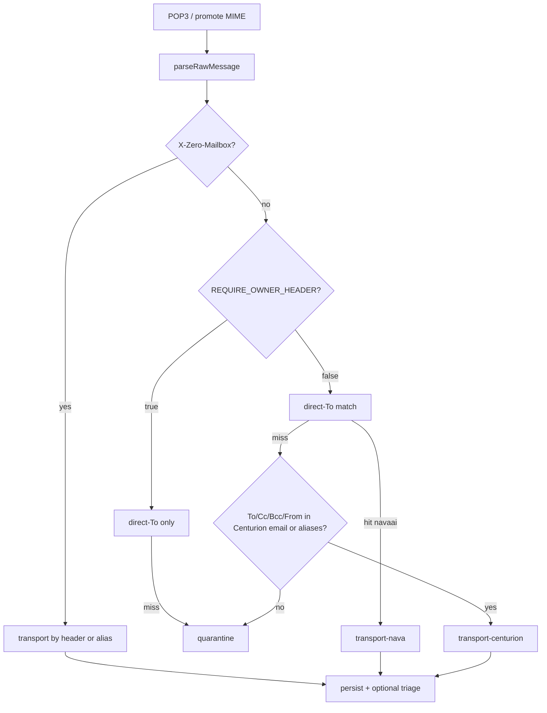

# feat: Unstamped Centurion routing + quarantine promote

## Goal Capsule

Defer IT `X-Zero-Mailbox` stamps without losing Centurion BCC copies: when stamp absent, route **Centurion-equated** sink mail into the Centurion transport (inbox/Sent as today), keep **direct-To `navaai@`** on the Nava transport, align Centurion identity to live hotel addresses, and one-shot promote existing `missing_owner_header` quarantine through the same persist path so AI triage enqueues.

**Authority:** this plan > live RDS observation 2026-07-27 > older fixture docs that say missing-owner → spam.

**Stop when:** Definition of Done met; stamp path still works when IT adds it later.

---

## Product Contract

### Summary

BCC copies already land on `navaai@` but quarantine for missing stamp + Centurion identity mismatch (`legacyhotel.com` vs live `legacyhotels.co.za` / `.com`). Pilot needs unstamped routing that preserves the distinction between “mail for Nava” and “Centurion copies we ingest,” then drains quarantine.

### Problem Frame

Live sink receives Centurion traffic (To/From Centurion addresses) without `X-Zero-Mailbox`. `persistInboundMessage` only falls back to direct-To transport match; BCC copies have To=guest or To=Centurion-at-wrong-domain → `missing_owner_header` quarantine. Seeded Centurion transport still uses `centurion@legacyhotel.com`, so hotel-From Sent detection and future stamps also misalign.

### Actors

- A1. Hotel guest / vendor (external From, To Centurion)
- A2. Centurion staff mailbox (logical transport; BCC copies on sink)
- A3. Direct `navaai@` correspondents (tests, ops, delegate mail)
- A4. Ops promoting quarantine + watching AI triage
- A5. `ai-worker` (unchanged; consumes `inbound_triage` runs)

### Requirements

- R1. Env toggle relaxes “owner header required” for unstamped routing; default stays strict in code/tests unless explicitly enabled for pilot.
- R2. When stamp **present**, keep existing last-header → `ownerHeaderValue` transport lookup (IT path unchanged).
- R3. When stamp **absent** and toggle on: direct-To match to an active transport email wins first (so To=`navaai@` → Nava transport).
- R4. Else when stamp absent and toggle on: if any To/Cc/Bcc/From address equals Centurion transport email or its aliases → Centurion transport (Bcc included for copies that surface Centurion only there; live Zimbra BCC copies usually keep Centurion on To or From).
- R5. Else still quarantine (`missing_owner_header`) — no silent dump of unknown mail into Centurion.
- R6. Align Centurion `mailbox_transport.email` + `owner_header_value` to live primary `centurion@legacyhotels.co.za`; keep aliases for `.com` and legacy `.com` seed form.
- R7. Hotel-From detection (`direction=outbound`, skip triage) uses the live Centurion email (and aliases) so BCC of Centurion-sent mail goes Sent, not triage.
- R8. One-shot promote all current `missing_owner_header` quarantine rows via existing S3 raw MIME → `persistInboundMessage`; atomic promote (see KTD6); reuse ingest UIDL idempotency across directions.
- R9. Promoted inbound non-hotel-From messages enqueue `inbound_triage` the same way as fresh ingest (no separate AI API). Promote runs with `INGEST_REQUIRE_OWNER_HEADER=false` or rows re-quarantine.
- R10. Threat model: toggle assumes sink ACL is tight; From-based equate can be forged if sink is open — pilot accepts this until IT stamps; prefer stamp/strip later.

### Key Flows

- F1. Guest → Centurion (BCC sink, no stamp) → Centurion inbox + triage enqueue.
- F2. Centurion → guest (sender BCC sink, no stamp) → Centurion Sent, no triage.
- F3. External → `navaai@` direct → Nava transport inbox + triage (unchanged inbox-first).
- F4. Stamped `X-Zero-Mailbox: centurion@…` → Centurion transport (unchanged).
- F5. Ops promote quarantine → same F1/F2 outcomes; AI runs appear for F1.

### Acceptance Examples

- AE1. Unstamped eml To=`centurion@legacyhotels.co.za`, toggle on → stored on Centurion transport, not quarantine.
- AE2. Unstamped eml To=`navaai@legacyhotels.co.za` → Nava transport (not Centurion).
- AE3. Unstamped eml From=`centurion@legacyhotels.co.za` To=guest → `direction=outbound`, zero triage run.
- AE4. Toggle off + unstamped non-direct-To → still `missing_owner_header` quarantine.
- AE5. Promote script on fixture quarantine row with S3 MIME → message row + quarantine gone + triage enqueued when inbound.

### Scope Boundaries

**In:** env toggle, Centurion identity + aliases, unstamped routing heuristic, seed/upsert fix, promote script + tests, EC2 env + runbook notes, CONCEPTS glossary touch.

**Deferred to Follow-Up Work:**
- IT Rule A/B stamp/strip on Zimbra
- Multi-property transports beyond Centurion aliases
- Quarantine UI / admin console
- Auto-promote on every poll (ops one-shot only)

**Outside this product's identity:** changing POP3 account, Exchange transport rules, autonomous send.

---

## Planning Contract

### Key Technical Decisions

- KTD1. **Toggle = `INGEST_REQUIRE_OWNER_HEADER`** (bool, default `true`). Pilot EC2 sets `false` (`INGEST_REQUIRE_OWNER_HEADER=false`). (session-settled: user-directed — chosen over always-on heuristic so local/CI keep strict quarantine.)
- KTD2. **Routing order when header missing and `INGEST_REQUIRE_OWNER_HEADER=false`:** (1) direct-To transport email match, (2) Centurion-equated match on To/Cc/Bcc/From vs Centurion email + aliases, (3) quarantine. Never route unknown unstamped mail by default. (session-settled: user-directed — preserve navaai vs Centurion-copy distinction.)
- KTD3. **Aliases live on Centurion transport** via `send_from_config.aliases: string[]` (column exists; unused today) seeded with `centurion@legacyhotels.com`, `centurion@legacyhotel.com`. Shared normalizer for stamp lookup + heuristic + hotel-From. Prefer DB over a second env list.
- KTD4. **Primary Centurion identity** → `centurion@legacyhotels.co.za` for both `email` and `owner_header_value`. Seed **must** `onConflictDoUpdate` on **`mailboxTransport.id`** (today targets `ownerHeaderValue` only — changing header would PK-conflict / orphan). Set email, ownerHeaderValue, aliases in the update. (session-settled: user-directed — fix identity now.)
- KTD5. **Stamp present:** lookup by `ownerHeaderValue` **or** alias membership on that transport (so old/new stamp values both resolve after cutover).
- KTD6. **Promote = thin CLI** under `apps/server-pilot/scripts/`: GET S3, parse, then **persist with quarantine short-circuit skipped** (or same DB transaction: delete quarantine + insert message), never delete-first without durable message. Duplicate check on ingestMailboxId+pop3Uidl **any direction** before insert. Require toggle false in process env. No new product API.
- KTD7. **AI triage:** do not call Bedrock from promote script — rely on `enqueueAiRun` inside persist for non-hotel-From. Ensure EC2 `AI_WRITE_GATE_ENABLED=true` if durable category writes desired (already pilot posture).

### Assumptions

- Sink mailbox continues to receive Centurion BCC (already observed); toggle does not create BCC, only routes it.
- Aliases listed above cover current quarantine From/To shapes; add more only if promote misses.
- Quarantine raw MIME keys in S3 are still readable for all current rows.

### High-Level Technical Design



### Open Questions

- Deferred: whether a later IT stamp wave retires the toggle (yes when Rule A/B live).

### Product Contract preservation

Product Contract created in this bootstrap; no upstream brainstorm. Session-settled: defer IT stamp; Centurion destination for equated mail; navaai direct distinct; fix identity; promote all current quarantine.

---

## Overnight Autonomous Execution Mandate

**User granted full autonomy.** No blocking questions overnight. No manual login. No "which approach?" pause.

### Communication

- Orchestrator + every subagent: **Respond `/caveman ultra`. Technical terms exact.**

### AWS / infra (use freely)

| Resource | ID / path |
|----------|-----------|
| EC2 | `i-008f737974a9ba9b3` (`af-south-1`) |
| RDS | `nava-zero-mail-pilot` (Postgres 16) |
| S3 | `nava-zero-mail-845242190536-af-south-1` |
| Repo on EC2 | `/home/ubuntu/repos/zero` |
| **Primary deploy** | `apps/server-pilot/deploy/ops-deploy.sh` (`--migrate` when schema) |
| **Primary app bounce** | `apps/server-pilot/deploy/ops-restart.sh` |
| **Primary box reboot** | `apps/server-pilot/deploy/ops-reboot.sh` |
| Guts (fallback) | `sync-ec2-git-bundle.sh`, `deploy-ec2.sh`, `ssm-run-command.sh` |

**Allowed:** ops wrappers, bundle sync, deploy, migrate (via `ops-deploy --migrate`), seed (no `--rotate` unless fix requires), SSM remote tests, PM2 logs, health curl, RDS vitest on EC2, set `INGEST_REQUIRE_OWNER_HEADER=false` on EC2, run promote-quarantine script, assert AI triage rows.

**Forbidden:** force-push main, `--no-verify`, destructive git, IT Exchange/VPN/real mail creds, wipe pilot DB without explicit wipe marker path from an existing runbook task.

### RCA loop (mandatory on any red)

FAIL → reproduce → root cause (file:line) → fix → test → commit → resume. Do not stop at first failure.

### Divergence authority

Better path to done criteria → take it. Log in handoff report.

### Typical overnight wave

```text
local: tests + builds green → commit → push EC2-pilot
→ ops-deploy.sh
→ seed:prod (no --rotate) for Centurion identity
→ set INGEST_REQUIRE_OWNER_HEADER=false + ops-restart.sh
→ promote-quarantine script via SSM
→ SQL assert: missing_owner_header → 0; Centurion messages + inbound_triage runs
→ handoff report under docs/superpowers/plans/handoff-reports/
```

### Done criteria

- [x] `INGEST_REQUIRE_OWNER_HEADER` env + tests (AE1–AE4)
- [x] Centurion identity `centurion@legacyhotels.co.za` + aliases; seed upsert by id
- [x] Unstamped Centurion-equated → Centurion; direct-To navaai → Nava
- [x] Promote script drains all `missing_owner_header`; atomic; triage enqueued for inbound
- [x] EC2: flag false, seed, promote, quarantine count 0 (or only poison), Centurion inbox/Sent show promoted mail
- [x] CONCEPTS entry for unstamped Centurion routing
- [x] Handoff report written

## Execution Mode

Autonomous overnight — no user checkpoint. REQUIRED SUB-SKILL: superpowers:subagent-driven-development. Do not ask "which approach?"

---

## Implementation Units

### U1. Env toggle + unstamped Centurion routing

**Goal:** Strict-by-default toggle; when relaxed, route unstamped Centurion-equated mail to Centurion while direct-To Nava stays Nava; stamp path still works with aliases.

**Requirements:** R1–R5, R7, R10; AE1–AE4

**Dependencies:** none

**Files:**
- `apps/server-pilot/src/env.ts` (modify)
- `apps/server-pilot/src/mail/ingest/store.ts` (modify)
- `apps/server-pilot/tests/env.test.ts` (modify)
- `apps/server-pilot/tests/ingest-store.test.ts` (modify)

**Approach:**
- Parse `INGEST_REQUIRE_OWNER_HEADER` like other bool gates (default true).
- Extract address normalization once; equated set = To+Cc+Bcc+From.
- Load Centurion aliases from transport `send_from_config` when resolving hotel-From and unstamped match.
- When header present, resolve transport by ownerHeaderValue **or** alias contains header.

**Patterns to follow:** inbox-first direct-To in `store.ts`; `AI_WRITE_GATE_ENABLED` bool parsing in `env.ts`; existing `isHotelSent` From===transport.email — extend equality to aliases.

**Test scenarios:**
- Toggle default true; missing header + To guest → quarantine.
- Toggle false; To Centurion live/alias → stored Centurion.
- Toggle false; To navaai → stored Nava.
- Toggle false; From Centurion To guest → outbound, no triage enqueue.
- Header stamped to alias value → Centurion transport.
- Covers AE1–AE4.

**Verification:** targeted vitest ingest-store + env green.

---

### U2. Centurion identity seed + live row upsert

**Goal:** Primary Centurion address matches live hotel mail; seed does not orphan rows when `owner_header_value` changes.

**Requirements:** R6–R7

**Dependencies:** U1 (aliases shape)

**Files:**
- `apps/server-pilot/src/db/seed.ts` (modify)
- `apps/server-pilot/tests/seed-contract.test.ts` (modify)
- fixtures / corpus that hardcode `centurion@legacyhotel.com` only where stamp tests need the **old** string — update expectations to live primary or keep as alias-covered stamp cases (modify as needed)

**Approach:**
- Set `TRANSPORT_EMAIL` / `TRANSPORT_OWNER_HEADER` to `centurion@legacyhotels.co.za`.
- Upsert Centurion transport on `id`; set `send_from_config.aliases` for `.com` + legacy `legacyhotel.com`.
- On EC2 after deploy: `seed:prod` (no password rotate) updates the live row.

**Patterns to follow:** existing Nava transport upsert; seed-contract assertions.

**Test scenarios:**
- seed-contract expects live Centurion email + aliases present.
- Existing ingest fixtures that stamp old address still resolve via alias (U1).

**Verification:** seed-contract + ingest-store alias stamp case green.

---

### U3. Quarantine promote script

**Goal:** One-shot move all `missing_owner_header` rows into normal message storage (and triage enqueue) using S3 MIME + persist.

**Requirements:** R8–R9; AE5

**Dependencies:** U1, U2

**Files:**
- `apps/server-pilot/scripts/promote-quarantine.ts` (create) — or `.mts` matching sibling scripts
- `apps/server-pilot/tests/promote-quarantine.test.ts` (create)
- `apps/server-pilot/deploy/navaai-real-mail-smoke.md` or short ops note in deploy (modify) — how to run on EC2 after env flip

**Approach:**
- Filter reason=`missing_owner_header` (all current); optional `--limit` for dry runs.
- Per row: GET `rawMimeS3Key`, parse, persist (skip quarantine short-circuit / same txn as delete), same ingest mailbox/UIDL + new messageId.
- Process must have `INGEST_REQUIRE_OWNER_HEADER=false`.
- Log stored vs quarantined vs duplicate; non-zero exit if any hard failure.
- Dry-run mode lists ids without writes.

**Execution note:** Prefer a small DB-backed unit test with fake S3 over a full EC2-only script; smoke on EC2 after deploy.

**Test scenarios:**
- Covers AE5: seeded quarantine + MIME → message on Centurion, quarantine deleted, triage run row when inbound.
- Already-stored same UIDL (inbound or outbound) → treat as promoted, clear quarantine, no duplicate row.
- Crash-safe: no path leaves quarantine deleted without a message or explicit duplicate.
- Missing S3 object → row kept, counted as error.

**Verification:** promote-quarantine test green; ops runbook lists env + command.

---

### U4. EC2 flip + promote + triage proof

**Goal:** Live pilot stops quarantining Centurion copies; backlog drained; triage runs visible.

**Requirements:** R1, R8–R9

**Dependencies:** U1–U3

**Files:**
- `apps/server-pilot/deploy/write-ec2-env.sh` or `.env.production` template keys (modify if there is a documented key list)
- `CONCEPTS.md` (modify) — glossary for unstamped Centurion routing / owner-header toggle

**Approach:**
- Set `INGEST_REQUIRE_OWNER_HEADER=false` on EC2; restart worker/http as needed.
- `seed:prod` for identity.
- Run promote script once.
- Spot-check: newest Centurion-looking quarantine gone; `ai_workflow_run` inbound_triage for promoted guest mail; Sent for hotel-From copies.

**Test expectation:** none — runtime/ops smoke (SQL counts + optional forceSync of one new Centurion BCC).

**Verification:** quarantine `missing_owner_header` count → 0 (or only new poison); Centurion inbox/Sent show promoted subjects from 2026-07-27 FortiMail/GuestRevu/confirmation letters.

---

## Verification Contract

- Local: `pnpm --filter @zero/server test` on `tests/env.test.ts`, `tests/ingest-store.test.ts`, `tests/seed-contract.test.ts`, `tests/promote-quarantine.test.ts`.
- EC2: env assert `INGEST_REQUIRE_OWNER_HEADER=false`; seed:prod; promote script; SQL spot-check message + ai_workflow_run; one new live BCC lands Centurion not quarantine.

## Definition of Done

- Toggle + routing + identity shipped with tests (AE1–AE4).
- Promote script ships with AE5 coverage.
- EC2: flag on, Centurion identity updated, quarantine backlog promoted, triage enqueued for inbound promotions.
- Stamp-on path still documented as the long-term IT model; toggle framed as deferral, not replacement.
- CONCEPTS entry names unstamped Centurion routing.

## Risks & Dependencies

| Risk | Mitigation |
|------|------------|
| Open sink + toggle = cross-mailbox pollution | Keep sink access tight; unknown unstamped still quarantines (R5) |
| Seed upsert by old owner header orphans row | Upsert by id (KTD4) |
| Alias miss on odd Centurion address | Promote logs failures; add alias + re-run |
| AI write gate off → no durable folders | Confirm pilot `AI_WRITE_GATE_ENABLED=true` during U4 |
| Fixture docs still say missing-owner→spam | Do not revive; live-parity + this plan win |

## Sources & Research

- Live RDS 2026-07-27: quarantine From/To Centurion without stamp; inbox only direct-To navaai / tests.
- `apps/server-pilot/src/mail/ingest/store.ts` — inbox-first + quarantine reasons.
- `docs/solutions/security-issues/ec2-pilot-pre-real-ingest-security-gate.md` — stamp trust model.
- `docs/solutions/architecture-patterns/live-pilot-production-parity-real-mail.md` — inbox-first authority.
- `docs/solutions/test-failures/inbox-listing-test-fixture-drift.md` — identity drift.
- `docs/plans/2026-07-10-001-feat-production-ai-triage-plan.md` — hotel-From → Sent, triage enqueue rules.
- Session-settled: Centurion for equated copies; navaai direct distinct; fix identity; promote all current quarantine; defer IT stamp.
