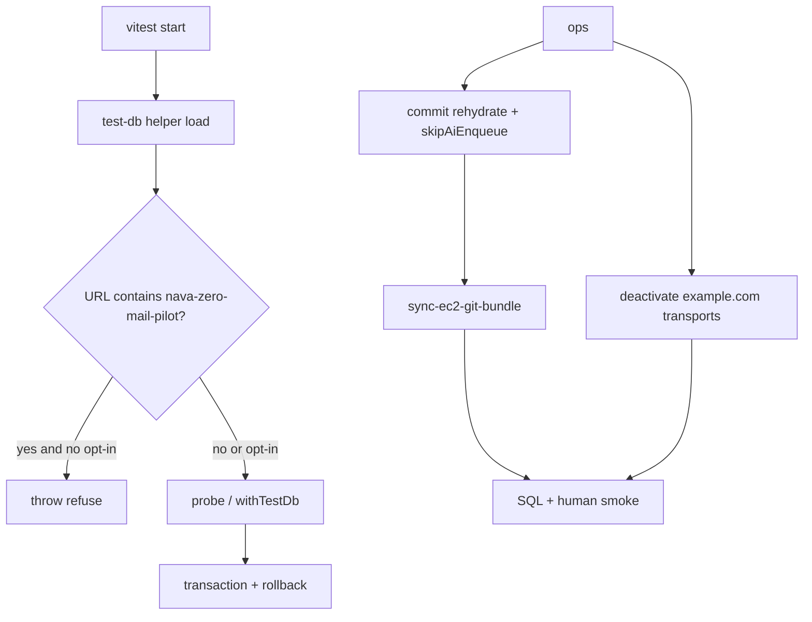

# fix: Pilot RDS vitest guard + rehydrate git/EC2 parity

## Goal Capsule

Stop another vitest wipe of the live pilot RDS, land the already-run S3 raw-MIME rehydrate tooling in git + EC2 branch parity, deactivate leftover `*@example.com` fixture transports, and verify Centurion/Nava mail looks healthy via SQL + a short human checklist.

**Authority:** session-settled defaults (hard-refuse pilot host; checklist-only UI smoke; fixture cleanup now) > handoff `docs/superpowers/plans/handoff-reports/2026-07-27-unstamped-centurion-overnight.md` > `docs/solutions/database-issues/vitest-production-pilot-db-wipe.md` > older fixture docs.

**Stop when:** Definition of Done met; IT Zimbra stamp/strip still deferred.

---

## Product Contract

### Summary

After unstamped Centurion overnight, an accidental full vitest run against prod `DATABASE_URL` wiped pilot message/thread rows and polluted transports with fixture emails. Quarantine promote + S3 rehydrate recovered most mail on-box, but rehydrate code is still an EC2 tarball overlay (not on `EC2-pilot` tip), and `tests/helpers/test-db.ts` still has no pilot-RDS refuse. This plan hardens the test choke point, commits/syncs rehydrate, cleans fixture transports, and smoke-checks live routing.

Product Contract unchanged from session bootstrap (ops/hardening; no new mail product behavior beyond preventing regression).

### Problem Frame

Pilot RDS is reachable from EC2 with sourced `.env.production`. Some tests bypass `withTestDb` rollback and mutate for real. `pnpm --filter @zero/server test -- <files>` can still run the full suite. Bundle sync only ships committed tips — untracked rehydrate dies on next hard reset.

### Actors

- A1. Ops / overnight agent running EC2 vitest or SSM scripts
- A2. Pilot users reading Centurion/Nava inbox in SPA
- A3. `ai-worker` (must not get bulk re-triage from rehydrate land)

### Requirements

- R1. Vitest path refuses known pilot RDS host unless explicit opt-in env (hard fail, loud message).
- R2. Shared refuse logic mirrors existing `ingest-benchmark.ts` host marker (`nava-zero-mail-pilot`).
- R3. Intentional deploy gates that must touch RDS document + set the opt-in (or unset `DATABASE_URL` before vitest).
- R4. Rehydrate module/script/tests + `skipAiEnqueue` on persist are committed and present after EC2 bundle sync.
- R5. Rehydrate default remains triage-off; no bulk `--triage` in this plan.
- R6. Deactivate (not delete) remaining active/inactive cleanup of `*@example.com` transports so they stay out of routing; orphan fixture messages documented.
- R7. Smoke: SQL transport/message/quarantine asserts + human health/VPN/folder spot-check; no new Playwright suite.
- R8. Document “never source `.env.production` into vitest; use `pnpm exec vitest run <files>` from `apps/server-pilot`” in the existing wipe solution note or deploy smoke doc.

### Key Flows

- F1. Developer/agent runs vitest with pilot `DATABASE_URL` → refuse before DB open/mutation.
- F2. Ops commits rehydrate → bundle sync → EC2 files match git tip.
- F3. Ops deactivates fixture transports → only Centurion + Nava active for routing.
- F4. Ops runs SQL + human smoke → Centurion volume present; next BCC not quarantined for equate cases.

### Acceptance Examples

- AE1. Unit: URL containing `nava-zero-mail-pilot` → guard throws without opt-in; with opt-in → allows.
- AE2. Non-pilot URL / unset → guard does not throw (skip path unchanged).
- AE3. After sync, EC2 has `scripts/rehydrate-raw-mime.ts` at same SHA as laptop tip.
- AE4. `SELECT count(*) FROM mailbox_transport WHERE email LIKE '%@example.com' AND is_active` → 0.
- AE5. Health curl ok; Centurion message count ≫ 0; `missing_owner_header` only poison/non-equated residuals.

### Scope Boundaries

**In:** test-db guard + tests; commit/sync rehydrate + store `skipAiEnqueue`; fixture deactivate SQL/runbook; smoke checklist; short docs touch.

**Deferred to Follow-Up Work:**
- Separate disposable `TEST_DATABASE_URL` / Testcontainers (ideal isolation; not this plan)
- Migrating every `getDb()` contract test into `withTestDb`
- Bulk `--triage` rehydrate
- IT Zimbra Rule A/B stamp/strip
- Hard DELETE of fixture transports + CASCADE orphan messages
- `git push` to origin (laptop may already be ahead; optional)

**Outside this product's identity:** changing POP3 account, hotel Exchange rules, autonomous send.

---

## Planning Contract

### Key Technical Decisions

- KTD1. Fail-closed host substring refuse on pilot marker `nava-zero-mail-pilot`, shared or copied from `ingest-benchmark.ts` `isPilotProdDatabase`. (session-settled: user-approved — chosen over soft `TEST_DATABASE_URL`-only skip: wipe happened with sourced prod URL; soft skip still allows mutation.)
- KTD2. Opt-in escape hatch env (e.g. `VITEST_ALLOW_PILOT_RDS=1`) for rare intentional gates — same posture as `CONFIRM_PILOT_SEED` / benchmark `--allow-prod`. Document which gate scripts need it.
- KTD3. Guard fires at `test-db.ts` module load / probe entry so both `withTestDb` and any helper importing it refuse early; also export a pure `assertNotPilotProdDatabase(url)` for unit tests without opening sockets.
- KTD4. Fixture cleanup = `is_active=false` WHERE email LIKE `%@example.com` (session-settled: user-approved — chosen over defer: leftover fixtures confuse transport lists; delete CASCADE deferred as riskier).
- KTD5. UI verification = SQL + human checklist only (session-settled: user-approved — chosen over new Playwright: password often absent on box).
- KTD6. Land rehydrate via normal commit + `sync-ec2-git-bundle.sh` / `ops-deploy.sh` — no more S3 tarball overlays for this path.

### Assumptions

- Pilot RDS hostname marker remains `nava-zero-mail-pilot` (see `apps/server-pilot/deploy/aws-resources.md`).
- Rehydrate already restored ~241 messages on EC2; this plan does not require a second full rehydrate unless sync resets files without data.
- External research: fail-closed inherited-URL guards and host markers beat name-heuristic-only guards; container/host-blind markers are a known pitfall — our marker is in the RDS endpoint string itself, so it survives EC2 sourcing.

### High-Level Technical Design



### Sequencing

U1 (guard) can land before or after U2 (rehydrate commit); prefer **U1 first** so any verification vitest cannot wipe again. Then U2 sync, U3 fixtures, U4 smoke.

---

## Implementation Units

### U1. Hard-refuse pilot RDS in vitest helper

**Goal:** Vitest cannot open/mutate pilot RDS without explicit opt-in.

**Requirements:** R1–R3, AE1–AE2

**Dependencies:** none

**Files:**
- `apps/server-pilot/tests/helpers/test-db.ts` (modify)
- `apps/server-pilot/tests/test-db-guard.test.ts` (create) — or extend `tests/env.test.ts` / `deploy-config.test.ts` if that already asserts confirm gates
- `apps/server-pilot/scripts/ingest-benchmark.ts` (optional extract shared helper) — only if duplication is ugly; else copy marker + comment “keep in sync”
- Gate scripts under `apps/server-pilot/deploy/*gate*.sh` that source `.env.production` then run vitest (modify only those that need RDS) — set opt-in or unset `DATABASE_URL` per script intent
- `docs/solutions/database-issues/vitest-production-pilot-db-wipe.md` (modify) — point at guard + opt-in

**Approach:**
- Pure `assertNotPilotProdDatabase(url, env)` using host parse + substring `nava-zero-mail-pilot`.
- Call from helper load path before `probeTestDb` / `withTestDb` connect.
- Also register a tiny vitest `setupFiles` entry (or extend existing setup) that imports the assert so suites using raw `getDb()` without `test-db.ts` still refuse (those were the wipe agents).
- Opt-in: `VITEST_ALLOW_PILOT_RDS=1` (prefer one documented name; do not invent a second allow flag).
- Do not rely on `NODE_ENV=test` alone (can be omitted when sourcing prod env).

**Patterns to follow:** `ingest-benchmark.ts` `isPilotProdDatabase`; `seed-prod.ts` `CONFIRM_PILOT_SEED`; `env.ts` `assertNoHostedObservabilityEnv`.

**Execution note:** Implement guard test-first (pure helper unit tests with fake URLs; no real RDS).

**Test scenarios:**
- Covers AE1. URL with `nava-zero-mail-pilot` + no opt-in → throws actionable message naming the env var to set.
- Covers AE1. Same URL + opt-in → no throw.
- Covers AE2. Localhost / other host / empty → no throw from refuse (skip-if-unreachable remains separate).
- Edge: URL parse failure still matches substring fallback (mirror benchmark).

**Verification:** focused vitest on guard file green; solution doc names refuse + opt-in.

---

### U2. Commit rehydrate + EC2 bundle parity

**Goal:** Rehydrate tooling and `skipAiEnqueue` live on `EC2-pilot` tip and on the box after sync.

**Requirements:** R4–R5, AE3

**Dependencies:** U1 recommended first

**Files:**
- `apps/server-pilot/src/mail/ingest/rehydrate-raw-mime.ts` (add if untracked)
- `apps/server-pilot/scripts/rehydrate-raw-mime.ts` (add)
- `apps/server-pilot/tests/rehydrate-raw-mime.test.ts` (add)
- `apps/server-pilot/src/mail/ingest/store.ts` (ensure `skipAiEnqueue` committed)
- `CONCEPTS.md` (ensure Raw MIME rehydrate entry present)

**Approach:**
- Single atomic commit (or tight pair) for rehydrate + store flag + concepts.
- `bash apps/server-pilot/deploy/sync-ec2-git-bundle.sh` then confirm `git rev-parse HEAD` and file presence on EC2.
- Do **not** re-run full rehydrate unless counts regress; dry-run optional to prove CLI.
- Never recommend root `pnpm --filter @zero/server test -- …` as scoped run.

**Patterns to follow:** `promote-quarantine.ts` CLI/env gate; overnight handoff deploy notes.

**Test scenarios:**
- Existing helper unit tests for parse/CLI/summary stay green.
- Test expectation: none for deploy sync beyond AE3 file presence — smoke runtime check.

**Verification:** EC2 HEAD matches laptop commit; `scripts/rehydrate-raw-mime.ts` exists; dry-run exits 0 with `INGEST_REQUIRE_OWNER_HEADER=false`.

---

### U3. Deactivate fixture `*@example.com` transports

**Goal:** Active routing set is only real pilot transports (Centurion + Nava).

**Requirements:** R6, AE4

**Dependencies:** U2 optional; can run anytime after seed identity correct

**Files:**
- `apps/server-pilot/deploy/navaai-real-mail-smoke.md` or wipe solution doc (modify) — paste deactivate SQL + verify queries
- No new production script required unless ops wants a tiny `scripts/deactivate-fixture-transports.ts` — prefer documented SQL one-shot to avoid another confirm-gated runner

**Approach:**
```sql
UPDATE mailbox_transport SET is_active = false WHERE email LIKE '%@example.com';
-- verify
SELECT id, email, is_active FROM mailbox_transport ORDER BY email;
SELECT count(*) FROM message m
  JOIN mailbox_transport t ON m.transport_id = t.id
  WHERE t.email LIKE '%@example.com';
```
- Leave orphan fixture messages; do not CASCADE delete in this plan.
- Note: future vitest slip recreates fixtures only if guard (U1) fails — U1 is the real fix.

**Test expectation:** none — ops SQL verification (AE4).

**Verification:** AE4 query returns 0 active fixture transports; Centurion/Nava still `is_active=true`.

---

### U4. SQL + human smoke checklist

**Goal:** Prove post-incident mail surface healthy without new automation.

**Requirements:** R7–R8, AE5

**Dependencies:** U1–U3

**Files:**
- `docs/superpowers/plans/handoff-reports/2026-07-27-unstamped-centurion-overnight.md` (modify residuals → done/partial)
- `apps/server-pilot/deploy/navaai-real-mail-smoke.md` (modify) — add post-rehydrate / guard section if missing
- Optional short handoff: `docs/superpowers/plans/handoff-reports/2026-07-27-pilot-rds-guard-ops-parity.md` when execution finishes

**Approach — SQL:**
- Active transports = Centurion + Nava only
- Message counts by transport/direction
- Quarantine by reason (poison/`unknown_transport` only)
- Optional: newest Centurion subjects non-empty

**Approach — human:**
- `curl` health `:8788`
- PM2 `http`/`worker`/`ai-worker` online
- Env: `INGEST_REQUIRE_OWNER_HEADER=false`, `MAIL_TRANSPORT_MODE=real`, `AI_WRITE_GATE_ENABLED=true`
- SPA: Centurion folder shows restored subjects; Nava shows direct-To tests
- Watch/send one equated BCC → Centurion not `missing_owner_header`

**Test expectation:** none — checklist outcomes.

**Verification:** AE5 + checklist ticks; handoff residuals updated.

---

## Verification Contract

- Local: focused vitest on guard + rehydrate helper tests from `apps/server-pilot` via `pnpm exec vitest run <files>` (never filter-args full suite).
- EC2: after sync, file presence + optional rehydrate `--dry-run`; SQL AE4/AE5; health/PM2.
- Do not source `.env.production` into a vitest process without `VITEST_ALLOW_PILOT_RDS=1` **and** knowing the suite is rollback-safe.

## Definition of Done

- Pilot RDS refuse lives in test helper with unit coverage (AE1–AE2).
- Rehydrate + `skipAiEnqueue` on EC2 tip (AE3).
- No active `*@example.com` transports (AE4).
- Smoke checklist green (AE5).
- Wipe solution / smoke doc updated so next agent does not repeat the incident.

## Risks & Dependencies

| Risk | Mitigation |
|------|------------|
| Gate scripts break after refuse | Audit `*gate*.sh`; set opt-in or unset `DATABASE_URL` before vitest |
| Guard only in `test-db.ts` but some tests never import it | U1 requires vitest `setupFiles` import of assert; follow-up still migrate `getDb()` tests into `withTestDb` |
| Bundle hard-reset drops on-box tarball-only files | U2 commit+sync before any reset |
| Second wipe via non-vitest script | Out of scope; wipe script already needs `CONFIRM_PILOT_WIPE` |
| Fixture deactivate undone by bad test | U1 primary; AE4 recheck after any EC2 vitest |

## Sources & Research

- Session defaults: hard refuse / checklist smoke / fixture cleanup now.
- `docs/solutions/database-issues/vitest-production-pilot-db-wipe.md`
- `docs/superpowers/plans/handoff-reports/2026-07-27-unstamped-centurion-overnight.md`
- `docs/plans/2026-07-27-002-feat-unstamped-centurion-routing-plan.md` (prior product; do not re-open)
- `apps/server-pilot/scripts/ingest-benchmark.ts` — pilot host marker
- External: fail-closed inherited `DATABASE_URL` under test (agent-network #435/#436); host-marker guards must use signals present in the URL (datanika e2e_seed pitfall); AuditBuffet isolate test DB pattern (deferred as follow-up Testcontainers/`TEST_DATABASE_URL`)
