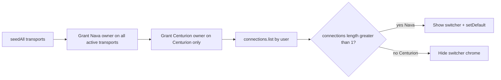

# feat: Nava multi-mailbox switcher + auto-grants

## Goal Capsule

Enable the existing mailbox switcher for users with multiple grants. Give **Nava AI** owner access to every active hotel transport (including Centurion and any future seeded transport). Keep **Centurion** login Centurion-only. Stop when Nava can switch inboxes in the UI and Centurion still sees one row.

**Authority:** this plan > current 1:1 seed ACCESS_ROWS > disabled FE flag.

**Stop when:** Definition of Done met; no admin grant UI; no OAuth add-connection.

---

## Product Contract

### Summary

Re-enable switcher UX when the signed-in user has 2+ `mailbox_access` rows. Seed (and re-seed) so Nava owns all active transports; Centurion owns only Centurion. Dropdown rows = grants only.

### Problem Frame

Backend already lists connections from `mailbox_access` and `connections.setDefault` flips `is_default`. FE hard-disables switcher (`allowConnectionManagement = false`). After Centurion got its own login, seed became 1:1 (Nava→Nava only), so even flipping the flag would show nothing useful for Nava. Ops want Nava as cross-inbox god view; Centurion staff stay single-inbox.

### Actors

- A1. Nava AI operator (`navaai@legacyhotels.co.za`) — multi-inbox switcher
- A2. Centurion operator (`centurion@legacyhotels.co.za`) — Centurion only
- A3. Future hotel transport (e.g. next property) — auto-granted to Nava on seed

### Requirements

- R1. FE shows mailbox switcher chrome when the user has **2+** connections from `connections.list`; hide when 0–1 (Centurion stays clean).
- R2. Switcher uses existing `connections.setDefault` + cache scope switch (no new API).
- R3. On seed: **Nava** gets `owner` access on **every active** `mailbox_transport` row.
- R4. On seed: **Centurion** gets `owner` access **only** on `transport-centurion`.
- R5. Defaults: Nava `is_default` on `transport-nava`; Centurion `is_default` on `transport-centurion`.
- R6. Re-seed replaces pilot access rows (no leftover 1:1-only Nava grant after this ships).
- R7. Adding a new active transport in seed → next `seedAll` auto-grants Nava without editing a hand-maintained Nava row list.
- R8. Keep separate Centurion login and password in Secrets Manager (already live).

### Key Flows

- F1. Login Nava → default Nava inbox → switcher shows Nava + Centurion (+ future) → pick Centurion → inbox scoped to Centurion.
- F2. Login Centurion → only Centurion connection → no multi-avatar switcher chrome.
- F3. Seed adds new active transport → re-seed → Nava gains access row automatically; Centurion unchanged.

### Acceptance Examples

- AE1. After seed, `mailbox_access` for `user-navaai` includes both `transport-nava` and `transport-centurion` (and any other active transports).
- AE2. `user-centurion` has exactly one access row: `transport-centurion`.
- AE3. Nava UI: 2+ connection avatars/menu entries; `setDefault` to Centurion loads Centurion threads.
- AE4. Centurion UI: no multi-mailbox switcher chrome (single connection).
- AE5. Contract test: insert extra active transport in seed path (or simulate post-seed grant helper) → Nava access count includes it without listing it in a static Nava-only ACCESS_ROWS tuple.

### Scope Boundaries

**In:** FE switcher gate, seed grant policy, contract tests, CONCEPTS touch, EC2 re-seed note.

**Deferred to Follow-Up Work:**
- Admin UI to edit grants
- Runtime auto-grant when transports are created outside `seedAll`
- Role nuance (member vs owner) beyond owner for Nava

**Outside this product's identity:** OAuth/Google add-connection, Cloudflare Zero agent accounts.

---

## Planning Contract

### Assumptions

- Only `seedAll` creates production hotel transports today; auto-grant on seed covers option 2.
- Test-only transports inserted in vitest without going through the new grant helper stay isolated (tests that need Nava multi-access use `seedAll` or call the helper).
- Existing switcher handler in `nav-user.tsx` is sufficient once the gate is data-driven.

### Key Technical Decisions

- KTD1 — **Data-driven switcher gate:** `allowConnectionManagement = connections.length > 1` (not hard `true`). Centurion stays single-row → no chrome. (session-settled: user-approved — switcher when 2+ grants)
- KTD2 — **Nava auto-grant all active transports on seed:** after transports upsert, delete pilot access for keep-user ids, then grant Nava owner on every `mailbox_transport` where `isActive`, plus Centurion-only row for Centurion user. Prefer this over a growing static `ACCESS_ROWS` list for Nava. (session-settled: user-directed — option 2 auto-grant future transports)
- KTD3 — **Keep Centurion exclusive login** — do not remove `user-centurion`; do not give Centurion access to Nava transport. (session-settled: user-directed — chosen over one-user+switcher-only)
- KTD4 — **No schema migration** — reuse `mailbox_access` / `is_default`; no new tables.

### High-Level Technical Design

### Product Contract preservation

Product Contract created in this bootstrap; no upstream brainstorm. Session option **2** confirmed (auto-grant Nava on future transports + switcher if 2+ grants).

---

## Implementation Units

### U1. Seed: Nava all-active grants + Centurion-only

**Goal:** Replace 1:1 ACCESS_ROWS with seed-time grant policy so Nava covers every active transport.

**Requirements:** R3, R4, R5, R6, R7, AE1, AE2, AE5

**Dependencies:** none

**Files:**
- `apps/server-pilot/src/db/seed.ts`
- `apps/server-pilot/tests/seed-contract.test.ts`
- `apps/server-pilot/tests/auth-context.test.ts` (expect Nava allowed on Centurion again)

**Approach:** After transport upserts, clear pilot `mailbox_access` for keep user ids. Query active transports. Insert Nava owner rows for each (`isDefault` true only for `transport-nava`). Insert Centurion owner row for `transport-centurion` only (`isDefault` true). Optionally keep a small `PERSONA_ACCESS` for Centurion exclusivity; do not hand-list every Nava transport. Update seed comment that claimed one-login-per-mailbox.

**Patterns to follow:** Existing access replace block in `seed.ts`; connections list join in `connections.ts`.

**Test scenarios:**
- Happy: `seedAll` → Nava access length equals active transport count; includes nava + centurion
- Happy: Centurion access length 1 on centurion only
- Edge: after seed, insert another active transport + re-run grant step / `seedAll` with that transport in seed → Nava gains row without static list edit
- Regression: defaults — Nava default nava; Centurion default centurion
- Auth: `resolveMailboxContext('user-navaai', 'transport-centurion')` succeeds again

**Verification:** seed-contract + auth-context green for new expectations.

---

### U2. FE: enable switcher when 2+ connections

**Goal:** Show existing switcher UI only when multi-grant users need it.

**Requirements:** R1, R2, AE3, AE4

**Dependencies:** U1 (otherwise Nava still has one row in prod until re-seed)

**Files:**
- `apps/mail/components/ui/nav-user.tsx`
- `apps/mail/tests/demo-backend-guards.test.ts` (or smallest existing nav/connections test if present; add focused unit if none)

**Approach:** Replace `const allowConnectionManagement = false` with derived boolean from `data?.connections?.length > 1` (and keep demo-mode blocks as today). Do not invent new switcher UI. Confirm collapsed + expanded layouts both use the same flag.

**Execution note:** Prefer a tiny pure helper test for the gate predicate if extracting `canManageConnections(count)` keeps the component thinner; otherwise one FE/unit assertion on the flag expression is enough.

**Patterns to follow:** Existing `handleAccountSwitch` + `otherConnections` memo in `nav-user.tsx`.

**Test scenarios:**
- Happy: connections length 2 → gate true
- Happy: connections length 1 → gate false
- Integration (manual/EC2): Nava sees avatars; Centurion does not

**Verification:** unit/gate test green; smoke on EC2 after re-seed optional but recommended in ops note.

---

### U3. Docs + EC2 re-seed ops note

**Goal:** Glossary + how to apply grants on live pilot without rotating passwords.

**Requirements:** R8

**Dependencies:** U1, U2

**Files:**
- `CONCEPTS.md`
- Plan ops subsection below (no new long runbook unless implementer finds deploy doc already covering seed)

**Approach:** Add short CONCEPTS entries for mailbox access and mailbox switcher. Document: sync code → `CONFIRM_PILOT_SEED=1 pnpm seed:prod` **without** `--rotate` → Nava gains Centurion (and any active) grants; passwords unchanged.

**Test expectation:** none — docs only.

**Verification:** CONCEPTS entries present; ops note in Definition of Done checklist.

---

## Verification Contract

- `pnpm --dir apps/server-pilot exec vitest run tests/seed-contract.test.ts tests/auth-context.test.ts tests/connections-default.test.ts --reporter=dot`
- FE: existing mail package test that covers nav-user / connections gate if added in U2
- EC2 (after deploy): login Nava → see Centurion in switcher → switch → Centurion threads visible; login Centurion → single mailbox

---

## Definition of Done

- [ ] U1–U3 complete
- [ ] Nava has access rows for all active transports after seed
- [ ] Centurion remains single-transport
- [ ] Switcher visible only when connections > 1
- [ ] Contract tests updated and green
- [ ] CONCEPTS updated
- [ ] Live pilot re-seeded without password rotate (or explicitly noted if rotate required)

---

## Operational / Rollout Notes

1. Land code (commit + EC2 sync/deploy or hotfix path used previously).
2. On EC2: `CONFIRM_PILOT_SEED=1 pnpm seed:prod` (no `--rotate`) so Nava multi-grants apply; Centurion password stays `CenturionAI2707` / SM.
3. Hard-refresh SPA; login as Nava and confirm switcher.
4. Rollback: re-seed prior ACCESS policy or set FE gate false; mail data untouched.
