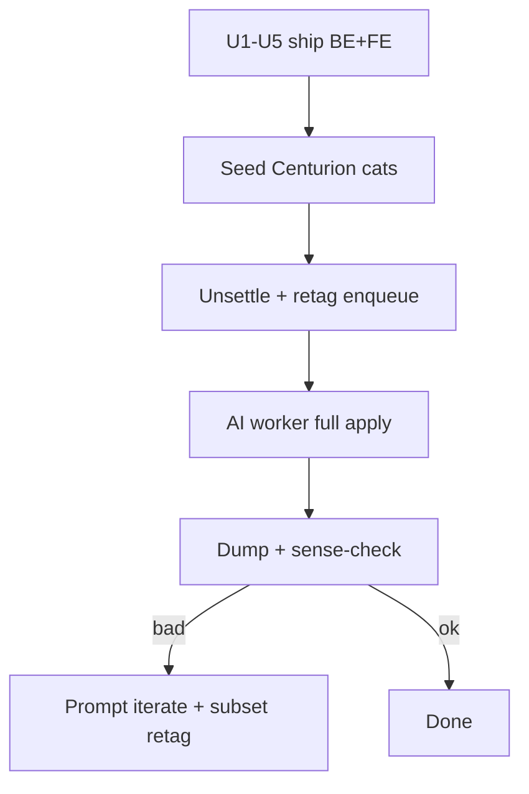

# feat: Hotel revenue queues — triage + Inbox + Centurion retag

## Goal Capsule

Replace invent-WHO triage (`internal` / `individual` / `group` / `travel-agents`) with four FO work queues, teach the classify prompt (spam criteria + full thread), show those queues as **Inbox sections + sidebar mirrors**, then **retag all Centurion production threads** and sense-check.

**Authority:** session-settled IA + spam labels below > this plan > twin-slug patterns.

**Stop when:** BE primaries + `triage-v4` live; FE Inbox shows four visible sections; Centurion retagged; spam/queue audit reviewed in chat (prompt iterated if nonsense). Soft banners / Open-queue / Arriving-soon / Accounts+Needs-reply chips / AutoHide product = **out**.

---

## Product Contract

### Problem frame

Prod classifies by invent-WHO. FO lives in Inbox; invent-WHO folders teach the wrong job. Spam prompt says “irrelevant automation” → GuestRevu/OTP/bounce/FNB false spam. Trigger-only triage → OOO buries real RFQ. Taxonomy alone under-delivers — money-queue drafts matter. Need one ship: **teach + retag + show**.

### Actors

- A1. Centurion FO / reception — books, groups, cancels, channel, handovers.
- A2. Implementer / `ce-work` — BE triage + FE Inbox + retag ops.

### Requirements

- R1. Primaries: `new-bookings` · `groups-events` · `at-risk` · `ops`. Overlay `urgent` = badge/sort pin, not a 5th primary. Spam stays triage category → `spam_at` (system folder), not a primary.
- R2. Classify prompt: inclusion + exclusion spam criteria + priority ties + few-shot archetypes; Task = classify TRIGGER with full-thread context.
- R3. Refine thin: never-spam / short-personal / handover-not-urgent / subject-URGENT-not-SLA remapped to new slugs. No force-ham vendor engine.
- R4. Draft enqueue when `AI_DRAFTS_ENABLED`: money queues (`new-bookings` / `groups-events` / `at-risk`) yes; `ops` + spam no. Off during bulk retag. **Ponytail:** keep existing candidate-draft skeleton prompt this pass — queue-specific draft tones (hit-send / proposal / retain) deferred.
- R5. Inbox `/mail`: four **sections**, all visible; scan At risk → New Bookings → Groups & Events → Ops; within: urgent → starred → recency.
- R6. Sidebar mirrors same four filters/labels (twin lock).
- R7. Retag all `transport-centurion` inbound threads after ship; preserve `spam_user_locked_at`; then audit spam TP/FP + queue sense.

### Acceptance examples

- AE1. Mixed threads on `/mail` → four section headers; Ops expanded.
- AE2. Pill + sidebar = New Bookings / Groups & Events / At risk / Ops (not Travel Agents / Individual).
- AE3. True SLA/`urgent` pins top of section; subject “URGENT” on old invoice alone → `urgent=false`.
- AE4. New Bookings / Groups / At risk with drafts on → candidate draft enqueued (skeleton OK); Ops → no new draft.
- AE5. GuestRevu / OTP / OOO-on-RFQ / FNB / bounce → not spam; FortiMail / BookLogic promo / cold donation → spam.
- AE6. Post-retag Centurion dump: primaries only new slugs; invent-WHO memberships gone for AI-managed rows.

### Scope boundaries

**In**
- BE: `categories.ts`, seed, `mail-triage` prompt+full-thread, `refineTriageOutput`, never-spam domain, draft enqueue matrix + draft-workflow policy switch, contracts/fakes.
- FE: `hotel-folder-presentation.ts`, `folder-map.ts`, nav order, `build-mail-list-virtual-rows` queue mode, demo fixtures.
- Ops: retag script (unsettle + new idempotency keys), Centurion seed, audit dump + iterate.

**Deferred**
- Accounts + Needs-reply sticky chips (no Accounts source; Needs-reply needs conf-join).
- Soft banners; Open-queue; Arriving-soon; keyboard `g`+queue; revenue $; AutoHide; server section cursors.
- Staff spam mark → auto prompt training (marking already exists via move spam/inbox).

**Out**
- Invent-WHO folders; Urgent as work-type primary; Ops collapsed; 5th Accounts folder; force-ham heuristics module; Nova Pro.

### Key decisions (product)

- KD1. Segmented Inbox + Mirror Queues (session-settled: user-directed).
- KD2. Ops always visible (session-settled: user-directed).
- KD3. Plain English labels (session-settled: user-approved).
- KD4. Skip AutoHide product (session-settled: user-directed).
- KD5. **Single plan / single ship** (session-settled: user-directed 2026-07-29 — chosen over FE∥BE parallel split: avoid twin drift + “demo works / pilot invent-WHO”).
- KD6. Defer soft banners / Open-queue / Arriving-soon (session-settled: user-approved).
- KD7. Defer Accounts + Needs-reply chips (session-settled: eng-review).
- KD8. Teach via prompt criteria+exclusions+few-shots, not force-ham rules (session-settled: user-directed).
- KD9. Full-thread triage context (session-settled: user-directed).
- KD10. Draft enqueue matrix this pass; draft *tone* prompts later (session-settled: eng-review+ponytail 2026-07-29 — chosen over shipping three draft policies in same PR: skeleton already works; tone is product polish).

**Product Contract preservation:** Merged FE IA + BE handoff + spam teach + retag; KD5 replaces parallel-split; KD10 cuts draft tones; chips still deferred.

---

## Planning Contract

### Assumptions

- Slug set exact: `new-bookings` · `groups-events` · `at-risk` · `ops` · overlay `urgent` · triage `spam`.
- List rows already expose `categoryIds`; FE partitions via `resolveThreadCategoryPresentation`.
- Settled threads only get `urgency_only` — retag must unsettle + new idempotency keys (`inbound-triage-retag-v4:${messageId}`).
- Retag with `AI_WRITE_GATE_ENABLED=true`, `AI_DRAFTS_ENABLED=false`.
- Nova Lite 300K; Centurion max ~7 msgs @ 2k/msg ≪ window.
- Few-shot archetypes ≠ eval/contract variant strings (contamination).

### Key technical decisions

- KTD1. Twin slug lock: BE `apps/server-pilot/src/ai/categories.ts` owns truth; FE `hotel-folder-presentation.ts` + `folder-map.ts` copy same strings same PR.
- KTD2. Spam = `spam_at` column, not primary membership.
- KTD3. Prompt version `triage-v4` (new taxonomy + spam criteria + thread Task).
- KTD4. System prompt order: Task → Categories → Spam include/exclude → Decision rules → Examples → Output. Criteria before few-shots.
- KTD5. Full thread in user prompt (worker load like `mail.get`); mark TRIGGER; 2k/msg.
- KTD6. Refine stays thin; +`mail.legacyhotels.com` never-spam only.
- KTD7. Segmented Inbox = FE virtual rows (`groupByQueue`); always four headers; pin-within-section.
- KTD8. Draft **enqueue** gated by primary slug in `worker.ts` only. Leave `candidate-draft.ts` skeleton system prompt unchanged this pass (KD10).
- KTD9. Retag script one-shot on EC2/SSM; preserve `spam_user_locked_at`; leave invent-WHO `mail_category` rows orphaned (no delete migration).
- KTD10. No new eval framework — contract-assert prompt phrases + multi-msg format; live Bedrock golden deferred.

### High-level technical design

```text
Inbound msg
    │
    ▼
worker: load thread msgs (oldest→newest)
    │
    ▼
mail-triage triage-v4 (criteria + exclusions + shots)
    │
    ▼
refineTriageOutput (thin, new slugs)
    │
    ├── spam ──► spam_at
    └── primary ──► mail_thread_category
            │
            ├── money queues + AI_DRAFTS_ENABLED ──► candidate_draft (skeleton)
            └── ops / spam ──► no draft
            │
listThreads inbox ──► resolveThreadCategoryPresentation
            │
            ▼
buildMailListVirtualRows(groupByQueue)
            │  at-risk → new-bookings → groups-events → ops
            ▼
Inbox sections + sidebar twins

RETAG (ops): unsettle AI cats + spam_at → enqueue retag-v4 keys → audit dump
```



### Alternatives considered

| Approach | Why not |
|----------|---------|
| FE-only then BE later | Twin drift; pilot stays invent-WHO |
| Force-ham rule engine | User rejected; teach prompt instead |
| Same idempotency key re-enqueue | No-op — settled forever |
| Retag with drafts on | Draft storm on ~193 threads |
| Live Bedrock CI eval this pass | Contract phrase gates enough; live score later |

---

## Implementation Units

### U1. BE taxonomy + seed + types

**Goal:** Primaries become the four revenue queues; overlay `urgent` kept.

**Requirements:** R1

**Dependencies:** none

**Files:**
- Modify: `apps/server-pilot/src/ai/categories.ts`
- Modify: `apps/server-pilot/src/db/seed.ts`
- Modify: `apps/server-pilot/src/lib/driver/types.ts`
- Modify: `apps/server/src/lib/driver/types.ts` (twin)
- Test: `apps/server-pilot/tests/categories-contract.test.ts`, `apps/server-pilot/tests/seed-contract.test.ts`

**Approach:** Replace `AI_PRIMARY_CATEGORY_SLUGS` + seed rows (sortOrder: at-risk 100, new-bookings 110, groups-events 120, ops 130; urgent 10). Remove invent-WHO.

**Test scenarios:**
- Happy: seed upserts four primaries + urgent.
- Error: unknown slug rejected by schema consumers.

**Verification:** categories + seed contracts green.

---

### U2. Classify prompt + full-thread input (`triage-v4`)

**Goal:** Model classifies TRIGGER with thread context under new enums; spam taught by criteria not “irrelevant automation”.

**Requirements:** R1, R2, R9 (KD8/KD9)

**Dependencies:** U1

**Files:**
- Modify: `apps/server-pilot/src/ai/workflows/mail-triage.ts` (export builders)
- Modify: `apps/server-pilot/src/ai/worker.ts` (load thread msgs)
- Modify: `apps/server-pilot/src/ai/run-ledger.ts` (`DEFAULT_TRIAGE_PROMPT_VERSION = triage-v4`)
- Test: `apps/server-pilot/tests/ai-triage-contract.test.ts`, enqueue contracts asserting `triage-v4`

**Approach:** Rewrite `buildSystemPrompt` per handoff categories + spam include/exclude + decision ties + examples (handoff set ∪ spam archetypes: FortiMail, BookLogic promo, donation, GuestRevu→ops, OTP→ops, OOO-on-RFQ, bounce→ops, FNB→ops). User prompt: multi-msg, TRIGGER mark, 2k/msg. Task text must say thread/TRIGGER.

**Directional prompt shape (not copy-paste lock):**
- Spam include: cold sales, promo, newsletter, quarantine digest, partner booster w/o booking ask, cold charity.
- Spam exclude: review digests, channel OTP, OOO/auto-reply on real work thread, MTA bounce, bank POP, short personal → work category.
- Ties: at-risk beats money queues; agency one-room → new-bookings; multi-room → groups-events; unsure spam vs work → work + lower confidence.

**Execution note:** Contract-assert exported system prompt contains inclusion + exclusion phrases and archetype clusters; assert multi-msg format.

**Test scenarios:**
- Happy: prompt contains new enum names + “Not spam” exclusions.
- Happy: multi-msg user prompt orders oldest→newest and marks TRIGGER.
- Edge: per-msg truncate at 2k.
- Covers AE3, AE5 (prompt-level).

**Verification:** triage contracts green; version `triage-v4` enqueued on new inbound.

---

### U3. Refine + never-spam + draft enqueue gate

**Goal:** Post-model thin belt on new slugs; skip draft enqueue for ops/spam.

**Requirements:** R3, R4

**Dependencies:** U1, U2

**Files:**
- Modify: `apps/server-pilot/src/ai/triage.ts`
- Modify: `apps/server-pilot/src/ai/never-spam.ts`
- Modify: `apps/server-pilot/src/ai/worker.ts` (enqueue iff money primary)
- Test: `apps/server-pilot/tests/ai-triage-contract.test.ts`, `apps/server-pilot/tests/ai-worker-contract.test.ts`

**Approach:** never-spam `@legacyhotels.co.za` → `ops`; other never-spam emails → `new-bookings`; +domain `mail.legacyhotels.com`; short-personal → `new-bookings`; handover-not-urgent on `ops`; optional subject-URGENT+invoice → urgent=false; drop invent-WHO agency↔individual swaps. Worker: enqueue draft only when category ∈ {new-bookings, groups-events, at-risk}. **Do not** edit `candidate-draft.ts` prompt this pass (KD10).

**Test scenarios:**
- Happy: never-spam spam remap → ops / new-bookings.
- Happy: short personal → new-bookings.
- Happy: ops triage does not enqueue draft; new-bookings does when drafts enabled.
- Covers AE4.

**Verification:** worker + triage contracts green.

---

### U4. BE invent-WHO test/fake sweep

**Goal:** All server-pilot AI fixtures speak new slugs.

**Requirements:** R1

**Dependencies:** U1–U3

**Files:**
- Modify: `apps/server-pilot/src/ai/eval-runner.ts`, `apps/server-pilot/src/ai/bedrock/fake.ts`, `apps/server-pilot/tests/fixtures/ai-spike/centurion-demo.json`, `centurion-live-corpus-contract`, mail-category-filter tests, etc.

**Approach:** Mechanical slug remap; spike eval stays smoke (no fake-override “golden teach”).

**Test scenarios:** Existing contracts pass with new expected categories.

**Verification:** targeted vitest suite green.

---

### U5. FE twins + queue Inbox + demo

**Goal:** FO sees four sections + sidebar mirrors matching BE.

**Requirements:** R5, R6

**Dependencies:** U1 (slug contract)

**Files:**
- Modify: `apps/mail/lib/mail/hotel-folder-presentation.ts`
- Modify: `apps/mail/lib/demo/folder-map.ts`
- Modify: `apps/mail/config/navigation.ts`
- Modify: `apps/mail/lib/mail/build-mail-list-virtual-rows.ts`
- Modify: `apps/mail/components/mail/mail-list.tsx`
- Modify: demo fixtures/adapters under `apps/mail/lib/demo-data/`
- Test: `apps/mail/tests/hotel-folder-presentation.test.ts`, `apps/mail/tests/demo-folder-map.test.ts`, `apps/mail/tests/build-mail-list-virtual-rows.test.ts`, demo adapter tests

**Approach:** Remap invent-WHO → new slugs/titles. `groupByQueue` ordered headers always (empty OK); missing primary → Ops; sort urgent → starred → recency; keep `groupByDate` off hotel Inbox. Reuse `resolveThreadCategoryPresentation` — do not invent second resolver.

**Execution note:** Unit-test builder before UI wire.

**Test scenarios:**
- Happy: four headers in scan order; threads bucket correctly.
- Edge: empty At risk header still emitted; unknown → Ops; pin-within-section; date mode unchanged when off.
- Covers AE1, AE2, AE3.

**Verification:** FE unit tests green; demo `/mail` shows four sections.

---

### U6. Centurion retag script + run

**Goal:** Durable rewrite all Centurion AI categories/spam under `triage-v4`.

**Requirements:** R7

**Dependencies:** U1–U4 deployed; Centurion `mail_category` seeded with new slugs

**Files:**
- Create: `apps/server-pilot/scripts/retag-centurion-triage.mjs`
- Reuse: dump/audit scripts (`dump-centurion-spam-audit.mjs`, thread dump)

**Approach:** Dry-run flag. Scope transport-centurion inbound threads. Unsettle: delete AI-managed `mail_thread_category`; `spam_at=null` for AI targets. **Skip wipe** of `spam_user_locked_at` (preserve staff). Enqueue `inbound_triage` on latest inbound with key `inbound-triage-retag-v4:${messageId}`, `promptVersion: triage-v4`. Env: write gate on, drafts off. Batch; pump ai-worker; wait succeeded.

**Test scenarios:**
- Happy (dry-run): counts threads/messages to enqueue.
- Edge: user-locked threads listed skipped.
- Integration: after live run, sample `applyMode=full` in metrics.

**Verification:** SSM run completes; workflow runs succeeded; invent-WHO AI memberships cleared.

---

### U7. Audit + prompt iterate

**Goal:** Sense-check spam + queues; fix teach surface if nonsense.

**Requirements:** R7, AE5, AE6

**Dependencies:** U6

**Files:**
- Local artifacts (gitignored): refreshed audit JSON / thread summaries
- Possibly re-touch: `mail-triage.ts` few-shots/criteria only

**Approach:** Confusion matrix vs Jul-29 human labels; queue spot-check (~20 threads across 4 primaries). If fail: edit prompt criteria/shots → subset retag with `retag-v4b` keys — **not** new heuristic file.

**Verification:** Chat audit table; user OK or one iterate cycle.

---

## Verification Contract

- BE: categories, seed, ai-triage, ai-worker, invent-WHO sweep contracts.
- FE: presentation, folder-map, virtual-rows queue mode, demo adapter.
- Ops: dry-run retag counts; live retag succeeded runs; audit dump.
- Manual: AE1–AE6 on demo then Centurion pilot.

## Definition of Done

- [ ] `TRIAGE_CATEGORIES` = new-bookings|groups-events|at-risk|ops|spam; urgent bool unchanged
- [ ] `triage-v4` enqueued; full-thread user prompt live
- [ ] Draft enqueue gate enforced; drafts off during retag; skeleton draft OK (tones deferred)
- [ ] FE twins + four Inbox sections + sidebar
- [ ] Centurion retagged; audit reviewed; invent-WHO gone from AI-managed memberships
- [ ] No force-ham engine; chips/AutoHide/soft banners not shipped

## Deferred to Follow-Up Work

- Queue-specific draft tones (hit-send / proposal / retain) in `candidate-draft.ts` (KD10)
- Accounts + Needs-reply sticky chips (after data + conf-join)
- Conf-join needs-reply detectors (optional later)
- Soft banners, Open-queue, Arriving-soon, keyboard jumps, section cursors
- Staff lock → auto few-shot training loop
- Live Bedrock golden eval CI
- Delete/orphan-cleanup invent-WHO `mail_category` rows (harmless if left)

## Risks & Dependencies

| Risk | Mitigation |
|------|------------|
| Twin FE≠BE | Same PR / same slug table |
| Retag no-ops on settled | Unsettle + new idempotency keys |
| Draft storm | Drafts off during U6 |
| Under-spam after exclusions | Keep BookLogic/FortiMail/donation in include + shots |
| Page-size starves section | Accept v1; cursors deferred |
| User-locked spam skipped | Intentional; list in audit |

## Sources & Research

- Handoff (absorbed): `docs/plans/2026-07-29-triage-prompt-handoff.md`
- Prior FE eng review: GSTACK REPORT below (U3 chips cut; resolver reuse)
- Spam teach: Centurion Jul-29 labels; criteria-before-shots ([explicit criteria](https://examlab.net/en/certs/anthropic/cca-f/topics/explicit-criteria-prompt-design)); few-shot/eval split ([contamination note](https://dev.to/ethanwritesai/our-few-shot-examples-came-from-the-eval-set-the-094-was-fiction-kdc))
- Code: `mail-triage.ts`, `triage.ts`, `worker.ts`, `never-spam.ts`, `hotel-folder-presentation.ts`, `build-mail-list-virtual-rows.ts`, `ai-triage-live-gate.sh` unsettle pattern

---

## What already exists

| Piece | Reuse |
|-------|-------|
| `resolveThreadCategoryPresentation` | FE partition + urgent |
| `buildMailListVirtualRows` date mode | Extend with queue mode |
| `applyDurableTriageResult` settled/urgency_only | Unsettle before retag |
| `enqueueAiRun` idempotency | New retag keys |
| never-spam + short-personal refine | Remap targets only |
| `candidate_draft` + `AI_DRAFTS_ENABLED` | Gate by primary slug |
| moveThreads spam/inbox + `spam_user_locked_at` | Preserve on retag |
| Dump/audit scripts | Phase U7 |

## NOT in scope

- Soft banners, Open-queue, Arriving-soon, AutoHide product
- Accounts + Needs-reply chips
- Force-ham / spam-heuristics module
- Queue-specific draft tone prompts (defer — KD10)
- Nova Pro; personal never-spam email removal
- Enterprise search design doc on this branch (unrelated)
- New golden-eval framework / live Bedrock CI this pass

## Worktree parallelization

| Step | Modules | Depends |
|------|---------|---------|
| U1–U4 BE | `apps/server-pilot/src/ai/`, seed, tests | — |
| U5 FE | `apps/mail/lib/`, `components/mail/` | U1 slugs |
| U6–U7 ops | scripts + SSM | U1–U4 deployed |

**Lanes:** BE U1–U4 then FE U5 can overlap after U1 lands in same branch (shared types). U6–U7 sequential after deploy. Prefer **one branch** (KD5) over dual PR twin risk.

**Conflict flag:** `CenturionMailCategory` / driver types — touch once in U1 for both apps.

## Failure modes

| Path | Failure | Handling |
|------|---------|----------|
| Queue partition | Missing categoryIds | Fallback Ops |
| Twin drift | Wrong titles | Same-PR twin tests |
| Retag same key | No write | New retag-v4 keys |
| Settled skip | urgency_only | Unsettle first |
| Category missing slug | throw on apply | Seed before retag |
| Prompt under-spam | BookLogic FN | Include criteria + shot; iterate U7 |

---

## GSTACK REVIEW REPORT

**Skill:** plan-eng-review + ponytail
**Mode:** FULL_REVIEW (scope reduced inside mega-plan)
**Target:** `docs/plans/2026-07-29-001-feat-hotel-revenue-inbox-ia-plan.md` (unified)
**Date:** 2026-07-29
**Auto-decide:** all recommended options accepted by user instruction

### Step 0 — Scope Challenge
- Complexity: 8+ files (BE+FE+retag). **Smell fires.**
- Minimum that still hits user goal: U1–U3 + U5 twins/sections + U6–U7. U4 = mechanical sweep (keep). Draft *tones* = not required for goal.
- **Accepted recommendation:** Proceed mega-plan (KD5) **with ponytail cut KD10** — enqueue gate only; leave `candidate-draft.ts` skeleton. Do not split FE/BE again.
- Irrelevant design doc (search parity Jul-7) — ignored.
- Completeness: retag+audit kept (user asked). Chips/AutoHide stay out.

### Architecture (auto-picked)
1. **[P1] Draft tone switch overbuild** (confidence 9/10) — `candidate-draft.ts` is one skeleton prompt today (`systemPrompt` L43–48). Three tone policies = new product surface. → **Cut from U3** (KD10). Enqueue matrix stays.
2. **[P1] Retag without seed** (confidence 9/10) — apply throws if slug missing. → Keep U6 dep: seed before unsettle (already sequenced).
3. **[P2] Twin FE≠BE** (confidence 8/10) — same PR / KTD1. → Keep single branch.
4. **Reuse resolver / pin-within-section** — prior FE review; still folded.

### Code quality (auto-picked)
1. **Orphan invent-WHO category rows** — leave orphaned; no delete migration (ponytail).
2. **Export prompt builders** — keep for contract asserts (needed).
3. **No spam-heuristics.ts** — already out; reinforce.

### Tests (auto-picked)
```
CODE PATHS
[+] categories remap          [★★★] categories/seed contracts
[+] buildSystemPrompt v4      [★★ ] phrase + archetype asserts (add)
[+] full-thread user prompt   [★★★] order/TRIGGER/truncate unit
[+] refine new slugs          [★★★] never-spam/short-personal remap
[+] draft enqueue gate        [★★★] ops skip / money enqueue
[+] groupByQueue builder      [★★★] FE builder tests
[+] retag script              [★★ ] dry-run counts (script smoke)
[+] live Bedrock golden       [GAP] deferred KD10-adjacent

USER FLOWS
[+] FO opens /mail sections   [★★ ] demo + manual AE1
[+] Centurion after retag     [★★ ] audit dump U7 [→EVAL] sense-check
```
- **REGRESSION:** invent-WHO refine remaps must update or tests fail — U3/U4 critical.
- Eval scope: **contract phrase gates only** this pass (recommended); live Bedrock deferred.

### Performance (auto-picked)
1. Bulk retag Bedrock cost — drafts off + batch caps (keep).
2. Full-thread 2k/msg — already capped; no issue.
3. Page-size section starve — accept v1 (prior).

### Outside voice
- Skipped (user: auto-pick recommended; no Codex wait).

### TODOS.md
- No TODOS.md in repo. Deferred items live in plan Deferred section. **Skip creating TODOS.md** (ponytail — plan already lists them).

### Implementation Tasks (from this review)
- [x] **T1** — Cut draft tone policies from U3; KD10 — *done in plan*
- [ ] **T2 (P1)** — U1–U4 BE ship
- [ ] **T3 (P1)** — U5 FE sections
- [ ] **T4 (P1)** — U6 retag + U7 audit
- [ ] **T5 (P2)** — Follow-up: candidate-draft tone by slug

### Summary
- Step 0: mega-plan accepted + ponytail cut (draft tones)
- Architecture: 4 issues → all folded
- Code quality: 3 → folded
- Test: diagram gaps → contract asserts; live eval deferred
- Performance: 0 blocking
- Unresolved decisions: 0
- Critical gaps: 0 if U6 unsettle/keys followed
- Lake score: complete retag/audit kept; draft tones cut (right incomplete feature)