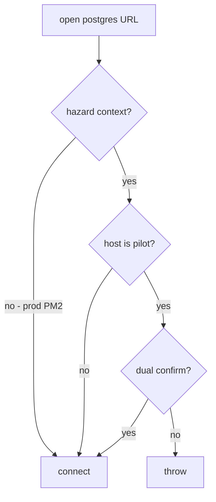

## Goal Capsule

**Objective:** Make a second accidental logical wipe of live pilot Postgres (`nava-zero-mail-pilot`) by Vitest, fixture suites, or casual agent/ops scripts **mechanically fail closed**, while production PM2 and intentional dual-confirmed ops still work.

**Authority:** User scoped Option **B** (shared connection refuse under hazard contexts + dual-key confirm for intentional mutate) with intentional seed/promote/rehydrate/wipe kept behind dual confirm. TDD mandatory (`/test-driven-development`). Canonical incident: `docs/solutions/database-issues/vitest-production-pilot-db-wipe.md`.

**Stop when:** Hazard-path connects to pilot throw without dual confirm; Vitest never mutates pilot without both keys; contract gates that need no DB are DB-free on the ship branch; deploy-config scan still green; intentional ops still work with confirms; docs/smoke confirm-string drift fixed.

**Out of scope:** CloudWatch/SNS cliff alarms (Option C), Multi-AZ, S3 retention policy, automated PITR orchestration, triage-v5 cutover.

---

## Product Contract

### Summary

Twice (Jul 27 Vitest full suite; Jul 30 Task 9 fingerprint recurrence) live pilot mail data was replaced by fixtures. Vitest host refuse shipped after Jul 27 and was **necessary but not sufficient**. This plan closes the bypass class: hazard-context connection refuse, dual-key mutate confirms for scripts, DB-free contract gates, and TDD proofs — without breaking production `getDb()`.

### Requirements

- **R1.** Under Vitest (or any declared hazard context), opening a connection whose `DATABASE_URL` hostname contains `nava-zero-mail-pilot` must throw unless **dual** env confirms are set (see KTD-2). Single `VITEST_ALLOW_PILOT_RDS=1` alone must **not** suffice for mutation-capable connects.
- **R2.** Production runtime (`getDb()` / `createDb` when not in hazard context) must continue connecting to pilot without new confirms.
- **R3.** Mutating ops scripts (`seed:prod`, `pilot-db-wipe`, and any script that inserts fixture transports / truncates mail plane) must refuse pilot unless dual confirm; read-only dumps may use a weaker read confirm or stay allowlisted explicitly.
- **R4.** Deploy gates that only need contract assertions must be **DB-free** (`unset DATABASE_URL` and unset allow) on the branch that ships this plan — port the `triage-v5-quality` shape for `ai-gate` / `bedrock-live-gate` where applicable.
- **R5.** `deploy-config.test.ts` dynamic scan remains the enforcement for any future gate that sources prod env **and** runs Vitest — and must treat dual-key (not single allow) as the required opt-in once R1 lands.
- **R6.** Agent/overnight docs and wipe solution prevention section state the dual-key rule; smoke.md confirm-string drift (`CONFIRM=WIPE_PILOT_DB` vs `CONFIRM_PILOT_WIPE`) is fixed.
- **R7.** All behavioral changes are proven test-first (failing test before production code).

### Actors

- **A1.** Overnight / Cursor agent on EC2 or local with sourced prod env.
- **A2.** Human operator running intentional seed/wipe/promote/rehydrate.
- **A3.** Production PM2 processes (http, worker, ai-worker) using pilot `DATABASE_URL`.

### Key Flows

- **F1.** Agent runs Vitest with pilot `DATABASE_URL` → refuse (no dual key) → zero SQL.
- **F2.** Agent runs `tsx` mutate script against pilot without confirms → refuse.
- **F3.** Operator sets dual confirm → seed/wipe proceeds.
- **F4.** PM2 cold start → `getDb()` connects to pilot normally.

### Acceptance Examples

- **AE1.** Vitest with pilot URL and empty confirms → setup/connect throws naming both required env vars; message count unchanged (no live DB needed to assert throw).
- **AE2.** Vitest with only `VITEST_ALLOW_PILOT_RDS=1` → still throws (dual-key).
- **AE3.** `NODE_ENV` production-like `getDb()` unit with pilot URL mock env and no `VITEST` → allowed (hazard false).
- **AE4.** `seed-prod` without confirms → refuse; with dual confirm → confirm gate passes (may still mock DB beyond confirm check).
- **AE5.** `ai-gate.sh` on ship branch does not export `VITEST_ALLOW_PILOT_RDS=1` and unsets `DATABASE_URL` before vitest (static test).

### Scope Boundaries

**In:** Guard module expansion, `createDb`/script chokepoints, gate script rewrites, deploy-config tests, docs/smoke fixes, overnight overlay one-liner if present.

**Deferred to Follow-Up Work:** Option C cliff alarms; IAM DB user with revoke DDL for app role; separate disposable RDS always-on for EC2 vitest; wrapping every ad-hoc `.mjs` dump under one CLI (enumerate and migrate high-risk mutators first).

**Outside:** Changing hotel POP3 DELE policy; enabling Multi-AZ as “prevention.”

---

## Planning Contract

### Key Technical Decisions

1. **Hazard context, not blanket refuse** `(session-settled: user-approved — chosen over Option A Vitest-only and Option C+alarms for this plan: B shared refuse under hazard; C deferred)`  
   Refuse pilot connects when any of: Vitest/`VITEST`/`import.meta.vitest`, `NODE_ENV=test` with live URL, or explicit `PILOT_DB_GUARD=hazard` (agents may export). Do **not** refuse plain production PM2 `getDb()`.

2. **Dual-key for mutation-capable pilot access**  
   Require **both** `VITEST_ALLOW_PILOT_RDS=1` **and** `CONFIRM_PILOT_MUTATE=1` (exact string `1`) before hazard-context connect to pilot. Intentional wipe/seed keep their specific confirms (`CONFIRM_PILOT_WIPE` / `CONFIRM_PILOT_SEED`) **and** must also satisfy the shared mutate confirm when opening postgres — implementer may alias `CONFIRM_PILOT_SEED=1` / `CONFIRM_PILOT_WIPE=1` as satisfying the mutate half to avoid triple flags, but Vitest must never treat seed/wipe confirms as Vitest allow.

3. **Chokepoint = `createDb` + script `openSql(url)` helper**  
   Production and tests should open postgres only through `apps/server-pilot/src/db/client.ts` `createDb` (call guard at start) and a small `apps/server-pilot/src/db/pilot-safe-sql.ts` (or extend guard) used by `scripts/*.ts` that currently call `postgres()` raw. High-risk mutators first: `seed-prod.ts`, wipe path, promote/rehydrate/retag. Read-only dumps: either go through helper with `mode: 'read'` + `CONFIRM_PILOT_READ=1` or remain listed exceptions documented in deploy-config-style test.

4. **Move guard out of tests-only tree**  
   Promote host detection + assert APIs from `tests/helpers/pilot-rds-guard.ts` into `src/db/` (or `src/lib/`) so scripts can import without pulling Vitest. Keep thin re-export from old path for test imports.

5. **DB-free contract gates on ship branch**  
   Port `triage-v5-quality` behavior: `ai-gate.sh` / `bedrock-live-gate.sh` unset `DATABASE_URL` and `VITEST_ALLOW_PILOT_RDS` (bedrock may keep Bedrock creds via scoped source then unset URL). Gates that truly need RDS keep dual-key export and scoped `pnpm exec vitest run`.

6. **TDD**  
   Every unit below starts with a failing test. No production code before red.

### Assumptions

- Jul 30 culprit may have been non-Vitest or allow misuse; plan treats both as in-scope bypasses.
- CloudWatch cliff (Option C) is valuable but deferred unless this plan’s Definition of Done is met and wipe still recurs.
- Product Contract preservation: n/a (ce-plan-bootstrap).

### High-Level Technical Design

### Alternatives Considered

| Approach | Why not now |
|----------|-------------|
| A — Vitest/docs only | Already failed once after Jul 27 refuse |
| C — B + CloudWatch cliff | Good second layer; more infra; defer |
| Separate always-on disposable RDS | Right long-term; larger ops cost; follow-up |
| Remove all Vitest allow entirely | Breaks intentional RDS-backed gates until rewritten |

---

## Implementation Units

### U1. Promote and extend pilot DB guard (dual-key + hazard)

**Goal:** Shared, importable guard with hazard detection and dual-key mutate assert.

**Requirements:** R1, R2, R7

**Dependencies:** none

**Files:**
- create: `apps/server-pilot/src/db/pilot-rds-guard.ts` (or `src/lib/pilot-rds-guard.ts`)
- modify: `apps/server-pilot/tests/helpers/pilot-rds-guard.ts` (re-export)
- modify: `apps/server-pilot/tests/pilot-rds-guard.test.ts`
- modify: `apps/server-pilot/tests/setup/refuse-pilot-rds.ts` (call dual-key assert)

**Approach:** Move `PILOT_PROD_DB_HOST` / `isPilotProdDatabase`. Add `isHazardDbContext(env)` and `assertPilotConnectAllowed(url, env, { purpose: 'vitest' | 'script-mutate' | 'script-read' | 'runtime' })`. Vitest purpose requires dual key. Runtime purpose no-ops. Keep loud error text naming both env vars.

**Execution note:** Implement new domain behavior test-first. Watch refuse-with-only-allow fail before implementing dual-key.

**Test scenarios:**
- Covers AE1/AE2. Pilot URL + no env → throw.
- Pilot URL + only `VITEST_ALLOW_PILOT_RDS=1` → throw (new).
- Pilot URL + both keys → no throw for vitest purpose.
- Non-pilot URL → no throw.
- Runtime purpose + pilot URL + no keys → no throw.
- Empty URL → no throw.

**Verification:** `pnpm exec vitest run apps/server-pilot/tests/pilot-rds-guard.test.ts` (from package) green; refuse-pilot-rds still loads.

---

### U2. Chokepoint `createDb` / `getDb` under hazard

**Goal:** Every drizzle/postgres open via client module respects U1.

**Requirements:** R1, R2, R7

**Dependencies:** U1

**Files:**
- modify: `apps/server-pilot/src/db/client.ts`
- create/modify: `apps/server-pilot/tests/db-client-pilot-guard.test.ts`

**Approach:** At start of `createDb(url)`, if hazard → `assertPilotConnectAllowed`. `__setDbForTests` remains bypass for tx handles already opened under test helper (test-db still asserts before connect).

**Execution note:** Failing test that stubs env as Vitest + pilot URL and expects `createDb` throw before any network.

**Test scenarios:**
- Hazard + pilot URL + no dual key → `createDb` throws (no real TCP).
- Hazard + dual key → `createDb` may proceed (mock postgres if needed) or stop before connect with injectable factory — prefer throw-before-postgres via guard only.
- Non-hazard + pilot → allowed.

**Verification:** New test file green; existing pilot-rds-guard + a smoke import of client under unset URL still work.

---

### U3. Script mutators use shared open + dual confirm

**Goal:** seed / wipe / promote / rehydrate / retag cannot open pilot without confirms.

**Requirements:** R3, R7

**Dependencies:** U1

**Files:**
- create: helper used by scripts (e.g. `apps/server-pilot/src/db/open-pilot-sql.ts`)
- modify: `apps/server-pilot/scripts/seed-prod.ts`
- modify: `apps/server-pilot/deploy/pilot-db-wipe.sh` and/or wipe entry that opens DB
- modify: `apps/server-pilot/scripts/promote-quarantine.ts`, `rehydrate-raw-mime.ts`, `retag-centurion-triage.mjs` (or `.ts` equivalent) — at minimum all that DELETE/INSERT mail plane
- modify: `apps/server-pilot/tests/deploy-config.test.ts` (or new `pilot-mutate-confirm.test.ts`)

**Approach:** Replace raw `postgres(env.DATABASE_URL)` with helper that asserts script-mutate purpose. Alias: `CONFIRM_PILOT_SEED=1` or `CONFIRM_PILOT_WIPE=1` counts as mutate half for those scripts; still require explicit documentation. Retag `--apply` path is mutate; dry-run may use read purpose. Also cover `delete-centurion-live-fixtures.mjs` (already has `CONFIRM_DELETE_CENTURION_FIXTURES`) and align `ingest-benchmark.ts` `--allow-prod` with the shared host marker + dual-key (or retire local duplicate marker).

**Files:** (also) `apps/server-pilot/scripts/delete-centurion-live-fixtures.mjs`, `apps/server-pilot/scripts/ingest-benchmark.ts`

**Execution note:** Test-first confirm refusal for seed-prod gate function (extract pure `assertSeedAllowed(env)` if needed).

**Test scenarios:**
- Covers AE4. Seed without confirms → throw/exit non-zero.
- Seed with seed+mutate (or dual) confirms → assert passes.
- Wipe script without `CONFIRM_PILOT_WIPE` → refuse (existing) + still requires mutate key if opening SQL through helper.
- Dry-run retag with read purpose + pilot → allowed with read confirm or documented exception.

**Verification:** Unit tests green; bash `-n` on wipe script; no live pilot needed.

---

### U4. DB-free contract gates + deploy-config dual-key

**Goal:** Close overnight copy-paste of `source .env.production` + single allow + vitest.

**Requirements:** R4, R5, R7

**Dependencies:** U1

**Files:**
- modify: `apps/server-pilot/deploy/ai-gate.sh`
- modify: `apps/server-pilot/deploy/bedrock-live-gate.sh`
- modify: `apps/server-pilot/tests/deploy-config.test.ts`
- optionally mirror from `zero-triage-v5` worktree patterns

**Approach:** Unset `DATABASE_URL` and `VITEST_ALLOW_PILOT_RDS` before vitest/smoke. Update deploy-config expectations: scripts that both source prod **and** run vitest must export **both** dual-key vars (or must unset URL and not run against pilot). Prefer unset URL so dual-key unused.

**Execution note:** Start with failing deploy-config assertion that ai-gate must not contain `VITEST_ALLOW_PILOT_RDS=1` without unset, or must unset DATABASE_URL.

**Test scenarios:**
- Covers AE5. Static parse of `ai-gate.sh` / `bedrock-live-gate.sh` → unset present; casual allow export absent OR paired with dual-key if still RDS-backed.
- Dynamic scan still fails closed for new gates that forget opt-in.
- `hms-read-gate.sh` remains intentional RDS path with dual-key when `--full` uses pilot.

**Verification:** `pnpm exec vitest run tests/deploy-config.test.ts` green from `apps/server-pilot`.

---

### U5. Docs, smoke drift, overnight rule

**Goal:** Humans/agents cannot learn the unsafe pattern from our own docs.

**Requirements:** R6

**Dependencies:** U1–U4 ideally landed so docs match code

**Files:**
- modify: `docs/solutions/database-issues/vitest-production-pilot-db-wipe.md` (Prevention: dual-key)
- modify: `apps/server-pilot/deploy/navaai-real-mail-smoke.md` (`CONFIRM_PILOT_WIPE=1`)
- modify: `docs/solutions/workflow-issues/ec2-pilot-autonomous-deploy-and-ssm-gotchas.md` (remove/replace ad-hoc allow+vitest example)
- modify: `CONCEPTS.md` (`VITEST_ALLOW_PILOT_RDS` + new dual-key / hazard terms if needed)
- modify: `.cursor/skills/overnight-autonomous-zero/SKILL.md` (or repo overnight overlay) — hard rule: never set dual keys casually; never Vitest against pilot

**Approach:** Doc-only + CONCEPTS. No product code.

**Test expectation:** none — documentation; verify by review checklist against R6.

**Verification:** Grep shows no `CONFIRM=WIPE_PILOT_DB` in smoke; wipe doc mentions dual-key; overnight skill mentions refuse.

---

## Verification Contract

- From `apps/server-pilot`: focused vitest for `pilot-rds-guard`, new client guard test, `deploy-config` — with `DATABASE_URL` unset.
- Never set `VITEST_ALLOW_PILOT_RDS` or `CONFIRM_PILOT_MUTATE` in CI/agent default env.
- Manual smoke (operator): PM2 still healthy against pilot after deploy of client change (F4).
- Optional: one intentional `CONFIRM_PILOT_SEED=1` dry path on disposable DB only — not pilot — to prove confirms still open helper.

## Definition of Done

- [ ] U1–U4 tests were seen red then green (TDD).
- [ ] Single-allow Vitest against pilot URL fails closed.
- [ ] Production `getDb` path not broken (AE3 / PM2 health).
- [ ] Mutating scripts refuse without confirms.
- [ ] Ship-branch `ai-gate` / `bedrock-live-gate` DB-free (or dual-key if still RDS).
- [ ] Docs/smoke/overnight rule updated (U5).
- [ ] No claim that DeletionProtection prevents SQL wipe.

## Risks & Dependencies

| Risk | Mitigation |
|------|------------|
| Guard breaks PM2 | Hazard detection must exclude production worker; AE3 + post-deploy health |
| Scripts bypass helper | Enumerate `postgres(` in `scripts/`; test fails if new raw open without helper comment allowlist |
| Agents set both keys casually | Overnight skill + refuse to document keys together in copy-paste snippets; prefer DB-free gates |
| `.mjs` retag hard to import TS guard | Thin JS duplicate of host check or compile path; do not leave retag unguarded |

## Sources & Research

- `docs/solutions/database-issues/vitest-production-pilot-db-wipe.md` (last_updated 2026-07-30)
- `docs/plans/2026-07-27-003-fix-pilot-rds-test-guard-and-ops-parity-plan.md`
- `docs/solutions/workflow-issues/nava-mailbox-switcher-finish-wipe-safe-verify.md`
- `CONCEPTS.md` — Pilot RDS vitest refuse / PITR / wipe-safe verify
- Local code: `apps/server-pilot/src/db/client.ts`, `tests/helpers/pilot-rds-guard.ts`, deploy gates, `CONFIRM_PILOT_*` scripts
- Scratch research (post-write confirm): `.superpowers/ce-compound-scratch/20260730-122833-d1e5/plan-repo-research.md`, `plan-learnings.md`
- External research: skipped — local incident docs + patterns sufficient; high-risk domain already encoded in institutional learnings
