# fix: Render CID inline images and make sender trust real

## Goal Capsule

**Objective:** Hotel/Rocketseed emails show banners, GIFs, and other inline images in the message body (not only as attachment chips), while remote http(s) images stay gated by trust — and Trust Sender actually works.

**Authority:** Debug findings 2026-07-30; prior design in `docs/superpowers/plans/2026-07-30-rocketseed-banner-first-class.md` Tasks 5–7 (CID projection + inline route); Outlook Safe Senders / remote-content norms (block remotes by default or behind trust; CID is not remote).

**Stop when:** Opening a pilot message with `cid:` imgs + matching `attachment.contentId` rows shows those images in Shadow DOM without enabling scripts; toggling Trust / `externalImages` loads preserved remote `http(s)` imgs; hotel never-spam domains count as image-trusted when remotes are gated; no JS execution in mail HTML.

---

## Product Contract

### Summary

Pilot mail already stores inline image bytes and lists them as downloadables, but the body never resolves `cid:` references, and ingest/wire permanently replace remote image URLs with a 1×1 placeholder — so Trust Sender cannot restore remotes. Fix projection + storage/wire trust gate; keep scripts sandboxed forever.

### Requirements

- R1. Same-message `cid:` references in sanitized HTML rewrite to authenticated absolute inline URLs and render in the body when the attachment is a safe raster.
- R2. Inline image bytes serve only to session users with mailbox access to that message; never via unsigned public URLs or FE-exposed `contentId`.
- R3. Remote `http(s)` image URLs survive ingest and wire sanitization as URLs; loading is gated at `processEmailContent` / FE trust (`externalImages`, trusted senders/domains, or temporary Show Images).
- R4. Trust matches exact sender email **or** sender domain (Outlook Safe Senders–style domain entries). Prefer reusing `AUTO_TRIAGE_NEVER_SPAM_DOMAINS` as the built-in hotel domain set for image trust when global `externalImages` is off — do not invent a second domain module.
- R5. When images fail for a non-trusted sender, Show Images + Trust Sender remain visible; CID load failures for already-trusted senders degrade to alt text without falsely implying remote block.
- R6. Mail HTML never gains `allow-scripts` / executable JS — Shadow DOM + server sanitize stay the XSS boundary.

Deferred (ponytail): seeding `trustedSenders` defaults in settings UI; privacy-page copy for domains; syncing `apps/server` schema twin — not needed for pilot CID fix while `externalImages` defaults true.

### Actors

- A1. Hotel staff reading Centurion / Nava mail in Zero FE.
- A2. System (Rocketseed / Zimbra) delivering branded MIME with CID banners and optional remote branding URLs.

### Key Flows

- F1. Open thread → FE calls `processEmailContent` with `messageId` + trust flag → sanitize → CID rewrite → Shadow DOM shows banners/GIFs.
- F2. Untrusted remote imgs → blocked placeholder + banner → Show Images (temp) or Trust Sender / domain → remotes load on reprocess.
- F3. `` requests `/api/.../inline` with session cookie → authz + raster check → bytes.

### Acceptance Examples

- AE1. Message with `` and matching inline GIF attachment → banner visible in body without clicking Trust Sender.
- AE2. Message with remote `https://branding.example/logo.png` and `externalImages=false`, sender not trusted → placeholder; after Trust Sender → logo loads.
- AE3. Unauthenticated or cross-mailbox inline GET → 401/404; no bytes.
- AE4. SVG / oversized / magic-mismatch attachment referenced by cid → placeholder; no XSS vector.
- AE5. Script tags / event handlers in HTML still stripped after CID work.

### Scope Boundaries

**In scope:** CID projection helpers, authenticated inline HTTP route, `processEmailContent` message scoping, storage/wire preserve remote URLs, domain trust matching + hotel domain defaults, FE cache/API wiring, tests.

**Out of scope / deferred:**

- Rocketseed SMTP cutover, self-BCC reconciliation, compose-time banner preview (owned by rocketseed plan).
- Enabling JavaScript inside email HTML (never).
- Image proxy / dead `template()` iframe CSP path revival.
- Backfilling already-placeholderized historical remote URLs from raw MIME (optional follow-up).
- CSS `url()` remote tracking neutralization beyond current sanitize (known residual; see audit-A).

### Product Contract preservation

Product Contract created by `ce-plan-bootstrap` from debug session — no upstream brainstorm.

---

## Planning Contract

### Key Technical Decisions

- KTD1. **CID always projectable; remote always trust-gated.** Industry norm (Gmail/Outlook/webmail): CID travels with the message and is not a tracking fetch; remotes are the privacy risk. `(session-settled: user-directed — chosen over “require Trust for CID too”: hotel banners must look correct without a click)`
- KTD2. **Reuse rocketseed Tasks 5–7 shape:** `cid-images.ts` + `safe-inline-image.ts` + `GET .../inline` + `processEmailContent` requires `messageId`; absolute URLs from `BETTER_AUTH_URL` origin. `(session-settled: user-approved — chosen over data: URI embed: plan and Gmail size/Outlook strip concerns; signed S3 in HTML leaks)`
- KTD3. **Storage/wire sanitize = XSS only for imgs:** keep `http`/`https`/`cid`/`data` src strings when present; do **not** burn remote URLs to placeholders at ingest/wire. Placeholders only when `shouldLoadImages=false` at **render** (`processEmailContent`). Both `sanitizeHtmlBodyForStorage` and `toParsedMessage` must change or Trust stays theater.
- KTD4. **Domain trust:** extend match to `trustedSenders` entries that are bare domains or `@domain`, plus treat `AUTO_TRIAGE_NEVER_SPAM_DOMAINS` as always image-trusted domains (same hotel set). Exact emails still work. No new `hotel-domains.ts`.
- KTD5. **No FE `contentId` on thread wire.** Rewrite server-side only; `getMessageAttachments` continues omitting `contentId` from client payload.

### Assumptions

- Most “missing sexy banners/GIFs” in hotel mail are CID (attachment chips prove bytes exist), not only remote hosts.
- `BETTER_AUTH_URL` is the correct public origin for inline URLs in live pilot (`https://nava.legacy.local`).
- Cheerio fragment mode (`load(html, null, false)`) is the rewrite vehicle (already used in `collapse-quoted-html.ts`).
- Raster validation can ship without `sharp` initially (magic bytes + dimension parsers for PNG/JPEG/GIF/WebP) as in rocketseed plan.

### High-Level Technical Design

```mermaid
flowchart LR
  MIME["MIME cid + optional http imgs"] --> Ingest["ingest: XSS sanitize, keep img URLs"]
  Ingest --> DB["htmlBody + attachment rows"]
  DB --> Wire["toParsedMessage: XSS sanitize, keep URLs"]
  Wire --> FE["MailContent trust gate"]
  FE --> Proc["processEmailContent messageId"]
  Proc --> San["sanitize shouldLoadImages"]
  San --> Cid["rewrite cid → absolute inline URL"]
  Cid --> Shadow["Shadow DOM"]
  Shadow --> Inline["GET /api/.../inline cookie auth"]
  Inline --> S3["getObjectBounded + raster gate"]
```

### Alternatives Considered

| Approach | Why not |
|----------|---------|
| Only flip `externalImages` / Trust Sender | Already default true; does not resolve `cid:` or burned placeholders |
| Gmail-style `data:` embed at process time | Huge HTML, cache bloat; Outlook often strips `data:` imgs |
| FE fetches each CID via `getAttachment` signed URL | Exposes contentId or requires FE rewrite; many round-trips; S3 CORS |
| Domain allowlist of image **hosts** (branding CDN) | Wrong layer; Outlook trusts **senders/domains**, not image CDNs |

### Risks & Dependencies

- Historical messages already have remote placeholders in DB — new behavior helps new/re-ingested mail; optional MIME reparse follow-up.
- Inline route must not depend on `x-zero-active-transport` (img tags cannot set it) — use `mailbox_access` join.
- Loosening storage sanitize without render gate = tracker leak — U2 + U3 must land together in the same shippable slice as FE trust still calling `processEmailContent`.
- Depends on existing S3 `getObjectBounded`, Better Auth session cookies, attachment `contentId` populated at ingest (already true).

---

## Implementation Units

### U1. CID normalize + rewrite helpers

**Goal:** Pure functions rewrite sanitized `img[src=cid:…]` to absolute inline URLs for same-message attachment metadata.

**Requirements:** R1, R2, R6

**Dependencies:** none

**Files:**
- Create: `apps/server-pilot/src/mail/cid-images.ts`
- Create: `apps/server-pilot/src/mail/safe-inline-image.ts`
- Modify: `apps/server-pilot/src/mail/sanitize-email-html.ts` (export placeholder)
- Test: `apps/server-pilot/tests/cid-images.test.ts`
- Test: `apps/server-pilot/tests/safe-inline-image.test.ts`
- Test: `apps/server-pilot/tests/sanitize-email-html.test.ts`

**Approach:** Normalize CID (strip `cid:`, percent-decode once, trim, strip `<>`, lowercase; reject path/query/control). Match exact Content-ID among image attachments only; duplicates → ambiguous block. Cheerio fragment rewrite of `img[src]` only. Raster gate: PNG/JPEG/GIF/WebP signatures, max 5 MiB, max dimension/pixel caps per rocketseed Task 5.

**Patterns to follow:** `docs/superpowers/plans/2026-07-30-rocketseed-banner-first-class.md` Task 5; `collapse-quoted-html.ts` cheerio fragment load.

**Execution note:** Implement test-first for normalize + rewrite + raster rejects.

**Test scenarios:**
- Happy: single cid → URL under `BETTER_AUTH_URL` origin path `/api/mail/messages/{id}/attachments/{att}/inline`
- Edge: angle-bracket Content-ID, percent-encoded cid, case fold
- Error: missing/duplicate/malformed cid → placeholder + blocked flag
- Integration: does not rewrite `<a href="cid:…">` or CSS `url(cid:…)`

**Verification:** Vitest green for the three test files; no network.

---

### U2. Authenticated inline attachment HTTP route

**Goal:** Cookie-authenticated byte route for projected CID URLs.

**Requirements:** R1, R2, AE3, AE4

**Dependencies:** U1

**Files:**
- Create: `apps/server-pilot/src/http/inline-attachment.ts`
- Modify: `apps/server-pilot/src/main.ts`
- Test: `apps/server-pilot/tests/inline-attachment-http.test.ts`
- Modify: `apps/server-pilot/tests/attachment-access.test.ts`

**Approach:** Handler factory with injectable auth/DB/storage. Session required; join attachment → message → `mailbox_access` for session user; path IDs must match; MIME + `getObjectBounded` + `safe-inline-image` validate; headers: Content-Type, safe inline disposition, Content-Length, `Cache-Control: private, max-age=300`, `Referrer-Policy: no-referrer`, `X-Content-Type-Options: nosniff`. Mount before tRPC wildcard. No active-transport header.

**Patterns to follow:** rocketseed Task 6; `getAttachment` mailbox scoping spirit; `read-artifact.ts` bounded read.

**Test scenarios:**
- Happy: authorized raster → 200 exact bytes
- Error: no session 401; cross-mailbox/cross-message 404; bad magic 415; oversize 413; missing S3 404

**Verification:** HTTP tests green; route registered in `main.ts`.

---

### U3. Preserve remote URLs at ingest + wire; gate only at process

**Goal:** Trust Sender / `externalImages` can load remotes because URLs still exist in `decodedBody`.

**Requirements:** R3, F2, AE2

**Dependencies:** none (ship with U4)

**Files:**
- Modify: `apps/server-pilot/src/mail/sanitize-email-html.ts`
- Modify: `apps/server-pilot/src/trpc/wire-compat.ts`
- Modify: `apps/server-pilot/tests/sanitize-email-html.test.ts`
- Modify: `apps/server-pilot/tests/ingest-html-sanitize.test.ts`
- Modify: `apps/server-pilot/tests/mail-html-sanitize.test.ts`

**Approach:** Split concerns: storage/wire call sanitize in `preserveImageUrls: true` mode (still strip scripts/handlers/dangerous tags; keep http(s)/cid/data img src). `processEmailContent` remains the only path that replaces remote src with placeholder when `shouldLoadImages=false`. Update tests that currently expect storage to placeholder remotes.

**Patterns to follow:** Postern/Gmail “neutralize at render / opt-in load”; existing `sanitizeEmailHtml` transformTags.

**Execution note:** Characterization: assert current storage strips remotes, then flip expectation.

**Test scenarios:**
- Happy: storage sanitize keeps `https://…/x.png` src; strips `<script>`
- Happy: process with `shouldLoadImages=false` placeholders that URL
- Happy: process with `shouldLoadImages=true` keeps URL
- Integration: `toParsedMessage` `decodedBody` still contains remote src

**Verification:** Sanitize + wire tests green; no raw script survival.

---

### U4. Message-scoped `processEmailContent` + FE trust/domain match

**Goal:** End-to-end body render: CID rewrite + trust gate + hotel domain defaults + honest banner.

**Requirements:** R1–R6, F1–F3, AE1–AE5

**Dependencies:** U1, U2, U3

**Files:**
- Modify: `apps/server-pilot/src/trpc/routes/mail.ts`
- Create: `apps/server-pilot/src/mail/trust-sender.ts` (pure match helper; import never-spam domains)
- Modify: `apps/mail/components/mail/mail-content.tsx`
- Modify: `apps/mail/hooks/use-threads.ts`
- Test: `apps/server-pilot/tests/process-email-content.test.ts`
- Test: `apps/server-pilot/tests/trust-sender.test.ts`
- Modify: `apps/mail/tests/mail-content-fallback.test.ts`
- Modify: `apps/mail/tests/demo-backend-guards.test.ts` (trust persist)

**Approach:**
1. `processEmailContent` input adds required `messageId`; authorize via active transport; sanitize with `shouldLoadImages`; load attachment metadata once; CID rewrite; quote collapse; return `hasBlockedImages`.
2. FE passes `messageId`; cache key `email-content-v2`.
3. `isTrustedSender` uses helper: `externalImages` OR email/domain in `trustedSenders` OR sender domain in `AUTO_TRIAGE_NEVER_SPAM_DOMAINS`.
4. Img error: if src is inline API URL, clear src / keep alt — do not treat as remote-block banner when already trusted.

**Patterns to follow:** rocketseed Task 7; existing `persistTrustedSender`; import domains from `never-spam.ts` (no second allowlist file).

**Execution note:** Start with failing `process-email-content` integration test for CID→URL.

**Test scenarios:**
- Covers AE1: cid projects and returns in `processedHtml`
- Covers AE2: remote blocked then allowed by trust flag
- Covers AE5: script still stripped
- Domain: `newsletter@legacyhotels.co.za` trusted when list has `legacyhotels.co.za`
- FE: query key bump prevents stale no-CID cache

**Verification:** Pilot + mail vitest targets green; manual open of live branded message shows banner in body.

---

## Verification Contract

- `pnpm --dir apps/server-pilot exec vitest run tests/cid-images.test.ts tests/safe-inline-image.test.ts tests/sanitize-email-html.test.ts tests/inline-attachment-http.test.ts tests/process-email-content.test.ts tests/trust-sender.test.ts tests/mail-html-sanitize.test.ts tests/ingest-html-sanitize.test.ts`
- `pnpm --dir apps/mail exec vitest run tests/mail-content-fallback.test.ts tests/demo-backend-guards.test.ts`
- `pnpm --dir apps/server-pilot build`
- Live smoke (VPN): open known Rocketseed/self-BCC or branded inbound with GIF/banner attachments → body images visible; Network tab shows `/inline` 200 with cookie.

## Definition of Done

- All U1–U4 merged with tests above green.
- AE1–AE5 satisfied on pilot path.
- No email JS execution path introduced.
- Rocketseed plan Tasks 5–7 effectively completed for render path (outbound Rocketseed cutover still separate).
- Known residual documented: historical placeholder remotes; CSS `url()` remote loads not fully neutralized.

## Sources & Research

- Code: `apps/server-pilot/src/mail/sanitize-email-html.ts`, `wire-compat.ts`, `trpc/routes/mail.ts`, `apps/mail/components/mail/mail-content.tsx`, Gmail CID rewrite in `apps/server/src/lib/driver/google.ts`
- Prior plan: `docs/superpowers/plans/2026-07-30-rocketseed-banner-first-class.md` Tasks 5–7
- Outlook: Safe Senders + Automatic Download (Microsoft Support); OWA “trust content from this sender”
- Webmail norms: CID default-on, remote default-off / opt-in (e.g. public webmail sanitizer patterns)
- Learnings: `docs/solutions/security-issues/ec2-pilot-pre-real-ingest-security-gate.md`; `docs/solutions/logic-errors/mail-quoted-history-crop-and-collapse.md`
