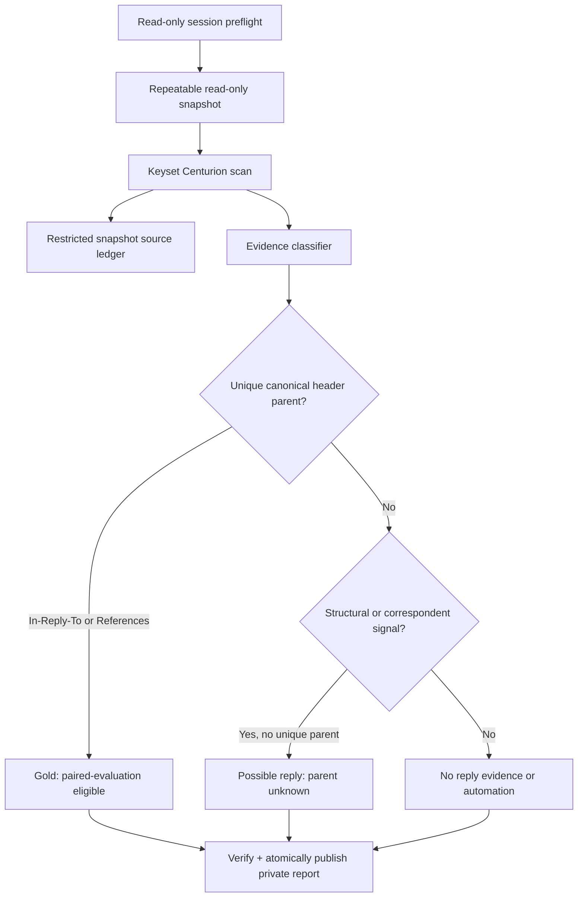

# Centurion outbound reply audit - Plan

## Goal Capsule

Produce one local audit result for every send in the defined Centurion audit population.

Each result must state whether a reply relationship is proven, possible with an unknown parent, absent, ambiguous, malformed, or automated.

The local report must identify evidence and corpus-use eligibility without changing product drafts, mailbox state, RDS rows, or evaluation cohorts.

**Stop when:** a completed read-only audit emits one result per Centurion send from one verified snapshot, a local Markdown table summarizes classifications and corpus use, and all parent claims are evidence-backed. A failed run emits only an opaque incomplete status, never partial per-send conclusions.

---

## Product Contract

### Summary

This plan adds a private, evidence-first audit for shared-mailbox sends.

It replaces manual header and structural-body evidence checks with deterministic labels.

It does not use an LLM to infer semantic parentage from raw mail text.

### Problem Frame

POP3/BCC ingestion often loses `In-Reply-To` and `References`.

Current joins use stored thread identity only.

Real replies can therefore appear in solo database threads, while subject and participant similarity can produce multiple plausible parents.

Chronology and a 24-hour cutoff prevent unsafe merges but do not prove a parent relationship.

### Requirements

#### Audit coverage

- R1. Audit population means messages in the resolved Centurion transport whose normalized sender exactly equals the configured Centurion shared-mailbox identity; unknown aliases and sent-as identities are excluded rather than inferred. Direction is recorded but not filtered because BCC copies can be stored as inbound. The summary records the population definition and transport rows excluded by this sender rule.
- R2. The audit uses only the existing operator credential in one fresh `REPEATABLE READ, READ ONLY` transaction, verifies the session read-only state, and applies bounded query and lock timeouts.
- R3. The audit counts and keyset-scans the corpus within one snapshot, emits exactly one result per scanned send, and stops with an opaque incomplete result on any count mismatch, duplicate, gap, timeout, disconnect, or schema drift.

#### Evidence and classification

- R4. Gold parent pairs require one unique exact direct-header match through `In-Reply-To` or `References` to an earlier eligible inbound parent. An eligible parent has inbound direction and a normalized sender different from every configured Centurion shared-mailbox identity.
- R5. Messages without unique header evidence must never become paired ground truth through subject, recipient, timestamp, or thread proximity.
- R6. Structural body signals may identify a reply marker, but never identify a parent unless independent unique header evidence exists.
- R7. A former “strong” subject-and-participant match with multiple candidate parents must report `possible old-correspondent reply, parent unknown`.
- R8. Automation/system applies only to persisted hard evidence: a known delivery-system sender plus a fixed delivery-status subject/body marker. The stored schema cannot prove generic out-of-office status, so it becomes `unclassifiable`, not excluded from a human corpus by guesswork.
- R9. Each result must distinguish `classified`, `ambiguous`, and `unclassifiable`; coverage completeness is reported separately from evidence confidence.

#### Report and corpus use

- R10. The private Markdown table must show opaque reply and candidate-parent references, reply label, evidence labels, reason, classification state, and corpus-use disposition.
- R11. Only Gold pairs are eligible for paired draft evaluation.
- R12. Possible or unpaired classified human sends are eligible only as style/template examples. `automation/system` and `unclassifiable` sends are excluded pending later manual resolution.
- R13. Product draft generation remains available for every otherwise eligible inbound message; audit class controls evaluation quality, not drafting scope.
- R14. Raw bodies, addresses, subjects, message IDs, headers, timestamps, S3 keys, database URLs, paths, stack traces, and stable identifiers must not enter agent prompts, subagent inputs, stdout, chat, or the opaque audit report. They may exist only in the restricted run-local source ledger and reconciliation map.

### Acceptance Examples

- AE1. A Centurion send with one exact `In-Reply-To` match is `Gold header-linked` and names one opaque parent reference.
- AE2. A Centurion send whose `References` resolves to one earlier inbound message is `Gold reference-linked` and names one opaque parent reference.
- AE3. A send with an old-correspondent signal but no unique parent is `possible old-correspondent reply, parent unknown` and has `style/template only` use.
- AE4. A send with no header, quote, or correspondent signal is `no reply evidence` and has `style/template only` use.
- AE5. A subject-and-participant match with two eligible prior messages is parent-unknown, never Gold.
- AE6. An auto-reply or delivery notification is `automation/system`, excluded from response-style examples, and cannot create a parent pair.

### Scope Boundaries

#### In scope

- Private snapshot-bound source ledger generated by the audit runner; `apps/server-pilot/scripts/dump-centurion-emails-md.mjs` is reference-only and not invoked.
- Read-only source query, deterministic evidence classification, and private local report.
- Synthetic-only unit tests and a real-corpus operator run.

#### Deferred to Follow-Up Work

- Dual-cohort draft backtesting.
- Thread-merge or ingest changes.
- UI-versus-database thread verification.
- Semantic model review of raw email text.

#### Outside this plan

- Product draft, triage, mailbox, UI, database-schema, S3, HMS, deploy, and workflow-worker changes.
- Any mutation of RDS rows or external service.

---

## Planning Contract

### Key Technical Decisions

- KTD1. **Audit-only, no-write boundary** (session-settled: user-approved — chosen over draft/evaluation/product changes: current need is a manual-review replacement and report only). The runner is a purpose-built read-only operator script, not an AI workflow or backtest cohort.
- KTD2. **Header proof is canonical and fail-closed.** Canonicalize `Message-ID`, `In-Reply-To`, and every `References` value before matching. One canonical `In-Reply-To` resolving uniquely to an earlier eligible inbound parent is Gold even when `References` contains historical thread IDs. Without `In-Reply-To`, only the final canonical `References` token is considered a direct parent; it must resolve uniquely to an earlier eligible inbound parent. Any Centurion-shared sender is ineligible as a parent even if BCC ingestion labels its row inbound. Duplicate identities, malformed direct-parent fields, or an unresolved direct parent are parent-unknown. Historical references never become competing direct parents.
- KTD3. **Keep a snapshot-bound private source ledger separate from atomic opaque output.** The audit itself materializes a restricted source ledger and reconciliation map from its verified snapshot. It stages a complete run directory, verifies count and digest, then atomically publishes JSONL, summary, Markdown, and the private ledger with random per-run opaque references. The ledger is never sent to chat or used as agent context.
- KTD4. **Use explicit non-Gold labels.** `possible old-correspondent reply, parent unknown` replaces the ambiguous 24-hour rule. `no reply evidence`, `automation/system`, and `malformed metadata` remain distinct to avoid a false negative being treated as a false parent match.
- KTD5. **No semantic model pass.** Local code may detect structural quote markers in memory, but raw mail body content cannot enter any agent prompt. The report therefore makes evidence claims, not unsupported semantic claims about writer intent.
- KTD6. **Audit through one constrained connection.** The runner does not reuse the application database client. It opens one purpose-built connection with the existing operator credential, proves its transaction is read-only before querying, and preflights private output-root and disabled-egress controls. The existing credential's broader database privileges are an accepted risk; no second connection is permitted.
- KTD7. **Explicit source and egress boundaries.** The runner's only permitted network client is its PostgreSQL connection; it has no browser, model, mail, worker, object-storage, telemetry, proxy, or HTTP client. It emits no chat output. The handoff may use only the finalized opaque table and aggregate summary; all source-ledger inspection stays local.
- KTD8. **Manual private-artifact retention.** The local operator owns each restricted run directory until manual purge. Purge deletes the full run directory and verifies it no longer exists; this is filesystem deletion, not a false promise of physical erasure on SSD media. Full-disk encryption remains the host-level control for storage remnants.

### High-Level Technical Design

### Evidence Precedence

1. One exact unique canonical `In-Reply-To` match to an earlier eligible inbound `message_id_header`.
2. Without `In-Reply-To`, the final exact unique canonical `References` match to an earlier eligible inbound `message_id_header`.
3. Structural reply evidence: outermost quoted block, `On … wrote`, mail-client `From`/`Sent` lines, or recognized plain-text quote.
4. Correspondent-history or subject/time similarity only.

Steps 3 and 4 can label a message as a possible reply.

Only steps 1 and 2 can name a Gold parent.

### Assumptions

- The configured shared-mailbox identity is the complete population definition for this run; aliases and sent-as identities need an explicit future inventory before inclusion.
- The existing operator RDS credential can begin and verify a `REPEATABLE READ, READ ONLY` session before the real-corpus run.
- A message can be classified without revealing the source value that produced the evidence label, and oversized or malformed source material can remain unclassifiable.
- Persisted fields do not include generic auto-reply headers; only known delivery-status signatures are automatable, and all other suspected automation remains unclassifiable.

### Sources and Research

- `apps/server-pilot/src/db/schema/mail.ts` defines persisted reply-header fields and transport/thread indexes.
- `apps/server-pilot/src/mail/send/resolve-reply-headers.ts` establishes outbound reply-header precedence.
- `apps/server-pilot/src/mail/ingest/store.ts` first-matches header candidates and is intentionally not audit-grade evidence.
- `apps/server-pilot/scripts/diag-centurion-staff-shapes.ts` proves metadata-only cross-thread header diagnostics.
- `apps/server-pilot/src/ai/draft-backtest.ts` is chronology-based and is not authoritative for parent linkage.
- `docs/solutions/logic-errors/mail-quoted-history-crop-and-collapse.md` requires outermost-only quote detection.
- `docs/solutions/database-issues/vitest-production-pilot-db-wipe.md` requires pilot RDS to stay outside Vitest.

---

## Implementation Units

### U1. Evidence classification contract

- **Goal:** Define a pure, evidence-first classifier for outbound Centurion messages and candidate parent metadata.
- **Requirements:** R4, R5, R6, R7, R8, R10, R11, R12, R14.
- **Dependencies:** None.
- **Files:** Create `apps/server-pilot/src/ops/centurion-outbound-reply-audit.ts`; create `apps/server-pilot/tests/centurion-outbound-reply-audit.test.ts`.
- **Approach:**
  1. Define closed input and report schemas with opaque result references, classification state, evidence tier, fixed reason codes, candidate count, completeness, and corpus-use disposition.
  2. Canonicalize direct-parent fields and resolve Gold through `In-Reply-To`, then only the final `References` token when `In-Reply-To` is absent. Parent metadata must prove inbound direction and a non-Centurion normalized sender.
  3. Expose a bounded pure structural/automation extractor that reduces synthetic or in-memory body text to fixed enums; the separate pure classifier accepts only those enums and no raw address, subject, body, or header source field.
  4. Reject source fields and report keys that can carry raw message content, identifiers, paths, or stable hashes; generate random references once per run rather than deriving them from any source field.
- **Patterns to follow:** `apps/server-pilot/src/ops/mail-artifact-backtest.ts` for closed aggregate schemas; `docs/solutions/logic-errors/mail-quoted-history-crop-and-collapse.md` for outermost-only quote extraction.
- **Test scenarios:**
  - Covers AE1. One exact earlier `In-Reply-To` match yields one Gold parent.
  - Covers AE2. One earlier `References` match yields one Gold parent.
  - Covers AE3. Old-correspondent signal with no header match yields possible reply, parent unknown, and style/template-only use.
  - Covers AE4. No signal yields no-reply-evidence and style/template-only use.
  - Covers AE5. Multiple same-subject or same-correspondent candidates cannot become Gold.
  - Covers AE6. Automation/system signal excludes the send from response-style examples.
  - An inbound-direction BCC copy whose normalized sender is Centurion cannot become a Gold parent.
  - Bracket variants canonicalize to one header identity.
  - Duplicate header identities and multiple resolved references remain parent-unknown.
  - A unique `In-Reply-To` remains Gold when `References` contains several historical message IDs.
  - With no `In-Reply-To`, only the final `References` token can name a parent.
  - A nested quote sequence produces one structural evidence result, not duplicate parent candidates.
  - Proven automation excludes corpus use; uncertain automation is unclassifiable.
  - Nested, malformed, and oversized bodies test the bounded structural/automation extractor; malformed or oversized material is unclassifiable instead of silently defaulting to a non-reply conclusion.
  - The report schema rejects raw body, address, header, subject, timestamp, path, message-ID, and stable-hash fields.
  - Random per-run references cannot equal a deterministic digest fixture.
- **Verification:** Synthetic fixtures cover every label, precedence branch, and report-schema refusal with no database connection.

### U2. Read-only corpus audit runner

- **Goal:** Load Centurion sends and metadata, derive local-only evidence signals, and produce one classification input per send.
- **Requirements:** R1, R2, R3, R4, R5, R6, R7, R8, R14.
- **Dependencies:** U1.
- **Files:** Create `apps/server-pilot/scripts/audit-centurion-outbound-replies.ts`; modify `apps/server-pilot/tests/centurion-outbound-reply-audit.test.ts`; modify `.gitignore`.
- **Approach:**
  1. Fail closed unless the existing operator credential can open and verify one session as read-only, and output-root and disabled-egress controls pass.
  2. Open one fresh `REPEATABLE READ, READ ONLY` transaction with local statement and lock limits; do not permit a second connection.
  3. Use the identical population predicate for count and pages, ordered by non-null `created_at ASC, id ASC`; the keyset cursor is `{createdAt, id}` and a page is strictly greater than that pair. Count sender-nonmatching transport rows separately, retain direction as an anomaly signal, and never infer aliases.
  4. Batch direct-header parent lookups by canonical header token within the same snapshot, then admit only earlier inbound, non-Centurion-sender parents. Select only fields required for bounded evidence derivation and the snapshot-bound source ledger; never query drafts, queue rows, attachments, raw MIME keys, S3, or pre-existing export artifacts.
  5. Build random run-scoped opaque references before records leave memory, write the source ledger and reference map under the restricted staging root, parse structural and delivery-status markers through the pure bounded extractor, and add an ignored private artifact root.
- **Execution note:** This is a production-data reader, not a test. Never source production environment values into a shell that will run Vitest.
- **Patterns to follow:** `apps/server-pilot/scripts/diag-centurion-staff-shapes.ts` for read-only TLS query setup; `apps/server-pilot/scripts/dump-centurion-emails-md.mjs` for private local corpus export; `apps/server-pilot/scripts/diag-centurion-gold-corpus.ts` for no-body diagnostics.
- **Test scenarios:**
  - Source projection yields each scanned Centurion send exactly once despite direction anomalies from BCC ingestion.
  - A DB-free page source covers null sent/received times, cursor boundaries, duplicate/gap detection, timeout, and disconnect behavior.
  - Header-parent batching applies the same parent eligibility predicate as the classifier.
  - Source-contract coverage requires the declared transaction mode and rejects DML, worker, SMTP, S3, model, browser, and telemetry imports.
  - Source-contract coverage permits only the one PostgreSQL client and rejects proxy, HTTP, and general egress imports.
  - Raw exception details and source values are replaced by fixed failure codes.
  - Query timeout, disconnect, duplicate, gap, count mismatch, or schema drift emits an opaque incomplete result and stops without an automatic retry.
  - Output location has restricted current-user access, is ignored by Git, and cannot be a symlink, reparse point, or path outside the project-local private artifact root.
- **Verification:** Static source-safety checks forbid mail send, worker enqueue, persistence mutation, service-client imports, and unsafe egress; a disposable synthetic input proves snapshot cardinality, page coverage, incomplete-stop behavior, and output-path guards.

### U3. Private table and aggregate report

- **Goal:** Materialize an operator-readable Markdown table and machine-checkable JSONL/summary without exposing raw source values.
- **Requirements:** R3, R9, R10, R11, R12, R13, R14.
- **Dependencies:** U1, U2.
- **Files:** Modify `apps/server-pilot/src/ops/centurion-outbound-reply-audit.ts`; modify `apps/server-pilot/scripts/audit-centurion-outbound-replies.ts`; modify `apps/server-pilot/tests/centurion-outbound-reply-audit.test.ts`.
- **Approach:**
  1. Stage detail JSONL, aggregate summary, Markdown, snapshot source ledger, and opaque-reference reconciliation map under a unique restricted run directory.
  2. Verify detail count and digest against aggregate counts before one atomic directory publish.
  3. Render a local Markdown table with per-run random opaque references, parent status, reason code, classification state, and corpus-use decision. The private ledger shares those references for manual local reconciliation.
  4. Keep completed run directories until operator-directed manual purge, verify removal after purge, and state once that inbound product drafting eligibility is unchanged.
- **Patterns to follow:** `apps/server-pilot/src/ops/mail-artifact-backtest.ts` aggregate contract and `apps/server-pilot/tests/mail-artifact-backtest.test.ts` private-field rejection coverage.
- **Test scenarios:**
  - Detail-record count and digest match aggregate count and scanned-send count.
  - Markdown table has one row per opaque reply reference and no raw source values.
  - Each opaque reference resolves only through its same-run restricted reconciliation map and source ledger.
  - The source ledger, reference map, and opaque report all derive from one transaction snapshot.
  - Gold rows carry paired-evaluation use; possible/no-evidence rows carry style/template-only use; automation and unclassifiable rows carry exclude use.
  - Interrupted publication leaves no final partial report.
  - Corrupt prior output is rejected instead of silently appended.
- **Verification:** Reload generated JSONL, summary, Markdown, and restricted map from synthetic fixtures; validate schema, row counts, digest, forbidden-key scan, random-reference behavior, snapshot binding, and atomic-finalization behavior.

### U4. Run audit and deliver corpus ledger

- **Goal:** Run the purpose-built read-only audit over the real Centurion corpus and return its final classification table and totals.
- **Requirements:** R1, R2, R3, R9, R10, R11, R12, R13, R14.
- **Dependencies:** U1, U2, U3.
- **Files:** Generate ignored local artifacts under `apps/server-pilot/.tmp-centurion-outbound-audit/`.
- **Approach:**
  1. Attest read-only session mode, output-root controls, and no-egress boundary before one audit run.
  2. Generate the private source ledger, reference map, and opaque audit report from the same verified snapshot.
  3. Verify snapshot count, keyset coverage, report schema/digest, source-ledger binding, and read-only transaction behavior.
  4. Return aggregate counts and the requested opaque classification table in chat; full bodies and source mappings remain inside the restricted local run directory until manual purge.
- **Execution note:** Prefer the purpose-built read-only script and its output validation. Do not run a test runner against pilot RDS.
- **Patterns to follow:** `apps/server-pilot/scripts/dump-centurion-emails-md.mjs` for private corpus materialization and `apps/server-pilot/scripts/diag-centurion-staff-shapes.ts` for read-only corpus diagnostics.
- **Test expectation:** none -- this unit is an operator audit run after U1–U3 synthetic verification.
- **Verification:** Report records every message in the defined audit population once or emits an opaque incomplete report, labels each completed record with evidence and corpus use, and emits no mutation or raw source data to terminal output.

---

## Verification Contract

| Scope | Proof |
|---|---|
| U1–U3 | Unset `DATABASE_URL` and `VITEST_ALLOW_PILOT_RDS`, then run only `apps/server-pilot/tests/centurion-outbound-reply-audit.test.ts`. |
| Source safety | Confirm the audit runner has no DML, worker enqueue, SMTP, S3, model, browser, telemetry, proxy, HTTP, or egress-capable path beyond its single PostgreSQL connection. |
| Local report | Validate JSONL and aggregate schemas, report cardinality/digest, forbidden-field rejection, source-ledger snapshot binding, and atomic-finalization behavior against synthetic data. |
| Real corpus | Attest transaction mode, then prove snapshot count equals keyset-scanned records; incomplete output is a stop, not a partial success. |

---

## Risks and Dependencies

- Missing POP3/BCC reply headers can make the true parent unknowable. Mitigation: label parent unknown instead of guessing.
- Subject or participant overlap can produce false parent matches. Mitigation: preserve candidate ambiguity and never promote it to Gold.
- Raw corpus artifacts contain private mail. Mitigation: create the source ledger only under restricted non-symlink private storage, prevent CI/archive/telemetry upload, retain it only until operator-directed manual purge, and keep it absent from prompts, logs, chat, and opaque reports.
- Production RDS data is sensitive. Mitigation: run no tests against it, use one bounded verified read-only snapshot transaction, and prohibit any second connection. Existing operator credentials may have broader database privileges outside the transaction; the user accepted this residual risk.
- A BCC copy can be marked inbound despite representing a shared-mailbox send. Mitigation: select sends by normalized Centurion sender but exclude that sender from every eligible parent predicate, regardless of direction.
- A disconnected or timed-out scan could look complete. Mitigation: compare snapshot count, deterministic pages, detail count, and digest before publication; otherwise mark incomplete and stop.
- The requested semantic “reply or not” decision exceeds available structural proof when headers and quote markers are absent. Mitigation: report evidence strength honestly rather than presenting a confidence guess as ground truth.
- Aliases and sent-as identities may be absent from the population. Mitigation: define this run against the configured exact shared-mailbox identity, count sender-nonmatching transport rows, and require an explicit future identity inventory before expansion.

---

## Definition of Done

- Every completed run emits exactly one audit result for every message in its defined Centurion audit population; failed runs emit only incomplete status.
- Gold contains only unique direct-header-linked parents.
- Former ambiguous subject/participant matches read `possible old-correspondent reply, parent unknown`.
- Output identifies paired-evaluation, style/template-only, or exclude use for every send.
- Product drafting scope has not changed.
- Synthetic tests pass with production database variables unset.
- Real-corpus run attests its session read-only state, is snapshot/cardinality/digest-checked, and produces restricted snapshot-bound local artifacts retained until manual purge.
- Raw private mail never appears in agent/subagent prompts, terminal output, or committed files.

## GSTACK REVIEW REPORT

| Review | Trigger | Why | Runs | Status | Findings |
|--------|---------|-----|------|--------|----------|
| CEO Review | `/plan-ceo-review` | Scope & strategy | 0 | — | — |
| Codex Review | `/codex review` | Independent 2nd opinion | 0 | — | — |
| Eng Review | `/plan-eng-review` | Architecture & tests (required) | 1 | CLEAR | 0 unresolved after revision |
| Design Review | `/plan-design-review` | UI/UX gaps | 0 | N/A | Backend/operator-only scope |
| DX Review | `/plan-devex-review` | Developer experience gaps | 0 | N/A | No public API, SDK, or CLI |

**VERDICT:** ENG CLEARED — ready to implement.
NO UNRESOLVED DECISIONS
