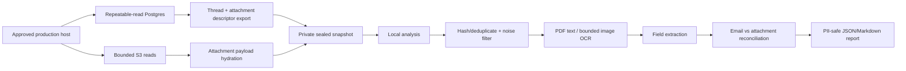

# Attachment-Inclusive Corpus Export Implementation Plan

> **For agentic workers:** REQUIRED SUB-SKILL: Use superpowers:subagent-driven-development (recommended) or superpowers:executing-plans to implement this plan task-by-task. Steps use checkbox (`- [ ]`) syntax for tracking.

**Goal:** Extend the existing read-only Centurion corpus exporter so an approved production-side run captures attachment metadata and bounded private attachment payloads, then supports local PDF/image processing and exact email-versus-attachment monetary-field reconciliation.

**Architecture:** Reuse the existing repeatable-read Postgres snapshot, attachment descriptor query, S3 bounded-read path, private snapshot sealing, and hydration contract. Add an attachment-inclusive export mode rather than creating a second database reader. Extend the artifact contract with an explicit private `attachment_bytes` artifact for original PDF/image bytes; keep existing `attachment_text` extraction for PDFs. A single local analyzer performs deduplication, noise classification, field extraction, and email-versus-attachment reconciliation. Image OCR is not part of this first exporter/analyzer contract unless a verified local toolchain is already present; images remain retained and explicitly unresolved when OCR is unavailable.

**Tech Stack:** TypeScript, Drizzle/Postgres reader, existing `RealS3Storage.getObjectBounded`, existing private corpus snapshot/sealing contract, Vitest, local Poppler toolchain, Python analysis scripts where existing corpus analysis conventions use Python.

## Global Constraints

- Production export is read-only: no mailbox, database, S3, queue, or application mutations.
- The exporter must run only through the existing approved-instance/IMDS preflight and private-output destination checks.
- Never emit raw addresses, bodies, attachment text, S3 keys, credentials, database URLs, or tokens to stdout, Git, web, or remote services.
- Raw attachment bytes are private local artifacts; use restrictive permissions and deterministic manifest hashes.
- Inline images, logos, banners, signatures, tracking pixels, and duplicate decorative assets must be measurable but excluded from useful-document counts. If source inline/content-ID fields are unavailable, report inline status as `unknown` and use only verified metadata/hash signals.
- Preserve unresolved/failed/too-large/encrypted/unreadable states; never convert missing extraction into “no information.”
- Do not run Vitest with pilot or production `DATABASE_URL`; database tests use fixtures or a disposable non-production database.
- Do not run the production exporter as part of tests or local verification.

---

## Problem Frame

The current corpus contains thread/message records and attachment markers, but the latest local snapshot does not contain attachment descriptors or S3 payloads. Existing code already queries attachment descriptors and can hydrate bounded attachment text, but the export does not yet provide a complete attachment inventory and analysis-ready payload set. The product question is operational: for every relevant thread, determine whether useful information—especially monetary amounts, payment evidence, confirmation state, reservation identifiers, and dates—exists in the email text, only in an attachment, in both, or nowhere extractable.

Current local evidence is limited to marker counts (966 threads and 1,617 inbound messages with attachment markers). Those are not counts of real files or useful documents.

## Scope Boundaries

### In scope

- Attachment-inclusive production-side corpus export using the existing mailbox transport scope and as-of snapshot semantics.
- Attachment metadata inventory: attachment ID, message/thread linkage, filename, MIME type, size, inline status, content hash, read/extraction status, and opaque storage reference.
- Bounded local retention of original PDF/image attachment bytes needed for analysis, with an explicit `attachment_bytes` artifact kind, deterministic artifact IDs, content hashes, atomic publication, and manifest validation.
- PDF embedded-text extraction and page/error metadata using the existing bounded artifact toolchain.
- Image metadata/noise classification. OCR is deferred unless a verified local toolchain is available during implementation; unavailable OCR is recorded as `ocr_unavailable`, never as “no amount.”
- Decorative/inline/duplicate asset filtering and useful-document classification.
- Thread-level reconciliation of monetary amounts and selected operational fields between email text and attachment-derived text.
- PII-safe aggregate reports and machine-readable analysis artifacts.

### Deferred to Follow-Up Work

- Automatic triage routing based on attachment-derived fields.
- Writing extracted values back to production mail, PMS, or finance systems.
- Automatic payment verification or settlement claims.
- Autonomous sending, confirmation, refund, booking, or cancellation actions.
- General OCR infrastructure for arbitrary documents beyond this corpus analysis.

### Outside this product's identity

- Production mutation or financial reconciliation against an authoritative PMS/payment ledger.
- Treating an email or attachment as proof of delivery, human ownership, or settlement beyond explicit operational state stated in the message/document.

## Requirements Traceability

- **R1 — Complete inventory:** Every attachment descriptor linked to an included message is represented exactly once in the export, including unsupported and failed reads.
- **R2 — Payload provenance:** Every retained original payload has an opaque `attachment_bytes` artifact ID, source attachment ID, byte count, SHA-256 of original bytes, MIME metadata, and manifest entry. Extracted text is a separate `attachment_text` artifact linked to the same attachment ID.
- **R3 — Privacy:** No raw PII or storage credentials appear in safe summaries, logs, reports, or version-controlled files.
- **R4 — Noise separation:** Inline/decorative assets remain countable but do not inflate useful-document counts.
- **R5 — Extraction honesty:** PDF/image extraction records success, no-text, unsupported, encrypted, malformed, too-large, timeout, and read-failure states distinctly.
- **R6 — Field reconciliation:** For each target thread, the analyzer reports fields present in email text, attachment text, both, neither, or unresolved.
- **R7 — Reproducibility:** Export and analysis are sealed with schema/version/as-of/scope/denominator/hash metadata.
- **R8 — Operational safety:** Production execution requires existing approved-host and destination preflight and has bounded S3 reads/total bytes/timeouts.

## Key Technical Decisions

1. **Extend the existing exporter and snapshot contract.** The repository already has `createThreadCorpusSnapshotLoader`, attachment descriptors, `attachmentLocators`, hydration payloads, `getObjectBounded`, and private artifact sealing. A parallel exporter would duplicate safety-critical scope and sealing logic.
2. **Retain metadata for every attachment; retain bytes only under explicit bounded policy.** This allows exact inventory and failure counts without requiring unlimited private storage.
3. **Hash before analysis and deduplicate locally.** Content hash is the stable file identity for repeated banners, signatures, and reused confirmation documents; attachment IDs remain the source linkage.
4. **Use a small first-pass document taxonomy.** Primary class: `useful`, `decorative`, `unknown`; optional hint: `payment`, `confirmation`, `quote`, `other`. Orthogonal fields capture `pdf`, `image`, `inline`/`inline_unknown`, `duplicate`, `byte_retained`, `contains_amount`, `contains_reservation_reference`, and extraction state. Expand document classes only after coverage is measured.
5. **Keep monetary matching conservative.** Normalize currency/amount formats and compare within exact normalized value plus currency; do not infer a missing amount from totals or claim payment settlement from document presence.
6. **Treat OCR as optional and explicit.** PDF embedded text reuses the existing bounded extractor. Original images are retained for later processing, but first-pass analysis records `ocr_unavailable` unless an approved local OCR toolchain exists; it never treats unavailable OCR as absent information.

## High-Level Technical Design



Each attachment record follows:

```text
source attachment descriptor
→ policy decision (retain / metadata-only / excluded-inline)
→ bounded S3 read
→ sha256 + byte count
→ extraction state and text artifact (if supported)
→ document class + field evidence
→ thread-level reconciliation
```

---

## Implementation Units

### U1. Extend attachment-inclusive snapshot/export contract

**Goal:** Make the sealed private snapshot and existing live exporter represent a complete attachment inventory plus bounded original PDF/image bytes without exposing S3 keys in safe corpus records.

**Requirements:** R1, R2, R3, R7.

**Dependencies:** None.

**Files:**

- Modify: `apps/server-pilot/src/ops/centurion-thread-corpus-snapshot.ts`
- Modify: `apps/server-pilot/src/ops/centurion-thread-corpus-exporter.ts`
- Modify: `apps/server-pilot/src/ops/centurion-thread-corpus-hydrator.ts`
- Modify: `apps/server-pilot/src/ops/centurion-thread-corpus-postgres-reader.ts`
- Test: `apps/server-pilot/tests/export-thread-corpus.test.ts`

**Approach:** Add `attachment_bytes` beside existing `raw_mime` and `attachment_text`. Compute original-byte SHA-256 during bounded S3 hydration, retain bytes only under explicit limits, and link byte/text artifacts by attachment ID. Define separate descriptor, retained-byte, unique-content, and duplicate-group counts. Audit the reader query before promising `isInline`/`contentId`; if columns are absent, use `inline_unknown`. Malformed source rows become explicit inventory failures rather than disappearing. Publish artifacts atomically and remove incomplete temporary output on failure. Reuse existing PDF extraction for `attachment_text`.

**Test scenarios:**

- A message with two attachments produces two unique inventory records linked to the same source message and thread.
- A duplicate content hash across different attachment IDs preserves both source links while allowing one local payload artifact.
- An attachment remains represented with `inline: true` when source metadata provides it; otherwise it is represented with `inline_unknown` and is not silently dropped.
- A too-large, missing, or failed S3 object produces a sealed failure status without aborting unrelated attachments.
- A malformed hydration payload, mismatched attachment ID, or mismatched byte size fails contract validation.
- An original byte artifact with changed hash, size, or MIME linkage fails contract validation.
- Safe serialized corpus output contains no S3 key, raw filename-derived PII, attachment text, or credential material beyond approved metadata.

**Verification:** Snapshot validation passes for complete, partial, duplicate, inline, and failed attachment inventories; existing corpus contract tests remain green.

### U2. Build one local attachment analysis and reconciliation pipeline

**Goal:** Analyze retained attachment payloads locally, deduplicate content, separate decorative assets, and reconcile operational fields against thread email text.

**Requirements:** R1, R2, R3, R4, R5, R6, R7.

**Dependencies:** U1.

**Files:**

- Create: `apps/server-pilot/scripts/analyze-attachment-corpus-2026-08-31.py`
- Create: `.private/connected-mailbox-corpus/follow-up/attachment-analysis-2026-08-31.json`
- Create: `.private/connected-mailbox-corpus/follow-up/attachment-analysis-2026-08-31.md`
- Test: `apps/server-pilot/tests/attachment-corpus-analysis.test.ts`

**Approach:** Read only the sealed local snapshot. Compute hashes where bytes are retained, group duplicate assets, and use available metadata/features for noise filtering: inline status or `inline_unknown`, MIME type, filename class, byte size, and repeated hash frequency. Reuse existing bounded PDF extraction results. Retain images and record `ocr_unavailable` unless an approved local OCR toolchain exists. Extract conservative amount/currency, reservation/reference ID, date, payment status, and confirmation status candidates, then reconcile email and attachment evidence in the same pass. Produce one versioned JSON artifact plus Markdown projection, with per-attachment records keyed by opaque IDs and mutually exclusive field relationships including `mismatch` and `unresolved_extraction`. Production exporter changes remain in U1; do not create a second production CLI.

**Test scenarios:**

- Repeated inline-logo fixtures classify as decorative and collapse to one payload hash with multiple source links.
- Text PDF, scanned PDF, PNG, invoice, confirmation, quote, and malformed/encrypted fixtures receive expected extraction states; image OCR is explicitly unresolved when unavailable.
- OCR unavailable produces `ocr_unavailable` and does not count the image as text-empty or “amount absent.”
- Identical currency and amount in email and PDF classify as `both`; attachment-only, email-only, neither, mismatch, and unresolved cases remain distinct.
- Multiple amounts preserve labeled candidates without inventing one paid/total amount.
- Threads with no useful attachment remain in the reconciliation denominator.
- Raw payload text is absent from the PII-safe report; hashes and opaque IDs remain stable.

**Verification:** Unit/integration fixtures prove no production-side mutation calls are reachable; analyzer output is only safe summary JSON/Markdown and the private snapshot passes full sealing/readback checks.

### U3. Validate, document, and operationalize the export

**Goal:** Make the new export safe to run on the approved production host and easy to verify locally without accidentally contacting production.

**Requirements:** R3, R7, R8.

**Dependencies:** U1, U2.

**Files:**

- Modify: `apps/server-pilot/scripts/export-centurion-thread-corpus-live.ts`
- Create: `apps/server-pilot/scripts/verify-attachment-corpus-export.ts`
- Test: `apps/server-pilot/tests/attachment-corpus-export-cli.test.ts`
- Create: `docs/infor-hms/connected-mailbox-attachment-corpus-export-2026-08-31.md`

**Approach:** Add attachment-inclusive mode to the existing live exporter; do not create a second production CLI. Reuse approved-host attestation, canonical output allocation, real-storage checks, existing reader, S3 bounded reads, existing limits, sealing, and safe summaries. Define exact mode/flag defaults, byte-budget precedence, metadata-only fallback, and atomic publication. Add a verifier only for checks not already covered by snapshot sealing/readback: local schema, hashes, descriptor/payload linkage, permissions, denominator totals, privacy, and path safety. Production invocation is documented only, never run during local development.

**Test scenarios:**

- Invalid mode, missing environment, non-approved host, non-Linux host, non-canonical output path, and fake storage fail before DB/S3 access.
- Successful fixture export includes all descriptors and bounded `attachment_bytes` artifacts with manifest counts and hashes.
- Per-object/aggregate limits preserve metadata statuses; S3 missing, access, oversized, and malformed cases receive stable failure categories.
- Export closes the reader, publishes atomically, and leaves no partial payloads outside the approved private output directory.
- No write-capable storage method, pilot DB URL, production DB URL, or live S3 access is reachable from local analyzer/verifier tests.
- Tampered payload, manifest, ordered-record hash, artifact count, or path fails verification.

**Verification:** A fixture export can be verified end-to-end locally; documentation distinguishes production-side execution from local analysis and states exact output artifacts and failure semantics.

---

## Success Metrics

The completed export must produce exact, reconciled values for:

- Included threads/messages and attachment descriptors.
- Threads/messages with any attachment descriptor.
- Unique attachment content hashes and duplicate groups.
- PDFs, images, inline images, decorative assets, and useful-document classes.
- Extraction success, no-text, unsupported, encrypted, malformed, too-large, timeout, and read-failure counts.
- Monetary-field relationships: email-only, attachment-only, both, mismatch, neither, unresolved.
- Payment-related threads with a machine-readable amount in email, attachment, both, neither, or unresolved.
- Confirmation/quote/payment-document classes and the number of material fields available only in attachments.
- Zero unsafe production writes and zero secrets/raw PII in safe output channels.

## Risks and Mitigations

| Risk                                             | Mitigation                                                                                                                                                                                  |
| ------------------------------------------------ | ------------------------------------------------------------------------------------------------------------------------------------------------------------------------------------------- |
| Inline banners inflate attachment counts         | Preserve raw inventory, classify decorative separately using inline/hash/size/dimension signals                                                                                             |
| S3 object is missing or expires                  | Keep descriptor and explicit read failure; do not drop the thread                                                                                                                           |
| OCR is unavailable or creates false amounts      | First pass records `ocr_unavailable`; if a verified local OCR toolchain is later enabled, mark provenance, require currency/amount normalization, and report unresolved/mismatch separately |
| Multiple amounts create false “paid amount”      | Preserve labeled candidates; never select a total without explicit label evidence                                                                                                           |
| Raw PII leaks through logs/reports               | Opaque IDs, hashes, private payload directory, safe aggregate serializer, privacy scan                                                                                                      |
| Export exceeds disk or time budget               | Per-object and aggregate limits, metadata-only fallback, resumable batch manifest                                                                                                           |
| Production execution accidentally occurs locally | Existing approved-host preflight plus tests that assert no live dependency invocation                                                                                                       |
| Existing snapshot contract is widened unsafely   | Reuse validators/sealing and add fixture contract tests before CLI changes                                                                                                                  |

## Operational Notes

- Production-side run must be performed only by the approved Zero operational workflow on the approved instance; this planning session must not execute it.
- First run should use a metadata inventory plus bounded payload budget and write a new private snapshot directory, never overwrite the canonical prior snapshot.
- Local analysis consumes the sealed snapshot and writes follow-up artifacts under `.private/connected-mailbox-corpus/follow-up/` with mode `0600`.
- Preserve the original export manifest and analysis manifest so later corpus refreshes can compare attachment coverage and content-hash reuse.
- Treat the first output as analysis evidence, not a production suppression or routing decision.

## Definition of Done

- [ ] Existing exporter contract and tests support complete attachment inventory plus bounded payload hydration.
- [ ] Approved-host live CLI has read-only, bounded Postgres/S3 behavior and safe failure output.
- [ ] Local analyzer produces validated PII-safe attachment inventory, noise filtering, document classes, and extraction states.
- [ ] Reconciliation report gives exact email-only/attachment-only/both/neither/unresolved counts for monetary and selected operational fields.
- [ ] Fixture tests cover success, duplicates, inline noise, missing/oversized/encrypted/malformed payloads, OCR unavailable, privacy, sealing, and path safety.
- [ ] Local verification passes without `DATABASE_URL`, production credentials, or live S3 access.
- [ ] Operational documentation clearly separates approved production export execution from local analysis.
