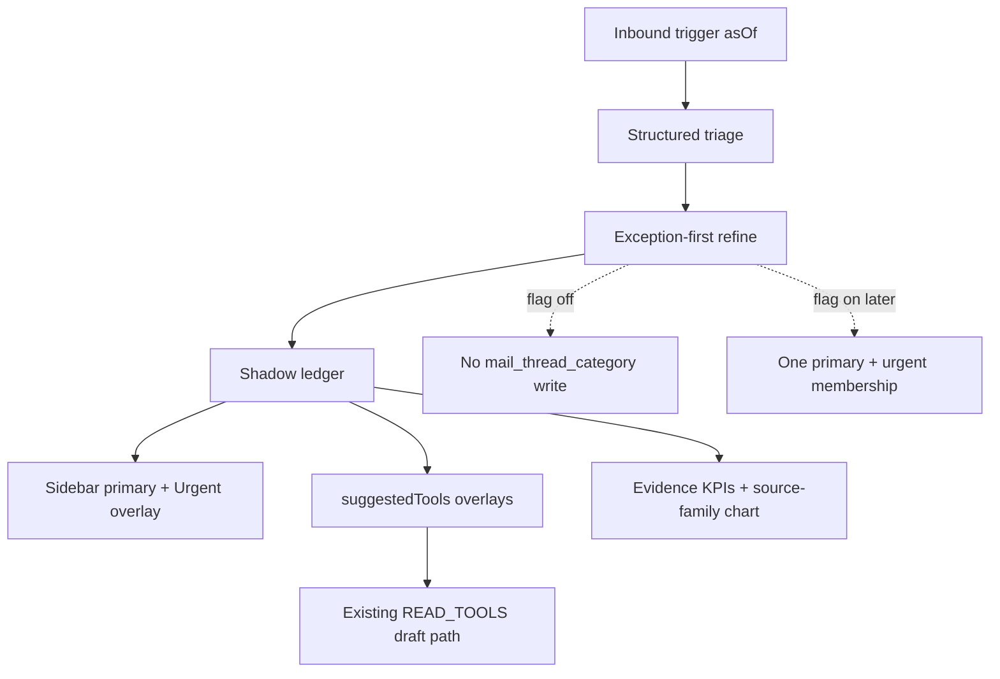

# feat: Centurion workflow triage, tool tags, and source-family dashboard

## Goal Capsule

Replace the live 4-primary + urgent category model with the locked workflow-folder sidebar, P0–P5 human-agency triage, tool tags for drafting, evidence KPIs, and a source-family volume chart.

Authority: locked Build target (2026-08-31) wins for folders, Urgent overlay, KPIs, and chart. Tool portfolio comes from the 2026-08-25 connected-mailbox corpus analysis, not the 2026-08-03/04 Infor HMS demand docs. Latest corpus denominators and chart totals come from the 2026-08-30 snapshot.

Stop conditions: no production mailbox mutation, no durable folder backfill, no HMS writes, no auto-close/suppress/send/archive by source, no fake response/revenue/hours-saved KPIs, no pilot-RDS tests.

## Product Contract

Product Contract unchanged from the locked Build target plus the tools-vs-triage brief.

### Requirements

- R1. Sidebar organizes by required human work, not sender. Exactly one primary workflow folder per thread.
- R2. Urgent is a cross-folder overlay and pinned queue, not a replacement primary folder.
- R3. Triage returns P0–P5 plus one primary folder. Ask: what must a human do, by when, and why?
- R4. Automated-looking is provenance, not no-action. Automated / Channel is only clean routine system traffic after exception/request/payment/failure checks.
- R5. Internal property domains never enter Automated / Channel. `mail.legacyhotels.com` and `branding.legacyhotels.co.za` are `source_scope=internal_property` and `automation_state=excluded_internal`.
- R6. `hospitality.cloud` is finance-ops automation candidate; primary Money & Billing, overlay Confirm & Reconcile; not blanket P4.
- R7. Unknown / Needs Review is safe abstention, not classifier failure.
- R8. Bookings holds new bookings and quotes. Quotes remain response work. Quote vs booking is first-class overlay and tool selection, not two competing folders.
- R9. Groups & Events is group/event work involving 10+ rooms.
- R10. Confirmation language does not prove PMS completion.
- R11. Dashboard shows 3 evidence KPIs + 1 research queue. Source-family chart is volume, not a KPI.
- R12. Chart uses the locked post-override bars: 1,042 mapped external/system-like threads = 37.1% of 2,810. Do not republish 1,079 / 38.4% as the external total.
- R13. Suggested HMS/mail tools inform frontend/backend tags and AI drafting. Reads only. No HMS mutation in this slice.
- R14. Shadow mode before gold review before operational instrumentation before any savings/suppression policy.
- R15. Human override remains available. No auto-close, suppress, send, or archive by source alone.
- R16. Spam remains a system folder (`spam_at`), not a workflow folder. Folder-first spam matrix stays intact.

### Actors

- A1. Reservationist: works one primary folder plus Urgent overlay.
- A2. Shadow reviewer: inspects predictions without mailbox mutation.
- A3. Drafting agent: may call existing read tools tagged on the thread; never writes HMS or sends mail.

### Key Flows

- F1. Inbound trigger → structured triage (priority, folder, overlays, tools) → refine → shadow ledger.
- F2. Reservationist opens Bookings, filters quote overlay, sees suggested `hms_quote_stay`.
- F3. Reservationist opens Urgent; thread still belongs to Money & Billing.
- F4. Internal bounce stays in Exceptions & Recovery, never Automated / Channel.
- F5. Dashboard renders evidence KPIs and the source-family chart with tooltips; drill-down is filter, not a savings claim.

### Acceptance Examples

- AE1. Quote request with dates/occupancy → primary `bookings`, overlay `quote`, priority P3, suggested tool `hms_quote_stay`. No `bookable` claim.
- AE2. New channel booking notice without PMS join → primary `confirm-reconcile` or `bookings` per exception-first rules, overlay `booking`, priority P1/P2, suggested tool `hms_find_reservation`.
- AE3. Internal delivery failure from `mail.legacyhotels.com` → `exceptions-recovery`, `source_scope=internal_property`, never `automated-channel`.
- AE4. `hospitality.cloud` booking-payment notice → `money-billing` + `confirm-reconcile` overlay; not blanket P4.
- AE5. Clean routine channel notice after exception checks → `automated-channel`, P4, no HMS tool required.
- AE6. Conflicting evidence → `unknown-review`, abstain reason set, no forced folder.

### Scope Boundaries

In scope: category contract, triage schema/prompt/refine, shadow persistence, sidebar/pills, dashboard KPI+chart, tool-tag planner using existing READ_TOOLS, tests on disposable DB/fixtures.

Deferred: HMS writes, CRS Check Availability, folio post/settle/refund, live gold review, production retag, attachment-inclusive export, savings/revenue KPIs, backfill of tools against historical outbound.

Outside identity: autonomous send, suppress, archive, or PMS mutation by source family.

## Planning Contract

### Assumptions

- Shadow-only durable category writes remain the default. A feature flag is required before new folders write to `mail_thread_category`.
- Overlays are not extra sidebar folders. Persist them on the triage payload / shadow ledger.
- 2026-08-25 analysis is the tool-portfolio source (2,403 threads / 3,268 messages). 2026-08-30 is the current denominator and chart source (2,810 threads / 3,820 messages). Do not mix those denominators in one card.
- 846 additional likely-automated inbound is pre-override research, not Automated / Channel volume.
- `ponytail-review` skill file was not found; simplicity review ran inline and is recorded below.

### Key Technical Decisions

- KTD1. Replace `AI_PRIMARY_CATEGORY_SLUGS` (`at-risk`, `new-bookings`, `groups-events`, `ops`) with eleven workflow slugs. Keep `urgent` as the only overlay category slug that uses `mail_thread_category`. Rationale: existing membership + presentation path already supports one primary plus urgent. Extra overlays as categories would explode the sidebar and spam matrix.
- KTD2. New `triageOutputSchema` is `{ primaryFolder, priority, urgent, overlays, sourceScope, sourceFamily, automationState, suggestedTools, humanAction, confidence, rationale, policyFlags, abstainReason }`. `category` remains a derived compatibility field during dual-read. Rationale: current `{ category, urgent }` cannot express quote vs booking or tool tags.
- KTD3. Suggested tools are a closed enum of existing `READ_TOOL_IDS` plus empty. Planner is deterministic from folder+overlays+humanAction. Rationale: 25 Aug portfolio already ranked these reads; writes stay future_write.
- KTD4. Quote vs booking share `bookings`. Overlay `quote` selects `hms_quote_stay`. Overlay `booking` selects `hms_find_reservation` and may also suggest `hms_quote_stay` when the ask is still pre-reservation. Rationale: 25 Aug `quote_request` is existing_covered by `hms_quote_stay`; `new_booking` is existing_insufficient and needs find/reconcile, not quote-as-booking.
- KTD5. Dashboard source-family chart is a frozen labeled snapshot for the 2026-08-30 corpus, not live RDS aggregation in this slice. Live compute-on-read comes later with join coverage. Rationale: current Nava FTE dashboard still freezes 2026-08-25 2,403-thread mix and must not be shown as the new KPI.
- KTD6. Internal-property refine runs before Automated / Channel. Never-spam allowlist for internal domains already maps to `ops`; retarget that branch to `exceptions-recovery` / `internal-partner`, never `automated-channel`.
- KTD7. No production retag and no `spam_at` change. Shadow ledger stores the new prediction beside current durable categories.

### High-Level Technical Design

Folder vs tool:

| Primary folder | Default tools | Notes |
|---|---|---|
| bookings | `hms_quote_stay` and/or `hms_find_reservation` | quote overlay vs booking overlay |
| groups-events | `hms_group_block_read`, `hms_quote_stay` | 10+ rooms; event read remains roadmap |
| manage-stay | `hms_find_reservation` | writes deferred |
| confirm-reconcile | `hms_find_reservation` | confirmation ≠ completion |
| money-billing | `hms_read_folio`, `hms_find_reservation` | folio is roadmap_read |
| documents-delivery | `hms_list_documents`, `hms_sent_email_audit`, `mail_read_artifact` | no resend |
| exceptions-recovery | `hms_find_reservation` optional | internal bounces: no Automated / Channel |
| guest-experience | none or `mail_read_artifact` | preference read not in READ_TOOLS |
| internal-partner | none | no HMS gap |
| automated-channel | none | only after exception checks |
| unknown-review | none | abstain |

### Alternatives Considered

- Keep 4 primaries and add overlays only: rejected; locked Build target requires workflow folders.
- Make quote its own sidebar folder: rejected; user locked Bookings = new bookings + quotes.
- Live RDS source-family aggregation now: rejected; no governed join, would invent KPIs from heuristic families.
- Implement HMS writes because census has 243 modify / 180 create rows: rejected; 25 Aug Wave 3 is future_write and user said outbound backfill is not this slice.

## Implementation Units

### U1. Workflow slug and presentation contract

Goal: canonical primary/overlay slugs, titles, subtitles, nav order, and dual-read aliases.
Requirements: R1, R2, R8, R9, R16
Dependencies: none
Files: `apps/server-pilot/src/ai/categories.ts`, `apps/mail/lib/mail/hotel-folder-presentation.ts`, `apps/mail/lib/demo/folder-map.ts`, `apps/mail/config/navigation.ts`, `apps/mail/tests/hotel-folder-presentation.test.ts`, `apps/server-pilot/tests/ai-triage-contract.test.ts`
Approach: add eleven primaries + `urgent`. Keep old slugs as `LEGACY_PRIMARY_CATEGORY_SLUGS` for dual-read only. Do not delete seed rows in this unit.
Test scenarios: new slug set is the managed primary set; `urgent` is overlay; `spam` is not managed; nav order matches locked sidebar; `new-bookings` presentation still resolves under dual-read alias map.
Verification: mail + server unit tests pass without DATABASE_URL.

### U2. Structured triage schema and tool-tag types

Goal: replace `{ category, urgent }` as the product contract while keeping a derived compatibility category.
Requirements: R3, R7, R13
Dependencies: U1
Files: `apps/server-pilot/src/ai/triage.ts`, `apps/server-pilot/src/ai/workflow-triage-contract.ts` (new), `apps/server-pilot/tests/ai-triage-contract.test.ts`
Approach: new zod schema; `validateTriageOutput` accepts new shape; derived `category` maps unknown/spam/legacy for old callers.
Test scenarios: quote example AE1 parses; missing primaryFolder fails; suggestedTools rejects unknown ids; confidence remains diagnostic.
Verification: contract tests fail on old-only payload once the schema is required.

### U3. Exception-first refine and internal-domain overrides

Goal: refine rules implement exception-first precedence and locked source-scope overrides.
Requirements: R4, R5, R6, R15
Dependencies: U2
Files: `apps/server-pilot/src/ai/triage.ts`, `apps/server-pilot/tests/ai-triage-refine.test.ts`
Approach: never-spam internal domains → exceptions-recovery/internal-partner, never automated-channel. Finance-ops candidate cannot collapse to automated-channel. Routine automated-channel only after no request/failure/payment/deadline/guest impact.
Test scenarios: AE3, AE4, AE5, AE6. FortiMail/security stays exceptions or guest/security overlay, not automated-channel.
Verification: refine tests cover internal exclusion without live mail.

### U4. Prompt and shadow workflow

Goal: model prompt and `mail-triage` emit the new schema into shadow storage only.
Requirements: R3, R14, R15
Dependencies: U2, U3
Files: `apps/server-pilot/src/ai/workflows/mail-triage.ts`, `apps/server-pilot/src/ai/triage.ts`, `apps/server-pilot/tests/ai-triage-contract.test.ts`
Approach: rewrite `buildSystemPrompt` around human agency, folders, overlays, tools. `applyShadowTriageResult` stores full payload. `applyDurableTriageResult` remains old behavior unless flag is on; default flag off.
Test scenarios: system prompt contains P0–P5 and workflow folders; does not teach `ops` as the primary work queue; shadow apply does not write categories; durable apply with flag off is a no-op for new slugs.
Verification: fake adapter contract tests; disposable DB tests gated by TEST_DB_AVAILABLE.

### U5. Deterministic suggested-tool planner

Goal: map folder + overlays + humanAction to existing READ_TOOLS for UI tags and draft admission.
Requirements: R8, R13
Dependencies: U2
Files: `apps/server-pilot/src/ai/suggested-tools.ts` (new), `apps/server-pilot/src/ai/candidate-draft-agent.ts`, `apps/server-pilot/tests/suggested-tools.test.ts` (new)
Approach: pure function. Quote → `hms_quote_stay`. Booking reconcile → `hms_find_reservation`. Payment → `hms_read_folio` if active, else find. Documents → list/audit/artifact. Empty for automated-channel/unknown/internal-partner unless exception overlay. Never emit write tool ids.
Test scenarios: AE1–AE5 tool lists. Planner never returns `reservation_create`. Active-tool intersection with `DEFAULT_CANDIDATE_ACTIVE_TOOL_IDS` is explicit.
Verification: unit tests only.

### U6. Sidebar, pills, and Urgent queue

Goal: live and demo nav show locked folders; Urgent is pinned overlay; pills use new titles.
Requirements: R1, R2, R16
Dependencies: U1
Files: `apps/mail/config/navigation.ts`, `apps/mail/lib/mail/hotel-folder-presentation.ts`, `apps/mail/lib/mail/route-filter.ts`, `apps/mail/tests/hotel-folder-presentation.test.ts`
Approach: `HOTEL_PRIMARY_NAV_ORDER` becomes the eleven workflow slugs with urgent sorted first as overlay. Feature flag `WORKFLOW_FOLDERS_NAV` (or existing capabilities object) switches nav. Spam/bin/inbox unchanged.
Test scenarios: urgent stripe remains; bookings title is Bookings; automated-channel subtitle states clean routine only; spam not in workflow section.
Verification: mail unit tests.

### U7. Dashboard evidence KPIs and source-family chart

Goal: replace frozen 2026-08-25 mix as the user-facing story with the locked 2026-08-31 evidence KPIs + chart.
Requirements: R11, R12
Dependencies: none
Files: `apps/server-pilot/src/ops/nava-fte-dashboard.ts`, `apps/server-pilot/src/ops/nava-fte-dashboard-view.ts`, matching tests, mail admin dashboard types/components if that surface is the user-facing chart
Approach: add a dated snapshot module for 2026-08-30 evidence KPIs and the 1,042-bar chart. Keep 2026-08-25 frozen constants as historical, labeled with asOf. Chart subtitle and tooltip fields are locked. No `Emails saved` copy.
Test scenarios: bar sum 1,042; 1042/2810 = 37.1%; internal 37 not in external total; finance 97 includes hospitality.cloud 25; unresolved external 5.
Verification: arithmetic unit tests.

### U8. Seed and dual-read compatibility

Goal: seed new category rows without deleting old ones; dual-read map for existing memberships.
Requirements: R1, R14
Dependencies: U1, U4
Files: category seed in `apps/server-pilot/src/db/seed.ts` (or current seed path), `apps/server-pilot/src/ai/categories.ts`
Approach: insert new slugs. Dual-read: if flag off, UI still shows old four. If flag on, old memberships are visible only as unknown/legacy until re-shadowed. No production UPDATE of memberships in this slice.
Test scenarios: seed contains both sets; flag-off nav still has `new-bookings`; flag-on nav has `bookings` and not `ops`.
Verification: seed/unit tests; disposable DB if required.

## Verification Contract

- `unset DATABASE_URL VITEST_ALLOW_PILOT_RDS NODE_ENV`
- Never source `.env.production`
- Database tests only with disposable `TEST_DATABASE_URL` + `CONFIRM_DISPOSABLE_TEST_DB=1`
- `pnpm --filter @zero/server exec vitest run tests/ai-triage-contract.test.ts tests/ai-triage-refine.test.ts tests/suggested-tools.test.ts`
- `pnpm --filter @zero/mail exec vitest run tests/hotel-folder-presentation.test.ts`
- No production host, S3, or mailbox access

## Definition of Done

- New schema and folders exist in code and tests.
- Shadow path records P0–P5, primary folder, overlays, source_scope, automation_state, suggestedTools.
- Durable folder writes remain off by default.
- Dashboard chart uses 1,042 / 37.1% and forbids savings copy.
- Quote vs booking tool tags match AE1/AE2.
- Internal domains never route to Automated / Channel.
- No HMS write tools registered for this slice.
- Pilot-RDS prohibition preserved.

## Review Disposition

Eng review (inline, completeness floor): schema, shadow vs durable, spam matrix, internal-domain refine, disposable-DB tests, and dashboard denominator split are in units. Dual-read flag is required so old four-folder UI does not silently break.

Ponytail / simplicity (inline; skill file missing): do not add a second membership table; do not add HMS writes; do not live-query RDS for the chart in this slice; do not split quote into its own folder; do not retag production.

Design review (inline): Urgent stays pinned overlay with stripe; workflow folders use human-work titles/subtitles; chart is clearly “who/what fills the inbox”, not a KPI; Unknown is a real folder, not an error toast.

## Sources

- `docs/infor-hms/connected-mailbox-corpus-analysis-2026-08-25.md` — tool portfolio, 2,403/3,268, 1,409 tool-demand rows
- `.private/connected-mailbox-corpus/follow-up/human-agency-triage-axis-2026-08-31.md`
- `.private/connected-mailbox-corpus/follow-up/converged-kpi-recommendation-2026-08-31.md`
- `.private/connected-mailbox-corpus/follow-up/domain-automation-inventory-2026-08-31.md`
- `.private/connected-mailbox-corpus/follow-up/booking-vs-quote-automation-category-analysis-2026-08-31.md`
- `apps/server-pilot/src/ai/categories.ts`, `triage.ts`, `workflows/mail-triage.ts`, `hms/read-tools.ts`, `candidate-draft-agent.ts`
- `apps/mail/lib/mail/hotel-folder-presentation.ts`, `apps/mail/config/navigation.ts`
- `docs/solutions/ui-bugs/hotel-folder-ui-parity.md`
- `docs/solutions/architecture-patterns/folder-first-spam-at-folder-matrix.md`
