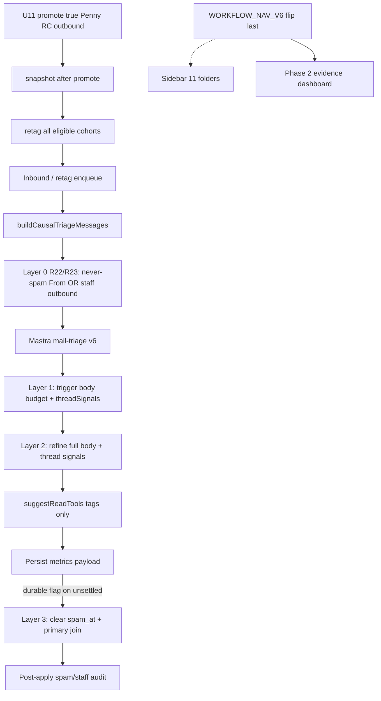

# feat: Centurion workflow triage, Mastra cutover, and durable backfill

## Goal Capsule

Replace live 4-primary + urgent triage with locked workflow-folder sidebar, P0–P5 human-agency triage, read-only suggested-tool tags, Mastra `mail-triage` schema/prompt cutover, and a **gated durable Centurion backfill of all eligible Centurion threads** from old folders → new folders via existing snapshot/retag/restore rails.

**Phase 1 (this plan — execute first):** triage AI quality + frontend (nav, Urgent, Spam system folder) + drafting **infrastructure** (`suggestedTools` tags on metrics; folder↔tool map) + full eligible backfill + nav flip last.

**Phase 2 (follow-up — after backfill green + `WORKFLOW_NAV_V6` on):** dual-audience evidence dashboard (Client + Nava-dev cards, frequent-sender chart, live workflow triage mix from durable categories). See [`docs/superpowers/plans/2026-09-01-centurion-evidence-dashboard-implementation.md`](../superpowers/plans/2026-09-01-centurion-evidence-dashboard-implementation.md).

**Not in either phase (yet):** HMS tool activation, draft generation, compose/send, write tools.

Authority: locked Build target wins for folders, Urgent overlay, KPIs, safety. Chart external total is **1,042 / 37.1% of 2,810** (not 1,079 / 38.4%).

Stop conditions: no auto-close/suppress/send/archive by source; no fake response/revenue/hours-saved KPIs; no pilot-RDS Vitest; no write tool ids in `suggestedTools`; spam matrix / `spam_user_locked_at` preserved; operator retag/promote may use pilot `DATABASE_URL` for Centurion ops only — Vitest never does.

## Product Contract

- Product Contract preservation: locked Build target unchanged for folders/P0–P5/KPIs/chart. Changed: R14 durable backfill; **R22 staff-conversation not-spam**; **R23 ReserveCloud/Penny SCS staff rewrite alias** (verified live quarantine 2026-09-01).

### Requirements

- R1. Sidebar organizes by required human work, not sender. Exactly one primary workflow folder per thread.
- R2. Urgent is cross-folder overlay + pinned queue, not a replacement primary.
- R3. Triage returns P0–P5 + one primary folder. Ask: what must human do, by when, and why?
- R4. Automated-looking is provenance, not no-action. Automated / Channel only after exception/request/payment/failure/deadline/guest-impact gates.
- R5. Internal property domains (`mail.legacyhotels.com`, `branding.legacyhotels.co.za`) never enter Automated / Channel.
- R6. `hospitality.cloud` finance-ops stays Money & Billing (+ Confirm overlay when needed), not blanket P4.
- R7. Unknown / Needs Review is safe abstention.
- R8. Bookings holds new bookings **and** quotes. Quote vs booking is overlay + tool tag, not two folders.
- R9. Groups & Events = 10+ rooms / events.
- R10. Confirmation language ≠ PMS completion.
- R11. **Phase 2:** Dual-audience evidence dashboard (Client + Nava-dev sections; no numeric card cap). Source-family chart is volume, not KPI. Phase 1 ships triage only — no dashboard rewrite.
- R12. **Phase 2:** Chart bars sum to **1,042** external/system-like = **37.1%** of 2,810. Internal 37 excluded from external total. Do not publish 1,079 / 38.4% as external. Workflow triage mix bars read **live from durable categories** after backfill (not census/offline).
- R13. Suggested tools = closed `READ_TOOL_IDS` (+ `mail_read_artifact` if in planner allowlist). Tags inform UI/draft admission. **Tag ≠ invoke.** No write tools. No tool activation work in this plan.
- R14. Sequence: schema+Mastra → metrics payload → verify fixtures → **U11 promote true Penny** → Centurion snapshot/targets → retag dry-run → restore drill → cohorted durable apply covering **all eligible Centurion threads** → audit → flip **nav** flag last. Then gold review / savings later.
- R14b. **Backfill universe:** all Centurion-transport threads with an inbound trigger eligible for retag. Residuals (explicit, not silent): `spam_user_locked_at`, sender `block`/`allow` skip rules, outbound-only threads with no inbound trigger. Done = 100% eligible applied + audited; residual counts logged.
- R14c. **Flag matrix (locked):** (1) `WORKFLOW_TRIAGE_V6` / durable-apply capability enables schema+metrics+joins for workflow slugs; (2) `WORKFLOW_NAV_V6` flips mail sidebar to 11 folders. Nav flag defaults **off** until backfill audit green. Never one flag that couples mid-backfill empty folders to durable writes.
- R15. Human override stays. No source-only suppress/archive/send.
- R16. Spam remains `spam_at` system folder, not a workflow folder. Model/schema signal is `isSpam` (boolean), orthogonal to `primaryFolder`. Never `primaryFolder:'spam'`. Manual mark-spam + ingest `block` still win over never-spam; `spam_user_locked_at` freezes AI flips.
- R17. Durable backfill uses existing Centurion snapshot/retag/restore/audit scripts extended for workflow slugs + `triage-v6` promptVersion; unsettles settled threads (clear AI joins **and** clear unlocked `spam_at`) so apply can rewrite primary/spam (not urgency_only). Skip `spam_user_locked_at` and sender `block`/`allow`.
- R18. Full triage payload (priority, overlays, source, tools, abstain, `isSpam`) persists on `ai_workflow_run.metrics`. No second membership table.
- R19. Spam false-positive hardening uses **defense-in-depth** (see KTD13–KTD17). Narrow fixes only; do not loosen broad spam rules.
  - **Layer 0 — pre-model short-circuit (R22/R23):** force `isSpam=false` for the **entire thread** when (a) trigger From is never-spam (Legacy hotel domains, pilot Gmails, **or** `pmbobo@eu.mail.reservecloud.com`), **or** (b) thread contains a **staff outbound response** (Legacy Hotels From outbound **or** true Penny ReserveCloud staff send per R23 discriminator). Model may still run for folder/priority; it cannot auto-spam those threads.
  - **Layer 1 — model context:** causal thread messages stay in prompt; **trigger body gets higher budget than context** (e.g. trigger 8–12 KiB, context messages 2 KiB) **or** append extracted quoted-tail block when `RE:`/`FW:` and hotel markers appear below truncation. Prompt v6 explicitly lists R22/R23: LH From, LH outbound, Penny ReserveCloud staff send ≠ spam; SCS wrappers ≠ staff outbound; noreply SCS ≠ staff.
  - **Layer 2 — refine on full haystack:** `refineTriageOutput` uses **full trigger body** (not `BODY_LIMIT` slice) plus **thread signals** including `legacyHotelsOutboundResponse: true` when any causal-window outbound From is `@legacyhotels.co.za` / `@mail.legacyhotels.com` (or Centurion mailbox mapped to those domains). Hotel-conversation quote rule (FP2) remains for cases with quoted LH content but no stored outbound row yet → `money-billing` when payment-shaped.
  - **Layer 3 — apply belt:** same From as refine; never-spam/`allow` skip `spam_at` write; when R22 fires, clear unlocked `spam_at` and write workflow primary (thread-level not-spam).
  - FP1 class (`jvermaak@legacyhotels.co.za`): domain already on allowlist — fix is layers 0–3 + unsettle re-eval, **not** domain expansion unless RCA proves miss (e.g. `branding.legacyhotels.co.za` only with explicit test).
- R20. **Spam FP regression suite** blocks backfill apply: zero `legitimate-mail-marked-spam` protected regressions on fixture set including FP1/FP2 shapes + R22 LH-outbound-response fixture; extend `quality-eval.ts` protected regression for v6 `isSpam` output.
- R21. **Post-backfill spam audit:** read-only check that no unlocked thread has `spam_at` when (a) latest inbound From is never-spam **or** (b) thread has Legacy Hotels outbound response (exclude `spam_user_locked_at`, sender `block`, manual-mark path). Reuse/extend `dump-centurion-spam-audit.mjs`.
- R22. **Required thread-level not-spam rule (product lock):** Classify the **whole thread** as not spam when either:
  1. The email/trigger **comes from** a hotel-staff identity (Legacy Hotels domains on never-spam, **or** allowlisted staff rewrite aliases such as `pmbobo@eu.mail.reservecloud.com`), **or**
  2. The thread **has a staff response** — outbound From Legacy Hotels domain **or** true Penny ReserveCloud staff send (see R23 discriminator).
  Move entire thread out of spam (`isSpam=false`, clear unlocked `spam_at`, assign workflow primary). Do **not** treat “any reply from any party” as not-spam. Manual mark-spam / ingest `block` / `spam_user_locked_at` still override auto path (AE11/AE8).
- R23. **ReserveCloud / Infor SCS identity (required):** `pmbobo@eu.mail.reservecloud.com` is Penny Mbobo’s SCS rewrite alias (Infor Sales & Catering), not spam. Live quarantine (2026-09-01) split ~**101 true-ish staff sends** vs ~**115 SCS inbound wrappers** (To/Cc only `pmbobo@legacyhotels.co.za`). Discriminator: headers store From as email-only — use **recipients**, not display name.
  - **True staff (gold / R22 staff-response):** From RC Penny + recipients include external (not only Penny Legacy).
  - **SCS wrapper (not outbound gold):** From RC Penny + recipients only Penny Legacy — guest mail rewritten through SCS; still never auto-spam, but **does not** count as hotel staff outbound for R22 clause (2).
  - **`noreply@noreply.reservecloud.com`:** system SCS — never staff-response; never add whole `*.reservecloud.com` to never-spam.
  - **Ingest:** true staff quarantine rows should be promoted into `message` as outbound (or equivalent) so R22/gold see them; wrappers stay inbound-shaped. No other `*@eu.mail.reservecloud.com` staff localparts found.
- R24. **Gold tiers (templated ≠ automated):** Keep three buckets in all calibration language:
  - **A auto/channel** — confirmation-letter / OTA / notification relays → **out of gold**
  - **B human-templated** — filled templates including Penny Event Proposal/Contract/Thank You → **in gold** (events → `groups-events`)
  - **C human-prose** — free-form Centurion replies → **in gold**
  Prior `87` = Centurion human-non-auto only; expanded gold must add promoted true Penny SCS (~101) and must **not** add wrappers (~115).

### Actors

- A1. Reservationist — one primary folder + Urgent overlay.
- A2. Operator — runs snapshot/retag/restore with dry-run defaults.
- A3. Drafting agent (future) — may call active read tools tagged on thread; never writes HMS/sends in this plan.

### Key Flows

- F1. Inbound → Mastra `mail-triage` → validate/refine → metrics payload → optional durable membership (gate on).
- F2. Quote → `bookings` + `quote` overlay → tag `hms_quote_stay`.
- F3. New channel booking without join → `bookings` or `confirm-reconcile` + `booking` → tag `hms_find_reservation`.
- F4. Internal bounce → `exceptions-recovery`, never `automated-channel`.
- F5. **Phase 2:** Dashboard evidence board + 1042 chart; no live click-filter pretending to archive/hide mail in Phase 1.
- F6. Backfill: snapshot → approved targets → retag unsettle+enqueue → worker drain → audit → restore available.

### Acceptance Examples

- AE1. Quote request → `bookings`, overlay `quote`, P3, tools include `hms_quote_stay`.
- AE2. OTA new reservation notice without PMS join → `bookings` or `confirm-reconcile`, overlay `booking`, P1/P2, `hms_find_reservation`.
- AE3. Internal delivery failure → `exceptions-recovery`, `sourceScope=internal_property`, never `automated-channel`.
- AE4. `hospitality.cloud` payment notice → `money-billing` (+ confirm overlay), not blanket P4/`automated-channel`.
- AE5. Clean routine channel after gates → `automated-channel`, P4, empty tools.
- AE6. Conflicting evidence → `unknown-review`, `review_required` / abstainReason, P2.
- AE7. Settled old `ops` thread in backfill cohort → after unsettle+apply, primary becomes a workflow slug (not stuck urgency_only).
- AE8. `spam_user_locked_at` thread → retag skips; `spam_at` + joins unchanged.
- AE9. Unlocked spam + never-spam From (`jvermaak@legacyhotels.co.za` class) → after retag+worker: `spam_at` null, `primaryFolder=internal-partner`, `isSpam=false`.
- AE10. Unlocked spam + RE payment reply quoting Centurion/Bongi outbound (`enviromongz` class) → `spam_at` null, `primaryFolder=money-billing` (or matching workflow), `isSpam=false`.
- AE11. Manual mark-spam / ingest `block` on never-spam From still sets `spam_at` (auto-never-spam does not override user intent).
- AE12. FP1 fixture: model returns spam + `jvermaak@legacyhotels.co.za` → after pipeline layers 0–3: `isSpam=false`, `primaryFolder=internal-partner`, no `spam_at` on apply.
- AE13. FP2 fixture: long body with quoted Centurion/Bongi block below 2000-char model slice → after refine: `isSpam=false`, `primaryFolder=money-billing`, flag `refine:hotel-conversation-not-spam`.
- AE14. Pre-apply quality eval: `protectedRegressions` count for `legitimate-mail-marked-spam` = **0** on v6 fixture batch; post-apply audit: zero unlocked never-spam From **and** zero unlocked threads with LH outbound response still in `spam_at`.
- AE15. Thread with external inbound (not LH From) but prior Centurion/LH-domain outbound reply present → pipeline forces `isSpam=false`, clears unlocked `spam_at`, assigns workflow primary (not left in Spam folder). Covers “we already responded ⇒ whole thread not spam.”
- AE16. From `pmbobo@eu.mail.reservecloud.com` + external To (Event Proposal/Contract) → `isSpam=false`; counts as staff rewrite for R22; preferred folder `groups-events` when event-shaped.
- AE17. From `pmbobo@eu.mail.reservecloud.com` + To only `pmbobo@legacyhotels.co.za` (SCS wrapper) → `isSpam=false` but **not** treated as staff outbound response; do not add to outbound gold.
- AE18. `noreply@noreply.reservecloud.com` → never staff-response; may still be spam/digest per content.
- AE19. Live unlocked spam with Legacy staff From (jvermaak / centurion / rfourie class — 3 threads verified) → after unsettle+apply: `spam_at` null.

### Scope Boundaries

**In scope (Phase 1):** workflow slugs + seed dual-read, triage schema/prompt/refine, Mastra workflow schemas, metrics payload, suggested-tool planner (tags), sidebar/nav flag, Centurion retag/snapshot/restore/audit v6 extensions, cohorted durable backfill ops runbook, **ReserveCloud never-spam + discriminator + true-Penny quarantine promote**, spam FP fixtures, tests on disposable DB/fixtures.

**Deferred to Phase 2 (after U9 backfill green + nav flip):** dual-audience evidence dashboard, dump-refresh KPI board, frequent-sender chart, live workflow triage mix from `mail_thread_category`. Plan: [`docs/superpowers/plans/2026-09-01-centurion-evidence-dashboard-implementation.md`](../superpowers/plans/2026-09-01-centurion-evidence-dashboard-implementation.md).

**Deferred beyond both phases:** HMS tool activation/live reads, HMS writes, outbound gold draft backtest beyond calibration recount, live RDS compute-on-read chart without registry, savings/revenue KPIs, permanent dual-read, attachment OCR counts, broader staff BCC never-spam expansion beyond R22 Legacy From clear.

**Outside identity:** autonomous send, suppress, archive, or PMS mutation by source family.

## Planning Contract

### Assumptions

- Mastra path is the existing `mail-triage` **workflow** (`createWorkflow`), not a new Agent class — “write the Mastra AI agent” means rewrite that workflow’s schema/prompt/steps.
- One cutover **pair**: durable/schema flag ≠ nav flag (R14c). Defaults: durable can enable for retag; nav off until full eligible audit green.
- Metrics payload contract (R18): `primaryFolder`, `priority`, `urgent`, overlays `{booking,quote,payment}`, `isSpam`, `suggestedTools`, `sourceScope`, `automationState`, `humanAction`, `confidence`, `rationale`, `policyFlags`, `abstainReason`, `promptVersion`, refine flags, input/output hashes. Derived legacy `category` for dual-read only.
- Exact workflow slugs: `bookings | groups-events | manage-stay | confirm-reconcile | money-billing | documents-delivery | exceptions-recovery | guest-experience | internal-partner | automated-channel | unknown-review` + overlay `urgent`.
- Phase 2 dashboard catalog locked in evidence-dashboard plan (Client + Nava-dev sections; workflow triage mix **live post-backfill**). Phase 1 does not ship dashboard cards.
- Gold recreate (90 threads) calibrates **tag ranking / folder↔tool map** interim; after U11, union +~101 true Penny SCS. Draft-target (1,393) calibrates **forward workload**. Never merge denominators.

### Key Technical Decisions

- **KTD1.** Eleven workflow primaries + `urgent` overlay membership only. Extra overlays live on metrics payload, not as category rows.
- **KTD2.** `workflowTriageOutputSchema` = `{ primaryFolder, priority, urgent, overlays…, isSpam }`. When `isSpam=true`, skip primary join and write `spam_at` only (after never-spam/`allow` belt). When `isSpam=false`, require one of 11 workflow folders and clear `spam_at`. Derived legacy `category:'spam'` only for unread dual-read callers.
- **KTD3.** Deterministic `suggestReadTools(folder, overlays, humanAction)` is the sole writer of `suggestedTools` after refine. Empty tools when `isSpam`. Reject write ids.
- **KTD4.** Quote vs booking share `bookings`. Overlay `quote` → `hms_quote_stay`. Overlay `booking` → `hms_find_reservation` (and quote tool only if still pre-reservation ask).
- **KTD5.** **Phase 2:** Chart = dump-refresh snapshot + versioned domain→family registry (1,042 bars on Aug-30 baseline). Not dishonest compute-on-read RDS. Workflow triage mix = durable category counts after backfill.
- **KTD6.** Internal-property refine before Automated / Channel.
- **KTD7.** Durable backfill **in scope**: extend retag rails to unsettle legacy+workflow AI joins **and** clear unlocked `spam_at`, bump `promptVersion` to `triage-v6`, new key-prefix; restore rolls back AI joins + spam/lock. Ship FP1/FP2 refine **before** cohort `--apply` that clears spam so FPs are not re-stamped.
- **KTD11.** Never-spam remap targets become workflow folders: hotel domains → `internal-partner`; pilot Gmails → `bookings`. Heuristic not-spam remaps (empty-body, day-visitor, property-subject, short-personal) retarget workflow folders, not `new-bookings`.
- **KTD12.** Hotel-conversation not-spam refine uses **full** trigger haystack + thread outbound signals — not the Mastra `BODY_LIMIT=2000` model slice alone.
- **KTD13. Spam defense-in-depth.** Shared `staffConversationNotSpam(signals)` used by Layer 0 / refine / apply (no triple-divergent logic). Layer 0: never-spam From (existing allowlist + RC Penny email) **or** staff-outbound response → force `isSpam=false`. Layer 1: higher trigger body budget + threadSignals in prompt (skip separate quoted-tail helper unless FP2 still fails after TRIGGER≥8KiB). Layer 2: full-body refine + hotel-conversation belt. Layer 3: apply clears unlocked `spam_at` **and** writes workflow primary on never-spam/R22 (must not early-return without clear+join).
- **KTD14. Thread context for spam, not whole-body dump.** Causal window + `threadSignals` (`legacyHotelsOutboundResponse`, `reserveCloudStaffOutbound`, RE/FW). No unbounded thread dump.
- **KTD9.** Thin overlays for v1: `booking`, `quote`, `payment` + `urgent` only. No speculative overlay fields.
- **KTD20.** CE plan = product/units SoT. Executable TDD tasks: `docs/superpowers/plans/2026-09-01-centurion-workflow-triage-implementation.md` (cite R/AE/U-IDs; no product fork).
- **KTD21. Full-universe retag ops.** U9: cohort schedule (50→250→remainder), Bedrock throttle pause, fresh key-prefix, ETA vs eligible N, mid-flight resume. Audit `asOf=createdAt` + spam=`spam_at` (not slug).
- **KTD22. U11 direction.** Promote true RC Penny with **outbound direction override**. Wrappers + noreply skipped. Dry-run ~101 / ~115 / noreply. Non-Penny quarantine out of scope. Order: promote+verify → snapshot → retag.
- **KTD17. R22 thread-scoped.** Prefer stored outbound From-domain / rewrite-alias; body quotes as belt only.
- **KTD18. ReserveCloud never-spam + discriminator.** Exact email `pmbobo@eu.mail.reservecloud.com` in never-spam emails; not whole domain. Staff-outbound: From RC + recipients not solely Penny Legacy.
- **KTD19. Quarantine promote hard dependency** for R23 gold + R22 RC staff-response visibility.
- **KTD15. Backfill/backtest spam gates.** Pre-apply quality eval; post-apply never-spam-in-spam + staff-outbound audit.
- **KTD16.** Prefer `TRIGGER_BODY_LIMIT≥8192`; quoted-tail helper only if FP2 still fails.
- **KTD8.** Folders = human work; overlays = draft archetype; tools = PMS click tags. Tag ≠ invoke.
- **KTD10.** Fat metrics on `ai_workflow_run` only. No second membership table.

### High-Level Technical Design

### Tools ↔ triage reconciliation (evidence)

| Tool | Draft-target threads (n=1393) | Expanded gold recreate (n=90) | Triage implication | Build in this plan? |
|---|---:|---:|---|---|
| `hms_find_reservation` | 1120 (80%) | 10 (11%) | Default for booking/confirm/manage overlays | Tag only |
| `hms_quote_stay` | 264 (19%) | 21 (23%) | `quote` overlay on Bookings | Tag only |
| `mail_read_artifact` | 524 (38%) | — / attach signal | Documents & Delivery | Tag only |
| `hms_list_documents` | 76 (5%) | 32 (36%) | Gold-heavy; tag documents folder; activate later | Tag only |
| `hms_group_block_read` | 50 (4%) | 32 (36%) | Gold-heavy; tag Groups & Events; activate later | Tag only |
| `hms_read_folio` | 169 (12%) | 13 (14%) | Money & Billing | Tag only |
| `reservation_create` / writes | high on draft-target | 2 (2%) | **Never tag**; HITL write later | Out of scope |

**Quote vs booking:** share Bookings. Difference is overlay + tool tag + priority (P3 response vs P1/P2 create/reconcile), not sidebar split. Matches locked Build target + gold (`booking_create` only 1/90).

**Can tools alone draft all emails?** No. Live tools today 0%. Even with all reads: ~39% gold threads are prose-only (no fact tool); writes needed for create/amend/cancel; HITL always. Triage still routes human work for the rest.

### Alternatives Considered

- Keep shadow-only forever: rejected — user requires durable backfill now.
- Separate Quote folder: rejected — product lock.
- Live RDS chart: rejected — no governed joins.
- Model emits free tool ids: rejected — closed planner.
- Blind slug map `ops`→folder without re-triage: rejected — wrong for R4/R6.
- Implement HMS tools in same PR: rejected — user: triage now, tools later.
- **Unbounded full thread body to model:** rejected — token cost; use causal window + threadSignals + quoted-tail extraction only.
- **ML second-pass spam scorer:** rejected — deterministic layers sufficient for known FPs.
- **Expand never-spam to all `@*.co.za`:** rejected — over-broad; explicit domains only.

### Review Disposition

- **gstack-plan-eng-review (nava-plan 2026-09-01 re-run):** MUST-FIX absorbed — full-universe R14b, cohort/Bedrock KTD21, U11 outbound override KTD22, flag matrix R14c, metrics contract, Layer-3 apply clear+join, audit asOf, slug enum in Assumptions.
- **ponytail-review (re-run):** shared not-spam helper; drop speculative overlays; TRIGGER budget over quoted-tail helper; keep `suggested-tools.ts` as drafting-infra seam; U10 stays as gate unit.
- **gstack-plan-design-review (re-run):** exclusive nav filter; split durable vs nav flags; named KPIs; Unknown UI; Urgent primary pill; chart no live click — absorbed U5/U6.
- **Prior spam/triage reviews:** still absorbed (R19–R24, AE9–AE19).

## Implementation Units

### U1. Workflow slug + presentation contract

Goal: eleven primaries + urgent overlay titles/nav dual-read.
Requirements: R1, R2, R8, R9, R16
Dependencies: none
Files: `apps/server-pilot/src/ai/categories.ts`, `apps/mail/lib/mail/hotel-folder-presentation.ts`, `apps/mail/lib/demo/folder-map.ts`, `apps/mail/config/navigation.ts`, matching tests
Approach: add `AI_WORKFLOW_PRIMARY_SLUGS`; keep `LEGACY_PRIMARY_CATEGORY_SLUGS`; managed = legacy∪workflow∪urgent during cutover.
Test scenarios: AE folder titles; urgent not primary; spam not workflow.
Verification: mail + server unit tests without DATABASE_URL.

### U2. Workflow triage schema + spam defense-in-depth

Goal: P0–P5 + `isSpam`; four-layer spam FP prevention; **R22/R23 staff + ReserveCloud not-spam**; exception-first refine.
Requirements: R3–R7, R15, R16, R19, R22–R24, KTD13–KTD19
Dependencies: U1
Files: `apps/server-pilot/src/ai/triage.ts`, `never-spam.ts` (add exact `pmbobo@eu.mail.reservecloud.com`), optional `spam-refine-signals.ts` (new, thin), `tests/ai-triage-contract.test.ts`, `tests/ai-triage-refine.test.ts`, `tests/never-spam.test.ts`
Approach:
- Layer 0: `forceNotSpamIfStaffConversation({ from, threadSignals })` — R22/R23.
- Add never-spam **email** for Penny ReserveCloud; do **not** add `*.reservecloud.com`.
- `threadSignals.legacyHotelsOutboundResponse` **or** `reserveCloudStaffOutbound` (From RC Penny + recipients not only Penny Legacy).
- SCS wrapper (RC From + To only Penny Legacy): `isSpam=false` but no staff-outbound flag.
- Layer 2 full-body hotel-conversation quote belt remains for missing outbound rows.
Test scenarios: AE1–AE6, AE9–AE19; AE16/AE17 discriminator fixtures.
Verification: Vitest with `unset DATABASE_URL VITEST_ALLOW_PILOT_RDS`.

### U3. Mastra mail-triage v6 cutover

Goal: prompt + schemas + **split body budgets** + threadSignals in user prompt.
Requirements: R3, R14, R16, R18, R19, KTD14–KTD16
Dependencies: U2
Files: `apps/server-pilot/src/ai/workflows/mail-triage.ts`, `apps/server-pilot/src/ai/worker.ts`, `tests/ai-triage-contract.test.ts`
Approach:
- Replace flat `BODY_LIMIT=2000` with `TRIGGER_BODY_LIMIT` (≥8192) + `CONTEXT_BODY_LIMIT=2000`.
- Append `threadSignals:` + optional `quotedContext:` blocks to `buildUserPrompt`.
- Pass full trigger body to refine; truncated slice only to model.
- Prompt v6 spam section: R22 — LH From never spam; thread with LH-domain outbound response never spam; payment reply quoting hotel staff not spam; newsletters/quarantine digests remain spam.
Test scenarios: prompt tests; AE15 + FP2 regression via fake adapter returning spam.
Verification: contract tests + fake adapter.

### U4. Deterministic suggested-tool planner

Goal: folder+overlay → READ tool tags; gold-aware map; no writes.
Requirements: R8, R13, KTD8
Dependencies: U2
Files: `apps/server-pilot/src/ai/suggested-tools.ts` (new), `tests/suggested-tools.test.ts` (new)
Approach: pure function; documents→list/artifact; groups→group_block_read; money→folio+find; quote→quote_stay; booking→find. Do not modify `candidate-draft-agent` activation set in this unit.
Test scenarios: AE1–AE5; never emit write ids; tag≠invoke documented in test name.
Verification: unit tests only.

### U5. Sidebar / Urgent UI behind nav flag

Goal: exclusive workflow nav + Urgent when `WORKFLOW_NAV_V6` on; legacy nav when off.
Requirements: R1, R2, R14c, R16
Dependencies: U1
Files: `apps/mail/config/navigation.ts`, presentation/route-filter, `apps/server-pilot/src/env.ts` (nav flag), mail tests
Approach: flag off → legacy 4 + Urgent; flag on → 11 workflow + Urgent only (exclusive filter). Spam never in Folders. Unknown = real folder with review-not-spam styling. Urgent route still shows primary workflow pill. Embed title/subtitle table + nav order in tests.
Test scenarios: exclusive filter; spam excluded from Folders; Unknown title; Urgent+primary pill; empty-state copy during partial backfill.
Verification: mail unit tests.

### U6. Evidence dashboard (Phase 2 — **not Phase 1**)

Goal: dual-audience evidence board (Client + Nava-dev) + frequent-sender chart + **live** workflow triage mix from durable categories; forbid savings copy; no dishonest live click-filter.
Requirements: R11, R12
Dependencies: **U9 complete** (full eligible backfill audited green), **`WORKFLOW_NAV_V6` on**, U5 nav shipped
Executable plan: [`docs/superpowers/plans/2026-09-01-centurion-evidence-dashboard-implementation.md`](../superpowers/plans/2026-09-01-centurion-evidence-dashboard-implementation.md)
Approach: dump-refresh snapshot + registry; triage mix from `mail_thread_category` / metrics — **not** pre-backfill census. Demote Aug-25 FTE mix historical.
Verification: unit tests; no pilot-RDS Vitest.
**Do not start U6 until Phase 1 Definition of Done minus dashboard is green.**

### U7. Seed dual-read + durable apply path for new slugs

Goal: seed workflow category rows; `applyDurableTriageResult` accepts workflow primaries; settled semantics unchanged.
Requirements: R1, R14, R17
Dependencies: U1, U3
Files: `apps/server-pilot/src/db/seed.ts`, `categories.ts`, `triage.ts`, worker tests
Approach: insert new slugs; do not delete legacy rows; full apply only when unsettled.
Test scenarios: AE7 urgency_only vs full on settled fixture; disposable DB only if needed.
Verification: `TEST_DATABASE_URL` + `CONFIRM_DISPOSABLE_TEST_DB=1` or pure unit mocks.

### U8. Retag/snapshot/restore/audit v6 (incl. spam re-eval)

Goal: scripts support workflow managed slugs + triage-v6; unsettle clears unlocked `spam_at`; dry-run default.
Requirements: R17, R15, R16, R19
Dependencies: U7
Files: `scripts/retag-centurion-triage.mjs`, `snapshot-centurion-triage.mjs`, `restore-centurion-triage-snapshot.mjs`, `audit-centurion-triage-retag.mjs`, matching tests
Approach: extend managed/unsettle sets; keep spam lock/block/allow skips; audit: approved spam → `spam_at` set + no primary join; approved non-spam → `spam_at` null + workflow primary; PII under `.private/`.
Test scenarios: dry-run no mutate; AE8/AE9/AE10; restore verify hash incl. spam columns.
Verification: script unit tests; no Vitest against pilot RDS.

### U9. Operator backfill runbook (all eligible Centurion)

Goal: full-universe cohorted cutover with spam FP gates + Bedrock envelope + restore drill.
Requirements: R14, R14b, R14c, R17, R20, R21, KTD21
Dependencies: U3–U8, U10, U11
Files: handoff under `docs/superpowers/plans/handoff-reports/`; `dump-centurion-spam-audit.mjs`; targets export; retag CLIs
Approach: **U11 promote+verify → snapshot+targets (eligible universe) → U10 green → dry-run → restore drill → cohorts (50→250→remainder) with throttle pause → audit each cohort → expand → flip WORKFLOW_NAV_V6 → then U6 evidence dashboard (Phase 2)**. Log residuals. Abort apply if spam FP regression fails.
Test expectation: none as code unit — ops checklist + audit evidence.
Verification: eligible applied = 100% minus logged residuals; AE14/AE19; never-spam-in-spam = 0.

### U10. Spam FP regression + backtest harness

Goal: fixture suite + quality-eval gate prevents backfill from re-stamping known FPs (incl. ReserveCloud discriminator).
Requirements: R20, R21, R23, AE12–AE19
Dependencies: U2, U3
Files: `apps/server-pilot/tests/fixtures/spam-fp-v6.jsonl` (new), `apps/server-pilot/tests/spam-fp-v6.test.ts` (new), `apps/server-pilot/src/ai/quality-eval.ts`, `apps/server-pilot/tests/ai-quality-eval.test.ts`
Approach: fixtures AE12–AE19 + newsletter negative; fake-adapter force-spam; extend `protectedRegressionFor` for v6 `isSpam`.
Test scenarios: AE12–AE19; protected regression count 0.
Verification: Vitest only (never pilot RDS).

### U11. Promote true Penny ReserveCloud quarantine → message (staff outbound)

Goal: ~101 true-ish Penny SCS sends as **outbound** messages; ~115 wrappers skipped; noreply skipped.
Requirements: R23, R24, KTD19, KTD22
Dependencies: none (parallel early); **before** snapshot/retag
Files: `apps/server-pilot/src/mail/ingest/promote-quarantine.ts`, `scripts/promote-quarantine.ts`, `tests/promote-quarantine.test.ts`
Approach: filter From exact RC Penny; recipient discriminator; **direction override outbound** for true staff; dry-run class counts; do not blind-promote all `missing_owner_header`.
Test scenarios: ~101/~115/noreply dry-run; wrappers not outbound; noreply skipped.
Verification: unit tests + EC2 dry-run; no Vitest vs pilot RDS.

## Verification Contract

- Before every Vitest: `unset DATABASE_URL VITEST_ALLOW_PILOT_RDS NODE_ENV`
- Never `VITEST_ALLOW_PILOT_RDS=1`; never source `.env.production` into test shells
- Disposable DB only when DB required
- Focused: `ai-triage-contract`, `ai-triage-refine`, `spam-fp-v6`, `suggested-tools`, `hotel-folder-presentation`, retag/snapshot/audit tests
- **Pre-apply gate:** spam FP fixture batch + quality eval protected regression = 0 before any retag `--apply`
- Operator backfill: snapshot/retag/audit CLIs with dry-run first; Centurion transport only
- No HMS write registration; no savings KPI copy

## Definition of Done

- [ ] Workflow folders + Urgent behind **WORKFLOW_NAV_V6** (off until backfill green); durable/schema flag separate
- [ ] Mastra `mail-triage` emits P0–P5 + primaryFolder + `isSpam` + overlays + tools tags into metrics (frozen field list)
- [ ] Refine + apply Layer-3: never-spam/R22 clears unlocked `spam_at` **and** writes workflow primary
- [ ] Suggested-tool planner AE1–AE5; empty when `isSpam`; never write tool ids; tag ≠ invoke (no candidate-draft activation)
- [ ] **Phase 1 complete without dashboard** — U6 deferred until above green + nav flip
- [ ] **Phase 2 (separate plan):** dual-audience evidence board + 1042 chart + live triage mix; no savings copy
- [ ] **All eligible Centurion threads** durable-backfilled (cohorts 50→250→rest); residuals logged; restore drill proven
- [ ] U11 promote dry-run ~101/~115/noreply; true Penny outbound in message table
- [ ] Settled unsettle (AE7); spam locks skipped (AE8); manual/ingest block preserved (AE11)
- [ ] No pilot-RDS Vitest; no source-only suppress/send/archive
- [ ] Tools not activated; drafting AI deferred
- [ ] Folder-first spam matrix preserved
- [ ] R22/R23 + AE12–AE19; pre-apply quality eval green; post-apply staff/never-spam spam audit = 0
- [ ] Gold language uses R24 tiers; wrappers excluded from outbound gold

## Sources & Research

- Locked Build target (user 2026-08-31 / re-confirmed 2026-09-01)
- `docs/plans/2026-08-31-002-feat-centurion-workflow-triage-plan.md` (superseded stop condition)
- `docs/superpowers/plans/2026-08-31-centurion-workflow-triage-and-tools.md`
- `docs/superpowers/plans/2026-09-01-ai-drafting-tool-portfolio-plan.md` (tools deferred; template-routing)
- `.private/.../corpus-tool-rediscovery-2026-09-01.json`
- `.private/.../centurion-pmbobo-gold-recreate-2026-09-01.json`
- Hermes transcript `d73c02b3-7e5c-4fb6-8d8a-30e477cd9ca9`
- Live SSM calibration 2026-09-01: `.private/connected-mailbox-corpus/follow-up/_work/penny-reservecloud-gold-calibration-2026-09-01.json` (~101 true / ~115 wrappers / 0 Penny spam / 3 Legacy spam threads)
- `docs/solutions/architecture-patterns/folder-first-spam-at-folder-matrix.md`
- `apps/server-pilot/src/ai/quality-eval.ts` (`legitimate-mail-marked-spam` protected regression)
- `apps/server-pilot/scripts/dump-centurion-spam-audit.mjs`
- External: [Infor Sales & Catering](https://www.infor.com/products/sales-catering), [docs.reservecloud.com](https://docs.reservecloud.com/), [reservecloud.com](https://reservecloud.com/), [Google Workspace approved-sender spam bypass](https://knowledge.workspace.google.com/admin/gmail/advanced/add-custom-spam-filters-to-gmail)
- Live: `triage.ts`, `mail-triage.ts`, `never-spam.ts`, `promote-quarantine.ts`, retag/snapshot/restore/audit scripts, `read-tools.ts`
- Eng + ponytail reviews 2026-09-01 (this pipeline)
- **Canonical execution pointer:** `docs/superpowers/plans/2026-09-01-centurion-workflow-triage-implementation.md` (thin; do not fork requirements)
