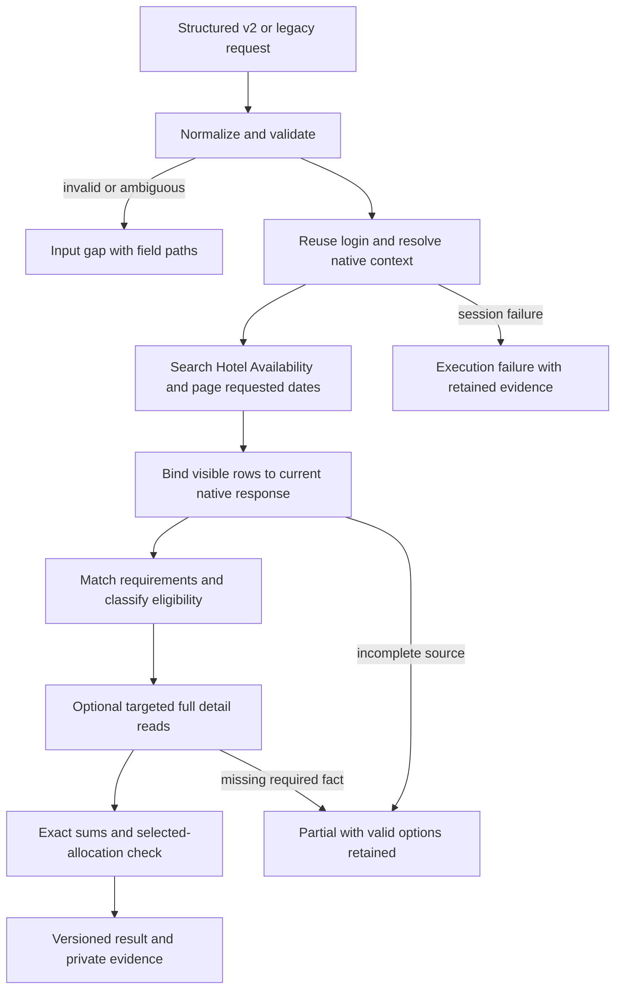

# Persistent Playwright Fetch Quote - Plan

## Goal Capsule

- **Outcome:** widen the working standalone deterministic quote tool into a reusable Hotel Availability search: multiple room/rate offers, per-room requirements/preferences, contextual rates, source-backed prices/terms, and truthful allocation results.
- **Build on the shipped baseline.** Reuse `apps/server-pilot/tooling/playwright-quote/`; do not rebuild login, browser ownership, recording or the Stagehand runner. Original U1/U2 established the positive path and standalone packaging; this revision adds U3-U7.
- **Runtime:** native Playwright, zero model calls. Cursor CLI Grok 4.6 high is the orchestrator. GPT-6 Astra, invoked through Codex CLI `exec` (not a Cursor Task/subagent), owns all development-time computer use, live PMS/browser work, selector/source discovery and live acceptance. Grok owns offline code, tests, docs, commit/push and review triage. Do not use GPT-5.6 Luna.
- **Authority:** current PMS account, browser access and normal network traffic remain approved. Search/filter edits and related read-only detail views are allowed. No request allowlist, unknown-request teardown, mandatory test account, Reserve, business writes or production integration.
- **Execution posture:** autonomous. `/autonomous-plan` is granted for this document. Implementation still starts only when a session is told to execute the plan (the `/goal` prompt or an explicit “go”). Continue to the Definition of Done or a demonstrated true blocker. Editing this document is not execution.
- **Timing:** there is no fixed 30-minute completion target. Optimize model spend by keeping Astra off until live PMS/browser work is actually required. Report elapsed checkpoints, not approval requests; do not silently cut accepted scope to meet a stopwatch.
- **Delivery:** updated code, portable input/output schema, focused tests, examples, README, private verification handoff, committed changes and a pushed non-protected feature branch. No PR, deployment, UI or email work.

---

## Product Contract

### Summary and problem frame

The existing tool returns one public-rate option per occupancy group. It has recorded adult, child and zero-inventory evidence, but it cannot yet represent different hard requirements per group, apply negotiated context, or establish joint inventory across groups.

Widen the input/output contract and the existing browser path. Do not turn this into an email agent, booking engine or generic browser framework.

### Requirements

**Retained guarantees**

- R1. Validate property, real arrival/departure dates, room quantities, adult allocation and child ages before browser access.
- R2. Use **Front Desk > Availability > Hotel Availability** and its related read-only details. OSRRAV/Room Type and Rate Availability and CRS are not substitutes.
- R3. Bind every claimed nightly price, inventory value and restriction to current applied criteria, native identity, source currency and visible PMS evidence.
- R4. Preserve requested versus satisfied conditions and missing facts. Never infer a bed equivalence, meal inclusion, entitlement, tax treatment or policy from an unsupported label.
- R5. Preserve adult, supplied-age child, input-gap, genuine unavailability, partial and execution-failure behavior; stale/empty/loading data is not sold out.
- R6. Deliver deterministic runtime interaction, extraction and transformation without Stagehand or model callbacks.
- R7. Keep one live development owner; packaged calls use isolated owned contexts and preserve the borrowed browser.
- R8. Deliver fresh-session evidence, useful structured results, a readable summary and existing private audit bundles.

**Expanded capability**

- R9. Represent required versus preferred constraints per occupancy group; distinguish matching offers, alternatives and unresolved requirements.
- R10. Support optional organization, booking-agency and group references through actual Hotel Availability controls, with requested/applied context and rate eligibility evidence.
- R11. Return multiple native room/rate options from each scoped search, with deterministic ordering and explicit completeness instead of one hidden winner.
- R12. Calculate sums of verified displayed nightly rates using exact decimal arithmetic; distinguish these from PMS totals, taxes/fees and final payable amounts.
- R13. Keep per-group inventory separate from the feasibility of the complete room allocation; never double-count shared inventory or sum mutually exclusive offers.
- R14. Support stays across calendar windows, optional requested currency, bounded option/detail retrieval and explicit unsupported/unresolved criteria.
- R15. Publish a versioned, documented request/result schema usable by a future LLM caller without browser selectors, hashes or invented internal PMS IDs.
- R16. Retain all source-backed information relevant to quoting: room/bed, board/packages, restrictions, contextual eligibility, exact policy text and evidence references.
- R17. Verify implemented capability with real PMS runs; an unimplemented branch returning unknown is not a completed feature.

### Scope boundaries

**Included:** one standalone callable/CLI tool; structured input/output; read-only lookup pickers; room/rate filtering; prices and related detail extraction; local matching, arithmetic and allocation checks; focused regression tests; private evidence.

**Not included:** Nava UI/API integration, email parsing/classification, drafting/sending, PDF/pro-forma creation, booking creation/amendment/cancellation, inventory holds, payments, folio, RDS changes, deployment, registries, queues, general search languages or a portfolio rewrite.

**Deferred to follow-up:** mixed-date rooming lists, split stays/room moves, optimization over every possible room assignment, arbitrary guest wishes interpreted by a runtime LLM, external currency conversion and proving unrelated write tools. Daily stays of 1-30 nights are the initial supported range. Do not pretend this is a universal booking engine.

### Request contract

Preserve the current CLI flags and accept existing adult/child example inputs through one normalization path. The new canonical request has `schemaVersion: 2`; conflicting legacy and new fields return a field-specific input gap rather than silently choosing one. The schema artifact exposes `$defs.request` and `$defs.result`; no browser is needed to inspect either.

Absent `schemaVersion` identifies legacy input. Preserve its property/dates/room quantities/occupancy; assign deterministic `group-1`, `group-2` IDs when absent. Map root `roomCode`/`rateCode` to singleton required-code lists on each group. Map legacy bed/board preferences through documented aliases, and room-description/flexibility/payment text to named preferred features without inventing native codes. Legacy calls default to full details, but return the v2 result and explicit limits, not the historical single-option output. Document this output-version change.

| Field | Contract |
|---|---|
| `propertyCode`, `arrivalDate`, `departureDate` | Required; ISO calendar dates, departure exclusive, one property/stay per call. Property must be verified against the authorized session. |
| `rooms[]` | 1-8 occupancy groups with unique `id`, positive integer `quantity`, `adults`, `children`, and every `childAges[]` value. Quantity multiplies the per-room occupancy, not the total guest count. |
| `rooms[].required` | Optional typed conditions: `roomCodes[]`, `rateCodes[]`, `bedTypes[]`, `boardBases[]`, plus explicit `features[]` requests. OR within a list; AND across different fields. Empty lists are invalid. |
| `rooms[].preferred` | Same vocabulary; influences ordering only. A preference miss does not become a hard rejection. Required conditions always win. |
| `rateContext` | Optional `organization`, `agency`, `group`; each reference supplies exactly one of native `code` or exact `name`, resolved uniquely in its read-only picker. All supplied contexts must be retained and applied together where PMS supports that combination. |
| `requestedCurrency` | Optional ISO code; omission uses property currency. Convert only through verified PMS controls; no local FX approximation. Return source/display currency and the applied conversion basis. |
| `search` | Optional `salesStrategy`, `includeRestricted` (default false) and `includeAlternatives` (default true). Default public strategy remains the verified BAR choice; scoped rates may require a different verified native strategy. Restricted offers are information, not eligible offers. |
| `details` | `summary` or `full`; default `summary` for v2. Summary returns source-verified nightly offers and available grid facts. Full inspects at most five narrowed offers per group; a wider set returns partial detail coverage and instructions to narrow by native codes. Legacy inputs default to full. |
| `maxOptionsPerGroup` | Default 50, maximum 200. A return limit is not permission to claim exhaustive search. Report counts, limiting reason and narrowing hints. |
| `notes` | Optional caller context retained as data. It does not authorize actions or imply any condition was satisfied. |

Normalize known board vocabulary into `room_only`, `breakfast`, `dinner_bed_breakfast`, `half_board`, `full_board`, `all_inclusive`; preserve the native label too. Do not equate half board with a particular meal without source evidence. Bed vocabulary is `single`, `twin`, `double`, `queen`, `king`; do not equate double occupancy with a double bed.

`features[]` items carry `name` and `value` strings for conditions such as refundability, payment method, accessibility or parking. Match only through a specific implemented source-backed mapping. Unrecognized conditions remain unresolved, never satisfied by loose substring matching. Callers can narrow using native codes returned by a previous call.

An absent room type or rate is valid: search without that filter and return choices. Missing room allocation or required child ages is an input gap, not permission to invent them. Retain the tenant-observed age-picker range as a transport bound; it does not establish the property's commercial definition of a child. Do not propagate the legacy server's unrelated age/room caps into this standalone API.

Names resolve by exact normalized equality (case/whitespace normalization only); multiple matches return an input gap with candidate labels/codes. A supplied exact code narrows a product; it never proves rate entitlement. Unsupported input combinations must be reported, not ignored.

### Result contract

Publish `schemaVersion: 2`, requested/normalized inputs, observed time, source screen, per-search applied criteria, `groups[]`, `allocation`, `searchCompleteness`, issues and evidence references. Keep business outcome separate from capture status.

Each group retains its request, has an `options[]` array and its own `outcome`. Each option includes:

- Native property, room/rate identity and context, stable identity within this run, room description and observed bed facts.
- Each charged night: date, exact decimal amount, currency/basis, inventory and observed restriction facts; departure restrictions separately.
- Board/package/inclusion facts, exact source labels/text and source references.
- `matchStatus: match | alternative | unresolved`; each requested condition has `satisfied | unsatisfied | unknown`, its evidence and a reason.
- `rateScope: public | contextual | unknown`, plus `eligibility: verified | conditional | unknown` and applied organization/agency/group evidence. Restrictions are recorded separately under availability; a contextual rate can also be restricted. A price row is not proof of eligibility.
- `availability: available | unavailable | restricted | unknown`, with scope and reason; `available` describes observed sell conditions, not a reservation guarantee.
- `calculated` displayed-rate sums, separate nullable PMS total/tax/fee/payable facts, and `held:false`.
- Detail coverage: `not_requested | complete | partial`; distinguish `not_inspected`, `not_shown`, `unsupported` and extraction errors. Missing text never means no policy.
- Evidence references into the existing private bundle. Do not repeat entire DOM/network payloads in the main response.

Top-level outcomes are `quote | no_match | unavailable | input_gap | partial | execution_failure`:

| Outcome | Meaning |
|---|---|
| `quote` | Every group has at least one eligible, verified matching offer at the requested detail level; no unresolved mandatory pricing/input issue. Multiple groups also require an explicitly selected, checked allocation. |
| `no_match` | Complete requested search found no offer satisfying the hard requirements; report alternatives and reasons. This is not hotel-wide sold out. |
| `unavailable` | Verified inventory shortage for the explicitly searched product/allocation scope. Requires complete relevant coverage and known-good source interpretation. |
| `input_gap` | Missing/invalid/conflicting caller fields or ambiguous exact reference resolution; return paths and concrete corrections. |
| `partial` | Useful data exists but coverage, required facts, eligibility or joint allocation is unestablished. Truncation and required-detail failures cannot masquerade as full success. |
| `execution_failure` | Browser/session/source failure prevents a trustworthy result. Preserve completed groups and sanitized failing phase if available. |

Uninspected optional policy text in a summary call does not itself make verified nightly offers fail. An unknown **required** cancellation/board/bed condition does. A summary search is not advertised as a final payable quote.

Aggregate outcomes deterministically: pre-search validation/ambiguous references -> input gap; a fatal session/source error -> execution failure retaining finished groups; incomplete required scope/facts -> partial; otherwise a complete group no-match -> no_match; otherwise a proven scoped inventory shortage -> unavailable; otherwise an unselected/unverified multi-group allocation -> partial; otherwise quote. Capture failures remain separate in `audit.status`. CLI exit 0 means a resolved quote/no_match/unavailable with requested capture complete; exit 2 covers partial/input_gap/execution_failure or incomplete requested capture.

Issues have stable codes, field/group/option references, a reason and a corrective action or narrowing hint. Separate caller-correctable input from retryable transport failure. Unsupported/unapplied rate context produces partial with that explicit context status; public alternatives never silently fulfil a contextual request.

### Pricing and multi-room semantics

- Sum exact amounts in integer minor units or existing decimal support, never binary floating-point money. Honor source currency precision; unsupported formats fail explicitly.
- For each option, return per-room displayed-nightly-rate sum and that sum times the group's quantity, labelled `sum_of_displayed_nightly_rates`, `official:false`. Complete dates, identical currency and known per-room basis are prerequisites.
- PMS stay totals, tax inclusion, mandatory fees, package charges and final payable amounts are separate facts. Populate them only from a read-only authoritative view tied to this offer; otherwise retain unknown plus an inspected/not-inspected reason.
- Do not claim a displayed-nightly sum includes LOS discounts or validates a stay-level rate. Verify arrival/departure, closed-to-arrival/departure and min/max length-of-stay conditions. Unresolved restriction semantics make the offer conditional.
- Never sum alternatives together. An all-groups scenario sum requires exactly one selected offer per group. An exact singleton room/rate constraint per group selects that scenario; a broad options search does not.
- The selection input is exactly `rooms[].required.roomCodes:[one code]` together with `rateCodes:[one code]` for every group. No run-local option ID or extra allocation-selection API is required.
- `allocation.status` is `verified_at_observation | insufficient | not_selected | unknown`. Broad multi-group searches return useful group options with `partial` and `not_selected`, not a falsely complete group quote.
- For an explicitly selected scenario, aggregate demanded quantity by **proven shared inventory pool and night**, not by rate code. Two rates can sell the same rooms. Verify property/building/room-type/group-allotment identity from the source before combining counts.
- Prefer one final native inventory observation for each affected pool where accessible. Separate occupancy searches are not an atomic inventory check. If comparable pool evidence cannot be established, preserve `unknown`; do not simulate success by subtracting unrelated counts.
- Even a verified allocation is an observation with timestamps, not a hold, guarantee of a particular physical room, or price lock.

### Acceptance examples

- AE1 (R9/R11): no room code, two adults sharing one room -> multiple native room/rate offers, not automatic Standard/first-row selection.
- AE2 (R9): twin beds required and breakfast preferred -> a Queen-only offer is an alternative, not a match; unknown bed facts remain unresolved.
- AE3 (R10): a specific organization/agency/group request -> exact resolved reference appears in the actual search; eligible rates are distinguished from public/conditional alternatives.
- AE4 (R12): nightly amounts 100, 500, 500 versus 200, 200, 200 -> sums 1100 versus 600; equal-condition price ordering uses the full displayed-nightly sum, not the first night.
- AE5 (R13): two selected groups each request two rooms from a proven pool containing three -> no complete four-room quote, even if each individual search says two fit.
- AE6 (R14): stay crosses the default 14-day grid -> complete dated evidence or explicit partial; no missing night or departure check hidden by paging.
- AE7 (R4/R16): required refundable rate but only a configured-policy flag -> unresolved, never an invented refund promise.
- AE8 (R5/R17): positive adult, positive supplied-age child, child-to-adult reset, exact zero-inventory case and local missing-age case remain distinguishable.
- AE9 (R10/R14): scoped search followed by public search -> organization/agency/group, currency and rate filters reset and are verified; no contextual-rate leakage.

---

## Global Constraints

- Preserve the dirty worktree and unrelated changes. Work in the current linked worktree; no duplicate checkout or destructive Git.
- Reuse Node >=22.18 and pinned Playwright 1.63.0 from the existing sibling installation. No Stagehand model/extension setup, dependency upgrade or new runtime service.
- Preserve the working remote launcher. If custom launch scratch paths are needed, use a short private `TMPDIR` separate from evidence directories; long temporary paths caused a recorded launch failure, but its exact low-level mechanism was not established.
- Existing normal PMS network access is approved; do not add request allowlists or unknown-request teardown. This does not authorize removing unrelated safeguards.
- Only search-state changes and read-only detail navigation are authorized. Never Reserve, create/amend/cancel bookings, save reference records, post charges, change hotel configuration or send mail.
- Keep Shop by Day off; it can ignore restrictions. Viewing restricted/exclusive offers does not make them eligible. Do not disable restrictions to manufacture positives.
- Use one Astra live-browser owner via a single Codex `exec` session that is resumed, not respawned. Grok and any Cursor Task/Browser subagent must not attach CDP, inspect credentials, start/stop owners or manipulate the PMS.
- Preserve the isolated-context, post-auth capture, sanitizer and borrowed-owner cleanup behavior in the current implementation.
- No pilot/production database test runner, no `VITEST_ALLOW_PILOT_RDS=1`, no production environment sourced into tests. This standalone feature requires no database.
- Private corpus and PMS evidence stay in approved private storage; no raw client data or credentials in Git, web queries, dispatch prompts, public logs or external review systems.
- Autonomy is scoped to this feature. No app deployment, migrations, seed, reboot, production bounce, global model configuration, hook bypass or PR. Commit/push is authorized only for the useful implementation/documentation changes made during this execution under U7, on the current non-protected feature branch, with normal hooks and no force-push.

---

## Autonomous Execution Mandate

**User granted autonomous execution for this plan (`/autonomous-plan`).** Once a session is instructed to execute, continue through U3-U7 and fresh verification without routine user checkpoints. Do not stop to ask which approach, which model, or whether to proceed past a failing test. A better safe route to the accepted result is allowed; record it without silently reducing requirements. Adding this mandate is not itself permission to start coding in the planning chat.

### Decision authority and RCA

- Make reversible implementation decisions directly. A failing test, slow control, missing selector or unfamiliar response calls for diagnosis, not a user question.
- FAIL -> preserve current page/evidence -> reproduce the smallest failing boundary -> identify cause -> make the smallest correct repair -> targeted check -> resume the workflow.
- On the first repeated action with unchanged state, stop repeating and inspect. Do not spend three complete attempts to earn escalation.
- Astra owns live debugging from the first PMS/browser failure. If Grok's offline helper fails twice on a demonstrated source/selector issue, escalate that specific issue to the existing Astra Codex session rather than spawning a chain of reviewers or a second Codex process.
- Do not create a separate post-hoc code-review stage. Focused tests, static checks and live evidence are the verification mechanism; a failing gate triggers RCA and repair. Grok triages Greptile; Astra is called only when a finding requires live source re-proof.
- At 15/30-minute checkpoints and after a material setback, report elapsed time, business capability achieved, exact outstanding issue and next action. Do not pause automatically at these times.
- Ten minutes with no new business/source evidence triggers an approach reassessment and a concise progress report. Do not classify ordinary slowness as an external blocker.
- Keep logs compact in conversation; full evidence goes to private artifacts. Resume from the current working page, not a fresh login, during repair.

### Models and division of work

| Work | Owner |
|---|---|
| Orchestration, pure schema/normalization/matching/arithmetic, focused tests, docs, commit/push, Greptile triage | Main Cursor CLI session on Grok 4.6 high (`cursor-grok-4.6-high`). Do not switch the parent to Astra, Sol or Luna. |
| All live computer use, PMS/browser, credentials, Playwright selector/source discovery, live acceptance | One GPT-6 Astra Codex CLI `exec` session (`-m gpt-6-astra`, extra-high reasoning). Resume that session; do not spawn a second Astra. |
| Eligibility, restrictions, inventory-pool reasoning | Astra produces source-bound facts from the live PMS. Grok may compose results only from those facts and fixtures. Grok must not re-interpret the PMS by driving the browser. |
| Delivered runtime | No model, no model credentials, no autonomous browser agent loop |

This split exists because Cursor cannot natively spawn GPT-6 Astra. Confirmed on this host: `agent --list-models` has no `gpt-6`/`astra` slug; this session's Task allowlist is inherit, Claude, Composer, `cursor-grok-4.6-high`, `gpt-5.6-sol-medium` and Muse. Cursor Browser subagents and GPT-5.3-Codex Cursor models are not Astra computer-use and must not replace it.

**Proven native path (baseline U1/U2).** Codex thread `01a0b190-a7d5-7532-a390-cc157e9b519e` (`codex-tui` 0.154.0, titled later “Confirm full agreement”) built `apps/server-pilot/tooling/playwright-quote/` as **parent GPT-6 Astra**, Azure provider (`model_providers.azure` is named “Azure Foundry Luna + Astra”), `reasoning_effort: xhigh`, `sandbox_policy: danger-full-access`, `approval_policy: never`, `permission_profile: disabled`, network on. It did **not** use OpenAI hosted Computer Use. Live work was shell + Playwright `connectOverCDP` to a borrowed EC2 Chromium on private port 19223, started with `aws ssm send-command` and forwarded with `aws ssm start-session` as documented in `apps/server-pilot/tooling/playwright-quote/README.md`. One Codex `spawn_agent` (`audit_review`) ran after the tool existed; it was not the browser owner. `computer_use` string hits in that rollout: 0. Default `~/.codex/config.toml` remains `model = "gpt-5.6-luna"`; the working session overrode to `-m gpt-6-astra`.

Cursor Grok cannot call Codex `spawn_agent`. That tool exists only inside a Codex parent. From this Cursor CLI session, Astra is a sequential `codex exec` worker Grok waits on, not a background watchover and not a Cursor Task.

**Warning:** the flags below match the already-authorized VPS/EC2 quote environment from that TUI session. They disable Codex filesystem sandboxing and approval prompts. Do not use them to widen product scope, expose CDP, or start a second browser.

```bash
codex exec -m gpt-6-astra \
  -c 'model_reasoning_effort="xhigh"' \
  --sandbox danger-full-access \
  --dangerously-bypass-approvals-and-sandbox \
  -C /home/ubuntu/projects/zero/.worktrees/centurion-dashboard-tools \
  --json \
  -o .private/playwright-quote/astra-last-message.md \
  "$(cat .private/playwright-quote/astra-brief.md)"
```

Continue the same Astra worker with `codex exec resume <SESSION_ID>` (or `resume --last` only when that last session is this quote owner). Keep one live browser owner. Inspect existing port 19223 / owner PID before starting another. Grok must not attach CDP, start/stop owners, or keep the SSM tunnel as its own long-lived side channel; put owner/tunnel instructions in the Astra brief and let Astra follow the README.

Brief Astra like the working U1/U2 paste, not “you have access to everything, just build ASAP”:

- `/caveman` full
- Own the live Hotel Availability browser yourself; avoid unnecessary Codex subagents
- Reuse `apps/server-pilot/tooling/playwright-quote/` login, borrowed CDP, pinned Playwright 1.63.0
- Keep the browser session alive; inspect the current failing step; persist working selectors immediately
- Prove source-bound PMS prices before expanding
- File paths for plan, interfaces, evidence; no credentials, CDP URLs or mail bodies in the prompt

Use at most one Astra Codex session. Grok does U3/U5/U6/U7 inline and waits for each Astra turn to finish before the next live brief. Do not spawn GPT-5.6 Luna, a second Codex process, a Cursor Task billed to Sol/Luna, or a Codex IDE extension chat as a hidden second owner. Astra must not commit, push or run Greptile. If Astra is unavailable, do not silently replace the live browser owner with Grok, Cursor Browser, Stagehand or another model. These are project judgments, not a measured cross-model performance claim.

### AWS / infra inventory from the Zero overlay

The project overlay's infrastructure details are retained below. **Its general deploy/migrate/seed permissions do not expand this plan's no-deployment scope.**

| Resource | ID / path |
|----------|-----------|
| EC2 | `i-008f737974a9ba9b3` (`af-south-1`) |
| RDS | `nava-zero-mail-pilot` (Postgres 16) |
| S3 | `nava-zero-mail-845242190536-af-south-1` |
| Repo on EC2 | `/home/ubuntu/repos/zero` |
| **Primary deploy** | `apps/server-pilot/deploy/ops-deploy.sh` (`--migrate` when schema) |
| **Primary app bounce** | `apps/server-pilot/deploy/ops-restart.sh` |
| **Primary box reboot** | `apps/server-pilot/deploy/ops-reboot.sh` |
| Guts (fallback) | `sync-ec2-git-bundle.sh`, `deploy-ec2.sh`, `ssm-run-command.sh` |

Allowed here: existing private SSM tunnel/owner setup, read-only infrastructure diagnosis, feature-local edits, local non-DB tests and approved read-only PMS runs. Start a separate owner on a free private port if necessary; do not stop another chat's browser.

Forbidden: force-push, destructive Git, hook bypass, IT Exchange/VPN/real mail credential access, any test runner aimed at pilot/production RDS, `VITEST_ALLOW_PILOT_RDS=1`, and sourcing `.env.production` into tests. Reuse existing connected browser infrastructure without exposing CDP publicly.

Before any local or EC2 Vitest invocation:

```bash
unset DATABASE_URL VITEST_ALLOW_PILOT_RDS
```

Database-required tests use a disposable non-production database only. No database is needed for the scoped acceptance gates.

For a Cursor execution-backend outage, follow the existing recovery lesson: bounded retries at about 5, 15 and 45 seconds; recover Git/progress state before resuming. A tool-bridge failure is not a PMS outage. Only report a persistent tooling blocker after recovery alternatives are exhausted.

### Done and true blockers

- Binary completion requires every applicable requirement and verification row below, final-code evidence and the private handoff; narrative confidence is not proof.
- Missing usable credentials/access, human-only authentication, destructive ambiguity, another owner's unresolved resource conflict, or an external outage preventing required proof are true blockers after safe alternatives are exhausted.
- Unsupported tenant configuration must be demonstrated through its actual controls/source. Report the affected capability, not a fabricated technical workaround.
- A defect in our implementation is not a true blocker. Fix it. If required live proof is unavailable, deliver an explicit partial handoff and do not claim 100% completion.
- On completion or genuine stop, preserve useful artifacts and close only owned contexts/owners/tunnels. Stop owned outstanding work so nothing continues after the reported end.

---

## Planning Contract

### What already exists and what changed

- Baseline commit `f7ffdb87` established deterministic adult/child quotes; `ae53e4d0` and `a7f369f9` hardened tracing and reusable audit bundles. Inspect current files; hashes in old handoffs are historical.
- `fetch-quote.mjs` already contains login, Hotel Availability navigation, child controls, one-search calendar collection, source matching, detail reads and attach-only CLI logic.
- `readCalendar` already sees multiple rows. Replace single-candidate selection, not the entire browser path. `searchCalendar` and `assertApplied` need real contextual filters instead of unconditional clearing/rejection.
- Existing handoff records adult/child commands near 48-51 seconds and first positive in about ten minutes. The later video/audit command took about 231 seconds including privacy processing; measure those components separately.
- The bounded corpus report supports dates, occupancy, room allocation, board/bed needs and business context. Its 37 proxy is not an inbound census; two raw-review strata are not exhaustive coverage.
- Relevant quoted thread history can supply the still-current request; reconstruction belongs to the caller. Do not build the report's routing taxonomy into the quote tool.

### Key technical decisions

- KTD1. **Extend native Playwright.** Keep existing login, private CDP connection and dependency pins. No runtime LLM, Stagehand healing loop, browser MCP installation or provider comparison.
- KTD2. **One normalization path.** Add a small pure quote-contract module and a portable JSON schema export/artifact. New and legacy input feed the same browser implementation; no second server/OSRRAV adapter.
- KTD3. **Discover once, then code.** Retain one authenticated development page. Inspect unique visible controls and source shape, prove the changed action there, then persist it. Use readiness conditions, not repeated LLM calls or arbitrary sleep loops.
- KTD4. **Search once per distinct applied search signature.** Reuse a current source observation across groups only when occupancy/ages, dates, property, context, currency and search-affecting filters match. Quantity and preferences may be evaluated locally when not server criteria. No search-per-option or durable price cache.
- KTD5. **Rich grid results; selective full details.** Summary enumerates source-bound nightly options without opening every panel. Full-detail calls use narrowed exact room/rate codes and return fresh results, not cached promises. Inspect at most five options per group per full-detail call; report partial coverage and narrowing hints when exceeded.
- Apply hard-condition classification and ordering to all examined source-bound rows before imposing the output cap. Report source-scan coverage separately from returned/detail counts. An unseen or truncated matching row cannot justify `no_match`.
- KTD6. **Required facts can trigger targeted detail reads.** If a bed/meal/policy requirement cannot be resolved from the grid, inspect its read-only source within the bound or mark unknown. Cache repeated room information only within this run and only when identity/context match; nightly or rate-dependent terms cannot be generalized from one panel.
- KTD7. **Eligibility and restrictions are business facts, not network guards.** Retain public, negotiated, restricted and unknown candidates with their evidence/status. More information does not mean more permission to claim a price applies.
- KTD8. **No combinatorial booking solver.** Return choices grouped by occupancy. Check a fully selected scenario with proven inventory pools; do not calculate every cross-product assignment or guarantee continuous occupancy of a particular physical room.
- KTD9. **Keep capture separate from business success.** Reuse `audit.mjs` unchanged unless a proven defect prevents the feature. Most development probes use targeted reads/screenshots; final acceptance includes one representative video bundle and the existing privacy checks.
- KTD10. **Fail locally, preserve useful output.** One malformed/hidden option becomes an unresolved candidate and incomplete coverage, not loss of every valid group. Shared session/source corruption ends the call with completed evidence retained.
- KTD11. **Source limits are explicit, not development escape hatches.** Absence of a tax field after relevant inspection is a legitimate unknown; never inspecting the rate/meal/package source is unfinished work.

### Technical shape and failure coverage



Local tests cover normalization, matching, amounts, completeness and inventory accounting. Live tests cover authentication/context reset, unique controls, rate eligibility, calendar paging, details and fresh-source binding. Audit regression tests cover capture finalization, privacy and borrowed-owner preservation. No mock PMS application is required.

### Evidence and source constraints

- Ordinary browser actions cause the searches. Read the resulting `/api/internalBooking/hotelAvail/inquiryForGrid` response and bind it to its actual request and rendered grid. Do not substitute guessed direct requests or private API calls for UI execution.
- Before each changed search, clear incompatible/stale context and verify every requested context/filter on the actual request/readback. Retain source projection, not credentials/session fields.
- Verify every charged night and the departure restriction, including across calendar pages. De-duplicate date overlap and reject stale/mismatched headers.
- Infor docs describe date/nights controls that may differ from this tenant's visible UI. Use observed controls and page arrows; do not add hidden fields or equate a displayed range with a certified whole-stay query.
- Summary offers require source/DOM agreement for nightly amounts/inventory and truthful detail status. Full offers additionally require relevant Availability Details/Room Type/Rate/Meal/Package source reads for the facts claimed.
- Preserve exact policy text with room/rate/context/date scope. Only populate normalized cancellation/payment/tax facts with a deterministic documented interpretation. Otherwise return exact text plus unknown.
- Negative acceptance verifies actual request, response shape, parsing, scope, date coverage and a known-positive control. Do not import OSRESS-specific field names or broad date scans from historical lessons.

### Assumptions and implementation-time unknowns

- HRCEN is the verified target property; arbitrary cross-property/tenant support is not claimed.
- Initial support is daily stays, at most 30 nights and eight occupancy groups. Weekly/monthly rates and mixed-date room moves are out of scope, not silently converted.
- Source-approved public rate classification starts from verified BAR/BARRO behavior. Other returned rates remain conditional until their eligibility is established; do not discard them solely because their code is unfamiliar.
- Exact organization/agency/group selector mechanics, scoped sales strategy, currency conversion readback, source restriction flags and inventory-pool identity require Astra's live discovery in the Codex `exec` session. Grok must not guess those controls.
- The client may not expose final totals/tax/policies in authorized read-only views. Their retrieval attempt and structured unknown behavior are mandatory; inventing them or reserving a room to reveal them is forbidden.
- This plan's schema, pure helpers and documented read-only capabilities can be complete while some optional source facts remain unavailable. A broken requested filter, missing mandatory price, or absent required live proof cannot be reclassified as such an optional unknown.

---

## Implementation Units

Original U1/U2 retain their historical meanings: establish a source-checked positive path and parameterize the standalone tool. They are the reusable baseline, not work to recreate. Execute the new units below.

### U3. Publish and implement the reusable quote contract

- **Requirements:** R1, R4-R6, R9, R12-R15. **Dependencies:** existing standalone baseline.
- **Files:** add `apps/server-pilot/tooling/playwright-quote/quote-contract.mjs`, `quote-contract.test.mjs`, `quote-tool.schema.json`; update existing example JSONs/README only after behavior is integrated.
- **Interfaces:** exported `normalizeQuoteRequest(input)` produces a canonical v2 request or field-path issues; `assessConstraints(group, facts)` produces condition results and match status; `sumDisplayedRates(nightly, quantity)` returns labelled exact sums or a reason they cannot be computed. Keep schemas and exports side-effect-free.
- **Approach:** use ordinary data objects and focused validation, not a schema interpreter or general rules engine. Publish request and result JSON Schema in one documented artifact; test representative acceptance/rejection cases against runtime validation and schema to prevent drift. Reuse an installed schema library only if it simplifies this without adding a package/install prerequisite.
- **Owner:** Grok implements the pure contract after the interface is fixed in this plan. Astra is not used for U3. No separate review pass.
- **Focused tests:** cover AE1/AE2/AE4 and ambiguous legacy/v2 input, then implement pure behavior and rerun until those cases and legacy fixtures pass. The plan does not require a separate red/green ceremony or reviewer.
- **Other tests:** reversed/impossible dates; zero/missing rooms/adults; missing/stale ages; duplicate group IDs; required versus preferred precedence; OR/AND list semantics; unrecognized feature remains unknown; optional currency; exact cents/quantity; mixed currencies/missing night -> no subtotal; no subtotal presented as payable; import causes no browser/config access.
- **Verification:** schema descriptions define units, defaults, caps, enum meanings and correction paths. A caller can describe differing room needs without internal selectors or authority digests.

### U4. Widen Hotel Availability searches and evidence extraction

- **Requirements:** R2-R11, R14, R16-R17. **Dependencies:** baseline; U3 interface agreed (offline implementation may run in parallel).
- **Files:** modify `apps/server-pilot/tooling/playwright-quote/fetch-quote.mjs` and `fetch-quote.test.mjs`; add only compact sanitized fixture projections under its `examples/` if useful. Reuse `audit.mjs` and `remote-owner.mjs`.
- **Interfaces:** search produces applied criteria, native/visible row facts, detail coverage and per-option issues; the pure U3 functions consume those facts. Keep the current callable/CLI entrypoint; public schema export does not wire a server registry.
- **Owner:** Astra Codex `exec` exclusively owns live browser access, changed selectors, context resolution and source semantics. Grok may prepare the brief and consume returned facts/code; Grok must not drive the PMS.
- **Approach:** first prove multiple public options on the existing adult case. Then prove contextual pickers/search, required room/board matching, currency behavior and calendar paging in the same session. Persist working code as discovered.
- **Live discovery:** exercise organization, agency and group controls with real existing references selected via read-only pickers. Verify their actual source IDs and behavior individually and in supported combinations. Reset to public afterward. Do not invent refs, rates or group records.
- **Detail strategy:** summary returns verified row data and explicit uninspected terms. Full reads chosen/narrowed offers, including exact per-night detail where it affects the claim; reuse identical room-information reads within the run.
- **Tests after source discovery:** minimal source-shaped fixtures cover multiple options, incomplete/hidden row isolation, contextual criteria match/mismatch, stale context reset, null calendar, overlapping date windows, wrong currency, changed headers and restriction-only results. No synthetic browser recreation.
- **Verification:** positive adult and child multi-option results; applied scoped context with eligible/conditional rates correctly distinguished; full detail evidence for multiple differing offers; full requested date coverage. Present valid partial source facts on a genuine detail limit/failure.

### U5. Compose honest search, pricing and allocation results

- **Requirements:** R3-R5, R9-R16. **Dependencies:** U3/U4.
- **Files:** modify `quote-contract.mjs`, `quote-contract.test.mjs`, `fetch-quote.mjs`, `fetch-quote.test.mjs`.
- **Interfaces:** add pure `evaluateAllocation(groups, sourcePools)` returning allocation status, per-pool/night demand/supply evidence and reasons; result composition retains per-option assessment and completeness. Do not invent a pool identity when sourcePools lacks it.
- **Owner:** Grok implements the pure allocation/composition helper and its fixtures; Astra owns browser wiring, source semantics and integration via the same Codex session.
- **Approach:** replace hidden single-option selection with deterministic full-stay ordering inside comparable eligibility/match classes. Required failures never rank as matches. Preserve useful alternatives, native labels and unknowns.
- **Allocation:** broad results have no selected all-room total. Exact singleton room/rate constraints select a scenario; evaluate combined demand only against proven same-pool observations. Joint proof failure yields partial, not successful all-room quotation.
- **Focused tests:** cover AE4/AE5 with pure fixtures, implement exact sums/allocation/outcomes, then verify the integrated result retains scope and issues. No separate code-review stage.
- **Other tests:** two rates sharing one pool; different allotments cannot be merged; same guest/quantity semantics across groups; mixed currency; alternatives never summed; no matching hard requirements versus sold-out inventory; unverified eligibility; partial option/detail cap; one failed group retains earlier results; equal-price stable tie order.
- **Aggregate tests:** combinations of quote/no-match/unavailable/partial/fatal groups follow the stated precedence; caller input errors are not transport retries; a required match beyond the return limit is not falsely no-match. AE4/AE5 synthetic fixtures prove only pure logic, never live source or allocation semantics.
- **Verification:** output and readable summary agree on matching/alternative status, amount basis, scope and allocation; no `quote` for an unselected/unverified multi-group scenario.

### U6. Verify final runtime and document the widened capability

- **Requirements:** R1-R17 and AE1-AE9. **Dependencies:** U3-U5.
- **Files:** update `README.md`, `quote-tool.schema.json`, `examples/`, focused test files; create `.private/playwright-quote/widening-handoff.md` with live run references and requirement coverage. Do not overwrite historical handoffs.
- **Owner:** Astra does final live verification in the same Codex session. Grok updates fixtures/schema/examples and documentation from exact evidence, without touching the browser. This is not a review assignment.
- **Approach:** run the Verification Contract after the final edit. Replay from fresh isolated contexts; keep one representative multi-option/child or mixed-group video using the existing capture lifecycle.
- **Documentation:** exact runnable invocation and owner/tunnel prerequisites; one broad search example, one required/preferred mixed-room example, one scoped context example, one full-detail narrowing example; schema version/legacy normalization; exact meaning of every partial/unknown outcome.
- **Performance:** record setup/login, search/paging, detail reads, pure processing and audit finalization separately; list search count and options returned. Verify no search-per-option loop and no runtime model dependency.
- **Verification:** run focused tests, `rg`/`git diff --check` static sanity checks and the applicable live checks after the final edit; fix failing behavior and bind evidence to the final runtime hash. No separate code-review stage and no blanket “all supported” claim from one successful case.

---

### U7. Commit, push and bounded Greptile finalization

- **Requirements:** every applicable U3-U6 requirement is verified before finalization; no unrelated work is landed.
- **Owner:** Grok orchestrates finalization, git, push and Greptile, and decides whether findings are valid. Call Astra only if a valid finding requires live source re-proof.
- **Scope gate:** inspect `git status --short`, `git diff --name-only` and the final diff before staging. Stage files this execution intentionally changed and that are useful to retain for the quote feature, including necessary supporting tests/docs/config. Do not stage untouched files merely because they were read, unrelated pre-existing user/agent changes, broad cleanup, credentials, generated output or `.private/` evidence. Never use `git add -A`.
- **Pre-push gate:** rerun the Verification Contract after the last implementation edit, run `git diff --check`, confirm no credentials/private evidence are tracked, and confirm the current branch is non-protected. Never use `--no-verify`, force-push, destructive Git or an amend that rewrites shared history.
- **Commit/push:** create a normal conventional commit for the selected implementation/documentation changes from this execution, then push the current feature branch to `origin` with `git push origin HEAD` (use `-u` only when the branch has no upstream). If the branch is protected, remote identity is unavailable or the staged scope is ambiguous, stop and record the true blocker rather than pushing broadly.
- **Greptile command:** on this machine, from the pushed branch, run:

  ```bash
  greptile review --json --instructions "Review the committed deterministic Hotel Availability quote-tool changes in this branch. Focus on concrete correctness, safety, source-bound pricing/eligibility semantics, tests and plan compliance. Do not request Stagehand, runtime LLM calls, request guards, UI work or unrelated repository cleanup."
  ```

- **Review resolution:** capture the review output/ID in `.private/playwright-quote/greptile-review-*.json` or the private handoff. If the CLI reports an in-progress run, inspect it with `greptile review status --json --commit HEAD` or `greptile review show <id> --json`; do not launch duplicate reviews while one is active.
- **Validity rule:** inspect every Greptile comment against the code, plan, repository rules and actual evidence. A valid comment identifies a concrete defect, regression, safety violation or unmet accepted requirement. Do not blindly apply speculative, duplicate, unrelated or preference-only comments; record the disposition and reason.
- **Bounded repair loop:** for each review round with valid findings, make the smallest correct fix, run the affected focused checks and `git diff --check`, commit the fix, push it, then run Greptile again. Perform at most **three total Greptile review rounds**, including the first review. Stop early when no actionable valid findings remain. Never turn a service failure into an unbounded retry loop.
- **Completion:** final handoff records branch, commit SHAs, review IDs/round count, each finding disposition, verification results and any unresolved finding after the third round. An unresolved valid finding after the limit is reported as incomplete/blocking; it is not silently marked clean.

---

## Verification Contract

### Local commands

Run from the worktree root with no pilot/production database configuration. These commands are for the future executor, not permission to run them while writing this plan.

```bash
node --check apps/server-pilot/tooling/playwright-quote/fetch-quote.mjs
node --check apps/server-pilot/tooling/playwright-quote/quote-contract.mjs
node --test apps/server-pilot/tooling/playwright-quote/*.test.mjs
```

Expected: syntax checks exit 0; focused tests pass, including new contract/matching/allocation cases and existing audit regressions. During test-first work, the new case must first fail for its intended behavioral assertion, not a missing environment/dependency.

For final audit/privacy regression verification, reuse the existing documented suite without live RDS:

```bash
unset DATABASE_URL VITEST_ALLOW_PILOT_RDS
(cd apps/server-pilot && node_modules/.bin/vitest run tests/hms-trace-privacy.test.ts tests/hms-browser-artifacts.test.ts)
git diff --check
```

Use existing scoped lint if configured for changed files. Broad app builds, deployment gates and server contract suites are unnecessary when those paths remain untouched.

### Live acceptance matrix

| Scenario | Required proof |
|---|---|
| Baseline adult, no room/rate code | Multiple eligible native offers when inventory permits; each nightly price/currency/inventory source-bound; explicit completeness. |
| Supplied-age child then adult reset | Positive age-aware price with verified ages; second search clears child/context state. Existing corpus age-12 input is suitable. |
| Required bed/board versus preference | At least one live satisfiable condition and one mismatch/unknown; alternative never labelled match. |
| Organization, agency and group | Each adapter exercised with an existing resolvable reference and verified applied criteria; at least one positive contextual-rate case across the three. Verify public reset and supported combined context behavior. |
| Currency | Property-currency default and one requested currency path where configured; source conversion/readback or demonstrated unsupported result, never hidden conversion. |
| Multi-group selection | One live explicit selected allocation checked against source pool evidence; deterministic over-demand fixture proves no double-counting. If source cannot establish pools, retain partial and disclose that limitation instead of claiming joint support. |
| Cross-calendar stay | A requested range spanning a page boundary has all nights plus departure covered; date overlap/stale page detected. |
| Full details | Two differing offers retain relevant nightly/room/rate/meal/package/policy evidence, or honest source-absent facts after inspection; required missing facts remain unresolved. |
| Negative and limits | Known-positive control plus scoped zero inventory, no-match, truncation/partial and local missing-age rejection. No date scan or configuration mutation to force a positive. |
| Final fresh replay and capture | Final code runs without model credentials, matching schema and current PMS; baseline login-body, stale-child and import-side-effect regressions pass. Requested capture completes; inspected video shows painted Hotel Availability results, not login/spinner-only frames; privacy tests pass and borrowed owner survives. |

Reuse `.private/playwright-quote/request-adult.json`, `request-child.json`, `request-unavailable.json` and baseline evidence where useful. Original adult dates are 2026-09-24 to 2026-09-27; child dates are 2026-10-01 to 2026-10-04, age 12. Verify current inventory rather than comparing to old prices. A changed-date diagnostic case must be labelled separately from the original request.

All three organization/agency/group adapters require a live successfully applied reference, and at least one of those scoped searches must return a positive contextual-price result. If a reference/control is genuinely unavailable, record the exact evidence and its unsupported/no-match behavior, but deliver the widening as partial rather than marking this mandatory capability complete. No requirement to find a discounted positive for all three contexts is imposed. Optional currency conversion or tax/policy facts may instead have demonstrated source-unsupported outcomes. Required positive adult/child/contextual evidence cannot be replaced by synthetic fixtures.

The handoff records each applicable row, final code hash, exact command, evidence paths, unresolved source facts, elapsed phases and cleanup. Stored screenshots/videos do not independently establish pricing correctness.

---

## Definition of Done

- U3-U7 implement the versioned contract and legacy normalization without a parallel quote runtime.
- Multiple options, per-group hard/soft conditions, all three reference adapters, complete date coverage and requested-currency handling are implemented and evidenced.
- Prices carry verified basis/currency; calculated sums are exact and distinct from official payable totals. Eligibility and restriction uncertainty cannot become matching available offers.
- Multi-group results never overclaim joint inventory or add alternatives; selected allocations use proven pool identity or remain explicitly partial.
- Optional unavailable PMS facts remain honest and source-scoped; no required behavior is replaced with an unconditional unknown or unsupported stub.
- Final focused/schema/audit checks and applicable live matrix rows pass after the final code edit. Missing required live proof means partial delivery, not 100% completion.
- README/schema/examples and private handoff describe precisely what worked, what remains source-limited and how to rerun it.
- Only this execution's abandoned code is removed; user changes and historical evidence are preserved. Owned resources are closed or explicitly handed over.
- Useful implementation/documentation changes made by this execution are committed and pushed to the current non-protected feature branch without staging unrelated work, secrets or private evidence.
- One to three Greptile CLI review rounds are recorded. Every concrete valid finding is fixed and rechecked, or any finding remaining after round three is explicitly reported as incomplete/blocking.
- No runtime LLM, new firewall, booking mutation, UI/email integration, database work, deployment or unrelated Git landing occurred.

“100%” means the scoped implementation and verification contract above, not guaranteed inventory, every conceivable hotel rate, or an autonomous email system.

---

## Sources and Decisions

- `apps/server-pilot/tooling/playwright-quote/fetch-quote.mjs` and README: actual baseline controls, source projection and one-option/public-rate limitations.
- `.private/playwright-quote/handoff.md` and `audit-handoff.md`: measured positive runs and capture overhead, not current source-code certification.
- `.private/gold-reanalysis-2026-09-10/quote-contract-pass-2026-09-18.md`: corpus vocabulary; use as requirements evidence, not a rate oracle or live-demand census.
- `docs/solutions/architecture-patterns/private-playwright-audit-bundles-for-live-hms-read-tools.md`: reuse post-auth capture, finish-before-close, source/readback pairing and isolated contexts.
- `docs/solutions/workflow-issues/hms-live-proof-packaging-vs-payload-completeness.md`: field-level verification; do not import its historical promotion/human-signoff pipeline into this autonomous standalone plan.
- `docs/solutions/conventions/live-negative-result-verification-gate.md`: source/scope/positive-control checks, not a new runtime approval system.
- `docs/solutions/runtime-errors/chromium-launcher-long-tmpdir.md`: reuse the short temporary-path launcher behavior when starting a new owner.
- [Infor Hotel Availability workflow](https://docs.infor.com/hms/2026.08/en-us/hmsolh/jxo1557688477063.html): room/rate multiselect, guests/ages, contextual rates, currency and restriction flags.
- [Infor Hotel Availability screen](https://docs.infor.com/hms/2026.08/en-us/hmsolh/pages/osmpav_help.html): daily grid, 14-day paging and Room/Rate/Meal/Package information icons.
- [Codex CLI non-interactive exec](https://developers.openai.com/codex/cli/reference.md) and [non-interactive mode](https://learn.chatgpt.com/docs/non-interactive-mode): `codex exec -m gpt-6-astra`, `--json`, `--output-last-message`, `exec resume`. This is the Astra call path from Cursor. Cursor Task cannot spawn Astra. Proven live settings come from Codex thread `01a0b190-a7d5-7532-a390-cc157e9b519e`.
- [GPT-6 Astra](https://developers.openai.com/api/docs/models/gpt-6-astra): coding/computer-use support. Not present in Cursor's native model catalog. Model assignment here is the user's chosen policy, not a benchmark or pricing promise.
- [Cursor Grok 4.6](https://cursor.com/help/models-and-usage/grok-4-6) and [Cursor models](https://cursor.com/docs/models-and-pricing): Grok 4.6 is the Cursor Models pool orchestrator. GPT-5.6 Luna/Sol are Other Models and are not used by this plan.
- Engineering decision: widen search semantics and evidence before claiming a wider capability; keep final acceptance separate from schema green.
- Simplicity decision: reject a new controller, generic constraint DSL, rate registry, Cartesian allocation solver and duplicate audit system. One existing driver plus a small pure contract module is sufficient.
- Tool-interface decision: portable versioned schemas, field-path errors, explicit units/statuses, summary/full detail choice and backwards input normalization. No LLM/parser/UI implementation.

## Execution Mode

Autonomous, plan-driven implementation in the fresh user-launched **Cursor CLI** session on Grok 4.6 high. Follow the mandate, fixed interfaces and dependency order; keep progress in the private handoff rather than adding mutable task state to this plan. Use short hierarchical updates. No routine execution-choice ceremony. Codex Astra is a worker, not the parent session.

Copy-paste launch prompt:

```text
/goal Execute this plan to its complete Definition of Done:

docs/plans/2026-09-17-002-feat-playwright-fetch-quote-plan.md

Read the entire Markdown plan first, including U7, the Autonomous Execution Mandate, Global
Constraints, Model Division, Verification Contract and Definition of Done.

Model policy:

- This Cursor CLI session on Grok 4.6 high is the orchestrator. Stay on that model.
- Do not use GPT-5.6 Luna or Sol. Do not spawn a Cursor Task as Astra. Astra is not in the
  Cursor catalog.
- Call GPT-6 Astra only through Codex CLI `exec -m gpt-6-astra` with extra-high reasoning,
  `--sandbox danger-full-access`, `--dangerously-bypass-approvals-and-sandbox`, one resumed
  session, file-path briefs, and `--json` plus `--output-last-message`. Those flags match the
  proven U1/U2 TUI session on this host; do not use them to widen scope.
- Astra owns all PMS/browser work, Playwright selector/source discovery and final live
  acceptance via borrowed CDP as in the quote README. Grok must never attach CDP, read
  credentials, start/stop owners or drive Hotel Availability.
- Wait for each Astra exec to finish. Do not run a background watchover, Cursor Browser
  subagent, Stagehand, GPT-5.3-Codex Cursor model, Codex `spawn_agent` from Cursor, or a
  Codex IDE extension chat as a substitute live owner.
- Do not spawn a second reviewer or run a separate post-hoc code-review process.
- The delivered runtime must remain deterministic Playwright with zero model calls.
- Default Codex config is Luna. Always pass `-m gpt-6-astra`. Azure Foundry already served
  Astra for the baseline quote build; do not wait on ChatGPT login.
- Astra briefs use `/caveman` full and the proven U1/U2 style: own the browser, keep the
  session alive, persist working selectors, prove source-bound prices. Do not tell Astra it
  has access to everything or to skip the plan.

Execute U3 through U7 autonomously. Do not pause for routine choices or ask which approach to
use. Follow the plan’s safety boundaries and RCA loop.

At the end, execute U7 exactly:

1. Inspect git status and the final diff.
2. Select only files this execution intentionally changed and that are useful to retain for the
   quote feature.
3. Include necessary implementation, tests, docs or config touched by this execution.
4. Do not stage untouched reference files, unrelated pre-existing work, credentials, generated
   output or `.private/` evidence.
5. Never use `git add -A`, force-push, `--no-verify`, destructive Git or amend shared history.
6. Run the required focused tests, live checks, audit checks, rg checks and git diff --check.
7. Commit the selected changes.
8. Push the current non-protected feature branch to origin.
9. Run:

   greptile review --json --instructions "Review the committed deterministic Hotel Availability
   quote-tool changes in this branch. Focus on concrete correctness, safety, source-bound
   pricing/eligibility semantics, tests and plan compliance. Do not request Stagehand, runtime
   LLM calls, request guards, UI work or unrelated repository cleanup."

10. Inspect every Greptile finding against the code, plan, repository rules and evidence.
11. Fix only concrete valid findings.
12. After each valid fix, rerun affected checks, commit the selected fix files, push, and run
    Greptile again.
13. Run at most three total Greptile review rounds.
14. Stop early when no actionable valid findings remain.
15. Record commits, branch, review IDs, findings/dispositions, verification results, evidence
    paths and remaining limitations.

Finish with a concise handoff containing implemented capabilities, exact commands, live
evidence, timing, Greptile results and any genuine blocker.
```
