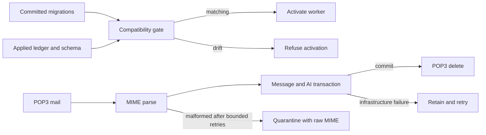
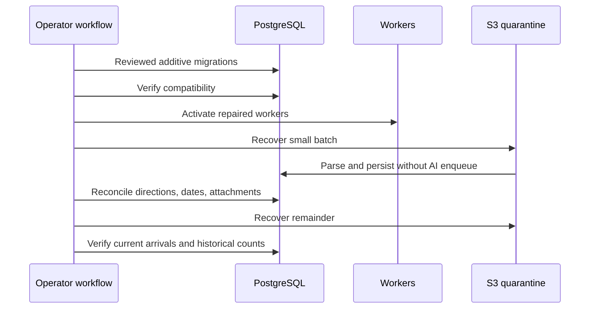

# fix: Restore ingestion and prevent schema drift - Plan

## Goal Capsule

Restore Centurion mail ingestion and all recoverable incident mail, prevent a skipped migration from becoming silent mail quarantine, and land the fix on main and the reservationist worktree.
User authorizes implementation, tests, production additive migrations, restarts, staged recovery, commits and normal main integration/push.
Execute autonomously with standard subagents; progress and evidence live outside this plan.
Stop only for unavailable access, destructive ambiguity or repository safety conflict.

---
## Product Contract

### Summary and problem frame

The September 24 production deploy introduced AI workflow columns without applying migrations 0024–0028.
AI enqueue runs inside message persistence; missing columns roll back valid mail and the shared three-retry poison path quarantines it and deletes POP3 mail.
As of October 2, 1,286 affected raw messages remain present in S3; 218 quarantine arrivals fall within September 26–28 Johannesburg.
Production AI worker is crashed and inbound storage remains stale.

### Requirements

- R1. Apply reviewed pending production migrations and restore live persistence and AI-worker operation.
- R2. Recover incident quarantine rows with original direction, dates, threading and attachment references, reconciling every attempted row.
- R3. Systemic database failures retain POP3 mail and never consume the malformed-message poison counter.
- R4. Deploy activation refuses unapplied or mismatched committed migrations and required schema drift before overwriting live build artifacts or replacing running processes.
- R5. Required prevention coverage uses real disposable PostgreSQL, the committed migrations and the real parse/persist/enqueue path; missing test DB fails the required gate.
- R6. Delete fake database/persistence tests that enshrine this failure or imply schema compatibility; preserve useful existing real integration coverage.
- R7. Land reviewed changes on main and merge them into the current reservationist worktree without disturbing unrelated changes.

### Acceptance examples

- AE1. A valid guest message against a database missing read_request fails through the real ORM, remains in POP3 after three cycles, has no poison quarantine row, and persists once schema is repaired.
- AE2. A deployment with pending migrations fails before process replacement; a fully migrated matching database passes.
- AE3. Recovery of inbound and staff-sent copies preserves business direction and source dates, restores attachment objects, and is idempotent.

### Scope boundaries

Remove misleading tests in the affected ingestion/recovery/deploy area.
Do not purge unrelated unit tests or ship unrelated reservationist feature commits onto main.
Recovered historical mail is not a fresh shadow prediction; AI catch-up must use a bounded historical path.
Backtest execution is deferred; refresh its corpus and usable-case count after restoration.

---
## Global Constraints

Never run a test runner against pilot/production RDS or source production environment into tests.
Never set VITEST_ALLOW_PILOT_RDS=1, force-push main, bypass hooks, expose credentials/private mail through SSM or Git, or overwrite unrelated dirty files.
All database-required tests run against a task-owned disposable PostgreSQL 16 database.
Production verification uses purpose-built read-only scripts and health probes.
Production migration is additive; review pending SQL before mutation and verify backup/PITR state.
S3/raw-mail recovery is staged and reconciled; unexpected routing, missing objects or corruption remain visible.

## Autonomous Execution Mandate

User granted full autonomy for this plan. Continue through verified restoration and landing without routine questions.
Use standard non-fast subagents; execute inline if unavailable.
FAIL → reproduce → establish mechanism → smallest correct fix → focused verification → resume.
Changes to accepted method are allowed when safer or simpler; record reason in handoff.

### AWS / infra

| Resource | ID / path |
|---|---|
| EC2 | `i-008f737974a9ba9b3` (`af-south-1`) |
| RDS | `nava-zero-mail-pilot` (Postgres 16) |
| S3 | `nava-zero-mail-845242190536-af-south-1` |
| Repo on EC2 | `/home/ubuntu/repos/zero` |
| Primary deploy | `apps/server-pilot/deploy/ops-deploy.sh` (`--migrate` when schema) |
| Primary app bounce | `apps/server-pilot/deploy/ops-restart.sh` |
| Primary box reboot | `apps/server-pilot/deploy/ops-reboot.sh` |
| Guts fallback | `sync-ec2-git-bundle.sh`, `deploy-ec2.sh`, `ssm-run-command.sh` |

Allowed: authorized ops wrappers, bundle sync, additive migrate, read-only SSM, PM2 logs, health checks, staged recovery and disposable-DB tests.
Forbidden: destructive Git/DB operations, real-mail sends, IT Exchange/VPN credentials, production test runners and credential bypass.
Before every Vitest invocation unset DATABASE_URL and VITEST_ALLOW_PILOT_RDS; pass only explicit task-owned TEST_DATABASE_URL and disposable confirmation.
No missing-DB skip may satisfy the required regression gate.
On tool-bridge failure retry boundedly and resume from actual Git/evidence state; never invent an application root cause.
True blockers: inaccessible credentials/services after safe alternatives, required human interaction, destructive ambiguity or safety conflict.

### Binary done criteria

All R1–R7 have fresh evidence; regression tests demonstrate failure before the fix and pass after; required PostgreSQL CI gate cannot skip; main and worktree include the fix; production schema matches deployed code; recovered totals reconcile and unresolved mail is reported individually without secrets.

---
## Planning Contract

### Key technical decisions

- KTD1. Repair production with existing reviewed migrations first; adding only read_request would leave other missing columns/tables.
- KTD2. Retain mail on known infrastructure SQLSTATE classes through nested ORM causes and known PostgreSQL driver connection errors; malformed MIME retains bounded poison handling. Avoid an outbox redesign during incident recovery.
- KTD3. A read-only deployment compatibility check compares committed journal hashes against the applied ledger and verifies required schema objects and unique conflict arbiters derived from ORM metadata. Reject unknown newer migration history rather than assuming backward compatibility. Invoke before any live activation mutation, including the ops wrapper's remote-environment bootstrap; reuse in restart/readiness where needed. Explicit migration runs before this gate, then remote-environment bootstrap and activation may proceed.
- KTD4. Use real PostgreSQL with real ORM and persistence. Fake POP3/S3 adapters are acceptable local substitutes for external transport; no database/enqueue substitution in incident regressions.
- KTD5. Build fix on a dedicated branch based on main, then integrate into both main and the existing reservationist branch. Main already contains the recovery utility; production predates it.
- KTD6. Recover with AI enqueue disabled, preserve source timestamps and verify attachment objects. Historical AI catch-up is separately bounded and never treated as future-shadow observation.

### High-level technical design

### Alternatives and risk

Automatically migrating on every restart hides a production mutation; refuse drift and keep explicit migration authority.
Decoupling AI into a new outbox would improve fault isolation but adds a new data lifecycle; the narrow classification and deployment gate address this incident without that redesign.
Migration runner behavior around enum values must be validated on PostgreSQL 16 before production; newly added enum values cannot be used until commit.
Main and current worktree diverge in unrelated features; use a fix branch based on main and a scoped merge.
S3 HEAD proves object presence, not parse success; reconciliation must enumerate failures.

### Sources

- Incident evidence: `.private/ingestion-debug-20261002/diagnosis.md` (local only).
- `apps/server-pilot/src/mail/ingest/store.ts`, `apps/server-pilot/src/mail/ingest/worker.ts`, `apps/server-pilot/src/mail/ingest/recover-parse-failure.ts`, `apps/server-pilot/src/ai/run-ledger.ts`.
- `apps/server-pilot/deploy/ops-deploy.sh`, `apps/server-pilot/deploy/deploy-ec2.sh`, `apps/server-pilot/deploy/launch-readiness.sh`; `apps/server-pilot/drizzle/0024_read_tool_runs.sql` through `apps/server-pilot/drizzle/0028_ai_shadow_first_repair.sql`.
- `docs/solutions/database-issues/vitest-production-pilot-db-wipe.md`, `docs/solutions/workflow-issues/ec2-pilot-autonomous-deploy-and-ssm-gotchas.md`, `docs/solutions/runtime-errors/pm2-esm-is-cli-entry-and-unref-sleep.md`.
- PostgreSQL error codes: https://www.postgresql.org/docs/16/errcodes-appendix.html
- PostgreSQL enum transaction rules: https://www.postgresql.org/docs/16/sql-altertype.html
- Existing recovery PR: https://github.com/kufupa/Zero/pull/10

---
## Implementation Units

### U1. Validate and repair deployed schema

**Goal:** Restore compatibility using the existing deployed migrations.
**Requirements:** R1.
**Dependencies:** None.
**Files:** `apps/server-pilot/drizzle/0024_read_tool_runs.sql` through `apps/server-pilot/drizzle/0028_ai_shadow_first_repair.sql`, local-only operational evidence.
**Approach:** Provision owned PostgreSQL 16, apply committed migrations including the production upgrade boundary, inspect pending SQL and production backup state, then use reviewed migration mechanism on deployed production checkout. Restart AI worker after schema verification.
**Test scenarios:** Real empty-database migrate succeeds; upgrade from 0023 to current succeeds with existing data; enum use works after migration commits.
**Verification:** Production ledger and required objects match; AI worker starts without undefined-column failure.

### U2. Retain mail on systemic database errors and prove recovery

**Goal:** Infrastructure failure cannot poison/delete valid mail.
**Requirements:** R2, R3, R5, R6; AE1, AE3.
**Dependencies:** U1 disposable database.
**Files:** `apps/server-pilot/src/mail/ingest/worker.ts`, `apps/server-pilot/src/mail/ingest/recover-parse-failure.ts`, `apps/server-pilot/tests/pop3-worker.test.ts`, `apps/server-pilot/tests/recover-parse-failure.test.ts`, new `apps/server-pilot/tests/ingest-schema-drift.test.ts` and required disposable helper as needed.
**Approach:** Trace nested PostgreSQL causes, report safe infrastructure diagnostics and retain POP3 mail without poison accounting. Replace fake persistence/error tests that assert wrong deletion. Real recovery tests cover original metadata, attachments and idempotence; fix recovery only where those tests reveal required gaps.
**Execution note:** Test-first through real PostgreSQL.
**Test scenarios:** Missing column/table and actual PostgreSQL driver connection failure retain mail for three cycles with zero quarantine; repair permits one successful insert and delete; unrelated valid mail behavior persists; malformed MIME remains bounded; mixed inbound/outbound recovery preserves source timestamps and references, restores attachments, reports safe per-row residual outcomes, and duplicate retry does not create rows or enqueue AI.
**Verification:** Tests fail for observed old behavior and pass after change; no skipped required cases.

### U3. Refuse incompatible activation and enforce real CI coverage

**Goal:** A deploy cannot silently activate against stale production schema.
**Requirements:** R4–R6; AE2.
**Dependencies:** U1; coordinated with U2 for CI files.
**Files:** new `apps/server-pilot/src/db/migration-compatibility.ts`, new `apps/server-pilot/scripts/check-migration-compatibility.ts`, `apps/server-pilot/deploy/deploy-ec2.sh`, `apps/server-pilot/deploy/ops-deploy.sh`, `apps/server-pilot/deploy/ops-restart.sh`, `apps/server-pilot/deploy/pm2-boot.sh`, `apps/server-pilot/deploy/launch-readiness.sh` if needed, new `apps/server-pilot/tests/migration-compatibility.test.ts`, `.github/workflows/ci.yml`, `apps/server-pilot/tests/helpers/test-db.ts` and `apps/server-pilot/package.json` as needed.
**Approach:** Reuse committed journal and hashes in a read-only check. Fail on missing/mismatched migrations and required objects; run after dependency installation but before server build, runtime config replacement and process mutation, preserving assets-only semantics. The ops wrapper must run explicit migrations before compatibility verification, then bootstrap remote environment only after verification succeeds; deploy-ec2 also guards direct invocation. Guard restart and boot before process deletion. Add required real-Postgres suites to existing PostgreSQL 16 CI job; selected gate fails on missing DB.
**Execution note:** Test-first against real committed migration states.
**Test scenarios:** 0023 ledger refuses current activation; mismatched hash refuses; current ledger plus missing required column refuses; fully migrated schema passes; missing DB causes failure; ops-deploy drift failure leaves absent remote env files absent and existing files unchanged; explicit migration succeeds before compatibility verification and remote-env bootstrap; direct deploy, restart and boot refuse before process replacement and shared runtime-file activation; quiesced asset-only path keeps its existing contract.
**Verification:** Behavioral gate tests and shell syntax pass; CI runs all incident tests with real DB and no skip.

### U4. Land, deploy and recover incident mail

**Goal:** Main/current worktree and production all have verified repair.
**Requirements:** R1, R2, R7.
**Dependencies:** U2, U3.
**Files:** affected implementation/test/CI files; `docs/runbooks/centurion-day-one-operations.md`; handoff under `docs/superpowers/plans/handoff-reports/`.
**Approach:** Review diff, commit scoped fix, merge into main, merge main fix into reservationist branch preserving dirty files. Integrate fetched latest main while preserving its changes. Deploy a scoped production repair based on the currently deployed lineage with the schema gate, avoiding an incidental Outlook v4 rollout; record both landed and deployed SHAs. Stage recovery, sample source-date/direction/attachment reconciliation, recover remainder, count residual reasons, bound historical AI catch-up if safe. Refresh local backtest corpus without running paid/live backtest.
**Test scenarios:** All required incident suites run; full affected mail/transport regression gate passes; production read-only checks show current persistence, online AI worker and reconciled quarantine recovery.
**Verification:** Main and current worktree contain same fix commits; production deployed SHA recorded; per-row outcome and aggregate totals reconcile; remaining unrelated quarantines remain visible.

---
## Verification Contract

Use task-owned PostgreSQL 16 with committed migrations and explicit disposable confirmation.
Run new incident suites with zero skips; verify old behavior fails before implementing each change.
Run relevant existing real mail/transport/recovery tests, server build, focused lint and shell syntax checks.
Review every changed line and obtain independent review; fix material findings before landing.
Production proof uses read-only DB queries, PM2 status/restart counts, successful ingestion progression, S3 object/attachment checks and exact recovery counts.
Never use test runners against production.

## Definition of Done

R1–R7 and AE1–AE3 verified with fresh evidence.
No valid incident mail silently dropped; every recovery outcome reconciled and irrecoverable/corrupt rows reported.
Required schema compatibility and real-DB CI gates active.
No misleading fake persistence tests remain in affected regressions; useful unrelated tests preserved.
Main, current reservationist worktree and production include repair.
Unrelated dirty work preserved; owned experimental resources cleaned up; abandoned code removed.
Handoff records changed behavior, evidence, production SHA, recovery totals and any material residuals.

## Execution Mode

Autonomous. Execute units in dependency order; no routine user checkpoints.
