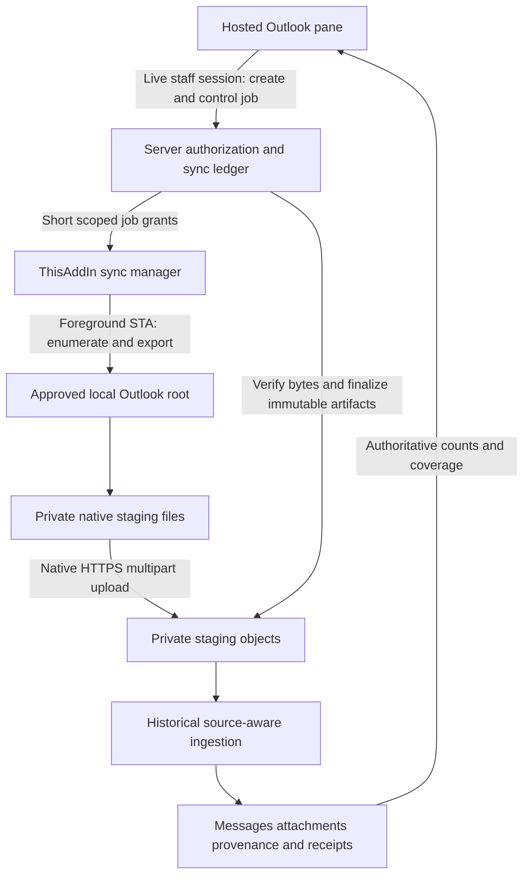
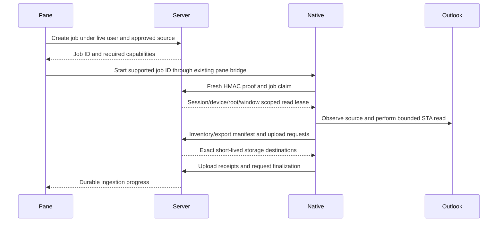
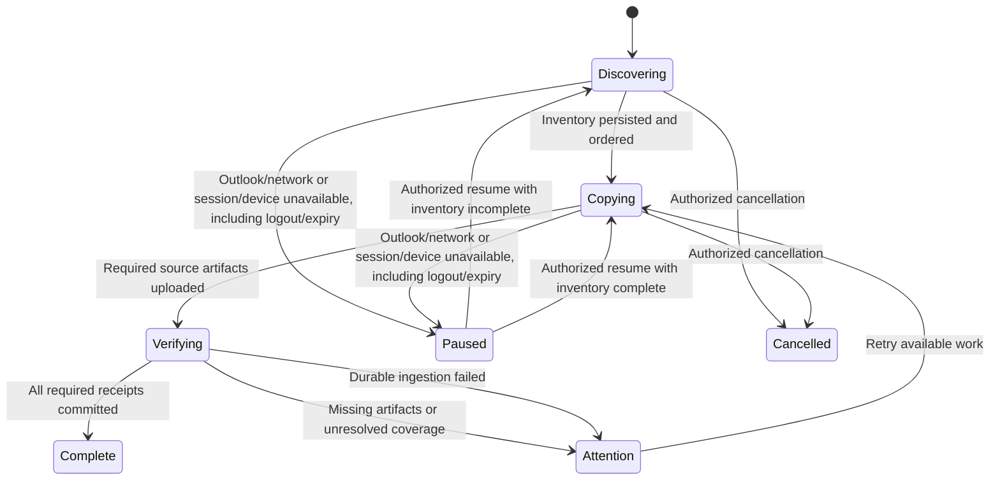

# Outlook Mailbox History Sync - Plan

## Goal Capsule

- **Objective:** One new Classic Outlook installer enables automatic mailbox-history copy and reusable native capabilities; subsequent sync controls and workflows deploy centrally.
- **Authority:** User-approved whole-hotel-mailbox copying and hosted-UI requirements, with the security commitments below. This plan extends, rather than replaces, `docs/superpowers/plans/2026-09-29-outlook-pilot-security-v4.md`.
- **Execution profile:** Characterize existing security/persistence behavior before changing it; implement new authorization, transfer and ingestion behavior test-first.
- **Boundary:** This artifact is planning only. Implementation does not itself authorize production deployment, customer messages, or staff-PC access.
- **Stop conditions:** Never weaken authorization to make sync work, execute tests against production RDS, delete source mail, fabricate fidelity, or claim Windows proof from Linux CI.
- **Tail ownership:** Implementer owns cross-repository verification and release preparation. Ansh coordinates the real Windows installation and staff onboarding when release is authorized.

---

## Product Contract

### Summary

Extend the installed add-in with secured mailbox enumeration, message export, file upload and resumable copy jobs.
Use those abilities for automatic month-history onboarding now and server-deployed sync buttons later.
Keep the hosted Outlook pane, drafts, attachments and approved triage moves.

### Problem Frame

The current security release authorizes individual folders for reads and writes.
Its folder snapshots stop at 5,000 messages and expire after ten minutes; attachment reads encode whole files into size-limited WebView2 JSON.
Those controls support interactive pilot actions, not a complete, resumable month-history copy.
Manual archive uploads burden staff and do not provide automatic canonical ingestion.
The EC2 server cannot directly inspect a workstation's local POP3/PST mailbox.

### Requirements

**Mailbox access and security**

- R1. Authorize reads across the intended hotel Outlook store/root and all current/future descendant folders, without approving each read folder separately.
- R2. Keep staff identity, live 24-hour session, enrolled Windows-user device credential and actual Outlook source identity mandatory before mail reads.
- R3. Preserve native Send/Delete removal, prohibited Deleted Items/Outbox move destinations, approved mutation folders, exact-pane navigation, CSP, sanitization and native move confirmations.
- R4. Limit extensibility to installed, typed native capabilities; remote pages, email content and AI prompts cannot invent COM operations, filesystem access or upload destinations.

**Automatic history copy**

- R5. After sign-in, pairing and source approval, start one idempotent onboarding copy for one calendar month before the fixed onboarding instant, exporting newest first across eligible folders.
- R6. Copy sent and received mail wherever filed, including Spam and Deleted Items where readable; exclude unsent Drafts/Outbox content from automatic history ingestion.
- R7. Preserve all available message bodies, original transport headers, identities, recipients, timestamps, conversation metadata and attachment bytes/metadata, including inline and embedded artifacts.
- R8. Preserve an Outlook-native Unicode MSG archive without representing it as original wire MIME; missing or protected data has an explicit availability status.
- R9. Import copied history into durable, searchable server records without replaying AI/HMS/send/move actions or rewriting current read/spam/category state.
- R10. Resume through interruption without duplicate logical messages or lost attachment work; retain independent coverage for distinct local Outlook sources.

**Staff and developer experience**

- R11. Show compact top-right progress with scanning, copying, paused, failed and complete states; staff continue using Outlook during sync.
- R12. Ship future account-specific sync/retry/window buttons and server-side processing using the installed capabilities without redistributing the EXE.
- R13. Require one installer upgrade for these new native capabilities; make no promise that genuinely new native/OS capabilities will never require updates.

### Actors and Flows

- A1. Staff member: signs in, pairs once, uses the pane, pauses/resumes copy.
- A2. Operator: Ansh or authorized developer tooling provisions named users, enrolls a Windows-user installation, approves the actual source, revokes access and prepares releases.
- A3. Installed native add-in: reads local Outlook and uploads source artifacts under short-lived server authority.
- A4. Server: owns grants, jobs, storage receipts, ingestion and progress.
- F1. Onboarding: operator approves source → staff installs and signs in → enters one-use pairing code → automatic history discovery/copy → progress/result.
- F2. Interruption: pane reload continues the job; Outlook exit/network loss pauses; reopening with valid authorization resumes existing work.
- F3. Future button: hosted UI creates a typed job using supported capabilities → server authorizes it → the same installed add-in executes it.
- F4. Revocation: server denies further read/export/upload grants; native stops new work and clears readable cached UI state; completed server records retain their existing retention policy.

### Acceptance Examples

- AE1. A folder created after enrollment is readable under the approved root, but cannot become a move destination merely because it is readable.
- AE2. More than 5,000 messages across Inbox, Sent and filing folders copy without silent truncation; ordering uses message event time, not folder traversal order.
- AE3. A 100 MiB attachment uploads without traversing WebView2 base64; its receipt is complete only after bytes/checksum and database persistence verify.
- AE4. Outlook restart resumes the same fixed time window; a second workstation with different local history gets its own coverage, not a false already-complete response.
- AE5. Staff logout or 24-hour expiry stops new native reads; closing the pane alone does not impersonate logout or extend the session.
- AE6. A server-deployed “Retry missing history” button works on the same installed binary; an unknown native operation remains denied.
- AE7. History containing old replies, blocked senders and duplicate POP3 copies preserves provenance without sending, creating AI runs or changing staff's existing read/spam/category state.

### Scope Boundaries

- Keep the UI inside Outlook, hosted at the existing HTTPS pane URL. No locally packaged UI, new Windows service, commercial publisher certificate or auto-updater.
- No access to every account in the Outlook profile by default. Approve the intended hotel store/root; a mixed personal/hotel PST needs explicit whole-store approval or a hotel-only subtree.
- Whole-root reads do not grant whole-root writes. Existing mutation source/destination approvals remain unchanged.
- Copy means upload to Nava storage, not Outlook Forward or SMTP Send.
- This release copies history; it does not guarantee perpetual live sync while Outlook is closed, recover permanently deleted mail or reconstruct unavailable attachments/headers.

#### Deferred to Follow-Up Work

- Continuous incremental local-mail sync and AI-selected copy jobs; the same typed primitives should support their later hosted orchestration.
- Multiple approved Outlook stores on one enrolled Windows-user device. Preserve the existing single-store enrollment model now; do not build a speculative profile registry.
- New nondefault-store reply composition. Retain the existing target-safe draft guard; verify actual pilot profiles before onboarding and flag incompatible profiles rather than relaxing it.
- Bulk-move UI redesign, broader web-mail changes, staff click/use tracking and an external agent-tool registry.

---

## Planning Contract

### Baseline and Changes from the Email to IT

Plan against current merged release sources, not the older 1.0.11 binary or an empty local submodule.
The initial inspection found `feat/reservationist-backtest` in the existing dashboard-tools worktree; preserve unrelated dirty files and start implementation from then-current merged main in isolation.
Native sources belong to `kufupa/nava-outlook-addin`, represented here by paths under `apps/server-pilot/vsto`.

| Topic | Current / email commitment | Planned change and reason |
|---|---|---|
| Read folders | Specific approved folders | Whole approved hotel root and future descendants; needed for sent/filed history. Broader confidentiality exposure, not broader writes. |
| Onboarding | Sign-in and enrollment | Automatically copy one month of available history into Nava storage; explain scope, destination and retention to IT/staff. |
| Background authorization | Interactive navigation-bound grants | Separate read-only job grants, still bound to a live staff session/device/root. Pane reload no longer destroys copy work. |
| EXE updates | Native changes may require an update | One new capability release now; future supported sync controls/windows/workflows remain server-only. |
| Send/Delete | Automated native commands removed | Unchanged. Server-side mail/DaVinci SMTP and POP3 cleanup remain separate and untouched. |
| Bulk confirmation | 10+ moves per request or over 25/minute | Unchanged. Read-only inventory/upload does not consume move counters or prompt per batch. |
| “Every email” | Available read/attachment functionality | Read all authorized folders; automatic history excludes unsent drafts/outbox and reports unavailable data rather than inventing completeness. |

Suggested IT clarification: “We are extending read-only access to the full approved hotel mailbox, including Sent and filed mail, so onboarding can copy the previous month into Nava automatically. Send/delete restrictions and move safeguards remain unchanged.”

### Future-Change Decision Guide

| Later request | What changes | Another installer? |
|---|---|---|
| Add a per-account Sync / Retry button, change onboarding screens or progress layout | Hosted UI and existing authorized job service | No. |
| Copy another supported date window or a subset of folders beneath the approved root | Typed server job parameters; UTC bounds and folder selection checked server-side and natively | No. |
| Add server-side analysis/HMS processing of already copied data | Separately authorized server workflow; do not replay it during history ingestion | No native change unless it needs a new local Outlook action. |
| Read a newly created folder beneath the approved root | Existing ancestry-based read policy | No additional per-folder approval or installer. |
| Broaden the approved root or approve a triage destination supported by installed code | Private operator policy change; refreshed grants | No, but explicit authorization is still required. |
| Add another local Outlook store, new native/OS action or new artifact format unsupported by this build | New native contract and Windows behavior | Yes; explicitly outside the server-only promise. |

Job parameters contain only supported copy intent: approved source identity, fixed UTC date bounds, optional descendant-folder selection and installed schema/capability version. Native derives files/manifests from Outlook itself. Server policy tunes work budgets within native hard safety bounds; it cannot inject scripts, filesystem paths, COM method names or arbitrary upload URLs.

### Key Technical Decisions

- KTD1. **Separate root-level reads from folder-level writes.** Add a versioned, server-issued read-root policy to the existing device/store grant. Native resolves ancestry and actual StoreID before every item operation. No JavaScript wildcard or inferred ownership from sender names.
- KTD2. **Install finite capabilities, not a remote-code engine.** Extend the existing protocol with capability/version negotiation for bounded inventory, artifact export and read-only copy-job control. UI buttons submit typed jobs; server validates parameters independently. Unknown capabilities fail closed; old clients keep existing interactive behavior but cannot start unsupported sync.
- KTD3. **Server ledger; add-in-level execution.** A dedicated sync ledger owns immutable source/window, per-item receipts and fenced claims. `ThisAddIn` owns the native manager; the pane only starts/displays jobs. The existing server process owns a small bounded ingestion drain, started at process startup and stopped on shutdown; no additional service is required. Finalization atomically records verified artifacts as pending ingestion before acknowledgment. The drain claims/retries that work with fencing after restart, independently of Outlook. Already-authorized received data may finish server persistence after staff logout; new native reads, uploads and finalizations still require live authority. Reuse existing database claim fencing, not AI job types or an in-memory ingest lock.
- KTD4. **Job authority is not device authority.** A live authenticated pane creates the job. Native renewal signs a fresh nonce using the existing DPAPI-held HMAC secret and checks the job's live staff session, active mailbox grant, device, root and policy generation. Read leases are at most 60 seconds; operation batches recheck expiry. Renewals never require a pane-navigation lease, but never work from HMAC alone. Explicit logout cancels native work; server revocation/expiry also denies renewal. A later session for the same authorized user may rebind a paused job through an authenticated resume action; another user cannot adopt it.
- KTD5. **Time-slice Outlook work on its foreground STA.** COM inspection/export remains on Outlook's main thread; short yielding batches release COM references. Network transfer and hashing run off-thread on files/plain data only. Initial targets: one native extraction at a time, two uploads, metadata batches up to 200 rows or 50 ms before yielding. A single large COM SaveAs may exceed that budget; prove responsiveness on Windows before release.
- KTD6. **Inventory first, then global newest-first copy.** Freeze end time at first authorized onboarding and subtract one calendar month in hotel timezone, clamping month-end; store UTC instants and timezone. Discover each real mail folder with bounded date-filtered pages and durable checkpoints. Scan the union of received/sent-date candidates, then classify direction from approved mailbox identities and source evidence. Use ReceivedTime for inbound and SentOn for outbound; preserve raw timestamp provenance. Also run a bounded metadata-only pass over each folder for rows with unusable/sentinel dates, deduplicated against date candidates. Record unresolved eligibility without exporting all out-of-window content; unresolved coverage prevents an unconditional complete result. Provider cursors are session-local: restart or folder mutation replays the affected partition through idempotent observations rather than assuming a persisted row offset still identifies the same mail. Sort eligible inventory by event time descending with a stable source/observation tie-breaker; transfer completion can differ because uploads run concurrently.
- KTD7. **Original artifacts plus structured projection.** Native exports Unicode MSG and structured available metadata/body/attachment artifacts. Read headers and Internet Message-ID independently. Include resolved SMTP sender/sent-representing identities, To/Cc/available Bcc/Reply-To, ReceivedTime/SentOn/original Date, In-Reply-To/References, conversation fields, categories/read flags as evidence, attachment MIME/CID/inline/type/size and extraction status. A missing optional property differs from a missing required artifact. Export is not a decrypted-content guarantee.
- KTD8. **Binary transfer bypasses the web page.** Native stages unpredictable private files, hashes them and streams to exact server-issued S3 object/part destinations; no page-supplied paths/URLs. Native validates configured HTTPS storage origin/bucket/region, method, object and job binding, and rejects redirects. Presigns last at most 60 seconds for request start and renew on demand. Existing in-flight transfers or issued URLs are not instantly revoked; stop new grants, abort work best-effort and deny unauthorized finalization. Bind each upload to declared length and SHA-256. Verify the staging object, then seal it using a conditional copy bound to its observed source ETag; a changed source fails and is reverified. ETag is an object-version precondition, not a content checksum. Verify the sealed object's length/SHA-256 through bounded streaming before acknowledging its receipt. Never presign the final committed object for overwrite; repeated finalization uses its recorded immutable receipt rather than replacing it.
- KTD9. **History is a source-aware ingestion mode.** Do not call POP3 persistence wholesale or fabricate UIDLs/raw MIME. Reuse safe threading/sanitization services through a historical persistence seam. Explicitly suppress AI/shadow queues and live-mail read/spam/label side effects. Add `mail_thread.history_only` (non-null false default); only newly created history-only threads set it true. Exclude these threads from inbox/active-work lists and all unread-work counts; retain authorized search/all/Sent access. Existing threads and their flags stay unchanged. The first genuinely new, nonduplicate live message joining a history-only thread clears the flag transactionally through the live persistence path; historical replay and a linked duplicate do not. Serialize concurrent live/history writes on the thread so history cannot hide live work. Source read/category/spam flags remain provenance, not operational state. Any later historical analysis is separately requested.
- KTD10. **Conservative dedup; independent source coverage.** Keep source identity (device/store/root/EntryID plus observed version) separate from canonical message identity. Repeated receipt/finalization is idempotent. Cross-source/POP3 linking requires a unique strong match using genuine Message-ID with corroborating timestamp/participants/content evidence. Missing/reused IDs and identical templates never merge from body hash alone; ambiguous observations remain separate and visible for reconciliation. Different local PSTs get separate jobs even for the same transport.
- KTD11. **Preserve large originals without removing parser safety.** Keep POP3 25 MiB message/15 MiB attachment defaults unchanged. Sync artifact manifests use bigint byte counts and multipart transfer; body parsing is bounded and original bytes remain available when parsing is unsupported. Widen the existing attachment `size_bytes` column to PostgreSQL bigint with Drizzle number-mode mapping and explicit nonnegative safe-integer validation at DTO/storage boundaries. Supported storage sizes must remain within JavaScript's exact integer range; do not add a second competing size field or write overflow into the legacy column. Activate the migration with matching code under the existing compatibility guard. An extraction limit produces a coverage status, not missing attachment bytes or a false complete result.
- KTD12. **No additional surveillance or platform framework.** Store only source identities, security/job receipts, coverage and error codes needed to authorize/resume/prove copy. No staff time/click tracking, plugin registry, new queue infrastructure or native auto-updater. UI/operator calls share the same scoped job service; no new AI tool execution authority.

### High-Level Technical Design

#### Component and Data Flow

#### Authorization Sequence

#### Job State and Lifetime

#### Capability Boundaries

| Authority | Permitted operations | Not permitted |
|---|---|---|
| Authenticated pane | Create/control supported jobs; read authorized progress | HMAC secret, arbitrary native code, arbitrary root approval |
| Native read-root lease | Read current/future descendant mail; export exact authorized items | Writes, account-wide profile access, arbitrary filesystem upload |
| Native mutation grant | Existing exact approved draft/triage operations | Native Send/Delete, unapproved destination, Deleted Items/Outbox moves |
| Upload grant | Exact immutable job/artifact/part staging destination | Arbitrary URL, replacing committed artifacts, public object exposure |
| Operator | Enrollment, root policy and revocation through existing private tooling | Automatic scope changes based on email/AI instruction |

### Resource and Failure Policy

- Treat page/time/depth budgets as resumable work budgets, never a total-message cap disguised as success. Detect cycles/search folders; skip duplicate virtual views, not underlying real mail.
- Inventory is not an atomic mailbox snapshot. Persist observed location/version; recheck before export. Rediscover moved items within scope conservatively; items moved outside scope or deleted become unavailable, not permission bypasses.
- Local spool target: at most 1 GiB of queued artifacts and 1 GiB disk headroom, with one oversized artifact allowed only when its observed size plus headroom fits. Thresholds live in server policy within safe native bounds; disk shortage pauses without data loss.
- Reuse 100 MiB single-PUT / 16 MiB multipart patterns. No arbitrary 5,000-message or 15 MiB copy ceiling. Platform/storage maximums remain explicit coverage failures; never promise unlimited files.
- On server/database failure, retain staged uploaded originals and retry persistence. Native upload acknowledgment permits spool cleanup only after a verified immutable artifact receipt and durable pending-ingestion record; it is not yet the UI's copied count. The server drain commits canonical/provenance records before incrementing copied count; duplicates count separately after a verified link. Pending ingestion survives server restart and does not expire as abandoned staging.
- Clean local files after acknowledged commit; on logout/revocation remove readable staged content, retaining only protected resume metadata. Unacknowledged staged content expires after 24 hours and can be re-exported. Abort abandoned multipart uploads and expire uncommitted server staging after seven days; retained customer originals follow the existing mailbox retention policy, not a new guessed lifetime.
- Do not log mail bodies, addresses, secret values or presigned URLs. Progress uses counts/bytes and bounded error codes; detailed source metadata is authorized application data.

### Alternatives Considered

| Approach | Decision |
|---|---|
| Hosted button loops current bridge commands | Reject for full sync: bounded snapshots, incomplete metadata, base64 size limits and pane lifetime prevent reliable full copy. |
| Finite native read/export/upload capabilities with server jobs | Choose: satisfies current copy and later server UI iteration while retaining security boundaries. |
| Downloadable scripts/plugins or arbitrary COM proxy | Reject: expands remote page compromise into general workstation execution; contradicts the IT security intent. |
| Server-only mail-provider/Graph import | Not the present local POP3/PST source. Revisit if hotel mail infrastructure changes; not a substitute for local Sent/filed history. |

---

## Implementation Units

### U1. Read-root policy and reusable capability contract

- **Goal:** Broaden approved reads without broadening writes. **Requirements:** R1–R4, R12–R13; AE1, AE6. **Dependencies:** None.
- **Files:** `apps/server-pilot/src/db/schema/outlook-device.ts`, `apps/server-pilot/src/outlook-security/device.ts`, `apps/server-pilot/src/outlook-security/authorization.ts`, `apps/server-pilot/scripts/outlook-device-operator.ts`, `apps/server-pilot/drizzle/` new migration, `apps/mail/lib/workstation/bridge-protocol.ts`, native `OutlookBridgeAuthorization.cs`, `OutlookMailOperationPolicy.cs`, `OutlookBridgeDispatcher.cs`, `OutlookMailOperations.cs` under `apps/server-pilot/vsto/NavaOutlookAddin/`.
- **Tests:** `apps/server-pilot/tests/outlook-sync-authorization.test.ts`, existing `outlook-bridge-authorization.test.ts` and `outlook-device-enrollment.test.ts`; native `apps/server-pilot/vsto/tests/NativeMailboxReadPolicyTests.cs`; frontend `apps/mail/tests/workstation-bridge-protocol.test.tsx`.
- **Approach:** Add versioned read-root policy to existing single-store grants; update all read paths, including selected-mail events, folder listing, attachments and conversation lookup. Keep mutation source/destination checks separate. Extend operator inventory/approval output to show the actual store/root; old clients deny unsupported policy rather than interpret it as an unrestricted wildcard.
- **Patterns:** Existing one-use tickets, COM-observed scopes and private operator CLI.
- **Execution note:** First prove a whole-root read grant cannot authorize any newly allowed write.
- **Test scenarios:** New descendant readable; personal second store denied; mixed-store root/subtree boundary; source ancestry changed; old/unknown capability denied; unapproved destination and prohibited descendants denied; pre-login metadata still silent; scope revocation stops renewal.
- **Verification:** All retained interactive reads work throughout approved root; existing native Send/Delete, origin and move-consent regressions remain green.

### U2. Durable copy-job ledger and staff-bound native leases

- **Goal:** Share resumable jobs across native execution and hosted UI. **Requirements:** R2, R4–R5, R10, R12; F1–F4, AE4–AE6. **Dependencies:** U1.
- **Files:** New `apps/server-pilot/src/db/schema/outlook-sync.ts`, `apps/server-pilot/src/outlook-sync/{ledger,authorization,service}.ts`, `apps/server-pilot/src/trpc/routes/outlook-sync.ts`, `apps/server-pilot/src/http/outlook-sync-native.ts`; update DB/router/HTTP registration and additive migration.
- **Tests:** New `apps/server-pilot/tests/outlook-sync-ledger.test.ts`, `outlook-sync-authorization.test.ts`, `outlook-sync-router.test.ts`.
- **Approach:** Immutable window/source/policy, source-specific idempotent onboarding identity, live-session binding, fresh HMAC nonce, fenced claim/heartbeat and per-artifact receipts. Permit one active job per local source; independent sources on different PCs must not suppress each other's history. Same-user authenticated resume rebinds session without extending the expired session. Protect create/control/status and native routes against cross-user/mailbox/device/job access.
- **Patterns:** `apps/server-pilot/src/ai/run-ledger.ts` fencing; existing Outlook HMAC/live-session verification. Separate ledger from AI workflows.
- **Test scenarios:** Double onboarding creates one source job; different local PST creates another; stale claim cannot commit; session expiry/logout/device or mailbox revocation denies reads; pane reload does not change source/window; other user cannot adopt; same user re-login resumes; corrupted job parameters denied.
- **Verification:** Disposable PostgreSQL proves real transactions, claim races and no skipped security tests.

### U3. Native inventory and resumable foreground-STA manager

- **Goal:** Enumerate complete eligible history without blocking normal Outlook use. **Requirements:** R5–R6, R10–R11; F1–F2, AE2, AE4–AE5. **Dependencies:** U1–U2.
- **Files:** Native `ThisAddIn.cs`, `TaskPaneControl.cs`, `NavaOutlookAddin.csproj`; new `OutlookMailboxSyncManager.cs`, `OutlookMailboxScanner.cs`, `OutlookSyncCheckpointStore.cs` under `apps/server-pilot/vsto/NavaOutlookAddin/`.
- **Tests:** New native `tests/NativeMailboxSyncTests.cs`, `tests/NativeMailboxScannerTests.cs`; extend `tests/native-v4.test.mjs` for wiring only.
- **Approach:** Manager survives pane unmount; all COM work remains STA and yields. Server owns durable inventory/order; native holds protected minimal checkpoints, not restart-trusted row offsets. Date filters use UTC-correct Outlook semantics; persist scan pages before advancing. Add a metadata-only sentinel-date pass. Restart invalidates provider cursors and replays incomplete/changed partitions idempotently. Reconcile live folder/item changes, virtual folders and unavailable source. Logout differs from pane closure; no background Windows service.
- **Patterns:** Existing folder traversal/store validation and COM release discipline; replace memory snapshots only for new sync capability, not unrelated interactive APIs.
- **Test scenarios:** 10,001 messages, nine folders and same-date ties; month-end/DST; Sent moved to filing folder; no mail; null folder/cycle/deep budget; moves/deletion during inventory; Outlook busy/exit/restart; invalid or expired lease; all COM calls on STA and yields between batches.
- **Verification:** Behavioral fake-provider C# coverage plus supervised Windows responsiveness; no “complete” from truncated discovery.

### U4. Full-fidelity export and native binary transfer

- **Goal:** Preserve available message/attachment data without WebView2 buffering. **Requirements:** R7–R8, R10–R11; AE3. **Dependencies:** U1–U3.
- **Files:** Native new `OutlookMessageExporter.cs`, `OutlookArtifactUploader.cs`; update `OutlookBridgeDispatcher.cs` optional property extraction; server new `apps/server-pilot/src/outlook-sync/storage.ts`, native HTTP upload/finalize routes and artifact schema.
- **Tests:** Native `tests/NativeMessageExportTests.cs`, `tests/NativeArtifactUploadTests.cs`; server `tests/outlook-sync-storage.test.ts`, `outlook-sync-router.test.ts`.
- **Approach:** Unicode MSG archive plus versioned structured manifest/bodies/attachment artifacts; independent optional property reads. Native stages only Outlook-derived approved artifacts, hashes/streams off-thread, validates exact trusted destination, retries multipart parts and renews URL grants. Server checks declared length/SHA-256/object ownership, conditionally copies the verified source ETag into a never-presigned sealed key, rechecks sealed bytes and transactionally queues ingestion with the immutable receipt. Bounded spool and clean-up never remove source Outlook mail.
- **Test scenarios:** Header missing but Message-ID available; SMTP display/Exchange identities; inline/embedded/zero-byte/large attachment; protected/uncached/reference attachment; unavailable body; 100 MiB upload; expired presign, part retry, checksum mismatch, overwrite between verification and sealing, repeated finalization, foreign object, redirect/arbitrary URL/path, disk full, crash before/after acknowledgment, revocation during in-flight upload.
- **Verification:** Every declared accessible artifact has a verified receipt; unavailable data remains explicit. Private storage access and native memory usage verified with large-file fixtures.

### U5. Historical ingestion, provenance and conservative dedup

- **Goal:** Make copied history useful without repeating the prior ingestion incident or live actions. **Requirements:** R7–R10; AE7. **Dependencies:** U2, U4.
- **Files:** New `apps/server-pilot/src/mail/ingest/outlook-history.ts`, `apps/server-pilot/src/outlook-sync/{ingest,drain}.ts`; update `src/mail/ingest/store.ts` only for shared safe seams and the live-history transition, `src/db/schema/mail.ts`, `src/mail/folder-semantics.ts`, `src/mail/folder-unread-counts.ts`, `src/main.ts` startup/shutdown, provenance schema/migration and relevant attachment/query projections.
- **Tests:** New `apps/server-pilot/tests/outlook-sync-ingest.test.ts`, `outlook-sync-dedup.test.ts`; extend `ingest-schema-drift.test.ts`, `migration-compatibility.test.ts`, `mail-baseline-ingest.test.ts`, attachment HTTP tests as needed.
- **Approach:** Store native provenance separately from POP3 UIDL/raw MIME. Preserve independent source timestamps and direction evidence; unresolved observations retain originals and do not force an inaccurate inbound/outbound canonical row. Persist attachments with safe bigint projection, sanitize display projections, link only unique corroborated duplicates and preserve richer existing data. Implement `history_only`, active/unread filters and the transactional nonduplicate live-arrival transition in KTD9. Start/stop the bounded fenced ingestion drain with the existing server process; retries do not require Outlook/pane presence once artifacts are accepted. Only successful transaction/verified receipts count as copied.
- **Patterns:** Existing Message-ID normalization/reference threading, raw-source preservation, real PostgreSQL ingestion harness and migration compatibility checks.
- **Execution note:** Characterize live POP3 persistence before extracting shared code; explicitly assert zero historical automation/state rewrites.
- **Test scenarios:** Reused/missing Message-ID and identical template bodies; moved EntryID; duplicate device/POP3 source; late richer attachment copy; unknown direction/date; 32-bit size overflow; malicious HTML/CID; DB outage/pending migration after uploaded bytes; restart/fenced retries while Outlook is closed; new history stays out of active/unread lists; new live arrival clears history-only while duplicate replay does not; concurrent history/live writes; zero AI/shadow/SMTP/HMS/native actions and unchanged existing read/spam/category/workflow state.
- **Verification:** Real disposable PostgreSQL proves dedup, rollback and recovery; existing POP3 ingestion/retention regression suite remains unchanged and passing.

### U6. Automatic onboarding and truthful hosted progress

- **Goal:** Remove manual staff upload steps while preserving normal pane use. **Requirements:** R5, R10–R12; F1–F3, AE4–AE6. **Dependencies:** U2–U5.
- **Files:** `apps/mail/app/(routes)/outlook-pane/page.tsx`, `apps/mail/lib/workstation/use-outlook-bridge.ts`; new `apps/mail/lib/workstation/use-outlook-sync.ts`, `apps/mail/components/workstation/outlook-sync-progress.tsx`.
- **Tests:** New `apps/mail/tests/outlook-sync-progress.test.tsx`, `outlook-sync-client.test.ts`; extend `outlook-pane-onboarding.test.tsx`, `outlook-pane-render.test.tsx`, `workstation-bridge-protocol.test.tsx`.
- **Approach:** Auto-start only after valid user/device/root/capabilities. Existing pairing UI stays; a short notice names mailbox, month window and Nava copy destination. Display “Finding emails” without fabricated percent until inventory is known; then verified copied/duplicate/message/attachment/byte counts. A compact status chip opens a keyboard-accessible details panel without interrupting drafting. Paused reasons map to actions: session expiry → Sign in; network loss → automatic recovery plus Resume; revoked source/device → Contact operator. Attention separates copied, linked duplicates and unavailable counts; offer Retry available items only for recoverable work. Permanent missing/protected content remains an explicit coverage gap, never a retry loop or all-copied success. Pause/resume/retry uses server job state. Keep drafts/HMS/screenshot views usable at 350–450 px. Logout pauses jobs; pane unmount clears interactive navigation but not read-only job identity.
- **Test scenarios:** No preauth start; old EXE upgrade notice; duplicate render/login refresh; empty history; scanning/copying/incomplete/paused/complete; reason-specific Sign in/Resume/Contact operator; retryable versus permanent missing artifacts; session expired→login→resume; mailbox/account switch isolates status; unavailable attachment not100% copied; keyboard/screen-reader progress; draft+PDF and screenshot popout regressions.
- **Verification:** One account-specific hosted retry-button addition works without a native change; UI has no device secret, bulk mail payload or upload destination control.

### U7. End-to-end compatibility, operational controls and release

- **Goal:** Prepare one trustworthy native+server+UI release without database loss. **Requirements:** R1–R13; F1–F4, AE1–AE7. **Dependencies:** U1–U6.
- **Files:** Native `apps/server-pilot/vsto/.github/workflows/outlook-vsto.yml`, `installer/setup.iss`, assembly metadata and tests; root existing private-native CI/gitlink workflow; `apps/server-pilot/deploy/outlook-v4-security-release-runbook.md`, `apps/server-pilot/src/outlook-security/README.md`, new `docs/production-readiness/outlook-history-sync-onboarding.md`, environment/deploy compatibility checks.
- **Tests:** `apps/server-pilot/tests/outlook-sync-e2e.test.ts`, migration/deploy/installer contract tests; Windows native behavior suites; relevant frontend pane suites.
- **Approach:** Preserve the stable wrapping key, repaired ingestion lineage and latest main changes. Append reviewed migrations; current compatibility gate rejects both pending and newer journals, so quiesce affected processes for migration+matching-code activation and roll forward rather than restart incompatible old code. Keep sync disabled until server/storage/native capabilities pass. Version the next installer from the actual latest release, pin exact native commit, verify CI artifact/hash/installer served over hotel HTTPS. Existing desktop credential survives upgrade where scope is unchanged; new scope requires operator approval, not secret regeneration.
- **Test scenarios:** Old native/new server retains interactive policy but refuses sync; new native/server mismatches fail closed; disable sync stops new grants without breaking drafts; no enrollment reset; migration failure retains source objects; incompatible rollback refused; server/pane restart resumes; direct S3 reachable from real hotel PC or rollout blocked with actionable transport error; no source modification during copy.
- **Verification:** Disposable tests first, then authorized read-only production schema/health evidence and a supervised Windows acceptance copy. Record installer/server/UI/native commit versions separately; prepared release is not proof staff installed it.

---

## Verification Contract

Planning ran no tests, builds or production probes. These are required execution gates.

| Gate | Required proof |
|---|---|
| Server behavior | Targeted Vitest sync/auth/storage/persistence suites in `apps/server-pilot`; DB-dependent suites require disposable PostgreSQL and zero skips. |
| Ingestion safety | Existing `test:ingestion` suite and duplicate/attachment/threading regressions pass against a disposable database; production RDS test guard remains enabled. |
| Native behavior | Portable source contracts plus compiled C# scanner/export/authorization/job tests in Windows CI; source regex alone is insufficient. |
| Frontend | Targeted pane/onboarding/bridge/progress Vitest suites and production build; CSP buttons/drafts/PDF/screenshot popouts remain functional. |
| Cross-layer | Real HMAC/session/root grants, interrupted file transfer, verified storage and committed ingestion; forged job/root/object and stale worker rejected. |
| Windows acceptance | Classic Outlook actual pilot profile: one-month sent/received coverage, large attachments, responsiveness, restart/resume, signout, manual Send, approved moves and blocked native Send/Delete. Nondefault-store drafting limitation checked before staff onboarding. |
| Release | Exact private native gitlink, Windows build artifact hash, matching server/UI capability versions, reviewed migrations and served installer hash. No production test runner or seed/wipe. |

Performance acceptance: between native metadata batches, pane and Outlook selection remain interactive; a representative large-attachment export must be measured on Windows and documented before rollout. No guessed “instant” or fixed completion-time promise.

---

## Definition of Done

- Whole approved-root reads work, including future folders and Sent/filed mail, without broadening any mutation grant.
- One-month automatic copy persists available bodies/metadata/headers/attachments with truthful source coverage and no SMTP/native mail mutations.
- Large transfers bypass WebView2 JSON; interrupted uploads/imports resume with verified receipts and conservative dedup.
- Pane reload, Outlook restart, logout, expiry and revocation match the specified lifecycle; old clients fail safely.
- Historical ingestion preserves POP3 source evidence and existing work state; no historical AI/HMS/send replay.
- A new hosted sync/retry button works on the same native build; no arbitrary remote native execution is possible.
- U1–U7 verification passes with recorded Windows evidence or an explicitly unfulfilled rollout gate; do not declare client-ready without that evidence.
- Documentation explains one-time installation, pairing, root approval, retained limitations, copy destination and IT/email deviations.
- No unrelated edits, abandoned prototype code, secrets in Git or unnecessary staff surveillance remain.

---

## Planning Review Outcome

- Repository, institutional-learnings, native-boundary and Microsoft/AWS documentation research informed the plan. No tests, builds or production probes ran during planning.
- Coherence, feasibility, product, design, security, scope and adversarial review completed. Six actionable gaps were resolved: pause transitions, imported-history state, restart-safe ingestion ownership, missing-date discovery, verified upload sealing and actionable recovery UI. Rechecks confirmed the substantive fixes.
- No actionable document-review findings remain. The architecture is sufficiently grounded for implementation; runtime acceptance is not established by this plan.
- Remaining release evidence is explicit: disposable PostgreSQL behavior/races, real Windows COM/export responsiveness, pilot-profile drafting compatibility, hotel storage connectivity and exact release hashes. Customer retention must be known before activation.

---

## Risks, Deployment and Evidence

- **XSS still matters:** whole-root reads increase accessible confidential data. Keep safe rendering/CSP/exact-origin and scoped authority; a device key does not make malicious in-origin JavaScript harmless.
- **Stolen device secret:** live user-session/root checks prevent HMAC alone becoming copy authority. Revocation denies new leases; already-issued authority has bounded residual validity.
- **Malicious native artifact/upload inputs:** exact job/root/object binding, private staging, quotas and checksum sealing prevent arbitrary file exfiltration, storage abuse and object overwrite.
- **Mailbox fidelity:** Outlook can omit headers, retain only cached headers or restrict encrypted content. Preserve accessible originals and explicit gaps. Do not promise a transactional snapshot of the mailbox at onboarding.
- **Hotel-only data boundary:** a shared PST may mix accounts. Operator approves actual store/root; no inferred sender-based authorization.
- **Customer retention:** month-back is the selection window, not a 24-hour data deletion policy. Existing customer retention remains; if none is documented, Ansh resolves retention before client activation, without blocking coding.
- **Current pilot profile:** nondefault-store reply drafts remain guarded. If a required staff profile is incompatible, resolve that as a separate proven native change before onboarding; do not silently remove draft functionality.
- **Deployment:** preparation can be autonomous; real staff-PC installation/verification requires a Windows environment and coordinated access. No paid signing, new domain or additional workstation service is required.

### Sources and Research

- Current source: `apps/server-pilot/src/outlook-security/{authorization,device}.ts`, `src/db/schema/outlook-device.ts`, native `OutlookBridgeAuthorization.cs` and `OutlookMailOperationPolicy.cs`: live sessions, one-store enrollment and coupled folder approvals.
- Native `OutlookFolderEmailSnapshotStore.cs`, `OutlookMailOperations.cs`, `OutlookBridgeDispatcher.cs`, `TaskPaneControl.cs`, `ThisAddIn.cs`: memory snapshot/JSON limits, incomplete metadata and current lifecycle.
- `apps/server-pilot/src/mail/ingest/store.ts`, `src/db/schema/mail.ts`, `src/storage/{s3,catchup-upload}.ts`: POP3 identity, historical side effects, integer sizes and buffering patterns.
- `docs/solutions/database-issues/production-schema-drift-stopped-centurion-mail-ingestion.md`: durable retention and reviewed schema activation.
- `docs/solutions/integration-issues/centurion-outlook-sent-forward-bcc-ingest-threading.md`: upload originals rather than forward mail.
- `docs/superpowers/specs/2026-09-11-centurion-augsep-sent-catchup-design.md`: body-hash dedup is unsafe; some old enqueue claims are superseded by current code.
- `docs/production-readiness/2026-10-02-outlook-security-deployment.md`: released enrollment/secret/deployment baseline; do not equate published installer with enrolled fleet.
- [Microsoft Outlook technology/threading constraints](https://learn.microsoft.com/en-us/office/client-developer/outlook/selecting-an-api-or-technology-for-developing-solutions-for-outlook): Outlook foreground-STA rule governs native manager design, overriding broader generic Office background-thread guidance.
- [Microsoft date-time filtering](https://learn.microsoft.com/en-us/office/vba/outlook/how-to/search-and-filter/filtering-items-using-a-date-time-comparison): UTC/local filter semantics require explicit conversion.
- [Microsoft MailItem.SaveAs](https://learn.microsoft.com/en-us/office/vba/api/outlook.mailitem.saveas): Unicode MSG is supported; original MIME is not a listed save format.
- [Microsoft secure WebView2 guidance](https://learn.microsoft.com/en-us/microsoft-edge/webview2/concepts/security): specific messages, validate origin, avoid generic proxies.
- [AWS presigned URL security](https://docs.aws.amazon.com/AmazonS3/latest/userguide/using-presigned-url.html): URLs are reusable bearer capabilities; expiry and checksum verification do not imply instant device revocation.
- [Microsoft new Outlook compatibility](https://learn.microsoft.com/en-us/office/dev/add-ins/outlook/one-outlook): VSTO/COM works in Classic Outlook, not new Outlook; this plan does not migrate clients.
