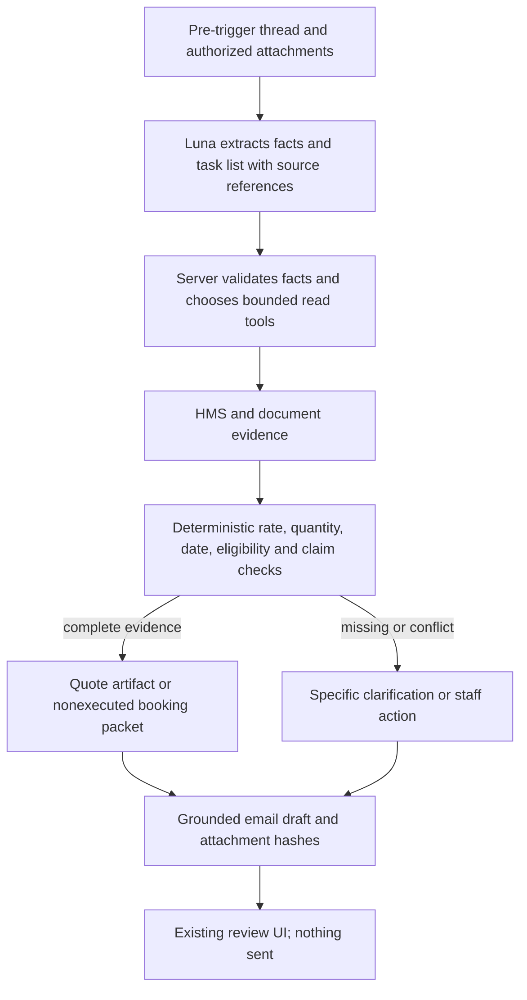

# Reservationist readiness audit and proposed build order

This is a researched audit and design recommendation for discussion, not an implementation-ready autonomous launch contract.
No product fix, deployment, reservation save, payment mutation, or email send was performed during this audit.
Existing unrelated worktree changes were preserved.
Source baseline: branch `feat/reservationist-backtest`, commit `0b57af1478a639ad26c2959396fbee3f2a05589f` plus the pre-existing dirty worktree.

## Outcome and recommendation

Build a draft-first AI reservationist on the existing Luna/Mastra and candidate-draft infrastructure.
Reuse existing read-only HMS tools; add a server-owned quote revision, deterministic pricing checks, attachment evidence, and realistic nonexecuting booking validation.
Do not replace the model or introduce separate agents per customer class before fixing these boundaries.

The four-tool reservationist is currently a standalone backtest prototype, not the live draft product.
Its pricing arithmetic is useful, but the route does not yet prove authoritative whole-stay payable pricing, quote validity, or executable booking requests.
The PDF renderer demonstrably prints wrong totals.
The old benchmark is neither a reliable accuracy measurement nor a complete workflow test.

The desired finished output is a saved, reviewable email draft with actual attachment artifacts, the evidence supporting its facts, and any pending nonexecuted PMS actions.
A new reservation cannot truthfully be described as confirmed before a real save produces its identifier and documents.
For now, create work produces a validated action packet and a clearly pending post-save reply, not a fictional booking confirmation.

---

## What is actually working

| Component | Observed capability | Limit |
| --- | --- | --- |
| Azure Luna | Fresh synthetic PDF input through Responses, `store:false`, reasoning effort `max`, returned exact fields and amounts | One smoke test, not a guarantee for scans, ambiguous documents, or document authenticity |
| Mastra dependencies | `@mastra/core` 1.70.0 and `@mastra/libsql` 1.23.2 already present | Old dependency-upgrade TODO is stale |
| Playwright quote reader | Nightly observations, occupancy groups, rate context, restrictions, selected-allocation checks, exact minor-unit summation | Read-only observations, no hold; not an authoritative tax-inclusive payable total |
| Party lookup | Existing organization/agency/profile lookup | No match is not proof of no contract; profile match alone does not settle eligibility |
| Contract route | Fresh Standard Queen `NCOR2B`, 12–14 Oct, 1 adult: R1,360 + R1,360 = R2,720 | One scoped negotiated-rate result, not proof of all contracts or tax treatment |
| PDF generation | Produces a PDF through Gotenberg | Fresh one-line/two-line renders show R0 line/aggregate defects; seventh line is structurally broken |
| Create dry run | Normalization plus a small local schema validator | Not a PMS form dry run, reservation commit, full business-rule validator, or complete booking implementation |
| Broader read/document infrastructure | Reservation/context, folio and existing-document contracts/services exist | Not connected to the four-tool reservationist; every live adapter still needs capability proof |
| Candidate UI/draft persistence | Existing candidate refresh, revision and review boundary | Reservationist is not wired into it; current persistence has no generated attachment integration at this seam |

Sources: `apps/server-pilot/src/ai/reservationist-agent.ts`, `apps/server-pilot/src/ai/mastra.ts`, `apps/server-pilot/src/ai/drafts.ts`, `apps/server-pilot/src/hms/read-service.ts`, `apps/server-pilot/src/mail/artifacts/existing-document-service.ts`, and the private fresh observations listed below.

---

## Recomputed Phase B baseline

All 126 latest saved traces were recomputed against the current scorer; all saved L1 results matched.
These are historical stored results, not a new model run.

| Measurement | Result | Interpretation |
| --- | --- | --- |
| L1 pass | 89/126, 70.6% | Loose checks, not completed workflows |
| Workflow OK | 97/126, 77.0% | Quote/create agreement; skip/spam/other treated interchangeably |
| Reviewer good or acceptable | 44/126, 34.9% | 21 good, 23 acceptable, 82 bad; model review itself needs adjudication |
| L1 passes graded bad | 58/89 | Passing the old gate does not mean sendable |
| Create-labelled cases with valid create call | 0/10 | Two called but invalid, eight did not call |
| All create calls | 8 across 6 threads; all invalid | Missing room type, rate plan, guarantee and other required fields |
| Quote calls | 16 | 5 full quote, 4 partial, 3 execution failure, 1 input gap, 3 oracle-gated stub returns |
| Party calls | 10 | 2 resolved, 7 no match, 1 ambiguous |
| PDF calls | 1 | Call occurrence is not evidence of correct rendered money |

Why the number was misleading:

- The benchmark removes attachments before prompting the model. Thirty-six trigger messages have PDFs, but the model never received them.
- The four-tool scope explicitly routes invoices, folios, amendments, cancellations, groups and events to other/no tools.
- Quote execution is gated by a classification derived from the staff gold reply. Changing the visible stub label did not remove this hidden gold-dependent execution control.
- The scorer does not require a valid create request, successful PDF, successful quote outcome, correct party, correct departure, correct room quantities, or a complete nonempty reply.
- Money scoring floors decimals, scans incidental numeric fields, accepts partial amount overlap, and can accept stale/context money.
- Only 18 cases had date assertions and nine had occupancy assertions. Missing assertions are not successful checks.
- One reply per thread is sampled; never-replied inbound work is excluded. The benchmark is not all incoming hotel work.
- Its corpus manifest still describes 388 rows over Sep26–28; the actual file contains 1,461 rows, including 1,214 in-window Sep26–Oct2 messages and 247 context messages.
- Earlier scoring mechanisms can award 100% critical/tool coverage to missing-fact placeholders. That is not successful automation.

The reviewer’s 82 bad drafts include an approximate keyword-based breakdown of 49 document/payment attachment gaps, six unsupported actions, 14 empty/suppressed drafts and 13 other issues.
This explains the capability mismatch but is not a newly adjudicated gold label set.
The reviewer used the same Luna model family; treat disagreements as review items, not unquestionable truth.

Sources: `apps/server-pilot/src/ai/reservationist-backtest.ts`, `apps/server-pilot/scripts/run-reservationist-backtest.ts`, `apps/server-pilot/src/ai/draft-backtest.ts`, and `.private/reservationist-backtest/phase-b-azure-1/`.

---

## Correct workflow model

Customer class selects rate context, not workflow.
A private guest can book directly; an organization can ask for a quote; an agency can send an amendment or a document request.
A message can contain more than one task.

| Task in the email | Required sequence | Finished output under current no-write authority |
| --- | --- | --- |
| New price/availability request | Read thread and attachments → resolve party if relevant → quote with correct stay/room/board/rate basis → select offer → validate pricing → render proposal | Evidence-backed quote draft plus real PDF |
| New booking request, including contract bookings | Read evidence → check for existing booking if referenced/duplicate risk → resolve party/rate authority → fresh quote or accepted quote revision → claim check if claim exists → validate create packet | Nonexecuted create packet; pending post-save reply |
| Acceptance of our previous quote | Load exact sent revision and validity wording → confirm requested facts unchanged → check availability/current conflicts → validate booking packet | Preserve approved quote context; do not silently substitute today’s rate |
| Existing booking query | Find reservation → read relevant context/folio/documents | Grounded answer plus authorized existing document if requested |
| Voucher, invoice or proof of payment | Read document → extract claims and source spans → match party/reservation → compare price or authoritative ledger state as applicable | Match/mismatch/uncertain report; PDF alone is not cleared funds |
| Amendment/cancellation/group/event | Read existing state → scope proposed action → dry-run or human task where no supported write exists | Explicit pending action; no fictional completion |
| Automatic notice/spam/no response needed | Identify actual message purpose and known automation signature | Skip only that task; do not skip every human message from an OTA relay |

Names in this table describe responsibilities, not claims that all adapters already exist or are live-qualified.
Keep two core business branches—quote and book—but do not force all other work into them.

Recommended processing shape:

Luna handles language, extraction and task reasoning.
Code handles money, mandatory checks, permission boundaries and readiness.
Do not rely on the model choosing to invoke a price check.
Do not add a second browser owner or replace the existing PMS framework.

---

## Pricing contract

For valid nightly rates of the selected whole stay:

`Accommodation = sum over groups g of quantity(g) × sum over occupied dates d of validRate(g,d)`.

Each group has its own arrival, exclusive departure, room type, adults/children and ages, board, currency, party/rate entitlement and price authority.
Quantity can multiply a per-room sum only when these facts are identical for those rooms.
Two different groups or stays must not share a price merely because their dates overlap.

Example: two identical rooms with R1,000 then R1,200 nights cost R4,400; a different room at R1,500 for one night adds R1,500; accommodation total is R5,900.

This is an accounting identity, not proof that a daily shopping grid contains the correct whole-stay rate.
HMS documents Daily/Weekly/Monthly shopping and weekly/monthly rate rules.
The existing fetcher explicitly shops `lengthOfStay: 'DY'`.
Prove applicable length-of-stay basis and packages before calling the sum a final payable price.
Never automatically split a long stay into short quotes: that can change weekly/monthly discounts, restrictions and package rules.
An existing read-only Display/Calculate Rates surface is documented; qualify its availability in this tenant before extending the existing reader.

Grand payable amount also includes authorized extras and applicable fees/taxes not already included, less authorized discounts.
Do not double-charge VAT/levy, meals already included in BB/DBB, or children’s supplements.
Separate currencies; no implicit exchange conversion.

### Mandatory checks

- Exact cents, not floating approximations or floored rand.
- Exactly one observation for every occupied date; no missing, duplicate, extra or out-of-window dates.
- Matching property, room, occupancy, board, currency, party and rate basis.
- One selected offer per group, not all alternative offers added together.
- Whole-stay rate validity, restrictions and package/tax/levy treatment.
- Quantity and per-date joint inventory checked separately from price; shopping is not a hold.
- Block unexplained R0/unpriced offers. Explicit authorized complimentary bookings require a distinct supported policy; zero is not universally invalid in HMS.
- Preserve immutable evidence timestamp and exact revision. Changing price-affecting facts requires repricing or an authorized revision.
- Authorized negotiated overrides retain original source rate, changed rates, author, reason and time.

### Rate claims reuse the quote result

The price check is a pure deterministic comparison, not a new PMS scrape.
Extraction must distinguish an exact rate, a maximum ceiling, an approximate budget, average daily rate, a total, and amount paid.
Carry date/room/board/occupancy, currency, tax/levy basis, quantity and a source page/span with each claim.

- Exact rate/total: compare like-for-like cents and flag actual differences.
- Maximum rate: an HMS rate below the ceiling is not a mismatch; it meets that price constraint.
- Average daily only: compare the derived stay total and report that nightly agreement was not established.
- Rounded averages: derive the possible rounding bound from precision and nights; do not invent a blanket R1 tolerance.
- Missing/ambiguous basis: cannot check, not match.
- Price mismatch: block automatic readiness and retain both sources; do not silently take paper money or current HMS money.
- A historical/current price delta is not itself an arithmetic bug. Classify it separately as a temporal difference requiring authority evidence.

### Quote validity: evidence and remaining limit

Fresh extraction of all 50 local Proposal PDFs, 45 unique normalized document texts, found these two clauses on every file:

- “Valid until: 3 days from date quoted above”.
- “No booking has been made and is subjected to availability on acceptance of this quotation”.

This supports three-day quote validity and explicitly disproves an inventory hold.
It does not establish exact 72-hour expiry versus calendar-day expiry, or the full policy for repricing an accepted valid quote.
Recommended product behavior: retain the exact sent revision and stated validity; unchanged acceptance uses that approved offer as context, checks availability, and escalates a conflicting current price rather than silently overriding it.
Treat exact cutoff semantics as a hotel-policy decision before automatic acceptance handling ships.

### Tax: do not overstate the evidence

Staff proposals consistently say VAT and tourism levy included.
The fresh and archived quote reader still lacks authoritative inclusion/itemized payable evidence.
Infor documentation makes Tax Included configurable; equal-looking staff/HMS numbers are not sufficient proof for every rate plan.
Close this gap by reading this property’s actual configured basis or authoritative whole-stay calculation for the specific rate/package.
Until then, do not automatically add tax or certify unknown grid amounts as universally all-inclusive.

---

## PDF root causes and best representation

The patcher changes quantity/nights/rate inputs but leaves line and aggregate formula caches at zero.
Gotenberg/LibreOffice selectively recalculates some cells, not all monetary totals.
The seventh accepted line goes into row30, which is merged across A:H and has no total formula.
Recalculation flags alone do not fix row geometry and are not a robust monetary contract.

Use a server-owned quote revision with multiple stays, selected evidence-backed room allocations, optional explicitly authorized overrides, and extras with independent units.
Accommodation display rows are contiguous runs sharing description, occupancy, board and rate.
Flat prices still legitimately use quantity × nights × rate; changing prices require separate runs.
Different stay windows require separate source quotes, with per-date demand rather than every group active every night.
Extras use explicit day/trip/person/service counts, not fake room codes or inferred hotel nights.

Compute every displayed line and total once in code, write deterministic numeric money cells, and reconcile the rendered PDF against those totals.
Blank unused rows; correct Standard King/Executive descriptions from actual HMS labels; condition breakfast/meal and tax copy on supported facts.
For the immediate fixed template, reject overflow before rendering with an actionable staff result.
Full group coverage requires continuation pages or an expanded approved template; never truncate or average unrelated prices to fit six rows.
The Outlook pane must stop presenting static demo prices/date strings as live pricing and must use the same validated revision as the agent.

Exposure correction: no observed historical quote endpoint logs is not proof no customer received a bad PDF.
This audit did not establish complete sent-mail/deployment history; do not repeat the previous absolute “no client received one” claim.

---

## Reliable backtest design

The user’s desired test is fundamental correctness, not failing old mail because prices have since changed.
Use three separate lanes, never one blended money score:

| Lane | Price truth | What it proves |
| --- | --- | --- |
| Deterministic pricing/renderer tests | Explicit nightly/group/extra fixtures with exact expected cents | Arithmetic, quantities, date coverage, display runs, tax/package handling and rendered totals |
| Historical workflow replay | Only evidence available before the trigger; frozen tool responses where available | Task choice, extraction, party/claim handling, valid dry-run packet and grounded draft |
| Fresh live read-only qualification | Current HMS result for current request plus native source/readback | Current reader/context/rate correctness, independent of historical staff price |

For historic staff PDFs, independently verify the document’s arithmetic and representation.
Staff amounts alone do not prove which historical PMS rate configuration was available.
Where a contemporaneous PMS snapshot is absent, report historical rate-authority unverified rather than inventing it from today’s grid.
Record current-versus-historical deltas as a separate diagnostic. Large deltas warrant review, but neither a large nor small delta automatically proves a bug or correctness.

### Replay chronology clarification

The intended method is correct: act as if each historical inbound just arrived, supply only earlier context, run permitted reads, validate/simulate proposed writes without executing them, and compare against the withheld later staff response.
The problem is in implementation and scoring, not that basic idea.
An existing-reservation workflow is appropriate only when the reservation already existed before the triggering inbound.
Today’s PMS may contain the very reservation staff created in response to that inbound; using that present-day hit to route the historic request to existing-booking handling leaks the completed outcome.
For state-sensitive reads, use request-bound pre-trigger fixtures/snapshots or a labeled simulator; use current live reads only for independently scoped current-reader qualification.
The source booking letter and later staff reply may score the proposed create fields/postconditions but must not supply answers to the agent or manufacture unconditional simulator success.
Evaluation may compare a clearly labeled hypothetical post-action reply against staff’s reply after a validated simulated action; do not confuse that with a sendable production draft that already has real committed booking IDs/documents.
Production can finalize confirmation wording/documents after its approved save step; this backtest executes no save.

Execution requirements:

- Remove gold-derived tool gates. Gold labels and future staff replies remain scoring-side only.
- Freeze corpus hashes, chronological pre-trigger input, genuine reply pairing, attachment content hashes, code/prompt/tool/model/scorer versions and selected case IDs.
- Repair stale manifests and explicitly choose inbound-window versus staff-reply-window sampling.
- Expand Sep8–Oct2 coverage, including unresponded inbound, direct bookings, contract quotes, acceptance, existing bookings, groups and no-response work.
- Review gold workflow/facts, not merely classify staff replies with regex. Outbound letters can corroborate bookings but are not automatically new-booking triggers.
- The current 126 cases are development data already inspected and tuned. Use untouched thread families/newer mail as holdout; deduplicate near-identical templates and conversations.
- Frozen replay responses bind exact normalized request identity and observable time. Never synthesize successful tool results from the expected staff answer.
- Create simulation uses the same field/schema/business validation as intended execution, can fail on missing codes/dates/eligibility/duplicate bookings, and always returns saved:false.
- No unconditional-success create stub, dummy zero-byte PDF, missing-fact placeholder, or tool-call presence can count as completed work.
- Score task classification, extracted facts, tool success, price/eligibility, attachment identity, create validity and grounded draft readiness separately.
- Full-case pass requires all mandatory facts/artifacts/actions. Correct handoff is reported separately from autonomous completion.
- Give deterministic money and tool results priority; blind reviewer judges language/coverage; adjudicate disagreements instead of accepting either model’s verdict automatically.
- Persist resumable runs by case/attempt/source version, bounded retries, cost and time. One browser owner; no PMS writes or sends.

100% on a finite, strictly scored declared scope is a useful target, not a promise of universal production accuracy.
Do not tune on the holdout until it passes and then call it independent.
Do not manufacture a higher score by excluding failures or counting staff handoffs as automation.

---

## Proposed build order

Sizes are relative engineering scope, not reliable calendar estimates: S = localized change; M = cross-component unit; L = several integrations.

| Unit | Deliverable and principal files | Acceptance gate | Size / priority |
| --- | --- | --- | --- |
| U1 | Pricing/PDF containment: pane demo output guard; deterministic workbook totals; row capacity; `apps/mail/app/(routes)/outlook-pane/page.tsx`, `src/quote-proposal/patch-sheet.ts`, proposal tests | Real Gotenberg one/two/six-row money correct; overflow explicit; no demo quote emitted as live | S / critical |
| U2 | Trustworthy baseline and corpus provenance: backtest scorer/runner, frozen request replay, attachment descriptors, strict validity, manifests and scorer tests | Known false-pass probes fail; all exclusions counted; gold never controls execution | M / critical |
| U3 | Authoritative quote revision and price checks: existing quote fetch/contract, server quote model, pure claim comparison and tests | Full-stay basis, room-night cents, tax/levy/package and contract evidence qualified; mandatory checks cannot be skipped | M–L / critical |
| U4 | Attachment-inclusive Luna and multi-task agent: artifact reader, reservationist schemas, extraction/recovery tests | Real PDFs/scans where supported produce sourced structured facts; ceilings not exact rates; ambiguous facts stay unresolved | M / high |
| U5 | Evidence-backed proposal output: proposal builder/API/agent schemas, room description mapping, extras and continuation rendering | Mixed rooms/occupancy/windows/nightly prices/extras/revisions render without wrong sums or clipping | M / critical |
| U6 | Complete nonexecuting create packets: create request normalizer/validator, rate/profile/source/guarantee acquisition, duplicate and failure fixtures | All required real codes/IDs and business facts present; invalid requests fail; no invented confirmation or PMS write | M–L / high |
| U7 | Draft/UI integration: Mastra registration, candidate workflow, draft persistence, attachment linking, existing reservation/document routes | Same runner powers evaluation and UI; actual artifact hashes/files on saved drafts; pending actions visible | L / high |
| U8 | Bounded overnight development replay and blind qualification | Strict frozen scorecard, failure ledger, untouched holdout, no hidden manual successes, no saves/sends | M / final gate |

Sequence: U1 and U2 first; U3 establishes pricing authority before U5/U6 automatic readiness; U4 can use existing safe artifact seams; U7 integrates only proven capabilities; U8 starts when fixtures, scoring and run boundaries are trustworthy.
Each unit needs its own approved implementation detail and test-first work packet before autonomous coding.
Broader amendments/cancellation/payment execution and actual PMS save/send are separate permission/capability milestones, not secretly enabled by this roadmap.

## Acceptance examples that must survive implementation

| Case | Required result |
| --- | --- |
| 1 room × 2 nights × R1,000 | PDF line and total R2,000, never R0 |
| Nightly R100/R500/R500, quantity 2 | R2,200; separate R100 and R500 date runs |
| Mixed rooms, guests and staggered dates | Separate identity per group/window; sum only occupied room-nights |
| Two alternatives for one requested room | Select one; never charge for both |
| Two selected groups competing for same room pool | Per-date joint inventory considered; no claim of a hold |
| Weekly/monthly rate or stay above reader limit | Qualify applicable full-stay basis; no naive short-stay partition |
| Voucher maximum R1,700; valid HMS R1,560 | Ceiling satisfied, not an exact-price mismatch |
| Exact voucher R1,700; comparable HMS R1,560 | Difference retained and readiness blocked until approved resolution |
| Average total matches but nightly source differs | Total-level agreement only; do not claim nightly equality |
| Room-only offer | No complimentary breakfast boilerplate |
| Child breakfast / transport | Explicit service quantity and unit count, no inferred accommodation nights |
| Unexplained zero price | Not automatically quotable; authorized comp is a separate branch |
| Valid earlier quote accepted | Exact revision preserved; availability checked; conflicting current rate escalated |
| Date/type/board/occupancy edited after quote | Selection/revision invalidated or authorized repricing recorded |
| Claimed proof of payment | Not marked cleared without matched authoritative payment/ledger evidence |
| New booking dry run | Complete valid packet, saved:false; no made-up reservation number or pro forma |
| Missing PDF or failed quote tool | Specific recovery/handoff; never a passing complete-workflow result |
| Seven or more rendered lines | Complete continuation strategy or explicit refusal; no silent truncation |

---

## Verification evidence and uncertainty

### Fresh observations during this audit

- Azure PDF smoke: synthetic one-page text PDF, expected two nights at ZAR 1,234.56 / total 2,469.12; HTTP200 completed and exact JSON extraction; effort max; store false; usage 88 input, 146 output including 113 reasoning tokens. No customer document was used in this smoke.
- Gotenberg: current local builder against running converter; synthetic one/two/seven/room-only files saved under `.private/reservationist-verification-20261003/`; independent pdftotext and visual inspection confirm monetary/row/boilerplate failures.
- Live negotiated read: `.private/playwright-quote/research-20261003/2026-10-03T23-29-07-772Z-e9f6f454/`; command exit0, outcome quote, no issues, audit complete; NCOR2B STQN, R1,360 per date / R2,720 total; single-group allocation not_selected means per-option inventory only, not an allocation or hold.
- All 50 Proposal files extracted afresh; normalized-text de-duplication yields 45. Three-day validity and no-booking/availability clauses present on all 50.
- Both audit-owned SSM tunnel sessions closed after diagnostics. The pre-existing remote browser owner was preserved.

### Offline verification

- Backtest/candidate/document suites: 129 tests passed, 11 skipped across 11 files.
- PDF/agent server subset: 8 passed, 3 skipped; mail proposal/pane subset: 15 passed.
- Quote contract suite: 27 passed; quote completeness/live-driver offline subset: 32 passed.
- These subsets overlap. Do not add them into an inflated unique total. Mocks/skips are not live proof.

### Evidence threshold

95 threshold met for saved-metric recomputation, code wiring/schema defects, exact room-night summation implementation, reproduced PDF failures, the scoped fresh contract read, and deployed PDF-input capability.
Not met for all rate-plan whole-stay authority, this property’s complete tax/levy configuration, historic price reconstruction, complete client exposure history, or production-wide workflow readiness.

Strongest alternative: a more capable model or prompt could improve language and task reasoning, and current HMS is better evidence for a new offer than an old email.
Neither repairs dropped PDFs, insufficient tools, invalid booking schemas, corrupted rendered totals, missing tax/LOS authority, or a biased scorer.
Retain Luna; fix those boundaries first and then measure residual model error.

---

## Sources and research route

Local source, private artifacts, Codegraph, three independent read-only audit agents, existing offline tests, fresh synthetic PDF conversion/model input and a live read-only HMS contract request.
Customer corpus and credentials were not uploaded to public research.

Decision-critical source entry points:

- `apps/server-pilot/src/ai/reservationist-agent.ts`: tool schemas, oracle gate, rules, runner and dry validation.
- `apps/server-pilot/src/ai/reservationist-backtest.ts`: case construction, gold heuristics and permissive scoring.
- `apps/server-pilot/scripts/run-reservationist-backtest.ts`: prompt attachment omission, stubs and run provenance.
- `apps/server-pilot/src/ai/draft-backtest.ts`: placeholder-based earlier score inflation.
- `apps/server-pilot/src/ai/mastra.ts` and `apps/server-pilot/src/ai/drafts.ts`: actual live registration/persistence seam.
- `apps/server-pilot/src/mail/artifacts/read-artifact.ts` and `existing-document-service.ts`: authorized PDF/document evidence reuse.
- `apps/server-pilot/tooling/playwright-quote/quote-contract.mjs`: sums, context, availability and allocation checks.
- `apps/server-pilot/tooling/playwright-quote/fetch-quote.mjs`: daily shopping, native context and source observations.
- `apps/server-pilot/tooling/playwright-quote/create-request.mjs`: limited validation, not execution.
- `apps/server-pilot/src/quote-proposal/` and `apps/mail/lib/quote-proposal/description.ts`: workbook and description boundary.
- `apps/mail/app/(routes)/outlook-pane/page.tsx`: static sample rates and simulated search.

Primary external sources:

- [Infor rate maintenance: tax, weekly/monthly, packages, overrides and complimentary rates](https://docs.infor.com/hms/2024.x/en-us/hmsolh/s_t1424428595824.html).
- [Infor room-rate shopping: Daily/Weekly/Monthly, negotiated rates, Reserve action](https://docs.infor.com/hms/2026.08/en-us/hmsolh/jxo1557688477063.html).
- [Infor Display Rates / Calculate Rates](https://docs.infor.com/hms/3.8/en-us/hmsolh/s_t1424428571268.html).
- [Infor negotiated organization rates](https://docs.infor.com/hms/3.8.x/en-us/hmsolh/s_t1424428593437.html).
- [Infor explicit reservation re-quote](https://docs.infor.com/hms/3.8/en-us/hmsolh/abh1439826538709.html).
- [OpenAI file/PDF inputs](https://developers.openai.com/api/docs/guides/file-inputs).
- [Azure Responses PDF support](https://learn.microsoft.com/en-us/azure/foundry/openai/how-to/responses).
- [OpenAI evaluation guidance](https://developers.openai.com/api/docs/guides/evaluation-best-practices).

HMS sources span product versions; documented capability must be qualified in this tenant, not assumed from a page alone.
One Exa Agent run, effort high, `agent_run_211e090f2dae41ad82ff62ee9bd97315`; reported 2 compute units, 60 searches, total $0.5001.
Material primary pages independently inspected; an independent advanced-search contradiction pass confirmed configurable tax, LOS pricing and explicit re-quote, correcting the previous universal-VAT/daily-price/automatic-repricing assumptions.
No ordinary-search fallback was required for the Exa Agent run.
