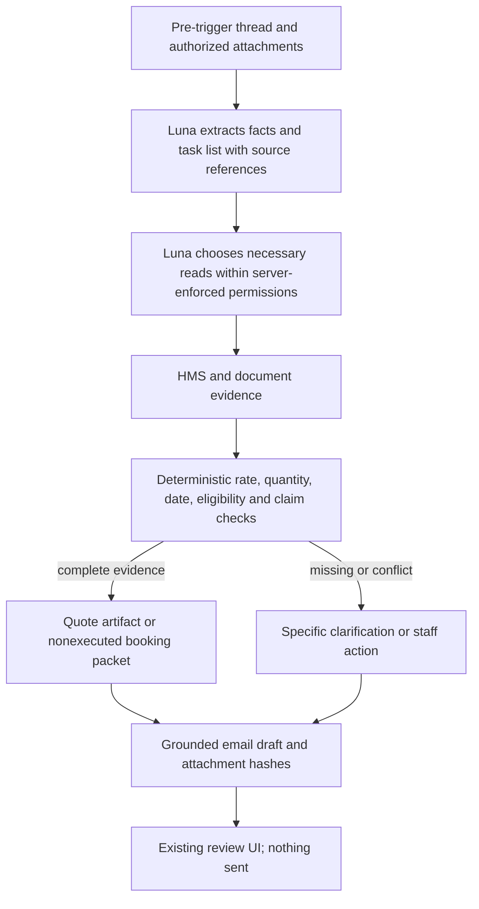

# Evidence-backed AI reservationist - Plan

This is the implementation contract derived from the separate readiness audit at `docs/plans/2026-10-03-001-feat-reservationist-readiness-roadmap-plan.md`. Planning does not start implementation. The user reviews this plan before launching its bounded autonomous execution.
No product fix, deployment, reservation save, payment mutation, or email send was performed while producing this plan.
Existing unrelated worktree changes were preserved.
Source baseline: branch `feat/reservationist-backtest`, commit `0b57af1478a639ad26c2959396fbee3f2a05589f` plus the pre-existing dirty worktree.

## Goal Capsule

Deliver a staff-review AI draft from each inbound: identify every task, read authorized evidence, run the necessary read tools, prepare a correct quote artifact or validated nonexecuting booking action, and compose a grounded reply. Nothing is sent or saved to HMS.

Use the same application runner for staff candidates and historical replay. Later staff replies are evaluator-only; earlier staff emails remain legitimate context. Complete pricing correctness and declared-scope replay qualification before claiming readiness.

Authority: current user boundaries → repository safety rules → Product Contract → unit designs → historical research. Generic skill deployment permissions do not broaden the user's read-only boundary. Local fixes and qualification may proceed after launch; external writes require a separate explicit instruction.

Execution tail: one executor owns implementation, tests, review reconciliation, failure ledger and handoff. Keep execution progress outside this decision document. Completion means satisfying Definition of Done, not finishing one overnight session.

## Global Constraints

- No PMS create/save/update/cancel, no payment mutation, no email send, no production deployment/migration/restart. No blank reservation-form action that temporarily holds stock/rates either.
- Use the existing read-only browser owner and approved model route. Do not create a second scraper/browser framework or agents per customer class.
- Never run tests against pilot/production RDS, set `VITEST_ALLOW_PILOT_RDS=1`, or source `.env.production` into tests. Database tests use a verified disposable database.
- Preserve the dirty worktree and foreign commits. No destructive git, force push, bypassed hooks, automatic landing or unrelated edits.
- Authorized customer data stays in private local artifacts or the approved inference route, never public research, Git, CI/SSM logs or review dispatch prompts. Credentials are never output.
- The LLM does not own monetary arithmetic, recipients, final readiness, permissions, evidence authorization or mandatory price checks.
- Qualify observed corpus needs first. Configurable HMS features are evidence gaps, not proof that this property's current prices are wrong.

## Autonomous Execution Mandate

This mandate applies once the user launches implementation; it does not authorize execution during this planning turn. Then continue safe work until the done gates pass or a true blocker remains. Slow investigation and multiple fix–test cycles are expected.

### Decision and recovery authority

- Choose safe reversible implementation details without routine questions. Preserve all accepted requirements; record material approach changes with reasons.
- Use standard non-fast agents for independent research/review. Coordinate file ownership; overlapping edits are sequential. If delegation is unavailable, continue inline.
- On any red: reproduce → identify cause/mechanism → fix → add regression → focused tests → wider gates → resume. Never bypass a guard, change expected output just to pass, or omit a failed case.
- Checkpoint each case/attempt with input, artifact and implementation versions. Resume only compatible checkpoints; keep superseded failures visible.
- Missing access to one rate family blocks automatic readiness for that family, not unrelated safe implementation. Continue other units, retain the blocker, and do not declare full completion.
- True blockers: unavailable required access, human-only policy/approval, unavailable disposable DB, forbidden external mutation, or a sustained external outage preventing required proof. Investigate safe alternatives first.

### AWS / infra boundary

| Existing resource | Identifier | Allowed use in this plan |
| --- | --- | --- |
| EC2 | `i-008f737974a9ba9b3`, `af-south-1`, repo `/home/ubuntu/repos/zero` | Authorized read-only diagnostics and existing browser bridge only |
| RDS | `nava-zero-mail-pilot` | Read-only corpus/health queries, never tests or writes |
| Mail S3 | `nava-zero-mail-845242190536-af-south-1` | Authorized reads; no bucket/lifecycle mutations |
| Deployment wrappers | `apps/server-pilot/deploy/ops-deploy.sh`, `ops-restart.sh`, `ops-reboot.sh` | NOT authorized; retained here to prevent accidental overlay escalation |
| Gotenberg | Existing converter or isolated local equivalent | Synthetic/private conversion with no mail send or PMS mutation |

This restricted resource table overrides the overnight overlay's broader deploy/migrate/seed permissions. Draft/artifact persistence tests use disposable/local services, not production mail state. Close only tunnels/sessions created by this run; preserve borrowed owners.

### Overnight completion and handoff

- Run the Verification Contract after fixes; inspect rendered money, artifact identity, tool payloads and actual evaluation failures.
- Emit concise progress during active work. Log private per-case failures and aggregate counts/cost/time without customer data in shared output.
- Do not stop merely because it is late or a test is hard. Do stop at safety boundaries; report precisely what remains and why.
- Handoff includes completed U-IDs, fresh command results, rate-family qualification, replay/holdout denominators, unresolved failures, code diff and owned-session cleanup. Do not claim production deployment or universal 100% accuracy.

## Product Contract

### Requirements

**Evidence and intent**

| ID | Required behavior | Units |
| --- | --- | --- |
| R1 | Each inbound uses causal context, authorized attachments and an explicit multi-task plan | U2, U4, U7 |
| R2 | Customer class determines party/rate context; message intent determines quote/book/read/other tasks | U3, U4, U6 |

**Price and deliverables**

| ID | Required behavior | Units |
| --- | --- | --- |
| R3 | Every selected accommodation allocation and extra is priced exactly in cents with applicable inclusions, quantity and source | U1, U3, U5 |
| R4 | Quotes are immutable revisions; valid acceptance references the exact prior offer, not silently today's price | U3, U6 |
| R5 | Required/promised PDFs show all selected rooms/stays/extras and correct terms/totals, with continuation rather than truncation | U1, U5 |
| R6 | Incoming rate claims are source-linked and typed; a ceiling is not an exact price, PoP is not cleared money | U3, U4 |
| R7 | Booking packets contain valid property fields and per-room guests; proposed writes remain nonexecuted | U6 |
| R8 | Drafts use corpus-backed controlled wording, real authorized artifacts and typed readiness/pending actions; no fictional completion or omitted secondary ask | U4, U5, U7 |

**Replay and operational safety**

| ID | Required behavior | Units |
| --- | --- | --- |
| R9 | Replay shares production logic, hides future outcomes, rejects invalid stubs and grades complete tasks | U2, U6, U8 |
| R10 | Every observed inbound is accounted for; development, holdout, handoff and unsupported work stay separate | U2, U8 |
| R11 | Existing candidate review, freshness, approval, human edits and mailbox authorization remain intact | U4, U7 |
| R12 | Local/disposable verification and read-only qualification are safe, resumable and evidence-backed | All |

### Scope and finish states

- Build quote, accepted-quote and new-booking preparation; add existing-reservation/document reads needed by observed tasks using existing services.
- Voucher/invoice/payment-proof extraction supports price/ledger questions, not autonomous payment approval.
- Amend/cancel requests yield a sourced pending action when execution is unauthorized. Group accommodation uses normal room allocations; unrelated event/conference services remain separately counted until supported.
- `ready_for_staff_review`: completed allowed work and all promised artifacts exist. `pending_pms_action`: valid action exists but must be performed before confirmation. `needs_clarification`: named missing facts. `blocked`: conflicting/unsupported evidence or access.
- A staff-only handoff is useful behavior but is not autonomous completion. A grounded guest clarification can complete its response obligation while booking completion remains pending. Score these separately. Finite declared-scope 100% and whole-corpus automation coverage are different metrics.

## Planning Contract

### Key technical decisions

- **KTD1 — one shared runner:** reuse Luna/Mastra, worker and candidate infrastructure. Replay swaps lower-edge tools/clock only, not agent policies or validation.
- **KTD2 — evidence-backed price:** adapt the rich native quote contract rather than retain a narrowed agent schema. Reuse exact-cent arithmetic, with one server-owned revision/comparison boundary.
- **KTD3 — corpus-backed inclusions:** Centurion staff proposals establish included VAT/levy commercial wording for the observed offer families. Retain that provenance separately from native HMS tax fields, which remain unknown. Preserve gross amounts; build no tax engine and add no 15%/1% surcharge. Investigate only a demonstrated conflict or unsupported observed family.
- **KTD4 — display runs, not new searches:** preserve every source night. Compress only consecutive identical-price nights inside the same allocation into PDF rows.
- **KTD5 — independent replay snapshots:** each inbound gets its own pre-trigger state; hypothetical agent bookings do not contaminate later actual staff history. Sequential simulated episodes are a separate optional diagnostic.
- **KTD6 — nonexecuting create:** structural/property validation is shared; simulator can fail and always exposes `saved:false`. Gold postconditions do not feed the simulator answers.
- **KTD7 — existing draft boundary:** persist attachments/action metadata through existing revisions, safe wire and editor; retain signed approval and claim fencing.
- **KTD8 — one observed price representation:** implement the existing nightly source and exact computed sum. Saved native responses contain no payable whole-stay total. Do not build a hypothetical `stay_total` branch, weekly/monthly calculator or pricing engine. If a corpus-relevant native source later supplies a different basis, record that evidence and extend only that boundary; never fabricate nights by dividing a total.
- **KTD9 — three clocks:** causal mail time determines available context/year/quote acceptance; source-evaluation time determines tool freshness for that lane; real elapsed time controls deadlines/retries. Do not rewrite source timestamps or freeze timeout clocks.
- **KTD10 — two core reply families:** extend the existing code-owned playbook with quote and booking wording learned from staff mail. Luna extracts facts/tasks and runs reads; code selects the family and renders validated facts plus conditional clauses. No final free-prose model call, template engine or six-way class workflow is needed. Six full-reply families is a simplicity ceiling for this plan, not an assertion about installed Outlook templates or permission to omit tasks.

### Evidence classes and practical price qualification

| Concern | What is established | Required action, not a speculative rewrite |
| --- | --- | --- |
| Wrong PDF totals/seventh row | Reproduced | Fix values and layout; render-read exact amounts |
| Room-only promised breakfast | Template/offer mismatch observed | Generate meal wording from proven board facts |
| VAT/levy calculation wrong | NOT established; 45/45 proposals say included; invoice gross already includes VAT/levy | Preserve gross amounts and scoped staff-policy wording; do not add percentages or block all offers because the grid has no tax field |
| Contract support absent | Disproved by fresh NCOR2B read | Reuse party context; verify each supported observed family |
| Long-stay source coverage | Three observed proposals quote 48 accommodation nights; current reader limit is 30 | Qualify those actual contracts/full periods; no generic weekly/monthly engine and no unsupported short-stay partition |
| Paper “discount” necessarily approved | NOT established by changing PDFs alone | Retain both revisions; require actual staff approval provenance for an override |

### Deferred policy details, not hidden assumptions

Three-day validity is evidenced; an inventory hold is not promised. Anchor imported offers to the printed/authored quote date, not delivery time: an observed September 7 PDF was sent September 22. An unchanged acceptance clearly inside validity carries the agreed offer forward and checks availability; ordinary current-price movement alone does not require escalation. Only the ambiguous cutoff, expired/superseded offer or changed scope needs a fresh offer or evidenced renewal.
Unknown source/track/guarantee defaults and unexplained rate conflicts remain unresolved until legitimate evidence exists. The corpus-backed included-tax policy is sufficient for its observed commercial wording; it is not a fabricated native configuration flag. No routine human decision is required to start implementation.

### Execution dependency order

U1 → U3 → U5; U2 and U4 establish replay and extraction alongside them. U6 depends on U2/U3/U4. U7 uses proven U3–U6 contracts. U8 qualifies the joined system.
Research and nonoverlapping test work can run in parallel. Agent, pricing-contract and draft integration edits share modules: assign one editor per lane and integrate sequentially. Never let parallel agents overwrite foreign WIP.

### Test and user-flow map

```text
causal inbound [U2 chronology/leakage tests]
  ├─ authorized PDFs [U4 byte/hash/scope tests + real-model eval]
  ├─ task plan [U4 multi-task eval, evidence/ask-bound composition]
  ├─ party + quote [U3 positive/negative controls, read-only native proof]
  │    ├─ missing/conflicting facts → clarification [U3/U7 visible-state tests]
  │    └─ valid source → revision/checks [U3 cent/date/claim tests]
  │         ├─ proposal → real converter → artifact [U1/U5 render-read/visual]
  │         └─ booking packet → validator/simulator [U6 no-write tests]
  └─ candidate → revision/attachment wire → staff editor [U7 disposable E2E]
       ├─ stale thread/artifact/human edit → preserve/flag [U7 race tests]
       └─ pending save → no confirmed wording [U6/U7 integration]

same runner + frozen adapters → replay → strict scorer [U2/U8 parity + holdout]
```

Every branch above requires a planned behavioral test, including negative outcomes; these are future gates, not claims of current coverage.

### Shared interface and operator contract

- U2/U7 share one versioned runner input: trigger ID/time, causal messages, authorized artifact refs, three clocks, capability restrictions and request-bound adapters. Evaluator gold has no field in this input.
- U3 supplies a server-resolved immutable quote revision with nightly source and computed total, selected allocations, inclusions with provenance, source/time/entitlement and validity. Store its serialized version in the existing generation/result ledger, linked to authorized output bytes; later acceptance retrieves the actual sent revision. Imported staff offers retain original line totals, terms and printed date as document evidence; do not backfill invented HMS nights or override approval.
- U4 supplies typed document facts/tasks with source spans, uncertainty and guest/staff disclosure. U6 consumes those facts plus the selected revision and returns validated per-room packets or named missing/conflicting requirements, always nonexecuting.
- U7 persists one versioned result: task states, readiness, quote/artifact refs, pending packets and errors. Existing editor/wire consumers use the same contract. Unknown result versions fail safely rather than losing attachments/actions.
- Errors contain stable code, affected stage/field, sanitized reason, retryability and recovery action. `fixture_missing` means supply a legitimate source fixture or report coverage unavailable; `authorization_denied` means repair authorized access, never retry/bypass; `resume_version_mismatch` means a new compatible run, preserving old results.
- Replay CLI defaults to frozen tools with no external HMS calls. Current-reader qualification is explicit. Synthetic stub smoke tests are never qualification. Preflight runs before inference/browser calls and exposes effective lane, case/fixture coverage, hashes/versions, model route, private output and limits without secrets/customer content.

The developer/operator is the existing Zero engineer, not a public SDK customer. Reuse the current CLI, test setup and repository support conventions. First useful result is a safe fixture replay with a truthful score/coverage report; no hosted playground, onboarding platform or unrelated framework.

## Outcome and recommendation

Build a draft-first AI reservationist on the existing Luna/Mastra and candidate-draft infrastructure.
Reuse existing read-only HMS tools; add a server-owned quote revision, deterministic pricing checks, attachment evidence, and realistic nonexecuting booking validation.
Do not replace the model or introduce separate agents per customer class before fixing these boundaries.

The four-tool reservationist is currently a standalone backtest prototype, not the live draft product.
Its nightly arithmetic is correct in saved checks; source context, accepted-offer handling, rendered money and executable booking inputs still need the changes below. No native whole-stay total or hypothetical tax engine is needed for the observed ordinary quote path.
The PDF renderer demonstrably prints wrong totals.
The old benchmark is neither a reliable accuracy measurement nor a complete workflow test.

The desired finished output is a saved, reviewable email draft with actual attachment artifacts, the evidence supporting its facts, and any pending nonexecuted PMS actions.
A new reservation cannot truthfully be described as confirmed before a real save produces its identifier and documents.
For now, create work produces a validated action packet and a clearly pending post-save reply, not a fictional booking confirmation.

---

## What is actually working

| Component | Observed capability | Limit |
| --- | --- | --- |
| Azure Luna | Fresh synthetic PDF input through Responses, `store:false`, reasoning effort `max`, returned exact fields and amounts | One smoke test, not a guarantee for scans, ambiguous documents, or document authenticity |
| Mastra dependencies | `@mastra/core` 1.70.0 and `@mastra/libsql` 1.23.2 already present | Old dependency-upgrade TODO is stale |
| Playwright quote reader | Nightly observations, occupancy groups, rate context, restrictions, selected-allocation checks, exact minor-unit summation | Read-only observations, no hold; not an authoritative tax-inclusive payable total |
| Party lookup | Existing organization/agency/profile lookup | No match is not proof of no contract; profile match alone does not settle eligibility |
| Contract route | Fresh Standard Queen `NCOR2B`, 12–14 Oct, 1 adult: R1,360 + R1,360 = R2,720 | One scoped negotiated-rate result, not proof of all contracts or tax treatment |
| PDF generation | Produces a PDF through Gotenberg | Fresh one-line/two-line renders show R0 line/aggregate defects; seventh line is structurally broken |
| Create dry run | Normalization plus a small local schema validator | Not a PMS form dry run, reservation commit, full business-rule validator, or complete booking implementation |
| Broader read/document infrastructure | Reservation/context, folio and existing-document contracts/services exist | Not connected to the four-tool reservationist; every live adapter still needs capability proof |
| Candidate UI/draft persistence | Existing candidate refresh, revision and review boundary | Reservationist is not wired into it; current persistence has no generated attachment integration at this seam |

Sources: `apps/server-pilot/src/ai/reservationist-agent.ts`, `apps/server-pilot/src/ai/mastra.ts`, `apps/server-pilot/src/ai/drafts.ts`, `apps/server-pilot/src/hms/read-service.ts`, `apps/server-pilot/src/mail/artifacts/existing-document-service.ts`, and the private observations referenced by the separate audit.

---

## Recomputed Phase B baseline

All 126 latest saved traces were recomputed against the current scorer; all saved L1 results matched.
These are historical stored results, not a new model run.

| Measurement | Result | Interpretation |
| --- | --- | --- |
| L1 pass | 89/126, 70.6% | Loose checks, not completed workflows |
| Workflow OK | 97/126, 77.0% | Quote/create agreement; skip/spam/other treated interchangeably |
| Reviewer good or acceptable | 44/126, 34.9% | 21 good, 23 acceptable, 82 bad; model review itself needs adjudication |
| L1 passes graded bad | 58/89 | Passing the old gate does not mean sendable |
| Create-labelled cases with valid create call | 0/10 | Two called but invalid, eight did not call |
| All create calls | 8 across 6 threads; all invalid | Missing room type, rate plan, guarantee and other required fields |
| Quote calls | 16 | 5 full quote, 4 partial, 3 execution failure, 1 input gap, 3 oracle-gated stub returns |
| Party calls | 10 | 2 resolved, 7 no match, 1 ambiguous |
| PDF calls | 1 | Call occurrence is not evidence of correct rendered money |

Why the number was misleading:

- The benchmark removes attachments before prompting the model. Thirty-six trigger messages have PDFs, but the model never received them.
- The four-tool scope explicitly routes invoices, folios, amendments, cancellations, groups and events to other/no tools.
- Quote execution is gated by a classification derived from the staff gold reply. Changing the visible stub label did not remove this hidden gold-dependent execution control.
- The scorer does not require a valid create request, successful PDF, successful quote outcome, correct party, correct departure, correct room quantities, or a complete nonempty reply.
- Money scoring floors decimals, scans incidental numeric fields, accepts partial amount overlap, and can accept stale/context money.
- Only 18 cases had date assertions and nine had occupancy assertions. Missing assertions are not successful checks.
- One reply per thread is sampled; never-replied inbound work is excluded. The benchmark is not all incoming hotel work.
- Its corpus manifest still describes 388 rows over Sep26–28; the actual file contains 1,461 rows, including 1,214 in-window Sep26–Oct2 messages and 247 context messages.
- Earlier scoring mechanisms can award 100% critical/tool coverage to missing-fact placeholders. That is not successful automation.

The reviewer’s 82 bad drafts include an approximate keyword-based breakdown of 49 document/payment attachment gaps, six unsupported actions, 14 empty/suppressed drafts and 13 other issues.
This explains the capability mismatch but is not a newly adjudicated gold label set.
The reviewer used the same Luna model family; treat disagreements as review items, not unquestionable truth.

Sources: `apps/server-pilot/src/ai/reservationist-backtest.ts`, `apps/server-pilot/scripts/run-reservationist-backtest.ts`, `apps/server-pilot/src/ai/draft-backtest.ts`, and `.private/reservationist-backtest/phase-b-azure-1/`.

---

## Correct workflow model

Customer class selects rate context, not workflow.
A private guest can book directly; an organization can ask for a quote; an agency can send an amendment or a document request.
A message can contain more than one task.

| Task in the email | Required sequence | Finished output under current no-write authority |
| --- | --- | --- |
| New price/availability request | Read evidence → resolve party if relevant → quote correct stay/room/board/context → validate selected price → formal PDF when requested or required by observed staff workflow | Grounded rate reply; real PDF only when the response promises/requires one |
| New booking request, including contract bookings | Read evidence → check for existing booking if referenced/duplicate risk → resolve party/rate authority → fresh quote or accepted quote revision → claim check if claim exists → validate create packet | Nonexecuted create packet; pending post-save reply |
| Acceptance of our previous quote | Load exact sent revision/printed date/validity → resolve latest agreed scope → check availability → validate booking packet | Preserve valid unchanged agreed price; no escalation merely for today's price drift |
| Existing booking query | Find reservation → read relevant context/folio/documents | Grounded answer plus authorized existing document if requested |
| Voucher, invoice or proof of payment | Read document → extract claims and source spans → match party/reservation → compare price or authoritative ledger state as applicable | Match/mismatch/uncertain report; PDF alone is not cleared funds |
| Amendment/cancellation/group/event | Read existing state → scope proposed action → dry-run or human task where no supported write exists | Explicit pending action; no fictional completion |
| Automatic notice/spam/no response needed | Identify actual message purpose and known automation signature | Skip only that task; do not skip every human message from an OTA relay |

Names in this table describe responsibilities, not claims that all adapters already exist or are live-qualified.
Keep two core business branches—quote and book—but do not force all other work into them.

Recommended processing shape:



Luna handles language understanding, extraction and task reasoning.
Code handles money, mandatory checks, permission boundaries, readiness and final controlled reply composition.
Do not rely on the model choosing to invoke a price check.
Do not add a second browser owner or replace the existing PMS framework.

---

## Staff reply templates

Use two core full-reply families, with shared conditional clauses. Do not make a new full template for each customer class, greeting, payment method, room type, missing field or secondary question.
The existing `reply-playbooks.ts` already renders code-owned fact/ask-bound replies. The normal `candidate-draft.ts` workflow returns that rendering even when model wording succeeds; the standalone reservationist still accepts a free `replyDraft` string. U7 joins the reservationist to the controlled path and replaces generic "authorized records" wording with natural staff-style copy.

### Corpus evidence and count limits

Rechecked all 454 outbound rows in the locally available corpus: 368 in the Sep26–Oct2 window plus 86 earlier context rows. Prefer original text; convert HTML-only bodies with `src/mail/inbound-reaction-parser.ts`'s existing parser. Use the history delimiters from `src/ops/centurion-eval-lab.ts`; exclude forward-only bodies beginning at a history delimiter instead of treating forwarded staff text as new authored copy. Normalize whitespace after that split. Exclude greetings/signatures from reusable-copy analysis. Counts below are observed phrase-bearing emails, not reservations, mutually exclusive workflow labels or a claimed complete Outlook-template inventory.

| Observed reusable wording | All available outbound / in-window | What it supports |
| --- | --- | --- |
| Formal quote: sign/return quotation; no rooms currently held | 9 / 6, across 9 threads | One quote family; dated apologies are optional copy, not another template |
| Booking done/made; pro forma will follow | 22 / 20, across 20 threads | One booking family with evidence-gated state and document/payment clauses |
| Proof of payment well received | 13 / 11 | Receipt acknowledgement clause; not proof funds cleared |
| Attached confirmation and pro forma; provisional until payment | 122 / 115, all HTML-only | Existing/committed booking-document variant; exact reservation status stays authoritative |
| Inline accommodation rates with Bed & Breakfast | 8 / 6 | Quote family also needs a no-PDF rate-summary variant; no need for another full template |

Primary private references: corpus `messages.jsonl:334,627,1271` for quote wording; `:364,365,599` for booking/payment/voucher variants; `:68,69,101` for HTML confirmation cover; `:122,637` for mixed occupancy/rate answers; `:344,926` for payment-credit and booking-plus-GDS counterexamples. Use the corpus hash in Appendix. Customer text and identities stay out of Git; public fixtures contain only generic reusable wording and synthetic facts.
Installed Outlook template files were not exported. The evidence establishes repeated staff wording, not that staff have exactly two or six stored templates. Earlier context is a selected lookback, not an exhaustive Sep8–25 outbound census. Phrase counts do not establish full-family coverage or that attachments were actually delivered.

### Families, conditional clauses and prerequisites

| Core family | Variants within the same family | Server-owned prerequisites |
| --- | --- | --- |
| Quote | Formal attachment or concise inline rate answer; single/mixed/group accommodation | Valid selected revision; correct requested price/occupancy/board; actual chosen quote bytes before saying "attached"; source-backed validity/no-hold terms |
| Booking | Prepared/pending action; accepted-offer preparation; existing/committed reservation and authorized document delivery | Prepared packet is nonexecuting. Actual status/ID/document evidence is required for booked/confirmed/delivered wording; never infer confirmed from provisional |

Reusable clause groups: acknowledgement/sign-off; validated price/stay facts; selected outgoing document; validity/availability; requested payment/voucher/rooming-list details; missing facts; additional requested answers; truthful pending action. These are small approved functions/strings in the current composer, not a DSL, template store, combinatorial registry or new UI.
All current required asks must be answered, clarified or marked unsupported once. Optional copy is selected only when relevant; no unconditional payment request, breakfast, three-day text, room hold or attachment promise. Money, dates, guests, room counts, board, status, recipient details, document names/refs and policy facts come from code-rendered authorized facts, not model-written slot text. Safe greeting/signature copy is centralized; do not copy personal asides, staff names or old payment links from gold.
The formal staff paragraph invites signature but does not override real save/availability requirements. Render an honest offer/acceptance invitation, not a promise that signature alone confirms a booking. A prepared booking uses pending wording and staff-only packet metadata; staff's post-save "booking has been done" version is only available with committed evidence, or a separately labeled non-sendable simulated preview.
Receipt acknowledgement may say proof was received only when the document exists, never that payment cleared. A promise of a future pro forma needs a real pending action/lifecycle and remains visibly pending; it cannot count as delivered or complete a request for an invoice now. Link each "attached quote/invoice" clause to that particular authorized outgoing artifact, not any unrelated PDF.

Strongest alternative: two rigid complete email strings cannot answer observed inline mixed-occupancy prices, booking plus company/GDS questions, voucher versus payment requirements, amended credit or group dietary questions. Use the same two family frames with applicable verified answer/question clauses; unsupported substantive work remains a visible handoff. Existing generic clarification/read/internal outcomes remain recovery/general composition, not reasons to proliferate quote/create templates. Add another full family only for a demonstrated distinct reusable task shape; more than six requires revisiting decomposition, never suppressing a legitimate ask.

### Template qualification

Freeze sanitized copy, family IDs and clause revision/hash with the development/reference corpus before holdout. Gold is evaluator-only; general copy learned from development is allowed, but a holdout-specific answer/name/rate is not. Current inspected mail is not an untouched template holdout.
Compare complete facts/tasks/artifacts/readiness first; grade staff-style consistency separately. Identical validated inputs and copy version produce identical final text/HTML. A familiar paragraph cannot pass with wrong money, absent PDF, omitted question or fictitious confirmation. No claimed improvement to the old 44/126 reviewer score exists until fresh joined-runner evaluation.

---

## Pricing contract

For valid nightly rates of the selected whole stay:

`Accommodation = sum over groups g of quantity(g) × sum over occupied dates d of validRate(g,d)`.

Each group has its own arrival, exclusive departure, room type, adults/children and ages, board, currency, party/rate entitlement and price authority.
Quantity can multiply a per-room sum only when these facts are identical for those rooms.
Two different groups or stays must not share a price merely because their dates overlap.
The current tool's `displayedSum` is this local sum, not a native HMS whole-stay invoice amount. Keep that provenance visible to staff.

Example: two identical rooms with R1,000 then R1,200 nights cost R4,400; a different room at R1,500 for one night adds R1,500; accommodation total is R5,900.

This is the correct calculation for the observed daily quote source; it is not proof of every rate configuration in HMS.
The source explicitly shops `lengthOfStay: 'DY'`. No captured calendar response supplies a native payable stay total.
Saved available offers do vary by date: STQN/BAR has R1,780/R2,260/R2,260, totaling R6,300, and a separate public adult LUXKNG offer varies across 18 nights. Date runs are therefore required, not speculative.
The staff corpus contains three 48-night accommodation proposals at R1,700 per night. Qualify those actual long-stay requests against the existing reader before widening its 30-night limit. Do not invent weekly/monthly pricing or automatically split requests to bypass that limit.
If a real applicable source later returns only a period total, preserve it exactly and make a scoped contract change then; no active generic period-total branch is required now.

Grand payable amount also includes authorized extras and applicable fees/taxes not already included, less authorized discounts.
Do not double-charge VAT/levy, meals already included in BB/DBB, or children’s supplements.
Separate currencies; no implicit exchange conversion.

### Mandatory checks

- Exact cents, not floating approximations or floored rand.
- Exactly one source price for every occupied date of each selected group; no missing, duplicate, extra or out-of-window dates. Imported staff offers may establish agreed line totals, but never manufacture unavailable historical HMS observations.
- Matching property, room, occupancy, board, currency, party and rate basis.
- One selected offer per group, not all alternative offers added together.
- The selected rate's observed restrictions, meal entitlement and applicable included-tax policy, with source provenance. Native unknown tax fields must stay unknown; do not confuse them with absent commercial policy.
- Quantity and per-date joint inventory checked separately from price; shopping is not a hold.
- Block unexplained R0/unpriced offers. Explicit authorized complimentary bookings require a distinct supported policy; zero is not universally invalid in HMS.
- Preserve immutable evidence timestamp and exact revision. Changing price-affecting facts requires repricing or an authorized revision.
- Authorized negotiated overrides retain original source rate, changed rates, author, reason and time.

### Rate claims reuse the quote result

The price check is a pure deterministic comparison, not a new PMS scrape.
Extraction must distinguish an exact rate, a maximum ceiling, an approximate budget, average daily rate, a total, and amount paid.
Carry date/room/board/occupancy, currency, tax/levy basis, quantity and a source page/span with each claim.

- Exact rate/total: compare like-for-like cents and flag actual differences.
- Maximum rate: an HMS rate below the ceiling is not a mismatch; it meets that price constraint.
- Average daily only: compare the derived stay total and report that nightly agreement was not established.
- Rounded averages: derive the possible rounding bound from precision and nights; do not invent a blanket R1 tolerance.
- Missing/ambiguous basis: cannot check, not match.
- A new booking's unexplained like-for-like price mismatch blocks automatic readiness and retains both sources. An accepted still-valid hotel quote is a prior authorized offer, not an unauthenticated voucher claim; ordinary current-rate drift does not invalidate it.
- A historical/current price delta is not itself an arithmetic bug. Classify it separately as a temporal difference requiring authority evidence.

### Quote validity: evidence and remaining limit

Fresh extraction of all 50 local Proposal PDFs, 45 unique normalized document texts, found these two clauses on every file:

- “Valid until: 3 days from date quoted above”.
- “No booking has been made and is subjected to availability on acceptance of this quotation”.

This supports three-day quote validity, subject to availability, not a stock hold.
Retain the authored/printed quote date, original terms, latest agreed scope and exact amounts. Clearly in-validity unchanged acceptance uses those amounts and rechecks availability; do not escalate merely because today's rate differs.
Changed dates/rooms/occupancy/board/services require a revised offer for the changed scope. Expired or superseded offers need current validation unless an explicit staff renewal or existing booking establishes the terms.
Only exact-boundary ambiguity remains: the documents do not specify 72 hours versus a calendar-day cutoff. Handle that narrow boundary as a staff check, not a blocker to normal acceptance cases. Do not reset validity when an old PDF is forwarded or resent.
Corpus acceptance evidence is limited: only 10 of 50 local Proposal attachments join to the available message corpus. A within-three-day acceptance included intervening scope changes; a later booking does not prove post-expiry price honour. Do not infer a universal late-honour rule.

### Tax: preserve the observed included amount

All 45 unique extractable staff proposals say 15% VAT and 1% Tourism Levy included. Their subtotal equals total; there is no added 15% or 1% line. A staff invoice independently shows net R3,095.65 + VAT R464.35 = gross R3,560, while its “Tourism Levy Included 27.04” breakdown does not increase gross.
Use the unchanged quoted gross amount for these observed Centurion offer families and retain the staff-policy evidence with the inclusion label. Do not reverse-engineer tax bases from that invoice or add percentages again.
The calendar grid's `taxInclusive` is still null. Record native-tax evidence and corpus-backed commercial inclusion as separate facts; do not rewrite null to a proved native flag.
The levy is the South African tourism-promotion contribution described by [TOMSA](https://tomsa.co.za/levy-faq/), not another VAT rate. Establishments choose to collect it; customers pay at participating establishments. Centurion's observed documents already include it. The product need is correct included wording/amount, not a remittance or tax-accounting engine.
Meal facts come from native labels/context: `Bed & Breakfast R` differs from `Room Only R`; neither proves child-meal entitlement. Retain native bundle labels already present upstream rather than inventing a new package engine.
Read rate detail/configuration only where an observed family conflicts with this policy or lacks applicable evidence. General Infor configurability is not evidence that this hotel's current quote amount needs extra taxes and is not a reason to block all quote work.

---

## PDF root causes and best representation

The patcher changes quantity/nights/rate inputs but leaves line and aggregate formula caches at zero.
Gotenberg/LibreOffice selectively recalculates some cells, not all monetary totals.
The seventh accepted line goes into row30, which is merged across A:H and has no total formula.
Recalculation flags alone do not fix row geometry and are not a robust monetary contract.

Use a server-owned quote revision with multiple stays, selected evidence-backed room allocations, optional explicitly authorized overrides, and extras with independent units.
Accommodation display rows are contiguous runs sharing description, occupancy, board and rate.
Flat prices still legitimately use quantity × nights × rate; changing prices require separate runs.
Different stay windows require separate source quotes, with per-date demand rather than every group active every night.
Extras use explicit day/trip/person/service counts, not fake room codes or inferred hotel nights.

Compute every displayed line and total once in code, write deterministic numeric money cells, and reconcile the rendered PDF against those totals.
Blank unused rows; correct Standard King/Executive descriptions from actual HMS labels; condition breakfast/meal and tax copy on supported facts.
For the immediate fixed template, reject overflow before rendering with an actionable staff result.
Full group coverage requires continuation pages or an expanded approved template; never truncate or average unrelated prices to fit six rows.
The Outlook pane must stop presenting static demo prices/date strings as live pricing and must use the same validated revision as the agent.

Exposure correction: no observed historical quote endpoint logs is not proof no customer received a bad PDF.
This audit did not establish complete sent-mail/deployment history; do not repeat the previous absolute “no client received one” claim.

---

## Reliable backtest design

The user’s desired test is fundamental correctness, not failing old mail because prices have since changed.
Use three separate lanes, never one blended money score:

| Lane | Price truth | What it proves |
| --- | --- | --- |
| Deterministic pricing/renderer tests | Explicit nightly/group/extra fixtures with exact expected cents | Arithmetic, quantities, date coverage, display runs, tax/package handling and rendered totals |
| Historical workflow replay | Only evidence available before the trigger; frozen tool responses where available | Task choice, extraction, party/claim handling, valid dry-run packet and grounded draft |
| Fresh live read-only qualification | Current HMS result for current request plus native source/readback | Current reader/context/rate correctness, independent of historical staff price |

For historic staff PDFs, independently verify the document’s arithmetic and representation.
Staff amounts alone do not prove which historical PMS rate configuration was available.
Where a contemporaneous PMS snapshot is absent, report historical rate-authority unverified rather than inventing it from today’s grid.
Record current-versus-historical deltas as a separate diagnostic. Large deltas warrant review, but neither a large nor small delta automatically proves a bug or correctness.
Practical quote replay can use old inbound requests with today's read-only prices: grade returned-source arithmetic/selection/PDF and gold task coverage, never exact equality to the old gold amount. Label it current-price counterfactual, not reconstructed historical price. Existing-booking/duplicate checks still use pre-trigger state, never today's completed booking. This makes useful testing possible without fabricating old PMS data.

### Replay chronology clarification

The intended method is correct: act as if each historical inbound just arrived, supply only earlier context, run permitted reads, validate/simulate proposed writes without executing them, and compare against the withheld later staff response.
The problem is in implementation and scoring, not that basic idea.
An existing-reservation workflow is appropriate only when the reservation already existed before the triggering inbound.
Today’s PMS may contain the very reservation staff created in response to that inbound; using that present-day hit to route the historic request to existing-booking handling leaks the completed outcome.
For state-sensitive reads, use request-bound pre-trigger fixtures/snapshots or a labeled simulator; use current live reads only for independently scoped current-reader qualification.
The source booking letter and later staff reply may score the proposed create fields/postconditions but must not supply answers to the agent or manufacture unconditional simulator success.
Evaluation may compare a clearly labeled hypothetical post-action reply against staff’s reply after a validated simulated action; do not confuse that with a sendable production draft that already has real committed booking IDs/documents.
Production can finalize confirmation wording/documents after its approved save step; this backtest executes no save.

Execution requirements:

- Remove gold-derived tool gates. Gold labels and future staff replies remain scoring-side only.
- Freeze corpus hashes, chronological pre-trigger input, genuine reply pairing, attachment content hashes, code/prompt/tool/model/scorer versions and selected case IDs.
- Repair stale manifests and explicitly choose inbound-window versus staff-reply-window sampling.
- Expand Sep8–Oct2 coverage, including unresponded inbound, direct bookings, contract quotes, acceptance, existing bookings, groups and no-response work.
- Review gold workflow/facts, not merely classify staff replies with regex. Outbound letters can corroborate bookings but are not automatically new-booking triggers.
- The current 126 cases are development data already inspected and tuned. Use untouched thread families/newer mail as holdout; deduplicate conversations and near-identical business cases, not shared generic staff wording.
- Frozen replay responses bind exact normalized request identity and observable time. Never synthesize successful tool results from the expected staff answer.
- Create simulation uses the same field/schema/business validation as intended execution, can fail on missing codes/dates/eligibility/duplicate bookings, and always returns saved:false.
- No unconditional-success create stub, dummy zero-byte PDF, missing-fact placeholder, or tool-call presence can count as completed work.
- Score task classification, extracted facts, tool success, price/eligibility, attachment identity, create validity and grounded draft readiness separately.
- Record reply family, clause IDs and copy version/hash; assess staff-style consistency separately from mandatory task/fact/artifact completion. General reusable development copy may be frozen, but per-case gold never becomes a template slot source.
- Full-case pass requires all mandatory facts/artifacts/actions. Correct handoff is reported separately from autonomous completion.
- Give deterministic money and tool results priority; blind reviewer judges language/coverage; adjudicate disagreements instead of accepting either model’s verdict automatically.
- Persist resumable runs by case/attempt/source version, bounded retries, cost and time. One browser owner; no PMS writes or sends.

### Scorecard and realistic finish target

| Metric | Numerator / denominator | Qualification target |
| --- | --- | --- |
| Deterministic money/render correctness | All required unit/property/render scenarios, including negative cases | 100% pass; every emitted amount reconciles to its selected source |
| Safety and truthful readiness | Evaluated attempts without unauthorized effects, invented prices/IDs/artifacts, privacy leaks or false confirmation | Zero critical violations; any violation blocks qualification regardless of aggregate score |
| Eligible end-to-end completion | Cases completing every permitted required task, valid packet/artifact and grounded draft / frozen eligible cases | ≥95% separately on development and untouched holdout; 100% is a stretch result, not a reason to overfit |
| Workflow/task selection | Correct full task sets / adjudicated cases | Report exact counts by family; aggregate completion still requires all tasks |
| Automation coverage | Eligible cases / all observed inbound, plus completed cases / all inbound | Always publish; staff handoffs, missing fixtures, unsupported and unadjudicated work remain visible |
| Repeated-run reliability | Cases passing all three fresh attempts / cases in a predeclared stratified repeat set | Report all-three consistency and each attempt; never best-of-three or retry-until-pass |
| Operational cost/latency | Actual tokens/cost/tool time and timed-out cases | Report by family and model route; configured budgets are execution limits, not accuracy evidence |

Eligibility is frozen before tuning: in-scope observed tasks, sufficient legitimate causal inputs/tool fixtures and adjudicated obligations. Errors caused by our tools, extraction, prompt or renderer remain eligible failures. Missing independent historical PMS evidence is a declared replay limitation, never a reason to claim tested success. Test schema/negative fixtures separately when a historic business case cannot be reconstructed.
The allowed output is a draft and validated pending booking packet, not a committed reservation. Correct `saved:false` packets can complete that permitted preparation task; unsupported staff-only handoffs cannot count as completed preparation.
A 95% threshold is a product acceptance choice, not a research-proven hotel rate or a claimed 95% confidence bound. Publish binomial uncertainty and family counts; tiny holdout slices remain provisional. For scale, even 126/126 independent successes would leave about a 2.4% one-sided 95% upper bound on failure probability; related thread samples weaken that calculation further.
No observed family with a reproducible critical pricing/safety defect is qualified by a good pooled score. Investigate the remaining failures without adding surname/template-specific rules or tuning on held-out cases.
Start with one full attempt per eligible case; use a predeclared repeat subset containing each supported workflow/rate family and prior failure mechanism for three fresh attempts. Freeze its case IDs/size in preflight before inference. Expanding repeat coverage is optional evidence, not a new orchestration platform.
100% on a finite, strictly scored set can happen; it does not promise universal production accuracy.
Do not tune on the holdout until it passes and then call it independent.
Do not manufacture a higher score by excluding failures or counting staff handoffs as automation.

---

## Implementation Units

Sizes are relative engineering scope, not reliable calendar estimates: S = localized change; M = cross-component unit; L = several integrations.

| Unit | Deliverable and principal files | Acceptance gate | Size / priority |
| --- | --- | --- | --- |
| U1 | Pricing/PDF containment: pane demo output guard; deterministic workbook totals; row capacity; `apps/mail/app/(routes)/outlook-pane/page.tsx`, `src/quote-proposal/patch-sheet.ts`, proposal tests | Real Gotenberg one/two/six-row money correct; overflow explicit; no demo quote emitted as live | S / critical |
| U2 | Trustworthy baseline and corpus provenance: backtest scorer/runner, frozen request replay, attachment descriptors, strict validity, manifests and scorer tests | Known false-pass probes fail; all exclusions counted; gold never controls execution | M / critical |
| U3 | Authoritative quote revision and price checks: existing quote fetch/contract, server quote model, pure claim comparison and tests | Observed nightly amounts/context/restrictions and applicable sourced inclusion policy verified; exact checks mandatory; unresolved actual families visible | M–L / critical |
| U4 | Attachment-inclusive Luna and multi-task agent: artifact reader, reservationist schemas, extraction/recovery tests | Real PDFs/scans where supported produce sourced structured facts; ceilings not exact rates; ambiguous facts stay unresolved | M / high |
| U5 | Evidence-backed proposal output: proposal builder/API/agent schemas, room description mapping, extras and continuation rendering | Mixed rooms/occupancy/windows/nightly prices/extras/revisions render without wrong sums or clipping | M / critical |
| U6 | Complete nonexecuting create packets: create request normalizer/validator, rate/profile/source/guarantee acquisition, duplicate and failure fixtures | All required real codes/IDs and business facts present; invalid requests fail; no invented confirmation or PMS write | M–L / high |
| U7 | Draft/UI integration and staff-style composition: existing playbook, candidate workflow, draft persistence, attachment linking and read/document routes | Shared runner and two core reply families; actual artifacts on drafts; complete asks and truthful pending actions | L / high |
| U8 | Bounded overnight development replay and blind qualification | Strict frozen scorecard, failure ledger, untouched holdout, no hidden manual successes, no saves/sends | M / final gate |

Sequence: U1 and U2 first; U3 establishes pricing authority before U5/U6 automatic readiness; U4 can use existing safe artifact seams; U7 integrates only proven capabilities; U8 starts when fixtures, scoring and run boundaries are trustworthy.
The work packets below supply that detail. Each starts with failing behavioral tests, then implementation, focused verification and regression review; no per-unit approval is needed after the user launches this plan.
Broader amendments/cancellation/payment execution and actual PMS save/send are separate permission/capability milestones, not secretly enabled by this roadmap.

### U1. Fix and contain wrong quote PDFs

**Goal / requirements:** Stop known wrong-money output; R3, R5, R12. **Dependencies:** none. **Size:** S, critical.

**Files:** modify `apps/server-pilot/src/quote-proposal/patch-sheet.ts`, `patch-template.ts`, `proposal-pdf.ts`, `gotenberg.ts`; `apps/server-pilot/src/trpc/routes/workstation.ts`; `apps/mail/app/(routes)/outlook-pane/page.tsx`. Extend `apps/server-pilot/tests/quote-proposal-pdf.test.ts`, `apps/mail/tests/quote-proposal.test.ts`, `outlook-pane-render.test.tsx`; add explicit pane/real-converter regression suites if absent.

**Exact steps and why:**

1. Write one/two/six/seven-row and unused-row regressions. Assert displayed amounts, not merely formula strings: the original mocked tests missed the defect.
2. Compute line totals/subtotal/final total in exact cents and write numeric H cells deterministically. Clear stale formula caches and unused money cells; do not depend on LibreOffice recalculation.
   Condition or clear misleading breakfast boilerplate for room-only evidence now, not only in U5; unknown board cannot promise breakfast.
3. Treat row30 as broken geometry, not a missing formula alone. Temporarily return explicit overflow instead of emitting a truncated seventh row; U5 replaces this containment with complete continuation pages.
4. Guard the pane's static RATE_TABLE, hardcoded month and simulated-success search. Demo data cannot become a live proposal. Keep the feature unavailable until U5 supplies evidence-backed inputs.
5. Validate converter HTTP status, PDF MIME/header/nonempty bytes. Run actual conversion, extract text and inspect layout. A successful HTTP response or opening file is insufficient.

**Tests / gate:** 1×2×R1,000 → line/total R2,000; R2,000 + R3,000 → R5,000; six rows complete; blanks contain no ghost R0; seventh row explicit refusal until U5; room-only never promises breakfast. Real converter money must match to the cent. No demo quote path bypasses the gate.

### U2. Repair replay inputs, chronology and scoring

**Goal / requirements:** Measure real completion, not tool-call presence; R1, R9, R10, R12. **Dependencies:** none; U7 finalizes runner parity. **Size:** M, critical.

**Files:** modify `apps/server-pilot/src/ai/reservationist-backtest.ts`, `reservationist-agent.ts`, `apps/server-pilot/scripts/run-reservationist-backtest.ts`; add `apps/server-pilot/src/ai/reservationist-replay.ts`; extend `reservationist-backtest.test.ts`, `reservationist-agent.test.ts`; add `reservationist-replay.test.ts`, `reservationist-runner-contract.test.ts` under server tests.

**Exact steps and why:**

1. Separate execution input from evaluator-only gold. Remove every gold-derived `liveQuoteOk`/oracle gate, not just visible stub names.
2. Create one case per inbound trigger in Johannesburg time. Supply trigger and prior mail/documents; exclude later staff replies, documents and PMS post-state. Preserve earlier staff quotes/confirmations.
3. Pair withheld responses by corpus-wide InReplyTo, then bounded subject fallback with confidence. One staff response can cover multiple inbounds: record shared-gold episode obligations rather than duplicate independent evidence. Keep no-gold, no-response and unprocessed cases visible.
4. Freeze actual corpus/window/hash/case and model/prompt/tool/scorer versions; repair stale manifest. Current 126 become development data, not independent qualification.
   Inventory fixture coverage before scoring: authentic contemporaneous response, current-reader qualification, synthetic scenario, or unavailable. A missing historical fixture is a coverage limitation, not a model failure; it cannot count as a successful tested task either.
5. Build independent pre-trigger snapshots. Replay responses bind the exact request, property, original observation time and tool version. Wrong/missing fixture returns unavailable; gold never manufactures successful tool output.
6. Grade exact cents and all selected room/date/quantity/occupancy/board/party fields, every task, successful payloads, valid create packet, real artifacts and final reply. Partial quote, invalid create, empty PDF or missing assertions cannot pass.
   Generate or validate every client-facing money/date/occupancy clause from approved structured facts, including rates in email body as well as PDF. A correct PDF plus hallucinated body price is a critical failure; tone points cannot offset it. Test valid positive outcomes too, so an always-refusing agent cannot qualify.
7. Keep historical workflow, deterministic money and current-reader lanes separate. Report price drift without letting current rates decide historical arithmetic correctness.
   Bind causal mail time, source-evaluation time and real elapsed deadlines separately. Historical email + today's live quote is a valid current-reader/counterfactual lane, not reconstructed historical price/state.
8. Reviewer sees facts/draft and gold but not L1 verdict; disputed labels are adjudicated. Record abstentions rather than converting uncertainty into a pass.
9. Make modes fail closed: `replay` is the default, with no external HMS access; `current-read` is an explicit read-only qualification lane. Legacy `--dry-tools` remains smoke-only or is rejected with migration guidance. Extend the existing `plan` command into preflight and implement `--help`; validate run IDs/output ownership against traversal and collisions before spending.
10. Preserve old thread-keyed traces as historical reports. New per-inbound scores require a new compatible manifest; reject unknown/legacy schemas on resume rather than silently reusing old scores.

**Tests / gate:** changing gold cannot change execution; two inbounds in one thread remain two cases; split-thread pairing works; prior quote visible/later booking absent; wrong fixture/one-cent error/invalid create/partial quote/empty attachment fail; all inbounds sum to declared coverage. No future PMS hit can turn a historic new booking into an existing-booking task. Omitted mode cannot call external HMS; missing fixtures are reported by preflight; legacy/incompatible manifests and unsafe run IDs fail before expensive calls.

### U3. Verify HMS inclusions and implement quote revisions/rate comparison

**Goal / requirements:** Trust the price source for the actual offer and protect it through acceptance; R2–R4, R6, R12. **Dependencies:** U2 for reproducible cases; read research can start earlier. **Size:** M–L, critical.

**Files:** existing `apps/server-pilot/tooling/playwright-quote/fetch-quote.mjs`, `quote-contract.mjs`, `quote-tool.schema.json`; `apps/server-pilot/src/hms/quote-stay-contract.ts` and its existing adapter seam; new `apps/server-pilot/src/quote-proposal/quote-revision.ts`, `rate-check.ts`; new `docs/infor-hms/2026-10-04-centurion-rate-family-qualification.md` with aggregate/config evidence references only. Tests: native `fetch-quote.test.mjs`, `quote-contract.test.mjs`; server `hms-quote-stay-v2.test.ts`, `hms-quote-completeness.test.ts`, new `quote-revision.test.ts`, `rate-check.test.ts`.

**Exact steps and why:**

1. Extract a qualification matrix from observed gold and tool requests: public/negotiated rate plans, BB/DBB/room-only, relevant occupancy/child facts, ≥7/30-night stays and quantities. Do not invent every possible hotel feature as a launch blocker.
2. Reuse existing native context/room/rate fields and eight-group capability; remove accidental four-group/quantity-four adapter narrowing or report explicit true limits. Do not add another scraper or independent total algorithm.
3. Build the minimal observed inclusion-policy record from original staff documents: property, observed rate/board families, applicable wording, evidence hashes and dates. Gross prices already include VAT/levy for those offers. Keep native tax fields unknown rather than synthesizing configuration. Retain upstream `nonroombundleslist` labels through the existing projection; `ispkg:false` does not mean no meals.
   An adult BB label does not establish child breakfast entitlement. Check child/extra service overlap only where the request includes those people/services; do not infer complimentary child meals or add an automatic supplement.
4. Inspect existing rate detail/configuration through the existing owner only for actual conflicts, missing applicable meal/entitlement evidence, or the observed 48-night contracts. Read-only Display/Calculate Rates is an optional source investigation, not mandatory speculative machinery. Never use blank reservation Check Availability, Reserve or configuration save: those can hold/write state.
   If browser exploration is needed, use the existing approved owner/kernel; the user permits GPT-6.1 Sol for that research instead of Astra. Keep the brief scoped to the missing fact, no writes or second browser. Documentation does not prove this tenant's controls bind date/party/tax/package.
5. Compare current selected native nightly amounts/contexts with observed staff offers as a diagnostic, recording dates and potential current/historical price drift. Prove entitlement and relevant restrictions; use actual original offers for historical agreed terms. No percentage surcharge, generic weekly/monthly engine or PMS edit is justified without a demonstrated applicable gap.
6. Record qualification as supported/conflicting/unresolved with provenance. Corpus policy can establish commercial inclusion without proving a native tax flag. A missing config screen alone does not invalidate a supported ordinary offer. A real conflicting or unpriced family cannot become ready and stays separately visible; current configuration cannot prove historic configuration.
7. Create immutable selected quote revisions: property, stay groups, quantity, per-room guest/occupancy facts, selected IDs, rate context/entitlement, native nightly cents, inclusions, source observation time, document validity and approval provenance. Evidence IDs are server-resolved, not LLM-invented.
   Implement the observed nightly evidence plus computed total only. Imported offers retain original document lines and validity as agreed-offer evidence, not fabricated source nights. No generic period-total variant/test is required absent an actual applicable source.
8. Mandatory checks: valid calendar/exclusive departure; exactly one price per occupied night with no gaps/duplicates/extras; correct room/board/context; selected allocations only; unexplained zero rejected; active per-date joint demand checked against the same inventory pool. Independent group searches alone cannot certify joint stock; ambiguous shared inventory remains explicitly unproven. Price is not an inventory hold.
9. Pure rate comparison reuses this evidence. Distinguish exact amount, ceiling, budget, rounded ADR, total and paid amount; compare only compatible bases. Precision-derived rounding bounds replace blanket R1 tolerance. Return match/mismatch/cannot_check with both sources and scope of agreement.
10. Accepted prior quotes load the exact pre-trigger/sent revision and authored/printed date. Unchanged clearly valid acceptance preserves its agreed price and rechecks inventory; today's different rate alone is not an approval issue. Expired/ambiguous/superseded offers or changed scope need validated revised terms or explicit renewal. Never reset validity on forwarding. Approved overrides preserve source rate, actor, reason and time.

**Tests / gate:** nonconsecutive equal prices stay separate display runs; missing/duplicate/date-extra prices fail; wrong room/board/currency/party fail; ceiling R1,700 vs R1,560 satisfies; exact claim disagrees; ADR total agreement does not certify nightly equality; accepted revision survives today's delta; forwarding does not restart validity; edits invalidate affected scope; unexplained zero or conflicting inclusion cannot become ready. Corpus-backed policy plus native-tax unknown remains a truthful supported state. Authorized complimentary rates are not inferred from zero. Observed 48-night source limits are qualified or remain an explicit unresolved family; no naive partition. No tax arithmetic is changed without demonstrated need.

### U4. Give Luna the PDFs and all tasks

**Goal / requirements:** Recover the inputs staff used and extract actionable source-linked facts; R1, R2, R6, R11, R12. **Dependencies:** U2 causal input contract; U3 validates prices. **Size:** M, high.

**Files:** `apps/server-pilot/src/ai/reservationist-agent.ts`, `prepared-draft-input.ts`, `draft-evidence.ts`, existing `src/mail/artifacts/read-artifact.ts`; `src/ai/bedrock/luna.ts` only if file wire needs extension; new `src/ai/reservationist-document-facts.ts`. Add `reservationist-document-facts.test.ts`, `reservationist-attachment-input.test.ts`; extend agent/prepared-input/artifact/adapter tests.

**Exact steps and why:**

1. Retain attachment ID, message time, MIME, size and byte hash. Filter signature CID noise without discarding unknown business files.
2. Reuse authorized byte reads and identity rechecks. Pass actual PDFs through the approved Luna adapter, not only filenames or inaccessible URLs. Keep bounded embedded-text/scanned-image paths and explicit unreadable/oversized recovery. Native multimodal input is the baseline; add OCR/layout machinery only when these local evals show a concrete gap.
3. Extract guests per physical room, dates/year context, children/ages, board, party and typed rate/payment claims with page/source references. Preserve contradictions and uncertainty; code normalizes dates/cents. Check supporting quotes against extracted original text; scans retain page/image-region locators and require visual/source adjudication in the eval. Model-produced page numbers and schema-valid amounts alone are not verified extraction.
4. Produce all tasks in one bounded plan: quote plus question, acceptance plus change, existing-document request, etc. Customer domain/category does not itself force create/skip.
   Return typed facts/task references and unresolved asks for controlled composition, not authoritative final free prose. Code validates the family/clauses against task completion and readiness; the model cannot omit a required answer or force post-save wording by naming a template.
5. Enforce document content as evidence, never executable instructions. A PDF's numbers/claimed payment are not authoritative price or cleared funds; later HMS evidence determines those claims.
6. Keep PreparedDraftInput/MailEvidenceRef admission and ask-bound composition. Reading a PDF does not automatically mark it `draftReady`.
7. Preserve existing `disclosure: guest|staff_only` through extraction, shared runtime, composition and rendering. Internal account IDs, approval provenance, unresolved billing notes and pending action packets stay in authorized staff metadata; they do not become guest text/PDF merely because the model read them. Explicitly permitted guest facts retain source proof.

**Tests / gate:** Tourvest-like ceiling/decimal ZAR; ADR vs nightly; mixed rooms/children; accepted prior PDF; prior/future attachment distinction; image/scan/corrupt/encrypted/oversized cases; conflicting docs; malicious instructions; changed bytes/cross-mailbox denial; staff-only facts cannot leak into guest reply/PDF. Real-model document eval includes text and scan cases, but deterministic validation still owns readiness.

### U5. Build complete evidence-backed proposals

**Goal / requirements:** One chosen offer, correct money and honest terms across complex stays; R3–R5, R8, R12. **Dependencies:** U1, U3; U4 for document-origin extras/claims. **Size:** M, critical.

**Files:** `apps/server-pilot/src/quote-proposal/proposal-pdf.ts`, `patch-sheet.ts`, `patch-template.ts`, `description.ts`; new `quote-lines.ts`; workstation route and reservationist tool schema; `apps/mail/lib/quote-proposal/description.ts`, pane page. Reuse approved Excel asset; add a continuation asset/layout with the same visual vocabulary. Tests: server `quote-proposal-pdf.test.ts`, new `quote-proposal-lines.test.ts`; mail proposal/pane suites; agent tool tests.

**Exact steps and why:**

1. Replace public/agent typed room prices/nights with selected revision/group/option references. Server resolves money; choices remain explicit. Several source stay windows can belong to one proposal.
2. Derive display lines from contiguous equal-price nights within the same group/room/occupancy/board/authority. Nights come from dates, not LLM integers. Reconcile every run/total to source nightly cents × quantity. Imported agreed offers preserve their original line totals without inventing missing native observations; only explicit validated amendments create new lines.
3. Derive room description from native label/class plus occupancy and proven meal plan. Correct SKNG Standard King and EXKNG Executive; do not market them as Suite/Standard.
4. Extras carry authorized label, quantity, units, unit kind and cents. Suppress duplicate meals only when proven service/person/age/date entitlement overlaps; adult BB can coexist with chargeable child breakfast. Staff overrides require actor/reason/time and retain original quote; changing old proposals alone does not prove approval.
5. Generate breakfast/tax/levy/validity terms from supported facts. Preserve three-day/no-booking/availability wording. Alternatives can appear in email, never be summed as simultaneously selected rooms.
6. Implement continuation pages with full rows and terms, and one clear final proposal total. U1 overflow refusal is not final completion. Cover 7+, staggered-date and varying-rate expansions without clipping or averaging.
7. Render via real converter, read all monetary rows/totals and visually inspect representative single/multipage files. Link output bytes/hash to the immutable revision.
8. Re-enable pane PDF only through the same selected-revision contract used by the agent. Dates and price source come from actual inputs/results; remove simulated search success from live readiness.
9. Treat guest names, labels and extracted extras as untrusted text. Escape them through the existing code-owned output boundary; never accept arbitrary HTML, external resource fetches or document instructions as rendering authority.

**Tests / gate:** flat, varied, returning price, mixed occupancy/rooms/board, multiple windows/two stays, adult BB + chargeable child meal, included-child meal without duplicate charge, trips, approved override, 7/12+ lines all render and reconcile. Foreign/stale/missing evidence and alternatives cannot emit a ready proposal. Agent/pane produce identical money for identical revisions. No unobserved whole-stay pricing engine is added.

### U6. Validate realistic booking packets without writes

**Goal / requirements:** Test what would be booked, not a success stub; R2, R4, R7, R9, R12. **Dependencies:** U2, U3, U4. **Size:** M–L, high.

**Files:** existing native `create-request.mjs`, `create-tool.schema.json`; agent and replay; new `apps/server-pilot/src/ai/reservationist-booking-packet.ts`. Tests: native `create-tool.schema.test.mjs`, `create-lab-stay.test.mjs` offline only; new `reservationist-booking-packet.test.ts`; replay tests.

**Exact steps and why:**

1. Expand room quantity into one physical-room packet, preserving guest assignment and selected rate/occupancy; one generic guest list is insufficient for mixed rooms.
2. Acquire mandatory arrival/departure/adults/source of business/room type/rate plan/track/first name/last name/guarantee from evidence and reviewed property rules. Do not invent guarantee or payment status.
3. Preserve contract context: quote organization uses native ID, booking agency needs native ID plus name; create organization/agency/A/R fields need exact display names. Guest profile can use native ID. A/R lookup is independent of organization/agency lookup; do not treat one as proof of another. Follow `docs/solutions/workflow-issues/hms-party-lookup-ar-independent-of-org-agency.md`.
4. Strengthen calendar/order/age/occupancy/quantity and room-rate-period/entitlement checks. A nonempty invented code is invalid; quote edits/expiry/conflicts remain explicit.
   Add conformance tests for the local JSON Schema validator's `oneOf`, required fields and bounds; replace unsupported validation with the existing approved schema library if necessary rather than trusting schema-shaped output.
5. Duplicate check uses legitimate pre-trigger state in replay. An already existing reference uses lookup; the record staff created later cannot leak into the historical create decision.
6. Validate every room using shared schemas and request-bound fixture/catalog facts before returning a prepared packet. Missing state/stock/access can fail; no validator/fixture adapter reads gold. Always expose `saved:false`; distinguish schema validity, business-rule validation and untested native save acceptance. Do not clone PMS state or build a full reservation simulator merely to make a stub succeed.
7. Score proposed fields/postconditions against withheld staff evidence. A hypothetical post-action reply/document may be scored in a labeled simulator lane only after valid simulation; the live draft stays pending save and cannot invent a booking ID/pro forma.
8. Keep save-capable adapters unavailable to this runner. Offline create-lab tests are not permission to invoke lab/live writes.

**Tests / gate:** every mandatory omission, imaginary code, impossible/reversed date, age/occupancy error, guest-room mismatch, partly invalid group, known prior duplicate, future booking absent, edited/expired/accepted revision, no-stock/network failure. Invalid packets never count as completed. Prove no create/save/PMS mutation invocation.

### U7. Integrate the runner, artifacts and pending actions into staff drafts

**Goal / requirements:** Make the proven logic usable in existing staff UI, not a second prototype; R1, R8, R11, R12. **Dependencies:** U2–U6 for readiness. **Size:** L, high.

**Files:** server `src/ai/worker.ts`, `reservationist-agent.ts`, `workflows/candidate-draft.ts`, `prepared-draft-input.ts`, `reply-playbooks.ts`, `draft-evidence.ts`, `reply-assessment.ts`, `candidate-draft-agent.ts`, `drafts.ts`, new `reservationist-runtime.ts`; `src/trpc/routes/ai.ts`, `drafts.ts`, `draft-wire.ts`; `draft-approval.ts` as needed. Mail `lib/mail/thread-draft-view-model.ts`, `components/mail/thread-display.tsx`, `thread-draft-card.tsx`, `reply-composer.tsx`, `hooks/use-drafts.ts`; `hooks/use-compose-editor.ts` and `types/index.ts` where hydration/wire requires them. Tests: new runtime-parity/draft-integration suites, existing `reply-playbooks.test.ts`, `reply-assessment.test.ts`, `ai-candidate-draft-contract.test.ts`, candidate-state/approval/promotion/wire/prepared-input tests; mail view-model/persistence and new candidate-card integration scenarios.

**Exact steps and why:**

1. Extract the shared runtime runner with causal thread, artifacts, clock, capabilities and lower-edge adapters. The replay and worker call this same logic.
2. Invoke it through the existing candidate_draft worker/workflow and approved route release. Preserve default/HMS lanes, requester binding, cancellation/deadlines and claim fencing. Simply registering an agent will not bypass the existing code-owned prose playbook; add evidence/ask-bound composition explicitly.
   Extend that playbook with the two corpus-backed families and conditional clauses in Staff reply templates. Remove final `replyDraft` authority from the qualified reservationist path. Render selected authorized facts and family prerequisites deterministically, then assess task coverage, factual literals, status and particular promised artifacts. Use canonical formatting shared by the renderer and critical-literal guard; do not weaken guards to make new formatting pass. Preserve weaker legacy quote caveats for legacy evidence; stronger qualified summaries require U3 proof.
   Skip the redundant final-wording model invocation that `runPreparedReplyWorkflow` currently discards, only on the new qualified composition path; retain approved model/release admission for extraction/planning and unchanged legacy paths. No new model, template library or renderer. Supported group accommodation can use the quote family; retain internal-only handling for unqualified event/block actions instead of deleting that safety rule wholesale.
3. Persist one versioned typed result in existing `aiWorkflowRun.metrics`, linked to generation: readiness, per-task state, quote/artifact refs and booking packet. Pending action is not verified HMS evidence. Reuse this ledger, not a new workflow database.
4. Stage/hash/verify new generated bytes first; then persist generation/draft/revision/artifact links in one DB transaction. Failed fence/DB/cancellation means no visible attachment promise. Track only run-generated orphans for later authorized cleanup; never delete reused inbound/existing files. Generated quotes have their own scoped immutable refs, not fabricated inbound attachment IDs. No model-supplied S3 keys.
5. Extend safe wire/compose hydration with opaque artifact references, filename/MIME/size/hash and authorized retrieval. Input-PDF freshness uses bounded byte SHA-256 and identity recheck, not nonexistent DB hashes. Reuse current artifact service; no forced new hash-table migration.
6. Show candidate reply first, then attachments and task/readiness summary. No candidate has Generate; first request has loading; initial failure has reason/retry; refresh failure retains prior candidate; permission denial has no retry storm. Pending/stale/blocked states show a reason and allowed next action. Never overwrite human-owned local draft content, including after autosave acknowledges it. Preserve the revision snapshot across async attachment hydration/refetch; follow `docs/solutions/logic-errors/mail-draft-refresh-data-loss-and-lifecycle.md`. Keyboard-accessible controls/preview focus return, polite status announcements, accessible errors and text status labels are required; use existing responsive components, no dashboard redesign.
   Keep readiness/reason adjacent to the card title. Each attachment has filename and loading/available/missing/changed/permission-denied/fetch-error state; retry only transient failures. A required unavailable artifact blocks readiness even when the reply body exists.
   Within the existing task summary expose staff-checkable pricing proof: selected room/dates/occupancy/board, rate-plan/party source, observation time, supported inclusion/basis, validated total and accepted revision/validity. Conflicts link their authorized document/page sources. Staff-only proof remains out of guest reply/PDF.
7. Preserve user-initiated editor opening/promotion for review, distinct from approval/send. `ensureEditableForReply` must copy/revalidate attachments into promoted revisions, not `attachments:[]`. Bind approval to thread, revision, body/recipients, evidence, bytes, route release and typed action/result digest. Server readiness rejects confirmed wording for pending save; UI labels alone are insufficient. Edits/new mail/changed artifacts invalidate old approval. No unattended promotion, approval, send or save.

**Tests / gate:** deterministic model/tool adapters prove replay/worker parity; actual Luna runs are graded for semantic correctness/variance, not byte equality. Identical validated facts/copy version give identical text/HTML; changed free model prose cannot change final output; qualified composition spends no extra wording call. Quote with/without required PDF, specific wrong/missing artifact, room-only, mixed rates/occupancy/windows, secondary question, voucher versus PoP, receipt versus cleared, provisional versus confirmed, pending versus saved and group accommodation versus unsupported event all have behavioral tests. Generic copy or a matching paragraph cannot override a missing ask. Existing literal/HTML/disclosure guards remain effective. Real PDF survives worker→DB revision→API→promotion→editor/reload with same bytes/hash; missing file fails readiness; upload then failed DB/fence leaves no visible promise/reused-file deletion; pending booking visibly/server-side unconfirmed; stale/cross-owner/changed hash denied; initial/loading/error/permission/refresh and per-attachment preview states work; pricing proof matches persisted evidence with unknown basis visibly unresolved; keyboard/status announcements work; dirty editor safe; old approval invalid after change. Shadow/off modes unchanged. Run disposable integration/browser tests, not production candidate writes.

### U8. Run resumable development replay and blind qualification

**Goal / requirements:** Establish a defensible complete declared-scope score and visible remaining corpus work; R9, R10, R12. **Dependencies:** joined U1–U7. **Size:** M, final gate.

**Files:** backtest runner/scorer/replay/runtime; private run manifests/scorecards/failure ledger; new `apps/server-pilot/tests/reservationist-run-provenance.test.ts`; runner-contract/replay/scorer regression suites; new `docs/infor-hms/2026-10-04-reservationist-replay-runbook.md` for safe commands and recovery, linked to existing operations guidance.

**Exact steps and why:**

1. Freeze supported workflow/rate-family scope, corpus/case/artifact versions and conversation/business-case development/holdout split. Current 126 are development. Do not leak duplicate conversations or near-identical business cases across split.
   Freeze reusable reply family/copy/clause versions before evaluation. Group repeated/amended versions of the same booking/request and near-identical case-specific facts together. Shared generic greeting/quote/booking copy is expected across independent cases and is not by itself a duplicate or a reason to exclude a holdout family. Holdout must contain genuinely new cases with frozen copy, not memorized expected facts. Report task completeness separately from style/template adherence; no template-specific scorer exemption or name/thread-specific repair.
2. Dry-run guards and deterministic pricing/renderer suites before model/HMS qualification. Then run historical workflow replay and current read-only qualification as separate lanes.
3. Use serial HMS ownership with bounded requests/deadlines/retries. Record every failed attempt/cost/time; checkpoint exact versions. A successful retry does not erase initial failure statistics.
   Proposed configurable defaults: one HMS call at a time, native call deadline ≤15 minutes, case elapsed deadline ≤45 minutes, ≤24 tool calls and ≤8 model turns per case, at most two additional retries for transient failures only. Retry backoff 5/15 seconds; no retry of auth/business-invalid/permission failures. Worker lease heartbeat remains active. Record limits; never silently raise them. Propagate abort into model/child-process/browser adapters; restore owned state without killing borrowed owner. Preflight displays the configured run-duration/spend cap before paid execution; 8 hours/USD25 may be offered as operator defaults, not represented as user-specified limits. Checkpoint at the configured cap; exhaustion is not completion. Record actual deployment/provider/tokens and a versioned Azure cost estimate, not legacy Bedrock/global-CRIS prices.
4. Iterate development failures with root-cause fixes and new regressions. Do not use inspected holdout cases as independent evidence; replace holdout if used to tune.
5. Score workflow, extraction, money, tools, booking validation, artifacts and reply separately. Every inbound is completed/handoff/unadjudicated/unprocessed/outside declared scope, with reason.
6. Qualify when all deterministic pricing/render/safety gates pass, critical violations are zero, and frozen eligible development AND untouched holdout each reach ≥95% end-to-end completion. Keep every remaining failure in the ledger and prevent unsafe output; no post-hoc exclusions. 100% finite-set completion is a stretch, not an instruction to overfit. A valid nonexecuting booking packet can complete the authorized preparation task; a staff-only handoff is not that completion. Clarification/no-response obligations are separately typed and graded.
   Report per-family denominators, all-inbound coverage and missing/unadjudicated cases. No tiny/unrepresented family inherits qualification from the pooled score. Run three fresh attempts on the predeclared stratified repeat set; report all-three consistency without replacing first-attempt results or selecting favorable attempts. Confidence intervals describe sample uncertainty, not guaranteed future performance.
7. Write aggregate handoff plus private failed-case evidence. Cleanup run-owned sessions and abandoned experiments; preserve original private artifacts/WIP unless removal is authorized.
8. Publish the operator runbook with exact implemented `plan/run/score/review/resume` recipes, expected preflight/output, credential variable names only, fixture provenance limits, the three structured error recoveries, no-write boundaries and explicit budget renewal. Execute its safe first-run recipe during qualification; documentation is not proof until it matches the implemented CLI.

**Tests / gate:** incompatible resume versions fail; timeout/auth/missing fixture recorded; no silent exclusions; no-gold cases counted; future-state/gold/holdout leakage detected; failed attempts retained. Fresh deterministic/safety gates pass 100%; zero critical violations; eligible completion ≥95% separately in development and untouched holdout. Every remaining failure, handoff and excluded-for-evidence case stays visible. Repeat attempts cannot upgrade a failed first attempt by best-of selection. Unadjudicated/unresolved cases prohibit a full-corpus 100% claim.

## Verification Contract

Commands below are execution-time recipes, not actions performed while planning. Run from repository root. Before every Vitest command remove database environment inheritance; disposable DB gates then supply only a verified test endpoint. Check test setup does not reload production credentials. No pilot opt-in exists.

**V1 — native offline quote/create contracts**

```bash
env -u DATABASE_URL -u VITEST_ALLOW_PILOT_RDS node --test apps/server-pilot/tooling/playwright-quote/quote-contract.test.mjs apps/server-pilot/tooling/playwright-quote/fetch-quote.test.mjs apps/server-pilot/tooling/playwright-quote/create-tool.schema.test.mjs apps/server-pilot/tooling/playwright-quote/create-lab-stay.test.mjs
```

Expected: all offline scenarios pass; no live/lab save called. Confirm create-lab test setup is mocked before running.

**V2 — server pricing/replay/agent unit gates**

```bash
env -u DATABASE_URL -u VITEST_ALLOW_PILOT_RDS pnpm --filter @zero/server exec vitest run tests/reservationist-agent.test.ts tests/reservationist-backtest.test.ts tests/reservationist-replay.test.ts tests/reservationist-runner-contract.test.ts tests/quote-revision.test.ts tests/rate-check.test.ts tests/quote-proposal-lines.test.ts tests/quote-proposal-pdf.test.ts tests/reservationist-document-facts.test.ts tests/reservationist-attachment-input.test.ts tests/reservationist-booking-packet.test.ts tests/reservationist-run-provenance.test.ts
```

Expected: every new/changed deterministic scenario passes. New paths are created by their owning units; missing files/skips are not a successful gate.

**V3 — existing draft safety and mail UI regression gates**

```bash
env -u DATABASE_URL -u VITEST_ALLOW_PILOT_RDS pnpm --filter @zero/server exec vitest run tests/prepared-draft-input.test.ts tests/reply-playbooks.test.ts tests/reply-assessment.test.ts tests/ai-candidate-draft-contract.test.ts tests/draft-approval.test.ts tests/draft-ai-promotion-contract.test.ts tests/draft-wire-sanitize.test.ts tests/hms-candidate-state.test.ts tests/reservationist-runtime-parity.test.ts
env -u DATABASE_URL -u VITEST_ALLOW_PILOT_RDS pnpm --filter @zero/mail exec vitest run tests/quote-proposal.test.ts tests/outlook-pane-render.test.tsx tests/thread-draft-view-model.test.ts tests/reservationist-draft-card.test.tsx
env -u DATABASE_URL -u VITEST_ALLOW_PILOT_RDS pnpm --filter @zero/server build
env -u DATABASE_URL -u VITEST_ALLOW_PILOT_RDS pnpm --filter @zero/mail build
```

Expected: focused gates/builds pass with no changed human-draft or review protection. Pre-existing unrelated failures are separately evidenced, not silently edited.

**V4 — real runtime artifacts:** real Gotenberg render-read/visual single, mixed, room-only and multipage cases; disposable candidate/attachment persistence and browser hydration E2E. Record exact command/environment/source/PDF hash and assertions. Mocked converter or skipped DB test cannot satisfy this gate.

**V5 — source qualification:** source-bound current native rate/context/restriction proof plus applicable corpus-backed commercial inclusion policy for supported observed families, with positive controls for negative lookups. Investigate actual contradictory/unpriced/long-stay families only; native tax null stays null. No new-form hold or reserve. Missing historical native snapshots limit replay proof, not permission to fabricate them.

**V6 — model and replay:** actual-PDF/scan extraction eval, joined-runner historical development replay, untouched holdout, separate current-reader lane. Record all model/prompt/tool/scorer versions, costs, attempts and denominators. No 100% from tool presence, placeholder facts or historical-price substitution.

**V7 — final review:** CE correctness/security review plus simplicity review of task diffs, fresh V1–V6 reruns after fixes, forbidden-side-effect assertions, private-artifact leakage check, session cleanup. UI/DX and paired engineering/simplicity review lenses must be completed before unattended launch; the report distinguishes inline review from unavailable formal helper/tool runs. Implementation requires fresh task-diff reviews; planning review is not a code sign-off.

## Definition of Done

- [ ] U1–U8 implement every R1–R12 requirement and listed behavioral scenario without silent scope cuts.
- [ ] Exact cents/date coverage/selected allocation/quantity/claim checks cannot be skipped by the LLM.
- [ ] Supported observed rate families have native amount/context/restriction evidence and applicable sourced commercial inclusions. Native-tax unknown is not relabeled proved; real conflicting/unpriced/unsupported long-stay families stay visibly unqualified without blocking unrelated ordinary offers.
- [ ] Single and continuation PDFs display every line and correct final total; real render/visual proof passes.
- [ ] Actual-PDF extraction and multi-task reasoning pass sourced evals; corruption/uncertainty recover honestly.
- [ ] Booking packets use valid mandatory property facts and preserve each room's guests; simulator can fail; no PMS write.
- [ ] Existing staff candidate flow contains actual attachments, durable pending actions, freshness/approval fences and protected human edits.
- [ ] Two core staff-style reply families share controlled fact/clause rendering; required secondary asks remain covered, template versions are frozen, and no extra final-wording model call or invented artifact/action promise occurs on the qualified path.
- [ ] All mandatory deterministic pricing/render/safety scenarios pass 100%, with zero critical violations in evaluated attempts. Frozen eligible development and untouched holdout each achieve ≥95% end-to-end completion; every nonpass remains visible and safely contained. Per-family counts, uncertainty, all-inbound coverage and predeclared three-attempt consistency are separately reported. No unadjudicated case is called passed.
- [ ] No invisible exclusions, fabricated success, unverified attachment promises, future gold/state leakage or handoffs counted as automation.
- [ ] Fresh relevant tests/builds/E2E/read-only qualification pass in safe environments; no production tests/deploy/send/save occurs.
- [ ] Abandoned implementation experiments are removed without touching foreign work; owned sessions closed; private handoff and aggregate evidence complete.

---

## Acceptance examples that must survive implementation

| Case | Required result |
| --- | --- |
| 1 room × 2 nights × R1,000 | PDF line and total R2,000, never R0 |
| Nightly R100/R500/R500, quantity 2 | R2,200; separate R100 and R500 date runs |
| Mixed rooms, guests and staggered dates | Separate identity per group/window; sum only occupied room-nights |
| Two alternatives for one requested room | Select one; never charge for both |
| Two selected groups competing for same room pool | Per-date joint inventory considered; no claim of a hold |
| Observed 48-night contract above reader limit | Qualify actual full-stay source/context or retain visible source limitation; no naive short-stay partition or hypothetical pricing engine |
| Voucher maximum R1,700; valid HMS R1,560 | Ceiling satisfied, not an exact-price mismatch |
| Exact voucher R1,700; comparable HMS R1,560 | Difference retained and readiness blocked until approved resolution |
| Average total matches but nightly source differs | Total-level agreement only; do not claim nightly equality |
| Room-only offer | No complimentary breakfast boilerplate |
| Child breakfast / transport | Explicit service quantity and unit count, no inferred accommodation nights |
| Unexplained zero price | Not automatically quotable; authorized comp is a separate branch |
| Clearly valid unchanged earlier quote accepted | Exact revision/amount preserved; availability checked; ordinary current-price drift is not an escalation |
| Old PDF forwarded after printed quote expiry | No renewed validity from delivery time; use explicit renewal or current revised offer |
| Date/type/board/occupancy edited after quote | Selection/revision invalidated or authorized repricing recorded |
| Claimed proof of payment | Not marked cleared without matched authoritative payment/ledger evidence |
| New booking dry run | Complete valid packet, saved:false; no made-up reservation number or pro forma |
| Missing PDF or failed quote tool | Specific recovery/handoff; never a passing complete-workflow result |
| Staff-style quote paragraph but missing quote bytes | No "attached quotation" promise or complete result; an unrelated PDF cannot satisfy it |
| Booking template plus secondary company/transfer/document question | Supported answer or focused unresolved action included; never drop it to fit the frame |
| Proof received or provisional reservation | Acknowledge receipt/status only; never silently promote to cleared payment or confirmed booking |
| Seven or more rendered lines | Complete continuation rendering with every line and final total. Refusal is temporary U1 containment only, never final acceptance |

---

## Appendix

### October 4 corpus and source recheck

These are fresh read-only inspections of saved original files, not a new PMS query, model backtest or product test run.

| Evidence set | Rechecked result | Scope / consequence |
| --- | --- | --- |
| `.private/gold-proposals/` | 371 files = 365 PDFs + 6 spreadsheet assets; 45 PDFs have no extractable text | Earlier “371 PDFs” was imprecise. No missing-file/deletion conclusion follows. OCR/vision coverage is still needed for unreadable originals |
| Extractable Proposal documents | 50 attachments, 46 binary-unique, 45 normalized-text-unique; 70 pricing rows | 70/70 row multiplications and 45/45 subtotal/total sums agree; quote layout is valid for flat runs |
| Included terms / validity | 45/45 VAT15% included and Tourism Levy1% included; 3 days from quoted date; subject to availability | No automatic tax/levy addition; no claimed inventory hold; preserve authored offer date |
| Invoice tax cross-check | Attachment locator `07f42fd0-4dba-428f-8b41-6dd28de829a5_002`, SHA256 `51f4d8a8c7be6b967a1dc9ec754c9c2b394d26a408c1f66e126133167ec622e0`: net3095.65 + VAT464.35 = gross3560.00, levy included27.04 | The levy breakdown is included in gross, not an additional quote charge; do not infer a generic levy formula/base |
| Long-stay proposal | Locator `35a15eb1-4382-4afe-87e4-90c21943b350_004`, SHA prefix `aba1814d2783fa4e`: one DBB room, 48 nights × R1700 = R81600 | Real observed source-limit case, not proof HMS supports arbitrary periods or monthly rates |
| Saved quote results | 53 result files, 886 repeated option occurrences; 865 successful calculated sums checked; zero discrepancies | `displayedSum` is the local exact-cent sum; `wholeStay/allRooms/taxInclusive` are null for every occurrence |
| Variation, qualified sample | 649 multi-night occurrences, 45 varying; 191 available/verified/matching multi-night occurrences, 6 varying | Variation is real, including public adult pricing; percentages describe a skewed development sample, not hotel-wide prevalence |
| Raw native evidence | 23 trace archives, 32 calendar response bodies inspected beyond projection; no payable total/tax/levy field | Absence is established on this calendar surface, not everywhere in HMS. Preserve upstream meal labels without inventing tax config |
| Causal acceptance evidence | Only 10/50 proposal attachments join available local mail, in nine threads | Three-day text is strong; unchanged-price honour after expiry is not established. A printed Sep7 offer sent Sep22 disproves delivery-time renewal |

Concrete varying-price artifact: `.private/playwright-quote/u4-final-child/result.json`, STQN/BAR R1780/R2260/R2260 → R6300, available/verified/match. Public adult variation also appears in `u4-final-paging/result.json` for LUXKNG across18 nights.
Calculation source: `tooling/playwright-quote/fetch-quote.mjs:541` calls `sumDisplayedRates`; `quote-contract.mjs` labels that money `sum_of_displayed_nightly_rates`, `official:false`. The legacy server also adds daily `roomRate` observations locally.
Corpus hash: `.private/reservationist-backtest/corpus/messages.jsonl`, SHA256 `950220308d37532f24fef5e36ec79586f940d3da23a488f4d0a73de4155046a1`. Its 1461 messages include1214 window +247 context; adjacent manifest is stale. The old full-range census and 149 remote confirmation-letter extracts were not reconstructed in this local recheck; do not claim their private remote originals were reread.

### Historical audit evidence

The observations and test results in this appendix belong to the separate October 3 readiness audit, not fresh execution during this October 4 planning turn. The complete audit stays at `docs/plans/2026-10-03-001-feat-reservationist-readiness-roadmap-plan.md`; these references explain the plan's evidence basis, not completed implementation gates.

### Fresh observations during this audit

- Azure PDF smoke: synthetic one-page text PDF, expected two nights at ZAR 1,234.56 / total 2,469.12; HTTP200 completed and exact JSON extraction; effort max; store false; usage 88 input, 146 output including 113 reasoning tokens. No customer document was used in this smoke.
- Gotenberg: current local builder against running converter; synthetic one/two/seven/room-only files saved under `.private/reservationist-verification-20261003/`; independent pdftotext and visual inspection confirm monetary/row/boilerplate failures.
- Live negotiated read: `.private/playwright-quote/research-20261003/2026-10-03T23-29-07-772Z-e9f6f454/`; command exit0, outcome quote, no issues, audit complete; NCOR2B STQN, R1,360 per date / R2,720 total; single-group allocation not_selected means per-option inventory only, not an allocation or hold.
- All 50 Proposal files extracted afresh; normalized-text de-duplication yields 45. Three-day validity and no-booking/availability clauses present on all 50.
- Both audit-owned SSM tunnel sessions closed after diagnostics. The pre-existing remote browser owner was preserved.

### Offline verification

- Backtest/candidate/document suites: 129 tests passed, 11 skipped across 11 files.
- PDF/agent server subset: 8 passed, 3 skipped; mail proposal/pane subset: 15 passed.
- Quote contract suite: 27 passed; quote completeness/live-driver offline subset: 32 passed.
- These subsets overlap. Do not add them into an inflated unique total. Mocks/skips are not live proof.

### Evidence threshold

95 threshold met for saved-metric recomputation, code wiring/schema defects, exact room-night summation implementation, reproduced PDF failures, the scoped fresh contract read, and deployed PDF-input capability.
Not met for all rate-plan whole-stay authority, this property’s complete tax/levy configuration, historic price reconstruction, complete client exposure history, or production-wide workflow readiness.

Strongest alternative: a more capable model or prompt could improve language and task reasoning, and current HMS is better evidence for a new offer than an old email.
Neither repairs dropped PDFs, insufficient tools, invalid booking schemas, corrupted rendered totals, missing tax/LOS authority, or a biased scorer.
Retain Luna; fix those boundaries first and then measure residual model error.

---

## Sources and research route

The prior audit used local source, private artifacts, Codegraph, three independent read-only audit agents, existing offline tests, fresh synthetic PDF conversion/model input and a live read-only HMS contract request.
This planning turn used local source/Codegraph inspection, independent corpus and raw-native-source rechecks, a completed Exa Agent harness/evaluation run and primary-source fetches, then plan/document/engineering review. No product test suite, model probe, PMS call or conversion was run in this planning turn; `pdftotext` only read existing originals.
Customer corpus and credentials were not uploaded to public research.
The template revision used a local pass over all 454 available outbound bodies, including 132 HTML-only/nonempty rows, and two independent source/learnings researchers. Quoted-history removal and HTML fallback were checked before accepting the phrase counts. No new Exa/model/PMS call or product test ran for this revision. The original audit is unchanged; template-only qualification remains a future gate, not a newly achieved score.

Decision-critical source entry points:

- `apps/server-pilot/src/ai/reservationist-agent.ts`: tool schemas, oracle gate, rules, runner and dry validation.
- `apps/server-pilot/src/ai/reservationist-backtest.ts`: case construction, gold heuristics and permissive scoring.
- `apps/server-pilot/scripts/run-reservationist-backtest.ts`: prompt attachment omission, stubs and run provenance.
- `apps/server-pilot/src/ai/draft-backtest.ts`: placeholder-based earlier score inflation.
- `apps/server-pilot/src/ai/reply-playbooks.ts:192,238` and `workflows/candidate-draft.ts:140,218`: existing generic controlled composition and discarded final model wording.
- `apps/server-pilot/src/ai/draft-evidence.ts:294,477` and `reply-assessment.ts:277,374`: legacy caveats, selected claims, completion and attachment boundaries to extend without loosening safety.
- `apps/server-pilot/src/ai/mastra.ts` and `apps/server-pilot/src/ai/drafts.ts`: actual live registration/persistence seam.
- `apps/server-pilot/src/mail/artifacts/read-artifact.ts` and `existing-document-service.ts`: authorized PDF/document evidence reuse.
- `apps/server-pilot/tooling/playwright-quote/quote-contract.mjs`: sums, context, availability and allocation checks.
- `apps/server-pilot/tooling/playwright-quote/fetch-quote.mjs`: daily shopping, native context and source observations.
- `apps/server-pilot/tooling/playwright-quote/create-request.mjs`: limited validation, not execution.
- `apps/server-pilot/src/quote-proposal/` and `apps/mail/lib/quote-proposal/description.ts`: workbook and description boundary.
- `apps/mail/app/(routes)/outlook-pane/page.tsx`: static sample rates and simulated search.

Primary external sources:

- [Infor rate maintenance: tax, weekly/monthly, packages, overrides and complimentary rates](https://docs.infor.com/hms/2024.x/en-us/hmsolh/s_t1424428595824.html).
- [Infor room-rate shopping: Daily/Weekly/Monthly, negotiated rates, Reserve action](https://docs.infor.com/hms/2026.08/en-us/hmsolh/jxo1557688477063.html).
- [Infor Display Rates / Calculate Rates](https://docs.infor.com/hms/3.8/en-us/hmsolh/s_t1424428571268.html).
- [Infor negotiated organization rates](https://docs.infor.com/hms/3.8.x/en-us/hmsolh/s_t1424428593437.html).
- [Infor explicit reservation re-quote](https://docs.infor.com/hms/3.8/en-us/hmsolh/abh1439826538709.html).
- [OpenAI file/PDF inputs](https://developers.openai.com/api/docs/guides/file-inputs).
- [Azure Responses PDF support](https://learn.microsoft.com/en-us/azure/foundry/openai/how-to/responses).
- [OpenAI evaluation guidance](https://developers.openai.com/api/docs/guides/evaluation-best-practices).
- [Anthropic agent evaluation guidance: outcomes, regression versus capability, repeated trials](https://www.anthropic.com/engineering/demystifying-evals-for-ai-agents).
- [Anthropic simple agent/workflow architecture](https://www.anthropic.com/engineering/building-effective-agents).
- [Tau-bench primary research: task outcome and all-trials consistency](https://arxiv.org/html/2406.12045v1).
- [Tau3 maintainer audit: flawed expected actions can depress scores](https://taubench.com/blog/tau3-task-fixes.html).

HMS sources span product versions; documented capability must be qualified in this tenant, not assumed from a page alone.
Prior-audit research: one Exa Agent run, effort high, `agent_run_211e090f2dae41ad82ff62ee9bd97315`; reported 2 compute units, 60 searches, total $0.5001. This was not an October 4 planning expense/run.
Material primary pages independently inspected; an independent advanced-search contradiction pass confirmed configurable tax, LOS pricing and explicit re-quote, correcting the previous universal-VAT/daily-price/automatic-repricing assumptions.
October4 harness research: one completed high-effort Exa Agent run, `agent_run_69d8deabada94555afec0a05ea229897`; reported2 compute units,60 searches,totalUSD0.5001. No customer data was supplied. Main agent separately fetched official evaluation/architecture pages. No fallback/replacement run was needed.
The research supports realistic held-out outcome scoring, deterministic guards and repeated trials; it does not establish a universal95% hotel threshold or a current-model performance forecast. Historical support benchmarks also contain annotation defects. Retain the existing local harness/Mastra instead of adopting a hosted evaluation platform or switching models based on unrelated benchmark scores.

## GSTACK REVIEW REPORT

Review disposition is plan-only. The local GStack helper installation and referenced `sections/review-sections.md` resources are absent; no helper dashboard/log or full interactive GStack run is claimed. Inline independent reviews apply the relevant engineering, design and DX lenses instead, with findings reconciled below. No product readiness score is inferred from a plan review.

| Review | Trigger | Why | Runs | Status | Findings |
| --- | --- | --- | --- | --- | --- |
| Engineering | Base-plan final pass, before the template revision | Architecture, failures, security, tests and operations | Main four-section review plus two independent challenges | Complete; one P2 summary inconsistency corrected | U3 acceptance summary now matches observed nightly source and sourced inclusion policy; no P0/P1 plan blocker, no code sign-off |
| Simplicity | Required paired planning gate | Avoid duplicate frameworks and speculative scope | 2 inline rounds | Findings reconciled | Existing reader, runner, artifact service and result ledger reused; no tax engine, second scraper, workflow DB or class-specific agents |
| Design | Staff-review UI scope | Seven UI/UX lenses | 2 inline rounds | Findings reconciled | Attachment loading/failure states, adjacent readiness, visible pricing proof, keyboard/focus/status behavior, protected human edits |
| DX | Internal runner/CLI integration | Eight interface/operator lenses | 1 inline round | Findings reconciled | Fail-closed replay mode, preflight, stable recovery codes, legacy-run isolation, safe runbook and measured first-run gate |
| Document review | Base-plan review before its final engineering pass | Product, coherence, feasibility, scope, design, security and adversarial cases | 7 independent persona passes before the template revision | Complete; zero actionable findings | Source limits, expiry cutoff, extraction reliability and small holdout uncertainty remain explicit execution-time proof obligations, not silently resolved facts |
| Template revision | User-authorized corpus-backed wording clarification | Repeat-copy evidence, existing composer, semantic completeness, artifacts/status, split leakage and minimal scope | Fresh local corpus pass; two independent code/learnings research passes; one independent delta challenge and one final engineering delta review | Complete; no actionable delta-review defects | Two core families plus verified clauses; no new engine or task unit. Main corrected deduplication to business cases, not shared boilerplate. This is a bounded delta review, not seven new full-plan reviews or implementation proof |
| Formal GStack helper runs | Optional tooling record | Distinguish installed tooling from inline evidence | 0 | Unavailable | Missing installation/resources; no fabricated log, dashboard or cross-model/tool score |

Reconciliation: completeness adds proof and safe failures; simplicity removes unobserved machinery, never required coverage. Refusal may contain U1 overflow but cannot satisfy U5. Implement observed nightly pricing; a different native source requires evidence before a scoped extension. Staff-only facts remain private. Legacy scores remain reports, not new qualification. Normal accepted-price drift is not an escalation; deterministic money/safety100% and eligible completion95% are distinct gates.

### Final engineering disposition

Scope retained as the user's draft-first product, with evidence-driven source qualification rather than speculative pricing machinery. Architecture: no unresolved design blocker. Code quality: one P2 inconsistent U3 summary corrected in the base review. Tests: every mapped branch has a required behavioral/unit/integration/eval gate; these are planned coverage, not executed new tests. Performance: no unresolved plan blocker; serial browser ownership, bounded extraction, abort propagation, budgets and checkpointing are explicit. The independent pricing challenge reported no actionable defect. The later template revision received a fresh independent semantic delta challenge followed by a final engineering delta review; neither found an actionable defect. Reviewers used the inherited model; this is not a cross-model endorsement or a formal GStack helper run.

### NOT in scope

| Deferred work | Why |
| --- | --- |
| Actual PMS save/update/cancel, payment approval and email send | Explicitly unauthorized; prepared packets and pending wording are the permitted product output |
| Production deployment, migration, restart or pilot-RDS tests | Separate authorization milestone; qualification uses local/disposable services and permitted reads |
| Generic tax, weekly/monthly or period-total engine | No applicable captured source requires it; qualify observed 48-night cases at the existing source boundary |
| New agent framework, scraper/browser owner, hosted eval platform or agents per customer class | Existing seams solve these responsibilities; class changes context, not the processing architecture |
| Unrelated event/conference automation or dashboard redesign | Not part of the proved accommodation path; record unsupported tasks without claiming automation |

### What already exists

Reuse the native quote/party/read contracts and exact-cent sum; authorized artifact/document services; Luna/Mastra; candidate worker, result ledger, draft revisions, approval fences and editor; existing CLI and test conventions. U1/U3/U5 repair and connect price/PDF boundaries, U2/U4/U6 add the missing evidence/validation paths, and U7 joins them to existing consumers. U1–U8 remain the canonical implementation task list; no duplicate TODO ledger or speculative framework is added by this review.

### Failure handling and required proof

| Boundary / realistic failure | Required handling and visible result | Planned proof |
| --- | --- | --- |
| Quote source: timeout, wrong party, missing night, unpriced option | Structured error or unresolved family; no invented amount/readiness | U3 positive/negative native controls; U8 deadline/abort tests |
| Documents: corrupt scan, changed bytes, unauthorized reference | Sourced uncertainty, changed/missing/denied artifact state; no silent extraction success | U4 real-document eval and scope/hash/admission tests |
| Price revision: expired/changed offer or incompatible claim | Preserve both sources; reprice changed scope or narrow staff check; valid unchanged offer stays valid | U3 revision/claim/calendar tests |
| Renderer: cached zero, overflow or misleading meal terms | Exact written money, full continuation, source-conditioned copy; failed artifact blocks readiness | U1/U5 real render-read and representative visual checks |
| Booking: missing code, wrong guest assignment or future duplicate | Invalid packet fails, pre-trigger state only, always saved:false | U6 schema/catalog/business/no-write regression fixtures |
| Draft: upload succeeds but DB/fence fails; async hydration overwrites edits | No visible artifact promise; preserve human-owned body/revision and prior candidate | U7 disposable transactional, race, promotion and browser E2E |
| Reply template: familiar copy omits a second ask, promises the wrong PDF or upgrades pending/provisional/receipt to confirmed/paid | Compose verified applicable clauses; retain unresolved work; bind exact document and action/status prerequisites | U7 deterministic clause/literal/HTML/status/coverage tests; U8 separate task/artifact/style scoring |
| Replay: missing fixture, holdout leakage, stale resume or budget cap | Explicit coverage/error/checkpoint; no false pass, dropped failure or automatic cap increase | U2/U8 provenance/scorer/CLI/repeated-attempt tests |

No identified boundary is deliberately left with both silent failure and no planned test/handling. Runtime success still requires executing these gates.

### Parallelization and completion record

- Lane A: U1 → U3 → U5, primarily quote/proposal and pane modules; sequential where contracts overlap.
- Lane B: U2/U4 fixture and document-test preparation can run alongside A. Shared agent/runner edits have one owner and integrate sequentially.
- U6 follows U2/U3/U4; U7 follows proven contracts and owns worker/draft/editor integration; U8 qualifies the joined runner.
- The dirty shared worktree is not a reason to create uncontrolled overlapping editors. Use isolated task worktrees when available; integrate only task-owned diffs and preserve foreign changes.
- The base final review introduced no new product requirement or backlog item; its actionable U3 summary finding was corrected. The subsequent user-authorized template revision clarifies R8/U4/U7/U8 and their tests rather than adding another implementation unit. Fresh template-delta reviews found no actionable defects. No implementation/test completion is claimed, and no helper-generated logs, task sidecars or dashboard scores are fabricated.

**VERDICT:** Revised plan, base-plan reviews and fresh template-delta/engineering reviews complete; ready for the user's implementation handoff. Product completion still requires U1–U8 and fresh V1–V7 verification. Formal helper tooling remains unavailable, not silently marked passed.

**UNRESOLVED DECISIONS:**
- Exact three-day cutoff and any post-expiry renewal need legitimate policy evidence for those narrow cases; clearly valid unchanged offers are already covered. Do not reset expiry on delivery.
- Observed 48-night source behavior must be qualified or remain an explicit unsupported family; do not partition away a real source restriction.
- Property-approved source/track/guarantee defaults and override authority need legitimate evidence where required. Safe unresolved behavior is specified; no additional routine user choice is needed to start local implementation.
