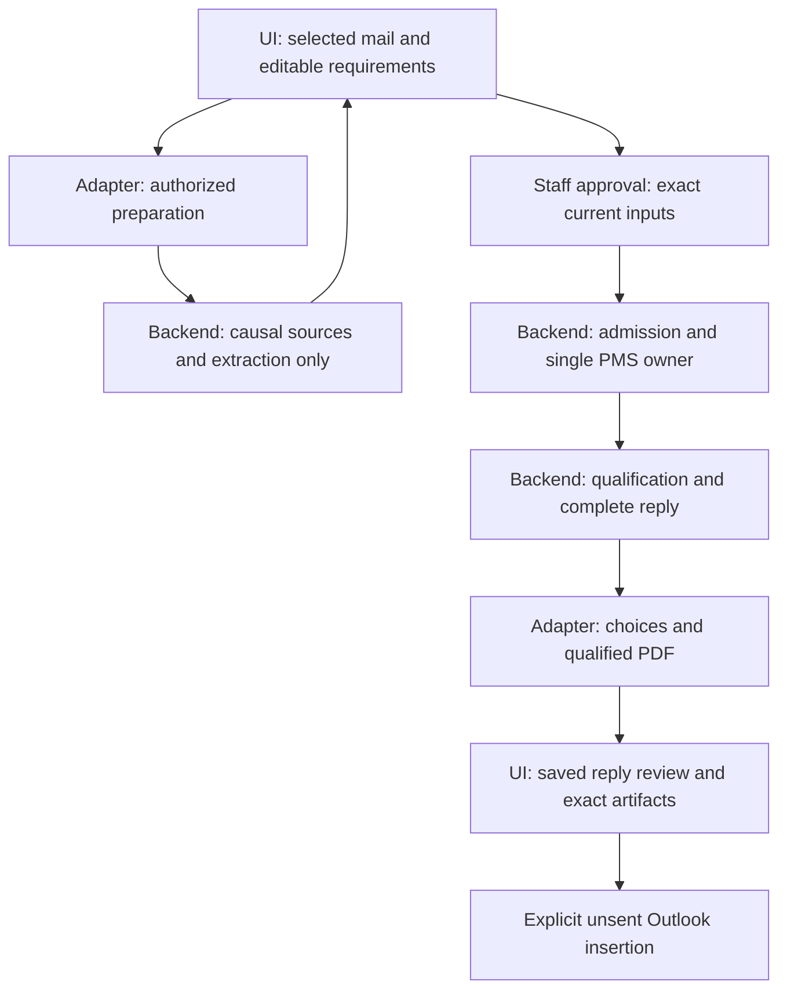
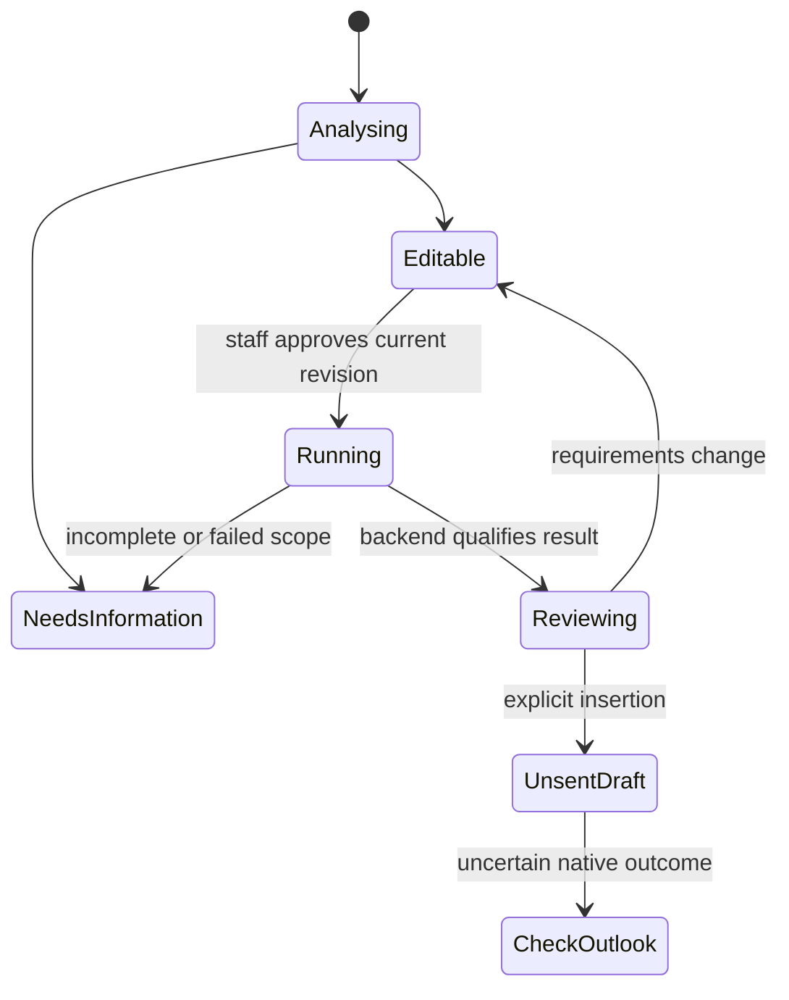

# Staff Quote UI Integration - Plan

## Goal Capsule

- Finish the existing staff quoting pane by connecting it to the backend reservationist stages; do not build a second agent.
- UI executor owns components, session state, adapters and integration proof in the quote-ui branch. Backend executor owns extraction, evidence admission, PMS execution, pricing, qualification and replay.
- Backend sibling is read-only to the UI executor. Use an owner-published scoped snapshot for integration, never copy its dirty working tree wholesale.
- No PMS writes, sends, production drafts, deployment, migrations, installer changes or second PMS browser owner.
- Complete independent adapter work while the backend is changing. Connected verification depends on an explicit backend handoff, not necessarily a main merge.
- Stop only the affected integration unit if its required backend boundary is unavailable; report the exact missing capability and owner. Do not substitute fixtures or quietly implement backend core.

---

## Product Contract

### Summary and Problem Frame

Keep staff inside the Outlook pane: inspect extracted requirements, approve read-only tools, review a qualified PDF and complete reply, then create an unsent native reply.
The pane has useful controls and safety gates, but currently runs conservative regex analysis and an unavailable tool endpoint.
The backend has real quote/PDF/draft capabilities, but its public read enqueue is not a staff-edited quote workflow interface.
The missing work is staged integration, not another extraction or pricing implementation.

Product Contract clarification: original selected-email analysis, editable requirements, approved tool steps, authentic results and unsent reply remain required. Agent/replay repairs stay with their existing owner.

### Requirements

**Source and approval**

- R1. Analyse the selected authorized email with causal thread/attachment sources through the existing backend extraction stage, without executing PMS.
- R2. Preserve partial facts, source identifiers, secondary questions and staff corrections when mapping to editable cards.
- R3. Execute the exact current staff-approved inputs through backend admission and its single PMS owner; raw email reparsing is not equivalent.

**Evidence and review**

- R4. Display backend results and coverage without interpreting raw read receipts as qualified proposals.
- R5. Generate the PDF through the qualified revision APIs and preserve authoritative revision/fact/run IDs, totals and artifact hashes.
- R6. Reuse saved reply hydration/edit/autosave and insert the full reviewed body plus exact reviewed PDF in an unsent native reply.

**Isolation and truthfulness**

- R7. Reject stale, cross-mailbox, cross-message or mismatched-revision results; keep existing uncertain native outcome handling.
- R8. Separate UI/mock verification, connected backend proof, Windows acceptance and deployment readiness in the handoff.

### Scope Boundaries

- Included: thin integration adapters, existing review/editor integration, authentic artifact previews and focused end-to-end proof.
- Excluded from the UI executor: extraction schemas/prompts, replay clock/freshness, rate/tax policy, quote arithmetic, native PMS tools and corpus scoring.
- Deferred to Follow-Up Work: create-booking UI/writes, auto-send, dashboards, design-system redesign, universal accuracy claims and production rollout.
- Do not weaken pricing or source checks to unblock UI. Unsupported scopes remain visible with a specific next action.

---

## Planning Contract

### Key Technical Decisions

- KTD1. Keep one integration adapter layer. Backend changes update mappings and focused contract tests, not the entire UI session architecture.
- KTD2. Backend owner exposes preparation, approved execution and qualification continuation over its existing services. No new generic workflow engine or duplicate document pipeline.
- KTD3. Do not wire edited groups directly to `ai.enqueueHmsRead`: that route accepts references and derives a request from authored mail; it does not accept the UI's edited groups.
- KTD4. Preserve backend qualification. A raw read result does not create the generation-bound revision consumed by `workstation.qualifiedProposalChoices`.
- KTD5. Replace the hypothetical UI PDF contract with actual backend evidence references. Never invent `centsReconciled: true` to satisfy a mock-shaped interface.
- KTD6. Keep selected allocation, input revision and complete reviewed reply together. Editing invalidates downstream evidence; staff text edits must survive artifact hydration.
- KTD7. Integrate using an owner-published snapshot and explicit overlapping-file resolution. Preserve main's mailbox isolation/native protocol; neither worker edits the other's checkout.

### High-Level Technical Design

### Backend Dependency Handoff

The backend executor must publish these capabilities or identify existing equivalents before connected proof:

| Capability | Required behavior | Existing starting point |
|---|---|---|
| Preparation only | Selected mailbox/message, causal sources, facts/tasks/references; no PMS execution | Existing provider/extraction stage; runtime currently also executes |
| Approved inputs | Current selected message and input revision; validate edited groups/party; preserve corrections | Existing execution/admission services; public read route is insufficient |
| Run lifecycle | Existing single owner, run reference/status/result; no duplicate launches on uncertain outcome | Existing AI/HMS queues and claim fencing |
| Qualification continuation | Persist authorized selected allocation/revision/facts and prepared complete reply | Existing qualified runtime/worker persistence |
| Artifacts | Authorized PDF/screenshot retrieval bound to run/message/revision | Existing draft artifacts and qualified PDF APIs |

This is a bounded backend interface requirement, not permission for Cursor to repair core services. Agree exported request/response types and capability status before implementing guessed shapes. Do not require a new schema versioning framework.

---

## Implementation Units

### U1. Contract mapping and safe integration handoff

- **Goal:** Make the ownership and actual request/result mapping executable without touching backend core.
- **Requirements:** R3, R5, R7, R8.
- **Dependencies:** None for inspection and characterization; backend owner publishes stage contract before successful-response wiring.
- **Files:** `apps/mail/lib/quote-workflow/backend-bind.ts`, `apps/mail/lib/quote-workflow/types.ts`, `apps/mail/tests/quote-workflow-backend-bind.test.ts`, `docs/plans/handoff-reports/reservationist-quote-ui-handoff.md`.
- **Approach:** Map actual exported backend types and available APIs. Record owner-approved snapshot commits/files, required service dependencies and overlapping pane/router paths. Prepare missing-capability behavior now; do not fake the successful staged interface.
- **Patterns:** Existing mailbox-scoped adapters and current revision guards.
- **Test scenarios:** Missing stage is unavailable; raw read receipt is not an offer/revision; PDF selection retains run/message/revision/fact references; incompatible result cannot enable PDF/native; backend failure releases local running state.
- **Verification:** Contract tests use sanitized real backend-shaped responses, not invented authorization flags. Owner handoff identifies every unavailable stage.

### U2. Bind preparation and staff-approved execution

- **Goal:** Replace regex/stub integration with the existing backend stages.
- **Requirements:** R1, R2, R3, R4, R7.
- **Dependencies:** U1 and owner-published preparation/approved-execution/qualification boundaries.
- **Files:** `apps/server-pilot/src/trpc/routes/quote-workflow.ts`, `apps/server-pilot/src/ai/quote-workflow-synced-selection.ts`, `apps/mail/lib/quote-workflow/backend-bind.ts`, `apps/mail/lib/quote-workflow/session.ts`, `apps/mail/app/(routes)/outlook-pane/page.tsx`, `apps/server-pilot/tests/quote-workflow-router.test.ts`, `apps/mail/tests/quote-workflow-step-runner.test.ts`.
- **Approach:** UI-owned route delegates to published backend services. Preserve source IDs and selected-message identity; map partial facts without inventing dates/occupancy. Staff approval sends the edited revision, not a fresh parse of latest thread mail. Reuse existing run lifecycle and dependencies.
- **Execution note:** Characterize actual boundary before replacing the stub.
- **Test scenarios:** Analyse makes zero PMS calls; earlier relevant attachment included/later reply excluded; arrival-only survives; edited adults/date/board reach approved execution; repeated Run does not duplicate a known in-flight operation; unmet party dependency blocks quote; failed/partial scopes keep useful facts and do not qualify unsupported prices; A-to-B-to-A rejects old results.
- **Verification:** Disposable authorized integration proves selected source -> preparation -> edited approval -> execution result with one existing backend owner. Missing source and permissions fail honestly.

### U3. Bind qualified artifacts and saved reply review

- **Goal:** Connect current UI selections to real qualified PDF and durable complete reply.
- **Requirements:** R4, R5, R6, R7.
- **Dependencies:** U1; U2 for newly generated staff-approved revisions. Existing published qualified revisions can characterize this unit earlier.
- **Files:** `apps/mail/lib/quote-workflow/backend-bind.ts`, `apps/mail/components/quote-workflow/quote-workflow-panel.tsx`, `apps/mail/components/quote-workflow/document-review.tsx`, `apps/mail/app/(routes)/outlook-pane/page.tsx`, `apps/mail/lib/quote-workflow/native-draft.ts`, `apps/mail/tests/quote-workflow-backend-bind.test.ts`, `apps/mail/tests/outlook-pane-stale-pdf-admission.test.tsx`, `apps/mail/tests/quote-workflow-native-draft.test.ts`.
- **Approach:** Use `workstation.qualifiedProposalChoices` and `qualifiedQuoteProposalPdf`; supported imported/approved source kinds use `sourceQuoteProposalPdf`, never relabel them as fresh HMS quotes. Reuse existing draft/editor hydration and autosave; no new draft store. Show authentic screenshot bytes only when a bound artifact exists. Keep explicit native insertion and manual Send.
- **Test scenarios:** Selected revision uses exact backend total/hash/bytes; multiple alternatives are not summed; unknown kind is unavailable; stale PDF ignored; wrong-mailbox artifact rejected; screenshot missing shows unavailable; secondary answers remain in full reply; staff edit plus delayed attachment hydration/autosave/refetch survives; unknown native create outcome shows Check Outlook Drafts rather than blind retry.
- **Verification:** Persisted draft refetch retains reviewed body and exact artifact; browser preview/native input hashes match backend artifact. Native proof is separate until Windows is available.

### U4. Connected checkpoint and landing preparation

- **Goal:** Prove the integrated staff path without repeating the backend corpus or taking its PMS owner.
- **Requirements:** R1-R8.
- **Dependencies:** U2, U3 and published backend snapshot.
- **Files:** `apps/mail/tests/browser-quote-workflow/interactive-pane.tsx`, `apps/mail/tests/browser-quote-workflow/interactive-pane-receipt.json`, `apps/mail/tests/quote-workflow-scenarios.test.tsx`, `docs/plans/handoff-reports/reservationist-quote-ui-test-receipts.md`, `docs/plans/handoff-reports/reservationist-quote-ui-handoff.md`.
- **Approach:** Integration branch contains only agreed UI/backend changes and resolves the overlapping pane. Use recorded native evidence for fast connected tests; coordinate any fresh HMS sample with existing owner. No second corpus evaluation, no live call per UI click during development.
- **Test scenarios:** Public single stay; party-rated stay; mixed occupancy or distinct-date groups; missing-fact/attachment clarification. Each checks actual server requests, qualification, full reply and PDF bytes. Narrow pane keyboard/edit/approval/preview path remains usable.
- **Verification:** One joined relevant suite and builds after integration, connected Chromium proof with unmocked application adapters/disposable persistence and explicitly recorded PMS boundary, then Classic Outlook unsent insertion if host available. Report backend defects to its owner.

---

## Verification Contract

- During edits: focused tests for changed adapter/session/router behavior; no full build/corpus run after each small patch.
- At checkpoint: joined relevant quote-workflow/pane tests, mail build and server-pilot TypeScript build using existing package scripts. Keep test DB environment unbound from pilot; disposable DB must be independently verified.
- Preserve baseline unrelated mail typecheck failures separately; do not claim blanket typecheck success or repair unrelated generated-route errors here.
- Reuse the backend's corpus results as backend qualification evidence, not as UI proof. Record backend snapshot and request shapes used in connected proof.
- Mocks prove UI behavior only. Recorded PMS with real adapters proves connected application behavior but not current live availability. Windows proof establishes native behavior; deployment remains a separate authorization.

---

## Definition of Done

- U1 mapping/handoff and U2-U4 connected outcomes verified against an owner-published backend snapshot.
- Staff-edited inputs are the inputs executed; analysis never runs tools.
- Real qualified PDF and complete reviewed reply persist and retain exact bytes/source binding.
- Existing mailbox isolation, stale-result rejection and uncertain native behavior preserved.
- No duplicate extractor/pricing engine/document pipeline/draft store; abandoned adapter experiments removed.
- Handoff separates connected web readiness, backend supported scopes, Windows acceptance and deployment; missing Windows proof means not installer-to-staff ready.
- No source changes in the other executor's checkout and no prohibited writes or sends.

---

## Risks and Timing

- Independent contract/adapter preparation: planning estimate 45-90 minutes; not a measured promise.
- Connected wiring and verification after backend stage publication: planning estimate 90-180 minutes; stage exposure effort belongs to backend and is not included.
- Windows acceptance: 30-60 minutes if an accessible host is available; otherwise report the blocker, not product completion.
- Biggest unknown is the stage interface, not JSX. Reassess after the first contract checkpoint before booking another large execution window.
- Backend schema churn should require localized adapter changes. Backend logic regressions remain its owner's task.

---

## Sources and Research

- UI baseline `6137ec47`: original UI plan and `docs/plans/handoff-reports/reservationist-quote-ui-handoff.md`; existing browser receipt proves hydrated React with mocked integrations only.
- UI `apps/server-pilot/src/trpc/routes/quote-workflow.ts`: regex preparation and unconditional unavailable Run.
- UI `apps/mail/lib/quote-workflow/backend-bind.ts`: placeholder PDF DTO/namespace differs from backend.
- Backend snapshot inspected read-only: `apps/server-pilot/src/trpc/routes/ai.ts`, `apps/server-pilot/src/hms/read-admission-issuer.ts`, `apps/server-pilot/src/ai/worker.ts`, `apps/server-pilot/src/trpc/routes/workstation.ts`.
- Backend `apps/mail/app/(routes)/outlook-pane/page.tsx` and `apps/mail/hooks/use-drafts.ts`: saved reply/editor/hydration already implemented; integrate, do not duplicate.
- This audit used local code, receipts, terminal output and Hindsight history; no external design research was necessary for settled integration boundaries.
