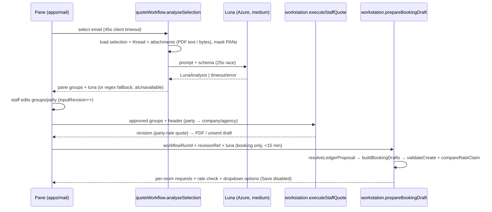

# feat: Luna reservationist MVP — analyse, prefill, booking drafts

**Execution posture:** Autonomous overnight (see the mandate below). Write each unit's tests first, then implement. One executor. Standard non-fast subagents only; if none are available, work inline. Start on the user's "go". **T0 = the UTC time of "go".** Record T0 in the ledger first thing in U0. Every time in this plan is T0-relative (`T+h:mm`); the executor writes the absolute UTC next to each one in the ledger.

**Evidence:** `docs/plans/2026-10-06-002-reservationist-mvp-evidence-ledger.md` (`[L#]`), `docs/plans/2026-10-06-003-case-coverage-gap-audit.md` (`[G]`), research briefs `/tmp/retro/brief-{A,B,C,D}-*.md` (VPS-local, not in git; copy to `.private/luna-mvp/briefs/` in U0).

---

## v2 day run (Oct 7 2026) — read this first

**State when v2 was written (11:50 UTC):**
- v1 D1–D10 are done. S1 is merged as [PR #33](https://github.com/kufupa/Zero/pull/33): main `6dfbb38b`, deployed to EC2.
- S2–S5 have not started.
- Local branch `feat/luna-mvp-stretch` is `origin/main` plus one unpushed docs commit (`4cb2a6a8`). There is also one untracked read-only research script, `apps/server-pilot/tooling/playwright-quote/read-reservation-fields.mjs`.
- This section **supersedes** the v1 "Stretch queue" and "Schedule" sections below. Everything else (Global Constraints, the mandate, runbooks, safety) still applies, except where "v2 safety amendments" below changes it.

**HMS outage (staff-confirmed, updated 12:14 UTC):** down from 12:00 SAST until **minimum 15:30 SAST (13:30 UTC)**; may still run to 16:00 SAST (14:00 UTC). VPN is healthy; `appsrv-1` login times out. Phase A needs no HMS. **Do not probe before 13:30 UTC.** First probe at 13:30 UTC, then at every later unit boundary. If Checkpoint A finishes before 13:30, park A6.

**Models and gates:** the user switches models by hand.
- Phase A and Phase C run on the execution model.
- **Gate G1** comes after Checkpoint A: **STOP**, write the ledger and report, and tell the user "Phase A done; switch model for Phase B".
- Phase B (analysis, short) runs on the research model and ends by confirming Phase C.
- Phase C then runs to the end with no further gate.

**Velocity, measured from last night's commit times:**
- A feature unit took 15–45m: U1 ≈30m, U3 ≈31m, U7 ≈45m, U8 ≈15m.
- A checkpoint (Greptile ×2 + fixes + PR + merge + deploy + verify) took 50–95m: CP1 1h34 including parallel U7 work, CP2 1h38, S1 review/merge ≈55m.
- The v1 plan's P50s were about 2.3× too high. The v2 estimates below are measured values.

### What staff actually do (research, Oct 7; aggregates only)

**Sources:**
- 116 HMS confirmation letters (outbound PDFs, Sep 28–Oct 6) parsed from S3. They are in `.private/luna-mvp/staff-bookings/letters/`, and the script is `letters_join.py` in the same folder.
- 71 of those letters joined to their inbound request, by guest surname or recipient address. The join is a heuristic and some joins are wrong, so the numbers are directional.
- The v1 census (1,189 rows) and the gap audit `[G]`.

**Findings:**
- **Staff book from thin emails and fill the gaps themselves.** 77% of requests (55/71) name no room type, and 82% (58/71) state no rate. Many say only "as per our telephone conversation". Staff don't send these back with questions.
- **Unstated room type becomes a Standard room.** 78% of letters (91/116) are Standard Queen or Standard Twin. For 1 adult: Standard Queen 47, Standard Twin 30. Both cost the same within each rate tier, so the choice is about availability, not a question for the client. "Single room" means 1 adult.
- **Unstated board becomes B&B.** 80% of letters (93/116) are B&B. DBB is 23/116, and 17 of the 18 joined DBB letters come from government senders, all on one fixed DBB tier. Rule: government gets DBB, everyone else gets B&B.
- **Rates fall into a few fixed tiers per party.** The quote tool already prices by party and `salesStrategy`, and the model never prices.
- **Dinner add-ons are separate charges.** When a client stated a dinner add-on (an amount per person), staff booked B&B and charged dinner separately, which is exactly S3 extras.
- **Booking doesn't wait for payment.** Every letter shows deposit received = 0 (116/116). Guarantee arrives later as a pro forma payment, voucher or PO.
- **A signed quotation turns straight into a booking**, which is the S1 lane.
- **Still unknown (HMS is down):** track, source of business, market segment, guarantee type and created-by per party class. Phase B reads 182 real reservations, read-only, to learn these.

**Product consequence, a new target:** "fully prefilled" is the wrong goal. The target is **staff-equivalent prefill**. That means everything staff would enter from the email, plus the defaults staff always apply. A field stays blank only where staff also had to ask: guest names on a booking, a shuttle flight time, or an unclear party. Questions are asked only for those. The census gets a `staffEquivalent` bucket (A2). The v1 baseline is `full` = 35/399 desk-action rows; `staffEquivalent` gets measured against it.

### Phase A — no HMS (execution model; starts ~12:20 UTC; P50 end ~15:40, P80 ~16:30)

| # | Item | P50 / P80 |
|---|---|---|
| A0 | Setup: watchdog `/loop 30m /continue-autonomously`; ledger heading `## v2`; `git switch -c feat/luna-v2-a` from current HEAD (`origin/main` + `4cb2a6a8`); commit this plan, the ledger and `read-reservation-fields.mjs` by explicit path (`docs:` / `chore(tooling):`) | 10m / 15m |
| A1 | Verbatim filter for `rateClaims` | 15m / 25m |
| A2 | Staff-equivalent defaults plus census re-run | 40m / 1h |
| A3 | S3 extras on the staff quote path | 45m / 1h15 |
| A4 | S1b: one-click re-quote when the prior quote has expired | 30m / 50m |
| A5 | Checkpoint A (S5 docs written during Greptile waits) | 60m / 95m |
| A6 | HMS probe **not before 13:30 UTC** (15:30 SAST floor); when up, run the Phase B read in the background | background |

**A1. `rateClaims` verbatim filter.**
- `apps/server-pilot/src/ai/quote-workflow-llm.ts:248-254` filters `evidence` to verbatim spans but returns `rateClaims` unfiltered. These are the 5 residual invented prices.
- Apply the same `sourceText.includes(claim.quote)` filter to `rateClaims`.
- Tests: a claim not in the source is dropped; a claim in the source is kept; when every claim is dropped, the price check shows "can't check", never an invented amount.
- Commit: `fix(reservationist): drop rate claims that are not verbatim in the email`.

**A2. Staff-equivalent defaults (from the findings above).**
- *Board:* `quote-workflow-llm.ts:156` maps `board:null` to `'unknown'`, which then blocks the quote (`apps/mail/lib/quote-workflow/session.ts:272`, `review-items.ts:41`, `staff-quote-bind.ts:181`).
  - Change: null becomes `'dinner_bb'` when Luna's party kind is government, otherwise `'bb'`.
  - Add `'defaulted'` to the `fields` state union (`quote-workflow-llm.ts:38`).
  - The pane shows plain text "usual" next to a defaulted board. Staff can still edit it.
  - When the email states a board, it always wins.
- *Room type:* an unstated room type never produces a missing question. Drop `roomType`/`roomPreference` entries from `missing` in the mapper. The quote returns options and staff pick.
- *Prompt:* append to `K2_MAPPING` (`quote-workflow-llm.ts:17`): "single room" = 1 adult per room; a double/twin room with no headcount = 2 adults; never ask for room type, board or rate, because the hotel defaults those.
- *Census:* add a `staffEquivalent` bucket to `apps/server-pilot/scripts/luna-case-census.ts` (next to `bucketOf`, `:244`):
  - workflow is quote or create_booking;
  - `missingPricing` is false;
  - no `MANUAL_FLAGS`;
  - extras, unread attachments and discounts no longer disqualify a row.
- Re-run the full census in the background (Runbook G, about $0.70, about 20m) and record the old `full` count next to the new `staffEquivalent` count in the ledger. Smoke `--limit 20` first.
- Tests:
  - board null with a private party gives `bb` and `defaulted`;
  - board null with a government party gives `dinner_bb`;
  - a stated board wins over the default;
  - room-type questions are filtered out;
  - the pane test for a defaulted board renders "usual" and doesn't block the quote.
- Commit: `feat(reservationist): default board and room like staff do`.

**A3. S3 extras.** Follow stretch-specs §S3, with these corrections:
- The staff path writes `proposalFacts: []` at `apps/server-pilot/src/trpc/routes/workstation.ts:477`, not `:433`.
- Build `AuthorizedProposalFacts` (`apps/server-pilot/src/quote-proposal/quote-lines.ts:34-36`) from fields staff confirmed in the pane, with `revisionId`, `authorizationId`, `sourceRef` and `sourceHash` taken from the revision and the prepared quote.
- *Dinner:*
  - `unitKind:'person_service'`, `quantity:1`, persons = each group's guests, dates = each night, `units = persons.length × dates.length`. Any other combination throws `ambiguous_meal_units`.
  - `unitMinor` is the staff-confirmed amount per person per night.
  - The pane prefills the amount only when an A1-filtered verbatim claim holds it; otherwise the field is empty and staff type it.
- *Shuttle:* with no staff-typed amount, add no extras line, only a review item "Shuttle requested — add a price or answer in the reply". With an amount, add a `trip` line. Never add an R0 line.
- The draft total check (`drafts.ts` via `deriveAuthorizedExtraLines`) must include the extras.
- Tests:
  - the spec's three cases;
  - a 2-adult, 3-night dinner gives 6 units and no throw;
  - a shuttle with no amount gives a review item and no line.
- Commit per the spec.

**A4. S1b: re-quote an expired prior quote.**
- `apps/mail/app/(routes)/outlook-pane/page.tsx:430` only toasts "This quote expired — run Quote again". The cause is the 15-minute freshness window (`reservationist-business-services.ts` `maxAge` 15×60000).
- Replace the toast with a "Re-quote same stay" action:
  - It calls `executeStaffQuote` with the prior revision's groups (dates, quantity, adults, childAges, board, roomCodes) and the party header from `metrics.staffQuoteAttestation` (company / agency / `salesStrategy`).
  - Then it continues to `prepareBookingDraft`, as S1 does.
- Fake-only tests: an expired result renders the action; clicking it sends the prior inputs unchanged; staff edits made after the prefill still win.
- The live run moves to C2.
- Commit: `feat(pane): re-quote an expired earlier quote in one click`.

**A5. Checkpoint A.**
- Runbook E, **always `-b origin/main`**. Two rounds; a third only for open P0/P1.
- Then PR, merge, Runbook B deploy, Runbook C verify, and the host smoke from U6 step 9.
- Deploying during or after the outage is fine. If health fails, roll back with Runbook D to `6dfbb38b`.
- During Greptile waits, write the S5 docs (stretch-specs §S5). Seed B3 with the letters findings above: the letter fields all come from the HMS reservation header, so "send the confirmation letter" is a post-save HMS step, not a new generator. Timebox 30m each.

**A6. HMS probe (background).**
- **Earliest 13:30 UTC.** If wall clock is before that, do not probe; continue A1–A5.
- Run Runbook F plus the U0 `party-lookup.mjs` probe.
- When HMS is up, run the Phase B read:
  - Smoke 3 first: `node apps/server-pilot/tooling/playwright-quote/read-reservation-fields.mjs --input .private/luna-mvp/staff-bookings/smoke.json --out .private/luna-mvp/staff-bookings/fields-smoke.jsonl`.
  - Need at least 2 rows with outcome `read`.
  - Then the full set: `--input input.json --out fields.jsonl` (182 rows, resumable, about 15–25m).
- Serial; no other live HMS step runs at the same time. Read-only: the script's route guard aborts save/cancel/delete/checkin/checkout POSTs.

**G1 (end of Phase A):** STOP. Update the ledger and the report § v2. Tell the user: "Phase A done; switch model for Phase B".

### Phase B — staff-code analysis (research model, P50 45m)

- **B1.**
  - Join `.private/luna-mvp/staff-bookings/fields.jsonl` to the inbound requests, using confirmation number, letter and surname (pattern from `letters_join.py`).
  - Per party class (agency / government / organization / private; derived from company/ta1 and the rate tier), crosstab track, sourceOfBusiness, guaranteeType, marketSegment, rate-plan family and createdby.
  - Note what staff typed in `reservationnote` / `caller` when the email lacked facts.
  - Derive defaults with the existing rule: n≥3, support ≥60%, valid enum.
  - Output `.private/luna-mvp/code-mining/crosstab.md` and an aggregates-only table in the ledger.
- **B2.** Confirm or reorder Phase C, and edit this section in place if the findings change it.

### Phase C — HMS live plus lab saves (execution model; P50 ≈ 7h after Phase B, so about 23:30 UTC, P80 about 01:30)

| # | Item | P50 / P80 |
|---|---|---|
| C1 | Fill `MINED_CROSSTAB` in `apps/server-pilot/src/ai/booking-code-rules.ts` from B1; enum-validity test green; fields that fail the rule stay null with `CLIENT_QUESTION` | 20m / 35m |
| C2 | Live read-only proofs to `.private/luna-mvp/proofs/v2/`: S1b re-quote on a real thread (quote only); S3 extras PDF on one real quote | 30m / 50m |
| C3 | S2 multi-date quotes: stretch-specs §S2; guards re-verified Oct 7 at `apps/mail/lib/quote-workflow/staff-quote-bind.ts:207-209` and `apps/server-pilot/src/ai/staff-quote-workflow.ts:115`; one live 2-date quote | 50m / 1h20 |
| C4 | Checkpoint C (as A5) | 60m / 95m |
| C5 | Lab saves (A2), described below | 1h / 1h30 |
| C6 | A1 Save route (stretch-specs §S4) behind `RESERVATIONIST_PANE_SAVE`; guard is **lab-only** (`Labtest` + arrival ≥2027) until the user tries it; prove it through the route with one of the C5 lab-stay slots; the flag stays **unset on EC2** | 1h / 1h30 |
| C7 | Amendment/cancel read-only assist, described below | 1h30 / 2h15 |
| C8 | Checkpoint D plus the report § v2 | 1h20 / 2h |

**C5. Lab saves.**
1. First read the folio of lab stay `46184891-1`, read-only: did an R2,060 penalty post when it was cancelled? If it did, use an arrival ≥2027 that is outside the penalty window.
2. Then make at most 3 lab stays **in total, including the C6 proof**. For each one, in this order:
   - `create-lab-stay.mjs` full save, with no `--stop-before`;
   - record the confirmation in the ledger immediately;
   - readback with `read-reservation-fields.mjs`;
   - `cancel-lab-stay.mjs` on that confirmation only;
   - readback to confirm it is cancelled.

**C7. Amendment/cancel read-only assist.** This is the biggest unbuilt lane: 166 census rows are flagged amend/cancel.
- When Luna returns an `amend` or `cancel` task, the pane offers "Find reservation".
- It uses the `OSRESS.search` → `OSRESV.HDR` read path from `read-reservation-fields.mjs`, searching by confirmation number first, then by guest + dates.
- It shows the current stay (dates, room, rate, pax, status) next to the requested change.
- No writes.

**Cut order if behind:** C7 (leave it as a PR) → C6 (leave it as a PR) → the C3 live proof. Never cut C1, or the readback and cancel steps of C5.

### v2 done criteria

- [ ] **E1** Checkpoint A merged and deployed with A1–A4. The ledger has the census old `full` vs new `staffEquivalent`, and invented prices = 0 after A1.
- [ ] **E2** Staff-booking read: ≥100 rows with outcome `read`, or an HMS outage note; `crosstab.md` written.
- [ ] **E3** `MINED_CROSSTAB` filled wherever the support rule holds; the rest null with `CLIENT_QUESTION`.
- [ ] **E4** ≤3 lab stays, each with save → readback → cancel → readback evidence. Zero writes to real bookings.
- [ ] **E5** Checkpoints C and D merged and deployed, or PR-reviewed with the reason recorded.
- [ ] **E6** `docs/plans/handoff-reports/2026-10-07-luna-mvp.md` § v2 updated (no PII), with an open-questions list.

### v2 safety amendments (all other Global Constraints still hold)

- **HMS writes are allowed only on lab stays this run creates.** A lab stay has guest last name `Labtest`, arrival ≥ 2027-01-01, and its confirmation recorded in the ledger when it was created. At most 3 per run.
- `cancel-lab-stay.mjs` runs only on those confirmations. `LAB_CANCEL_CONFIRMATION` is set inline for that one command only.
- **Never save, modify or cancel a real booking. Reading real bookings is allowed.**
- Pane Save stays off for real guests (`RESERVATIONIST_PANE_SAVE` unset on EC2) until the user tries it.
- Greptile always runs against `-b origin/main`; local `main` is stale at `5568ea18`.
- Smoke 3 rows before any batch (HMS reads, census).
- The watchdog starts at A0. Last night 5h32 was lost to a silent stop.
- Unchanged: no sends; the pilot-RDS rule; `unset DATABASE_URL VITEST_ALLOW_PILOT_RDS TEST_DATABASE_URL` before every Vitest run; no PII in git; one serial CDP owner; never touch other worktrees.

---

## Summary

Staff select an inbound email in the Outlook pane. One Luna call (Azure `gpt-6-luna`, effort `medium`) classifies it as quote, booking or other. The same call prefills the editable stay groups and party, lists "needs your answer" questions, and flags unsupported cases. The existing deterministic quote path does the rest: staff-approved HMS quote, then qualified PDF, then unsent draft. For bookings, the stored quote revision becomes per-room create requests at the party's contract rate, with a price check against what the email claimed. Save stays disabled tonight. Two checkpoints each go commit → Greptile ×2 → merge → deploy.

## Problem frame

The Oct 2–6 sprint shipped a regex-only pane. Luna code never reached the shipped branch [retro]. Most booking emails omit the fields HMS requires: track is missing in 97%, rate plan 93%, room type 90%, guarantee 87% [G]. The tools already exist: `executeStaffQuote`, party lookup inside the quote, the qualified PDF, `compareRateClaim` and `create-lab-stay.mjs`. What's missing is the AI front end, code defaults learned from staff's real bookings, and the mapping from quote to booking.

## Requirements

- R1. Any inbound selected in the pane shows a Luna workflow badge (Quote / Booking / Other) within ~30s, or a visible "AI unavailable" fallback. It never hangs.
- R2. Luna prefills the stay groups the staff then edit: dates, rooms, adults per room, child ages, board, room preference. It also prefills the party (agency / organisation / government / private). The model never outputs prices.
- R3. "Needs your answer" lists missing facts as questions. "Not supported yet" names each unsupported case. Both are plain text, and email-derived evidence never renders as HTML.
- R4. PDF attachments are read, or flagged as unread (`attachment_unread`). An unread attachment never blocks analysis.
- R5. Card numbers (Luhn-valid PANs) are masked before every model call and never stored.
- R6. Track / source of business / guarantee defaults come from staff's real reservations (read-only HMS). If unknown, the dropdown is blank and a question goes to the client.
- R7. A booking email plus a staff-approved quote produces one create request per room, at the quote's room and rate codes and with the party's HMS name. It also carries a price check (match / mismatch / can't check).
- R8. Case census over the corpus: workflow and flag counts, coverage buckets, invented prices = 0, and 30 rows for the user to check.
- R9. Each checkpoint goes PR → Greptile CLI ×2 with fixes → merge to main → deploy → health. Rollback = redeploy the previous main SHA.
- R10. Safety: no sends. No HMS saves. No Vitest against pilot RDS. No secrets or PII in git, SSM stdout or logs.

## Scope boundaries

- **In:** U0–U10 below.
- **Out tonight:** Save from the pane; lab stays; multi-date quotes; extras lines; conference/group quotes; amendments and cancellations; confirmation letters and pro formas; Word/Excel rooming lists; stays over 30 nights; Luna reply prose; eval infrastructure; the `prepareBookingPacket` proof chain.
- **Never:** sending email, saving historical-corpus bookings, any second browser owner on CDP 19223.

### Deferred to follow-up work (+4h / +8h blocks, ROI order)

| # | Item | P50 | Payoff |
|---|---|---:|---|
| A1 | Staff Save: server create spawn plus guard (staff-approved, or `Labtest` and arrival ≥2027), duplicate check (reservation search by guest + dates), readback after save. Enabled only with the user present. | 1–1.5h | bookings save from the pane |
| A2 | Lab stays. First read the folio of lab stay `46184891-1` read-only (did the R2,060 penalty post?). Then use a no-penalty lab rate and run ≤3 stays dated 2027+ marked `Labtest`: save → readback → cancel → readback. | 1h | save and cancel proven end to end |
| A3 | Booking that accepts our earlier quote: prefill from the thread's prior staff revision (`metrics.reservationistResult.quoteRevisions`) | 45m–1h | ~25% of bookings |
| A4 | Checkpoint 3 | 45m | |
| B1 | Multi-date quotes. Remove the guards at `apps/mail/lib/quote-workflow/staff-quote-bind.ts:201` and `apps/server-pilot/src/ai/staff-quote-workflow.ts:108-115`, loop ≤5 date sets (pattern `reservationist-execution.ts:330`), and merge them into one PDF. | 1–1.25h | 7–14% of quotes |
| B2 | Extras lines (dinner allowance amount from the client, shuttle) → `AuthorizedProposalFacts.extras`. The staff path currently passes `proposalFacts: []` (`workstation.ts:433`). | 45m | ~13% of proposals |
| B2.5 | Checkpoint 4a (with 1 live multi-date quote) | 45m | |
| B3 | Confirmation letter and pro forma research → sized plan | 1h timebox | 106–111 staff threads/fortnight |
| B4 | Conference sizing (52 event proposals, 33 contracts) → sized plan | 1h timebox | 25–36% of quote asks |
| B5 | Checkpoint 4b (docs only) | 15m | |

---

## Global Constraints

- **Worktree:** `/home/ubuntu/projects/zero/.worktrees/luna-mvp`, branch `feat/luna-reservationist-mvp`, from main `5568ea18` (= EC2 HEAD). Keep the uncommitted partial edits (`luna.ts`, `quote-workflow-synced-selection.ts`, `reservationist-agent.ts`, new `reservationist-decision.ts`, 3 test files). U1 completes them.
- **Tests:** before any Vitest, run `unset DATABASE_URL VITEST_ALLOW_PILOT_RDS TEST_DATABASE_URL`. Never source `.env.production` in a shell that runs tests. No unit in this plan needs a database. If one appears to, mock `getDb` or treat it as a safety blocker.
- **Typecheck:** there is no `typecheck` script. Server: `cd apps/server-pilot && pnpm exec tsc -p tsconfig.json --noEmit`. That excludes `tests/`; Vitest doesn't typecheck either. Mail: `pnpm --filter @zero/mail build`, which doesn't typecheck. Record the baseline error count for `cd apps/mail && pnpm exec tsc --noEmit` in U0 and don't increase it.
- **Code style:** ESM, NodeNext, relative imports end in `.js`. zod **v3**: use `zodToJsonSchema(schema, {$refStrategy:'none'})`, never `z.toJSONSchema`. Prettier: width 100, single quotes. Multi-line readable style, as in `quote-workflow.ts`. tRPC return branches use `as const` literals.
- **Luna:** use `LunaModelAdapter` (`apps/server-pilot/src/ai/bedrock/luna.ts`) with `createAzureLunaModel()`. Server-pilot has **no `ai` package**, so no `generateObject`. Call `adapter.invoke({systemPrompt, userPrompt, files?, responseSchema, signal, deadlineAt})`, then `lunaAnalysisSchema.safeParse(output)`. Effort `medium` (3.8–7.2s measured vs 22.7s at max [L19]). Server deadline 25s via `Promise.race`; client timeout 45s. Kill switch `QUOTE_WORKFLOW_LLM=off`.
- **Field name:** `adultsPerRoom`, never `adults`, inside the Luna schema; its meaning flipped across earlier efforts [L20]. The pane field `adults` means per room.
- **Live HMS:** serial only. One borrowed owner on EC2 CDP `127.0.0.1:19223`, reached over the SSM tunnel. Never start or restart someone else's owner. `--stop-before availability` on every create run. `LAB_CANCEL_CONFIRMATION` unset. Never run `cancel-lab-stay.mjs` (**v2 exception:** lab stays this run created, per "v2 safety amendments"). **Wednesday maintenance (v2: 10:00 UTC until **minimum 13:30 UTC** / 15:30 SAST Oct 7, staff-confirmed):** tonight crosses into Wed Oct 7. Before each live HMS step, run the U0 login probe. If HMS is down, treat it as an external outage: defer only the live steps, continue other units, and re-probe at the next unit boundary.
- **Privacy:** raw PII stays in `.private/luna-mvp/` (gitignored). Git, PRs, SSM stdout and the morning report carry aggregates and codes only. Never print secret values.
- **Overruns:** cut scope; never add infrastructure. Max 2 prompt-tuning rounds. Log every divergence in the ledger `.superpowers/sdd/luna-mvp-progress.md`.

---

## Autonomous Execution Mandate

**User granted full autonomy (Oct 6 2026, 22:50 UTC: "/autonomous-plan … code it all up overnight").** Continue until the done criteria below are verified or a true blocker is reached. No blocking questions overnight. No manual login. No "which approach?" pause.

### Communication

- Orchestrator and every subagent: **respond `/caveman ultra`; technical terms exact.** Code, commits and PRs are written in normal prose.
- Subagent dispatch prompts carry file paths and purpose only, never raw PII.

### AWS / infra (use freely)

| Resource | ID / path |
|----------|-----------|
| EC2 | `i-008f737974a9ba9b3` (`af-south-1`) |
| RDS | `nava-zero-mail-pilot` (Postgres 16) |
| S3 | `nava-zero-mail-845242190536-af-south-1` |
| Repo on EC2 | `/home/ubuntu/repos/zero` |
| **Primary deploy** | `apps/server-pilot/deploy/ops-deploy.sh` (`--migrate` when schema) |
| **Primary app bounce** | `apps/server-pilot/deploy/ops-restart.sh` |
| **Primary box reboot** | `apps/server-pilot/deploy/ops-reboot.sh` |
| Guts (fallback) | `sync-ec2-git-bundle.sh`, `deploy-ec2.sh`, `ssm-run-command.sh` |
| EC2 role | `nava-prod-public-ipv4-WorkerRole-bPmrMEkmdwLU` |
| Bundle bucket | `nava-zero-bootstrap-845242190536` |

**Allowed:** ops wrappers, bundle sync, deploy, read-only SSM checks, PM2 logs, health curl, and tests against a disposable non-production database. Also, per the user's 22:52 approval: create the Secrets Manager secret `nava-zero/server-pilot/azure-luna` and one inline role policy granting read access to that secret only (U2). Also, per the user's 22:52 approval: live HMS **reads**, plus `create-lab-stay.mjs --stop-before availability`, from this Cursor session over the tunnel.

**Forbidden:**
- Force-push main, `--no-verify`, destructive git.
- IT Exchange/VPN/real mail creds.
- Any Vitest or test command pointed at pilot or production RDS; setting `VITEST_ALLOW_PILOT_RDS=1`; sourcing `.env.production` into a test process.
- HMS Save/Cancel/Delete (**v2 exception:** ≤3 `Labtest` lab stays with arrival ≥2027 that this run created; never a real booking); sending email.
- Printing or committing secret values; secret values in SSM command parameters.

### Pilot RDS safety (overrides autonomy)

Never run Vitest against `nava-zero-mail-pilot` or any production database. No overnight escape hatch exists.

Before every local or EC2 Vitest command:

```bash
unset DATABASE_URL VITEST_ALLOW_PILOT_RDS
```

If a test requires Postgres, use a disposable test database. If none exists, use read-only SQL/API health checks where they prove the requirement; otherwise report a safety blocker. Never weaken this rule to make a gate green.

### RCA loop (mandatory on any red)

FAIL → reproduce → root cause (file:line) → fix → test → commit → resume. Do not stop at the first failure. Symptom patches, skipped gates, and "user can finish later" are not completion.

### Cursor execution-backend flake (not a human gate)

Exact error: `Execution backend unavailable. Do not retry tool calls — the execution environment is down.`

This is Cursor's agent tool bridge, not Zero app/AWS/RDS. Full playbook: `docs/solutions/workflow-issues/cursor-execution-backend-unavailable.md`.

1. Do **not** ask the user to wait or re-invoke.
2. Backoff-retry Shell/Write/StrReplace (≈5s → 15s → 45s) until `echo shell_ok` works or three attempts fail.
3. On recovery: `git status`, read `.superpowers/sdd/luna-mvp-progress.md`, resume mid-task (resume the subagent, or re-dispatch with the existing uncommitted work).
4. Only if retries are exhausted **and** Shell is still dead after ~5 minutes: record a blocker in the handoff with evidence. Still do not invent an app RCA.

### Divergence authority

A better path to the done criteria → take it. Log it in the ledger and the morning report. Preserve requirements; never silently cut scope. When cutting for time, follow the cut order in the Schedule.

### Verification loop

Implement → focused tests → typecheck/build → checkpoint gates (Greptile ×2, merge, deploy, health, host smoke) → inspect evidence → fix any red → repeat.

### Done criteria (binary; evidence path required for each)

- [ ] **D1** `feat/luna-reservationist-mvp` merged to main via PR with 2 Greptile CLI rounds triaged (FIX/REJECTED/DEFERRED listed in the PR body).
- [ ] **D2** EC2 runs the merged SHA (`pm2 jlist` `sourceCommit`). `:8788/health`, `:8789/health` and the TLS vhost are healthy, and `/outlook-pane` returns 200.
- [ ] **D3** EC2 host smoke: `analyseQuoteSelection` on a synthetic email returns `source:'luna'` (Azure keys present: key-name count = 1 each). Or, if U2 was blocked by IAM, the fallback returns `aiUnavailable:true` and the blocker is recorded.
- [ ] **D4** Server and mail target tests green; server `tsc` 0 errors; mail build green; mail `tsc` error count ≤ the U0 baseline.
- [ ] **D5** Census written: `.private/luna-mvp/census/{rows.jsonl,summary.md,check-30.md}`; invented prices = 0; summary table (aggregates only) in the ledger.
- [ ] **D6** Code mining: `.private/luna-mvp/code-mining/{reservations.jsonl,crosstab.md}` with ≥15 reservations read, **or** a timebox-expired note. `booking-code-rules.ts` merged (defaults or nulls), with its enum-validity test green.
- [ ] **D7** Booking drafts: `prepareBookingDraft` and the booking card merged and deployed; `booking-draft.test.ts` green.
- [ ] **D8** Live proofs in `.private/luna-mvp/proofs/`: ≥1 Luna → party lookup → fetch-quote run, and ≥1 `create-lab-stay --stop-before availability` with `status:'stopped_before_availability'`. Or a recorded HMS-down/outage note.
- [ ] **D9** Morning report `docs/plans/handoff-reports/2026-10-07-luna-mvp.md` written (no PII) with an open-questions list.
- [ ] **D10** No unresolved blocker affecting the goal, or each blocker is recorded with evidence and a next step.

- [ ] **D11 (stretch)** After D1–D10: run the Stretch queue until it is empty or 14:00 UTC. Each S-item is merged and deployed, or PR-only, or skipped, with the reason in the report.

Checkpoint 2 (D7/D8) may legitimately end as "PR reviewed, unmerged" if it's past **T+9:40** (the Checkpoint 2 merge cutoff). Record that and stop.

### True blockers

Stop only for:
- credentials or access that cannot be obtained safely;
- required human-only interaction;
- destructive ambiguity;
- a conflict with safety policy;
- an external outage that prevents required proof (HMS down → defer only the live parts).

---

## Key technical decisions

| # | Decision | Rationale |
|---|---|---|
| K1 | Keep the partial test API names: `analyseQuoteSelection`, `buildQuoteWorkflowPrompt`, `mapLlmDecision`, `quoteWorkflowLlmEnabled` in a new `quote-workflow-llm.ts`; rewrite their fixtures to the new schema | Least churn; existing behaviour cases are correct (brief A §2) |
| K2 | `lunaAnalysisSchema` lives in `reservationist-decision.ts` (replaces `quoteWorkflowLlmSchema` `:34-72`); `CENTURION_HOTEL_RULES` unchanged, prompt adds a mapping paragraph (create→`create_booking`, skip/spam→`other`, groups 10+→`conference_or_group` flag) | Agent path still uses the rules |
| K3 | PAN helpers move to new `src/ai/card-mask.ts`; `property-knowledge-read.ts` imports from it | Census script must stay DB-free (brief A §7) |
| K4 | Route `ready` payload = legacy pane fields (`intent, groups, secondaryAsks, alternatives, reviewItems`) **plus** `source`, `fallbackReason?`, `aiUnavailable`, `luna: LunaAnalysis \| null`, `sourceRevision`. Server merges deterministic `attachment_unread` into `luna.flags`. Unread attachments → `reviewItems` (`document_failure`/`unread_source`); `luna.missing` → `reviewItems` (`question`/`secondary`) | Pane keeps working before U3; reviewItems already pass through (`backend-bind.ts:121-131`) |
| K5 | `workflow: quote\|create_booking → intent 'quote'`, `other → 'other'` | `intent !== 'quote'` hides all UI (`session.ts:462`) |
| K6 | Booking drafts use **option B**: pane calls existing `executeStaffQuote` first, then `prepareBookingDraft({workflowRunId, revisionRef, messageId, selectionEpoch, inputRevision, analysis})` reloads the stored revision via `resolveLedgerProposal` (`workstation.ts`) — no lock, no second HMS read; must run within 15 min of the quote | Saves ~3m40s; revision is the reusable artefact (brief C §1) |
| K7 | Pure per-room mapper `requestFromQuotedRoom(...)` exported from `booking-draft.ts`; `buildBookingDrafts` and the U9 proof script both use it | Testable; enables live proof without the deployed pane |
| K8 | Party in the draft = `group.context.agency?.name` / `group.context.organization?.name` (keys `{id,code,name}`), never Luna's string; do not copy `reservationist-booking-packet.ts:87` (`nativeId`) | HMS name is authoritative (brief C §3) |
| K9 | Price check: claim `source.page = 1`; amount normalised (strip `R`, `ZAR`, commas, spaces), precision = fraction length (pattern `reservationist-execution.ts:236`); Luna `taxBasis:'unknown'` → compare as `gross_included` and label "assumes VAT-inclusive" | `page:0`/fixed precision/`unknown` always yield `cannot_check` (brief C TL;DR); SA rates are quoted inclusive |
| K10 | Code mining = read-only tooling-lane script over the tunnel, modelled on `cancel-lab-stay.mjs` `openTarget`/`readIdentity` (no cancel code), inputs = 100 confirmations already proven live on Sep 15 (`centurion-dashboard-tools/.private/hms-read-100-20260915/candidates-100-softok.json`) | There is no reservation list mode (brief D §3); the exact search plus a read of the detail form fields works, and the form exposes `track`, `guaranteetype`, `sourceofbusinessdesc`, `marketsegment` (`apps/server-pilot/evals/hms/osresv-detail.live-shape.v1.json`) |
| K11 | Azure keys on EC2 via Secrets Manager + scoped inline role policy + `write-ec2-env.sh` `append_env` + surgical on-box env patch; never secret values in SSM params/stdout | User-approved 22:52; EC2 role reads only listed secrets (verified 22:56) |
| K12 | Deploy: `ops-deploy.sh` is the primary path. Preconditions: EC2 tracked-clean on main, and local `main` not checked out in any worktree. **Tonight, `main` is checked out in `.worktrees/recover-parse-failure` (verified 23:15), so Runbook B (ff-only bundle, PR30 path) is the expected path.** Never touch or detach other worktrees (user decision 23:16) | Overlay primary; EC2 verified clean at `5568ea18` (22:53) |
| K14 | Luna emits ordered `tasks[]` (quote / create_booking / amend / cancel / availability / other, with group indexes). Tonight it is only measured (census) and shown (one pane line). Execution stays fixed deterministic chains; the dormant tool-loop agent (`reservationist-agent.ts:150`, no callers) is not wired | Multi-tool cases (multi-date 7–14% of quotes, ~25% of bookings accept an earlier quote, amendments, cancellations) get real frequencies before any build. This is the contract for a later deterministic orchestrator with a tool budget (pattern `reservationist-execution.ts:330`: ≤5 requests, 24 calls). Avoids the retro's agent-loop slowness (~4 min per `quote_stay`) |
| K15 | Fold the uncommitted `reservationist-quote-ui` work into this branch in U0, before U3. U1 keeps that patch's `documentFailures` mapping, feeding the K4 `document_failure` review items. U3's party prefill follows the same "late analysis never overwrites staff edits" guard, and that patch's session tests must stay green | The patch overlaps exactly the files U3 edits. Merging it first avoids a later conflict and keeps the staleness fix, which matters more now that analysis takes ~6s |
| K13 | Pane booking card gets dropdown options from the server response (`options: {track, sourceOfBusiness, guaranteeType, roomType}` read from `create-tool.schema.json`) | Schema isn't exported to `@zero/mail` (brief B §6) |

## Assumptions

- Luna tax basis default (K9) is labelled in the UI; the client can correct it.
- The `track` value read from HMS may be a label; `normalizeCreateLabels` (`tooling/playwright-quote/create-request.mjs:154-161`) maps track labels to codes. Defaults that fail enum validation are dropped to null.
- The Outlook draft and Classic Outlook acceptance are checked by the user in the morning. The agent cannot drive Windows Outlook.

---

## High-level technical design



Analyse fallback state: `QUOTE_WORKFLOW_LLM=off` or Azure env missing → `disabled`. Adapter throws → `error`. Output fails the schema → `invalid_output`. More than 25s → `timeout`. Any fallback runs `analyseQuoteSources` (regex) and returns `aiUnavailable:true` and `luna:null`.

---

## Implementation units

Dependency order: U0 → (U1 ∥ U2 ∥ U4-run) → U3 → U5 → U6 → U7 → U8 → U9 → U10.

### U0. Preflight and baselines

**Goal:** a known-good starting state, so later reds are attributable.
**Requirements:** R9, R10.
**Dependencies:** none.
**Files:** `.superpowers/sdd/luna-mvp-progress.md` (create), `.private/luna-mvp/` (create, 0700).
**Approach:**
- Copy the four briefs to `.private/luna-mvp/briefs/`.
- Record the server baseline: the 3 quote-workflow test files plus `property-knowledge-read`. Expect partial tests to fail on import; record that.
- Record the mail baseline: `tests/outlook-pane-*.test.tsx`, `tests/quote-workflow-*.test.ts*` and `tests/trpc-request-timeout.test.ts`. `outlook-pane-step-runner` is probably already stale.
- Record the mail `tsc` error count and confirm the server `tsc` passes at baseline.
- Install pinned Playwright in this worktree: `npm ci --prefix apps/server-pilot/tooling/stagehand --ignore-scripts --no-audit --no-fund`.
- Confirm `greptile whoami` reports signed in (exit code is 0 even when signed out) and `gh auth status`.
- Open the tunnel on 19223 and check the EC2 owner (Runbook F).
- HMS probe: run `apps/server-pilot/tooling/playwright-quote/party-lookup.mjs` with any agency name (read its CLI args from the file header). Outcome `resolved`/`ambiguous`/`no_match` means HMS is up; a login or navigation failure means it's down. Record which.
- **Fold in the quote-ui work (K15; user decision 23:16).** `.worktrees/reservationist-quote-ui` holds 17 uncommitted files (+491/−163, last edited Oct 6 ~11:44 UTC) that are not on main. They cover: delayed analysis must not overwrite staff stay edits; a new submission clears quote authority; the staff-approved Government contact and the native room-code set are sent; a zero total is rejected and the PDF hash must match the bytes; unread attachments become `documentFailures`. Steps:
  1. Run `git -C ../reservationist-quote-ui diff --binary > .private/luna-mvp/quote-ui.patch`. Back up the luna partials with `git diff --binary > .private/luna-mvp/luna-partials.patch`, and copy the untracked partial files to `.private/luna-mvp/partials/`.
  2. Run `git stash push -u -m luna-partials -- apps/`. **Pathspec `apps/` only**, so the untracked plan docs stay put.
  3. Run `git apply --index .private/luna-mvp/quote-ui.patch`, then commit immediately as `fix(quote-ui): keep staff edits on late analysis, bind approved contact and room codes, verify PDF bytes`. Never modify the `reservationist-quote-ui` worktree itself.
  4. Run the tests:
     - Mail: `tests/quote-workflow-session.test.ts`, `tests/quote-workflow-backend-bind.test.ts`, `tests/outlook-pane-quote-pdf.test.tsx`, `tests/quote-workflow-panel.test.tsx`.
     - Server: `tests/quote-workflow-router.test.ts`.
     - Also server `tsc` and the mail build.
     - Any RCA fix is a further `fix(quote-ui): …` commit.
  5. Run `git stash pop`. A conflict is expected in `tests/quote-workflow-router.test.ts` (both sides edit it); resolve it by keeping both sides' cases. Re-run that file.
  - **Timebox 45m.** If the tests are still red after RCA, run `git revert --no-edit` on the fold-in commits (never `reset --hard`), then do step 5. Keep the patch in `.private`, log it as DEFERRED with the failing test names, and continue to U1. Never block U1 on this.
**Test expectation:** none (baselines only), apart from the quote-ui fold-in tests.
**Verification:** the ledger lists baseline pass/fail counts, the tsc count, HMS up/down, and the quote-ui result (committed SHA, or DEFERRED with the reason).

### U1. Analyse service (server)

**Goal:** `analyseSelection` returns a Luna analysis, or a flagged regex fallback, within the 25s budget.
**Requirements:** R1–R5.
**Dependencies:** U0.
**Files:**
- Modify `apps/server-pilot/src/ai/reservationist-decision.ts`: replace `:34-72` with `lunaAnalysisSchema` (below).
- Create `apps/server-pilot/src/ai/quote-workflow-llm.ts`.
- Create `apps/server-pilot/src/ai/card-mask.ts`; modify `apps/server-pilot/src/ai/property-knowledge-read.ts` to import the PAN helpers from it.
- Modify `apps/server-pilot/src/trpc/routes/quote-workflow.ts`: loader seam, remove the `missing_source` gate `:51-58`, Luna call, fallback.
- Modify `apps/server-pilot/src/ai/quote-workflow-synced-selection.ts` only if needed. The partial loader is already correct (brief A §2); add `signal` to the route's `LoadSyncedSelection` type.
- Tests: `apps/server-pilot/tests/quote-workflow-llm.test.ts` (rewrite fixtures), `tests/quote-workflow-router.test.ts`, `tests/quote-workflow-synced-selection.test.ts`, new `tests/card-mask.test.ts`.

**Schema (contract):**

```ts
// directional — the contract fields are binding, helper names may vary
lunaAnalysisSchema = z.object({
  workflow: z.enum(['quote', 'create_booking', 'other']),
  flags: z.array(z.enum(['conference_or_group','amendment_or_cancel','long_stay',
    'discount_or_negotiation','multi_date','extras','mixed_request','attachment_unread'])),
  groups: z.array(z.object({
    arrival: z.string().nullable(), departure: z.string().nullable(),   // ISO YYYY-MM-DD
    rooms: z.number().int().nullable(),
    adultsPerRoom: z.number().int().nullable(),   // .describe(): "Adults in EACH room; '6 adults in 3 rooms' = 2"
    childAges: z.array(z.number().int()),
    board: z.enum(['room_only','bb','dbb']).nullable(),
    roomPreference: z.string().nullable(), guestNames: z.array(z.string()),
  })),
  party: z.object({ kind: z.enum(['agency','organization','government','private']).nullable(),
    name: z.string().nullable(), reference: z.string().nullable() }),
  rateClaims: z.array(z.object({ kind: z.enum(['exact','ceiling','budget','average_daily','total','paid']),
    amount: z.string(), currency: z.string(), basis: z.enum(['per_room_per_night','total','unknown']),
    taxBasis: z.enum(['gross_included','exclusive','unknown']), quote: z.string() })),
  missing: z.array(z.object({ field: z.string(), question: z.string() })),
  evidence: z.array(z.object({ field: z.string(), quote: z.string() })),
  // K14: ordered PMS work the email implies. Measured and displayed only; never executed tonight.
  tasks: z.array(z.object({
    kind: z.enum(['quote','create_booking','amend','cancel','availability','other']),
    groupIndexes: z.array(z.number().int()),   // 0-based indexes into groups[]
    note: z.string(),                          // short plain text, e.g. "second date option"
  })).max(8),
})
```

Prompt rule for `tasks`: emit one task per distinct piece of PMS work, in the order staff would do it. Different date sets for the same ask become separate `quote` tasks. "Quote then book if OK" becomes `quote` then `create_booking`. A single simple ask is one task.

**Approach:**
- *Prompt (`buildQuoteWorkflowPrompt`):*
  - System = `CENTURION_HOTEL_RULES`, plus the K2 mapping paragraph, "never output prices except verbatim claims in rateClaims", and "extras (shuttle, dinner) → missing questions".
  - User = the `receivedAt` date (for year inference), then subject, then masked body. Then the thread: preceding messages oldest first, ≤8k chars each, ≤40k total. Then attachment text, ≤20k chars each.
  - Scanned PDFs go as `files` (≤3, `%PDF-` check per `luna.ts:141`).
- *Masking:* apply `maskCardNumbers` to subject, body, every thread body and all attachment text. Scanned PDF bytes cannot be masked; documented, accepted.
- *Call (`analyseQuoteSelection(input, {adapter, deadlineMs=25000, enabled})`):*
  - `Promise.race(adapter.invoke(...), timer)` with `clearTimeout` in `finally`, plus `signal` and `deadlineAt`.
  - Then `safeParse`. Result: `{source:'luna', analysis}`, or `{source:'regex_fallback', fallbackReason}`.
- *Adapter (lazy, in the route):* `new LunaModelAdapter({model: createAzureLunaModel(), reasoningEffort:'medium', routeId:'azure_quote', modelId:'gpt-6-luna', protocol:'azure-openai-responses'})`. Build it inside try, because `createAzureLunaModel` throws when env is missing; a throw means `disabled`.
- *Loader seam:* `quoteWorkflowLoaders = {loadSyncedSelection, adapter, llmEnabled}`, each nullable and injectable in tests.
- *`quoteWorkflowLlmEnabled(env)`:* contract as in the existing test `:202-212`. `QUOTE_WORKFLOW_LLM` must be `undefined`, `'on'` or `'off'`; anything else throws. `undefined` means enabled iff both Azure vars are set.
- *Mapping to the pane (`mapLlmDecision`):*
  - Group `id` = `g{i+1}`; `arrival→arrivalDate`, `departure→departureDate`, `rooms→quantity`, `adultsPerRoom→adults`, `childAges→childrenAges`.
  - Board: `dbb→'dinner_bb'`, `null→'unknown'`. `roomPreference` passes through.
  - `party.name→organisation`; `specialRequests: []`.
  - `fields[k]` = `'missing'` when null, otherwise `'extracted'`. Invalid ISO dates → null plus a `missing` entry.
  - `workflow: 'other'` → `groups: []`.
- *Logging:* `console.warn('quote_workflow_fallback', fallbackReason)` only, with no content.
- **Never** put `pdf` bytes into the response.

**Patterns:** `apps/server-pilot/src/ai/reservationist-extraction.ts:27` (schema → JSON schema); `tests/quote-workflow-llm.test.ts:42-53`, `:215-227` (adapter fakes).

**Test scenarios:**
- Happy path:
  - Fake adapter returns a valid quote analysis. Router returns `status:'ready'`, `source:'luna'`, `aiUnavailable:false`, and `groups[0]` ⊇ `{quantity:1, adults:2, board:'bb'}`; `sourceRevision` echoes `selectionEpoch`.
  - A `create_booking` analysis maps to `intent:'quote'`, keeps the groups, and keeps `luna.workflow:'create_booking'`.
- Edge:
  - `workflow:'other'` → `intent:'other'`, `groups:[]`.
  - `"2026-02-30"` → `arrivalDate` undefined, `fields.arrivalDate:'missing'`, plus a missing question.
  - `board:null` → `'unknown'`.
- Masking: body with `4111 1111 1111 1111` → the adapter `userPrompt` contains `[card ••••1111]` and not the digits. A non-Luhn 16-digit run stays unmasked. Card number inside a thread message is masked too.
- Attachments:
  - A non-PDF attachment no longer returns `missing_source`. Status is `ready`, `luna.flags` contains `attachment_unread`, and there is a `document_failure` review item.
  - A scanned PDF reaches the adapter as `files[0]` with `mediaType:'application/pdf'`.
- Failure:
  - The adapter sleeps 30s while ignoring abort (fake timers, or `deadlineMs:50`) → `regex_fallback`, `fallbackReason:'timeout'`, returned within the deadline.
  - The adapter throws → `'error'`. Output fails the schema → `'invalid_output'`.
  - `QUOTE_WORKFLOW_LLM=off` → `'disabled'` and the adapter is never called.
- Isolation: no synced row for this transport → `{status:'unsynced'}` (existing test kept).
- Tasks (K14):
  - An analysis with 2 `quote` tasks (groups 0 and 1 on different dates) passes through unchanged in `luna.tasks`. Pane `groups` still hold both groups, and the `multi_date` flag is kept.
  - 9 tasks → schema fails → `invalid_output` fallback.
  - `mapLlmDecision` never reads `tasks`; the pane mapping is identical with or without them.
- Contract: `quoteWorkflowLlmEnabled` matrix (`{}`→false, both Azure vars→true, `off`→false, `on`→true, `maybe`→throws).
- The `LunaModelAdapter` effort/strict/incomplete tests (`:214-243`) stay green.

**Verification:** the 4 server test files are green; server `tsc` shows 0 errors. Commit `feat(reservationist): Luna analyse step for quote and booking emails`.

### U2. Azure Luna keys on EC2

**Goal:** the deployed `http` process has `AZURE_OPENAI_BASE_URL` and `AZURE_FOUNDRY_API_KEY`.
**Requirements:** R1 (on host), R10.
**Dependencies:** U0. Runs in parallel with U1. Must finish before U6's host smoke.
**Files:** modify `apps/server-pilot/deploy/write-ec2-env.sh` (fetch the optional `AZURE_LUNA_SECRET_NAME`, default `nava-zero/server-pilot/azure-luna`; `append_env` both keys only when the fetch succeeds; never echo values).
**Approach:**
1. Get the VPS values. The key is in the current shell env `AZURE_FOUNDRY_API_KEY` (verified set). The base URL is the `base_url` in `~/.codex/config.toml` (an `.../openai/v1` URL).
2. Create the secret. Write the JSON `{AZURE_OPENAI_BASE_URL, AZURE_FOUNDRY_API_KEY}` to a mode-0600 temp file, run `aws secretsmanager create-secret --region af-south-1 --name nava-zero/server-pilot/azure-luna --secret-string file://<tmp>`, then `shred -u` the file. If the secret already exists, use `put-secret-value`.
3. Grant the EC2 role read on that secret only: `aws iam put-role-policy` on the EC2 role with policy name `NavaZeroAzureLunaSecretRead`, allowing `secretsmanager:GetSecretValue` on the returned ARN.
4. Patch the box env. An SSM script with **no secret in its parameters** fetches the secret with the instance role. Node then upserts the two keys into `/home/ubuntu/repos/zero/apps/server-pilot/.env.production` (0600, values single-quoted like `quote_val`). Print only `AZURE_KEYS_WRITTEN=2`.
5. `ops-restart.sh`.
6. Verify key names only. Count each key in the file, and in `/proc/$(pm2 pid http)/environ`; expect 1 for each.

**If IAM or Secrets Manager is denied:** log the blocker, continue, and let U6 deploy with the regex fallback (D3 "blocked" branch). The morning report then gives the exact commands for the user.
**Test expectation:** none (ops). `tests/deploy-config.test.ts` must stay green after the `write-ec2-env.sh` edit; run it, since it scans deploy scripts.
**Verification:** key-name counts = 1 in both the file and the pm2 env; recorded in the ledger.

### U3. Pane: Luna badge, prefill, needs-your-answer, not-supported

**Goal:** the pane renders the server analysis only. The client regex is gone, and the pane never hangs.
**Requirements:** R1–R4.
**Dependencies:** U1 (response contract K4).
**Files:**
- Modify `apps/mail/app/(routes)/outlook-pane/page.tsx`: delete the `analyseLocalEmail` import (`:81`) and the client regex block (`:281-285`). On a server `unavailable` result or a throw, dispatch `analysis_failed`. Effect deps become `[quoteAdmissionKey]`.
- Modify `apps/mail/lib/quote-workflow/backend-bind.ts`: widen `AnalyseSelectionResult`, `BoundAnalyse` and the `ready` mapping to carry `source`, `fallbackReason`, `aiUnavailable` and `luna`.
- Modify `apps/mail/lib/quote-workflow/types.ts`: add optional `QuoteAnalysis.luna`, `aiUnavailable` and `source`, plus a local `LunaAnalysisWire` type that mirrors the schema.
- Modify `apps/mail/lib/quote-workflow/session.ts`:
  - Build on the K15 commit (quote-ui fold-in). Its tests "does not let delayed analysis overwrite staff stay edits" and "clears quote authority on a new submission" must stay green.
  - In `analysis_ready`, when the staff header's company and agency are empty and not staff-edited, prefill from `luna.party`: agency → `agency`; organization → `company`; government → `company` plus `salesStrategy:'Government'`.
  - Add the `bookingDraft` slot used by U8: `null` in `initialQuoteSession` and in `clearDownstream`.
- Modify `apps/mail/lib/trpc-request-timeout.ts`: `quoteWorkflow.analyseSelection` → 45 000 ms.
- Create `apps/mail/components/quote-workflow/workflow-badge.tsx`, `needs-answer-list.tsx` and `not-supported-list.tsx`.
- Modify `quote-workflow-panel.tsx`:
  - Render the badge before the `non_quote` early return; render the two lists above `ItemsForYou`.
  - Rewrite the mailbox-status copy at `:277-281` to drop "Local regex preview".
- Modify `requirement-card.tsx`: an "AI suggestion" chip and evidence quotes as plain `<p>` text, never `dangerouslySetInnerHTML`.
- Tests:
  - Update `apps/mail/tests/quote-workflow-panel.test.tsx` (the `:145-150` assertion) and `tests/trpc-request-timeout.test.ts`.
  - Add an `analyseSelection` stub to every `OutlookPanePage` test mock (8 files listed in brief B §4); the stub returns exactly one group `g1`.
  - New `tests/quote-workflow-luna-render.test.tsx`.
  - Leave `lib/quote-workflow/analyse-local.ts` and its test in place, unused.

**Flag copy:**

| Flag | Copy |
|---|---|
| `conference_or_group` | Conference/group request: handle manually; the facts below are extracted |
| `amendment_or_cancel` | Amendment/cancellation: not supported yet |
| `long_stay` | Over 30 nights: split manually |
| `discount_or_negotiation` | Discount asked: needs your decision |
| `multi_date` | Several date options: quote the first, add the rest manually |
| `extras` | Extras requested (shuttle/dinner): add manually |
| `mixed_request` | Several requests in one email: check each |
| `attachment_unread` | An attachment couldn't be read: open it |

**Tasks line (K14):** when `luna.tasks.length > 1`, the not-supported list adds one line: "This email needs N steps: quote, quote, create booking. The pane handles the first; do the rest manually." Kinds use plain words. No buttons.

**Patterns:** card/chip/banner classes from `requirement-card.tsx:11,28-30`, `page.tsx:847-852`; the render-test pattern from `tests/quote-workflow-panel.test.tsx:13-57`; full-pane mocks from `tests/outlook-pane-render.test.tsx:124-153`.

**Test scenarios:**
- `luna.workflow:'create_booking'` → badge "Booking", and groups render.
- `aiUnavailable:true` → "AI unavailable", and the regex groups still render.
- `flags:['conference_or_group','attachment_unread']` → both copies are visible.
- `missing:[{field:'guestNames', question:'Guest names for room 2?'}]` → the question is listed.
- An evidence quote containing `` renders as literal text.
- Editing Adults calls `onPatchGroup('g1', {adults:3})` (existing test kept).
- The server returns `unavailable` → `phase` leaves `analysing` (no spinner forever).
- Selection changes mid-flight → the stale result is ignored (the `cancelled` guard kept).
- Timeout matrix: `/api/trpc/quoteWorkflow.analyseSelection?batch=1` → 45 000; `quoteWorkflow.analyseSelectionX` → 5 000.
- Party prefill: `party:{kind:'government', name:'Dept X'}` → header company `Dept X`, salesStrategy `Government`. A staff-edited header is not overwritten.
- Tasks: `tasks` of kinds `[quote, quote, create_booking]` → the line "This email needs 3 steps: quote, quote, create booking…" is visible. A single task → no line.

**Verification:**
- Mail target tests are green, or match the U0 baseline for stale files; any file still failing gets an RCA note.
- `pnpm --filter @zero/mail build` passes, and mail `tsc` stays at or below the baseline.
- Commit `feat(pane): Luna badge, prefill, questions and unsupported flags`.

### U4. Code mining (read-only HMS, background)

**Goal:** learn staff's track / source / guarantee / rate plan per party class from real reservations.
**Requirements:** R6.
**Dependencies:** U0 (tunnel and Playwright). Write and start it first, so it runs in the background during U1–U3.
**Files:**
- Create `apps/server-pilot/tooling/playwright-quote/read-reservation-codes.mjs`.
- Create `apps/server-pilot/src/ai/booking-code-rules.ts`.
- Test `apps/server-pilot/tests/booking-code-rules.test.ts`.
- Output to `.private/luna-mvp/code-mining/`.

**Approach:**
- *Script basis:* copy login, menu and `openTarget`/`readIdentity` from `cancel-lab-stay.mjs` (`:19-88`, `:163-200`). **Do not copy `cancelOpenRecord`.** Use the same env: `HMS_STAGEHAND_CDP_URL=http://127.0.0.1:19223`, `HMS_STAGEHAND_BROWSER_OWNERSHIP=borrowed`, `HMS_READ_SECRET_ARN=nava-zero/server-pilot/infor-hms-read`, `AWS_REGION=af-south-1`.
- *Read-only guard:* a `context.route` aborts any request whose path matches `/save|delete|cancel|duplicate|checkin|checkout|crs/i` (pattern `scripts/hms-guest-stay-form-inventory.ts:34-46`). Never click buttons other than search and row open.
- *Input:* `--input` = confirmation values from `centurion-dashboard-tools/.private/hms-read-100-20260915/candidates-100-softok.json` (100 entries, `{kind:'confirmation', value}`). Cap 40, serial, 2s pause, 90s per reservation.
- *Fields read (allowlist; confirm names against `apps/server-pilot/evals/hms/osresv-detail.live-shape.v1.json`):* `confirmationnumber, status, arrivaldate, departuredate, roomtype, rateplan, track, guaranteetype, sourceofbusiness, sourceofbusinessdesc, marketsegment, company, companyname, bookingagency, channel`. Read select elements by **selected option text** and inputs by value. Guest names are not read.
- *Output:* append one JSON line per reservation to `reservations.jsonl`, so a crash can resume.
- *Crosstab:* a small node step writes `crosstab.md`.
  - Party class: `bookingagency` non-empty → agency; else company/companyname matching `/dep(t|artment)|ministry|municipal|government|province|sapo|sars|saps/i` → government; else company non-empty → organization; else private.
  - Counts per class × field.
- *Rules:* `bookingCodeDefaults(kind)` returns, per field (`track`, `sourceOfBusiness`, `guaranteeType`), the top value when support is ≥60% and n≥3, else `null`. Values are normalised via `normalizeCreateLabels`, then validated against `create-tool.schema.json` enums; invalid → `null`. Embed the crosstab results as a frozen table in the TS file with `n` and `support`.
- *Timebox:* 2.5h wall clock. If HMS is down, or fewer than 15 reservations are read, ship `booking-code-rules.ts` with all-null defaults plus a `CLIENT_QUESTION` comment, and log it.

**Test scenarios:**
- Every non-null default is a valid enum value in `create-tool.schema.json`.
- An unknown kind returns all nulls.
- `private` with n<3 returns null.

**Verification:** `reservations.jsonl` and `crosstab.md` exist, or the timebox note does; the rules test is green. Commit `feat(reservationist): booking code defaults mined from staff reservations` (no PII in the TS file: codes, counts and party class only).

### U5. Case census

**Goal:** measure coverage on the real corpus with the U1 analyser.
**Requirements:** R8.
**Dependencies:** U1.
**Files:** create `apps/server-pilot/scripts/luna-case-census.ts`. It imports only `quote-workflow-llm.ts`, `reservationist-decision.ts`, `card-mask.ts` and `luna.ts`, plus `import type` from the selection module. No `getDb`.
**Approach:**
- *Corpus A:* `centurion-dashboard-tools/.private/reservationist-backtest/corpus/messages.jsonl`, filtered `businessDirection==='inbound' && !contextOnly` → 846 rows.
  - Body = `textBody`, or `htmlToPlainText(htmlBody)` (`src/mail/inbound-reaction-parser.ts:42`) when empty.
  - Thread = same `threadId`, `receivedAt` ≤ the selected message, oldest first.
  - Non-inline PDFs → `{name, text:null}`, so `attachment_unread`.
- *Corpus B:* `centurion-dashboard-tools/.private/cli-coverage/shards/*-bodies.jsonl`: 355 rows, 65 with `attachmentText`. Dedupe the 12 ids that also appear in A.
- *Run:* concurrency 8 with append-only `rows.jsonl`; resume by skipping ids already done. Env from the shell: base URL from `~/.codex/config.toml`, key from env. Never print them.
- *Cost cap:* sum `usage.estimatedCostUsd`; stop at $50 and report.
- *Bucket per row:*
  - **full** = quote or booking with no blocking flag and no missing pricing field (dates, rooms, adults).
  - **partial** = supported workflow, but with a flag or missing fact.
  - **manual** = flag ∈ {conference_or_group, amendment_or_cancel, long_stay}.
  - Plus `other`.
- *Invented price:* every digit amount in `rateClaims[].amount` must appear (after normalising) in the masked source text, and `rateClaims[].quote` must be a substring of it. Count violations; the target is 0, and any violation triggers prompt-tuning round 1.
- *Multi-tool measure (K14):*
  - Count the rows with `tasks.length > 1`.
  - Histogram of task-kind sequences (e.g. `quote>quote`, `quote>create_booking`, `amend`), top 15.
  - Count of `amend`/`cancel`/`availability` tasks.
  - The summary ranks the deferred items (B1 multi-date, A3, amendment, cancel, alternatives) by how many rows each would unlock.
- *Outputs:* `summary.md` (counts, flag table, buckets, multi-tool table) and `check-30.md` (10 quote / 10 booking / 10 other, randomly sampled with seed 42; masked excerpts plus analysis).

**Test expectation:** none (script). Run a 20-row smoke first and eyeball 5 rows.
**Verification:** D5. The summary table is pasted into the ledger, aggregates only.

### U6. Checkpoint 1: PR → Greptile ×2 → merge → deploy

**Goal:** U1–U5 live on main and EC2.
**Requirements:** R9, D1–D4.
**Dependencies:** U1, U2 (or its blocked note), U3, U4 (rules or null rules), U5 (may land after; it touches only `scripts/`).
**Approach (Runbook E then A):**
1. Tree clean: the plan docs and ledger are committed as `docs:`, `.private` is ignored.
2. `git push -u origin feat/luna-reservationist-mvp`.
3. `greptile review -b main --json > .private/luna-mvp/greptile-cp1-r1.json`. Poll `greptile review status --json` (3 = running). Triage every comment as FIX/REJECTED/DEFERRED, fix, run the tests, commit.
4. Round 2, same steps.
5. `gh pr create` with the triage table and the test evidence. Check the bot comments with `gh api …/pulls/<N>/comments` and fix any P0/P1 the same way.
6. `gh pr merge <N> --merge --match-head-commit <sha>`.
7. Deploy (K12): `git fetch origin`. If `git worktree list` shows no `[main]`, run `git branch -f main origin/main`, then `bash apps/server-pilot/deploy/ops-deploy.sh` with no `--migrate` (no schema change). Otherwise use Runbook B.
8. Verify with Runbook C.
9. Host smoke over SSM: `node --input-type=module` imports `dist/ai/quote-workflow-llm.js`, runs `analyseQuoteSelection` on a synthetic email ("Please quote 2 rooms, 2 adults each, 12–14 Nov 2026, B&B") with the real adapter, and prints `source=<x> ms=<n>` only.

**Rollback:** if health fails, redeploy `5568ea18` with Runbook D. Web/nginx rolls back automatically.
**Verification:** D1–D4 with evidence paths in the ledger.

### U7. Booking drafts (server)

**Goal:** a stored party-rate quote revision plus the Luna analysis gives per-room create requests and a price check.
**Requirements:** R6, R7.
**Dependencies:** U1, U4.
**Files:**
- Create `apps/server-pilot/src/ai/booking-draft.ts`: `requestFromQuotedRoom`, `buildBookingDrafts`, `splitGuestName`.
- Modify `apps/server-pilot/src/trpc/routes/workstation.ts`: add the `prepareBookingDraft` mutation.
- Test `apps/server-pilot/tests/booking-draft.test.ts`; extend `tests/` workstation coverage only if a route test pattern exists.

**Contracts (directional):**

```ts
type BookingDraftRoom = { groupId: string; roomIndex: number /* 1-based */; request: Record<string, unknown>;
  schemaErrors: string[] };
type BookingDraft = { rooms: BookingDraftRoom[]; rateCheck: Array<RateComparison & { claimQuote: string;
  assumedTaxBasis: boolean }>; missing: { field: string; question: string }[]; flags: string[] };
requestFromQuotedRoom({ arrival, departure, adults, childAges, roomCode, rateCode,
  party: { kind: 'agency'|'organization'; name: string } | null, guestName: string | null,
  defaults: { track; sourceOfBusiness; guaranteeType } }) → { request, missing }
buildBookingDrafts({ analysis, revision, defaults, messageId, validate }) → Promise<BookingDraft>
```

**Approach:**
- *Route (option B, K6):*
  - Input: `z.object({workflowRunId, revisionRef, messageId, selectionEpoch, inputRevision, analysis: lunaAnalysisSchema}).strict()`.
  - Load the `aiWorkflowRun` by id, scoped to `ctx.activeTransportId`. Run `resolveLedgerProposal(run, {transportId, messageId, revisionRef, factRefs: []})`, which checks attestation and freshness, and `structuredClone` the frozen revision.
  - Party class for defaults: `revision.groups[0].context` has `agency` → agency; has `organization` → organization (government when the staff header used `salesStrategy:'Government'`; read it from the stored attestation); else private.
  - Then `buildBookingDrafts`.
  - Return `{status:'ready', draft, options, messageId, selectionEpoch, inputRevision}`. `options` = enums read from `create-tool.schema.json` `$defs.request.properties`. Expired or not found → `{status:'unavailable', reason}`.
  - No lock, no HMS call, no DB writes.
- *Per group:* one request per `quantity`. Fields:
  - `arrival`/`departure`/`adults`/`childAges` from the revision group.
  - `roomType = group.roomCode`, `ratePlan = group.rateCode`.
  - Party from `group.context` (K8).
  - Guest = `analysis.groups[gi]?.guestNames[roomIndex-1]`, else the first name in the list for the lead room. A missing name produces a `missing` entry and the request is built without names.
  - `splitGuestName`: strip `Mr|Mrs|Ms|Miss|Dr|Prof` and dots; last token = `lastName`, the rest = `firstName`.
  - Defaults: a null field is omitted, which produces a `schemaErrors` entry plus a missing question ("Track for this booking?").
- *Validation:* `validate` = the create validator used by `createDefaultRunners().validateCreate` (`reservationist-agent.ts:237-246`: `normalizeCreateLabels` + `validateCreateRequest` from `tooling/playwright-quote/create-request.mjs`). Collect errors as strings.
- *Flags:*
  - A company was asked for (`analysis.party.kind ∈ {organization, government}` and a name), but no `organization` key in the context → flag `party_rate_not_applied`.
  - More than one revision group with different room codes → flag `joint_inventory_unproven` (the quote path already blocks this; defensive).
- *Price check (K9):* per claim build a `RateClaim`:
  - `scopeDigest = revision.scopeDigest`; `source {ref: messageId, page: 1, quote: claim.quote || claim.amount}`.
  - Amount normalised, precision derived. `taxBasis` = unknown → `gross_included` with `assumedTaxBasis:true`.
  - Basis and kind as Luna emitted them.
  - Target: copy the builder at `reservationist-execution.ts:239` (single group: `nightlyMinor = nightly[].amountMinor`, `quantity`; multi-group: the flatten trick; `taxBasis` from `inclusions`).
  - Then `compareRateClaim`.

**Test scenarios:**
- Happy path: a 2-room agency revision (`quantity:2`, `context.agency.name:'XYZ TRAVEL'`, `roomCode:'STQN'`, `rateCode:'TAXYZ'`) plus Luna guestNames `['Mr John Smith','Jane Doe']` → 2 requests, both with `agency:'XYZ TRAVEL'` and `ratePlan:'TAXYZ'`; names split correctly; `schemaErrors:[]` when defaults are complete.
- Price check:
  - Voucher ceiling `"R1,700"` vs nightly 185000 → `mismatch`, `differenceMinor:-15000`.
  - `exact` `"1850.00"` vs nightly 185000 every night → `match`.
  - `basis:'unknown'` → `cannot_check` (`ambiguous_basis`).
  - `taxBasis:'unknown'` → compared, with `assumedTaxBasis:true`.
- Edge:
  - Only one guest name for 2 rooms → room 2 has a missing question, and its request still has the other fields.
  - `defaults` all null → `track`/`sourceOfBusiness`/`guaranteeType` absent, 3 schema errors, 3 questions.
  - `roomCode:'XYZ'` → a schema error naming `$.roomType`.
  - A Government request whose revision context has no organization → flag `party_rate_not_applied`.
  - The revision object is not mutated (frozen-input test).
- Route:
  - Unknown `workflowRunId` → `unavailable`.
  - A run from another transport → `unavailable`.
  - An extra input key → zod rejects it.

**Verification:** the booking-draft tests are green; server `tsc` shows 0 errors. Commit `feat(reservationist): per-room booking drafts from the staff quote`.

### U8. Booking card (pane)

**Goal:** after a quote on a booking email, staff see one card per room, with a price check and Save disabled.
**Requirements:** R7.
**Dependencies:** U3, U7.
**Files:**
- Create `apps/mail/lib/quote-workflow/booking-draft-bind.ts`, mirroring `bindExecuteStaffQuote` (`staff-quote-bind.ts:379-460`).
- Create `apps/mail/components/quote-workflow/booking-card.tsx`.
- Modify `session.ts` (new action `booking_draft_ready`, guarded by `requestMatchesCurrent` and the `staffSource.sourceHash` check), `page.tsx` (after `staff_quote_ready` on a `create_booking` analysis, call `prepareBookingDraft`) and `quote-workflow-panel.tsx` (render the cards after the offers).
- Modify `trpc-request-timeout.ts`: `workstation.prepareBookingDraft` → 60 000 ms.
- Tests: `apps/mail/tests/booking-card.test.tsx`; extend `tests/trpc-request-timeout.test.ts`.

**Approach:**
- *Card fields:* read-only stay, room and rate codes, and party. Native `<select>` for track / source / guarantee, from `options`, using local state only. Rate-check chips: `match` green, `mismatch` amber banner with the claim quote as text, `cannot_check` slate with the reason; "assumes VAT-inclusive" when assumed. Questions listed.
- *Save:* the button is `disabled`, with the text "Saving from the pane is coming next — copy into HMS".
- *Staleness:* the bind rejects a result whose epoch, revision or messageId doesn't match, and `clearDownstream` wipes `bookingDraft`.

**Test scenarios:**
- A draft with 2 rooms renders 2 cards with the agency name.
- `mismatch` renders the amber banner and the claim text.
- Save is disabled.
- A stale `selectionEpoch` is ignored.
- `patch_group` clears `bookingDraft`.
- The timeout entry is 60 000.

**Verification:** mail tests and build are green. Commit `feat(pane): booking card with price check (save disabled)`.

### U9. Checkpoint 2: live proofs → PR → Greptile ×2 → merge → deploy

**Goal:** prove Luna → party → HMS codes → create-form fill on real data, then ship U7/U8.
**Requirements:** R7, R9, D7, D8.
**Dependencies:** U7, U8; HMS up (probe).
**Files:** create `apps/server-pilot/scripts/luna-booking-proof.ts` (VPS-only, DB-free).
**Approach:**
- *Pick emails:* 2 recent **booking** emails from the census rows with `workflow:'create_booking'`, arrival ≥ today+3 and a party. If none have future dates, use the closest one with dates shifted to the same weekday in 2027, and mark it `date_shifted`.
- *Proof script, per email:*
  1. Luna analysis.
  2. `party-lookup.mjs` for the party name. If resolved, take the HMS name and id.
  3. `fetch-quote.mjs --request <v2 json with rateContext>` (example `tooling/playwright-quote/examples/v2-scoped-context.json`), writing to `.private/luna-mvp/proofs/<id>/quote`.
  4. Take the first matching option's `room.code`, `rate.code` and nightly.
  5. `requestFromQuotedRoom` with the U4 defaults (nulls → use the census-dominant value for the lab proof only, labelled).
  6. Write `request.json`.
  7. `node apps/server-pilot/tooling/playwright-quote/create-lab-stay.mjs --request request.json --stop-before availability`.
  8. Copy `.private/create-screen/proof/{filled.png,result.json,observe.json}` into the proof dir **immediately**, because the next run overwrites them.
- *Expected result:* `stopped_before_availability`, with `blankRequired` ⊆ `['firstname','lastname']`. The party and names are never typed in this mode, which is a known limit and goes in the report.
- *Ship:* PR → Greptile ×2 → merge → deploy → verify, as in U6. Host smoke = `/health` plus `/outlook-pane` 200. If it's past T+9:40, leave the PR reviewed and unmerged.

**Test expectation:** none (proof script). D8 evidence files.
**Verification:** D7, D8.

### U10. Morning report

**Goal:** the user can see in 5 minutes what's live, what's proven and what to decide.
**Requirements:** D9.
**Dependencies:** all.
**Files:** create `docs/plans/handoff-reports/2026-10-07-luna-mvp.md` (no PII), and update the ledger.
**Content:**
- Done-criteria checklist with evidence paths.
- Census table, plus the multi-tool table (K14) with a recommended build order for the follow-up blocks.
- Code-mining crosstab, as codes and counts only.
- Proof results.
- Greptile triage summary.
- Divergences.
- Blockers with exact next commands.
- Client questions: track/source/guarantee per party class if not mined; does HMS email the confirmation letter on save?; standard dinner allowance.
- The user's 5-minute checks: select 3 emails in Classic Outlook; review `check-30.md`.
- Next block (A1–A4).

Optional: 380px pane PNGs via `apps/mail/tests/browser-quote-workflow/` (labelled mocks).
**Test expectation:** none.
**Verification:** the file exists and links every D-item.

---

## Stretch queue (v1; superseded by "v2 day run" above. S1 done as PR #33; S2–S5 moved into v2 phases)

**Specs first (U0b).** Right after U0, the orchestrator itself (not a subagent) writes `docs/plans/2026-10-07-001-luna-mvp-stretch-specs.md` (no PII), timeboxed to 25m. U4's background run continues meanwhile.
- **S1–S3** get full implementation-plan sections in the same shape as U1/U7: goal, files with **verified** line refs, contracts, approach, test scenarios, verification and commit message.
- **S4–S5** stay goal-level.
- Before closing the specs, run one inline pass with both lenses: completeness (eng review) and simplicity (ponytail). Log both in the spec file.

**Order** (default; the U5 census multi-tool table may reorder S1–S3 by rows unlocked; log any reorder):

| # | Item | Goal | P50 | Hard limits |
|---|---|---|---:|---|
| S1 | A3: booking accepts our earlier quote | Booking email in a thread that holds a prior staff quote revision (`metrics.reservationistResult.quoteRevisions`) → prefill groups and party from that revision and feed `prepareBookingDraft` without a new HMS quote, if still fresh; otherwise ask for a re-quote | 45m–1h | No HMS writes |
| S2 | B1: multi-date quotes | Remove the one-date guards (`apps/mail/lib/quote-workflow/staff-quote-bind.ts:202`, `apps/server-pilot/src/ai/staff-quote-workflow.ts:115`), loop ≤5 date sets serially (budget pattern `reservationist-execution.ts:330`), one merged PDF, per-date sections. Pane runs the `quote` tasks from K14 in order | 1–1.25h | 1 live read-only multi-date quote as proof; HMS probe first |
| S3 | B2: extras lines | Dinner allowance (client-stated amount only) and shuttle → `AuthorizedProposalFacts.extras` on the staff path (today `proposalFacts: []`, `workstation.ts:433`); shown on the PDF; never priced by the model | 45m | Amount must be verbatim in the email (same invented-price check as U5) |
| S4 | A1 code only | Save guard (staff-approved, or `Labtest` with arrival ≥2027), duplicate check (reservation search by guest + dates), readback, all behind `RESERVATIONIST_PANE_SAVE=off` (default off; route refuses when off). Tested with fakes only | 1–1.5h | **Never enable the flag. Never run a live save.** Save button stays disabled |
| S5 | B3 + B4 research | Confirmation-letter/pro-forma and conference sizing → sized plans in `docs/plans/` (aggregates only) | 1h each, timeboxed | Docs only |

**Rules:**
- Start only when D1–D10 are verified, or recorded as blocked with evidence.
- Start an item only if its P80 plus a ~1h checkpoint lands before **14:00 UTC (wall clock)**. Otherwise skip to S5 docs, which need no deploy.
- **Hard stop: 14:00 UTC.** Finish or park the current commit, update the morning report and stop.
- **Checkpoint 3+:** each code item (or S1+S2 batched, if both finish together) goes PR → Greptile ×2 → merge → Runbook B deploy → Runbook C verify, as in U6. Staff may be using the pane (16:00 SAST = 14:00 UTC). On any health failure, roll back immediately (Runbook D) and stop deploying for the rest of the run.
- All safety rules unchanged: no sends, no HMS saves or cancels, pilot-RDS rule, an HMS probe before every live step, no PII in git.
- Append each S-item's result (merged SHA / PR / skipped and why) to the morning report under "Stretch".

---

## Schedule (v1, historical; v2 uses the measured estimates in "v2 day run")

| Unit | P50 | P80 | Lands (P50, T0-relative) |
|---|---:|---:|---|
| U0 (incl. K15 quote-ui fold-in, timebox 45m) | 1h | 1.25h | T+1:00 |
| U0b stretch specs (orchestrator; U4 runs meanwhile) | 25m | 30m | T+1:25 |
| U4 script + start run (then background) | 40m | 1h | T+1:40 (run ends ≤T+4:10) |
| U1 (incl. K14 tasks) | 1.5h | 2.25h | T+3:10 |
| U2 (parallel slot) | 30m | 1h | T+3:25 |
| U3 | 1h | 1.5h | T+4:40 |
| U5 (background after U1) | 1h | 1.5h | T+4:25 |
| U6 Checkpoint 1 (Runbook B deploy) | 1h | 1.5h | **T+5:40** (P80 T+7:00) |
| U7 | 1.5h | 2h | T+7:10 |
| U8 | 45m | 1h | T+7:55 |
| U9 Checkpoint 2 | 1.25h | 2h | **T+9:10** (P80 → reviewed and unmerged at the T+9:40 cutoff) |
| U10 | 20m | 30m | T+9:30 |

HMS note: Wednesday maintenance is wall-clock, not T0-relative. The U0 probe and the per-step probes still apply.

**Cut order if behind:** U9 merge (leave the PR reviewed) → U8 polish → U4 (null defaults) → the U5 census subset (corpus B only). Never cut U1, U3 or U6.

---

## Risks

| Risk | Mitigation |
|---|---|
| HMS Wednesday maintenance blocks live reads | v2: do not probe before 13:30 UTC (15:30 SAST floor). Defer only live work; Phase A continues |
| IAM write denied for U2 | Deploy with the regex fallback plus badge; the report gives the user's commands |
| Removing the regex breaks 8 pane tests | U3 adds the `analyseSelection` stub to each mock; stale files RCA'd against the U0 baseline |
| Luna classifies poorly on a corpus slice | Census buckets plus `check-30.md`; max 2 prompt-tuning rounds |
| Party name mismatch fails the quote | Existing staff-visible error "Confirm the exact organisation or travel agency"; the draft never invents a party |
| Deploy clobbers EC2 state | EC2 verified tracked-clean; `.private` untracked survives; Runbook B fallback |
| Single CDP owner contention (U4 vs U9 vs the deployed pane) | Strictly serial; U4 must finish or be stopped before U9 |

---

## Runbook (exact commands; run from the worktree root)

**A. Tests.**

```bash
unset DATABASE_URL VITEST_ALLOW_PILOT_RDS TEST_DATABASE_URL
(cd apps/server-pilot && pnpm exec vitest run tests/quote-workflow-llm.test.ts tests/quote-workflow-router.test.ts tests/quote-workflow-synced-selection.test.ts tests/card-mask.test.ts tests/property-knowledge-read.test.ts tests/booking-code-rules.test.ts tests/booking-draft.test.ts tests/deploy-config.test.ts)
(cd apps/server-pilot && pnpm exec tsc -p tsconfig.json --noEmit)
(cd apps/mail && pnpm vitest run tests/quote-workflow-panel.test.tsx tests/quote-workflow-luna-render.test.tsx tests/booking-card.test.tsx tests/trpc-request-timeout.test.ts tests/outlook-pane-render.test.tsx tests/outlook-pane-quote-pdf.test.tsx)
pnpm --filter @zero/mail build
```

**B. ff-only deploy (fallback; PR30 path).**

```bash
gh pr merge <N> --merge --match-head-commit <head-sha>; git fetch origin main
SHA=$(git rev-parse origin/main); B=/tmp/zero-main-$(date +%Y%m%d%H%M).bundle
git bundle create "$B" origin/main
aws s3 cp "$B" s3://nava-zero-bootstrap-845242190536/git-bundles/$(basename "$B") --region af-south-1 --sse AES256 --only-show-errors
bash apps/server-pilot/deploy/ssm-run-command.sh "set -euo pipefail; cd /home/ubuntu/repos/zero; test -z \"\$(git status --porcelain --untracked-files=no)\" || exit 20; test \"\$(git branch --show-current)\" = main || exit 20; aws s3 cp s3://nava-zero-bootstrap-845242190536/git-bundles/$(basename "$B") /tmp/b.bundle --region af-south-1 --only-show-errors; git fetch /tmp/b.bundle refs/remotes/origin/main:refs/remotes/ship/main; test \"\$(git rev-parse refs/remotes/ship/main)\" = $SHA; git merge --ff-only refs/remotes/ship/main; rm -f /tmp/b.bundle; git log -1 --oneline"
SSM_EXECUTION_TIMEOUT_SECONDS=1800 bash apps/server-pilot/deploy/ssm-run-command.sh 'set -euo pipefail; export NVM_DIR=/home/ubuntu/.nvm; . $NVM_DIR/nvm.sh; export PATH=$HOME/.local/share/pnpm:$PATH; cd /home/ubuntu/repos/zero; bash apps/server-pilot/deploy/deploy-ec2.sh'
aws s3 rm s3://nava-zero-bootstrap-845242190536/git-bundles/$(basename "$B") --region af-south-1
```

**C. Verify (read-only).**

```bash
bash apps/server-pilot/deploy/ssm-run-command.sh 'cd /home/ubuntu/repos/zero; git rev-parse --short HEAD; curl -fsS http://127.0.0.1:8788/health; curl -fsS http://127.0.0.1:8789/health; curl --disable --noproxy "*" -fsS --resolve nava.legacyhotels.co.za:443:127.0.0.1 https://nava.legacyhotels.co.za/health; curl --disable --noproxy "*" -s -o /dev/null -w "%{http_code}\n" --resolve nava.legacyhotels.co.za:443:127.0.0.1 https://nava.legacyhotels.co.za/outlook-pane; export NVM_DIR=/home/ubuntu/.nvm; . $NVM_DIR/nvm.sh; pm2 jlist | node -e "for(const a of JSON.parse(require(\"fs\").readFileSync(0))) console.log(a.name,a.pm2_env.status,a.pm2_env.env?.NAVA_BUILD_COMMIT??\"\")"; bash apps/server-pilot/deploy/vpn-health-assert.sh'
```

Public hostname doesn't resolve from the VPS; always use SSM plus `--resolve`. `sourceCommit` beats the stale `buildLabel`.

**D. Rollback.**

```bash
git branch -f rollback/<sha> <last-good-sha>
GIT_BRANCH=rollback/<sha> bash apps/server-pilot/deploy/sync-ec2-git-bundle.sh
bash apps/server-pilot/deploy/ssm-run-command.sh 'export NVM_DIR=/home/ubuntu/.nvm; . $NVM_DIR/nvm.sh; export PATH=$HOME/.local/share/pnpm:$PATH; cd /home/ubuntu/repos/zero && bash apps/server-pilot/deploy/deploy-ec2.sh'
```

Never migrate, wipe or run Vitest during a rollback. Husky EACCES: `ssm-run-command.sh 'chmod u+w /home/ubuntu/repos/zero/.husky/_/h'`.

**E. Greptile.**

```bash
git status --porcelain                       # must be empty
greptile whoami | grep -q '^Not signed in' && echo BLOCKER
greptile review -b main --json > .private/luna-mvp/greptile-<cp>-r<n>.json; echo "exit=$?"
greptile review status --json                # 3 = running → wait 30s; then: greptile review show <id> --json
gh api repos/kufupa/Zero/pulls/<N>/comments --jq '.[] | select(.in_reply_to_id==null) | {id,path,line,body}'
```

Max 3 reviews per checkpoint. Stage files by explicit path; never `git add -A`.

**F. Tunnel + HMS.**

```bash
bash apps/server-pilot/deploy/ssm-run-command.sh 'ss -lntp | grep 19223; ps -eo pid,etime,args | grep remote-owner | grep -v grep'
PATH=/tmp/ssm-plugin.nKo2Cd/root/usr/local/sessionmanagerplugin/bin:$PATH aws ssm start-session --region af-south-1 --target i-008f737974a9ba9b3 --document-name AWS-StartPortForwardingSession --parameters '{"portNumber":["19223"],"localPortNumber":["19223"]}'   # background, keep open
export HMS_STAGEHAND_CDP_URL=http://127.0.0.1:19223 HMS_STAGEHAND_BROWSER_OWNERSHIP=borrowed HMS_READ_SECRET_ARN=nava-zero/server-pilot/infor-hms-read AWS_REGION=af-south-1
unset LAB_CANCEL_CONFIRMATION
```

If no owner is listed on EC2, the owner launch is documented at `apps/server-pilot/tooling/playwright-quote/README.md:113-168`. Only start one if none exists.

**G. Census/Luna env (VPS shell, never printed).**

```bash
export AZURE_OPENAI_BASE_URL="$(sed -n 's/^base_url *= *"\(.*\)"/\1/p' ~/.codex/config.toml | head -1)"   # AZURE_FOUNDRY_API_KEY already in env
pnpm --filter @zero/server exec tsx scripts/luna-case-census.ts --limit 20   # smoke, then full
```

---

## Execution Mode

v1: autonomous overnight, with no user checkpoint. **v2:** autonomous within each phase, with one user gate (G1, the model switch after Checkpoint A). Start v2 at A0, on the user's go. REQUIRED SUB-SKILL: superpowers:subagent-driven-development. Each implementation subagent gets one unit: its U-ID section, the brief path and the files, never raw PII. Review between units. Do not ask "which approach?". Before the first code change, record the initiative in Hindsight (`hindsight_capture_initiative`). Resume from the first unit not yet done, according to the ledger.

---

## Review log

- **Eng review (22:55), accepted:**
  - Party lookup runs inside `executeStaffQuote`.
  - RateClaim `basis`/`taxBasis`.
  - `cannot_check` status.
  - Async validate.
- **Research-driven corrections (23:00):**
  - No `ai` package, so use `ModelAdapter`.
  - Option B booking draft.
  - `page:1` and derived precision.
  - Strict `staffQuoteInput` (pass only quote fields).
  - Party `{id,code,name}`.
  - Pane is a React Router SPA, not Next.js; client adapter whitelist; non-quote intent hides UI; the analysing spinner hang.
  - EC2 staff-quote config verified installed; Azure keys verified absent (U2 added).
  - Code mining switched from list mode, which doesn't exist, to exact reads of the 100 proven confirmations.
  - Deploy front door is `ops-deploy.sh`.
  - Wednesday HMS maintenance probe.
- **User decision (23:12), option B:** add Luna `tasks[]`, measured and displayed but not executed (K14). The user rejected pulling B1 in tonight and rejected wiring the agent loop.
- **User decisions (23:21):** keep running after D1–D10 through the Stretch queue (S1–S5). Specs are written first (U0b) by the orchestrator. Hard stop 14:00 UTC wall clock. Stretch items merge and deploy. A1 is code only with the flag off; A2 lab stays are excluded (live saves).
- **User decisions (23:16):** fold the quote-ui uncommitted work in at U0 (K15). Leave the `main` checkout in `recover-parse-failure` alone and use the Runbook B deploy (K12). Schedule shifted +40m.
- **Correction (23:15):** ledger row 24 ("Azure adapter only uncommitted") is stale. `createAzureLunaModel` (`luna.ts:90`) and `LunaModelAdapter` (`:106`) are on main. Only the reasoning-effort option is uncommitted in `luna-mvp`.
- **Ponytail, accepted:** reuse the PAN helpers; evidence as plain text; null defaults allowed; proofs folded into Checkpoint 2.
- **Ponytail, rejected (user asked for these):** cutting the census, cutting code mining, a single Greptile round, dropping coverage numbers.
- **v1 run retro (Oct 7, 11:00):**
  - MVP built in 4h02 against a P50 of 9h30.
  - 5h32 idle after a silent stop; fix: watchdog.
  - Planning took 3h15 for 842 lines.
  - Greptile was about a third of hands-on time; 2 of 9 rounds ran against the stale local `main`; fix: `-b origin/main`.
  - The miner ran without a smoke test and got 0/40 reads, because UI grid search fails; fix: request-level `OSRESS.search` → `OSRESV.HDR` plus smoke 3.
  - The S1 spec missed the 15-minute freshness window; fix: S1b.
  - Census rank misled: extras beats multi-date.
- **User decisions (Oct 7, 11:17–11:32):**
  - Extend the run (8h+), with checkpoints every 1–2h.
  - Autonomous lab-only saves: `Labtest`, 2027+, ≤3, save → readback → cancel → readback; never real bookings; reads allowed.
  - Pane Save stays off for real guests.
  - Target staff-equivalent prefill, not fully prefilled; learn from staff's real bookings.
  - HMS is down until **minimum 15:30 SAST** (13:30 UTC); may run to 16:00 SAST. Do not probe before 13:30 UTC.
  - Stop after writing v2 and before execution.
  - The user switches models between phases (gate G1).
- **v2 inline review (both lenses):**
  - *Completeness (eng):*
    - Every Phase A item has file:line anchors, verified Oct 7.
    - The board default covers all 4 blocking sites.
    - The extras facts carry revision/authorization/source fields.
    - The shuttle never prices.
    - The lab-save sequence includes readbacks.
    - HMS writes are bounded by identity, count and ledger record.
  - *Simplicity (ponytail):*
    - A shuttle without a price becomes a review item, not an R0 line.
    - Board and room defaults are rules, not a model.
    - The Phase B join reuses `letters_join.py`.
    - S5 docs fit into Greptile waits.
    - No new infrastructure.
    - The amendment assist reuses the research reader's read path.
  - *Rejected:* a learned room-type model, since the price is the same within a tier; building a confirmation-letter generator, since HMS already produces the letter.

## Retro summary (why Oct 2–6 produced a regex tool)

44.5 wall-clock hours split as 31% useful now, 19% useful later, 32% overbuilt eval/provenance infra, and 18% steering or idle.

Causes:
- The product goal was fused with statistical gates.
- Agents optimised proxies: 1,739 tests, but 0 of 13 business tasks done.
- Luna code never reached the shipped branch.
- Explicit "don't over-engineer" instructions were overridden.
- Live PMS stayed in the iteration loop (9m55s live vs 1m58s recorded).
- Luna was pinned at `max` effort.
- Supervision theatre.
- Labels were regex-derived.

Disconfirmed: a weak coding model. Each rule above exists to prevent one of these causes.
