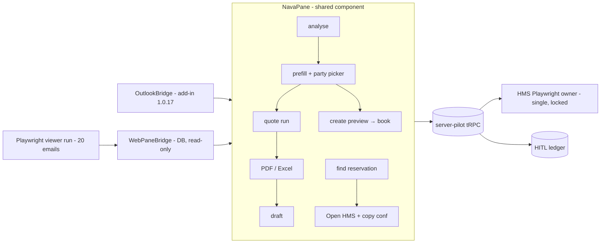

# Overnight v8: Nava pane works end-to-end for Centurion

> First execution step: copy this file to `docs/plans/2026-10-08-007-feat-overnight-v8-nava-pane-plan.md` on `main`, then mirror the lane state into `docs/context/`.

## Goal Capsule
- **Outcome by 07:30 UTC:** the reservationist installs 1.0.17 once, opens the pane, clicks an email, and gets:
  - the email analysed and pre-filled;
  - the **party (company/agency) picked, with its contract rates** (HMS-flagged) on the quote;
  - quote, **PDF and Excel**, then the draft;
  - **create books into HMS** with party and notes (behind one flag you flip in the morning);
  - an **Open HMS + copy confirmation** link wherever a reservation shows.
- **Proof without her:** every pane build is rendered in headless Chromium against the prod API on real Centurion emails (your viewer). Live HMS proofs on Labtest stays.
- **Your call time = teaching only.**

---

## Problem Frame (evidence)
| Finding | Evidence |
|---|---|
| Fix never reached her | Her IP 172.24.20.107 last loaded `/outlook-pane` at 12:56:35. Deploy was 13:22. After that: 520 `bridgeTicket`, 22 `reportBridgeFailure`, 0 `analyseSelection` |
| Bridge noise is a click race | 8 × 403 on `native/authorize` plus 22 failure reports (16 "navigation changed", 6 "request denied"). All are her clicking a new email mid-read. The 1.0.17 selection lease fixes this |
| Party matters on most mail | A party is named on 70% of quote emails and 80% of booking emails: agency 23–38%, company 27%, government 15–20%. HMS stays: travel agent 67%, company 73% |
| Contract rates follow the party | Woolworths org #49 → 18 contract options. Agencies 360 #113, CWT, Nexus → BAR only. Real record: Rennies (agency) booking a Bidvest (org) guest → `NCOR1B` Negotiated Contracted, 10% commission. Contracts attach to the party ID (org **or** agency, e.g. agency #569 → WSF2B). HMS flags the eligible rows. Commission and A/R follow the agency |
| Lookups missed by bug | Tourvest is a Company (#206). The 360 search never confirmed its filter applied (`party-lookup.mjs` ~L226, L353). 50-row cap, no store-idle wait |
| Create is close | Labtest create/find/cancel proven 10-08 01:06–01:45. The lab guard is at `pane-stay-save.ts:125-137`. Notes field `reservationnote` exists but is unfilled. Party isn't sent |
| Allowances (staff PDFs) | Dinner R200–475 per person per night, lunch R150–250 per person per night, office transfer R150–250 per person per day, shuttle R600 per trip (1–2 guests). Each is its own line. Totals include VAT |
| Excel | Repo template `apps/server-pilot/fixtures/centurion-quotation-template.xlsx` is byte-identical to the staff template. The patcher exists (`quote-proposal/patch-sheet.ts`). No download path. ⚠️ The live Gotenberg Chromium route may 404, and the pane PDF depends on it |
| Deep links | HMS opens records through session POSTs. A record-level URL is **unknown, leaning no**. An Open HMS landing link is proven |
| Voucher/POP | 28% of inbounds (304/1069). Confirmation number in text for only 10%. Existing search: confirmation, or surname + arrival |

---

## Scope
| Tier | Units |
|---|---|
| **T1, must ship** | U2 extraction, U3 auto-reload, U4 viewer/gate, U5 PDF route check, U6 party picker, U7 party → quote rates, U8 UI + separate allowance fields, U9 add-in 1.0.17, U10 create + party + notes, U16 live proofs + speed flag |
| **T2, should ship** | U11 HITL ledger (server, PR1–2), U12 Open HMS + copy confirmation + `hmsNumberFor` fix, U13 Excel download, U15 ops papercuts |
| **T3, stretch** | U14 voucher/POP → find reservation (surname + arrival) → card + links. U17 real-guest cancel guard. HITL PR3 tool-run logging. Excel template hardening. Inbox workflow folders |
| **Early finish** | **DoD sweep** (V-gates below): re-run every proof, check that nothing was skipped, fix gaps |
| **Out** | Amend writes. POP upload into the Documents tab (ask her). Record-level deep links unless the probe proves them. Mail routing for the 5 mailboxes (hotel IT). Web reply-draft insert. Self-enroll |

### Deferred to Follow-Up Work
- HITL pane events, outcome matching, scorers, Mastra adapter (PR4–7 of the Opus design).
- Excel → PDF parity through LibreOffice (fonts).
- Agency rate-code experiments beyond a single live probe.

---

## Key Technical Decisions
| KTD | Decision | Why |
|---|---|---|
| K1 | Extract `NavaPane({bridge})` from `page.tsx` first, as a pure move | 1,920-line hotspot. Unblocks the viewer and every other UI lane |
| K2 | Viewer = new route rendering `NavaPane` with a read-only `WebPaneBridge` fed from the DB (latest inbound message's `internetMessageId`). The draft step becomes Copy reply + Download PDF/Excel. Visible to you only | Only you use it. Same bundle she runs, so it doubles as the real-browser test gate. No iframe (CSP) |
| K3 | Party = one search over Company + Agency, results tagged by kind (Tourvest shows both its Company #206 and any agency profile; staff pick). Send **both** IDs to Rate Shop and keep only the rows **HMS flags as negotiated**. Nothing flagged → BAR, said plainly. Never pick a plan by its name. Commission and A/R follow the agency; guarantee stays a staff choice | Contracts attach to the party ID, org *or* agency: Woolworths org #49 → BCO1B/NCOR2B, agency #569 → WSF2B. NGD10B "Woolworths" is not flagged for #49 |
| K4 | Runner fails closed: an unverified filter is `execution_failure`, never `no_match`. "50+, refine" | The root cause of the 360 miss |
| K5 | Email-domain alias table (top ~25 parties) only pre-suggests. Staff confirm | Cheap, data-backed |
| K6 | Create flag `RESERVATIONIST_PANE_SAVE` = `off`/`lab`/`on`. Ships as `lab` | You flip `on` after reviewing the proofs |
| K7 | Allowances are 4 separate typed fields: dinner, lunch, office transfer (R per person per night/day), shuttle (trips × R per trip). Plus `other` {label, amount, unit} and a free-text `notes`. Staff-typed, never invented | Her ask plus the corpus rules |
| K8 | Excel built from the ledger-bound quote revision (as `qualifiedQuoteProposalPdf` does), reusing `patchProposalWorkbook`. Formulas kept | Same numbers as the PDF. No new dependency |
| K9 | HITL: 4 tables (`ai_agent_run`, `hitl_episode`, `hitl_event`, `hitl_tool_run`), text + CHECK, additive migration `0046_hitl_ledger`, flag `HITL_LEDGER=on`. Tonight: schema + analyse recording (+ tool runs if time) | Server-only. Captures (email → model output) and (email → human-approved tool input) |
| K10 | Links: plain anchors (VSTO opens non-Nava origins in the default browser). "Open HMS" + copy confirmation. Record URL only if the probe proves it | Avoids the WebView popout and session issues |

---

## High-Level Technical Design

**Lane / file ownership (no two lanes touch the same file):**
| Lane | Owns | Units |
|---|---|---|
| A pane-shell | `outlook-pane/page.tsx`, new `components/nava-pane/*` | U2, U3, U8-A/B/D, wiring of U6/U12/U13 |
| B party | `party-lookup.mjs`, `pane-party-lookup.ts`, `party-picker.tsx`, `staff-quote-bind.ts` rate context | U6, U7, party part of U10 |
| C create | `pane-stay-save.ts`, `create-lab-stay.mjs`, `create-tool.schema.json`, `booking-card.tsx`, `pane-stay-bind.ts` | U10, U17 |
| D quote-extras | `quote-workflow-panel.tsx`, `session.ts`, `staff-quote-workflow.ts`, `quote-lines.ts`, `proposal-pdf.ts`, `patch-sheet.ts` | U8-C, U13 |
| E viewer | new route + `web-pane-bridge.ts` + Playwright script | U4 |
| F add-in | add-in repo | U9 |
| G server misc | `db/schema/hitl.ts`, migration, recorders, ops scripts, `amend-find.ts` | U11, U12-server, U15 |

---

## Implementation Units

### U1. Context system + plan commit
- **Goal:** new chats start with context, and the overnight state is tracked.
- **Files:** `docs/context/ACTIVE.md`, `docs/context/ledger/2026-10-08-overnight.md`, `docs/context/MISTAKES.md`, `.claude/settings.json` (SessionStart hook prints ACTIVE.md), `CLAUDE.md` (`@AGENT.md`), this plan → `docs/plans/`.
- **Test expectation:** none (docs/config). Verify by starting a new session and seeing ACTIVE.md injected.

### U2. Extract `NavaPane`
- **Goal:** `page.tsx` keeps only `useOutlookBridge()` + `<NavaPane bridge=…/>`. No behaviour change.
- **Deps:** none. **Files:** `apps/mail/app/(routes)/outlook-pane/page.tsx`, `apps/mail/components/nava-pane/nava-pane.tsx`, `apps/mail/lib/workstation/pane-bridge-types.ts`, `apps/mail/tests/outlook-pane-render.test.tsx`.
- **Tests:**
  - the existing ~30 pane tests stay green;
  - the render test mounts via the new export;
  - the bridge type covers every field used (`page.tsx:224-238`).

### U3. Build stamp + auto-reload
- **Goal:** the pane footer shows the build id. The pane polls `/pane-version`. When a new release is live and the pane is idle with no unsaved form, it reloads (debounced, at most once per 10 min).
- **Deps:** U2. **Files:** `nava-pane.tsx`, `apps/mail/lib/workstation/pane-version.ts`, the nginx/server route serving the release id (`apps/server-pilot/deploy/pane-csp-release.mjs` release id), tests.
- **Tests:**
  - new id + idle → reload;
  - dirty form → no reload;
  - same id → no reload;
  - fetch error → silent.

### U4. Viewer + real-browser gate
- **Goal:** `/nava-preview` lists recent Centurion inbound emails. Selecting one renders `NavaPane` with `WebPaneBridge` (read-only). A Playwright script renders 20 corpus emails → screenshots + JSON (intent, pre-filled fields, party, errors) → a static gallery page.
- **Deps:** U2.
- **Files:**
  - `apps/mail/app/(routes)/nava-preview/page.tsx`, route entry in `apps/mail/app/routes.ts`;
  - `apps/mail/lib/workstation/web-pane-bridge.ts`;
  - `apps/server-pilot/src/trpc/routes/quote-workflow.ts` (make entryId/storeId/folderEntryId optional);
  - `apps/server-pilot/scripts/nava-preview-run.ts`;
  - `apps/mail/tests/web-pane-bridge.test.ts`; add to the `.github/workflows/ci.yml` list.
- **Approach:** latest *inbound* message (not `latest`, which can be outbound). Gate on the existing session plus active transport. No `bridgeTicket` calls.
- **Tests:**
  - GET_ACTIVE_EMAIL maps the DB message;
  - write commands are rejected with a "preview" message;
  - a message without Message-ID shows "unsynced";
  - a cross-transport message id is refused.

### U5. PDF route live check
- **Goal:** prove `qualifiedQuoteProposalPdf` works on prod Gotenberg (Chromium route). If it 404s, fix the sidecar image or fall back to LibreOffice.
- **Files:** `apps/server-pilot/deploy/gotenberg.compose.yaml` (only if needed).
- **Test expectation:** live: one PDF generated through the U4 viewer on a real quote.

### U6. Party picker (Company + Agency)
- **Goal:** one search box, results tagged by kind, alias pre-suggest, fails closed.
- **Deps:** rebase PR #48 (`feat/luna-v5-b`) onto main.
- **Files:**
  - `apps/server-pilot/tooling/playwright-quote/party-lookup.mjs` (filter read-back, idle wait for all kinds, 50+ flag);
  - `apps/server-pilot/src/ai/pane-party-lookup.ts`;
  - `apps/mail/components/quote-workflow/party-picker.tsx`;
  - `apps/mail/lib/quote-workflow/party-lookup.ts` (outcome-specific copy);
  - `apps/server-pilot/src/ai/party-aliases.ts` (domain → profile, top ~25);
  - tests beside each.
- **Tests:**
  - "Tourvest" → Company #206;
  - "360" / "360 degrees" → Agency #113;
  - unverified filter → `execution_failure` with the copy "HMS search didn't apply; try again";
  - 50 rows → "refine";
  - sender `@renniesbcdtravel.com` → suggests Rennies;
  - no match → free text + "BAR".
- **Live:** read-only lookups for 360, Tourvest, Woolworths, Rennies, Bidvest, CWT.

### U7. Party → quote rate context
- **Goal:** the quote passes the org and/or agency native IDs and keeps only HMS-flagged negotiated rows (`isNegotiatedRate`). Pre-fill reads "Organization Details", "Travel Agency Details" or "for X employee" from the body; the sender domain is only a hint.
- **Live (02:45 HMS slot, search only):**
  1. org #49 only;
  2. Bidvest org only;
  3. Rennies agency only;
  4. both IDs;
  5. one agency-linked Record View.
- **Deps:** U6. **Files:** `apps/mail/lib/quote-workflow/staff-quote-bind.ts`, `apps/server-pilot/src/ai/staff-quote-workflow.ts`, `fetch-quote.mjs` (context only), tests.
- **Tests:**
  - org pick → input carries the nativeId;
  - agency-only → agency ID sent, flagged rows shown, else BAR;
  - both picked → both IDs are sent, only flagged rows are shown;
  - nothing flagged → BAR with plain copy.
- **Live:** Woolworths (or Bidvest) quote returns a non-BAR plan.

### U8. Pane UI (A copy, B shell, C quote tool + allowances, D visual)
- **A:** "Nava" everywhere staff can see, never "Luna". Collapse the duplicate "cannot read/connected" banners into one status line.
- **B:** first-run bar hidden after onboarding. ⋯ menu (check connection, replay tour, feedback, about + build id).
- **C (Lane D):**
  - empty state;
  - separate typed fields: **Dinner** (R per person per night, qualifier label), **Lunch** (R per person per night), **Office transfer** (R per person per day), **Shuttle** (trips × R per trip), **Other** {label, amount, unit}, **Notes**;
  - schema `.strict()` extended;
  - quote-lines units;
  - PDF row fix (`proposal-pdf.ts:88`: no `· person_service` suffix, real QTY and NIGHTS);
  - drop the bare `transfer` regex (`session.ts:515`);
  - shuttle without a price → review item, never R0.
- **D:**
  - Segoe UI, 14px body, 12px labels;
  - demo spacing (14px gaps, 32px fields);
  - fluid width (remove fixed 380 at `page.tsx:1334`);
  - **visible styled scrollbar** matching the mail app.
- **Tests:**
  - string asserts updated;
  - fresh-profile onboarding hides the bar after the tour;
  - allowance math: 2 pax × 3 nights × R450 → one line R2,700 with QTY 2 and NIGHTS 3; lunch and dinner on separate lines; shuttle 2 trips × R600 = R1,200; other with unit `item`;
  - schema rejects negatives;
  - 380px and 520px render snapshots via U4.

### U9. Add-in 1.0.17
- **Goal:** empty task-pane title (or a single space if `""` is rejected), default width ≈ her initial view, plus PR #8's fixes:
  - v7 #2 reply draft "outcome unknown";
  - #3 selection lease;
  - #4 other-store click;
  - #5 STA for sync;
  - #7 `SourceKind`. Windows CI build → SHA check → publish → update the install doc + server pin.
- **Files:** add-in repo `TaskPaneControl.cs` / `ThisAddIn.cs` (CustomTaskPane title/width), version bump, `docs/pilot/2026-10-08-install-and-onboarding.md`.
- **Tests:** CI green. The manifest hash matches the served file.

### U10. Create: real-guest-ready + party + notes
- **Goal:**
  - flag `off|lab|on` replaces the lab-only guard;
  - the create fills **Primary Booking Agency, Organization**, Reservation Note (`reservationnote`), booker name/email if cheap;
  - Preview → Book from the pane.
- **Deps:** U6 (party ids).
- **Files:** `apps/server-pilot/src/ai/pane-stay-save.ts`, `create-lab-stay.mjs`, `create-tool.schema.json`, `apps/mail/lib/quote-workflow/pane-stay-bind.ts`, `apps/mail/components/quote-workflow/booking-card.tsx`, tests.
- **Tests:**
  - `lab` keeps the Labtest guard;
  - `on` allows a real surname;
  - `off` = copy-only;
  - stale preview digest → refused;
  - duplicate found → refused;
  - children > 0 → copy-only with a reason;
  - agency + org mapped into the schema;
  - notes ≤ HMS max length.
- **Live (Labtest):**
  - Preview → Book through the viewer;
  - the confirmation number reads back with agency, org and note;
  - **auto-email check** (guest email = our test inbox);
  - cancel.

### U11. HITL ledger (server)
- **Goal:** PR1 schema + migration `0046_hitl_ledger` + contract tests. PR2 record every analyse (`ai_agent_run`, episode upsert). PR3 (stretch) tool runs.
- **Files:** `apps/server-pilot/src/db/schema/hitl.ts`, `apps/server-pilot/drizzle/0046_hitl_ledger.sql` + journal, `apps/server-pilot/src/ai/quote-workflow-analyse-selection.ts` (recorder seam), `quote-workflow-llm.ts` (telemetry), `apps/server-pilot/src/trpc/routes/quote-workflow.ts`, tests.
- **Patterns:** `src/db/schema/ai-shadow-evaluation.ts`; idempotent SQL style of `0006_*`. ⚠️ drizzle snapshots exist only for 0000/0001, so hand-write the SQL rather than trusting `db:generate`.
- **Tests:**
  - flag off → no writes;
  - recorder insert failure doesn't fail analyse (300ms cap);
  - cache hit links `cached_from_run_id`;
  - schema-contract export test.

### U12. Open HMS + copy confirmation
- **Goal:** wherever a confirmation shows (lookup panel, booking card), show **Copy** + **Open HMS** (plain anchor to the landing page). Fix `hmsNumberFor` (`amend-find.ts:45-50`) so that 7-digit billing refs no longer become `N-1`.
- **Probe (10 min, read-only):** does `OSRESV?...&confirmationnumber=` open a record? If yes, link to the record.
- **Tests:**
  - 1879000 is not converted;
  - 64318608-1 is kept;
  - anchor has no `target=_blank`.

### U13. Excel download
- **Goal:** `workstation.quoteWorkbook` (ledger-bound revision) returns the patched template with formulas kept and metadata scrubbed. Pane: "Download Excel" beside the PDF. Same extras handling as the PDF (rows ≤ 6, else lines are merged by type).
- **Files:** `apps/server-pilot/src/trpc/routes/workstation.ts`, `apps/server-pilot/src/quote-proposal/patch-sheet.ts`, `patch-template.ts`, `apps/mail/components/quote-workflow/quote-workflow-panel.tsx` button, `apps/server-pilot/tests/quote-proposal-pdf.test.ts` (fix the stale assert).
- **Tests:**
  - totals equal the PDF totals;
  - formulas present;
  - `core.xml` creator scrubbed;
  - more than 6 lines handled;
  - a stale revision is refused.

### U14 (stretch). Voucher/POP → find reservation
- **Goal:** for voucher or POP emails, Nava extracts surname + arrival (body or PDF) → the existing search → reservation card + U12 links + "Save attachment".
- **Files:** `reservationist-decision.ts` (an `existing_booking_doc` intent), `pane-stay-lookup.ts`, `amend-lookup-panel.tsx`.

### U15. Ops papercuts
- Bake the husky `chmod` into `ops-deploy.sh`. Treat `outboundBacklogEmpty` as a warning, not exit 1.

### U16. Live quote proofs + speed flag
- 5 real quote emails through the viewer → quote + PDF + Excel. 2 passes → `QUOTE_TRACE_ASYNC=on`.

### U17 (stretch). Real-guest cancel guard
- Same flag pattern. Penalty dialogs still stop and are handed back to staff.

---

## Execution Plan (UTC)

```mermaid
gantt
  dateFormat HH:mm
  axisFormat %H:%M
  section Opus
  U1 context+plan          :23:45, 20m
  merges/deploys/HMS       :00:05, 445m
  section A pane-shell
  U2 extract               :23:50, 40m
  U3 reload                :00:30, 40m
  U8 A copy                :01:10, 40m
  U8 B shell               :01:50, 50m
  U8 D visual+scroll       :02:40, 60m
  wire U6/U12/U13          :03:40, 60m
  section B party
  U6 runner+search+alias   :23:50, 120m
  U7 rate context          :01:50, 50m
  U10 party-on-create      :02:40, 60m
  section C create
  U10 guard+notes          :00:00, 120m
  U17 cancel (stretch)     :05:00, 40m
  section D quote-extras
  U8 C allowances+PDF      :23:50, 100m
  U13 Excel                :01:30, 90m
  section E/F/G
  U4 viewer (after U2)     :00:30, 100m
  U9 add-in 1.0.17         :23:50, 120m
  U11 HITL PR1-2           :01:00, 120m
  U12 links + U15 ops      :03:00, 60m
  U14 voucher (stretch)    :04:00, 90m
  section HMS (single owner)
  U12 probe                :00:40, 10m
  U6 live lookups          :01:45, 45m
  U16 quotes+U7 rate proof :02:45, 60m
  U10 Labtest book+email   :04:00, 75m
  spare                    :05:15, 45m
  section Gates
  D1 deploy                :01:40, 15m
  D2 deploy                :04:00, 20m
  D3 deploy (+migrate)     :06:00, 20m
  DoD sweep + handoff      :06:20, 70m
```

| Deploy | About | Contents | Gate |
|---|---|---|---|
| D1 | 01:40 | U2, U3, U4, U8-A, U8-C | viewer run on 20 emails green; health 8788/8789; pane 200 |
| D2 | 04:00 | U6, U7, U8-B/D, U13, U12, U15, `QUOTE_TRACE_ASYNC` | viewer run + live org-rate quote + PDF + Excel |
| D3 | 06:00 | U10 (flag `lab`), U11 `--migrate`, stretch units | viewer run, Labtest book proof, migration compatibility check |
| Cutoff | 07:30 | nothing after this | — |

---

## Models, parallelism, tokens
| Who | Does | Evidence for the split |
|---|---|---|
| **Haiku 5.5, effort max** | All implementation from file:line briefs. A **second Haiku acts as a checklist reviewer on every PR.** Data research, viewer screenshot QA | Last night 45 Haiku agents wrote all the code. The bugs that escaped (Message-ID P0, #57 fake client) were **test-design** gaps that Opus review also missed. The fix is the real-browser gate, not more Opus review |
| **Opus 5.5 (driver)** | Briefs, merge/deploy decisions, all live HMS steps, user-facing claims. **Reads diffs only for** U10 write guard, U11 migration, U4 auth scoping | Haiku judgement calls were verbose and sometimes wrong. Opus owns diagnosis and anything that touches a real guest |
| **Greptile CLI** | 4 runs: U10, U6+U7, U11, U4. P0/P1 fixed before merge; P2 → ledger. Block merge while a P1 is open on the head SHA | #56 merged with an open P1 yesterday |
| **Codex GPT-6 Astra** | Only if Playwright can't locate Agency/Org/Note fields on New Record | Proven HMS explorer, rarely needed |

- **Concurrency:** at most 4 Haiku builders plus 1 Haiku reviewer at a time. One worktree per lane from `main`. A lane rebases after each merge.
- **Token rules:**
  - briefs cite the research files instead of re-exploring;
  - agents report in ≤30 caveman lines;
  - Opus reads the reviewer summary, test output and screenshots, not full diffs (except the 3 critical units).
- **HMS:** one browser owner (property lock). Opus runs every live step in the fixed slots above.

## State and checkpoints
- `docs/context/ledger/2026-10-08-overnight.md`: one row per unit (start, end, PR, outcome, mistake).
- `docs/context/ACTIVE.md`: current lane state.
- Stop guard hook deadline 07:35 UTC.
- ScheduleWakeup fallback ≤25 min (no dead air).
- Per PR: brief → build → tests (`unset DATABASE_URL VITEST_ALLOW_PILOT_RDS TEST_DATABASE_URL`) → Haiku review → Greptile if critical → merge → batch deploy → viewer run.

---

## Verification Contract
| V | Gate | Pass |
|---|---|---|
| V1 | Viewer run, 20 real emails | 0 crashes. Intent shown. Pre-fill present on quote and booking emails. Screenshots in the gallery |
| V2 | Party | 360 → #113, Tourvest → Company #206, an org quote returns a non-BAR plan |
| V3 | Quote | 2 live quotes → PDF + Excel. Totals match. Allowance lines correct |
| V4 | Create | Labtest booked from the pane with agency, org and note. Confirmation read back. No guest email received (or flagged). Cancelled |
| V5 | Add-in | 1.0.17 published. SHA matches. Install doc updated |
| V6 | Prod | 8788/8789 ok, pane 200, VPN ok, migration applied, flags as listed |
| V7 | Her first use (tomorrow) | `analyseSelection` 200 from her IP after install |

## Definition of Done
- T1 units merged and deployed with V1–V6 green, or each failure written up with its RCA in the handoff.
- Handoff `docs/plans/handoff-reports/2026-10-09-overnight-v8.md`:
  - what's live;
  - the flags to flip (`RESERVATIONIST_PANE_SAVE=on`);
  - the 1.0.17 install link;
  - the teaching script;
  - the gallery URL;
  - open risks.
- Ledger complete. Hindsight retro saved.

## Risks
| Risk | Mitigation |
|---|---|
| Real-guest create sends HMS auto-email, or shows `createdBy=NAVAAI` | V4 checks the email. You decide the flag. The NAVAAI question goes to the hotel |
| Gotenberg Chromium 404 | U5 is first in the queue. LibreOffice fallback |
| `page.tsx` conflicts | U2 lands first. Lane A is the single owner |
| Windows CI fails for 1.0.17 | Web changes still land. She stays on 1.0.16 and reloads the pane |
| Migration | Additive only, flag-gated, hand-written SQL |
| Contract rates | HMS's flag decides, never the plan name. Nothing flagged → BAR, said plainly |
</content>
</invoke>
