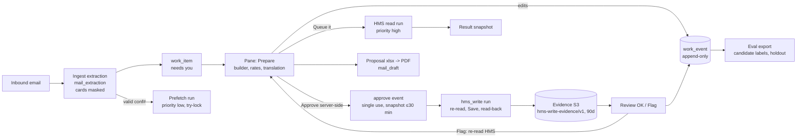
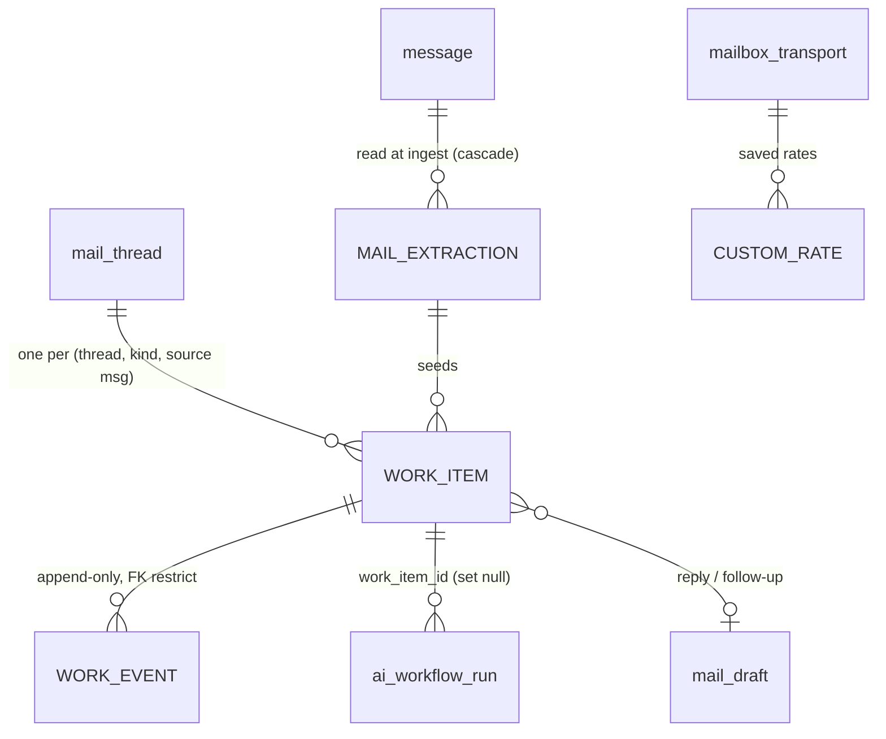

# Nava Pane Weekend v4 - Plan

**Target repo:** `kufupa/zero`. All work branches from a fresh `origin/main` (1d83b02b8 at planning time), not from the parked worktree this file sits in. The first merged PR copies this file into `docs/plans/` on main.

---

## Goal Capsule

**Objective.** Make the Centurion reservationist pane useful for a real working day on both the Outlook pane and the webmail panel:
- Nava reads every email on arrival and pre-fills quote and booking work.
- Slow HMS work queues in the background.
- Every HMS write keeps a review trail.
- Every human edit is recorded so it can feed evals.

**Product loop.** Read → Prepare → Queue → Act (background) → Review. A Review can loop back to Prepare. Automate comes later. Only HMS reads run unattended. Every HMS write needs her approval, then a before/after screenshot review.

**Authority order.** User instructions in chat > this plan > `CLAUDE.md` and memory rules > repo conventions. For this run the user approved Opus-subagent review instead of Greptile (credits unknown). Local checks plus Opus review gate merges.

**Stop conditions.** Stop and ask the user before:
- any HMS write outside our own Labtest booking (2027+ arrival, created by us);
- adding or enabling any GitHub Actions workflow or check;
- any `greptile review`;
- GitHub cleanup (archive pushes, merging #95, closing #3, pruning remote branches), which is not yet approved;
- any destructive DB operation, or tests against prod RDS;
- any scope change that contradicts a Key Technical Decision.

**Execution profile.** Opus 5.5 orchestrates, reviews and merges. Haiku 5.5 at max effort codes in 7 parallel lanes. Codex (high reasoning) drives HMS through Playwright in one serial lane. Each unit logs ETA start and end rows in `~/.claude/eta-ledger.jsonl`.

**Tail ownership.** The orchestrator owns PRs, squash merges, deploys via `apps/server-pilot/deploy/ops-deploy.sh`, live proof, the 01:00 London checkpoint report and the final report.

---

## Product Contract

### Summary
This plan turns the pilot pane into a pre-filled, queue-driven workstation for Centurion's reservationist (Bongi), using the findings of the 2026-10-09 UI call.

Nava reads each inbound email at ingest and stores the result in RDS, so the pane opens instantly:
- type, contact, stays and room rows, requested vs booked dates, confirmation numbers;
- any language translated to English;
- attachment text with card numbers masked, including the vouchers it fails to read today.

Quotes gain:
- a stay/room builder and multi-stay support;
- saved and one-off rates;
- a discount override;
- one combined Proposal Excel, with the PDF exported from it.

Slow HMS work moves into a persisted queue and a "Needs you" list. HMS writes (attach voucher, amend, cancel) get prepare → approve → execute → review groundwork, live only on Labtest.

### Problem Frame
From the call (`bongi UI call transcript.md`), in her words:
- Groups: mixed room types can't be expressed, a second stay is dropped, and booker details are missing from the top.
- Rates: she can't enter event (cricket) or one-off rates, or record a manager-approved discount.
- Waiting: HMS lookups feel slow, and she has to wait in the pane.

From the field screenshots:
- duplicate HMS buttons;
- a wrong amendment arrival (1 Nov instead of 31 Oct);
- three scary warnings for one unreadable Travelit voucher PDF;
- "Insert draft" offered on a do-not-reply sender.

Today extraction runs when the pane opens (25 s deadline, regex fallback) and is cached in a host-local file. The old webmail triage spends tokens on folder pills nobody uses.

### Actors
- A1. Reservationist (Bongi): works in the Outlook pane, non-technical, impatient with waits over 30 s.
- A2. Founder/operator: tests on the webmail panel and reviews eval data.
- A3. Approving manager (Kamala Douglas GM, Martha Mthembu Sr FOM, or any manager): approves discounts in person, off-system.
- A4. Nava workers: ingest extraction, the HMS lane and the follow-up timer.

### Requirements

**Read**
- R1. Extract every admitted inbound email (not outbound copies) at ingest into a stored, versioned record. It holds:
  - type: quote, booking, amendment, cancellation, voucher/POP, spam or other;
  - contact block;
  - stays and room rows, each with a stable id;
  - requested vs booked dates;
  - validated confirmation numbers;
  - target hotel;
  - attachment read status.
- R2. Detect non-English emails and store an English translation with two views, clean and word-for-word. Replies stay in English.
- R3. Read the voucher/POP PDFs rejected today: wrong declared mime, owner-locked, Outlook-sync keys, scanned. Never warn about inline or logo images. Show at most one message per unreadable booking file.
- R23. Mask card numbers (Luhn-valid 13–19 digit runs) and security codes before any model call and before anything is persisted.

**Prepare**
- R4. Show the core contact details (name, company, email, phone) at the top of the pane, pre-filled.
- R5. Build quotes from rows of stay × room type × count × occupancy. Rows and stays can be added, removed (with undo) and duplicated. Totals are shown. Room names use the Infor form, e.g. "Standard Queen (STQN)".
- R6. A multi-stay quote produces one Proposal Excel with N lines, one subtotal and one total, plus the PDF exported from that Excel. A multi-stay booking produces one draft reservation per stay.
- R7. Rates she can use:
  - saved custom rates (name + rate; add, edit, delete);
  - a one-off typed rate;
  - a discount override (rate code such as NCOR1B, an override rate, and free-text "approved by / why").
  Client documents show only the final rate, never the internal note.
- R8. Agency and company rates price correctly. Re-land the closed PR #92 room-filter fix, written generally.
- R9. Amendment emails show requested vs booked dates, labelled "Amendment", not "Other". Duplicate buttons and useless lines are removed. The primary HMS handoff is Copy link + Copy confirmation number.
- R10. 3 business days after a quote is sent (attachment or body-only) with no client reply, a follow-up draft appears for her review. Nothing is auto-sent.

**Queue**
- R11. HMS lookups (stay by confirmation number, party, quote rates) run as persisted background jobs. She can queue one, move on and come back to the result.
- R12. Confirmation-number lookups prefetch at ingest at low priority. They never block staff work and are shown as dated snapshots.
- R13. A "Needs you" list on both surfaces groups open work items by type and status.

**Act and Review**
- R14. Every HMS write follows prepare → server-side approve → background execute → before/after screenshots → her Review OK or Flag. The approval is single-use and covers the values she saw plus the HMS snapshot they came from. This weekend, writes run only on our Labtest booking.
- R15. Attach voucher to booking works end to end on Labtest. Where POPs live in production is verified read-only.
- R16. Cancel safety: a pending penalty surfaces as "needs check", and the unguarded cancel paths are closed.

**Data and evals**
- R17. Every human-in-the-loop action is recorded as an append-only, tamper-resistant event:
  - AI value vs her value per stable field id;
  - accept, reject, approve and review decisions;
  - timing.
  Events export to versioned eval datasets as candidate labels.

**Quality and ops**
- R18. Every feature behaves the same on the Outlook pane and the webmail panel. Host-only actions are adapted, never dead. Pending and failed states are designed, not raw errors.
- R19. No new entity-specific logic (company, agency or sender literals) in production code. Remove the hard-coded HMS ids.
- R20. A backtest of 15 minutes or less (held-out Oct 5–9) runs at each deploy without regressing field accuracy.
- R21. Draft HTML is sanitised before rendering in the pane.
- R22. HMS quote runs get faster, and production timings for login, criteria fill and grid are measured.
- R24. New controls are keyboard-operable with visible focus. Tabs work with arrow keys. Toasts are announced to assistive tech.

### Acceptance Examples
- AE1. Tailormade/New Frontiers email: 26–27 Oct and 17–18 Nov, 30 rooms, single and double/twin rates.
  - The pane shows two stays with editable room rows.
  - The agency is the sender's organisation (New Frontiers Tours), separate from the end client (Tailormade Africa).
  - Get rates runs once per stay.
  - The result is one Proposal Excel with a row per stay × room and one total.
- AE2. French amendment email: the guest adds the night of 31 Oct and late checkout on 7 Nov. HMS has 1 Nov–6 Nov.
  - Type is Amendment, requested 31 Oct–7 Nov, booked 1–6 Nov.
  - The lookup uses the booked dates.
  - The English translation box is shown open.
- AE3. Travelit VCC voucher PDF (752 KB):
  - The text is read with card digits masked, or one line says why it couldn't be read.
  - No "guest surname" or "partial read" duplicates.
  - Insert draft is hidden (do-not-reply sender).
- AE4. Discount: she picks NCOR1B, enters R1,850 per night, and types "Kamala OK'd – repeat group".
  - The client PDF and Excel show R1,850 only.
  - The pane review shows the override and a Copy-for-HMS-comments line.
  - A `work_event` holds the AI rate, her rate, the note and her session user.
- AE5. She queues "Find booking", opens another email, then returns. The job status and result come back from the DB. A pane or server restart loses nothing.

### Scope Boundaries
- **Out:**
  - admin dashboard and its per-hotel lock (deferred; must land before DaVinci staff log in);
  - pro forma invoices;
  - DaVinci tenant work;
  - HMS writes on real bookings;
  - auto-send;
  - Graph-based drafts;
  - Outlook folder/category auto-filing;
  - deleting `/nava-preview`.
- **Low ROI, last:** making "Open booking" deep-link straight to the reservation. Only the Messenger / `SYSTEM_FUNCTION_NAME` test runs (U28-H7). Copy link + number is the shipped path. Tell Bongi the link opens HMS, and the number finds the booking.

### Deferred to Follow-Up Work
- Amend RPA live, then enablement.
- Real-booking attach, amend and cancel.
- Provisional holds.
- Mastra datasets on `@mastra/pg`.
- Auto-handling simple emails.
- DaVinci onboarding and the admin-dashboard tenant lock.
- Graph drafts.
- A batch "run all" action on the Needs-you list.
- Role-based permissions for who may approve writes or edit saved rates. Today it is any authenticated user on the transport.
- **To-do: EC2 HMS run retention.** Pane runs live in `/tmp` (lost at reboot/30 days); quote runs never get cleaned (~24 MB/run, ~0.7 GB/day at 30 quotes; 36 GB free). Move pane runs to a persistent dir beside quote runs; keep screenshots + `events.jsonl` + `result.json` 90 days (~0.3 MB/run, ~9 MB/day); delete Playwright `trace.zip` after 7 days. One cleanup timer, ~30 min.

### Sources
- Call transcript: `bongi UI call transcript.md` (worktree root).
- Design demo: `docs/superpowers/specs/2026-09-23-centurion-outlook-side-pane-demo.html` (pane 4 is the reference).
- Prior plans: `docs/superpowers/plans/2026-09-11-hms-attach-inbound-document.md`, `docs/superpowers/specs/2026-09-26-outlook-quote-proposal-pdf.md`, `docs/plans/2026-10-07-001-luna-mvp-stretch-specs.md`.
- Infor HMS docs: Documents upload `https://docs.infor.com/hms/2026.08/en-us/hmsolh/s_t1424428568335.html`; APPURL/Messenger record links `https://docs.infor.com/hms/2026.08/en-us/hmsolh/s_t1424428540222.html`.
- Quote corpus: 8,823 PDFs. Current quotes use the Excel "Proposal" layout (100 of 102 since Aug 2026; 97% Excel-created). Multi-stay quotes always have one subtotal and one total.

---

## Planning Contract

### Key Technical Decisions
- KTD1. **Four new tables plus two columns, one migration, shipped alone.**
  - Migration 0047 adds `mail_extraction`, `work_item`, `work_event` and `custom_rate`.
  - It also adds `ai_workflow_run.work_item_id` (nullable, ON DELETE SET NULL, indexed) and `ai_workflow_run.priority` (smallint, default 0, included in the hms-lane claim order).
  - The migration is hand-written, with a mirror `schema.ts`, a journal entry (`when` > 1791072013000) and a contract-test allowlist entry.
  - It ships as its own deploy (D0). Every later rollback target already contains it.
  - Everything else is reused: queued work in `ai_workflow_run`, drafts in `mail_draft`, files in S3.
  - Rationale: typed state plus an append-only edit log is where eval platforms converge (Mastra, LangSmith, Langfuse, Braintrust). A generic event store adds replay cost.
- KTD2. **`work_event` is the authoritative HITL record. `hitl_event` stays as telemetry.**
  - `hitl_event` writes are best-effort (300 ms cap, failures swallowed in `apps/server-pilot/src/ai/hitl-recorder.ts`). It has no writer today and a 90-day telemetry window.
  - Approvals and labels can't be best-effort. `work_event` is written in the same transaction as the state change.
  - A DB trigger rejects UPDATE and DELETE.
  - The FK to `work_item` is RESTRICT, so deleting mail can't erase approval history.
- KTD3. **Excel is the master quote document.**
  - Fill `apps/server-pilot/fixtures/centurion-quotation-template.xlsx` with N rows, shifting every row-addressed artefact.
  - Export the PDF from the xlsx through Gotenberg/LibreOffice (`apps/server-pilot/src/quote-proposal/gotenberg.ts`). The HTML renderer remains the fallback.
- KTD4. **One HMS user, one serial lane, real yielding.**
  - All HMS work goes through the per-property advisory lock.
  - Background runs (prefetch, probes) take the lock with try-lock only. They re-queue to `retry_wait` when contended and are skipped while a staff quote is in flight (the signal `apps/server-pilot/src/hms/property-queue-state.ts` already reads).
  - User-queued jobs carry a higher `priority` than prefetch.
  - Codex sessions pause the prod hms executor lane (flag) and run on EC2 via SSM, following the `ops-hms-proof` pattern.
- KTD5. **Translation is a second call, made only when needed.**
  - Extraction returns `sourceLanguage`.
  - The translate call (aligned clean and literal segments, with its own deadline) runs only for non-English mail.
  - Medium reasoning.
- KTD6. **The discount override is a line-level price source.**
  - Each row's price source is `hms`, `saved`, `one_off` or `override`. An override needs a rate code, an override rate and free text.
  - The client Excel and PDF show only the final line rate.
  - `resolveApprovedOverride` (a whole-total override) stays unused.
  - The actor is the session user.
- KTD7. **The primary HMS handoff is Copy link + Copy confirmation number.** A deep link ships only if U28-H7 proves a record URL works when warm and still hits login when cold, so it is not a bearer link.
- KTD8. **Split the pane before the UI fans out.** Split `apps/mail/components/nava-pane/nava-pane.tsx` (2,113 lines) into a shell, hooks, screens and blocks first.
- KTD9. **Diagnose before fixing.** Confirm the voucher and single-stay causal rows with read-only prod queries before changing gates.
- KTD10. **Fix generally.**
  - No sender or agency literals in code.
  - Party matching stays live-HMS-verified.
  - Remove the hard-coded HMS ids in `apps/server-pilot/src/ai/party-aliases.ts`.
  - A lint script blocks new ones.
- KTD11. **Prefetched HMS results are dated display snapshots.**
  - They are shown on open whatever their age ("as of 14:02").
  - A snapshot older than 30 minutes is re-read before she can approve a write from it. Under 30 minutes, no wait.
  - The write job itself always re-reads the booking when it opens it to edit (no extra wait for her: it runs in the background).
- KTD12. **Approvals are server-made, single-use and state-bound.**
  - A dedicated approve procedure recomputes the fingerprint from stored work-item state plus a digest of the HMS before-state read. It writes an approval event. The approval is valid while its HMS snapshot is under 30 minutes old.
  - An `hms_write` run consumes the event once, re-reads HMS before Save, and aborts to needs-check on mismatch.
  - `hms_write` runs are excluded from stale-lease reclaim. A lost lease means needs-check plus a read-back, never an automatic re-run.
- KTD13. **Card data never leaves the parser unmasked.** Reuse the Luhn check in the card-mask module (`isLuhnValid`, `PAN_CANDIDATE_PATTERN`, used in `property-knowledge-read.ts`) on attachment text and vision output, before model calls and persistence.
- KTD14. **Work items store only human-facing status.**
  - Stored statuses: `needs_you`, `review`, `done`, `dismissed`.
  - "Queued", "Running", "Retrying", "Failed" and "In HMS" are derived from the linked `ai_workflow_run` state, so there is one state machine.

### High-Level Technical Design

**Product loop and where data lands**

**Data model (new tables in caps)**

`mail_extraction`
- Columns: message id, extractor version, status, kind, language.
- `payload` jsonb: contact; stays[] and rows[] with stable ids; requested and booked dates; conf#s; missing[].
- `translation` jsonb, `attachments` jsonb (per-file status and reason), `usage` jsonb.
- Unique on (message, version). Cascades with the message.
- Version = hash of schema + prompt + rules. The pane reads the latest succeeded row for the message.

`work_item`
- Columns: transport, thread, source message, kind, extraction id, status, `state` jsonb (form, including row price sources and the override), quote file keys, sent message/at, follow_up_due_at.
- Unique on (thread, kind, source message).
- An extraction upsert never overwrites a state field that has a user event.

`work_event`
- Columns: work item, at, actor (session user, ai or system), type.
- `field_path` uses stable ids (e.g. `stays[s_1a2b].rows[r_9c8d].count`).
- `ai_value` and `value` jsonb, `ai_source` (extraction version or analyse run id), `ms_since_open`.
- `payload_hash` and `expires_at` for approvals; `evidence` jsonb (S3 key + sha256).
- Insert-only trigger.

`custom_rate`
- Columns: transport, name, amount_minor, currency, board, room_codes, valid_from/to, note, created_by, archived_at.
- Unique name among non-archived rows.

`ai_workflow_run` additions
- New kinds: `inbound_extraction`, `quote_followup`, `hms_write`.
- New columns: `work_item_id`, `priority`.

**Lanes and waves** (1.0× plan durations; edges match the unit dependencies)

```mermaid
gantt
  dateFormat HH:mm
  axisFormat %H:%M
  section Prep
  U1 setup, prod evidence, holdout      :u1, 18:45, 45m
  section S data
  U2 migration (D0 alone)               :u2, after u1, 60m
  U3 extraction + translation           :u3, after u2, 300m
  U4 prefill API + work events          :u4, after u3, 90m
  U5 retire triage + backfill           :u5, after u4, 150m
  section P pdf/speed
  U6 PDF read fix + card masking        :u6, after u1, 170m
  U9 speed quick wins                   :u9, after u6, 80m
  U7 scanned PDF vision                 :u7, after u9, 130m
  U10 keep-warm + availability          :u10, after u7, 140m
  section Q quotes
  U11 #92 reland                        :u11, after u1, 45m
  U12 Excel N rows + PDF from xlsx      :u12, after u11, 220m
  U13 rates + override (server)         :u13, after u12, 240m
  U14 follow-ups                        :u14, after u13, 90m
  section U1 pane
  U15 pane split                        :u15, after u1, 100m
  U8 sanitiser                          :u8, after u15, 20m
  U17 card cleanup + copy link          :u17, after u8, 175m
  U16 contact + translation box         :u16, after u4, 60m
  U18 approve + review screens          :u18, after u17, 110m
  section U2 builder
  U19 stay/room builder + look          :u19, after u15, 210m
  U20 multi-stay finish                 :u20, after u19, 130m
  U21 rate controls UI                  :u21, after u20, 110m
  U22 web save reply                    :u22, after u21, 80m
  section J queue/review
  U23 HMS job queue + prefetch          :u23, after u2, 200m
  U25 approvals + write safety          :u25, after u23, 160m
  U24 needs-you list                    :u24, after u4, 70m
  U26 attach/amend/cancel groundwork    :u26, after u25, 150m
  section T test
  U27 backtest + lint + eval export     :u27, after u1, 160m
  section H HMS serial
  U28 HMS live research + proofs        :u28, after u1, 600m
```

- Cross-lane joins are enforced at merge time, not drawn: U13 needs U2, U14 needs U4, U18 needs U25, U20 needs U12, U21 needs U13, U26 needs U28 H2/H5.
- Deploy batches are listed in U29.

### Assumptions
- She is not working the pane over the weekend, so HMS lane work and deploys won't disrupt her. Production writes stay off.
- U1 reads the prod flags `AI_WRITE_GATE_ENABLED`, `WORKFLOW_TRIAGE_V6`, `LUNA_ANALYSE_WARMER` and `HITL_LEDGER` from the EC2 env before U5.
- U1 checks `GOTENBERG_URL` and `/health`. `apps/server-pilot/deploy/install-gotenberg.sh` already exists.
- Infor's "Messenger record URL" behaviour is unverified until U28-H7.
- Labtest bookings live inside the live Centurion property. Guards must check the opened record, not just the request.

### Implementation Constraints
- Never point tests at prod RDS (`docs/solutions/database-issues/vitest-production-pilot-db-wipe.md`).
- Migrations run only with an explicit `--migrate` deploy. All pending migrations share one transaction. The boot gate checks hash and order (`apps/server-pilot/src/db/migration-compatibility.ts`). After 0047 there is no rollback to an earlier SHA, only forward fixes.
- Read-only prod access goes through SSM: SELECT, head-object and log reads only.
- No GitHub Actions. No Greptile. Opus-subagent review.
- Every PDF path still calls `runPdfSandbox` (bwrap `--unshare-net`, prlimit).

### Data Handling
All locations are client-approved. Card numbers are masked anyway (KTD13): the original email and PDF stay untouched; only AI inputs, extractions and eval exports carry the masked form.

| Where | What | How long |
|---|---|---|
| RDS (Postgres) | `mail_extraction`, `work_item`, `custom_rate`, HMS job results/snapshots (`ai_workflow_run`) | Same as the email it came from |
| RDS (Postgres) | `work_event` (edit + approval log) | Forever (eval source) |
| S3 (same bucket as raw mail and attachments) | Before/after write screenshots, prefix `hms-write-evidence/v1/` | 90 days (one lifecycle rule) |
| EC2 disk, `/tmp/pane-*` | Pane lookup/save/cancel run folders (~60 KB each) | Cleared at reboot or after 30 days (Ubuntu default) |
| EC2 disk, `.private/playwright-quote/` in the deploy checkout | Quote run folders (~24 MB each: ~22.5 MB Playwright trace, ~0.3 MB screenshots) | Never deleted today (1.8 GB at 2026-10-09). To-do below. |
| Dev VPS, `.private/` (gitignored) | Eval JSONL, golden set, holdout export, Codex probe screenshots | No auto-delete |

- Screenshots are fetched through a transport-checked server route, never public URLs.

---

## Implementation Units

| U-ID | Title | Key files | Depends on |
|---|---|---|---|
| U1 | Setup, prod evidence, holdout export | `apps/server-pilot/scripts/export-centurion-nine-day-corpus-live.ts` | none |
| U2 | Migration 0047 (deploy D0 alone) | `apps/server-pilot/src/db/schema/work.ts`, `apps/server-pilot/drizzle/0047_*` | U1 |
| U3 | Ingest extraction + translation | `apps/server-pilot/src/ai/extraction/*`, `src/ai/worker.ts` | U2, U6 (masking) |
| U4 | Pre-fill API + work items + work events | `src/trpc/routes/work-items.ts`, `src/trpc/routes/quote-workflow.ts` | U3 |
| U5 | Retire old triage + backfill | `src/mail/ingest/live-admission.ts`, `src/ai/worker.ts` | U4 |
| U6 | PDF read fix + card masking | `src/mail/artifacts/read-artifact.ts`, `src/ai/card-mask.ts` | U1 |
| U7 | Scanned PDF vision fallback | `src/mail/artifacts/read-artifact.ts` | U6, U9 |
| U8 | Draft HTML sanitiser | `apps/mail/components/nava-pane/*` | U15 |
| U9 | HMS speed quick wins + timings | `tooling/playwright-quote/fetch-quote.mjs` | U6 (lane order) |
| U10 | Keep-warm HMS + availability probe | `tooling/playwright-quote/*`, `src/ai/quote-workflow-warmer.ts` | U7, U23 |
| U11 | Re-land #92 contract-rate room filter | `src/ai/reservationist-business-services.ts` | U1 |
| U12 | Proposal Excel N rows + PDF from xlsx | `src/quote-proposal/*` | U11 |
| U13 | Saved/one-off/override rates (server) | `src/trpc/routes/rates.ts`, `src/quote-proposal/quote-lines.ts` | U2, U12 |
| U14 | Quote follow-up drafts | `src/ai/quote-followup.ts` | U4, U13 |
| U15 | Pane split into blocks | `apps/mail/components/nava-pane/*` | U1 |
| U16 | Contact block + translation box | `apps/mail/components/nava-pane/blocks/*` | U4, U15 |
| U17 | Booking/amend card cleanup | `apps/mail/components/quote-workflow/amend-lookup-panel.tsx` | U8 (lane order) |
| U18 | Approve + review screens | `apps/mail/components/quote-workflow/review-card.tsx` | U17, U25 |
| U19 | Stay/room builder + demo look | `apps/mail/components/quote-workflow/requirement-card.tsx` | U15 |
| U20 | Multi-stay finish | `apps/mail/lib/quote-workflow/*`, `src/ai/booking-draft.ts` | U19, U12 |
| U21 | Rate controls UI | `apps/mail/components/quote-workflow/rate-controls.tsx` | U20, U13 |
| U22 | Web save reply → Outlook insert | `apps/mail/components/nava-pane/use-insert-ai-draft.ts` | U21 |
| U23 | Persisted HMS job queue + prefetch | `src/ai/hms-jobs.ts`, `src/trpc/routes/pane-stay-lookup.ts` | U2 |
| U24 | Needs-you list (both surfaces) | `apps/mail/components/nava-pane/screens/needs-you.tsx` | U4, U23 |
| U25 | Approvals + write safety | `src/ai/hms-approval.ts`, `src/ai/pane-stay-save.ts` | U23 |
| U26 | Attach/amend/cancel groundwork (Labtest) | `src/ai/pane-hms-write.ts`, `tooling/playwright-quote/attach-document.mjs` | U25, U28 |
| U27 | Backtest + entity lint + eval export | `scripts/run-reservationist-backtest.ts`, `scripts/check-entity-literals.mjs` | U1 |
| U28 | HMS live research + proofs (serial) | `tooling/playwright-quote/probes/*` | U1 |
| U29 | Deploys D0–D4 + checkpoint reports | `apps/server-pilot/deploy/ops-deploy.sh` | all |

Paths starting with `src/`, `tooling/` or `scripts/` are under `apps/server-pilot/`.

### U1. Setup, prod evidence, holdout export
**Goal:** Clean lane bases, confirmed causal chains, a frozen holdout set and recorded baselines.
**Requirements:** R3, R6, R20, R22.
**Dependencies:** none.
**Files:**
- `apps/server-pilot/scripts/export-centurion-nine-day-corpus-live.ts`
- `apps/server-pilot/src/ops/centurion-thread-corpus-postgres-reader.ts`
- `apps/server-pilot/tests/centurion-nine-day-export.test.ts`
**Approach:**
- Create one worktree per lane from fresh `origin/main`.
- Run read-only SSM SELECTs:
  - the Travelit 172159-3615 attachment row (mime, key, inline, size), plus head-object and `pdfinfo` on a `/tmp` copy;
  - the agent-run rows for the Tailormade quote (LLM vs regex fallback, length of groups);
  - prod HMS `events.jsonl` timings for about 10 quotes and 10 finds;
  - prod flags and Gotenberg health.
- Parametrise the export window.
- Export Oct 5–9 (SAST) and freeze its hash.
- Record the typecheck error baseline and the backtest baseline.
- Write ledger start rows.
**Test scenarios:**
- An export with `--from 2026-10-04T22:00Z --to 2026-10-09T22:00Z` writes only in-window messages.
- A window over 31 days is rejected.
- The reader stays SELECT-only (existing guard test passes).
**Verification:** Evidence notes are in the ledger. The holdout manifest hash is in `.private/`. Baselines are recorded.

### U2. Migration 0047 (deploy D0 alone)
**Goal:** Land the whole schema once, so lanes never fight over migrations and rollbacks stay possible.
**Requirements:** R1, R7, R10, R11, R14, R17.
**Dependencies:** U1.
**Files:**
- `apps/server-pilot/drizzle/0047_nava_work_items.sql`, `apps/server-pilot/drizzle/meta/_journal.json`
- `apps/server-pilot/src/db/schema/work.ts` (new), `apps/server-pilot/src/db/schema/mail.ts`, `apps/server-pilot/src/db/schema/index.ts`
- `apps/server-pilot/src/ai/run-ledger.ts` (claim order by priority)
- `apps/server-pilot/tests/schema-contract.test.ts`, `apps/server-pilot/tests/migration-compatibility.test.ts`, `apps/server-pilot/tests/work-event-immutability.test.ts`
**Approach:**
- Additive SQL per the data model, with a mirror comment like 0046.
- CHECK constraints on the kind, status and type sets.
- An insert-only trigger on `work_event`. The `work_event → work_item` FK is RESTRICT. Other FKs cascade from message and transport.
- Indexes:
  - `work_item (transport_id, status, updated_at)`
  - `work_event (work_item_id, at)`
  - `ai_workflow_run (work_item_id, created_at)`
  - unique `mail_extraction (message_id, extractor_version)`
- The hms-lane claim orders by `priority desc` before `next_run_at`.
- New enum values are not used inside the migration itself.
**Patterns to follow:** `apps/server-pilot/drizzle/0046_hitl_ledger.sql`, `apps/server-pilot/src/db/schema/hitl.ts`.
**Test scenarios:**
- Schema-contract passes with 0047 on the additive allowlist.
- The journal `when` is greater than 0046's, and hashes match.
- UPDATE or DELETE on `work_event` raises.
- Deleting a `work_item` that has events is refused.
- A duplicate active `custom_rate` name fails; after archiving, the same name succeeds.
- Deleting a message cascades its extractions.
- The claim picks a priority-10 run before an older priority-0 run.
**Verification:** Applies on local Postgres, and the boot gate passes locally. Ships as D0 with `--migrate`, then a health check.

### U3. Ingest extraction + translation
**Goal:** Read every admitted inbound email once at ingest, safely, and store the result.
**Requirements:** R1, R2, R3, R19, R23.
**Dependencies:** U2, U6 (masking helper).
**Files:**
- `apps/server-pilot/src/ai/extraction/schema.ts`, `apps/server-pilot/src/ai/extraction/extract.ts`, `apps/server-pilot/src/ai/extraction/translate.ts` (new)
- `apps/server-pilot/src/mail/ingest/live-admission.ts`, `apps/server-pilot/src/ai/worker.ts`
- `apps/server-pilot/src/ai/reservationist-decision.ts`: rules drop "10+ rooms = other" and add requested vs booked dates and agency vs end client.
- `apps/server-pilot/tests/inbound-extraction.test.ts`, `apps/server-pilot/tests/extraction-translate.test.ts`
**Approach:**
- Enqueue `inbound_extraction` only for inbound direction. Idempotency key: `inbound-extraction:<messageId>:<version>`.
- Reuse the quote-analysis route (Azure gpt-6-luna, medium).
- Mask card data in attachment text before the call (KTD13).
- Mail text is untrusted input: system rules forbid following instructions found in the email.
- Assign stable ids to stays and rows.
- Validate confirmation numbers (digits-dash-digits) and ISO dates as `checkCancelInput` does, and drop invalid values.
- The translate call runs only when `sourceLanguage` ≠ en.
- Extraction kind `spam` writes `spamAt`.
- Hourly cap and spend guard, like the warmer.
- Version = hash of schema + prompt + rules.
**Test scenarios:**
- Covers AE1. Two date sets give two stays with stable ids. The agency is the sender's organisation, distinct from the end client.
- Covers AE2. An amendment gives requested and booked date pairs.
- A French body stores translation segments. An English body makes no second call.
- A voucher fixture with a Luhn-valid card number reaches the model with the digits masked, and the stored payload has no card digits.
- An invalid confirmation number "ABC-12" is dropped.
- An outbound saved-sent copy is not extracted.
- A spam fixture sets `spamAt`.
- A timeout stores `failed` with a reason. A rerun with the same key is a no-op.
- A 30-room group is classified quote, not other.
**Verification:** A local fixture run fills `mail_extraction`. U27 field accuracy does not regress.

### U4. Pre-fill API + work items + work events
**Goal:** The pane opens from stored extraction instantly, and every edit is logged accurately.
**Requirements:** R1, R13, R17, R18.
**Dependencies:** U3.
**Files:**
- `apps/server-pilot/src/trpc/routes/work-items.ts` (new), `apps/server-pilot/src/trpc/router.ts`, `apps/server-pilot/src/trpc/routes/quote-workflow.ts`
- `apps/mail/lib/quote-workflow/use-work-item.ts` (new)
- `apps/server-pilot/tests/work-items.test.ts`, `apps/mail/tests/work-item-events.test.tsx`
**Approach:**
- Upsert a `work_item` per (thread, kind, source message). Never overwrite state fields that have a user event.
- The pane reads the latest succeeded extraction plus its work item.
- Pane states:
  - **Ready:** stored extraction, no wait.
  - **Reading:** extraction still pending. Today's live read runs behind an editable form showing "Reading this email…".
  - **Failed:** the stored reason with Retry, and the form stays editable.
- `recordEvent` takes field edits and accept/reject/dismiss only, debounced per field. The actor comes from the session.
- Approve and review go through dedicated procedures (U25, U18).
- `ai_value` is looked up by stable id, and `ai_source` is stored. User-created rows log `ai_value` null with origin user.
**Test scenarios:**
- Opening a message with a stored extraction makes no LLM call.
- With no extraction, the pane falls back with the Reading state.
- Editing the arrival logs one event with `ai_value`, `value` and `ai_source`. Five keystrokes make one event.
- After she deletes stay 1, an edit on the old stay 2 still pairs with the AI stay 2 value.
- A re-extraction does not reset a field she edited.
- `recordEvent` rejects type `approve`.
- Another transport's work item is rejected.
**Verification:** Webmail open time with a stored extraction is under 1 s locally. Events are visible in the DB.

### U5. Retire old triage + backfill
**Goal:** Stop old-triage token spend without losing anything that depends on it.
**Requirements:** R1, R19.
**Dependencies:** U4.
**Files:**
- `apps/server-pilot/src/mail/ingest/live-admission.ts`, `apps/server-pilot/src/mail/ingest/store.ts`, `apps/server-pilot/src/ai/worker.ts`, `apps/server-pilot/src/env.ts` (`INBOUND_TRIAGE_CLASSIFIER=off`)
- `apps/server-pilot/src/trpc/routes/mail.ts` (pills from extraction kind)
- `apps/server-pilot/scripts/backfill-inbound-extraction.ts`
- `apps/server-pilot/tests/triage-retire.test.ts`
**Approach:**
- The flag skips only the inbound folder/label classifier call. Every other triage consumer is handled explicitly:
  - `applyDurableTriageFromWorker` (folder/read/spam): spam comes from extraction kind `spam`; folder moves are retired.
  - `persistMailBaselineProjection`: keeps running, driven from extraction completion.
  - The pane warmer trigger: moves to extraction completion.
  - The outbound `external-sent-baseline` run: still enqueued.
- Backfill 14 days with a dry-run count, idempotent keys and an hourly cap.
- Backfilled items on threads that already have a later outbound reply are created `done`.
- Delete the agency-domain lists only after nothing reads them.
**Test scenarios:**
- With the flag off, inbound mail gets an extraction and a `mail_baseline_projection` row, and no classifier call.
- With the flag off, a spam fixture still gets `spamAt`.
- With the flag off, a sent copy still gets its baseline run.
- Pills render from the extraction kind.
- Backfill dry-run writes nothing. A second run creates no duplicates.
- Answered threads backfill as done.
**Verification:** After deploy, no new classifier calls, extraction rows for new mail, a non-empty baseline projection, and a Needs-you list free of answered threads.

### U6. PDF read fix + card masking
**Goal:** Booking PDFs get read with card data masked. Logos are ignored. At most one honest message.
**Requirements:** R3, R23.
**Dependencies:** U1 (causal row confirmed).
**Files:**
- `apps/server-pilot/src/mail/artifacts/read-artifact.ts`, `apps/server-pilot/src/ai/card-mask.ts` (reuse), `apps/server-pilot/src/ai/quote-workflow-synced-selection.ts`, `apps/server-pilot/src/ai/quote-attachment-review.ts`, `apps/server-pilot/src/ai/reservationist-attachment-input.ts`, `apps/server-pilot/src/ai/voucher-find.ts`
- `apps/mail/lib/quote-workflow/voucher-find.ts`, `apps/mail/components/quote-workflow/voucher-find-card.tsx`, `apps/mail/components/quote-workflow/not-supported-list.tsx`
- `apps/server-pilot/tests/hms-artifact.test.ts`, `apps/server-pilot/tests/voucher-find.test.ts`, `apps/server-pilot/tests/card-mask.test.ts`, `apps/mail/tests/voucher-find-card.test.tsx`
**Approach:**
- Ship the per-file reason first (mime class, key class, failure kind).
- Gate fixes:
  - accept `%PDF-` magic with a `.pdf` name under octet-stream;
  - try `pdftotext` before refusing owner-locked files;
  - bind `outlook-sync-originals/v1/...` keys by DB sha;
  - report `too_large` before the kill.
- Every path stays inside `runPdfSandbox`.
- Mask Luhn-valid PANs and CVV/security-code values on extracted text (`maskCardNumbers` in `apps/server-pilot/src/ai/card-mask.ts`).
- Skip images on sniffed bytes.
- One message per unreadable booking file, with the surname and partial-read lines suppressed.
- Opus review.
**Test scenarios:**
- Covers AE3. An octet-stream PDF with valid magic is read, and card digits come back masked.
- An owner-locked PDF with text is read. A user-password PDF stays "encrypted".
- A non-Luhn 16-digit order number is not masked.
- An outlook-sync key with matching sha is read. A sha mismatch is rejected.
- Text over 256 KB gives `too_large`.
- Inline GIF and PNG produce no warning.
- An unreadable voucher shows exactly one message.
**Verification:** The Travelit voucher reads in prod after D1 (U28-H6).

### U7. Scanned PDF vision fallback
**Goal:** Read image-only vouchers.
**Requirements:** R3, R23.
**Dependencies:** U6, U9 (lane order).
**Files:** `apps/server-pilot/src/mail/artifacts/read-artifact.ts`, `apps/server-pilot/src/ai/voucher-find.ts`, `apps/server-pilot/src/env.ts`, `apps/server-pilot/tests/scanned-pdf-vision.test.ts`
**Approach:**
- Behind a flag.
- `pdftoppm` runs in the sandbox, up to 3 pages at ≤1568 px, then one vision call.
- The prompt asks only for surname, arrival, departure and conf/order number, and forbids card data. The output is masked anyway.
- Cost is logged in usage.
**Test scenarios:**
- A `no_embedded_text` PDF with the flag on gets one call and returns fields. With the flag off, nothing changes.
- More than 3 pages renders only the first 3.
- If the vision output contains a PAN, it is masked.
- A vision failure falls back to the single unread message.
**Verification:** A corpus scanned voucher reads locally.

### U8. Draft HTML sanitiser
**Goal:** Draft HTML rendered in the pane can't carry scripts.
**Requirements:** R21.
**Dependencies:** U15.
**Files:** the block rendering `previewHtml` / `reviewedReplyHtml` under `apps/mail/components/nava-pane/`; `apps/mail/lib/mail/sanitize-mail-body-html.ts` (reuse); `apps/mail/tests/nava-pane-sanitise.test.tsx`
**Approach:** Route both `dangerouslySetInnerHTML` sites through the existing mail-body sanitiser. No new dependency. Opus review.
**Test scenarios:**
- `<script>`, `onerror=` and `javascript:` are stripped.
- The quote reply's tables and inline styles survive.
**Verification:** The fixture reply renders the same as before, minus the injected nodes.

### U9. HMS speed quick wins + timings
**Goal:** Faster quote runs, plus real numbers to decide on keep-warm.
**Requirements:** R22.
**Dependencies:** U6 (lane order).
**Files:** `apps/server-pilot/tooling/playwright-quote/fetch-quote.mjs`, `apps/server-pilot/tooling/playwright-quote/quick-search.mjs`, `apps/server-pilot/src/ai/staff-quote-workflow.ts`, `apps/server-pilot/src/ai/staff-quote-trace-async.ts`, `apps/server-pilot/tests/fetch-quote-phases.test.ts`
**Approach:**
- Write phase marks to `result.json`: secret, CDP, login, nav, criteria, grid, details.
- Read nightly details only for the chosen option.
- Raise the timeouts, then set `QUOTE_TRACE_ASYNC=on`.
- Replace fixed 1500 ms sleeps with event waits.
**Test scenarios:**
- `result.json` carries every phase duration.
- With 4 options, only the selected option's details are read.
- Async trace finalisation doesn't delay the response.
**Verification:** Live quote p50 drops against the U1 baseline (U28-H6).

### U10. Keep-warm HMS + availability probe
**Goal:** Cut login cost if the timings justify it, and know availability before she opens the email.
**Requirements:** R12, R22.
**Dependencies:** U7 (lane order), U23.
**Files:** `apps/server-pilot/tooling/playwright-quote/fetch-quote.mjs`, `apps/server-pilot/src/hms/property-read-lock.ts`, `apps/server-pilot/src/ai/quote-workflow-warmer.ts`, `apps/server-pilot/tests/hms-keep-warm.test.ts`
**Approach:**
- Keep-warm only if U9 shows login is over 15% of a run: one authenticated page per property, probed before login, logged in again on a miss.
- Session state lives under the existing 0700 profile dir.
- The availability probe is a priority-0 try-lock run. Its snapshot is shown with its age (KTD11).
- Respect Infor WTIMEOUT and the 8 h expiry.
**Test scenarios:**
- The warm page is reused. An expired shell triggers a fresh login.
- The probe never starts while a staff quote is in flight.
- The probe snapshot shows its "as of" time.
**Verification:** Measured login share drops. A probe snapshot shows on a quote work item.

### U11. Re-land #92 contract-rate room filter
**Goal:** Agency and company rates price correctly, with no hard-coded parties.
**Requirements:** R8, R19.
**Dependencies:** U1.
**Files:** `apps/server-pilot/src/ai/reservationist-business-services.ts`, `apps/server-pilot/src/ai/party-aliases.ts`, `apps/server-pilot/tests/party-contract-rates.test.ts`
**Approach:**
- Party reads drop the HMS room-type filter and filter locally, following PR #92 (branch `fix/v8-contract-rate-room-filter`).
- Delete the four hard-coded nativeIds.
- Table-driven test across 10+ varied parties.
**Test scenarios:**
- A contract party with a room filter returns contract options.
- A party not in HMS returns public rates with a "no contract" reason.
- Punctuation, "Pty Ltd" and shared-prefix names all match.
- The lint passes.
**Verification:** A live contract-party quote shows the contract rate (U28-H6).

### U12. Proposal Excel N rows + PDF from xlsx
**Goal:** One combined quote document that matches how the hotel works.
**Requirements:** R6.
**Dependencies:** U11.
**Files:**
- `apps/server-pilot/src/quote-proposal/quote-workbook.ts`, `apps/server-pilot/src/quote-proposal/patch-sheet.ts`, `apps/server-pilot/src/quote-proposal/proposal-pdf.ts`, `apps/server-pilot/src/quote-proposal/quote-lines.ts`, `apps/server-pilot/src/quote-proposal/filename.ts`
- `apps/server-pilot/src/trpc/routes/workstation.ts`, `apps/server-pilot/src/ai/staff-quote-workflow.ts` (remove the one-date-set guard), `apps/server-pilot/src/ai/reservationist-execution.ts` (additive-stays copy)
- `apps/server-pilot/tests/quote-workbook.test.ts`, `apps/server-pilot/tests/quote-proposal-multistay.test.ts`
**Approach:**
- Insert rows past line 6 and shift every row-addressed artefact below the insertion point:
  - `<row r>` and `<c r>` refs;
  - `mergeCell` refs;
  - formula refs (`SUM`, total);
  - drawing `xdr:from`/`xdr:to` rows;
  - the print-area definedName;
  - row heights.
- Delete `xl/calcChain.xml` and its rel and content-type entry.
- One row per stay × class × board × occupancy × rate run. DATE is blank on continuation rows.
- Combined revision from N attested stay runs.
- PDF via Gotenberg LibreOffice. HTML fallback behind a flag.
- Filename: `Quote - {agency} {stay span}.pdf`.
- Opus review (money).
**Test scenarios:**
- 2 stays × 1 type gives 2 rows. 3 × 3 plus 1 extra gives 10 rows. No collapse.
- On 10 rows, no merge overlaps a line row, and image anchors moved by the inserted count.
- `calcChain` is absent.
- SUM equals the line sum, and Excel and PDF totals agree.
- A single stay is unchanged.
- 64+ lines raise a clear error.
- Same-day options don't share a filename.
**Verification:** The Tailormade fixture opens in LibreOffice without repair and renders one PDF with 2 rows and one total (eyeballed at the checkpoint).

### U13. Saved/one-off/override rates (server)
**Goal:** Price with event, one-off and approved discount rates.
**Requirements:** R7.
**Dependencies:** U2, U12.
**Files:** `apps/server-pilot/src/trpc/routes/rates.ts` (new), `apps/server-pilot/src/quote-proposal/quote-lines.ts`, `apps/server-pilot/src/ai/staff-quote-workflow.ts`, `apps/server-pilot/tooling/playwright-quote/fetch-quote.mjs` (CON/GNC strategy), `apps/server-pilot/tests/custom-rates.test.ts`, `apps/server-pilot/tests/discount-override.test.ts`
**Approach:**
- `custom_rate` CRUD with archive-on-delete.
- Row price source is `hms`, `saved`, `one_off` or `override` (KTD6). An override requires a code, a rate and a note.
- Client Excel and PDF carry only line rates. No internal notes.
- HMS cricket codes (GNC3B/GNC4B) are shown as hints.
- Custom rates never enter the HMS `rateCodes` filter. Availability still comes from HMS.
- Opus review.
**Test scenarios:**
- Create, edit and archive a saved rate. An archived rate is hidden but kept on old quotes.
- A one-off rate prices the row and is labelled one-off in the audit.
- Covers AE4. An override without a note or rate is rejected. With both, the row reprices, the Excel and PDF show the override rate and no note, and the event actor is the session user.
- A custom rate never appears in the HMS filter.
**Verification:** A Labtest quote with an NCOR1B override completes end to end. U28-H4 confirms strategy pricing.

### U14. Quote follow-up drafts
**Goal:** No quote goes cold unnoticed.
**Requirements:** R10.
**Dependencies:** U4, U13.
**Files:** `apps/server-pilot/src/ai/quote-followup.ts` (new), `apps/server-pilot/src/main.ts`, `apps/server-pilot/src/ai/drafts.ts`, `apps/server-pilot/tests/quote-followup.test.ts`
**Approach:**
- When the quote work item's thread gets an outbound message after the quote was prepared (attachment or body-only), set `sent_message_id` and `follow_up_due_at` (+3 SA business days).
- One `quote_followup` run per due item, anchored to the sent message.
- The run writes a `mail_draft` with status `candidate` (doesn't take the active slot), as the system user, and moves the item to `needs_you`.
**Test scenarios:**
- A quote sent Friday is due Wednesday. A holiday shifts it by one day.
- A body-only send sets the due date.
- A client reply before the due date cancels the follow-up.
- A rerun doesn't duplicate.
- An existing active draft is untouched.
**Verification:** A seeded local thread gets one candidate draft.

### U15. Pane split into blocks
**Goal:** Two UI lanes can work in parallel.
**Requirements:** R18.
**Dependencies:** U1.
**Files:** `apps/mail/components/nava-pane/nava-pane.tsx`, new `apps/mail/components/nava-pane/{use-system-check.ts,use-insert-ai-draft.ts,reply-body.tsx,screens/*,blocks/*}`, `apps/mail/tests/nava-pane-scroll-contract.test.ts`, `apps/mail/tests/nava-pane-render.test.tsx`
**Approach:**
- Pure move.
- The shell keeps props, the screen switch (including a slot for the Needs-you screen) and the root layout.
- The block order is fixed in the shell: contact, translation, booking/voucher card, builder, rates, reply, review.
- Point the scroll-contract test at the new layout file.
**Execution note:** Characterisation first. Snapshot the welcome, tool, booking and voucher states before moving code.
**Test scenarios:**
- Existing pane, preview and webmail-panel tests pass unchanged.
- Snapshots are identical.
**Verification:** The diff is moves and imports only. No new typecheck errors.

### U16. Contact block + translation box
**Goal:** Core details at the top, translation only when needed.
**Requirements:** R2, R4, R18, R24.
**Dependencies:** U4, U15.
**Files:** `apps/mail/components/nava-pane/blocks/contact-block.tsx`, `apps/mail/components/nava-pane/blocks/translation-box.tsx`, `apps/mail/tests/contact-block.test.tsx`, `apps/mail/tests/translation-box.test.tsx`
**Approach:**
- The contact block (name, company/agency, end client, email, phone) is editable and logs events.
- The translation box shows open only when language ≠ en, with Clean and Word-for-word tabs (arrow keys work).
- Translation states: "Translating…" while pending; "Translation unavailable" with Retry when failed.
**Test scenarios:**
- Covers AE2. French shows the box open on Clean, and Word-for-word shows segment pairs.
- English shows no box.
- Pending and failed states render their copy.
- A missing phone shows an empty editable field.
- Editing the company logs an event.
- The tabs are keyboard-operable.
**Verification:** Both surfaces are identical (checkpoint screenshot).

### U17. Booking/amend card cleanup
**Goal:** No duplicate, dead or wrong elements.
**Requirements:** R9, R18.
**Dependencies:** U8 (lane order).
**Files:**
- `apps/mail/components/quote-workflow/amend-lookup-panel.tsx`, `apps/mail/components/quote-workflow/hms-link-actions.tsx`, `apps/mail/components/quote-workflow/workflow-badge.tsx`, `apps/mail/lib/quote-workflow/amend-find.ts`
- `apps/server-pilot/src/trpc/routes/quote-workflow.ts` (expose a `noReplySender` flag computed from `apps/server-pilot/src/mail/conversation-signals.ts`)
- `apps/mail/tests/amend-lookup-panel.test.tsx`, `apps/mail/tests/hms-link-actions.test.tsx`
**Approach:**
- One handoff row: Copy link + Copy confirmation number, with Open HMS secondary.
- Remove "Matched on". Hide Find once found. One lookup-duration string.
- The badge shows Amendment or Cancellation, with requested vs booked dates from U3.
- Hide Insert draft when `noReplySender` is set.
- Web: replace the "add-in too old" copy, and hide Replay tour and Check connection.
**Test scenarios:**
- Covers AE2. The badge reads Amendment with requested 31 Oct–7 Nov vs booked 1–6 Nov.
- Exactly one Copy link and one Copy confirmation.
- Find is absent after a find.
- Covers AE3. A notifications@ sender hides Insert draft.
- Copy writes the clipboard and fires an announced toast.
**Verification:** Visual check on both surfaces at the checkpoint.

### U18. Approve + review screens
**Goal:** She approves exactly what will be written, then confirms or flags what happened.
**Requirements:** R14, R17, R18.
**Dependencies:** U17, U25.
**Files:** `apps/mail/components/quote-workflow/approve-card.tsx`, `apps/mail/components/quote-workflow/review-card.tsx` (new), `apps/mail/components/quote-workflow/quote-audit-screenshot.tsx`, `apps/mail/tests/approve-card.test.tsx`, `apps/mail/tests/review-card.test.tsx`
**Approach:**
- The approve card lists each value to be written as before → after, with one Approve button that calls the U25 procedure.
- If an edit changes the fingerprint, the card shows "Changed since approval — approve again".
- Write states:

| State | What she sees |
|---|---|
| Running | Progress |
| Succeeded | Before and after screenshots plus a summary |
| Failed-partial | What is confirmed in HMS, plus Review |
| Needs check | The penalty or mismatch, in words |
| Gated off (prod) | No write controls; Copy link stays as the handoff |

- Review OK and Flag (Flag requires a note) go through a server procedure.
- Flag on an executed write re-reads HMS and shows current vs approved values. The next step is a fresh prepare → approve cycle, with no automatic reversal.
**Test scenarios:**
- Each write state renders its copy.
- An edit after approval shows the re-approve state.
- A Flag without a note is blocked.
- Flag on an executed write triggers a re-read and returns the item to `needs_you`.
- Expired evidence shows "screenshots expired".
- In prod (gated off), no write buttons render.
**Verification:** A Labtest attach run is approved and reviewed on both surfaces.

### U19. Stay/room builder + demo look
**Goal:** The quote form her groups need, styled like the pitched demo.
**Requirements:** R5, R18, R24.
**Dependencies:** U15.
**Files:**
- `apps/mail/components/quote-workflow/requirement-card.tsx`, `apps/mail/components/quote-workflow/quote-workflow-panel.tsx`, `apps/mail/lib/quote-workflow/session.ts`, `apps/mail/lib/quote-workflow/room-types.ts` (single code→name map)
- `apps/mail/components/nava-pane/pane-ui.tsx`, `apps/mail/components/ui/toast.tsx`
- `apps/mail/tests/stay-room-builder.test.tsx`, `apps/mail/tests/quote-workflow-session.test.ts`
**Approach:**
- A stay header (dates, with a "check-out" label) over stacked rows. Each row's room type, count and occupancy stack vertically at every pane width.
- Add, remove and duplicate rows and stays. Removing a stay is immediate, with an Undo toast that restores rows, rates and any override.
- Patching a row clears only its own stay's rates.
- Get rates is disabled until every row has a room type ("Choose a room type for each row").
- Guest and room totals. "Standard Queen (STQN)" naming.
- Demo pane-4 look: total card, "Available" chip, green draft CTA, dark pill toast, 3 px radius, visible focus.
**Test scenarios:**
- Covers AE1. Two stays render. Duplicating a stay copies its rows with new ids.
- 20 twin + 10 single totals 30 rooms / 50 guests.
- Editing stay 2 keeps stay 1's rates.
- A row with no room type disables Get rates, with the hint.
- Remove a stay, then Undo, restores everything.
- An unknown room code shows "Email asked for X".
**Verification:** The Tailormade fixture renders as designed on both surfaces (checkpoint screenshot).

### U20. Multi-stay finish
**Goal:** Multi-stay requests flow to one combined quote and to per-stay bookings.
**Requirements:** R6.
**Dependencies:** U19, U12.
**Files:** `apps/mail/lib/quote-workflow/session.ts`, `apps/mail/lib/quote-workflow/types.ts`, `apps/mail/lib/quote-workflow/multi-option-draft.ts`, `apps/mail/lib/quote-workflow/booking-draft-bind.ts`, `apps/server-pilot/src/ai/booking-draft.ts`, `apps/server-pilot/src/trpc/routes/workstation.ts`, `apps/mail/tests/quote-workflow-multi-stay.test.ts`, `apps/server-pilot/tests/booking-draft-multistay.test.ts`
**Approach:**
- `bookingDraft` becomes a map per stay.
- The combined quote is gated on all stays being rated and uses the U12 endpoint.
- Booking binding uses the selected stay, not `groups[0]`.
**Test scenarios:**
- Both stays rated: "Prepare quote" gives one document.
- One stay rated: shows "1 of 2 stays rated".
- Two stays give two booking drafts.
- Re-quoting stay 2 reuses stay 1's result.
**Verification:** Covers AE1 end to end on Labtest (U28-H6).

### U21. Rate controls UI
**Goal:** Saved, one-off and override rates usable from the pane.
**Requirements:** R7, R18, R24.
**Dependencies:** U20, U13.
**Files:** `apps/mail/components/quote-workflow/rate-cards.tsx`, `apps/mail/components/quote-workflow/rate-controls.tsx` (new), `apps/mail/tests/rate-controls.test.tsx`
**Approach:**
- Per row:
  - a saved-rate picker with an inline manager (add, edit, delete);
  - "Type a rate" for one-off;
  - "Discount / override" with a rate-code select (codes seen in HMS: NCOR1B, NCOR2B, BAR, GNC3B, GNC4B, other), an override rate per night, and free-text "approved by / why".
- A Copy-for-HMS-comments button.
**Test scenarios:**
- Covers AE4. An override missing its rate or note can't be saved. When complete, it reprices and logs an event.
- A deleted saved rate disappears from the picker.
- A one-off rate shows a chip and the total updates.
**Verification:** Checkpoint screenshot of all three paths.

### U22. Web save reply → Outlook insert
**Goal:** The same reply flow on both surfaces.
**Requirements:** R18.
**Dependencies:** U21.
**Files:** `apps/mail/components/nava-pane/use-insert-ai-draft.ts`, `apps/server-pilot/src/trpc/routes/drafts.ts`, `apps/mail/tests/save-reply.test.tsx`
**Approach:**
- On web, "Save reply" writes the thread's active `mail_draft` (sanitised HTML, quote PDF referenced).
- The Outlook pane shows "Insert saved reply" when one exists.
- Excel attachments on insert need a new add-in build, so they're deferred.
**Test scenarios:**
- Saving on web creates or updates one active draft through a revision.
- Outlook shows "Insert saved reply" and inserts the same HTML and PDF.
**Verification:** Saved on webmail, then inserted from Outlook manually.

### U23. Persisted HMS job queue + prefetch
**Goal:** Slow HMS work never blocks her.
**Requirements:** R11, R12.
**Dependencies:** U2.
**Files:**
- `apps/server-pilot/src/ai/hms-jobs.ts` (new), `apps/server-pilot/src/trpc/routes/pane-stay-lookup.ts`, `apps/server-pilot/src/trpc/routes/workstation.ts`, `apps/server-pilot/src/ai/worker.ts`, `apps/server-pilot/src/hms/property-read-lock.ts`
- `apps/mail/lib/quote-workflow/use-hms-job.ts`, `apps/mail/components/quote-workflow/hms-queue-status.tsx`
- `apps/server-pilot/tests/hms-jobs.test.ts`, `apps/mail/tests/hms-job-tray.test.tsx`
**Approach:**
- Lookups become `read_tool` runs on lane `hms` with `work_item_id`. User jobs get priority 10, prefetch 0.
- Background runs try-lock, re-queue on contention, and are skipped while a staff quote is in flight.
- The pane polls by run id.
- Labels, shared everywhere: Queued (position N), Running, Retrying, Failed (with Retry).
- Prefetch:
  - only for validated confirmation numbers on inbound mail;
  - capped per hour per transport;
  - the backfill doesn't prefetch;
  - results are dated snapshots (KTD11).
- A pause flag for the hms executor lane (used by U28).
**Test scenarios:**
- Covers AE5. Queue, unmount, remount: the status and result come back from the DB.
- A restart moves a read run to `retry_wait`.
- Prefetch never takes the lock while a staff quote is in flight. A duplicate prefetch is a no-op.
- A user job is claimed before an older prefetch.
- With the pause flag on, nothing is claimed.
- A prefetch snapshot shows its age.
**Verification:** Live after D2: a queued find completes while she browses another email.

### U24. Needs-you list (both surfaces)
**Goal:** Her Monday list, reachable where she works.
**Requirements:** R13, R18.
**Dependencies:** U4, U23.
**Files:** `apps/mail/components/nava-pane/screens/needs-you.tsx` (new), `apps/mail/components/mail/mail.tsx`, `apps/server-pilot/src/trpc/routes/work-items.ts`, `apps/mail/tests/needs-you.test.tsx`
**Approach:**
- A pane screen reached from a "Needs you (N)" control. Webmail also links it.
- Rows show kind, sender, subject, received time and a chip.
- Chips: Needs you, Queued, In HMS, Review (derived per KTD14).
- Clicking opens the thread in webmail. In Outlook it shows sender, subject and time so she can find the email.
**Test scenarios:**
- Rows sort by status, then age.
- Done and dismissed rows are hidden. Dismiss logs an event.
- The chip reflects the linked run state (retry → Queued).
- An empty list shows "All caught up".
- The Outlook entry point opens the screen.
**Verification:** The prod list after D3 shows real Centurion work items and no answered backfill threads.

### U25. Approvals + write safety
**Goal:** Writes are approved server-side, traceable and never double-executed. Known cancel hazards are closed.
**Requirements:** R14, R16.
**Dependencies:** U23.
**Files:**
- `apps/server-pilot/src/ai/hms-approval.ts` (new), `apps/server-pilot/src/ai/pane-stay-save.ts`, `apps/server-pilot/src/ai/pane-stay-cancel.ts`, `apps/server-pilot/src/ai/pane-stay-spawn-env.ts`, `apps/server-pilot/src/ai/run-ledger.ts`
- `apps/server-pilot/tooling/playwright-quote/create-lab-stay.mjs`, `apps/server-pilot/tooling/playwright-quote/cancel-lab-stay.mjs`, `apps/server-pilot/tooling/playwright-quote/cancel-stay-rules.mjs`
- `apps/server-pilot/deploy/` (S3 lifecycle rule for `hms-write-evidence/v1/`, preserving existing rules)
- `apps/server-pilot/tests/hms-approval.test.ts`, `apps/server-pilot/tests/pane-stay-cancel.test.ts`, `apps/server-pilot/tests/cancel-stay-rules.test.mjs`, `apps/server-pilot/tests/mail-retention-lifecycle.test.ts`
**Approach:**
- Approve procedure: recompute the fingerprint from stored state plus an HMS before-state digest, and insert an approve event (actor = session user). Snapshot over 30 minutes old: re-read first (KTD11).
- `hms_write` runs:
  - consume the approval once;
  - re-read HMS before Save and abort to needs-check on mismatch;
  - are excluded from stale reclaim (lease loss = needs-check plus read-back).
- Evidence PNGs go to `hms-write-evidence/v1/`, sealed, with SSE, a 90-day lifecycle and sha256 in the event. They are served by a transport-checked route.
- `penaltyPending` surfaces as needs-check.
- The spawn env becomes an allowlist, which drops `LAB_CANCEL_CONFIRMATION`.
- Guard or delete `cancel-lab-stay.mjs`.
- Opus review.
**Test scenarios:**
- A client-written approve is impossible: only the procedure creates one.
- An expired or reused approval is refused.
- An edit after approval needs re-approval.
- An HMS state change between approve and execute leads to needs-check.
- Crash after Save, then lease loss, gives needs-check and no second upload.
- A penalty after OK gives needs-check.
- `LAB_CANCEL_CONFIRMATION` is absent from the spawn env.
- The lifecycle rule doesn't overlap raw-mime/ or attachments/.
**Verification:** A Labtest create → cancel shows its evidence in review (U28).

### U26. Attach/amend/cancel groundwork (Labtest)
**Goal:** Prove the approve-then-execute path for writes on our own booking.
**Requirements:** R14, R15.
**Dependencies:** U25, U28 (H2 upload capture, H5 form inventory).
**Files:** `apps/server-pilot/src/ai/pane-hms-write.ts` (new), `apps/server-pilot/tooling/playwright-quote/attach-document.mjs` (new), `apps/server-pilot/src/env.ts` (`RESERVATIONIST_PANE_AMEND=lab`), `apps/server-pilot/tests/pane-hms-write.test.ts`, `apps/server-pilot/tests/attach-document.test.mjs`
**Approach:**
- One write runner covering three actions:
  - attach_document: Guest Stay → Documents → Create/Upload → Save;
  - cancel: the existing flow;
  - amend: prepare-only (read the form, no Save).
- Before any Save, re-read the opened record's last name and arrival and refuse unless Labtest and ≥2027, reusing the `cancel-stay-rules.mjs` check.
- Upload only `%PDF-` files within the read-path size cap, taken by attachment id.
**Test scenarios:**
- A non-Labtest confirmation is refused before HMS.
- A search that opens a non-Labtest stay is refused before Save.
- A non-PDF attachment is refused.
- Attach with a valid approval uploads and reads back the document list.
- Amend prepare returns current vs requested without saving.
**Verification:** U28-H2 real attach on our Labtest booking shows the PDF in Documents, and the evidence appears in review.

### U27. Backtest + entity lint + eval export
**Goal:** Cheap, general regression protection, and HITL events turned into eval data.
**Requirements:** R17, R19, R20.
**Dependencies:** U1.
**Files:**
- `apps/server-pilot/scripts/run-reservationist-backtest.ts` (port from branch `feat/reservationist-backtest`), `apps/server-pilot/src/ai/reservationist-backtest.ts`
- `apps/server-pilot/scripts/check-entity-literals.mjs`, `apps/server-pilot/scripts/export-work-events-dataset.ts` (new)
- `apps/server-pilot/tests/reservationist-backtest.test.ts`, `apps/server-pilot/tests/check-entity-literals.test.ts`
**Approach:**
- Golden set of 120: 80 dev, 40 holdout including Oct 5–9. Stratified by type × sender domain, no domain over 15%.
- Field-level scoring, including the new fields.
- Medium profile, concurrency 8, replayed HMS reads, 15 minutes or less.
- A 30-case subset runs per merge.
- Overfit alarm: dev minus holdout over 10 points.
- Eval export: the first AI value vs the final human value per stable field id, as a versioned JSONL with `label_status` candidate. Kept under `.private/` with the Data Handling retention.
**Test scenarios:**
- The scorer flags a wrong arrival and penalises a hallucinated field.
- `woolworths` in `src/` fails the lint, and passes in `tests/`.
- The export yields one example per edited field, respects the holdout split, and pairs by stable id after a stay deletion.
**Verification:** The baseline is recorded before the first merge, and every deploy's run is in the ledger.

### U28. HMS live research + proofs (serial)
**Goal:** Gather every live-HMS fact safely, one at a time, with one account.
**Requirements:** R9, R14, R15, R16, R22.
**Dependencies:** U1.
**Files:** `apps/server-pilot/tooling/playwright-quote/probes/*` (new; output under `.private/`)
**Approach:**
- Runs on EC2 via SSM, following the `ops-hms-proof` pattern.
- Pause the prod hms executor lane (U23 flag) for each session and confirm it is idle. Take the property lock.
- H1, H3, H5 and H7 run behind a read-only request manifest, following `apps/server-pilot/src/hms/live-read-manifest.ts`, which aborts any non-read path. H2 alone allows the upload request.
- Steps, in order:

| Step | What | Mode |
|---|---|---|
| H1 | Confirm a POP she already handled sits in Guest Stay → Documents; if not, find where | Read-only |
| H2 | On our Labtest booking, capture the real upload request, then do a real attach | Write, Labtest only |
| H3 | Folio and balance on the cancelled lab stays (the 2,060 penalty) | Read-only |
| H4 | Probe NCOR1B and GNC3B/4B pricing under CON/GNC | Read-only |
| H5 | Form inventory of a Labtest record | Read-only |
| H6 | Live proof after each deploy | Read-only |
| H7 | Low ROI, last: Messenger record link and the `FROMEMAIL/SYSTEM_FUNCTION_NAME=OSRESV` pattern, warm and cold, Chrome and Edge; cold must reach login | Read-only |

- Codex runs at high reasoning.
**Test expectation:** none (live research). Each step records a verdict, screenshots and URLs under `.private/` and in the ledger.
**Verification:** H1–H6 verdicts recorded. H7 decides whether a deep-link follow-up exists.

### U29. Deploys D0–D4 + checkpoint reports
**Goal:** Ship in safe batches and keep the user informed.
**Requirements:** all.
**Dependencies:** per batch.
**Files:** `apps/server-pilot/deploy/ops-deploy.sh` (used, not changed).
**Approach:**
- Batches are cut by computed ready time. Each deploy ships only merged units.

| Deploy | Time (London) | Units |
|---|---|---|
| D0 | ~20:45 | U2 alone, `--migrate`, health check |
| D1 | ~22:30 | U6, U11, U15, U8 |
| D2 | ~01:00 | U9, U12, U17, U19, U23 (U27 scripts merged) |
| D3 | ~05:00 | U3, U4, U16, U13, U20, U21, U24, U25, U18, U7, U14 |
| D4 | ~08:00 | U5, U10, U22, U26, plus anything that slipped |

- If the run overruns (history 1.8×), units slip lowest-ROI first: U22 → U10 → U5 → U14 → U26 → U7 → U18. Slipped units move to Saturday daytime.
- Each deploy: U28-H6 live proof plus a 30-case backtest.
- On failure, redeploy the newest SHA that already contains 0047, or forward-fix. Never go back past 0047.
- The 01:00 report covers D0–D2 units: estimate vs actual per unit, screenshots of both surfaces, open risks. The final report uses the same format.
**Test expectation:** none (operational).
**Verification:** Health green after each deploy. Prod writes stay off.

---

## Verification Contract
- **Server (`@zero/server`, `apps/server-pilot`):** `pnpm --filter @zero/server test` on touched suites. For U2, also `tests/schema-contract.test.ts` and `tests/migration-compatibility.test.ts`. DB tests use local Postgres only.
- **Mail (`@zero/mail`, `apps/mail`):** `pnpm --filter @zero/mail test` on touched suites.
- **Typecheck:** `tsc --noEmit` per touched app. No errors added over the U1 baseline (about 61 at planning time).
- **Lint:** oxlint on changed files. `scripts/check-entity-literals.mjs` (U27) on `apps/server-pilot/src`.
- **Review:** an Opus subagent reviews every PR. Full review for U2, U3, U6, U8, U12, U13, U23, U25 and U26. No open P0 or P1 at merge.
- **Behaviour:** the 30-case backtest per merge, the full 120 nightly. Holdout field accuracy may not drop more than 5 points vs baseline.
- **Live:** U28-H6 proof after each deploy, plus AE3 (voucher read, card masked) and AE5 (queued find) in prod.
- **Never:** GitHub Actions, `greptile review`, tests against prod RDS, or rolling back past 0047.

## Definition of Done
- R1–R24 satisfied, or marked deferred with a reason in the final report.
- All units merged via squash PRs, deployed through `ops-deploy.sh`, with live proof recorded.
- AE1–AE5 pass in prod or on Labtest, with screenshots in the final report.
- Ledger start and end rows for every unit, plus estimate vs actual in the final report.
- Prod HMS writes stay off (`RESERVATIONIST_PANE_SAVE` and `RESERVATIONIST_PANE_AMEND` not `on`). Only Labtest writes happened. The hms lane pause flag is cleared.
- No abandoned-attempt code, debug probes, or flags without a reader in the diff. Probes live only under `tooling/playwright-quote/probes/`.
- `CONCEPTS.md` updated for work item, work event, extraction, needs-you list, saved rate, override and approval.

---

## Risks & Dependencies
- **0047 is one-way.** It ships alone as D0, so later failures can roll back to a 0047-containing SHA.
- **Single HMS lane.** Live proofs (H6) take priority over research (H7). Background runs yield via try-lock and priority.
- **xlsx row shifting is fiddly.** The U12 tests cover merges, anchors and calcChain. The HTML renderer is the fallback.
- **Over-fitting.** Holdout plus the entity lint. Human edits are candidate labels only.
- **Guest PII and card data.** Masking before model and storage. Locations and retention in Data Handling.
- **Labtest lives in the live property.** Guards check the opened record before every Save.
- **Orchestration overrun.** History is 1.8×. The slip order is in U29.

## Sources & Research
- Exa agent run `agent_run_efe30c8ffe584118b0e42208ff2bbbd0`: typed tables, append-only revisions, approval fingerprints, and treating human corrections as candidate labels (Mastra, LangSmith, Langfuse, Braintrust docs).
- Exa agent run `agent_run_7c4b8877643740d8b847c0521603e628`: Infor HMS Documents upload steps, APPURL/Messenger record link, WTIMEOUT 15 min, 8 h re-auth.
- Doc review 2026-10-09: feasibility, adversarial, security, design and scope reviewers. Their findings are applied in place. The coherence reviewer did not complete.
- Prior evidence: `docs/plans/2026-10-06-002-reservationist-mvp-evidence-ledger.md`, `docs/plans/handoff-reports/2026-10-09-overnight-v8.md`, `docs/solutions/integration-issues/preserve-original-mail-objects-without-lifecycle-expiry.md`.
