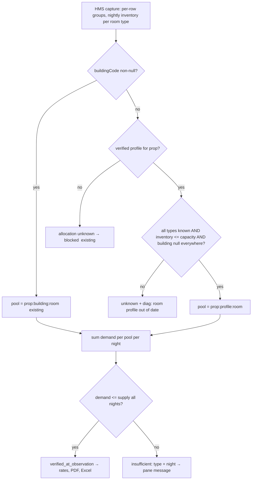

# AE1 Centurion Room Pool, Weekend v4 Retro, and v5 Remaining Work - Plan


## Goal Capsule

- **Objective:** close the last v4 Definition of Done gap. Ship multi-room-type quotes for Centurion **without a staff tick**, using a proven room-pool identity. Then prove AE1 Get rates + Proposal Excel on thread de9abfb6 (D6), finish the v4 tail and hand over a clean v5 backlog.
- **Authority:** user messages > this plan > `docs/plans/2026-10-09-001-feat-nava-pane-weekend-v4-plan.md` > repo conventions. The handoff holds (H1–H8 below) stay in force.
- **Stop conditions:** prod change after 07:30Z; any HMS write outside Labtest; any proof needing an attestation no human made; 3 failed fix loops on the same unit.
- **Tail owner:** the overnight session; the final report is due at 08:00Z.

---

## Product Contract

### Summary

Centurion is one property (HRCEN) in one building, with 160 rooms. Each physical room belongs to exactly one HMS room type. Encoding that as a checked **property room profile** lets the allocator give every room type a proven pool. Mixed-type quotes such as 30 Single + 30 Double/Twin then go through with no staff tick and no invented identity.

### Problem Frame

- AE1 Get rates and Excel on de9abfb6 are blocked. HMS returns `buildingCode: null` for every room in 4,185 captured rows, so `composeAllocation` (`apps/server-pilot/tooling/playwright-quote/quote-contract.mjs:629-679`) returns `unknown`. Composition then throws `native_quote_business_evidence_unavailable`.
- The rule "never invent pool identity" is right (`quote-contract.test.mjs:541`). The data to prove the identity was already available; nobody gathered it before escalating to the user. The cost was 4 h of waiting plus about 31 stop-hook loops.
- Draft PR #168 (option B) pools by property + room type, but makes staff tick "checked together in HMS" for mixed types. That is a human attestation covering a fact we can prove ourselves.

### Evidence that settles identity (gathered 2026-10-10 23:0xZ, read-only)

| Fact | Source |
|---|---|
| Account and property: every capture is HRCEN, and `HMS_EXPECTED_PROPERTY_CODE` must equal HRCEN | `apps/server-pilot/src/env.ts:242-244`, `fetch-quote.mjs:405,849`, 90 captures |
| HMS has 9 room types; the max inventory per type sums to **160** | 95 `.private/playwright-quote/**/group-*-source.json`: EXKNG 5, LUXKNG 4, SUITE 2, STQN 34, STWN 69, DLXKNG 8, DLXQN 10, DLXTWN 22, SKNG 6 |
| The hotel publishes **160 rooms** | Legacy brochure PDF (`bookings.legacyhotels.co.za/.../5d54f9e5eb46a029350344.pdf`), Cvent, M&C ("Number of Floors 6, Total Number of Rooms 160") |
| The split matches: brochure has 91 twins and 44 queens | STWN 69 + DLXTWN 22 = 91; STQN 34 + DLXQN 10 = 44 |
| Building: one six-storey building; HMS has no building config | M&C listing; `buildingCode` null in 100% of rows |

If any physical room counted under two types, the per-type capacities would sum to more than 160. They sum to exactly 160, so the room types are disjoint pools within one building.

### Requirements

**Allocation identity**
- R1. When HMS gives no building and a verified property room profile exists for the property, each room type is its own pool, `HRCEN:profile:<roomCode>`. Same-type rows sum against it.
- R2. The profile is checked on every capture. Unknown room type, observed inventory above profile capacity, or a non-null `buildingCode` means the profile is not used. A non-null building uses the existing building pool; the other cases stay `unknown`.
- R3. Any property without a profile keeps today's behaviour (`unknown` → blocked). The test "never invents identity" still holds.
- R4. An unavailable group reports `insufficient`, not "did not prove identity". This is the bug at `quote-contract.mjs:625-628`.

**Staff path**
- R5. A mixed-type Centurion quote needs no tick. Get rates → Prepare PDF → Download Excel → Save reply works as it does for single-type quotes.
- R6. When demand exceeds supply for a type, the pane says which type and night are short, using the existing `insufficient` path, so staff can quote fewer rooms or quote types separately.

**Proof**
- R7. AE1 on de9abfb6 runs one Get rates per stay and one Proposal Excel (D6). Room counts come from the email read (30 Single + 30 Double/Twin per stay), never the driver's 15/15 default. The S3 object is kept, and the work_item state is reverted with a guarded write.

**v4 tail**
- R8. Close the v4 run: `final-0800Z.md` (TL;DR under 50 words, an R-by-R table, AE screenshots index), ledger rows closed, and the DoD probe-path mismatch recorded.

### Acceptance Examples

- AE1a. HRCEN, 30 STQN + 30 STWN, supply 34/69 on both nights → `verified_at_observation`, Get rates OK, PDF and Excel enabled, no tick shown.
- AE1b. HRCEN, 40 STQN, supply 34 → `insufficient` naming STQN and the short night.
- AE1c. HRCEN capture where STWN reports 70 (above capacity 69) → profile rejected → `unknown` → blocked with a "room profile out of date" diagnostic.
- AE1d. Any other property, building null → `unknown` (unchanged).

### Scope Boundaries

- In scope: the profile, the allocator, staff-path cleanup (drop the #168 tick), the AE1 driver count source, the AE1 proof, the v4 final report.
- Out of scope this run, needing the user (holds): GitHub cleanup (#95, #3, archive pushes, prune); orca cleanup APPLY; outside-sender probe; dismissing 9753605e / `ae4-cleanup.sql`; the INBOUND_EXTRACTION_MAX_PER_HOUR change; RESERVATIONIST_PANE_SAVE/AMEND flags; HMS writes on real bookings.

### Deferred to Follow-Up Work (v5 backlog, ranked by ROI)

| # | Item | Why deferred | ETA (scaled) | ROI |
|---|---|---|---|---|
| F1 | Thread noise: auto-dismiss older untouched `other` items on the same thread; don't raise needs_you for staff-sent `other` | Product call per triage-69098cbb; reversible, so it qualifies for auto-decide under the new policy (KTD-6) | ~45 min | High: inbox 200+ → fewer false needs_you |
| F2 | AE2 lookup: when no booked dates were read, look up by confirmation number before falling back to the requested arrival | Find already works by surname; low risk | ~25 min | Medium |
| F3 | `quote-workbook-download.ts` misleading copy | Cosmetic | ~10 min | Low |
| F4 | Periodic profile re-proof: a monthly far-future HMS read checks capacities still sum to 160 | Guard R2 already catches drift at runtime | ~40 min | Medium |
| F5 | Partial-availability quote (quote what's free, flag the rest) | New product behaviour | ~2 h | Medium |
| F6 | Triage-retire (pills migration + flag), osrrav | Flag needs the user | — | — |

---

## Planning Contract

### Key Technical Decisions

- **KTD-1 Profile, not a magic building string.** The user's idea was to set the building to Centurion. Doing it with a checked profile keeps "identity comes from evidence". It also survives HMS later gaining buildings, and it fails closed if HMS config drifts.
- **KTD-2 Profile lives in code as a data file plus an evidence block** (capacities, published total, sources, capture digests). It does not live in the DB. It changes rarely, gets reviewed in PRs, and the existing manifest pattern fits (`apps/server-pilot/tooling/playwright-quote/centurion.manifest.json`).
- **KTD-3 Runtime guard on every capture** (R2). This makes the profile self-checking, so it is never stale in silence.
- **KTD-4 Close #168 and cherry-pick only its pooling code.** Keep same-type summing, collapsing mixed building/null, and the recompute-equality check. Drop the tick, `joint-rooms-check.ts`, `recordJointRoomsCheck`, the `joint_rooms_unchecked` blocker and its UI. Less surface, and no human attestation.
- **KTD-5 Keep the serial per-row HMS search** (`fetch-quote.mjs:697`). It already gives per-type nightly counts, which is all the allocator needs. The no-atomic-hold note (`fetch-quote.mjs:818`) stays true and is fine for quotes.
- **KTD-6 Decision policy (anti-block).** Before escalating, spend up to 20 min gathering data that could prove the safe path. Auto-decide with the recommended option when the change is reversible, rollback-able via ops-deploy, and touches no real booking or external send. Escalate only for the hold classes. Record auto-decisions in the checkpoint.

### High-Level Technical Design



### Sequencing

U1 → U2 → U3 → (U4 in parallel with U3) → review → deploy D14 → U5 proof → U6 report. U7 is retro/process and is written into the report.

---

## Implementation Units

### U1. Centurion room profile and its evidence

- **Goal:** a checked-in profile for HRCEN: 9 types with capacities, total 160, building none, evidence sources and capture digests.
- **Requirements:** R1, R2.
- **Files:** `apps/server-pilot/tooling/playwright-quote/property-profiles/HRCEN.json` (new); `apps/server-pilot/tooling/playwright-quote/property-profile.mjs` (new loader + validator); `apps/server-pilot/tooling/playwright-quote/property-profile.test.mjs`.
- **Approach:** the loader validates shape (capacities are positive integers, the sum equals `publishedRooms`) and exposes `profileFor(propertyCode)`. Derive capacities from the max observed inventory across captures. Commit the derivation numbers in the evidence block, not the private captures.
- **Patterns:** `centurion.manifest.json` plus the `quote-contract.mjs` module style.
- **Test scenarios:** a valid profile loads; capacities summing to 161 against published 160 are rejected; an unknown property gives null; a non-integer capacity is rejected.
- **Verification:** loader tests pass; the profile numbers match the evidence table above.

### U2. Allocator uses the profile identity and fixes the unavailable bug

- **Goal:** `composeAllocation` gives profile pools when the building is null and the profile passes the runtime guard; an unavailable group becomes `insufficient`.
- **Requirements:** R1–R4, AE1a–AE1d.
- **Dependencies:** U1.
- **Files:** `apps/server-pilot/tooling/playwright-quote/quote-contract.mjs`, `quote-contract.test.mjs`; mirrors in `apps/server-pilot/src/ai/reservationist-business-services.ts` and `apps/server-pilot/src/quote-proposal/quote-revision.ts` (pool id at ~362/399); `apps/server-pilot/src/ai/reservationist-evaluation-composition.ts` (evidence recompute ~141/209, `nativeQuoteGapDetail` ~154-175). Tests: `apps/server-pilot/tests/reservationist-evaluation-composition*.test.ts`, the quote-revision tests, the business-services tests.
- **Approach:** cherry-pick #168's pooling commit, then swap `property_room_type` for `profile` identity plus the guard. Allocation records `poolBasis: 'property_profile'` and the profile digest, so the evidence recompute stays deterministic. Keep the recompute-equality check from #168. The building-present path is unchanged.
- **Execution note:** test-first on `quote-contract.test.mjs`. Change "never invents identity" to "invents none without a verified profile".
- **Test scenarios:**
  - Covers AE1a: 30 STQN + 30 STWN, supply 34/69 → verified, two pools.
  - Covers AE1b: 40 STQN, supply 34 → insufficient (type, night).
  - Covers AE1c: inventory 70 > 69 → unknown with diagnostic `room_profile_mismatch`.
  - Covers AE1d: no profile → unknown.
  - Same type in two rows (20 + 20 STQN vs 34) → insufficient.
  - Building present on one row and null on another → building pool for the first; profile guard fails for the property → unknown.
  - Unavailable group → insufficient, not unknown (R4).
  - Evidence recompute: composition accepts a profile allocation and rejects a tampered pool id.
- **Verification:** contract `node --test` green; quote vitest files green; tsc clean.

### U3. Remove the staff tick path

- **Goal:** the staff path for mixed-type quotes is identical to single-type quotes.
- **Requirements:** R5, R6.
- **Dependencies:** U2.
- **Files:** do not merge #168's `joint-rooms-check.ts`, the `recordJointRoomsCheck` route, the `joint_rooms_unchecked` blocker in `apps/mail/lib/quote-workflow/session.ts`, or the tick UI in `apps/mail/components/nava-pane/...document-review.tsx`. Update `SHARED_INVENTORY_GAP_MESSAGE` (workstation/execution) so it only appears for a profile mismatch or no profile. Tests: `apps/mail/tests/*session*.test.ts`, `apps/server-pilot/tests/workstation*.test.ts`.
- **Approach:** U2 cherry-picks only pooling. U3 makes sure the pane copy and `pdfBlocker` have no tick state, and that the `insufficient` message names the type and night. Both surfaces (Outlook pane and webmail panel) share `nava-pane`.
- **Test scenarios:** a mixed-type verified quote gives `pdfBlocker` null; insufficient shows "Only 34 Standard Queen free on 26 Oct — quote fewer or split"; profile mismatch shows the out-of-date copy.
- **Verification:** mail tests green; no `joint_rooms` symbols on main.

### U4. AE1 driver takes room counts from the read

- **Goal:** the driver never invents counts; it uses the read's 30/30, or stops with `needs_edits:rooms`.
- **Requirements:** R7.
- **Files:** `apps/server-pilot/scripts/nava-ae1-rates-proof.ts` (drop the `NAVA_AE1_ROOMS=15/15` default at ~138); `apps/server-pilot/scripts/nava-proof-safety.ts`; tests beside it.
- **Test scenarios:** read has 30/30 → no fill; read lacks counts and ALLOW_EDITS is unset → `needs_edits:rooms`; with an explicit `NAVA_AE1_ROOMS` → fill only the missing fields.
- **Verification:** script tests green; a dry plan prints counts sourced from the read.

### U5. Deploy D14 and AE1 proof on de9abfb6

- **Goal:** live proof under systemd-run: one Get rates per stay plus one Proposal Excel; keep the S3 object; guarded state revert.
- **Requirements:** R5, R7.
- **Dependencies:** U2–U4 merged; Greptile gate clean; local main = origin/main (the #166 guard enforces it). Ships in D15 (Part 2 schedule).
- **Approach:** `git fetch origin main:main`, then `ops-deploy.sh` from `.worktrees/recover-parse-failure`, then manual health check. Run `nava-preview-gate.sh --ae1-rates <de9abfb6>` with the mailbox switch from #164. Read the work_item state first, then the guarded reset, logged in `rollbacks.md`. Roll back to e93caaad7 via ops-deploy if health fails.
- **Verification:** summary `staysRated 2`, `xlsx true`, Excel rows = 4 room rows plus a total, rates sourced from HMS, gallery pulled into `.private/h6/`.

### U6. v4 close-out report

- **Goal:** `final-0800Z.md`: TL;DR under 50 words, a done/blocked table, an R1–R24 status table from the v4 plan, AE1–AE5 screenshot index, rollbacks, ETA calibration, and decisions applied.
- **Requirements:** R8.
- **Files:** `.worktrees/w4-H/.private/checkpoints/final-0800Z.md` (private); append ledger close rows.
- **Test expectation:** none, report only.

### U7. Process fixes from the retro (no prod effect)

- **Goal:** stop the failure modes behind the wasted hours and tokens next run.
- **Files:** memory file `feedback-evidence-before-escalation.md` (with MEMORY.md pointer); `/tmp/w4-prodq.sh` gains a `\dt`/`\d` schema cheat-sheet comment; plan template note on `/goal` wording.
- **Approach:**
  - Write the KTD-6 decision policy into memory.
  - Future `/goal` text lists hold classes and says "items blocked only on hold classes count as done once noted in the checkpoint". That stops stop-hook loops.
  - Cap Haiku lane agents at about 2 h or 150 turns, then re-spawn with a summary.
  - Append ledger rows with `jq -c` to stop invalid JSON.
- **Test expectation:** none, process change.

---

## Verification Contract

- Contract: `node --test apps/server-pilot/tooling/playwright-quote/*.test.mjs`. The one failure that needs `.private` already fails on main and is accepted.
- Server: `cd apps/server-pilot && npx vitest run <touched test files>` with the disposable PG on 55601. Set `U` first, then `DATABASE_URL`/`TEST_DATABASE_URL`, and `CONFIRM_DISPOSABLE_TEST_DB=1`.
- Mail: `cd apps/mail && npx vitest run <touched files>`. tsc may show only the 12 errors already on main.
- `npx tsc --noEmit -p apps/server-pilot`; `pnpm dlx oxlint@1.6.0 --deny-warnings <files>`.
- Gate: local green + Greptile on the final push (P0/P1 fixed, P2 replied or rejected) + a Haiku-max verify of the fixes. An Opus review runs only after 2 failed Haiku rounds. No GitHub Actions; never trigger bots by comment.
- Live: health on 8788/8789, pm2 4/4 online, 0 failed `ai_workflow_run` in the hour after deploy, AE1 summary as in U5.

## Definition of Done

- U1–U4 merged; D14 deployed via ops-deploy; health verified manually.
- AE1 on de9abfb6: Get rates for both stays, a Proposal Excel created, S3 kept, state reverted (guarded), gallery saved.
- #168 closed with a comment pointing at the merged PR (closing a PR we opened is not repo cleanup).
- `final-0800Z.md` written; all ledger rows closed; no `joint_rooms` dead code on main; no new flags; holds untouched.

---

## Retro: weekend v4 (Oct 9 19:10Z → Oct 10 23:10Z)

### Done vs not done

| Area | Status |
|---|---|
| Goal items 2–7 (Greptile P1 79/79, getByMessage read path #155, backfill 1,725 + rerun 629, AE5 job queue, backtest #148/#149, ledger) | Done |
| AE2, AE3, AE4-A, AE5 live | Done |
| AE1 read | Done |
| AE1 Get rates and Excel | **Not done:** blocked on joint-room identity → this plan |
| Extra fixes: #160 staff-forward prompt, #161 no-reply, #162 copy, #163/#164 driver safety, #165 diagnostics, #166 deploy guard, #167 translation | Done (D9–D13) |
| v4 DoD "probes only in tooling/playwright-quote/probes/" | Not met as written: drivers live in `apps/server-pilot/scripts/nava-*-proof.ts`. Amend the DoD in the report |
| 08:00Z final report | Pending (U6) |

### ETA calibration (92 ledger ids)

| Kind | n | Σ est | Σ actual | Median ratio | Plan assumed |
|---|---|---|---|---|---|
| code-server | 29 | 2456 | 1311 | 0.52 | 0.71 |
| code-ui | 14 | 1154 | 900 | 0.73 | 0.91 |
| live-hms | 19 | 903 | 500 | 0.53 | — |
| deploy | 20 | 319 | 232 | 0.80 | — |
| review | 9 | 345 | 331 | 1.00 | — |

Overall estimate 5,192 min vs actual 3,282 (0.63). We over-estimate code and under-estimate waits. The worst overrun was H6c-AE1 (20 → 105 min, forward misread); the biggest underrun was U7 (96 → 16 min).

### Where time went (wall clock)

| Sink | Cost |
|---|---|
| Waiting on human/peer decisions | ~6 h total. AE1 joint-room 4 h 07 m (avoidable); AE4 thread 2 h; scope HOLD 53 m; plan "go" 71 m |
| Rework and mistakes | ~4.5 h. Greptile rounds ~308 m; U28 H1–H5 partial sessions 229 m; AE1 misread 85 m over; D9 mis-ship ~23 m; driver contamination ~40 m; false AE3 claims ~48 m |
| Proof-tool attach and selector churn (H2 ×4) | 87 m |

### Tokens (since Oct 9, about 3.75B incl. cache)

- **Haiku 2.50B (67%), Opus 1.25B.** 92% of the main session is cache reads (about 222k per turn).
- **Biggest waste:** five long-lived Haiku lane agents used 1.26B tokens, up to 890k context each, never compacted, with unverified outcomes (PR #89).
- **Stop-hook loop:** 37 injections and 78 turns burned 17.5M tokens; 30 of them did no tool call. Together with no-op wakeups that is about 11% of the main session.
- **Schema guessing:** 11 failed SQL calls. Bash file dumps: 10 of the 15 largest tool results.
- **Well spent:** Opus PR reviews (41, 214M) caught real P1/P2s on #160, #166, #167 and #168. Haiku research agents were cheap and decisive (this plan's evidence cost about 0.8M). AE proof tooling (70M) made live proofs repeatable.

### Model-usage learnings

- Haiku at max effort fits bounded research and audits. Use it in short-lived tasks; long-lived lanes balloon context.
- Opus works for critical diffs and reviews; review findings had a high hit rate.
- Opus in the main loop should not idle-loop; use long wakeups and let the stop hook see a "blocked-only-on-holds" done state.

### Good stuff

- No prod breakage. Every deploy went through ops-deploy with manual health checks, and the #166 guard now prevents the D9 class of mis-ship.
- Guarded writes and rollback log kept real threads clean after driver contamination; #164 now prevents it.
- Data-first root causes: translation segment counts (#167) and, now, the 160-room identity proof.

### Why it kept getting blocked, and the prevention (KTD-6, U7)

| Block | Real need? | Prevention |
|---|---|---|
| AE1 joint-room gate | No: a 10-min evidence pull resolved it | Evidence before escalation (20-min budget) |
| HMS_JOB_QUEUE hold | No: pre-approved in the goal | Treat goal approvals as standing; peers must cite a new risk to hold |
| Re-run scope HOLD | Partly | Default to the smallest reversible scope and report it |
| AE4 thread pick | No: any real quote thread worked | Auto-pick by a rule (newest real quote, no agency) |
| Stop-hook loop | Tooling | `/goal` text defines hold-blocked = done-if-noted |

---

## Updated ETAs (scaled by observed medians)

| Unit | Raw | × median | Scaled | ROI |
|---|---|---|---|---|
| U1 profile | 60 | 0.52 | 31 | Unblocks all Centurion group quotes |
| U2 allocator | 120 | 0.52 | 62 | Core fix plus bug R4 |
| U3 tick removal and copy | 40 | 0.73 | 29 | Removes friction and attestation risk |
| U4 driver counts | 30 | 0.52 | 16 | Stops invented data on real threads |
| Opus review | 30 | 1.00 | 30 | Critical-path gate |
| D14 deploy | 8 | 0.80 | 7 | — |
| U5 AE1 proof | 20 | 0.53 | 11 | Closes v4 DoD |
| U6 report | 25 | 1.00 | 25 | Required at 08:00Z |
| U7 process | 20 | 0.60 | 12 | Saves hours and tokens next run |
| **Total** | 353 | | **≈ 223 min (3 h 45 m)** | Done by about 03:00Z if started 23:15Z; well inside the 07:30Z prod cutoff |

v5 backlog F1–F5 ≈ 3 h 40 m scaled; F1 is first by ROI.

---

# PART 2: Overnight v5, +5 h of high-client-ROI work in parallel lanes

Research for this part: 7 Haiku-max agents (client ROI, eval inventory, Mastra/flywheel web, HMS reads, VPS/lanes/Greptile, corpus/backtest, mistakes/model routing). It cost about 1.6M Haiku tokens. Opus did only the synthesis.

## Client-ROI rules (what earns a lane)

- **High:** the work removes an HMS round-trip or retyping. Examples: Nava reads HMS rows for staff, one-click copy of HMS lines or confirmation numbers, quote PDF/Excel, a trustworthy "needs you" list.
- **Low:** it shows email fields that staff must retype into HMS anyway; they open HMS regardless.
- **Generalize or drop.** No entity-specific rules (Woolworths lesson). Every behaviour change ships with a corpus backtest or prod count, and `pnpm check:entities` must not grow its baseline.
- **Evidence:**
  - Bongi call: HMS waits "pretty slow", wants one view of what she missed, wrong dates, mixed-room groups, hand-typing special requests and "authorised by" into HMS.
  - Prod: 1,377 needs_you items with only 2 linked to a later hotel reply. Zero staff action events are logged, so client ROI is unmeasurable today.

## What we build tonight (Part 1 + Part 2 in one parallel run)

### Lane A: AE1 room profile (Part 1, U1–U4)

Unchanged scope. Review is now Greptile plus a Haiku verify, not an Opus review.

### Lane B: Measure and learn (flywheel v1). Schema first.

- **S1. Schema (Opus, orchestrator, first 20 min)**
  - Migration `0048_eval_label`: `eval_label(id, work_item_id, message_id, field_path, ai_value jsonb, human_value jsonb, label_kind correction|confirmation|run_flag|note, source_event_id, extractor_version, model_route, split dev|holdout|test, created_at)`. Index on `(split, field_path)`.
  - Register the new `work_event` types in `apps/server-pilot/src/db/schema/work.ts` (free-form column, no migration needed).
  - Ships in D14 with `--migrate` before any code depends on it.
- **B1. Pane action telemetry, both surfaces**
  - Events: `pane.opened`, `copy.hms_line`, `copy.confirmation`, `reply.inserted`, `reply.saved`, `pdf.created`, `excel.downloaded`, `hms.lookup.started/finished` (with ms), `item.dismissed`.
  - Batched tRPC route; fire-and-forget from `apps/mail/components/nava-pane/*`.
  - Gives the first real client-ROI numbers (time-to-reply, copy use, HMS wait).
- **B2. Positive labels and notes**
  - Emit `field.accept` when staff proceed with an unedited AI field (`apps/mail/lib/quote-workflow/use-work-item.ts`).
  - Store "Tell Nava" text as a masked `note.staff` event (`apps/server-pilot/src/trpc/routes/quote-workflow.ts:160`; today a boolean only).
- **B3. Label export v2**
  - `scripts/export-work-events-dataset.ts` writes `eval_label` rows with masked source text, `ai_source`, and a hash split 60/20/20 by work item.
  - Holdout locked; time split = last 30 days.
- **B4. Backtest consumes labels**
  - `run-reservationist-backtest.ts --target extract --dataset <file>`.
  - Per-field deterministic scorers via `@mastra/evals` `createScorer` (function steps only, no LLM judge until 100+ labels). Pin the exact version; `@mastra/core` 1.70 is already a dependency.
  - Pass criteria: stays/booked/confirmations 100%; field drop >5 pts fails; kind drop >10 pts fails at n≥30; dev-holdout gap ≤10.
  - Runs on EC2 via systemd-run, because the Azure key lives there and the VPS has no prod creds.
- **B5. Stratified sample for labelling**
  - Export about 400 prod reads stratified by kind (all 32 cancellations, about 60–75 per other kind) with a domain-disjoint holdout.
  - Labelled later by staff or the user. No LLM gold.

### Lane C: Trustworthy inbox and correctness

- **C1. Booked dates**
  - With no booked dates read, look up by confirmation number, then surname.
  - Never fall back to the requested arrival silently; show "booked dates not in mail" (AE2 follow-up).
- **C2. Reply link**
  - When a hotel outbound message appears on the item's thread after the item, set `sent_at` and mark the item handled with reason `hotel_replied`. A new inbound restores it.
  - Backtest first: a read-only prod count of how many of the 1,377 would clear, then sample 20 by hand.
  - Reversible system state, so auto-decided per KTD-6.
- **C3. Same-thread collapse**
  - Older untouched needs_you items on a thread are dismissed when a newer read lands (reason `superseded_by_thread`).
  - Reuse the `dismissSupersededItems`/`restoreSupersededItem` pattern in `apps/server-pilot/src/ai/work-items.ts`.
  - Staff-sent `other` mails get no needs_you.
- **C4. "Copy for HMS notes" block**
  - Special requests, booker name, discount "authorised by", rate line: one copy button, generic and data-driven.
  - Extends the `rate-controls.tsx` Copy-for-HMS pattern.
- **C5. Pre-commit entity check:** wire `pnpm check:entities` into `.husky/pre-commit`. No Actions.
- **U4. AE1 driver counts** (Part 1).

### Lane H: HMS live, single runner, serial

1. AE1 proof after D15 (U5).
2. Capture stage timings on 3 Labtest quote runs for the "HMS is slow" evidence.
3. Read-only Labtest probe of the HMS documents screen. This sizes `hms_list_documents`, the top-demand unbuilt read (89.5% gold), for the next run. Report only.

### Stretch (cut first if behind)

| Item | Scaled ETA | Why it's a stretch |
|---|---|---|
| X1 HMS stage-timing instrumentation in code | 36 min | Lane H gives evidence first |
| X2 Prefill booking from prior quote revision | 54 min | About 25% of bookings; needs C2 |
| X3 Quote follow-up nudge live | 30 min | Depends on C2 `sent_at` |

### Out of scope tonight (why)

| Item | Why |
|---|---|
| Voucher attach / booking save / amend / cancel on real bookings | Hold H8: writes on real bookings |
| Promote group/company/folio reads; HITL_LEDGER=on; prefetch flags | "Any other flag on" needs the user |
| HMS deep link | Product promise vs plan conflict; user call |
| Quarantine review path | Hotel IT and prod inserts |
| Langfuse/Mastra Cloud tracing | Sends PII off-box; `env.ts` blocks the keys |
| LLM judge, fine-tuning, GEPA/Ax | Fewer than 100 labels; premature |
| Admin dashboard, auto-draft replies | Need decisions or are large |
| GitHub cleanup, Actions | Holds |

## Parallelism and schedule (VPS: 4 vCPU, 15 GiB, no swap)

- **Lanes:** 3 code lanes (A, B, C) + 1 HMS lane, each in its own worktree from origin/main, on a shared pnpm store.
- **Suite gate:**
  - `flock` with 2 slots around vitest/tsc/playwright, run with `--maxWorkers=1`.
  - Pause launches when load1 > 6 or MemAvailable < 4 GB. Past runs hit load 7–26 and 5-second timeouts.
- **Shared test PG on 55601:** safe. Transactional rollback, or a per-run `zero_ingestion_<uuid>` DB.
- **Merge train:**
  - One PR at a time.
  - Wait for Greptile on the final push (about 6 min).
  - Fix P0/P1; reply to P2s or reject them with a reason.
  - Merge on local green + Greptile.
- **Deploys, serial, 5–7 min each:**
  - D14 at ≈T+45: 0048 `--migrate`, C1, C5.
  - D15 at ≈T+170: lane A + B1/B2 + C3.
  - D16 at ≈T+300: B3/B4 + C2 + C4.
  - All before 07:30Z. The HMS lane only runs after a deploy is green.

```mermaid
gantt
  dateFormat HH:mm
  axisFormat %H:%M
  section Orchestrator (Opus)
  S1 schema + briefs        :00:00, 25m
  merge train / deploys     :00:25, 330m
  section Lane A (Haiku)
  U1 profile                :00:25, 36m
  U2 allocator              :01:01, 72m
  U3 tick removal           :02:13, 30m
  section Lane B (Haiku)
  B1 telemetry              :00:25, 68m
  B2 accept+notes           :01:33, 27m
  B3 export v2              :02:00, 54m
  B4 backtest+scorers       :02:54, 72m
  B5 strat sample           :04:06, 20m
  section Lane C (Haiku)
  C1 booked dates           :00:25, 24m
  C5 entity hook            :00:49, 9m
  U4 driver counts          :00:58, 18m
  C3 thread collapse        :01:16, 36m
  C2 reply link + backtest  :01:52, 72m
  C4 HMS notes copy         :03:04, 45m
  section Lane H (serial)
  D14                       :00:45, 7m
  D15 + AE1 proof           :02:50, 25m
  timings + docs probe      :03:15, 45m
  D16                       :05:00, 7m
  final report              :05:30, 25m
```



## ETAs (scaled by ledger medians joined by id: code-server 0.60, code-ui 0.75, live-hms 0.53, deploy 0.80, review 1.0)

| Lane | Units | Scaled serial min |
|---|---|---|
| A | U1 36, U2 72, U3 30, review/fix 20 | 158 |
| B | S1 25, B1 68, B2 27, B3 54, B4 72, B5 20 | 266 |
| C | C1 24, C5 9, U4 18, C3 36, C2 72, C4 45 | 204 |
| H | D14–D16 21, U5 11, timings + probe 32, report 25 | 89 |
| **Wall clock** | lanes in parallel + merge-train overhead about 50 | **≈ 5 h 40 m** (start 00:00Z → about 05:40Z; 1 h 50 m buffer to the 07:30Z cutoff) |

Serial equivalent is about 717 min, so parallel lanes buy about 2.1×. Stretch X1–X3 adds 120 min serial; only pull it in if a lane finishes before T+4h.

## Model and token policy (evidence-based)

| Work | Model | Why (data) |
|---|---|---|
| Orchestrator: plan, briefs, merge/deploy go/no-go, P1 triage | Opus 5.5 (this chat or the kickoff chat) | Judgment; one context |
| Schema design (S1), allocator design check | Opus, in the orchestrator itself, not a subagent | User rule; highest blast radius |
| All code lanes, tests, fixes | Haiku 5.5 max | 67% of past tokens at about 1/40 the price; issue rate 43% is mostly VPS load and churn, which the suite gate now targets |
| Research, audits, log/ledger digests | Haiku max | Low issue rate; this plan's research cost about 1.6M Haiku tokens |
| PR review | Greptile + one Haiku max verify of P0/P1 | Replaces Opus reviews (user call); Opus review only if Haiku fails twice |
| Live HMS proof | Deterministic scripts (`nava-preview-gate.sh` modes) run by the orchestrator; Haiku digests output | Codex HMS runs failed 6 of 8; LLM drivers misread |
| Escalation | Opus subagent after 2 Haiku failures on the same unit | Caps Opus spend |

**Token savers:**
- Haiku agents live ≤90 min or ≤150 turns. Re-spawn with a summary; past lanes ballooned to 890k context and 1.26B tokens.
- Briefs give file:line scope, so no codebase tours.
- The orchestrator reads agent summaries, never files.
- Use `grep -n`/`sed` ranges, not file dumps.
- A schema cheat sheet up front (11 failed SQL guesses last run).
- Long wakeups; no polling of agent output.
- `/goal` wording stops stop-hook loops (17.5M tokens wasted last run).
- **Budget guess:** Haiku about 400–600M tokens, Opus about 40–60M for orchestration.

## Learning loop (mistakes, stuck points, model choice)

- **Append-only ledger fields per task:**
  - Start row: `effort`, canonical `model`.
  - Close row: `outcome` (pass|partial|fail|superseded|abandoned), `rework_min`, `stuck_min`, `mistake_class`, `verdict`, `p0/p1/p2`.
  - Append with `jq -c` only.
- **Mistake classes:** estimate_basis, vps_load, review_churn, proof_driver, scope_growth, stale_ref, human_wait, schema_guess, context_resume, rule_breach, overfit.
- **Report:** one jq command, five sections (calibration, models, mistakes, reviews, hygiene). It goes in the final report and drives next run's model routing. Fix the CLAUDE.md median command to join start and close rows by id; today 70 of 126 rows fall under `kind:null`.
- **Memory:** save `feedback-evidence-before-escalation.md` (KTD-6) and `feedback-model-routing.md` (the table above).

## Why we kept getting blocked → rule for the next run

Most waits were for decisions we could have made with data, or that were reversible. The kickoff `/goal` therefore says:
- Auto-decide reversible, rollback-able, non-booking choices.
- Spend 20 min on evidence before escalating.
- Escalate only the hold classes.
- Items blocked only on hold classes count as done once noted in the checkpoint.

## TL;DR: highest-ROI tonight

1. **AE1 room profile:** mixed-room group quotes with no tick (proof: 160 rooms).
2. **Trustworthy needs-you list:** reply link plus same-thread collapse; 1,377 open → expect most cleared, with a backtest count first.
3. **Measure client ROI:** pane action telemetry, field.accept, staff notes.
4. **Flywheel v1:** eval_label schema, export v2, Mastra deterministic scorers, `--dataset` backtest, stratified label sample.
5. **Booked-dates fix and a Copy-for-HMS notes block:** wrong dates and retyping were Bongi's top pains.
6. **Learning ledger and routing rules,** so the next run spends less Opus and waits less.

## Kickoff `/goal` (paste in a new chat or this one)

```
/goal Execute docs/plans/2026-10-10-NNN-feat-ae1-centurion-room-pool-v5-plan.md (Part 1 + Part 2) to its Definition of Done. Read Goal Capsule, then lanes A/B/C/H in the order given; run its Verification Contract; log every task start/close to ~/.claude/eta-ledger.jsonl with the plan's learning fields. Orchestrate on Opus; build, test, research and review with Haiku 5.5 max subagents (max 3 code lanes + 1 serial HMS lane, suite gate per plan); Opus subagents only for schema design or after 2 Haiku failures on one unit. Merge on local green + Greptile (fix P0/P1, reply/reject P2), deploy only via ops-deploy.sh in the plan's batches, live proof under systemd-run, no prod changes after 07:30Z. Decision policy: gather evidence ≤20 min, then auto-decide anything reversible, rollback-able and not a real-booking write or external send; record the decision in the checkpoint. Escalate ONLY the plan's Holds H1–H8 (real-booking HMS writes, new flags on, GitHub cleanup, Actions, env changes, S3 deletes, held proof items). Items blocked solely on a Hold count as done once noted in the checkpoint. Checkpoint every 90 min (done / running / blocked table). At 08:00Z write final-0800Z.md with the ledger learning report and TL;DR <50 words, then stop.
```

## Holds (unchanged)

- H1: no S3 deletes.
- H2: don't dismiss 9753605e or run ae4-cleanup.sql.
- H3: no outside-sender probe.
- H4: orca cleanup stays a dry run.
- H5: no GitHub cleanup.
- H6: no prod env change (cap stays 300).
- H7: no RESERVATIONIST_PANE_SAVE/AMEND.
- H8: no HMS writes on real bookings.
