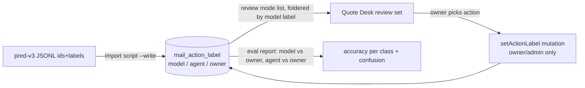

# feat: Owner marks classifier actions in nava-admin workflow folders

## Summary

This replaces the R3 markdown review packs with marking inside nava-admin. First, fix the workflow-folder crash. Then load the 400-email eval predictions as shadow labels, so each email shows in the folder for its predicted action. The owner confirms or corrects each action in the Quote Desk. Those marks become the gold set for the classifier gate (≥90% action accuracy, ≤1% failures).

---

## Problem Frame

- **The folders crash.** Every workflow folder in nava-admin shows "Could not load this workflow folder." Prod `remote-http` logs show `PostgresError: column reference "id" is ambiguous` from the folder list query.
  - The `automatedChannel` subquery in `apps/server-pilot/src/mail/workflow-folders.ts` interpolates `mailThread.id` / `mailThread.transportId`. Drizzle renders those unqualified inside the `$with` select, next to `message.id` and `mail_extraction.id`.
  - `apps/server-pilot/tests/workflow-folders.test.ts` is unit-only, so no test ran the SQL.
- **R3 packs are a side channel.** The R3 packs are 9 markdown files × 10 emails, marked by hand with checkboxes. The long-term product is triage into those same 9 folders. Marking in the folders produces the gold set and exercises the real surface at the same time.
- **The classifier can't feed the folders yet.** It is not merged: v3 scores 63% action accuracy on the 400, below the 90% gate. Merging it to fill the folders would change the live extractor staff rely on.

---

## Requirements

- R1. Workflow folders load on prod. On error, the list shows the server error message, not only the generic notice.
- R2. The 400-email eval set shows in the folders under its predicted action, without changing the live extractor or the pane.
- R3. The owner can mark each email's action as right, or pick the correct action, in one control. Marks persist and survive reload.
- R4. Only owner/admin roles can write marks; `member` gets FORBIDDEN.
- R5. An eval report compares model labels against owner marks: per-class accuracy, the confusion matrix, and coverage. It prints ids and labels only, never mail content.
- R6. The agent gold labels (R3 source) are imported too. The report shows agent-vs-owner agreement, so the old gold set can be trusted or dropped.
- R7. The UI supports fast marking: action preselected, keyboard shortcuts, auto-advance to the next unmarked email, and a progress count.

---

## Scope Boundaries

- No change to live extraction, pane behaviour, or the classifier prompt.
- No backfill of all mail. Only the 400-email eval set gets labels.
- No voice marking.
- The classifier merge stays gated on the item-6 rule (≥90%, ≤1% failures).

### Deferred to Follow-Up Work

- Classifier prompt v4, re-run against the owner-marked gold.
- When the classifier merges, live mail fills the folders from `payload.action`. The review set then becomes one filter of the same view.
- Fresh samples beyond the 400, e.g. "mark 50 new emails this week".

---

## Key Technical Decisions

- **New additive table `mail_action_label`, not `eval_label`.** `eval_label` requires a work item per row. Shadow predictions have no work item, and creating 400 work items would pollute the work queue. A row is (transport, message, source, action, needs_action, version, labelled_by, created_at).
  - `source` takes one of three values: `model`, `agent`, or `owner`.
  - Unique on (message_id, source, version). Owner marks are one row per message and upsert on re-mark.
- **Review set is a separate list mode, not a change to live folder membership.** The live folder list keeps "latest inbound message per thread". Eval messages are often not the latest message in their thread, so they would never surface there.
  - Review mode lists messages that have a `model` label, foldered by that label.
  - An email does not move folders when the owner corrects it; it shows a "marked: X" chip instead. Moving rows mid-review is disorienting.
- **Owner marks write directly to `mail_action_label` via a new mutation.** The existing `workItems.adminReview` stays as is. That one reviews extraction fields and needs the latest succeeded extraction id; action marking needs neither.
- **Predictions are imported with a script, dry run by default.** The input is JSONL with `messageId`, `action`, `needsAction` only.
  - The model label is the first prediction of the v3 run (`pred-v3-medium.jsonl`); the agent label is its `expected`.
  - Messages missing from the transport are skipped and counted.
  - The file carries no mail content, so copying it to EC2 is fine.
- **Fix the SQL by qualifying columns explicitly in the subquery**, and add a real-Postgres test. A unit test cannot catch a rendering bug like this one.

---

## High-Level Technical Design

---

## Implementation Units

### U1. Fix the workflow-folder SQL crash and surface errors

**Goal:** The folders load on prod; a future failure shows its reason.
**Requirements:** R1
**Dependencies:** none (ships alone, first)
**Files:**
- Modify `apps/server-pilot/src/mail/workflow-folders.ts` (the `automatedChannel` subquery, plus any other interpolated column inside the `$with` selects)
- Modify `apps/mail/components/mail/workflow-folder-desk.tsx` (the error notice shows the error message)
- Create `apps/server-pilot/tests/workflow-folders-db.test.ts` (real Postgres via `tests/helpers/test-db.ts`)

**Approach:** Qualify the thread references explicitly in the raw SQL, as the subquery already does for `mtc` / `mc`. Check the summary and thread queries for the same pattern.

**Test scenarios:**
- Seed one transport with an inbound message, a succeeded extraction and a thread. `listWorkflowFolderRows` returns the row in the folder mapped from its kind, with no SQL error.
- A thread tagged with the `automated-channel` category maps to `not-for-nava`.
- `getWorkflowFolderSummary` and `getWorkflowFolderThread` run against the same seed without error.
- UI: when the list query errors with message "X", the notice shows "Could not load this workflow folder: X".

**Verification:** On prod, nava-admin `/mail/quotes` lists threads, and remote-http logs show no new `ambiguous` errors.

### U2. `mail_action_label` table

**Goal:** Durable store for model, agent and owner action labels.
**Requirements:** R2, R3, R6
**Dependencies:** none
**Files:**
- Create `apps/server-pilot/drizzle/0049_mail_action_label.sql` (hand-written, additive, mirrors 0048's style)
- Modify `apps/server-pilot/src/db/schema/mail.ts` (or `work.ts`, whichever holds the mail-level tables) plus the schema index export
- Test: `apps/server-pilot/tests/mail-action-label-db.test.ts`

**Approach:**
- `action` has a CHECK constraint against the nine `MAIL_ACTIONS` values.
- `source` has a CHECK constraint against `model|agent|owner`.
- `message_id` references `message` with on-delete cascade.
- Index on (transport_id, source, action) for folder counts.
- Unique on (message_id, source, version). Owner rows use version `owner`.

**Test scenarios:**
- Inserting the same (message, source, version) twice conflicts. Upsert updates the action.
- An invalid action or source is rejected by the CHECK constraint.
- Deleting the message deletes its labels.

**Verification:** The migration applies cleanly on a fresh local DB and on a DB at 0048.

### U3. Import script for predictions and agent gold

**Goal:** Load the 400 predictions and agent labels into prod.
**Requirements:** R2, R6
**Dependencies:** U2
**Files:**
- Create `apps/server-pilot/scripts/import-action-labels.ts`
- Test: `apps/server-pilot/tests/import-action-labels.test.ts`

**Approach:**
- Input is a JSONL path plus `--version`. The script writes a `model` row from `predictions[0]` and an `agent` row from `expected`.
- It runs as a dry run unless `--write` is passed.
- It prints counts only: parsed, matched to the transport, inserted, skipped-missing, skipped-invalid.
- `ON CONFLICT DO NOTHING` makes re-runs idempotent.
- It resolves the transport from env the way the other ops scripts do.

**Test scenarios:**
- A three-line fixture with two known messages and one unknown: the dry run reports 2 matched and 1 missing, and writes nothing.
- With `--write`: 4 rows inserted (model + agent × 2). A re-run inserts 0.
- A line with an action outside `MAIL_ACTIONS` is counted invalid and skipped.
- A message from another transport is not matched.

**Verification:** On prod, the dry run reports ~400 matched. After `--write`, the row counts match.

### U4. Server: review-set list and `setActionLabel`

**Goal:** The folders can list the review set, and the owner can mark.
**Requirements:** R2, R3, R4
**Dependencies:** U1, U2
**Files:**
- Modify `apps/server-pilot/src/mail/workflow-folders.ts` (review-mode list, summary and row fields)
- Modify `apps/server-pilot/src/trpc/routes/workflow-folders.ts` (an optional `set: 'eval'` input on `summary`/`list`/`thread`, plus a `setActionLabel` mutation)
- Test: `apps/server-pilot/tests/workflow-folders-review-set-db.test.ts`

**Approach:**
- Review mode joins `mail_action_label` (source `model`) to `message`, filtered by transport and not-trashed thread, and maps to a folder via the existing `ACTION_FOLDERS`.
- Each row carries `predictedAction`, `ownerAction`, `markedAt`. Order: unmarked first, then received time.
- The summary returns per-folder totals and marked counts.
- `setActionLabel({ messageId, action })` checks that the message belongs to the active transport and that the role is not `member`, then upserts the owner row with `labelled_by`.
- The thread endpoint works for review-mode messages that are not the thread's latest message.

**Test scenarios:**
- Two messages with model labels `quote_availability` and `cancel` list under `quotes` and `cancellations` in review mode. Live mode does not list them unless they are the thread's latest.
- After `setActionLabel(cancel → amend)`, the row stays in `cancellations` with `ownerAction=amend`, and the summary marked count for `cancellations` is 1.
- A re-mark updates the same owner row (count stays 1).
- A `member` role gets FORBIDDEN. A message from another transport gets NOT_FOUND.
- An unmarked row sorts before a marked row.

**Verification:** The local DB tests pass, and the router input schema rejects unknown actions.

### U5. UI: review-set marking in the Quote Desk

**Goal:** Fast owner marking in nava-admin.
**Requirements:** R3, R7
**Dependencies:** U4
**Files:**
- Modify `apps/mail/components/mail/workflow-folder-desk.tsx`
- Modify `apps/mail/hooks/use-workflow-folder-summary.ts` (accepts the set)
- Modify the sidebar folder counts if they read the summary (show "marked/total" in review mode)
- Test: `apps/mail/tests/workflow-folder-desk.test.tsx` (create, or extend if a desk test exists)

**Approach:**
- A "Review set" toggle in the desk header, stored as a `set=eval` query param.
- In review mode, the right column shows "Nava says: <action>". Below it: a 9-option action control with the predicted action preselected, a "Right" button (saves the preselected action), and auto-advance to the next unmarked row.
- Keys:
  - `Enter` = right.
  - `1`–`9` = pick an action and save.
  - `j`/`k` = next/previous.
- Header progress: "marked N / total".
- Strings stay plain and staff-facing.

**Test scenarios:**
- Review mode renders the predicted action preselected. Clicking Right calls `setActionLabel` with that action and advances to the next unmarked row.
- Pressing `4` saves the 4th action and advances.
- A marked row shows a "marked: <action>" chip.
- A mutation error shows the message and does not advance.
- Live mode is unchanged: the existing Right/Edited/Wrong extraction review still renders.

**Verification:** On prod nava-admin, the owner toggles Review set, marks 3 emails, reloads, and the marks persist.

### U6. Eval report: model and agent vs owner

**Goal:** Turn owner marks into the classifier gate number.
**Requirements:** R5, R6
**Dependencies:** U2
**Files:**
- Create `apps/server-pilot/scripts/action-label-eval.ts`
- Test: `apps/server-pilot/tests/action-label-eval.test.ts`

**Approach:**
- Over messages with an owner row, compute:
  - model action accuracy and needs-action accuracy;
  - per-class precision and recall, and the confusion matrix;
  - agent-vs-owner agreement;
  - coverage (owner-marked out of model-labelled).
- Output JSON plus a short table, ids and labels only.
- Pure computation is split from the DB read, so the math is unit-tested. Reuse the metric helpers from the classifier branch if they land first; otherwise keep the math local and small.

**Test scenarios:**
- Fixture of 4 marked messages, 3 matching the model: accuracy 0.75. The confusion cell for the miss is 1.
- `no_action` vs any actionable class counts as a needs-action miss.
- Messages without an owner mark are excluded and counted in coverage.
- An empty set reports coverage 0 without dividing by zero.

**Verification:** Run on prod after the owner marks. The numbers are written to the scoreboard.

---

## Risks & Dependencies

| Risk | Mitigation |
|---|---|
| Some eval messages lack a row on the prod transport (re-synced ids) | Import reports skipped-missing. If it's above 5%, investigate before the owner starts. |
| Deploys touch live users | Batch: U1 ships alone (pure fix). U2–U5 ship together after local gates and Greptile. Smoke after each. |
| Owner marks bias toward the preselected prediction (anchoring) | The report shows agent-vs-owner too. If the owner wants, a later "blind" toggle can hide the prediction. |
| Migration on prod | Additive, `IF NOT EXISTS`, hand-written like 0048, applied by the normal deploy path. |

---

## Verification Contract

- Local: `oxlint`, typecheck, the related server and mail suites, and the new real-Postgres tests on the local test DB (never pilot RDS).
- Greptile review on each PR, with every P1 triaged before merge.
- Live:
  - U1: the folders list on prod and the logs are clean.
  - U3: import counts.
  - U5: the owner marks persist.
  - U6: the report runs.

## Definition of Done

- The folders load on prod.
- The 400 eval emails are visible in Review set mode in their predicted folders.
- The owner can mark at speed, and marks persist.
- The eval report produces the model-vs-owner accuracy and agent-vs-owner agreement from prod.
