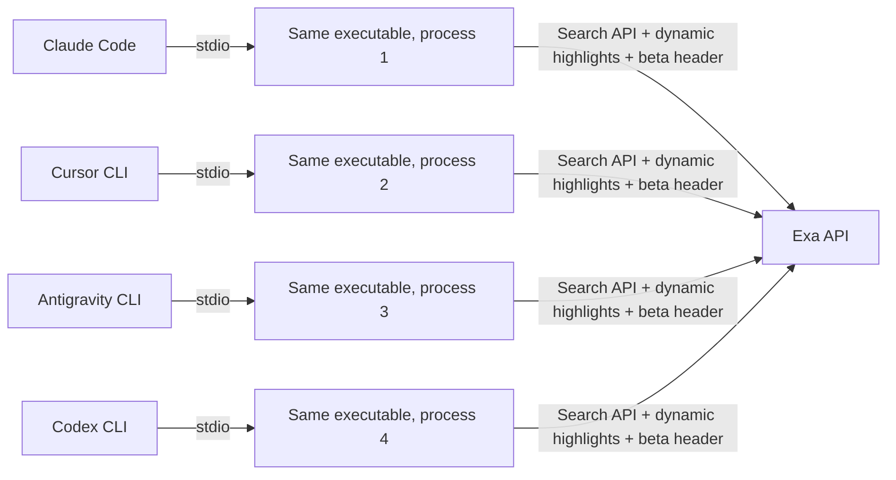

# Exa Dynamic Highlights across four agent CLIs

**Target repo:** Standalone host-owned `exa-mcp-dynamic-highlights` package, outside Zero.

## Goal Capsule

- **Objective:** Give Claude Code, Cursor CLI, Antigravity CLI (`agy`), and Codex CLI the same installed local Exa MCP executable, launched as one independent stdio process per client, that requests Dynamic Highlights wherever the existing search behavior returns highlights, while preserving the current four-tool surface and shared API key.
- **Change-size boundary:** A config-only edit needs 0 test-source lines, but cannot enable Dynamic Highlights on today's hosted MCP. The feature patch itself is estimated at 10–25 non-test LOC plus 20–40 focused request-contract test LOC; packaging/launcher setup is separate and depends on the chosen patch method. U2/U3 config changes need no test code. Estimates are diffs against the pinned upstream package, not its total source size.
- **Authority:** This request authorizes planning only, not package installation, a live Exa query, a canary, or client-config edits. Execution requires an explicit go-ahead in the executing session; U3 additionally requires owner go/no-go after reviewing U2 evidence. Exa's current Dynamic Highlights documentation defines the preview API contract. Credentials must never enter source, logs, or chat.
- **Execution profile:** On approval, create the host-owned package as a standalone Git repository and install its `exa-mcp-dynamic` executable in the user's local bin directory. The four user-global client registrations remain distinct; each CLI starts its own process from the same executable. This is not one daemon shared by the clients.
- **Stop conditions:** No client config changes—including a canary—before explicit execution authorization. Do not replace a client's hosted entry until its local proof passes. Stop before rollout if Exa rejects the preview header, schemas materially diverge, a client cannot source the existing key, or an approved non-VPS test runner is unavailable. Do not auto-approve tools or issue a live Exa Agent request during validation. If Exa adds a documented hosted-MCP setting before implementation, prefer config-only and drop U1.
- **Tail ownership:** One implementation owner carries the package from API-contract tests through one-client canary and sequential rollout to all four clients. No Zero deployment, product flag, or HMS operation is part of this work.

## Product Contract

### Summary

All four named CLIs currently use separate user-level Exa registrations that point to the same Exa-hosted MCP endpoint. The live tool schema does not expose the Dynamic Highlights request option, and the audited upstream search implementation does not send its required preview header. Updating client binaries or editing their current remote URL cannot add that API behavior. A host-owned local stdio package based on the latest published Exa MCP package can add it once; each CLI still launches its own process.

### Problem Frame

The hosted Exa MCP service is vendor-managed: its deployed version is not exposed in the client configuration, and the inspected remote server offers the same four tools but no Dynamic Highlights control. The clients therefore cannot independently set `contents.highlights.dynamic` or `Exa-Beta: dynamic-highlights-2026-08-28`. The current registrations also are not centrally shared: they are four client-specific entries. A read-only comparison found that all four currently resolve to the same API key; Antigravity's configuration stores that key inline, while the other three refer to `EXA_API_KEY`.

### Actors

- A1. The owner uses four local agent CLIs and wants Exa search snippets tuned for the current query.
- A2. Each CLI launches an independent MCP process under its own user-level configuration and trust rules.
- A3. The local Exa server calls Exa Search API using the owner's existing `EXA_API_KEY`.

### Requirements

**Search behavior**

- R1. Search requests that already return highlights use `contents.highlights.dynamic: true` and the documented beta header by default; do not add a model-facing argument.
- R2. Preserve the existing four tool names and model-facing parameters. Dynamic mode is a server default, not a new optional model control; existing callers continue to work.
- R3. Preserve advanced search's existing text, filters, and opt-in highlight behavior; when it returns highlights, those highlights use Dynamic Highlights.
- R4. Never silently retry a rejected preview request as an ordinary static-highlight search. Preserve upstream retry behavior for the same request; stop the canary/rollout if the preview is rejected.

**Parity and security**

- R5. All four CLIs use the same installed executable, each through its own stdio process, with `ENABLED_TOOLS` set to the same four-tool allowlist: `web_search_exa`, `web_search_advanced_exa`, `web_fetch_exa`, and `agent_run`.
- R6. All four processes use the current shared `EXA_API_KEY`, but only after its durable source and each CLI's inheritance behavior are verified. Remove the Antigravity inline credential after its local replacement passes. Do not rotate absent evidence of compromise. Never print or commit its value; rollback snapshots contain only redacted structure/placeholders, never credentials.
- R7. Preserve `web_fetch_exa`, `agent_run`, the four-tool allowlist, and each client's existing approval/trust settings. Do not change non-search tools or add global auto-approval.

**Upstream maintenance**

- R8. At implementation, recheck the latest published `exa-mcp-server` version, use that as the upstream baseline, and pin the exact version/commit and dependencies. The audit found npm `latest` at `3.4.1` on 2026-10-19. Do not claim this bumps Exa's hosted service: that runtime is vendor-managed and its deployed version is not observable from these clients.
- R9. Do not update Claude Code, Cursor, Antigravity, or Codex binaries as part of this feature; their versions are independent of the hosted Exa MCP runtime and the Dynamic Highlights API support.

### Key Flows

- F1. Default search: a model calls either Exa search tool using its current schema; the local server adds Dynamic Highlights request fields and the beta header; Exa returns query-relevant highlights in the normal result shape.
- F2. Preview unavailable: the API rejects the Dynamic Highlights preview; the server does not downgrade to static highlights, and the canary stops. The operator restores the unchanged hosted MCP registration.
- F3. Explicit full text: a caller supplies the existing bounded text option; the advanced tool returns that text alongside its highlights.
- F4. Migration: one isolated canary registration is verified first; then each client's `exa` entry is switched independently to the same local executable and environment-based key. A failing client is rolled back alone.

### Acceptance Examples

- AE1. Given any of the four CLIs, when the agent calls `web_search_exa`, the captured Search API request has `contents.highlights.dynamic === true` and the documented beta header; a live safe query returns nonempty highlights.
- AE2. Given any CLI, when `web_search_advanced_exa` is called with its existing highlight option, the API request uses dynamic highlights and the beta header; its current text and filter behavior is unchanged.
- AE3. Given a preview rejection, the server does not issue a static-highlight fallback and surfaces the upstream error; all other failures retain upstream handling.
- AE4. Given each CLI after rollout, its Exa tool list matches the same four names and schemas; the API key is sourced from `EXA_API_KEY` and appears in no config value, source, log, or verification output. The per-server approval, allowlist, and auto-approval state is unchanged, and any new consent prompt remains interactive.
- AE5. Given `web_fetch_exa` or `agent_run`, both remain registered with their current schemas and approval boundaries; this change does not alter their behavior.

### Success Criteria

- Existing highlight-producing search calls use Dynamic Highlights in all four clients, proven by focused request-contract tests and one accepted safe search per client.
- The four clients expose matching tool names and compatible schemas, and no client retains the old inline key.
- Advanced search retains its current text and filter behavior.
- No live Exa Agent request, global tool approval, product deployment, API-key rotation, or new input-filter behavior is introduced.

### Scope Boundaries

- **In scope:** a host-owned Exa MCP package, its focused tests and reproducible upstream pin, four user-global MCP registrations, and migration of the existing key to environment-only use.
- **Out of scope:** Zero/Nava product code, changing Exa's vendor-controlled hosted deployment, CLI binary upgrades, other agent clients, Dynamic Highlights support for Exa Agent, changing the current key, input/DLP/SSRF filters, and changing client trust policies.
- **Product Contract preservation:** This is host tooling and does not change the Zero product contract.

### Outstanding Questions

- Deferred: Identify the durable secure source of `EXA_API_KEY` and verify each CLI can pass it to stdio. If a CLI cannot, stop; do not put the key back into client JSON.
- Deferred: Exa may change or graduate the preview. Re-check the current API docs and beta header when implementing. If preview rejection details remain undocumented, keep the no-retry behavior; do not guess a classifier.
- Deferred: If Exa later exposes Dynamic Highlights as a hosted-MCP setting or tool option, replace the local patch with that config-only route.
- Deferred: The hosted MCP deployment's version remains unknown. The maintained local server will record its published-package baseline instead.

### Sources

- Audit record and methods: [2026-10-19 Exa MCP and Dynamic Highlights audit](../research/2026-10-19-exa-mcp-dynamic-highlights-audit.md).
- Exa Dynamic Highlights [API documentation](https://exa.ai/docs/search/highlights) and [research-preview announcement](https://exa.ai/blog/dynamic-highlights).
- Exa hosted MCP [reference](https://exa.ai/docs/reference/exa-mcp); latest published package at audit time: [`exa-mcp-server` npm registry](https://registry.npmjs.org/exa-mcp-server/latest).
- Upstream search implementations checked: [`webSearch.ts`](https://github.com/exa-labs/exa-mcp-server/blob/main/src/tools/webSearch.ts) and [`webSearchAdvanced.ts`](https://github.com/exa-labs/exa-mcp-server/blob/ad888a188cdefbe832c9feed2c3a97d1cb93cb35/src/tools/webSearchAdvanced.ts).
- Official client configuration references: [Claude Code MCP](https://code.claude.com/docs/en/mcp), [Cursor CLI MCP](https://cursor.com/docs/cli/mcp), [Antigravity CLI MCP](https://antigravity.google/docs/cli/mcp/), and [Codex MCP](https://developers.openai.com/codex/mcp/).

## Planning Contract

### Key Technical Decisions

- KTD1. Use one local stdio package/executable derived from the latest published Exa MCP package instead of four wrappers or the hosted remote service. Each CLI launches an independent process from the same installed executable; stdio does not provide one shared daemon. The hosted service does not expose request-level control for the required body field and beta header; one maintained package puts the patch in one place while each CLI keeps its own registration and process lifecycle.
- KTD2. Add Dynamic Highlights only to Search API requests that already return highlights. It does not change Exa Agent, fetch, or advanced-search text semantics.
- KTD3. Make dynamic mode the default for existing highlight-producing calls and keep it out of the model-facing schema.
- KTD4. Preserve advanced search's current text and filter defaults; changing those is a separate behavior decision.
- KTD5. Pass the existing key through the child process environment. Current configs are separate; there is no shared client registry or API-key broker. If Antigravity does not inherit the environment, resolve a secure injection path before rollout rather than persisting a second literal.
- KTD6. Treat npm `3.4.1` as audit-time baseline only. At implementation, capture the npm tarball URL and integrity; verify the patched source corresponds to that exact published tarball (or record a source commit proven to reproduce it), lock all dependencies, and keep the patch small and reviewable. A version string alone is not a reproducible source pin.
- KTD7. Canary under a temporary server name in one isolated CLI session, then switch registrations one client at a time. Require explicit owner authorization before canary/config edits and a second go/no-go before U3. Preserve approval settings and keep the hosted registration available as the rollback path; do not change or print credentials.

### High-Level Technical Design

The standalone `exa-mcp-dynamic-highlights` package installs the `exa-mcp-dynamic` executable, which the four CLIs launch as independent processes; there is no shared daemon or shared in-memory state. The package applies a small patch to the pinned upstream search request builders: dynamic highlights body field plus preview header on existing highlight requests. It preserves the existing four-tool set, advanced-search text behavior, API key, and each CLI's approval settings. The hosted registration remains available for rollback.

### Implementation Constraints

- Source lives in the standalone host-tools repository named `exa-mcp-dynamic-highlights`, outside the Zero application repository; its user-installed executable is named `exa-mcp-dynamic`. File paths listed below are relative to that standalone package repository.
- Preserve upstream schemas and behavior except for Dynamic Highlights on existing highlight requests. Do not add static-highlight fallback behavior.
- Confirm each CLI can pass the existing key to the local stdio process without recording its value; do not rotate the key or change unrelated environment handling.
- Add focused request-contract tests for the Search API body and header. Run them on an approved non-VPS runner; do not run a test runner on this coding VPS. Do not add a GitHub Actions workflow/check without owner approval.
- Keep all returned content as untrusted tool data. The adapter must not interpret it or execute it; do not claim this alone prevents a receiving model from being prompt-injected.
- Record the upstream version/commit, test result, four normalized tool inventories, and per-client live canary outcomes without recording API-key values or full search payloads.

### Sequence

1. After explicit implementation authorization, U1 builds, tests, and installs the pinned local package without changing client configurations.
2. After separate authorization for a live canary, U2 registers a temporary name in Claude Code and proves the API contract plus unchanged tool catalog.
3. After owner reviews U2 evidence and explicitly approves rollout, U3 updates the four registrations sequentially, migrating Antigravity away from the inline key and checking each CLI before moving to the next.

## Implementation Units

### U1. Build the shared Dynamic Highlights Exa MCP package

- **Goal:** Create a minimal host-owned patch from the latest published Exa MCP package so existing highlight-producing search calls use Dynamic Highlights.
- **Requirements:** R1–R9.
- **Files:** `package.json`, lockfile, retained upstream license/notice, `bin/exa-mcp-dynamic.js`, `src/tools/webSearch.ts`, `src/tools/webSearchAdvanced.ts`, `src/types.ts`, `test/dynamic-highlights.test.ts`, and a concise package `README.md`.
- **Approach:** Recheck npm latest and its official source; record tarball integrity and pin the exact upstream baseline. Keep the patch small relative to upstream: add the documented beta header and `dynamic: true` only where the search request already asks for highlights; preserve advanced search's current text/highlight controls and existing tool schemas. Do not add a second rollback executable, general input guard, environment sanitizer, or changes to fetch/agent behavior. Keep the hosted registration intact until rollout passes; rollback restores that registration.
- **Test scenarios:** (1) A mocked `web_search_exa` call sends `contents.highlights.dynamic === true` and the exact beta header. (2) A mocked advanced-search call with highlights enabled sends the dynamic field/header while preserving its text/filter options; existing calls without highlights keep current behavior.
- **Verification:** On an approved non-VPS runner, run the focused tests, build, and package dry-run; record upstream tarball integrity and dependency lock. Verify the installed command starts and exits cleanly. No client config changes or live Exa requests in this unit.
- **Depends on:** None.

### U2. Prove an isolated one-client canary

- **Goal:** With explicit owner approval, prove one client can launch the local stdio server with the securely sourced key and receive accepted Dynamic Highlights before any existing `exa` registration is changed.
- **Requirements:** R1, R2, R5–R7.
- **Files:** Temporary user-scoped Claude Code MCP registration and a redacted structural snapshot only; no secret-bearing backup and no Zero product files.
- **Approach:** Add `exa-mcp-dynamic` under a temporary canary name in an isolated Claude Code session. Keep the current hosted `exa` registration intact. Verify initialize/list/call behavior, issue one low-result-count safe synthetic search, confirm dynamic highlights, then remove the temporary registration. Never print the credential or raw response. If the preview header is rejected or key delivery is uncertain, stop and remove the canary; do not retry with static highlights.
- **Test expectation:** None — this unit changes client configuration, not code. Verify readiness, tool list, one safe live search, and the untouched hosted registration as acceptance checks below.
- **Verification:** `claude mcp list` plus the isolated live tool call; inspect only redacted status, request-contract metadata, and result shape. Do not invoke `agent_run` or test with private/personal data.
- **Depends on:** U1.

### U3. Migrate the four user-global client registrations

- **Goal:** After explicit owner go/no-go on U2, point all four CLIs to the same local package and securely sourced key, preserving tool names and trust boundaries.
- **Requirements:** R1–R9.
- **Files:** User-global Exa registrations for Claude Code, Cursor CLI (`cursor-agent`), Antigravity CLI (`agy`), and Codex CLI; redacted structural snapshots only; no Zero product files.
- **Approach:** For each client, add the local executable under a temporary name while its hosted entry remains available. Prove key delivery, tool inventory, trust-state parity, and one safe live search. Then switch that client's primary `exa` registration to the same executable; proceed to the next client only after the current one passes. Remove Antigravity's inline credential only after local success. If a client regresses, restore only that client's original hosted registration. Preserve interactive consent and the existing tool allowlist.
- **Test expectation:** None — this unit changes client configuration, not code. Verify each client's tool inventory, one safe live search, unchanged approval settings, and rollback to the still-available hosted registration.
- **Verification:** `claude mcp list`; `cursor-agent mcp list-tools exa`; `agy mcp list`; `codex mcp list`. Normalize and compare tool inventories, compare redacted per-server approval/allowlist/auto-approval state before/after, and perform one synthetic safe search per client. Check environment variable presence without printing values. Delete temporary registrations/snapshots at the end; snapshots never contain credentials.
- **Depends on:** U1 and successful U2.

## Verification Contract

| Gate | Evidence | Where / constraints |
|---|---|---|
| Request contract | Focused tests assert dynamic body field and exact beta header on existing highlight requests, while preserving advanced-search options | Approved non-VPS runner only; do not run a test runner on this coding VPS |
| Package pin | npm tarball integrity and proven source mapping (or reproducible source commit), exact dependencies/lock recorded; build and package dry-run succeed | Approved non-VPS runner; no unpinned `latest` runtime install |
| Key handling | Each client passes the existing key to the local MCP process without putting its value in source or output | Redacted config inspection and process-ready status; do not print the value |
| MCP compatibility and trust | The same four names and compatible schemas are returned for all client registrations; per-server approval, allowlist, and auto-approval state is unchanged | Read-only client CLI inventories plus sanitized before/after trust-state comparison; consent remains interactive |
| Live Dynamic Highlights | One safe, low-result-count search per CLI succeeds with nonempty highlights | One client at a time; no `agent_run`; do not record key, raw headers, or full query/result payloads |
| Rollback | Any one client can be restored to the hosted Exa registration | Keep the original hosted stanza until that client passes its canary |

No Zero application test, typecheck, Vitest run, database operation, deployment, feature-flag change, or HMS probe is required. If package tests cannot run on an approved non-VPS runner, the code may be prepared but client rollout remains on hold pending an authorized test environment.

## Definition of Done

- U1 passes focused request-contract tests and build against a reproducibly pinned latest-at-implementation upstream baseline.
- U2 proves the canary through Claude Code without changing its existing hosted registration.
- U3 proves all four clients use the same local server and key source, each passes a live safe search, and the Antigravity inline value is removed.
- Each client exposes the same four tools and preserves its existing approvals; no key is present in source, new config values, logs, or chat.
- Each CLI launches the same installed executable as its own stdio process; process shutdown leaves no orphan child, and result content is transported without adapter-side interpretation or execution.
- Preview rejection is never silently downgraded to a static-highlight request.
- The same key and tool approvals remain in use; no key value is written to source or output.
- Temporary registrations are removed after rollout; the original hosted entries remain available until each local registration passes.
- The audit-time version is not represented as the hosted service version, and no unrelated CLI or Zero application update is included.
