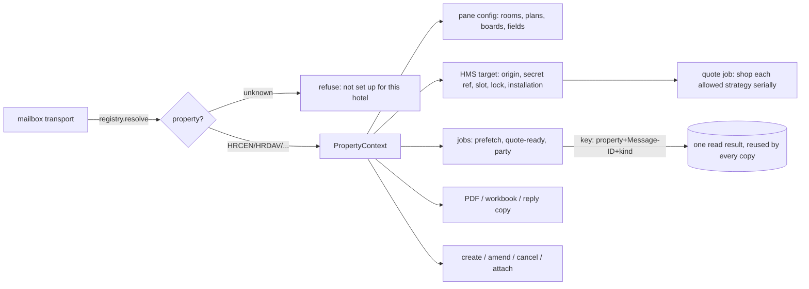
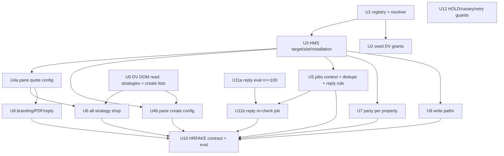

# feat: Hotel-agnostic Nava — property registry

**Product Contract preservation:** changed: slices 2, 5, 6, 10 after owner round 1 (2026-10-24) — per-mailbox grants, per-mailbox to-dos, all strategies, small HRFAKE. Evidence: [`docs/research/2026-10-24-multihotel-evidence.md`](../research/2026-10-24-multihotel-evidence.md).

## Ask (original words, OWNER-ASKS 210–212)

"Make Nava hotel-agnostic … swap everywhere"; ≥3 more hotels; many users per hotel (Faith + Ayanda at Da Vinci, whole reservations teams). DV pane lacks wholesale and shows Standard Queen, which DV doesn't have. 10/10 = every Infor workflow field per hotel in the pane, prefilled from the email, vague fields suggested from past mail, staff click yes. Propose architecture rewrites, not patches. DV rates from our data + HMS, not from staff.

## Evidence

| Claim | Number | Source |
|---|---|---|
| Hotels live in prod | 2 (HRCEN, HRDAV); 7 active mailboxes (1 CEN, 5 DV, 1 Nava) | S3 (`docs/research/2026-10-24-multihotel-shape-S3-hotels-users-mix.md`) |
| Unknown mailbox → Centurion | every non-DV transport reads HRCEN | `apps/server-pilot/src/hms/hms-read-target.ts`; S3 |
| Access model | user→mailbox grants only (13 grants, 7 users); no property table, no property grant | S3 |
| Grants live only in prod DB | `seed.ts` has 7 grants (CEN/Nava), prod has 13 incl. 5 DV mailboxes | S3 |
| Centurion-hardcoded code | HRCEN 144 hits / 72 files; Centurion 330 / 90 | A1 (`docs/research/2026-10-23-g1023-retro/A1.md`) |
| Pane room/rate lists | Centurion constants (`room-types.js`, `CENTURION_RATE_PLANS`); DV maps exist but pane omits property | A2, S1 |
| Infor fields known to our tools | quote ~20 request fields + HMS grid; create 10 required + 9 optional; amend 5 writable; cancel read 20; attach 4 | S1 (`docs/research/2026-10-24-multihotel-shape-S1-infor-fields.md`) |
| Create fields absent from mail | source 31%, adults 25%, guarantee 13%, room 10%, rate 7% (n=91) | `docs/plans/2026-10-06-003-case-coverage-gap-audit.md` |
| DV quote result, 30 d | 29/29 refused (100%) | S3 |
| DV extraction coverage | 26% of inbound copies have an action vs CEN 57% | S3 |
| DV duplicate copies | 1,121 inbound copies of the same Message-ID across DV mailboxes | S3 |
| DV rate words in outbound quote bodies (148 msgs) | STO/net 18, contract 17, BAR 16, airline 8, GOV 7, promo 7, wholesale **1**; Standard Queen 0 | S2 (`docs/research/2026-10-24-multihotel-shape-S2-dv-rates.md`) |
| DV answer key | **27 distinct validated BAR B&B facts** (38 PDF rows; Standard King/Suite/Deluxe King; ZAR 2,700–22,813/night, median 4,071). 0 validated non-BAR rows; 10 XLSX mix Contract/NC + STO/net without a row binding | S4 (`docs/research/2026-10-24-multihotel-shape-S4-dv-answer-key.md`) |
| DV quote format | 93% PDF, 7% XLSX; letterheads vary (Da Vinci 88, Legacy 56) | S4 |
| DV answer key covers all 5 DV mailboxes | S4 scanned outbound on davinci@, faith@, ayanda@, epick@, kmgidi@ together; no per-mailbox split yet | S4 brief; per-mailbox split = lane S5 |
| Rate words per mailbox (30 d, 1,458 quote-like outbound, regex) | Faith: STO/net 33, contract 35, BAR 26; davinci@ 551 BAR; "wholesale" written **once** across 6 mailboxes; sender class predicts poorly (GOV 7/10, TA→STO 17/128) | S5 (`docs/research/2026-10-24-multihotel-shape-S5-rate-patterns.md`) |
| Staff asked for wholesale | Faith: "I can't see the wholesale rate" (owner, 2026-10-24) | OWNER-ASKS 219 |
| Reply closes a to-do only in the replier's mailbox | `planThreadWork` trusts an own-domain inbound as the hotel's reply only from an address *that* mailbox has sent from; a reply-all from faith@ landing in davinci@ leaves davinci@'s to-do open | `apps/server-pilot/src/ai/work-items.ts:1230-1240` (code read; not counted in data) |
| Each mailbox copy runs its own prepare | quote-ready keys on the per-copy message row, so 5 copies = 5 HMS reads on one DV browser lock | `apps/server-pilot/src/ai/quote-ready.ts:226-246` (code read); 1,121 DV repeat copies / 30 d (S3) |
| Live-HMS proof time | p50 22 min, p75 85 min (n=43) | ETA ledger |
| AI mailbox (`transport-nava`) is a collector, not a hotel inbox | 14 d: 425 inbound, **0 outbound**, 416 from legacyhotels.co.za; 433 to-dos (427 still open, all created 10-10…10-15); 47 AI runs | read-only prod SQL 2026-10-25 00:05Z |
| g1023 PR speed (Grok 4.6 coders, Greptile in-lane, Apex on 6) | 30 PRs open→merge p50 **13** / p75 32 / p90 75 min; lane launch→merge-ready (ledger) p50 ~29 / p75 ~47; 24 product PRs merged in ~4.7 h with 7 lanes at T0 | `gh pr list` 2026-10-25; ETA ledger g1023-* rows |
| Leftover lanes after g1023 | 24 Orca worktrees + 21 Grok processes (~190 MB each) alive 36 h after their PRs merged; cleanup cron never removes `/home/orca/*` (`PROTECT_RE`) | `orca-ide worktree list`, `~/.orca-cleanup/worktree-cleanup.sh:23` |
| Reply closes to-do on sender + time only, not meaning | `planThreadWork` closes on any later hotel mail, acknowledgements included | P4 (`docs/research/2026-10-25-multihotel-plan-sizing-P4-reply-recheck.md`) |

## Gate G1–G10

| # | Answer |
|---|---|
| G1 properties | HRCEN, HRDAV now; HRBAK/HRKWA likely next (owner, unconfirmed; no design change). Unknown mailbox **refuses** (no Centurion fallback) |
| G2 live canary | Table below; every workflow × hotel on the deployed SHA |
| G3 flags | Each `*_ON` flag reads the registry; readiness check refuses `on` when the property lacks secret, browser slot, quote installation, rate source or required-field map |
| G4 retry cap | 2 failed loops per cell, then DOM diagnosis from screenshot or park |
| G5 ETA | ce-plan: LOC per slice (Luna scope) × code-server median 0.85 + review + deploy + live-hms p50 22 / p75 85 per cell |
| G6 freshness | CANARY PASS line carries the live SHA; flip script refuses older SHA |
| G7 error copy | Cause class shown: not set up for this hotel / HMS down / busy / not found |
| G8 patch vs rewrite | **Rewrite.** A 3rd hotel would add a 3rd branch to ~70 files. Registry + PropertyContext instead |
| G9 done | DV quote: BAR room + board + price match staff on ≥10 of the 27 S4 facts (future-dated stays re-shopped live); every sales strategy HRDAV allows (WS, NC/contract, GOV, AIR, STO) appears with its HMS price on a live shop of 3 future S4 stays, matching HMS's own rate grid; HRFAKE contract test green; CEN quote score not lower on the same rows |
| G10 holds | Real-guest writes, flag flips to `on`, seeding prod grants, onboarding a 3rd hotel's HMS login |

## Patch-vs-rewrite verdict

Rewrite into one **property registry** (rooms, rate plans + strategies, boards, dinner, required Infor fields + option lists, HMS tenant/secret/slot, quote installation, branding, reply copy, eval identity) + **mailbox→property** (unknown refuses) + **property grants** + a `PropertyContext` resolved once and passed through every job and pane call. Pane renders fields/options from the registry. A 3rd hotel = data + live canaries, no code.

## Planning Contract

### Summary

One property registry replaces two-hotel branches. Every mailbox maps to one hotel; an unknown mailbox refuses before any HMS call. Pane lists, HMS target/slot, quote strategies, party history, branding and write-path fields all read the registry through one resolved property. A third hotel becomes data plus live canaries.

### Requirements

| ID | Requirement | Source |
|---|---|---|
| R1 | Unknown or unmapped mailbox refuses with "not set up for this hotel"; never reads HRCEN | ask 210, F2 |
| R2 | Pane quote + create lists (rooms, rate plans, boards, source/track/guarantee, required fields) come from the active mailbox's hotel | ask 211, F8–F10 |
| R3 | Quote shows every strategy the hotel allows (BAR, WS, NC/contract, GOV, AIR, STO), each with its HMS price | ask 212, 219 |
| R4 | One to-do per mailbox; a reply from any mailbox of the same hotel closes the others'; HMS reads run once per hotel + Message-ID | ask 220, F6, F16, F17 |
| R10 | After a staff reply closes a to-do, an LLM re-reads the thread and decides: handled / waiting on guest / needs more action. Needs more action reopens that to-do with a one-line reason (e.g. "said they'd come back with rates") | ask 221 |
| R11 | `transport-nava` (the AI collector mailbox) maps to **no hotel**: no to-dos, no extraction, no HMS reads; it only feeds research/evals | ask 221, F20 |
| R5 | Per-mailbox access stays; prod-only DV grants live in seed | ask 220 Q3, F5 |
| R6 | Party history and caches per hotel | A1, memory party-profiles-per-login |
| R7 | PDF, workbook, reply copy per hotel | A1, P2 |
| R8 | Write paths (create/amend/cancel/attach) take target + required fields from the registry | A1, P3 |
| R9 | Staff error copy names the cause class | G7 |

### Key Technical Decisions

| Decision | Why | Evidence |
|---|---|---|
| Registry = extend `apps/server-pilot/tooling/playwright-quote/property-registry.mjs` (+ `.d.mts` types); no new package. `apps/mail` gets the property from the server (pane-config read), never its own transport map | Server TS and `.mjs` tooling can both import it; mail imports nothing from server-pilot today, so a package is plumbing (Grok #9) | P1 §2, Grok review #9 |
| Registry holds identifiers + secret/env *names*, never secrets | Secrets stay in Secrets Manager/env | P1 §2 |
| Existing property profiles (`tooling/playwright-quote/property-profiles/*.json`) stay as the rooms/rates/fields data; registry points at them | Avoid moving data twice; profiles already hold HRDAV rooms/strategies/required fields | A1 §2, P2 §3 |
| One refuse helper; every `'HRCEN'` default in `apps/server-pilot/src` (45 today) is either removed or on a reviewed allowlist (CLI dev defaults only); U10 asserts the count | Grok found 12 silent fallbacks outside the U1/U3 file lists (Grok #1) | Grok #1 |
| Pane gets one `mailboxProcedure` "pane config" read resolved from `ctx.activeTransportId` server-side | Caller never chooses the hotel; both surfaces share `NavaPane` | P2 §2 |
| No property-grant table | Owner Q3: per-mailbox grants | owner 2026-10-24 |
| BAR is shopped in the staff quote job; every other allowed strategy is its **own** queued job (one shop each), serial on the hotel's one browser slot | Staff quote claim budget is 7 min (`run-ledger.ts`); 6 shops in one job would blow it (Grok #2) | P3 S6, Grok #2 |
| Allowed strategies per hotel are registry data confirmed by a read-only HMS DOM read, not the dropdown list | HRDAV dropdown has 9 values, STO absent; dropdown ≠ entitlement | P3 S6, P2 §4 |
| Dedupe key = property + normalized Message-ID header + read kind; null header stays per copy | Different read kinds do different work; null headers must not collide | P3 S5 |
| Reply trust widens to exact addresses any same-hotel mailbox sent from; **exact equality**, not today's substring match; never across hotels | `knownSenders` uses `strpos`, so faith@ matches notfaith@ (Grok #5) | `work-items.ts` knownSenders, Grok #5 |
| Party sender map gets `property_code`, PK `(property_code, host)`; backfill HRCEN only after a read-only count proves every row was CEN-written, else abort | Host-only key merges an agency across hotels; "all rows are CEN" is an assumption (Grok #7) | P3 S7, Grok #7 |
| CLI-only default `--property HRCEN` in tooling stays; it is never a mailbox fallback | Dev ergonomics; not a staff path | P1 §1 |

### High-Level Technical Design



Unit dependency graph:



### Implementation Units

LOC = product lines (tests excluded), from sizing lanes P1–P3 (`docs/research/2026-10-24-multihotel-plan-sizing-P*.md`). Every unit is one PR. Review loop per PR: Greptile **Apex** → Grok 4.6 high triage lane (fix real P0/P1 reachable from a staff action or prod path today; push back on over-engineering with a one-line reply) → Apex again; round 3 with a fresh adjacent P1 = split/redesign (AGENTS.md).

#### U0. HRDAV read-only DOM read: allowed strategies + create option lists

**Goal:** Record which sales strategies Da Vinci actually allows (incl. STO and wholesale names) and the create form's source/track/guarantee/board options and required markers. **Requirements:** R2, R3. **Dependencies:** none (runs in parallel with U1). **Files:** `apps/server-pilot/tooling/playwright-quote/property-profiles/HRDAV.json`; evidence `docs/research/2026-10-2x-hrdav-dom-read.md`. **Approach:** Codex GPT-6.1 Sol drives Playwright over CDP on the HRDAV slot (owner 2026-10-24: computer use = Sol), read-only, under the HMS lock, one session; captures DOM + screenshots; writes nothing in HMS. Guard: the Playwright wrapper refuses clicks on Save/OK/Book/Confirm/Cancel Reservation buttons and any dialog accept; navigation, dropdown open and read only. **Owner yes needed** (PRODUCT.md says no LLM drives live HMS; this is the one exception, read-only). Ask Faith only if STO maps to no HMS code. **Test expectation:** none — data capture; consumed by U4b/U6 tests. **Verification:** profile lists strategies with codes + labels and create lists with required markers, each with a screenshot reference.

#### U1. Property registry package + mailbox resolver (unknown refuses)

**Goal:** One source of truth for property ↔ transports ↔ HMS identifiers. **Requirements:** R1. **Dependencies:** none. **Coder:** Luna. **LOC:** 120–200. **Files:** new `apps/server-pilot/tooling/playwright-quote/property-registry.d.mts`, new `apps/server-pilot/src/hms/property-refusal.ts` (one refuse helper + cause class); modify `apps/server-pilot/src/hms/{hms-read-target,hms-quote-target,mailbox-hms-origin-bind}.ts`, `apps/server-pilot/src/ai/{pane-stay-spawn-env,pane-stay-save}.ts`, `apps/server-pilot/tooling/playwright-quote/{property-registry,property-profile}.mjs`, `apps/mail/lib/quote-proposal/copy.ts` (stop defaulting to HRCEN; full removal of its map in U8). Tests: `apps/server-pilot/tests/{hms-read-target,hms-quote-target,hms-property-registry,mailbox-hms-origin-bind,pane-stay-spawn-env,pane-stay-save}.test.ts`, `apps/server-pilot/tooling/playwright-quote/property-profile.test.mjs`, `apps/mail/tests/quote-proposal.test.ts`. **Approach:** registry maps the 5 DV transports to HRDAV, centurion@ to HRCEN; `transport-nava` is `kind: collector` (owner 2026-10-25: only receives BCC copies of every hotel mailbox) → resolves to *no hotel*: no to-dos, no extraction, no HMS reads; its 427 stale to-dos are hidden by the query, not deleted. Resolver returns property or a typed refusal. **Patterns:** existing fail-closed tooling registry (`property-registry.mjs` throws `hms_property_unknown`). **Test scenarios:** each of the 6 hotel transports resolves to the expected code; `transport-nava` resolves to collector (no property, no refusal noise); unknown transport → refusal, no HRCEN; inactive example transports → refusal; `quotePropertyCodeForTransport('')` → refusal not HRCEN; registry JSON schema rejects duplicate transport across two properties. **Verification:** the 45 `'HRCEN'` defaults are listed in the PR with an owner unit for each (U3a/U3b/U4b/U8); none left unowned.

#### U2. Seed the prod-only DV mailbox grants

**Goal:** Re-seed can't wipe DV access. **Requirements:** R5. **Dependencies:** none. **Coder:** Grok 4.6 (auth). **LOC:** 20–45. **Files:** `apps/server-pilot/src/db/seed.ts`; test `apps/server-pilot/tests/seed-contract.test.ts`. **Approach:** first a read-only prod query listing the 6 extra grants (user id, transport, role, default) without passwords; add them and any missing user to `PILOT_USERS`/`applyPilotMailboxAccess`. **Test scenarios:** seed contract lists all 13 grants; Faith and Ayanda each have their own mailbox + davinci@; no user pruned. **Verification:** seed-contract green. Prod apply only via `provision:prod --apply` (insert-only), owner hold; **never `seed:prod`** (it prunes users not in `PILOT_USERS`, `seed.ts:416`).

#### U3. HMS target, slot, installation and job guards from registry (two PRs: U3a target/runtime/env/worker/installation; U3b `hms-jobs.ts` guards + quote-followup + agent-pane-adapter)

**Goal:** Remove two-hotel unions and CEN-only guards. **Requirements:** R1, R8, R9. **Dependencies:** U1. **Coder:** Grok 4.6. **LOC:** U3a 160–240, U3b 150–220. **Files:** `apps/server-pilot/src/hms/{hms-read-target,hms-quote-target,production-runtime,browser-artifacts}.ts`, `apps/server-pilot/src/ai/{staff-quote-installation,pane-stay-spawn-env,pane-stay-save,hms-jobs,quote-followup,agent-pane-adapter}.ts`, `apps/server-pilot/src/{env,worker}.ts` (boot today throws unless `HMS_EXPECTED_PROPERTY_CODE=HRCEN`); call sites in P1 §3 + Grok review #1. Tests: `apps/server-pilot/tests/{hms-read-target,hms-quote-target,hms-jobs,hms-runtime,staff-quote-installation,pane-stay-spawn-env,pane-stay-save,hms-property-read-lock}.test.ts`, `hms-slot-hrdav-install.test.mjs`. **Approach:** target = registry entry's origin, secret ref, slot, installation; readiness check refuses a flag `on` for a property missing any of them (G3); refusal carries cause class (R9). **Test scenarios:** HRDAV quote job uses the HRDAV slot + installation; HRCEN unchanged; property missing installation → `not_set_up` refusal before HMS; lock keys differ per property; a DV-origin guard no longer blocks a DV job. **Verification:** remote typecheck + tests; one read-only canary per hotel after deploy (G2).

#### U4a. Pane quote config from registry

**Goal:** DV pane shows DV rooms/plans/boards, never Standard Queen. **Requirements:** R2. **Dependencies:** U3. **Coder:** Luna. **LOC:** 140–220. **Files:** `apps/server-pilot/src/trpc/routes/quote-workflow.ts`, `apps/server-pilot/src/hms/rate-catalogue.ts`, `apps/mail/components/nava-pane/nava-pane.tsx`, `apps/mail/components/nava-pane/quote-workflow/{quote-workflow-panel,requirement-card,rate-controls}.tsx`, `apps/mail/lib/quote-workflow/{types,room-types,staff-quote-bind}.ts`. Tests: `apps/server-pilot/tests/{quote-rate-catalogue,room-types-parity}.test.ts`, `apps/mail/tests/{staff-quote-bind.test.ts,requirement-card.test.tsx,rate-controls.test.tsx}`. **Approach:** new mailbox-scoped pane-config read; pass property on **every** `staff-quote-bind` call (4 call sites omit it today, P2 §2). **Test scenarios:** DV mailbox → 9 DV room codes, no STQN; CEN mailbox → current list unchanged; bind without property → refusal not CEN; override choices come from registry. **Verification:** viewer run green on both surfaces + staff bundle load seen in nginx (PRODUCT pass bar).

#### U4b. Pane create config from registry

**Goal:** Create card shows the hotel's lists and required fields (DV Reservation Note). **Requirements:** R2. **Dependencies:** U3, U0. **Coder:** Luna. **LOC:** 110–170. **Files:** `apps/server-pilot/src/ai/booking-draft.ts`, `apps/server-pilot/src/trpc/routes/workstation.ts`, `apps/mail/lib/quote-workflow/types.ts`, `apps/mail/components/nava-pane/quote-workflow/booking-card.tsx`. Tests: `apps/server-pilot/tests/booking-draft.test.ts`, `apps/mail/tests/booking-card.test.tsx`. **Test scenarios:** DV draft marks Reservation Note required and blocks Book until filled; DV source list = U0's list; CEN unchanged. **Verification:** as U4a. Sequence after U4a (shared `types.ts`, `nava-pane.tsx`).

#### U5. Jobs carry property; one read per mail; cross-mailbox reply close

**Goal:** No 5× HMS reads for one DV email; reply-all closes every copy's to-do. **Requirements:** R4. **Dependencies:** U3. **Coder:** Luna. **LOC:** 130–220. **Files:** `apps/server-pilot/src/ai/{hms-jobs,quote-ready,work-items}.ts`. Tests: `apps/server-pilot/tests/{hms-jobs,quote-ready,work-items,work-items-hms-todo}.test.ts`. **Approach:** before enqueueing, look up an existing read result for (property, Message-ID, kind) across that hotel's transports via the existing `(transport_id, message_id_header)` index; reuse it. `knownSenders` checks outbound From across same-hotel transports. Collector mailboxes enqueue nothing (R11). **Test scenarios:** collector mail → no to-do, no extraction, no HMS job; same Message-ID in 3 DV mailboxes → 1 run, 3 to-dos with the result; null Message-ID → per copy; different hotels, same Message-ID → separate runs; Faith reply-all copy in davinci@ closes davinci@'s to-do; forged own-domain From not sent by any DV mailbox stays open; `notfaith@` does not match `faith@` (exact equality); a CEN mailbox reply never closes a DV to-do; later guest mail reopens. **Verification:** tests + read-only prod count after deploy: DV runs per distinct Message-ID ≈ 1.

#### U6. Quote shops every allowed strategy (two PRs: U6a per-strategy shop jobs; U6b pane strategy rows)

**Goal:** Faith sees wholesale (and STO/contract/GOV/AIR) with HMS prices. **Requirements:** R3. **Dependencies:** U4a, U0. **Coder:** Grok 4.6 (Playwright). **LOC:** 250–400. **Files:** `apps/server-pilot/src/ai/{staff-quote-workflow,quote-ready}.ts`, `apps/server-pilot/tooling/playwright-quote/{fetch-quote.mjs,quote-tool.schema.json}`, `apps/mail/lib/quote-workflow/{types,session}.ts`, `apps/mail/components/nava-pane/quote-workflow/quote-workflow-panel.tsx`. Tests: `apps/server-pilot/tooling/playwright-quote/{fetch-quote,fetch-quote-phases}.test.mjs`, `apps/server-pilot/tests/{staff-quote-job,quote-ready}.test.ts`, `apps/mail/tests/quote-workflow-panel.test.tsx`. **Approach:** U6a: the staff quote job shops BAR as today; each other allowed strategy is enqueued as its own read job (one shop, fits the 7 min claim), queued on the hotel's slot behind staff work. U6b: pane shows one row per strategy as results arrive (code, label, room, board, nightly, total, or "not offered for these dates"), BAR first; staff pick. U0 measures one shop's time; if per-shop login dominates, add session reuse as a follow-up. No auto-pick. **LOC:** U6a 140–220, U6b 120–200. **Test scenarios:** 6 strategies configured → 6 rows; one strategy returns no rooms → row says not offered, others still shown; HRCEN config (BAR/GOV) unchanged; strategy missing from registry never shopped. **Verification:** live read-only canary (G9): **1** future S4 stay on HRDAV, every allowed strategy shows the same price as HMS's own grid for that stay ("not offered" passes only if HMS also shows none); BAR price accuracy is proven separately by DoD 2.

#### U7. Party history per hotel

**Goal:** Agency history learned at one hotel never binds at another. **Requirements:** R6. **Dependencies:** U3. **Coder:** Grok 4.6 (migration). **LOC:** 120–200. **Files:** `apps/server-pilot/src/ai/{party-index,party-index-sweep,party-sender-map,party-aliases,party-match-v2,hms-jobs}.ts`, `apps/server-pilot/src/db/schema/party-sender-map.ts`, new `apps/server-pilot/drizzle/0NNN_party_sender_property.sql`. Tests: `apps/server-pilot/tests/{party-index,party-index-sweep,party-sender-map,party-aliases,party-match-v2,hms-jobs}.test.ts`. **Execution note:** read-only prod count of sender-map rows by writer/transport before writing the migration; abort if any row is not CEN-written. **Test scenarios:** migration backfills CEN rows to HRCEN; same host at HRCEN and HRDAV → two rows; DV lookup never returns an HRCEN history row; CEN-only history gate removed. **Verification:** DB tests on local disposable Postgres only; migration reviewed by Grok 4.7.

#### U8. Branding, PDF, workbook, reply copy per hotel

**Goal:** DV quotes carry Da Vinci identity; no Centurion fallback. **Requirements:** R7. **Dependencies:** U4a. **Coder:** Luna. **LOC:** 120–200. **Files:** `apps/server-pilot/src/quote-proposal/{filename,description,proposal-pdf,quote-workbook}.ts`, `apps/server-pilot/src/trpc/routes/workstation.ts`, `apps/mail/lib/quote-proposal/copy.ts`, `apps/mail/components/nava-pane/nava-pane.tsx`. Tests: `apps/server-pilot/tests/{quote-pdf-filename,quote-proposal-pdf,quote-workbook,quote-proposal-render}.test.ts`, `apps/mail/tests/{quote-proposal.test.ts,outlook-pane-quote-pdf.test.tsx}`. **Approach:** identity block (name, address, phone, logo ref) from registry; legacy builders refuse missing property. **Hold:** Da Vinci logo/address/phone need owner-supplied data; until then DV PDF uses the current text identity. **Test scenarios:** DV PDF has no Centurion strings; missing property → refusal; HRCEN output byte-equal to today's golden. **Verification:** tests + one DV PDF viewed by owner.

#### U9. Write paths take target + fields from registry

**Goal:** Create/amend/cancel/attach use the resolved hotel. **Requirements:** R8. **Dependencies:** U3. **Coder:** Grok 4.6 (write paths). **LOC:** 220–350. **Files:** `apps/server-pilot/src/ai/{pane-stay-save,pane-stay-amend,pane-stay-cancel,pane-hms-write}.ts`, `apps/server-pilot/tooling/playwright-quote/{property-profile,create-preflight,amend-stay-rules,amend-stay,cancel-stay}.mjs`. Tests: `apps/server-pilot/tests/{pane-stay-save,pane-stay-amend,pane-stay-cancel,create-preflight,pane-stay-spawn-env}.test.ts`, `apps/server-pilot/tooling/playwright-quote/{create-preflight,attach-document}.test.mjs`. **Approach:** preflight reads `requiredCreateFields` from the profile instead of the HRDAV special case; keep Labtest guards, penalty refusal, `ATTACH_VERIFIED`. **Test scenarios:** DV create without Reservation Note → preflight blocker; unknown property → refusal before spawn; HRCEN unchanged. **Verification:** Labtest create + cancel on both hotels on the deployed SHA (live-test table).

#### U10. HRFAKE contract test + property-keyed eval

**Goal:** Lock in "no silent Centurion fallback". **Requirements:** R1. **Dependencies:** U1–U9. **Coder:** Luna. **LOC:** 0–20 product, 60–120 total. **Files:** new `apps/server-pilot/tests/property-registry-contract.test.ts`, fixture `apps/server-pilot/tests/fixtures/property-registry-hrfake.json`. **Test scenarios:** HRFAKE mailbox resolves to HRFAKE target/slot/lists; unknown mailbox refuses before HMS; no HRCEN constant appears in HRFAKE pane config, target, PDF or job args. **Verification:** green in remote tests.

#### U11. Re-check a thread after a staff reply (two PRs: U11a rule baseline + eval; U11b job + reopen)

**Goal:** A staff reply closes that to-do, then a fresh read of the thread decides whether it is really done (owner ask 221: staff may defer, ask a question back, or answer only part). **Requirements:** R10. **Dependencies:** U11a none (offline, T0); U11b after U5 (shared `work-items.ts`). **Coder:** U11a Luna; U11b Grok 4.6 (new job kind + to-do state = write path to staff's list). **LOC:** U11a 80–130 (eval script) ; U11b 250–400 product (P4 says 330–535 incl. a migration; plan stores the outcome on the existing work-item row instead of a new table — reviewer confirms). **Files (U11b):** `apps/server-pilot/src/ai/{work-items,worker,quote-followup}.ts`, new `apps/server-pilot/src/ai/reply-check.ts`, `apps/server-pilot/src/db/schema/mail.ts` (job-kind enum), `apps/mail/components/nava-pane/screens/needs-you.tsx`. Tests: new `apps/server-pilot/tests/reply-check.test.ts`, `apps/server-pilot/tests/{work-items,quote-followup,ai-worker-contract}.test.ts`, `apps/mail/tests/needs-you.test.tsx`. **Approach:** on a `hotel_replied` close, enqueue `reply_check` keyed `reply-check:<workItemId>:<replyMessageId>` (idempotent). Outcome: `handled` / `waiting_on_guest` → stay done, 66 h quote follow-up clock unchanged; `needs_more_action` → reopen the same to-do with a one-line reason; a newer reply supersedes. Failure → to-do stays done + logged, never a silent reopen loop. Model: the current triage model (GPT-6 Luna); never Nova Lite (PRODUCT.md). **Execution note (AGENTS.md: cheapest baseline first):** U11a scores a rule baseline (strip quotes/signature; question to guest or "will revert" → waiting; pending/partial → needs action; else handled) and the LLM prompt on **≥100** prod reply rows whose truth comes from *what happened next in the thread* (later staff mail, guest reply, booking made), labelled by a Luna lane blind to both predictors, not from Nava's own `done` status. Ship the LLM only if it beats the rules. Behind `REPLY_RECHECK=off|shadow|on`; shadow first (logs outcome, changes nothing). **Test scenarios:** reply "we'll come back with rates" → needs action, reopens with reason; reply with full quote → handled; reply asking guest for dates → waiting on guest; second reply supersedes first check; CEN reply never touches a DV to-do; collector mailbox never checked. **Verification:** eval table n ≥ 100 committed to `docs/research/`; shadow on prod 24 h → agreement vs next-action truth reported; flip `on` = owner hold.

#### U12. Run guards in ops scripts (retro changes #1, #2, #4 — still not built)

**Goal:** Make the three rules that failed on 10-23 mechanical. **Dependencies:** none (T0). **Coder:** Grok 4.6. **LOC:** 40–80. **Files:** `apps/server-pilot/deploy/{hms-job.sh,ops-deploy.sh}`, `apps/server-pilot/src/ops/hms-proof-run.ts`. **Approach:** both scripts refuse to start when the run's `HOLD.txt` exists (path from env `NAVA_RUN_HOLD_FILE`); `hms-proof-run` refuses a 3rd attempt on the same cell unless a `diagnosis-<cell>.md` newer than the last failure exists; flag-flip helper refuses `on` without a `CANARY PASS <workflow> <property> <sha>` line whose SHA = live SHA. **Test scenarios:** HOLD present → exit non-zero before SSM; 3rd attempt without diagnosis → refused; stale-SHA canary → flip refused. **Verification:** script tests on EC2 runner.

### Sequencing, model and ETA (revised after Grok review)

Shared-file owners (serialize, never parallel): `hms-jobs.ts` U3b → U5 → U7; `work-items.ts` U5 → U11b; `quote-ready.ts` U5 → U6a; `nava-pane.tsx` + `workstation.ts` U4a → U4b → U8; `pane-stay-save.ts` U3a → U9.

**Max parallelism (owner 2026-10-25).** Lanes start the moment their files are free and their inputs exist; a lane may branch from a dependency's *pushed* branch (stacking ≤ 500 lines is allowed, AGENTS.md) and rebase once it merges, as g1023 did with U0 on U1. Only shared files and the one HMS slot per hotel serialize.

| Start when | Lanes (parallel) | Coder |
|---|---|---|
| T0 | U0 (live read, HRDAV slot) ‖ U1 ‖ U2 ‖ U11a (offline eval) ‖ U12 | Sol, Luna, Grok, Luna, Grok |
| U1 pushed (not merged) | U3a ‖ U4a (both stacked on U1) | Grok, Luna |
| U3a pushed | U3b ‖ U9 ‖ U6a (needs U0 data) | Grok, Grok, Grok |
| U3b merged | U5 | Luna |
| U4a + U6a pushed | U6b ‖ U4b (needs U0) | Luna, Luna |
| U5 merged | U7 ‖ U11b | Grok, Grok |
| U4b merged | U8 | Luna |
| all merged | U10 → deploy → canaries | Luna, orchestrator |

Peak 5–6 coding lanes. 16 PRs, product LOC ~1,900–3,000, each ≤ 500.

**ETA basis — evidence, and what was wrong before.** The first estimate (10 h / 24 h) double-counted: ledger `code-server` actuals already include the lane's own Greptile loop (g1023 U1: launch 02:05 → PR 02:45 → merged 02:51 = ledger 47 min), yet I added 2 review rounds on top, then multiplied the sum by 1.2–1.5 again, and chained PRs that do not depend on each other.

| Part | p50 | p75 | Source |
|---|---:|---:|---|
| One PR, lane launch → merge-ready | 39 | 75 | ledger `code-server` actuals n=169 (g1023 alone: ~29 / ~47) |
| Extra Apex round + Grok triage lane (owner 10-24: Apex on everything) | +17 | +27 | ledger `review` n=23 |
| **Per PR** | **56** | **102** | |
| Deploy | 6 | 12 | ledger `deploy` |
| Live read cell (quote, strategy shop) | 22 | 79 | ledger `live-hms` n=47 |
| Live write cell (Labtest create/cancel/attach) | 45 | 163 | g1023 retro §3: HRCEN create 12, HRDAV create 112, cancel 163 |

| Milestone | Critical chain | p50 | p75 |
|---|---|---:|---:|
| **A. Faith's pane: DV rooms + BAR + wholesale with HMS prices** | U1 → U3a → U6a → U6b (4 PRs; U0, U4a run beside it) + deploy + 2 read cells | 4×56+6+44 = **~4.5 h** | 4×102+12+158 = **~9.5 h** |
| B. Everything incl. reply re-check in shadow | U1 → U3a → U3b → U5 → U11b (5 PRs) + 2 deploys + 4 write cells per hotel slot (slots run in parallel) | 5×56+12+4×45 = **~8 h** | 5×102+24+4×163 = **~20 h** |

No extra orchestration multiplier: these are measured end-to-end lane times. The p75 tail is live writes (retro: live-hms p80 5.31× in the last 4 days); a cell that fails twice parks (G4) instead of stretching the run. Not counted: Wednesday HMS maintenance (~11:59–15:30 SAST), Luna coder speed vs Grok (no Luna code-lane history yet; each PR logs it), U11 flip to `on` (after 24 h shadow).

### Live-test table (canary per workflow × hotel, on the deployed SHA after the last workflow-changing deploy)


| Workflow | HRCEN canary | HRDAV canary | SHA rule |
|---|---|---|---|
| Quote (read) | 1 real recent quote thread, price = staff's | 1 real DV quote thread, rooms = DV list, price = staff's | after last deploy |
| Create (Labtest) | Labtest create + cancel | Labtest create (with reservation note) + cancel | after last deploy |
| Amend (Labtest) | parked; out of scope unless fixed | parked | — |
| Cancel unpaid (Labtest) | Labtest cancel | Labtest cancel | after last deploy |
| Attach (Labtest) | Labtest attach | Labtest attach | after last deploy |
| Unknown mailbox | HRFAKE refuses, no HMS call | — | contract test |

## Run Contract (orchestrator + lanes) — every past failure, made explicit

Owner 2026-10-25: "plan n prompt all the orchestrator / worktree agents correctly… so we dont make same mistakes". Each row cites where the mistake is recorded. The kickoff and lane brief below are pasted **verbatim** into the run; nothing here is "see the handbook".

### Mistakes → rule → how it is enforced

| # | Past mistake (source) | Rule this run | Enforced by |
|---|---|---|---|
| M1 | Orchestrator drove HMS, read screenshots; context 300–390K; steers read 20–85 min late; owner pause ignored 43 min (g1023 retro §5) | Orchestrator never runs HMS jobs, never opens screenshots/DOM. A **proof lane** (Grok 4.6, own terminal) runs each live cell and returns 5 lines | kickoff; orchestrator has no SSM in its brief |
| M2 | Pause was a chat message; deploy + HMS commit happened after it (retro §5–6) | Hard stop = `/tmp/mh1024/HOLD.txt` | U12: `hms-job.sh` + `ops-deploy.sh` refuse while it exists |
| M3 | Flag `on` with no live proof on that hotel ×3 (retro §6; memory flag-needs-canary) | No flag flip in this run without owner + `CANARY PASS <wf> <prop> <sha>` on live SHA | U12 flip guard |
| M4 | Live retry loops 5–8 rounds, no DOM look (retro §6, MISTAKES 10-09) | 2 failed loops per cell → written DOM diagnosis from the screenshot, else park | U12 proof runner refuses 3rd attempt |
| M5 | Stale proofs: cell passed on a SHA before the last workflow deploy (retro §6) | Canary line carries live SHA; rerun after any workflow-changing deploy | U12; DoD |
| M6 | ETA omitted proof tail ×4; ETA re-cut under pushback without evidence (MISTAKES 10-14) | ETA = parts table above; change only on new evidence | plan; ledger row per lane |
| M7 | 24 finished worktrees + 21 Grok processes left alive 36 h; cron never cleans `/home/orca/*` (this session) | **Lane lifecycle**: merged → orchestrator closes the lane's terminals, `orca-ide worktree rm`, logs it in state.md, same turn. Proof lanes close after their 5-line result | kickoff tick checklist; DoD 8 |
| M8 | Parallel tsc froze VPS (MISTAKES 10-14) | No tsc/vitest on VPS; `remote-typecheck.sh` / `remote-vitest.sh` | hook `block-local-tsc.sh` + brief |
| M9 | Lanes refused PRs fearing Actions (MISTAKES 10-14) | "Workflows disabled; opening PRs is safe" | brief |
| M10 | Lane without its test-file list stalled 25 min (AGENTS gates) | Every brief lists exact test files + every test asserting removed UI | brief template |
| M11 | Stale Greptile base let 2 P1s reach main (19 Oct evening retro) | `git fetch` then `greptile review --apex --branch origin/main` | brief |
| M12 | Merged with an open P1 / trusted P1 on old head (MISTAKES 10-08, 10-09) | Triage lane checks comment SHA = head SHA; no merge with unvalidated P1 | triage brief |
| M13 | 4th review round on same design (AGENTS: #308 6 rounds) | Round 3 with a fresh adjacent P1 → split/strip, orchestrator decides | brief |
| M14 | Deployed from a lane tree (SR3 ×2) | Deploy only from `recover-parse-failure`, `merge --ff-only origin/main` first | kickoff |
| M15 | Pane fix "live" but staff never reloaded (MISTAKES 10-08) | Pane change done = nginx bundle load after last deploy | DoD 6 |
| M16 | Flag flip missed a pm2 process (AGENTS flags row) | `/proc/<pid>/environ` on all 4 procs after any env change | kickoff deploy block |
| M17 | `seed:prod` prunes users (pilot-user-credentials) | Never `seed:prod`; U2 is code only | brief U2 |
| M18 | Lane grew to 58 files / 16 rounds (#214) | ≤500 product lines; lane splits itself | brief |
| M19 | Idle orchestrator with 0 lanes (SR2 51 min, SR3 35 min) | Every tick: if a unit's files are free and inputs pushed, start it **that turn** | kickoff |
| M20 | No handoff ever happened; $163 in 33 turns at >300K (retro §4; memory orchestrator-context) | At ~250K write handoff into state.md, `/compact`, log it; ceiling 300K | kickoff |
| M21 | Closeout skipped (retro §6) | Run ends with retro + `ce-compound mode:lane-close` + ACTIVE.md update | DoD 8 |
| M22 | Live mail / PII read by lanes | Lanes never open live guest mail; Labtest + synthetic fixtures only | brief |
| M23 | Approvals relayed between sessions (AGENTS) | Approvals only from this run's `state.md` A1–A4, written by the Opus chat after owner "go" | kickoff |

### Orca usage (correct way, `orca-ide skills get orca-cli`)

- Never bare `orca` (GNOME screen reader). Executable: `orca-ide`.
- Coding lane: `orca-ide worktree create --name mh-<unit> --no-parent --agent grok --prompt "Read /tmp/mh1024/briefs/<unit>.txt and do it." --json` → one terminal, agent-first, no fallback shell. Luna lane: `worktree create --name mh-<unit> --no-parent --json`, then `terminal create --worktree id:<full id> --command 'codex -m gpt-6-luna -c model_reasoning_effort=max --dangerously-bypass-approvals-and-sandbox'`, `terminal wait --for tui-idle` (send only if `satisfied: true`), `terminal send`.
- Stacked lane: `--base-branch origin/mh-<dep>`; rebase on `origin/main` after the dep merges.
- Record each lane's full `worktree.id` + terminal handle in state.md.
- Progress: background `terminal wait --for tui-idle --timeout-ms 1800000` per lane wakes the orchestrator; `terminal read` to check.
- **Close:** after merge (or park), `orca-ide terminal close --worktree id:<id> --all` then `orca-ide worktree rm --worktree id:<id>`; confirm `pgrep -u orca -x grok` count dropped. Never `pkill -f`.

### Kickoff (orchestrator: Grok 4.6 high, one Orca terminal in its own worktree `mh-orch`)

```
You are the ORCHESTRATOR for run mh1024 (multi-hotel Nava). Grok 4.6 high. You plan, launch, review diffs, merge, deploy. You do NOT code, do NOT run HMS jobs, do NOT open screenshots or DOM dumps — proof lanes do and return 5 lines.
FIRST: git fetch; read docs/plans/2026-10-24-001-multi-hotel-shape.md ALL (Run Contract, Units, Sequencing, Live-test table, DoD), PRODUCT.md, AGENTS.md, MISTAKES.md head -40, docs/context/ledger/2026-10-23-g1023-retro.md §3–8, /tmp/mh1024/state.md. `orca-ide skills get orca-cli` once. Reply "Read: … origin/main=<sha> live=<sha>" + T0 lane table.
AUTHORITY: PRODUCT.md hard rules > state.md A1–A4 > this plan. Approvals only from state.md / steer files written by the Opus chat.
HOLD: if /tmp/mh1024/HOLD.txt exists: start nothing, merge nothing, deploy nothing; finish your current tool call and wait.
EVERY TICK: (1) HOLD? (2) newest /tmp/mh1024/steer-*.txt read + logged (3) lanes running vs startable — start every startable unit THIS turn (files free + inputs pushed) (4) any PR idle >15 min (5) merged/parked lanes → close terminals + worktree rm + log (6) state.md line for every merge/deploy/cell.
MERGE: read every product diff yourself; Apex on head SHA; triage lane done; no unvalidated P1; remote typecheck on origin/main after each merge before deploy.
DEPLOY: only from .worktrees/recover-parse-failure (ff-only origin/main) via apps/server-pilot/deploy/ops-deploy.sh; health 200/200; 4 pm2 procs; /proc env on all 4.
LIVE CELLS: start a proof lane per cell (brief /tmp/mh1024/briefs/proof-<cell>.txt). One job per hotel slot; HRCEN and HRDAV slots in parallel. 2 failed loops → diagnosis or park. Cell PASS line carries live SHA.
CONTEXT: at ~250K write a handoff block in state.md, /compact, log it. Ceiling 300K.
FINISH: unit list + cell grid empty or parked → docs PR (ACTIVE.md, docs/research/2026-10-2x-mh1024-proofs.md), ledger closes, all lane worktrees removed. Reply caveman terse.
```

### Lane brief header (pasted at top of every `/tmp/mh1024/briefs/<unit>.txt`, then the unit's section verbatim + its file list + test files)

```
You are a CODING LANE (not the orchestrator). Edit only your unit's files; need another → say so in the PR body. Don't ask for confirmation.
FIRST: git fetch; your unit section in docs/plans/2026-10-24-001-multi-hotel-shape.md; grep docs/solutions + MISTAKES.md for your module; codegraph explore "<symbols>".
NEVER: open live guest mail/prod data; run tsc/vitest/any test runner here; edit /home/orca/bin; bare git stash; --no-verify; Actions/workflow files (all disabled — opening PRs is safe); push main; deploy; touch EC2/HMS/env/flags/seed:prod; send mail; pkill -f.
GATES (background, in parallel): unset DATABASE_URL VITEST_ALLOW_PILOT_RDS TEST_DATABASE_URL; bash /home/orca/bin/remote-typecheck.sh <wt> --app <app> (baseline mail 62 / server-pilot 0) ‖ bash /home/orca/bin/remote-vitest.sh <wt> <app> <your test files> ‖ git fetch && greptile review --apex --branch origin/main --json.
SIZE: one behaviour, ≤500 product lines; bigger → split yourself. No plumbing for later, no one-user abstractions.
REVIEW: fix real P0/P1 (reachable from a staff action or prod path today); one-line pushback on the rest; Apex again. Round 3 still drawing a fresh adjacent P1 → stop, write why in the PR, tell the orchestrator.
DONE: branch mh-<unit> pushed, PR open (what/tests/gates; coder model, rounds, real P1s), gates green, no open real P1. Kill anything you started. Report PR url + gate results.
```

### Triage lane (one per PR, Grok 4.6 high, same worktree as the coder after the coder reports)

```
Read every Greptile Apex comment on PR #<n> at head <sha> (check the comment's SHA). For each: real (reachable from a staff action / prod path today) → fix + test; over-engineering or speculative → reply one line why not. Owner: "ship 10/10 as fast as possible, no over-plumbing". Re-run Apex. Report: fixed N, pushed back M, open P1 0.
```

## Verification Contract

- Gates per PR: remote typecheck (`/home/orca/bin/remote-typecheck.sh`) ‖ remote tests on EC2 ‖ Greptile Apex on `origin/main`-fresh branch; oxlint on changed files. No local tsc/Vitest. DB tests on local disposable Postgres only.
- G4: 2 failed live loops per cell → DOM diagnosis from screenshot or park.
- G6: CANARY PASS line carries the live SHA; flag flip refuses an older SHA.
- Per PR log: coder model, rounds, real P1s, $.

## Definition of Done

1. On the deployed SHA, in **Faith's mailbox** pane: DV room list (no Standard Queen), a **wholesale row with an HMS price**, and every other U0-confirmed strategy with its HMS price on **1** future S4 stay, each matching HMS's own grid for that stay.
2. DV BAR room + board + price match staff on ≥10 of the 27 S4 facts (future stays re-shopped live).
3. HRFAKE contract green; unknown mailbox refuses.
4. CEN quote score not lower on the 8 rows of `docs/research/2026-10-20-quote-backtest-pool.md` (re-scored on old and new build).
5. Labtest create + cancel pass on both hotels on the deployed SHA.
6. Staff bundle load seen in nginx after the last deploy.
7. Reply re-check: eval n ≥ 100 committed; 24 h shadow on prod reported; AI collector mailbox creates 0 new to-dos after deploy.
8. Run closed clean: 0 lane worktrees and 0 lane processes left; ETA ledger rows closed; retro + `ce-compound mode:lane-close` done.

## Holds (owner)

What the owner's **"go"** authorises for this run (written into the run's `state.md` as A1–A4; never relayed from another session):

| # | Action | Why it needs the owner |
|---|---|---|
| A1 | U0: Sol drives Playwright on HRDAV, **read-only**, click guard on | PRODUCT.md: no LLM drives live HMS. One read-only exception |
| A2 | Deploys from `recover-parse-failure` whenever a merge must be seen | Live with the client; owner already OK'd (memory: deploy when needed) |
| A3 | Labtest create / cancel / attach on HRCEN and HRDAV (2027+ stays, Labtest guest only) | HMS writes; same fence as g1023 |
| A4 | Read-only quote canaries on real DV + CEN threads | Live HMS reads on real mail |

Asked later, separately: switching `REPLY_RECHECK` to `on` after its shadow day (it changes every mailbox's to-do list).

Not needed by this plan (so not asked): real-guest writes, `seed:prod` or any prod grant change (DV grants already exist in prod; U2 only writes them into seed code), third-hotel login. DV quote/create flags are **already `on`** in prod (`HMS_DAVINCI_MAKE_QUOTE`, `HMS_DAVINCI_CREATE`, checked 2026-10-25) and failing; this plan fixes the code under them; staff are not using the pane yet. DV logo/address/phone: taken from the most common letterhead in staff's own sent DV PDFs (S4: "Da Vinci Hotel", 88 of 140); owner glances at one DV PDF.

## Deferred to Follow-Up Work

- Rate suggestion (which strategy fits this email): per-party strategy history, truth = HMS rate codes, ≥100 rows (S5 §4).
- DV extraction coverage 25.6% vs CEN 56.8% (F7).
- Classifier/front-door rules per hotel (A1 row 12).
- Third hotel onboarding (data + canaries only).

## Review log

- 2026-10-25 owner round 2 (ask 221): ETA re-derived (was double-counting review + multiplier; now 4.5 h / 9.5 h for milestone A), U11 reply re-check (P4 sizing), U12 run guards, collector mailbox, 1-stay strategy proof, Run Contract with M1–M23 and verbatim prompts, holds rewritten as A1–A4.

- 2026-10-24 Grok 4.7 xhigh round 1: 3 P0, 5 P1, 2 P2, all folded in ([review](../research/2026-10-24-multihotel-plan-grok-review.md)). Changes: refuse helper + 45-default audit; `env.ts`/`worker.ts` in U3a; per-strategy jobs (7 min claim); exact-address reply trust; seed via provision only; sender-map pre-count; DoD in Faith's pane with wholesale; U3/U6 split; no new package; ETA requoted with live-hms tail.

## Owner decisions (round 1, 2026-10-24)

| # | Question | Answer |
|---|---|---|
| 1 | First release scope | Quote + create first (recommended) |
| 2 | Which rates | **All strategies the hotel allows, wholesale included, whatever the corpus shows** — Faith asked for wholesale; rates are revenue, must be complete. Suggesting *which* strategy fits an email = later, from lane S5 patterns |
| 3 | Who sees what | Every ingested mailbox is separate (like Outlook's multiple inboxes); owner grants per mailbox. No property-wide view |
| 4 | Duplicate copies | One to-do **per mailbox** (someone may be off). Dedupe only HMS reads. No claim-on-open |
| 5 | Next hotels | HRBAK/HRKWA likely, unconfirmed; registry stays hotel-agnostic, hotel #3 after DV quote passes |
| 6 | Routing | Luna writes 1,4,5,7,8,10; Grok 4.6 writes 2,3,6,9; Apex on everything; Grok lane triages comments |
| 8 | Reply closes to-do (round 2) | Close that to-do, then re-read the thread: handled / waiting on guest / needs more action (LLM; owner's examples: defer, question back) → U11 |
| 9 | AI mailbox | `transport-nava` only receives BCC copies of every hotel mailbox; not a hotel, not active → collector (R11) |
| 10 | Strategy proof | 1 future stay is enough, not 3 |
| 11 | Parallelism | Max parallel lanes; clean up finished worktrees/agents; every past mistake explicit in prompts → Run Contract |
| 7 | HRFAKE | Owner sees it as low value; kept as one small test (60–120 LOC), because silent HRCEN fallback is exactly the 10-23 DV failure |

## Open questions

- ~~`transport-nava` → which hotel?~~ Resolved 2026-10-25: none, it is a collector (R11).
- Does STO exist as an HMS strategy at Da Vinci, or is it Faith's word for WS/NC? U0 answers; ask Faith only if U0 can't.

## Research log

- ✅ S5 done (see evidence). Next for rate suggestion: per-party strategy history (which strategy staff used last time for this agency), truth from HMS rate codes, ≥100 rows. Was: per-mailbox rate-label split (all 5 DV + Centurion) and when staff pick BAR vs STO vs contract vs GOV vs AIR vs WS (sender class, group size, lead time). Feeds a later "suggest the rate" slice.
