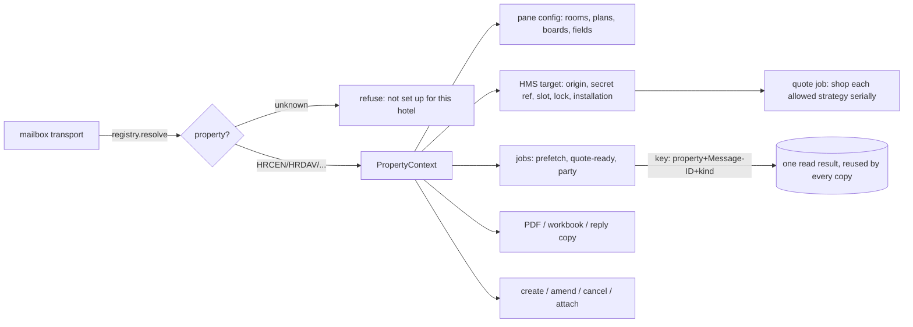
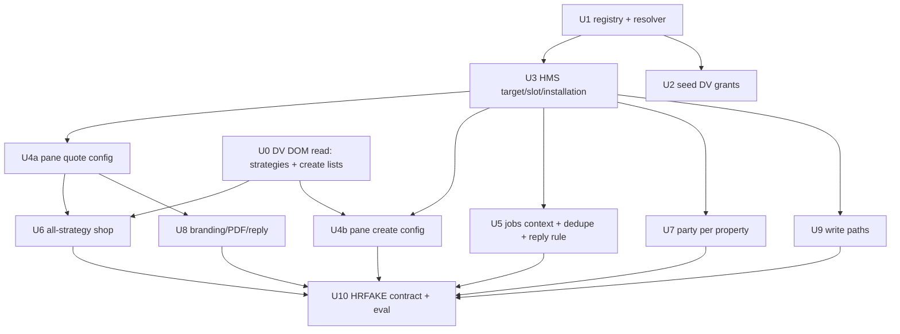

# feat: Hotel-agnostic Nava — property registry

**Product Contract preservation:** changed: slices 2, 5, 6, 10 after owner round 1 (2026-10-24) — per-mailbox grants, per-mailbox to-dos, all strategies, small HRFAKE. Evidence: [`docs/research/2026-10-24-multihotel-evidence.md`](../research/2026-10-24-multihotel-evidence.md).

## Ask (original words, OWNER-ASKS 210–212)

"Make Nava hotel-agnostic … swap everywhere"; ≥3 more hotels; many users per hotel (Faith + Ayanda at Da Vinci, whole reservations teams). DV pane lacks wholesale and shows Standard Queen, which DV doesn't have. 10/10 = every Infor workflow field per hotel in the pane, prefilled from the email, vague fields suggested from past mail, staff click yes. Propose architecture rewrites, not patches. DV rates from our data + HMS, not from staff.

## Evidence

| Claim | Number | Source |
|---|---|---|
| Hotels live in prod | 2 (HRCEN, HRDAV); 7 active mailboxes (1 CEN, 5 DV, 1 Nava) | S3 (`docs/research/2026-10-24-multihotel-shape-S3-hotels-users-mix.md`) |
| Unknown mailbox → Centurion | every non-DV transport reads HRCEN | `apps/server-pilot/src/hms/hms-read-target.ts`; S3 |
| Access model | user→mailbox grants only (13 grants, 7 users); no property table, no property grant | S3 |
| Grants live only in prod DB | `seed.ts` has 7 grants (CEN/Nava), prod has 13 incl. 5 DV mailboxes | S3 |
| Centurion-hardcoded code | HRCEN 144 hits / 72 files; Centurion 330 / 90 | A1 (`docs/research/2026-10-23-g1023-retro/A1.md`) |
| Pane room/rate lists | Centurion constants (`room-types.js`, `CENTURION_RATE_PLANS`); DV maps exist but pane omits property | A2, S1 |
| Infor fields known to our tools | quote ~20 request fields + HMS grid; create 10 required + 9 optional; amend 5 writable; cancel read 20; attach 4 | S1 (`docs/research/2026-10-24-multihotel-shape-S1-infor-fields.md`) |
| Create fields absent from mail | source 31%, adults 25%, guarantee 13%, room 10%, rate 7% (n=91) | `docs/plans/2026-10-06-003-case-coverage-gap-audit.md` |
| DV quote result, 30 d | 29/29 refused (100%) | S3 |
| DV extraction coverage | 26% of inbound copies have an action vs CEN 57% | S3 |
| DV duplicate copies | 1,121 inbound copies of the same Message-ID across DV mailboxes | S3 |
| DV rate words in outbound quote bodies (148 msgs) | STO/net 18, contract 17, BAR 16, airline 8, GOV 7, promo 7, wholesale **1**; Standard Queen 0 | S2 (`docs/research/2026-10-24-multihotel-shape-S2-dv-rates.md`) |
| DV answer key | **27 distinct validated BAR B&B facts** (38 PDF rows; Standard King/Suite/Deluxe King; ZAR 2,700–22,813/night, median 4,071). 0 validated non-BAR rows; 10 XLSX mix Contract/NC + STO/net without a row binding | S4 (`docs/research/2026-10-24-multihotel-shape-S4-dv-answer-key.md`) |
| DV quote format | 93% PDF, 7% XLSX; letterheads vary (Da Vinci 88, Legacy 56) | S4 |
| DV answer key covers all 5 DV mailboxes | S4 scanned outbound on davinci@, faith@, ayanda@, epick@, kmgidi@ together; no per-mailbox split yet | S4 brief; per-mailbox split = lane S5 |
| Rate words per mailbox (30 d, 1,458 quote-like outbound, regex) | Faith: STO/net 33, contract 35, BAR 26; davinci@ 551 BAR; "wholesale" written **once** across 6 mailboxes; sender class predicts poorly (GOV 7/10, TA→STO 17/128) | S5 (`docs/research/2026-10-24-multihotel-shape-S5-rate-patterns.md`) |
| Staff asked for wholesale | Faith: "I can't see the wholesale rate" (owner, 2026-10-24) | OWNER-ASKS 219 |
| Reply closes a to-do only in the replier's mailbox | `planThreadWork` trusts an own-domain inbound as the hotel's reply only from an address *that* mailbox has sent from; a reply-all from faith@ landing in davinci@ leaves davinci@'s to-do open | `apps/server-pilot/src/ai/work-items.ts:1230-1240` (code read; not counted in data) |
| Each mailbox copy runs its own prepare | quote-ready keys on the per-copy message row, so 5 copies = 5 HMS reads on one DV browser lock | `apps/server-pilot/src/ai/quote-ready.ts:226-246` (code read); 1,121 DV repeat copies / 30 d (S3) |
| Live-HMS proof time | p50 22 min, p75 85 min (n=43) | ETA ledger |

## Gate G1–G10

| # | Answer |
|---|---|
| G1 properties | HRCEN, HRDAV now; HRBAK/HRKWA likely next (owner, unconfirmed; no design change). Unknown mailbox **refuses** (no Centurion fallback) |
| G2 live canary | Table below; every workflow × hotel on the deployed SHA |
| G3 flags | Each `*_ON` flag reads the registry; readiness check refuses `on` when the property lacks secret, browser slot, quote installation, rate source or required-field map |
| G4 retry cap | 2 failed loops per cell, then DOM diagnosis from screenshot or park |
| G5 ETA | ce-plan: LOC per slice (Luna scope) × code-server median 0.85 + review + deploy + live-hms p50 22 / p75 85 per cell |
| G6 freshness | CANARY PASS line carries the live SHA; flip script refuses older SHA |
| G7 error copy | Cause class shown: not set up for this hotel / HMS down / busy / not found |
| G8 patch vs rewrite | **Rewrite.** A 3rd hotel would add a 3rd branch to ~70 files. Registry + PropertyContext instead |
| G9 done | DV quote: BAR room + board + price match staff on ≥10 of the 27 S4 facts (future-dated stays re-shopped live); every sales strategy HRDAV allows (WS, NC/contract, GOV, AIR, STO) appears with its HMS price on a live shop of 3 future S4 stays, matching HMS's own rate grid; HRFAKE contract test green; CEN quote score not lower on the same rows |
| G10 holds | Real-guest writes, flag flips to `on`, seeding prod grants, onboarding a 3rd hotel's HMS login |

## Patch-vs-rewrite verdict

Rewrite into one **property registry** (rooms, rate plans + strategies, boards, dinner, required Infor fields + option lists, HMS tenant/secret/slot, quote installation, branding, reply copy, eval identity) + **mailbox→property** (unknown refuses) + **property grants** + a `PropertyContext` resolved once and passed through every job and pane call. Pane renders fields/options from the registry. A 3rd hotel = data + live canaries, no code.

## Planning Contract

### Summary

One property registry replaces two-hotel branches. Every mailbox maps to one hotel; an unknown mailbox refuses before any HMS call. Pane lists, HMS target/slot, quote strategies, party history, branding and write-path fields all read the registry through one resolved property. A third hotel becomes data plus live canaries.

### Requirements

| ID | Requirement | Source |
|---|---|---|
| R1 | Unknown or unmapped mailbox refuses with "not set up for this hotel"; never reads HRCEN | ask 210, F2 |
| R2 | Pane quote + create lists (rooms, rate plans, boards, source/track/guarantee, required fields) come from the active mailbox's hotel | ask 211, F8–F10 |
| R3 | Quote shows every strategy the hotel allows (BAR, WS, NC/contract, GOV, AIR, STO), each with its HMS price | ask 212, 219 |
| R4 | One to-do per mailbox; a reply from any mailbox of the same hotel closes the others'; HMS reads run once per hotel + Message-ID | ask 220, F6, F16, F17 |
| R5 | Per-mailbox access stays; prod-only DV grants live in seed | ask 220 Q3, F5 |
| R6 | Party history and caches per hotel | A1, memory party-profiles-per-login |
| R7 | PDF, workbook, reply copy per hotel | A1, P2 |
| R8 | Write paths (create/amend/cancel/attach) take target + required fields from the registry | A1, P3 |
| R9 | Staff error copy names the cause class | G7 |

### Key Technical Decisions

| Decision | Why | Evidence |
|---|---|---|
| Registry = new workspace package `packages/property-registry` (JSON + small ESM resolver + `.d.mts`) | Must be read by server TS, server `.mjs` HMS tooling and `apps/mail`; a TS-only server module serves one of three | P1 §2 |
| Registry holds identifiers + secret/env *names*, never secrets | Secrets stay in Secrets Manager/env | P1 §2 |
| Existing property profiles (`tooling/playwright-quote/property-profiles/*.json`) stay as the rooms/rates/fields data; registry points at them | Avoid moving data twice; profiles already hold HRDAV rooms/strategies/required fields | A1 §2, P2 §3 |
| Pane gets one `mailboxProcedure` "pane config" read resolved from `ctx.activeTransportId` server-side | Caller never chooses the hotel; both surfaces share `NavaPane` | P2 §2 |
| No property-grant table | Owner Q3: per-mailbox grants | owner 2026-10-24 |
| Strategy shops run serially in **one** job, one login, one property lock | One browser per hotel; N jobs would N× logins | P3 S6 |
| Allowed strategies per hotel are registry data confirmed by a read-only HMS DOM read, not the dropdown list | HRDAV dropdown has 9 values, STO absent; dropdown ≠ entitlement | P3 S6, P2 §4 |
| Dedupe key = property + normalized Message-ID header + read kind; null header stays per copy | Different read kinds do different work; null headers must not collide | P3 S5 |
| Reply trust widens to exact addresses any same-hotel mailbox sent from; never whole-domain | Keeps forged-From protection | `work-items.ts` knownSenders, P3 S5(c) |
| Party sender map gets `property_code`, backfill HRCEN, PK `(property_code, host)` | Host-only key merges an agency across hotels | P3 S7 |
| CLI-only default `--property HRCEN` in tooling stays; it is never a mailbox fallback | Dev ergonomics; not a staff path | P1 §1 |

### High-Level Technical Design

Unit dependency graph:

### Implementation Units

LOC = product lines (tests excluded), from sizing lanes P1–P3 (`docs/research/2026-10-24-multihotel-plan-sizing-P*.md`). Every unit is one PR. Review loop per PR: Greptile **Apex** → Grok 4.6 high triage lane (fix real P0/P1 reachable from a staff action or prod path today; push back on over-engineering with a one-line reply) → Apex again; round 3 with a fresh adjacent P1 = split/redesign (AGENTS.md).

#### U0. HRDAV read-only DOM read: allowed strategies + create option lists

**Goal:** Record which sales strategies Da Vinci actually allows (incl. STO and wholesale names) and the create form's source/track/guarantee/board options and required markers. **Requirements:** R2, R3. **Dependencies:** none (runs in parallel with U1). **Files:** `apps/server-pilot/tooling/playwright-quote/property-profiles/HRDAV.json`; evidence `docs/research/2026-10-2x-hrdav-dom-read.md`. **Approach:** Codex GPT-6.1 Sol drives Playwright over CDP on the HRDAV slot, read-only, under the HMS lock, one session; captures DOM + screenshots; writes nothing in HMS. Ask Faith only if STO maps to no HMS code. **Test expectation:** none — data capture; consumed by U4b/U6 tests. **Verification:** profile lists strategies with codes + labels and create lists with required markers, each with a screenshot reference.

#### U1. Property registry package + mailbox resolver (unknown refuses)

**Goal:** One source of truth for property ↔ transports ↔ HMS identifiers. **Requirements:** R1. **Dependencies:** none. **Coder:** Luna. **LOC:** 180–260. **Files:** new `packages/property-registry/{package.json,registry.json,index.mjs,index.d.mts}`; modify `apps/server-pilot/src/hms/{hms-read-target,hms-quote-target,mailbox-hms-origin-bind}.ts`, `apps/server-pilot/src/ai/{pane-stay-spawn-env,pane-stay-save}.ts`, `apps/server-pilot/tooling/playwright-quote/{property-registry,property-profile}.mjs`, `apps/mail/lib/quote-proposal/copy.ts`, both `package.json`, `pnpm-lock.yaml`. Tests: `apps/server-pilot/tests/{hms-read-target,hms-quote-target,hms-property-registry,mailbox-hms-origin-bind,pane-stay-spawn-env,pane-stay-save}.test.ts`, `apps/server-pilot/tooling/playwright-quote/property-profile.test.mjs`, `apps/mail/tests/quote-proposal.test.ts`. **Approach:** registry maps all 5 DV transports + davinci@ to HRDAV, centurion@ to HRCEN; `transport-nava` explicitly mapped (owner check: HRCEN today). Resolver returns property or a typed refusal. **Patterns:** existing fail-closed tooling registry (`property-registry.mjs` throws `hms_property_unknown`). **Test scenarios:** each of the 7 live transports resolves to the expected code; unknown transport → refusal, no HRCEN; inactive example transports → refusal; `quotePropertyCodeForTransport('')` → refusal not HRCEN; registry JSON schema rejects duplicate transport across two properties. **Verification:** grep finds no remaining "else HRCEN" in the resolvers listed.

#### U2. Seed the prod-only DV mailbox grants

**Goal:** Re-seed can't wipe DV access. **Requirements:** R5. **Dependencies:** none. **Coder:** Grok 4.6 (auth). **LOC:** 20–45. **Files:** `apps/server-pilot/src/db/seed.ts`; test `apps/server-pilot/tests/seed-contract.test.ts`. **Approach:** first a read-only prod query listing the 6 extra grants (user id, transport, role, default) without passwords; add them and any missing user to `PILOT_USERS`/`applyPilotMailboxAccess`. **Test scenarios:** seed contract lists all 13 grants; Faith and Ayanda each have their own mailbox + davinci@; no user pruned. **Verification:** seed-contract green; **no `seed:prod` run** (hold; `provision:prod` additive only if owner asks).

#### U3. HMS target, slot, installation and job guards from registry

**Goal:** Remove two-hotel unions and CEN-only guards. **Requirements:** R1, R8, R9. **Dependencies:** U1. **Coder:** Grok 4.6. **LOC:** 300–450 (split into U3a target/runtime/installation and U3b `hms-jobs.ts` guards if diff > 500). **Files:** `apps/server-pilot/src/hms/{hms-read-target,hms-quote-target,production-runtime,browser-artifacts}.ts`, `apps/server-pilot/src/ai/{staff-quote-installation,pane-stay-spawn-env,pane-stay-save,hms-jobs}.ts`; call sites in P1 §3. Tests: `apps/server-pilot/tests/{hms-read-target,hms-quote-target,hms-jobs,hms-runtime,staff-quote-installation,pane-stay-spawn-env,pane-stay-save,hms-property-read-lock}.test.ts`, `hms-slot-hrdav-install.test.mjs`. **Approach:** target = registry entry's origin, secret ref, slot, installation; readiness check refuses a flag `on` for a property missing any of them (G3); refusal carries cause class (R9). **Test scenarios:** HRDAV quote job uses the HRDAV slot + installation; HRCEN unchanged; property missing installation → `not_set_up` refusal before HMS; lock keys differ per property; a DV-origin guard no longer blocks a DV job. **Verification:** remote typecheck + tests; one read-only canary per hotel after deploy (G2).

#### U4a. Pane quote config from registry

**Goal:** DV pane shows DV rooms/plans/boards, never Standard Queen. **Requirements:** R2. **Dependencies:** U3. **Coder:** Luna. **LOC:** 140–220. **Files:** `apps/server-pilot/src/trpc/routes/quote-workflow.ts`, `apps/server-pilot/src/hms/rate-catalogue.ts`, `apps/mail/components/nava-pane/nava-pane.tsx`, `apps/mail/components/nava-pane/quote-workflow/{quote-workflow-panel,requirement-card,rate-controls}.tsx`, `apps/mail/lib/quote-workflow/{types,room-types,staff-quote-bind}.ts`. Tests: `apps/server-pilot/tests/{quote-rate-catalogue,room-types-parity}.test.ts`, `apps/mail/tests/{staff-quote-bind.test.ts,requirement-card.test.tsx,rate-controls.test.tsx}`. **Approach:** new mailbox-scoped pane-config read; pass property on **every** `staff-quote-bind` call (4 call sites omit it today, P2 §2). **Test scenarios:** DV mailbox → 9 DV room codes, no STQN; CEN mailbox → current list unchanged; bind without property → refusal not CEN; override choices come from registry. **Verification:** viewer run green on both surfaces + staff bundle load seen in nginx (PRODUCT pass bar).

#### U4b. Pane create config from registry

**Goal:** Create card shows the hotel's lists and required fields (DV Reservation Note). **Requirements:** R2. **Dependencies:** U3, U0. **Coder:** Luna. **LOC:** 110–170. **Files:** `apps/server-pilot/src/ai/booking-draft.ts`, `apps/server-pilot/src/trpc/routes/workstation.ts`, `apps/mail/lib/quote-workflow/types.ts`, `apps/mail/components/nava-pane/quote-workflow/booking-card.tsx`. Tests: `apps/server-pilot/tests/booking-draft.test.ts`, `apps/mail/tests/booking-card.test.tsx`. **Test scenarios:** DV draft marks Reservation Note required and blocks Book until filled; DV source list = U0's list; CEN unchanged. **Verification:** as U4a. Sequence after U4a (shared `types.ts`, `nava-pane.tsx`).

#### U5. Jobs carry property; one read per mail; cross-mailbox reply close

**Goal:** No 5× HMS reads for one DV email; reply-all closes every copy's to-do. **Requirements:** R4. **Dependencies:** U3. **Coder:** Luna. **LOC:** 130–220. **Files:** `apps/server-pilot/src/ai/{hms-jobs,quote-ready,work-items}.ts`. Tests: `apps/server-pilot/tests/{hms-jobs,quote-ready,work-items,work-items-hms-todo}.test.ts`. **Approach:** before enqueueing, look up an existing read result for (property, Message-ID, kind) across that hotel's transports via the existing `(transport_id, message_id_header)` index; reuse it. `knownSenders` checks outbound From across same-hotel transports. **Test scenarios:** same Message-ID in 3 DV mailboxes → 1 run, 3 to-dos with the result; null Message-ID → per copy; different hotels, same Message-ID → separate runs; Faith reply-all copy in davinci@ closes davinci@'s to-do; forged own-domain From not sent by any DV mailbox stays open; later guest mail reopens. **Verification:** tests + read-only prod count after deploy: DV runs per distinct Message-ID ≈ 1.

#### U6. Quote shops every allowed strategy

**Goal:** Faith sees wholesale (and STO/contract/GOV/AIR) with HMS prices. **Requirements:** R3. **Dependencies:** U4a, U0. **Coder:** Grok 4.6 (Playwright). **LOC:** 250–400. **Files:** `apps/server-pilot/src/ai/{staff-quote-workflow,quote-ready}.ts`, `apps/server-pilot/tooling/playwright-quote/{fetch-quote.mjs,quote-tool.schema.json}`, `apps/mail/lib/quote-workflow/{types,session}.ts`, `apps/mail/components/nava-pane/quote-workflow/quote-workflow-panel.tsx`. Tests: `apps/server-pilot/tooling/playwright-quote/{fetch-quote,fetch-quote-phases}.test.mjs`, `apps/server-pilot/tests/{staff-quote-job,quote-ready}.test.ts`, `apps/mail/tests/quote-workflow-panel.test.tsx`. **Approach:** one job, one login, loop strategies from registry serially; per-strategy result row (code, label, room, board, nightly, total, or "not offered for these dates"); prepared quote shows BAR first; staff can switch. Measure shop time per strategy; if N×T breaks the staff-quote TTL, prepare BAR first and the rest in the same job afterwards (still one login). No auto-pick. **Test scenarios:** 6 strategies configured → 6 rows; one strategy returns no rooms → row says not offered, others still shown; HRCEN config (BAR/GOV) unchanged; strategy missing from registry never shopped. **Verification:** live read-only canary (G9): 3 future S4 stays on HRDAV, every allowed strategy shows a price matching HMS's own grid; BAR matches S4 staff price.

#### U7. Party history per hotel

**Goal:** Agency history learned at one hotel never binds at another. **Requirements:** R6. **Dependencies:** U3. **Coder:** Grok 4.6 (migration). **LOC:** 120–200. **Files:** `apps/server-pilot/src/ai/{party-index,party-index-sweep,party-sender-map,party-aliases,party-match-v2,hms-jobs}.ts`, `apps/server-pilot/src/db/schema/party-sender-map.ts`, new `apps/server-pilot/drizzle/0NNN_party_sender_property.sql`. Tests: `apps/server-pilot/tests/{party-index,party-index-sweep,party-sender-map,party-aliases,party-match-v2,hms-jobs}.test.ts`. **Test scenarios:** migration backfills existing rows to HRCEN; same host at HRCEN and HRDAV → two rows; DV lookup never returns an HRCEN history row; CEN-only history gate removed. **Verification:** DB tests on local disposable Postgres only; migration reviewed by Grok 4.7.

#### U8. Branding, PDF, workbook, reply copy per hotel

**Goal:** DV quotes carry Da Vinci identity; no Centurion fallback. **Requirements:** R7. **Dependencies:** U4a. **Coder:** Luna. **LOC:** 120–200. **Files:** `apps/server-pilot/src/quote-proposal/{filename,description,proposal-pdf,quote-workbook}.ts`, `apps/server-pilot/src/trpc/routes/workstation.ts`, `apps/mail/lib/quote-proposal/copy.ts`, `apps/mail/components/nava-pane/nava-pane.tsx`. Tests: `apps/server-pilot/tests/{quote-pdf-filename,quote-proposal-pdf,quote-workbook,quote-proposal-render}.test.ts`, `apps/mail/tests/{quote-proposal.test.ts,outlook-pane-quote-pdf.test.tsx}`. **Approach:** identity block (name, address, phone, logo ref) from registry; legacy builders refuse missing property. **Hold:** Da Vinci logo/address/phone need owner-supplied data; until then DV PDF uses the current text identity. **Test scenarios:** DV PDF has no Centurion strings; missing property → refusal; HRCEN output byte-equal to today's golden. **Verification:** tests + one DV PDF viewed by owner.

#### U9. Write paths take target + fields from registry

**Goal:** Create/amend/cancel/attach use the resolved hotel. **Requirements:** R8. **Dependencies:** U3. **Coder:** Grok 4.6 (write paths). **LOC:** 220–350. **Files:** `apps/server-pilot/src/ai/{pane-stay-save,pane-stay-amend,pane-stay-cancel,pane-hms-write}.ts`, `apps/server-pilot/tooling/playwright-quote/{property-profile,create-preflight,amend-stay-rules,amend-stay,cancel-stay}.mjs`. Tests: `apps/server-pilot/tests/{pane-stay-save,pane-stay-amend,pane-stay-cancel,create-preflight,pane-stay-spawn-env}.test.ts`, `apps/server-pilot/tooling/playwright-quote/{create-preflight,attach-document}.test.mjs`. **Approach:** preflight reads `requiredCreateFields` from the profile instead of the HRDAV special case; keep Labtest guards, penalty refusal, `ATTACH_VERIFIED`. **Test scenarios:** DV create without Reservation Note → preflight blocker; unknown property → refusal before spawn; HRCEN unchanged. **Verification:** Labtest create + cancel on both hotels on the deployed SHA (live-test table).

#### U10. HRFAKE contract test + property-keyed eval

**Goal:** Lock in "no silent Centurion fallback". **Requirements:** R1. **Dependencies:** U1–U9. **Coder:** Luna. **LOC:** 0–20 product, 60–120 total. **Files:** new `apps/server-pilot/tests/property-registry-contract.test.ts`, fixture `apps/server-pilot/tests/fixtures/property-registry-hrfake.json`. **Test scenarios:** HRFAKE mailbox resolves to HRFAKE target/slot/lists; unknown mailbox refuses before HMS; no HRCEN constant appears in HRFAKE pane config, target, PDF or job args. **Verification:** green in remote tests.

### Sequencing, model and ETA

| Wave | Units (parallel) | Coder | Product LOC | Raw min (code + gates) |
|---|---|---|---:|---|
| 0 | U0 DOM read ‖ U1 ‖ U2 | Sol (U0), Luna, Grok | 200–305 | U1 ~45, U2 ~25, U0 ~40 live |
| 1 | U3 | Grok | 300–450 | ~75 (two PRs) |
| 2 | U4a ‖ U5 ‖ U7 ‖ U9 | Luna, Luna, Grok, Grok | 590–990 | ~60 each, parallel |
| 3 | U4b ‖ U6 ‖ U8 | Luna, Grok, Luna | 480–770 | U6 ~75 |
| 4 | U10 + deploy + live canaries | Luna, orchestrator | 60–120 | deploy 6–12; canaries below |

Total product LOC **1,630–2,640** across 11 PRs (each ≤ 500 lines; U3 split if needed).

**ETA basis** (ledger, actual minutes per unit: code-server p50 39 / p75 75, n=169; code-ui p50 41 / p75 90, n=80; review p50 17 / p75 27, n=23; deploy p50 6 / p75 12, n=56; live-hms p50 22 / p75 79, n=47; orchestration ratio 1.2):

| Chain | Calc | Minutes |
|---|---|---:|
| Critical path code | U1 (45) → U3 (75) → U4a (60) → U6 (75) → U10 (40) = 295 raw × 0.85 | ~250 |
| Review rounds on chain | 5 PRs × Apex + triage ≈ review p50 17 × 2 rounds | ~170 |
| Deploys | 2 (after wave 2, after wave 4) × p75 12 | ~25 |
| Live canaries | quote CEN + DV (U6 strategy shop 3 stays) + create/cancel CEN + DV + attach DV = 6 cells; p50 22 / p75 79 | 130–475 |
| Orchestration overhead | × 1.2 on coordinator-dependent steps | +~90 |
| **Total to "DV quote passes on prod"** | | **~11 h p50, ~17 h p75** (wall clock; parallel waves hide the non-critical units) |

### Live-test table (canary per workflow × hotel, on the deployed SHA after the last workflow-changing deploy)

| Workflow | HRCEN canary | HRDAV canary | SHA rule |
|---|---|---|---|
| Quote (read) | 1 real recent quote thread, price = staff's | 1 real DV quote thread, rooms = DV list, price = staff's | after last deploy |
| Create (Labtest) | Labtest create + cancel | Labtest create (with reservation note) + cancel | after last deploy |
| Amend (Labtest) | parked; out of scope unless fixed | parked | — |
| Cancel unpaid (Labtest) | Labtest cancel | Labtest cancel | after last deploy |
| Attach (Labtest) | Labtest attach | Labtest attach | after last deploy |
| Unknown mailbox | HRFAKE refuses, no HMS call | — | contract test |

## Verification Contract

- Gates per PR: remote typecheck (`/home/orca/bin/remote-typecheck.sh`) ‖ remote tests on EC2 ‖ Greptile Apex on `origin/main`-fresh branch; oxlint on changed files. No local tsc/Vitest. DB tests on local disposable Postgres only.
- G4: 2 failed live loops per cell → DOM diagnosis from screenshot or park.
- G6: CANARY PASS line carries the live SHA; flag flip refuses an older SHA.
- Per PR log: coder model, rounds, real P1s, $.

## Definition of Done

1. DV quote on prod: BAR room + board + price match staff on ≥10 of the 27 S4 facts (future stays re-shopped live).
2. Every allowed DV strategy shows an HMS price on 3 future stays, matching HMS's own grid.
3. HRFAKE contract green; unknown mailbox refuses.
4. CEN quote score not lower on the same rows.
5. Labtest create + cancel pass on both hotels on the deployed SHA.
6. Staff bundle load seen in nginx after the last deploy.

## Holds (owner)

Real-guest writes; any flag to `on`; `seed:prod`; Da Vinci brand assets; HRBAK/HRKWA HMS login.

## Deferred to Follow-Up Work

- Rate suggestion (which strategy fits this email): per-party strategy history, truth = HMS rate codes, ≥100 rows (S5 §4).
- DV extraction coverage 25.6% vs CEN 56.8% (F7).
- Classifier/front-door rules per hotel (A1 row 12).
- Third hotel onboarding (data + canaries only).

## Owner decisions (round 1, 2026-10-24)

| # | Question | Answer |
|---|---|---|
| 1 | First release scope | Quote + create first (recommended) |
| 2 | Which rates | **All strategies the hotel allows, wholesale included, whatever the corpus shows** — Faith asked for wholesale; rates are revenue, must be complete. Suggesting *which* strategy fits an email = later, from lane S5 patterns |
| 3 | Who sees what | Every ingested mailbox is separate (like Outlook's multiple inboxes); owner grants per mailbox. No property-wide view |
| 4 | Duplicate copies | One to-do **per mailbox** (someone may be off). Dedupe only HMS reads. No claim-on-open |
| 5 | Next hotels | HRBAK/HRKWA likely, unconfirmed; registry stays hotel-agnostic, hotel #3 after DV quote passes |
| 6 | Routing | Luna writes 1,4,5,7,8,10; Grok 4.6 writes 2,3,6,9; Apex on everything; Grok lane triages comments |
| 7 | HRFAKE | Owner sees it as low value; kept as one small test (60–120 LOC), because silent HRCEN fallback is exactly the 10-23 DV failure |

## Open questions

- `transport-nava` maps to which hotel? (today HRCEN by fallback) — decide in U1, default: explicit HRCEN.
- Does STO exist as an HMS strategy at Da Vinci, or is it Faith's word for WS/NC? U0 answers; ask Faith only if U0 can't.

## Research log

- ✅ S5 done (see evidence). Next for rate suggestion: per-party strategy history (which strategy staff used last time for this agency), truth from HMS rate codes, ≥100 rows. Was: per-mailbox rate-label split (all 5 DV + Centurion) and when staff pick BAR vs STO vs contract vs GOV vs AIR vs WS (sender class, group size, lead time). Feeds a later "suggest the rate" slice.
