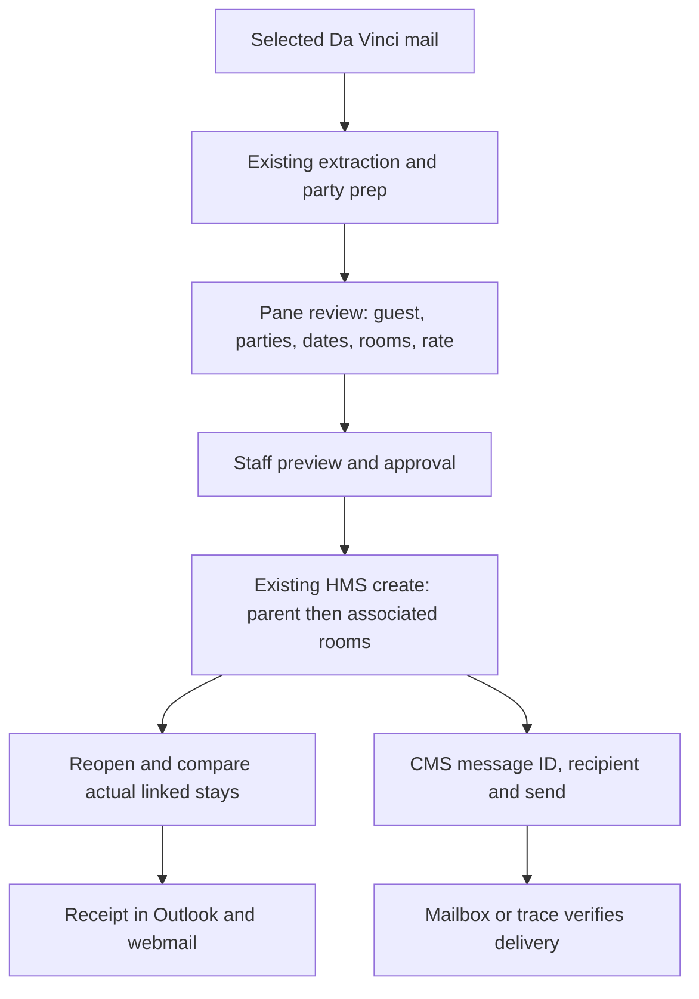
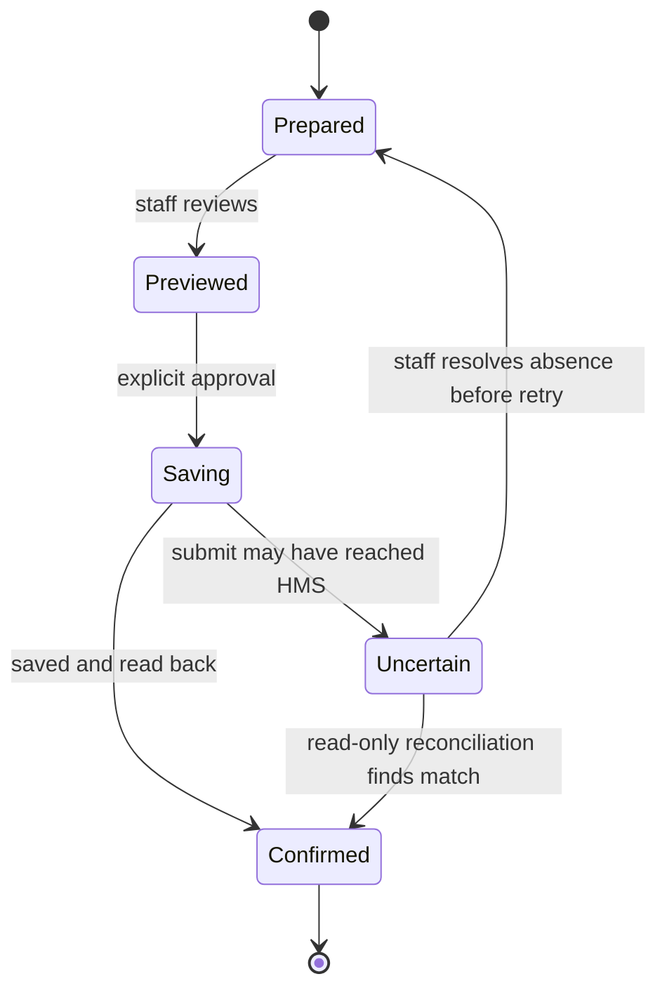

# Da Vinci Booking Proof - Plan

## Context

Get the existing Da Vinci booking workflow working in the real Outlook and webmail pane as fast as possible. Reuse the tools already deployed and prove what works before writing code. The owner requests a fast, detailed, evidence-backed plan and a Grok 4.7 xhigh adversarial review. This is planning only.

Owner's current direction: “can we use a diff worktree and diff browser to parallel claude code chat running this plan ... how does that running affect us. check n find best soln n update plan ... then also pls get grok to review the plan via grok build cli to prompt it ... then check its outputs n make final best + elegant plan ... pls still plan dont execute yet once u got final plan explain it to me n give me tasks n give me eta”. Earlier directions also require examining a real staff-linked booking with its inbound email, prioritizing the complete proof and not putting the scorer on the first-proof critical path.

## Goal Capsule

- Target HRDAV and its own tenant, credentials, mailbox and browser lock. Shared code must not regress other hotels; no Centurion feature work is planned.
- End-to-end means selected Da Vinci booking email, accurate guest and stay review, party lookup, HMS rate selection, human-approved preview, safe save, linked rooms when requested, persisted HMS readback, custom CMS recipient, and delivered confirmation where an authorized test can observe it. Prove Outlook and webmail surfaces.
- Begin with the fastest narrow Labtest checkpoint, but do not confuse a single-room save or filled CMS fields with full end-to-end completion.
- No real-guest writes, unsolicited messages, production flag changes, deploy, live browser or Pomerado run are authorized by this plan alone. Follow current owner permission and existing Labtest, guest-privacy, approval and property-lock boundaries.

## Product Contract

### Requirements

- R1. Staff can use Da Vinci's selected email to identify the right guest, agency or company, dates, rooms, occupancy and rate, with editable review and staff approval.
- R2. The existing save path handles one or multiple rooms; staff can see each real confirmation and the linked-room outcome. Avoid duplicate writes after uncertain saves.
- R3. Staff can select a custom confirmation email and enable CMS Send Mail. Verify saved fields and actual delivery separately.
- R4. Use property-scoped data from the active mailbox's trusted pane configuration; never infer hotel identity by assuming a URL contains it, or weaken cross-property isolation.
- R5. Compare a real staff-created linked-room case with its corresponding inbound email using read-only HMS access after authorization, before modifying linked-room semantics. Keep personal data private.
- R6. Complete actual booking fields, child ages, guest status, company ID binding, and native Add-Ons without silently reducing the requested booking scope. Keep original Pomerado stop until new owner direction.
- R7. First pane proof is not blocked by a large field-parity scoring project. Independent truth evaluation and broad accuracy remain requirements for staff readiness.

### Scope and authority

No amend/cancel feature development is on the first-booking critical path. Preserve the existing booking completeness plan, including Add-Ons and children, for the full objective. Direct send or delivery test requires an authorized test recipient and applicable owner authority. Historical Labtest runner proof is not proof of the staff pane or actual letter delivery.

## Planning Contract

### Decisions

- Start the read-only preflight, existing pane inspection and historical-letter trace in parallel with code review and targeted fixes. If existing deployed code passes the single-room checkpoint, write no code for that behavior.
- The active `paneConfig.propertyCode` already exists in the panel. Thread it to the existing `PartyPicker` through `QuotePeopleStep`; use mailbox configuration, not guessed URL parsing. Confirm correct transport and keep existing mismatch refusal.
- Treat the merged PR #668 reviews as credible hazards, not proven incidents. Validate the parent-field finding first. A server-side unknown-save guard and post-save persistence gap are source-confirmed; the normal pane already blocks retry, and no duplicate incident was observed. Treat uncertain submit as potentially saved and reconcile before permitting a retry.
- The investigated checkout is at `00d814ca3`, while a read-only remote query observed main at `d65040ec7a6a75f03bb6f7748c69fae70a2d8701`. PR #669's reader is on that remote main, not this checkout. Recheck the actual starting head and source before implementation; do not alter the active checkout merely to refresh it. The reader's slow-record issue and the scorer are not prerequisites for the first booking proof. Do not treat missed reads as field failures.
- Owner's urgency changes sequencing, not safety: parallelize distinct file owners, focused remote tests and same-head Greptile review. Coordinate shared files and the single HRDAV browser lock. Never use GitHub Actions for these checks.
- Use no speculative wholesale rewrite. Diagnose live failures first; modify only the demonstrated broken seam.
- Parallel Centurion and Da Vinci work only after checking separate property locks, browser profiles and debugging endpoints. A different git worktree isolates files, not a shared live service or database. A normal deployment restarts shared app processes, so coordinate the release window with the Centurion lane and never interrupt an in-flight proof. Do not infer current property ownership from historical records.
- Execution lanes after authorization: A owns server-side uncertain-submit handling; B owns party-property plumbing; C alone owns `booking-card.tsx` and saved-parent validation. Each lane uses its own worktree and branch from current `origin/main`, runs focused remote checks and same-head review in the background, and reports concrete findings. Avoid overlapping test-file ownership. The coordinator reads each diff, merges ready behavior slices through the existing gate and deploys once after required fixes. Only one lane may hold the HRDAV browser lock; evidence searches and offline review do not require it. No lane modifies active or dirty worktrees.
- Validate the agency's native ID and selected rate all the way to preview and commit. A visible party or returned rate alone is not proof of what the create request sent.

### Concurrent Centurion lane

- The Centurion Stagehand owner reported that the initial HRCEN read completed, both HRCEN advisory locks were released, and their browser was cleaned up. A synthetic iframe investigation continues and may be followed by another guarded HRCEN-only read. They report no deploy or restart planned. Coordinate with that lane before any shared deploy or restart, and check current runtime ownership then. Its source is `docs/research/2026-10-28-centurion-saas-stagehand-parity-codex-93f4b8e2.md`. This is a peer report, not an independent production runtime check. That document is an existing untracked shared file; do not overwrite it.
- Registry source defines distinct Centurion and Da Vinci browser slots and expected tenants. Applying the source's lock-key function to the two registry tenant/property pairs yields different keys. This is static evidence, not a live-lock inspection: actual effective tenants, all lock families and the coordinating database still require verification. Separate worktrees and browser profiles alone do not guarantee safe parallelism: the effective CDP endpoints, profiles, tenants and properties must also be distinct and correct.
- The `hms-job.sh` earlier-job gate can serialize its own jobs across properties unless already configured for property scope. A pane save takes the property lock directly, not this earlier-job gate; do not assume the gate protects a separate Stagehand session or serializes every path. The pane lock tenant comes from runtime environment, not necessarily the registry's expected tenant. Inspect actual launch paths, tenant inputs and effective settings; do not flip shared configuration or bypass the gate. The PM2 HMS worker is configured for one expected property, so do not assume that it runs both lanes concurrently.
- Use the established Da Vinci slot, not an arbitrary second browser against Centurion. Prior research documents two historical HRCEN lock families, one for worker/pane and one for staff quote; verify all applicable HRDAV lock families and the same coordination DB, not just one lock. Verify HRDAV slot readiness, VPN, disk and host capacity only when the owner authorizes execution. If endpoints, profiles, lock families or keys cannot be established, parallelize only non-live code, review and research; queue the browser proof. Do not borrow, restart or interrupt the Centurion slot.
- Normal deployment touches the shared EC2 checkout and restarts shared app processes. The executing session must confirm the Centurion live read has finished and the applicable reported locks are released before any release, rather than relying on this dated peer report. Give the Centurion lane a safe completion window, or combine ready, reviewed changes into one authorized deploy after its live read ends. Even web-only quiesced changes need coordination; a distinct worktree is not deployment isolation. The mandated release worktree currently has substantial pre-existing edits and untracked work. Preserve all of it; establish a safe exact-head release procedure with that worktree's owners before deploying, without reset, stash, overwrite, cherry-picking unrelated work or bypassing the deploy guard. The normal bundle is created from the local branch ref and the EC2 sync script force-checks out and resets the shared remote checkout. Verify that branch ref equals the reviewed origin head and inspect remote work before authorizing the reset; a dirty local working directory is not the source of the normal bundle, nor permission to discard any remote changes. Shipping SHA, not merely a merged PR, must contain every intended fix.

### Fast execution lanes after the owner says go

| Lane | Owner and files | Needs | Product lines | Test evidence |
|---|---|---|---|---|
| A: safe save | One Grok 4.6 high HMS writer via Cursor; route, work-item, pane-save and Add Record runner files in U3 | None to begin. Coordinate contract and test ownership with lane C. | Unknown until the durable operation contract is traced. The previous 10–40 estimate was retracted. | Route guard, atomic admission, DB failures, race/restart, Submit uncertainty and reconciliation. |
| B: party context | One Luna max writer; panel, people step, picker tests in U2 | None. Use already existing trusted property, not a new identity system. | Roughly 10–25 changed lines for plumbing, source-scoped only; 30–80 test lines are a provisional estimate, not a measured diff. | Property match/mismatch, mailbox switch, and exact agency/rate through preview and commit. |
| C: saved parent | One writer owns booking card and its tests, with Grok HMS support as needed. | Investigation starts immediately. Correct inherited semantics depend on the real staff-case comparison; agree with A on operation/receipt contract. | Unknown if durable parent data must be introduced; earlier 20–80 estimate assumed a reusable receipt. | Parent edits, same values, reload and partial outcomes; no unlinked fallback without staff-visible explanation. |
| D: proof and research | One property-locked live operator after authorization. | Verify HRDAV isolation; use the prior deployment if safe. Staff example and earlier letter trace start alongside code, not after scorer. | 0 unless a specific failing seam requires a separate repair. | Read-only real-case comparison, first controlled pane result, reopened HMS record and letter evidence. |
| Release coordinator | One coordinator; no ownership of lane files. | All relevant same-head gates, Centurion live work safely finished and exact reviewed branch available to the approved release script. | 0. | Read diffs, one coordinated deploy, verify both loaded surfaces and final HRDAV multi-room proof. |

The code examples in `00d814ca3` changed 46 lines in the booking card and added a 294-line Add Record runner, with 60 and 69 respective test lines. Those are historical comparisons, not estimates for the new durable-save design. Separate worktrees permit independent editing; they do not make the one HRDAV browser, shared release checkout, EC2 app processes, or shared queue parallel.

### High-level design

## Implementation Units

### U1. Read-only preflight, staff example and bounded first pane proof

- **Requirements:** R1, R3, R5, R7. **Dependencies:** Existing deployment and scoped owner authority.
- **Files/patterns:** `docs/context/ACTIVE.md`; `docs/context/HANDOFF-2026-10-28-hrdav-fullfield-coordinator.md`; `apps/server-pilot/src/ops/hms-proof-run.ts`; `apps/mail/components/quote-workflow/booking-card.tsx`.
- **Approach:** Identify deployed SHA, pane bundle, flags and HRDAV lock without modifying them. Check property, supported future Labtest dates and availability. In parallel, find one staff-created linked booking and its originating email in private data; the existing notes only prove Nava-created Labtest associations, not a matched staff-created example. Under the HRDAV lock inspect the parent’s Associated Reservations grid read-only. Compare each room's dates, occupancy, rates and association with the inbound request, without exposing identifiers. Reuse `.x-tab:visible` for Associated Reservations and `.x-grid-row:visible` selectors in `add-room-stay.mjs`; do not execute Add Record or Submit during this research. First prove one Labtest room through the actual pane with staff approval and a controlled custom recipient, if a message send is explicitly authorized. Compare reopened HMS values. Search existing evidence for the prior letter first. No code if existing behavior passes. Given the confirmed server retry gap, an earlier single-room Labtest checkpoint may use a fresh, controlled operation only if the actual pane and environment can guarantee one attempt with no automatic or manual retry on an uncertain result; investigate via read-only reconciliation instead. If that safety cannot be established, keep the checkpoint read-only until U3 is fixed. This conditional checkpoint is not a substitute for the durable server fix.
- **Fast linked-room observation:** After the single-room result, an owner-authorized operator may try one fresh, unchanged-field linked Labtest room on the current deployment if the HRDAV lock and one-attempt/no-retry handling are established. Use supported child ages, retain the parent's inherited values, and read back both confirmations and the Associated Reservations grid. Keep Send Mail unchecked unless an explicitly authorized recipient is part of this test. This observation does not prove safe staff retries, changed inherited fields, teenage children, actual delivery, or full staff readiness. If any write may have happened, stop and reconcile without retry. The safety fixes can proceed in separate worktrees while this bounded observation runs.
- **Verification:** Separate outcomes for pane readback, HMS field readback, delivery trace and actual mailbox receipt. A non-delivery observation is not proof HMS did not send.

### U2. Scoped property propagation

- **Requirements:** R1, R4. **Dependencies:** none; parallel with U1.
- **Files:** `apps/mail/components/quote-workflow/quote-workflow-panel.tsx`; `apps/mail/components/quote-workflow/quote-people-step.tsx`; `apps/mail/components/quote-workflow/party-picker.tsx`; `apps/mail/tests/party-picker-results.test.tsx`; `apps/mail/tests/staff-quote-party-pick.test.tsx`.
- **Approach:** Reuse the existing `paneConfig.propertyCode`, pass it through the existing people-step props to the picker, preserving transport-match and unknown-property checks. The current server already adds the resolved property to ordinary V2 results, partial V2 failures and the V3 wrapper in `apps/server-pilot/src/ai/hms-jobs.ts`; the earlier handoff saying those results lack property is stale for these current paths. Do not rewrite the server payload or weaken the reader to rescue old untagged results. Check actual persisted job version and property before claiming hydration works. Do not alter the party match algorithm or introduce new discovery logic.
- **Test scenarios:** Matching HRDAV candidates appear and bind; mismatched hotel is not displayed or bound; missing property fails closed for property-tagged results; legacy thread-scoped results still behave as intended; manual HMS lookup still works; mailbox switch does not retain a previous property's pick. The picker already has property-match and mismatch unit coverage; add the missing panel-to-picker integration coverage rather than reimplementing those tests. At the integration boundary, a staff-confirmed agency native ID and chosen contract rate appear in the exact preview and commit for each room.
- **Verification:** Both shared pane surfaces use the right mailbox context; targeted remote tests and same-head review pass. Estimated product change 10–25 lines and 30–80 test lines, not a measured diff. Manual lookup is a candidate first-proof fallback, not proof that prefetched matching already works.

### U3. Durable save admission and uncertain-submit safety

- **Requirements:** R2. **Dependencies:** none for coding; one HRDAV lock for proof. One writer owns the coupled server route, operation record, runner and their tests; UI owner coordinates its own existing `booking-card` coverage.
- **Files:** `apps/server-pilot/src/trpc/routes/quote-workflow.ts`; `apps/server-pilot/src/ai/work-items.ts`; `apps/server-pilot/src/ai/pane-stay-save.ts`; `apps/server-pilot/tooling/playwright-quote/add-room-stay.mjs`; `apps/server-pilot/tests/quote-workflow-router.test.ts`; `apps/server-pilot/tests/work-items.test.ts`; `apps/server-pilot/tests/pane-stay-save.test.ts`; `apps/server-pilot/tooling/playwright-quote/add-room-stay.test.mjs`; `apps/mail/tests/booking-card.test.tsx`.
- **Verified source-level gap:** `stayCommitGuard` returns `read_hms` for a persisted unknown outcome, but `commitStay` only handles `refuse` and proceeds toward another commit. The regular pane already disables retry for an unknown outcome; no live duplicate incident is established. The route saves the result only after HMS execution, logs and continues on a persistence exception, and ignores a `not_found` result. A missing durable record after an HMS save is a credible failure scenario, not an observed incident. The route's operation IDs are optional; understand and preserve legitimate caller paths while ensuring every write has a safe durable identity or an equally strong existing mechanism.
- **Approach:** Reuse the existing property lock, one-use preview grant and fail-closed duplicate reader. Those safeguards already serialize attempts; the duplicate reader intentionally permits a matching parent for an associated-room write, and a later fresh preview can yield a new grant. They do not establish that a persisted unknown is blocked by this route. Fail closed for `read_hms`, and atomically admit a durable attempt after validation and before any HMS write so a later valid attempt or crash cannot create an unguarded second write. Preserve preview authorization and allow a definitive pre-submit refusal to recover without stranding the user. Mark possible submission before clicking, not after click resolves. If final receipt persistence fails, retain or surface an uncertain state and require HMS reconciliation; never automatically retry. Ensure both parent and associated-room commits have the same safety contract. Do not add a redundant persistence system if the existing mechanism can satisfy atomic admission and durable recovery. Read-only HMS reconciliation must identify the correct property and stay, not just a similar guest.
- **Test scenarios:** Persisted unknown plus a valid preview is refused without invoking the runner; confirmed stay is refused; duplicate simultaneous attempts with different valid previews admit at most one; missing operation identity; database unavailable or missing work item before admission; successful save followed by persistence exception or non-throwing `not_found`; process death after admission or Submit; click definitely not sent versus may have fired; reload; matching and absent read-only reconciliation; staff-safe recovery without a duplicate. Include the regular pane's disabled-retry behavior.
- **Verification and size:** Server-side and UI paths both remain safe across restart and persistence failure. Previous 10–40 product lines was too narrow for the confirmed durability gap. Size is **unknown** until the existing operation and preview contracts are traced; do not claim a tiny change or guess a completion date from line count.

### U4. Compare linked-room inheritance to saved parent

- **Requirements:** R2, R5. **Dependencies:** U1 read-only real-case comparison; independent coding investigation may start immediately.
- **Files:** `apps/mail/components/quote-workflow/booking-card.tsx`; `apps/mail/tests/booking-card.test.tsx`; relevant save receipt/readback contract.
- **Approach:** Validate Greptile's stale-parent scenario against state transitions. If confirmed, compare child inherited fields against an immutable persisted parent snapshot or authoritative readback, never a reconstructed current draft. If those fields are unknown or inconsistent, stop and explain; do not silently convert a requested linked room into a separate booking. Retain partial outcomes. Do not add a second storage scheme if the existing receipt already holds what is needed.
- **Test scenarios:** Book parent then change CMS type, recipient, party, note or other inherited field; unchanged settings; reload; partial completion; absent saved snapshot; different guest; mixed rooms; existing parent receipt. Require displayed preview to match inherited HMS data.
- **Verification:** Review findings are validated and real P0/P1 fixed before merge; Labtest multi-room screenshot and independent readback demonstrate correct relationships and values. Tentatively 20–80 product lines plus 40–120 test lines if the concern is confirmed; durable parent snapshot or readback may require more.

### U5. Confirmation delivery and real multi-room proof

- **Requirements:** R1–R3, R5. **Dependencies:** U1; U3/U4 or a proven safe bounded path; approved send if a new test message is needed.
- **Files:** `apps/mail/components/quote-workflow/confirmation-recipient.tsx`; `apps/mail/tests/confirmation-recipient.test.tsx`; `apps/server-pilot/tooling/playwright-quote/create-lab-stay.mjs`; `apps/server-pilot/tests/create-request-confirmation.test.ts`; `apps/mail/tests/booking-card.test.tsx`.
- **Approach:** Trace historic Labtest mail first. Send Mail defaults on; for the first diagnostic save explicitly turn it off unless a test recipient and send have been authorized. If a new test is authorized, exercise custom recipient, CMS message type and checkbox through pane, and inspect reopened values, actual delivered letter and mailbox trace. The saved HMS fixture shows `udfchar13`, the CMS Booker Email field, at maxlength 80; the separate guest email field has maxlength 255, and the pane accepts up to 254. This is fixture evidence, not a verified current runtime limit. Validate current native behavior and fail safely instead of silently truncating. Reuse existing sender; do not add Nava outbound mail.
- **Test scenarios:** Checkbox on/off; self, client and custom address; missing and invalid address; message ID absent; exact CMS field-length boundary; HMS write/readback mismatch; send outcome unknown; no duplicate send on retry. Characterize inconsistent non-pane API input containing both a false `confirmationSendMail` and a recipient: the current route schema does not declare the boolean, while the runner derives Send Mail from recipient presence. The regular pane omits the recipient when the checkbox is off, so this is a source-level caller-contract concern, not a demonstrated staff-checkbox failure. Ensure any caller with explicit Send Mail off cannot trigger a send; retain existing approved UI behavior.
- **Verification:** One proof shows requested fields, linked room relationships, actual confirmation delivery where authorized, and staff pane results. An external IT hold is reported separately.

### U6. Booking completeness and measured accuracy

- **Requirements:** R1, R6, R7. **Dependencies:** U1–U5 expose actual missing fields; independent read-only research can begin early.
- **Files:** `apps/mail/components/quote-workflow/booking-card.tsx`; `apps/mail/tests/booking-card.test.tsx`; `apps/mail/tests/booking-card-reload.test.tsx`; `apps/server-pilot/tooling/playwright-quote/create-request.mjs`; `apps/server-pilot/tooling/playwright-quote/add-room-stay.mjs`; `apps/server-pilot/tooling/playwright-quote/add-room-stay.test.mjs`; `apps/server-pilot/src/ai/quote-ready.ts`; `apps/server-pilot/tests/quote-ready.test.ts`; `apps/server-pilot/src/ai/field-parity.ts`; `apps/server-pilot/tests/field-parity.test.ts`; `apps/server-pilot/tooling/playwright-quote/read-reservation-fields.mjs`; `apps/server-pilot/tooling/playwright-quote/read-reservation-fields.test.mjs`.
- **Approach and sizing:** Inventory actual staff-used field gaps and keep the requested guest rows, individual child ages, clear room counts, usable rate choices, reservation status, billing/profile fields and editable review. The current booking card already has individual child-age inputs, and the main create runner already has child-age handling; do not repeat the older handoff's blanket claim that all child-bearing creates are refused. Check those paths end-to-end. The associated-room runner explicitly refuses the 13–17 band; its correct native route is unresolved. Check forwarded-mail and party/rate job eligibility and hydration first: existing booking rate preparation is eligible. Fix only a demonstrated failure, tentatively 0–80 product lines. Verify company native-ID binding before changing it, tentatively 0–80 lines. Child 13–17 support in associated rooms has an unknown native path and unknown size. Add-On discovery covers native row identity, quantity, dates, charge behavior, adding and removing, approval and fresh readback. The earlier 120–200-line estimate covers only the Zero wrapper, not its native operation, pane, infrastructure or tests; the full size is unknown. Pomerado remains explicitly stopped until new authorization. Split proven defects into separate focused PRs rather than one speculative rewrite.
- **Test scenarios:** Forwarded email reaches the correct HRDAV preparation without binding stale property data; rates follow the confirmed agency and staff edits; native company identity persists after reopen; children in each supported age band survive save and readback; uncertain or partial room outcomes remain visible after reload. For Add-Ons, prove correct row, charge and dates, duplicate-free add/remove, recovery after uncertain Save, separate approval and fresh readback. Field-scoring tests cover arrival hints, slow stale record loads and incomplete truth rows.
- **Verification:** Real staff booking read-only comparisons identify correctness gaps. Larger independent truth-set scoring uses existing parity work after reader identity and arrival-hint fixes; it does not block the first pane checkpoint. No scored rows means no accuracy rate. Report unknown full Add-On size and duration until native discovery.

### Full-scope follow-through, not hidden inside the first proof

| Work | Existing starting point | Required outcome and boundary | Sizing |
|---|---|---|---|
| Guest and child rows | Existing individual age controls and native create age handling | Validate each age and room independently; investigate the associated-room 13–17 refusal and prove saved values without truncation. The booking-card/create inputs accept up to 16 ages while canonical work-item row edits accept up to 9; trace whether these different paths interact and provide consistent, non-truncating staff behavior rather than guessing a hotel policy. | Unknown until native route is observed. |
| Native booking status and required fields | Booking receipt currently models generic booked/unknown; prior completeness units U3/U4 | Wire actual reopened HMS status and supported required fields; preserve each room's confirmation after partial save. Unknown field or status remains unknown. | Previous source estimates were 25–45 product lines per slice plus tests; re-scope against the current head. |
| Agency, company and rates | Existing native IDs, picker and booking rate-preparation eligibility | Prove chosen party and rate reach each preview/commit and survive native readback. Characterize forwarded booking mail and all-room preparation rather than replacing the matcher. | Property prop threading 10–25 lines provisional; native binding or preparation fixes unknown until traced. |
| Arrival and special requests | Existing editable reservation note mapping | Preserve approved wording in the native note and prove readback. A note is not a native Add-On. | Prior source estimate was 15–30 combined lines; recheck against current source. |
| Native Add-Ons | Earlier booking-completeness plan U5–U7 and current hold on Pomerado | Establish catalog, exact row identity, quantity, dates and charges; add/remove and independently reconcile on Labtest, then mount approved controls on both surfaces. Failure must not recreate the reservation. Pomerado remains stopped until fresh authorization. | Unknown total. The older 120–200 product-line estimate covered only a proposed wrapper. |
| Staff-used fields and accuracy | Existing field-parity scorer and visible Guest Stay reader | Compare a matched real email and staff booking; wire missing routine fields in focused slices; repair stale-reader identity before using independent truth rows to score. | Unknown until the staff-field inventory and reader behavior are verified. |

The earlier detailed unit contracts, test scenarios and current-source caveats are in `docs/plans/2026-10-27-001-booking-completeness-plan.md`. Do not copy its old claims that all child-bearing creates are refused, that current party results lack property, or that booking rate preparation is categorically ineligible without checking this head.

## Verification Contract

- The shared build defaults Open HMS to a Centurion login landing page in `apps/server-pilot/deploy/deploy-ec2.sh`; `hms-link-actions.tsx` consumes one build-time URL without a property prop. This is a source-level wrong-property risk for HRDAV, not a confirmed live bundle defect. Inspect the actual target and hide or correct it for the active property if needed; never assume a Centurion link is valid for Da Vinci. Also check the prepared room code before a write: an omitted property can select a Centurion twin default in `quote-ready.ts`. Trace whether current callers supply HRDAV before calling it an active defect.

- Target focused tests per implementation unit on the approved remote Product EC2 route, never pilot RDS. Before Vitest unset `DATABASE_URL`, `VITEST_ALLOW_PILOT_RDS` and `TEST_DATABASE_URL`; never print credentials or connection strings. Remote typecheck uses approved script.
- Review every behavior slice on the exact head with Greptile Apex, remote tests and applicable typecheck in parallel. Validate and fix real P0/P1 before merge; coordinator reads every product diff. Respect one behavior per PR and repo line-size conventions. Never trigger GitHub Actions or bypass hooks.
- Deploy only from the prescribed worktree and script after authorization. Record last-good SHA, verify the deployed version and both staff bundles after the final fix. No claims of deployed proof before bundle load.
- Use one HRDAV lock for browser work and isolate writer files. Read-only real booking comparisons must protect guest data. Labtest stays and any message recipient follow current authority.

## Definition of Done

- Narrow checkpoint: actual HRDAV staff pane previews, approves and saves Labtest booking, reopens and reports correct HMS values; CMS fields and external delivery are separately labeled. A bounded no-code two-room observation is explicitly not proof of safe retry or complete booking readiness.
- Full booking: real linked-room representation matched to source email and reproduced for Labtest; party and rate correct; multiple rooms and ages supported; actual confirmation delivered where authorized; both staff surfaces proven after final deployment; native Add-Ons and staff-used fields completed with independent readback; independent accuracy evidence meets approved bar. Report every unresolved external or policy hold instead of calling partial proof complete.
- No unrelated changes, stale worktree overwrites, secrets, user data or experimental artifacts are introduced.

## Review and estimates

The earlier 239-minute midpoint used assumed serial component times; it was not a measured end-to-end Da Vinci result and should not be presented as one. The `hrdav-fullfield-run-20261028` ledger row estimated 210 minutes and took 244 minutes with a partial outcome, including 95 minutes rework and 60 minutes stuck. The `hrdav-multiroom-20261028` row estimated 140 minutes and took 124 minutes for the narrower runner, gates, deployment and Labtest proof. Neither times a pane-only proof or actual letter delivery. The earlier live-save benchmark of 20–34 minutes came from CLI-driven Labtest saves, not this pane flow.

| Checkpoint | Conditional planning forecast, minutes | Basis and limits |
|---|---:|---|
| First actual pane single-room result, existing deployment, if environment, safe one-attempt handling and any authorized test recipient are ready | 30–60; midpoint 45 | The 56-minute raw planning assumption is scaled by the 0.80 live-HMS ledger ratio. Prior observed 20–34-minute saves used a CLI, not the pane. No code or deploy is assumed. Result may expose a blocker. |
| Bounded unchanged-field linked-room result on existing deployment | 60–120; midpoint 90 | Planning assumption: first single-room check plus one linked room and readback, each 56 raw minutes × 0.80. No changes to inherited fields, no automatic retry, supported child ages, and Send Mail off unless authorized. Not staff-ready proof; no observed delivery included. |
| Safe multi-room pane proof after narrow fixes and one deploy | 120–180; midpoint 150 | The prior runner-only, gates, deploy and Labtest proof took 124 minutes. This scenario includes durable-save and saved-parent work, same-head gates, one deploy, reopened linked rooms and both staff-surface bundle checks. The size of the first two fixes is unknown. Actual email delivery, an unexpected redesign, a separate extra review round and waiting for Centurion are not included. |
| Full booking completeness, native Add-Ons and broad accuracy | Unknown | Discovery and native Add-On behavior remain open. The two partial or narrow run records do not justify inventing a total. |

These are conditional scenarios, not empirical percentiles or guarantees. For the 150-minute multi-room midpoint, the longest safety coding-and-gating lane is a raw 105-minute planning assumption multiplied by the 0.85 server-code ledger ratio = 89 minutes. It is informed by the 124-minute narrower multi-room run and a historical 90-minute contract-heavy launch-to-merge planning benchmark, not a direct measurement of this fix. The raw 25-minute deploy assumption × 0.83 = 21 minutes, and the raw 50-minute pane proof assumption × 0.80 = 40 minutes. Total = 150 minutes. The coding lane already includes review, so do not add the same review twice. The range is a judgmental fast scenario, not a statistical p75. The Centurion wait runs in parallel with coding; if it is longer, its remaining duration plus release and proof becomes the critical path. Email delivery or infrastructure waits are additional and unknown. Re-estimate if the saved-parent design, review or a first proof adds a real dependency. No implementation has started; the forecast clocks are contingent on the owner's go.

### Independent review and adjudication

Grok Build completed a read-only `grok-4.7` review. The CLI was invoked with `--reasoning-effort xhigh`; its response identifies `grok-4.7` but provides no independent effort receipt. Reported model cost: **$1.34**. The first attempt failed because bubblewrap was unavailable on PATH; the successful retry used an existing vendored binary without weakening the sandbox. Grok reviewed the earlier draft and named source, not this final revision, runtime, guest records, current production or the ledger. No code, browser or deploy was run.

| Review finding | Adjudication and plan decision |
|---|---|
| Separate worktrees do not isolate databases, browser endpoints, job gates or shared deployment. | **Accept.** Static slots exist, but current runtime identity, all relevant lock families and shared database must be verified. The executing session confirms the Centurion read and its applicable locks have ended before a shared deploy. The review's P0 describes a possible operational consequence, not an observed incident. |
| `hms-job.sh` can queue cross-property jobs, but the pane save does not enter that queue. Lock tenant comes from environment. | **Accept.** Documented the separate paths and runtime tenant inputs. Do not flip queue configuration. |
| A no-code, unchanged-field single/linked Labtest proof can provide an earlier result. | **Accept as a bounded observation.** One attempt per room, no retry after uncertainty, supported ages, safe lock and Send Mail off unless authorized. It does not replace a delivered confirmation or staff-ready safety proof. |
| Do not start save and parent safety lanes until a live proof fails. | **Reject.** Both code hazards are already source-confirmed, and a separate route inspection found an ignored unknown-save guard plus post-write persistence gaps. Waiting for a real failure would delay a needed safety fix. Start independent fixes after go while the bounded proof runs. |
| Parent matching uses a reconstructed draft, not saved inherited fields; submit can be uncertain before `clickedSave` is set. | **Accept.** U3/U4 use durable admission, uncertainty and saved-parent truth; the exact storage/readback seam remains an implementation discovery. No live duplicate or mismatch incident was established. |
| Thread existing property into the picker; native agency and rate need proof in commit and readback. | **Accept.** Current server V2/V3 wrapper already writes property metadata. No new matcher or hotel-identity service is warranted. The route already maps a parent stay ID to its stored confirmation. Organization native binding remains unproven. |
| Send Mail defaults on; CMS readback is not delivery. The cited 80-character CMS limit was unproven in Grok's allowed files. | **Accept the send and delivery findings; qualify the length claim.** The inspected HMS HTML fixture independently shows CMS `udfchar13` maxlength 80 and guest email maxlength 255. Live current behavior remains unverified. |
| Associated rooms reject 13–17, the Centurion room default may leak when property is omitted, and Open HMS has one build-time landing URL. | **Accept as source findings with runtime caveats.** The teen refusal is explicit. Trace actual HRDAV property propagation and bundle target before claiming a live defect; do not hold the first bounded proof on speculative fixes. |
| Set `REPO_ROOT` to a lane worktree for deploy. | **Reject.** The approved wrapper ships the reviewed branch to the canonical EC2 checkout and enforces the designated release worktree. Verify the exact reviewed branch and coordinate the canonical checkout rather than bypassing that path. |
| Earlier 109-minute arithmetic and 124-minute runner result prove a pane median. | **Reject.** Neither measures this full pane path. Keep the conditional scenarios labeled as assumptions, record external waits separately, and re-estimate on new evidence. |

Independent local source checks additionally found the route handles only `refuse` from `stayCommitGuard`, not `read_hms`, and catches or ignores failed result persistence. Existing preview grants, property locking and the duplicate reader mitigate some paths but do not establish durable recovery for a new valid preview. The normal pane already blocks in-session retry after an unconfirmed result. These are credible source-level risks, not proven production incidents.

The owner also requested `$ponytail`; it is disabled for assistant invocation and was not run or replicated.
