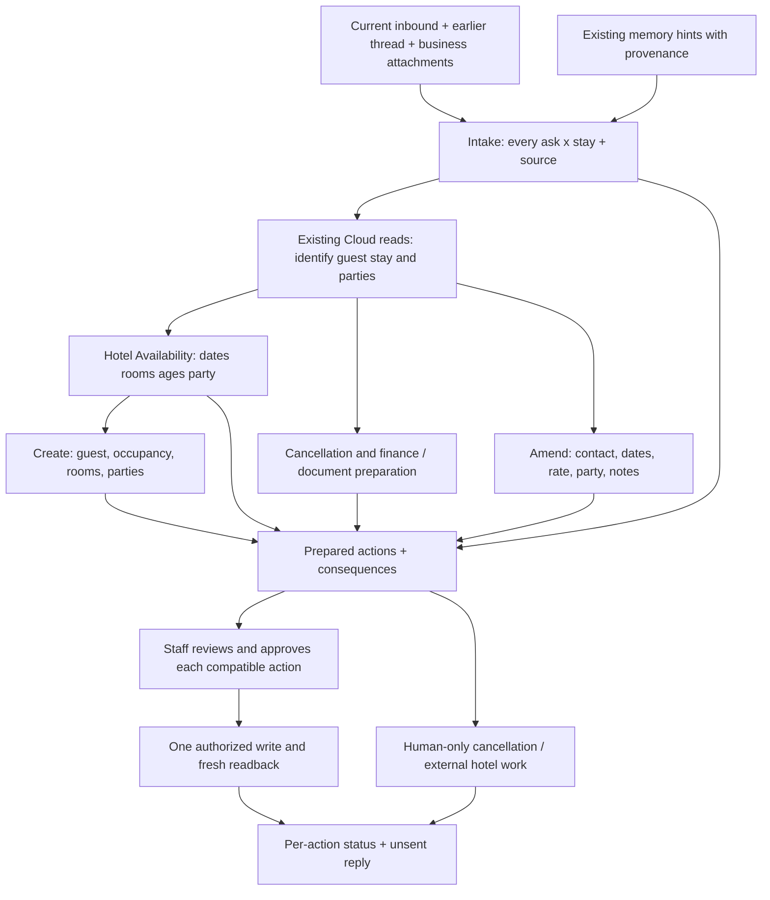

> **Historical run plan:** This 2026-10-31 scope and its operational instructions are superseded by the owner's 2026-11-01 HMS Cloud planning decisions. Do not carry forward its initial Labtest-save serialization precaution as a universal Cloud rule, its shared-profile work, group/XLSX or POP intake scope, or prior run authority as current requirements. Current product lock code may still run; this notice does not remove or bypass it. See the [current Cloud tools plan](2026-11-01-001-feat-hms-cloud-modular-tools-plan.md).

# HMS Cloud: broad coverage, lean parallel build

## Goal Capsule

`implementation-ready` describes the next work and ownership; it does not mean these features are already production-ready.

Deliver an HMS-backed reservationist that prepares all relevant requests in a real inbound email: current thread + business attachments + relevant existing memory hints → every request and stay → live PMS reads/quotes → useful proposed actions → staff approval → eligible Cloud write → readback and unsent response. Build the actual high-volume tool families, not one note-amend case or a collection of handoffs. The owner explicitly approved parallel work across product workflows for this run, overriding the older sequential-workflow default. Pane cosmetics and a memory redesign are not prerequisites. Execution is in progress; see the linked run log for current heads, proof and holds.

## Product Contract

1. Classify the target mail; preserve all its asks, stays and actionable attachments, and use relevant earlier same-thread context without confusing quoted history or later outcomes with current instructions. A self-sent pre-stay email with a confirmation is existing-stay information, never a new booking. Apply the product front-door rules, retaining travel-agent mail; the documented Profitroom/H-Pay exception conflict needs owner clarification only before changing those paths. Avoid decorative banners. Show unknowns, conflicts and partial work; a staff handoff is not automated completion.
2. Quote using HMS **Hotel Availability** with correct dates, room quantities, occupancy, real child ages and current party context; distinguish nightly prices, stock, rate eligibility and official totals. For create/amend support the requested fields and combinations: guest/profile and contacts; dates/nights; room, rate and board, including supported one-off/saved rates and authorized discounts; adults and children; notes; source; agency and organization; guarantee/deposit; multiple stays/rooms; and group/service requirements where evidenced. Exact saved readback—not merely filling a form—proves each claim.
3. Separate general field mechanics from authorization. Build toward a general staff-approved writer instead of embedding the Labtest identity in every setter. Actual writes in this run remain the authorized Proof Labtest profile, stays in 2027+, under existing property and safety guards. Real-guest writes, flags and deployment require current owner authority and applicable PRODUCT gates.
4. Cancellation is human-committed. Prepare the exact stay and scope, nights, rooms, known terms and available balances; give unknown penalty explicitly. The warning can appear after PMS changes status, so do not commit to discover a fee or accept a penalty dialog. Owner's suggested time windows are unconfirmed policy.
5. Handle billing, proof of payment (POP), vouchers, documents, groups/rooming and services as real workflow families. A receipt is evidence of a claimed payment, not proof that money posted or cleared; an invoice request is not necessarily POP. A/R is internal client context, not a demand signal. Handle hotel-only/external operations with concrete staff next steps and keep them visibly incomplete.
6. Reuse existing sessions, real clients and approval machinery when behavior actually fits; preserve privacy, identity, stale-write detection, one dispatch and uncertain-write reconciliation. Follow the product quote-output rules: BAR B&B, hotel-specific dinner add-on, no company name in the reply, and the default decline/optional selected alternative when full. Do not send email. Production equivalence and supported cases must be measured; a merged PR or a small exploratory sample is not 100% product readiness.

## Planning Contract

### Evidence and current state

This section records the original planning snapshot; the run log has the current implementation and verification status.

- Narrow real HMS Labtest creates, note edits and cancellations were independently reopened. One additional Labtest create probe visibly persisted adult/child-band and source-description values; exact child ages and source code were not shown by saved reader. Contact persisted once but dispatch was `uncertain` after an unidentified blocked request; no blind retry. `#800` generalized create branch and `#802` paired contact branch still require their own final-head proof. [Evidence](../research/halloween/2026-10-31-hms-coverage-run.md) · [prior results](../research/halloween/2026-10-31-hms-write-and-memory-results.md).
- Create `#800` currently couples adults + exactly one child + source, and agency requires that bundle and IATA. Make requested proofs independent, reusing existing child-age/source/party setters. Saved amend runs in a different frame: in one unsaved departure probe, 17 visible and five model fields changed, including pricing/tax, and reversing did not restore the full draft. Other field families/pickers also need observation; do not infer universal behavior from one record.
- Among 892 **selected** confirmation snapshots, 596 had agency, 548 organization, and 818 either. Later snapshots are not hotel-wide prevalence, request rate, current eligibility or evidence to prioritize A/R. They make unchanged-party preservation and agency/company support worthwhile. Group in one record field does not measure group requests. [Method](../research/halloween/2026-10-31-hms-coverage-run.md).
- The historical single-label, stratified 400-message study estimated new booking 10.05%, billing 7.54%, POP 4.44%, quote 3.13%, group/event 3.78%, amend 2.69%, cancel 0.72% of its frame. One analyst used some later context; small classes have wide uncertainty and this is not next week's forecast. 24/35 selected vouchers also requested booking, 0/35 evidenced POP. Fresh 125-email and 37 other/group cases are intentionally selected for coverage, not prevalence. [R3](../research/2026-10-13/r3-workflow-truth.md) · [coverage](../research/halloween/2026-10-31-hms-coverage-run.md).
- Existing `booking-lookup-session` / `saved-stay-agent-session` are useful same-page serialized Cloud tools, not production worker integration. Current worker has an older OSRRAV quote driver (client rejected that screen); separately, existing `hms-availability.ts` and `fetch-quote.mjs` use Hotel Availability. Reuse the correct path/Cloud reader as appropriate; do not replace the whole staff quote stack or build a new engine by default.
- The optional `PANE_BRAIN=agent` path currently converts each known child with an unspecified age to age 0 and rounds total adults up per room (`agent-pane-adapter.ts:63–73`). Source shows the conversion, not how often the path runs; carry unknown ages/allocation explicitly and do not price them as known. Separately, the older availability adapter treats an empty age list as zero children; check upstream handling of missing ages.
- Existing inbound mailbox loader is the starting point, but does not automatically provide all alternate HTML or older attachments. New worker input/runtime are not wired to ordinary inbound work. Current reservationist runtime hard-requires `pmsWrite:false`; a write is a separate approved execution. Existing create preview/commit is distinct from `hms_write`; amend approval binds a form + HMS preimage and its successful review currently closes the whole WorkItem. Multi-request work therefore needs an explicit action lifecycle, not just a thin adapter.
- Billing wording (#793), POP guidance (#796), Chromium configuration (#794), cancellation preparation (#795), and exposure via saved session (#799/#801 contact) are merged. Do not rebuild those; extend only a demonstrated product gap. A document list is not document bytes, and one folio without visible transactions is not proof of an empty ledger.
- The recent Oct 30 outbound linker was statically audited: it produces structural/address **candidates**, not proven same-stay links. Its real-data accuracy and ROI are unknown, and its source-manifest/association evaluation is held. Do not assume that the older app linker is reliable. Same-thread context and attachments can proceed independently; a cross-thread candidate is not a verified fact. [Evidence](../research/halloween/2026-10-31-hms-coverage-run.md).

### Design: small reusable mechanics, not a new framework

- **Inputs:** one request with per-stay/action identity, source and explicit intended fields; unknown/omitted vs explicit blank/clear remain distinct. Keep data in existing structures where they already fit; do not create a new generic framework or queue. Search results carry current native IDs and session-scoped selection; a later session must re-resolve the choice.
- **Tool shapes:** compose existing `search/read`, `set/choose`, `preview`, `save` and `readback` operations on the page. Create edits a blank form, amend edits a saved iframe; share selectors only where observed compatible. Several field edits for the same stay should be proposed and, where HMS supports it, saved together, rather than one separate writer/save per field.
- **Shared save fence:** create and contact currently each implement a near-copy ~100-line page/context route chain and overlapping ~140–170-line Chromium fixtures. First inspect existing `page-request-fence.mjs`: it supplies page-lifetime protected-path authorization, but is not automatically equivalent to the full context-wide chain. One owner extracts or extends the appropriate existing mechanic once two consumers are ready; per-operation request matchers and identity remain local. Preserve fallback order, frame selection, popup/send blocks, late requests, one dispatch and uncertain result. Keep the 985-key create schema lock until an equivalent classification is demonstrated; do not rewrite the merged cancellation preflight just to reduce its line count. Route fixtures should be shared, with a few meaningful outcome/matcher regressions and live readback, not a new mock browser suite per field.
- **Changed fields:** text-only changes may have a small stable delta; pickers, dates, occupancy, room and rate can change IDs, descriptions, nights, rates, tax and totals. Observe and validate the actual field-specific dependencies and surface consequences for staff; do not force a universal one-field diff or silently discard native side effects. Preserve unchanged linked parties rather than treating nonblank as wrong, once that Labtest preimage/request/readback is proved.
- **Approval:** reuse create preview/commit and amend grant/runner where compatible. Store/advance multiple tasks under existing work state or another smallest proven existing seam; group compatible field changes per stay. A review of one action must not mark unrelated unresolved actions done. Bind the approved active action, fresh PMS before-state, property and intended changes; understand existing whole-state digest invalidation before changing it. The existing pending-action `businessRulesValidated` flag proves source/identity/date checks in that code, not inventory, repricing or fees; do not present it as those decisions. No second approval queue by default.
- **Intake:** #798 is held on P1s: multipart clause-splicing can change meaning; card masking can miss Unicode-separated numbers or hide room lists. Keep meaningful full source views and source-specific citations, including asks that appear only in either alternative; solve duplicate text/alternative ambiguity without making the other view uncitable. Normalize Unicode card separators; do not exempt unlabeled card-like groups merely because that would preserve room lists. Preserve clearly distinguishable room lines and flag irreducible ambiguity for staff. Pick the smallest fix validated against the actual span-binding code; do not blindly merge the branch or build another loader. Original PDF/image bytes are not automatically redacted by masking extracted text. Use a privacy-safe OCR/redacted derivative or masked text for card-bearing or ambiguous media; if that cannot preserve needed evidence safely, surface the incomplete input. Continue admitting meaningful non-card attachments and images rather than banning media wholesale.

### Dependencies and parallel ownership

Four total active slots are available, including the coordinator. Start all four; do not gate unrelated lanes on a shared helper or a finished UI. One owner per shared file. Use existing useful branches and **Orca CLI child worktrees** for new independent lanes. Resolve the parent to this coordinator worktree (`--parent-worktree active` only when it resolves correctly; otherwise use its explicit `path:` selector); choose `--base-branch origin/main` or an explicitly reused feature head separately, since Orca lineage is metadata, not the Git base. Where safe and owned by this run, attach an existing useful worktree to the same Orca parent; do not reparent another session’s active checkout. Launch workers with `gpt-6-luna` / `max` for focused lanes; coordinator uses Terra/max when available. Specify the model/effort explicitly via Orca terminal launch when the built-in `--agent` launcher cannot, for example `codex --model gpt-6-luna -c model_reasoning_effort="max"`, subject to runtime support. Verify the accepted/started terminal handle and do not create duplicate terminals. Promote a worker to a new independent family as its first slice clears.

| Slot | First ownership / work | Parallel handoff |
|---|---|---|
| Coordinator | Inbound/action model, existing worker/pane/approval integration; shared session wiring and all product diff review. Keep actionable tasks visible after one action. | Integrate a tool as its actual contract stabilizes; start the vertical slice before the whole suite finishes. |
| Create worker | Reuse `#800`: independent adults/children/source/agency/org, profile selection/new-profile discovery, guest/date/room/rate/guarantee and multi-room. Own create writer/tests. | Prove useful combinations on distinct Labtest stays, then widen to missing families. |
| Amend worker | Reuse/evaluate `#802` dirty diff, paired contact; saved-frame picker/date/rate/party/occupancy exploration; own saved writers, `labtest-record` and the shared route extraction. | Reuse the guarded matchers/fence; do not wait for create. Fields with real side effects need their own observed proof. |
| Read/other worker | Hotel Availability quote gaps plus billing, POP, documents, group/rooming, services and representative sheet input. Own focused read/preparation modules. | Start with existing surfaces; split finance/group work to the next freed worker and extend the coordinator's common action output. |

The coordinator owns `worker.ts`, approval/work-item state and shared session tables; the read worker owns `agent-pane-adapter.ts` and availability inputs. Workers propose narrow integration changes. They work in separate worktrees. The amend owner extracts the common fence without concurrently editing the create worker's writer: create swaps to it when available. Quote, intake, billing, group and individual field exploration proceed during that work. Same-page calls serialize by existing session queue. Initially serialize **Labtest saves** until isolated records/sessions are proved, not all research or coding. EC2 typecheck and targeted Vitest share a remote lock; reviews and independent coding proceed while gates queue.

Existing exact holds: the previously blocked room-amend browser probe, and separate linker source-manifest write/later-association check, must not be retried, rephrased, delegated or rerouted. Until the original room-probe scope is clear, do not start a room-upgrade browser probe that might duplicate it. These are not a blanket ban on independent reads, create-room selection or other field families. The reasons were not recorded.

### Coverage boundary

Maintain a small operation × field × evidence matrix in existing research: request or case, supported input combinations, current HMS reader/writer, observed side effects, saved/readback status, integration status and any actual PMS or authorization limit. The goal is full handling of eligible, corpus-backed requests across the listed families and combinations; it is not a promise to support every feature in Infor. A tool existing, a Labtest proof, and a staff-ready production workflow are different levels. Count individual actions and entire emails; a handoff or an unknown is visible partial coverage, not completed automation. Use additional corpus examples where they reveal missing operations, not repetitive research as a substitute for building.

### Four-hour working budget, not a total ETA

Checkpoints, relative to resume, are priorities to aim for and reprioritize against, not forecasts: **0–30m** confirm branch ownership and produce first useful discoveries/fix; **30–60m** first high-value Labtest proof(s), intake and finance/group discovery progressing; **60–120m** first working email→read/prepare→approval→Labtest/readback path while create and amend expand; **2–4h** continue field families, docs/POP/group tools and same-head gates in parallel. If a slice slips, preserve other lanes, choose the next unblocked high-value task, and re-estimate from actual time; do not stop all workers to perfect the helper. Record each lane’s actual start, first live proof, PR open, review/rework, gate and merge timestamps; separate active investigation/coding from paused or queued elapsed time. Report progress and update the estimate at the first checkpoint rather than maintaining a separate tracking framework.

Evidence: #797 first commit→merge 63m02, PR-open→merge 56m33, excluding initial exploration, with uncertain dispatch; its live command 34s. It added 450 product lines and 329 test lines, including a repeated route fence. The subsequent unmerged #802 paired-contact change adds 101/deletes 36 writer lines plus focused test/session changes, suggesting reuse can make related fields smaller, not proving every future field is cheap. #795 added 498 product + 497 test lines; its merged implementation is sunk work, not an excuse to build similarly large per-field suites. A focused test was 1–2s and remote typecheck ~26s before setup/lock. #800 has already exceeded 90m elapsed since its first commit without final intended proof; this includes coordination and the later pause, not 90m of measured active coding. Previous narrower 26-PR run took ~3h52 from run start to last merge, median 11.8m open→merge, excluding each PR's pre-open coding. Earlier 6–15h amend / 4–10h other / 12–30h total estimates were withdrawn. Complete-suite ETA is unknown until first saved picker/date, linked-party and end-to-end integration results are timed; 4h is a serious target, not a promise.

### Branch disposition

- **Keep and reshape #800:** local `fc4b` contains the pending create branch plus a local merge of current main. Decouple optional fields; verify final head and meaningful Labtest combinations.
- **Keep and reassess #802:** `01c8` has four uncommitted files including blank-note handling; no remote checks or paired real-HMS proof for that dirty diff. Reuse if it remains the smallest correct contact path; do not discard its work or call it proven.
- **Hold #798:** `f3e6` has three P1s and no worker caller. Salvage only the useful pieces or replace with a smaller source-view/intake fix; re-review final code.
- **Do not expand custom XLSX parser:** `9c96` has two uncommitted entries. First try the existing conversion on a representative rooming sheet and check sheets/columns/hidden cells; use an established library if accurate structured extraction needs one. Preserve the unfinished work until its owner/session disposition is confirmed.
- **Preserve** `4b37` mailbox-loader branch pending comparison, and worktrees with active sessions or uncommitted work. Three clean ancestor checkouts and four clean already-merged PR checkouts were removed via Orca; verify fresh status before any further cleanup. Remaining local main is seven merges behind `origin/main`; do not reset or overwrite its untracked work.

## Implementation Units

### U1. Shared mechanics and targeted discoveries

Owner: amend worker, coordinator on integration. Start contact/create/other lanes now. Consolidate the existing save route chain and duplicated browser fixture only when the first two consumers are ready; no speculative factory. Probe the saved iframe/picker and draft side effects only for the currently implemented fields. Preserve the exact denied operations. Verification: existing route semantics, one dispatch, blocked popup/send/late request, and fresh Labtest readback for claims actually made.

### U2. Create and party parity

Owner: create worker; existing `hms-cloud/guest-stay-*.mjs`, profile/lookup modules; shared session edits by coordinator. Decouple child ages, source, agency and company; handle zero/multiple children and optional fields independently; explore guest/profile creation/selection, current guarantee, rate/board and multi-room via existing code. Preserve explicitly untouched fields and prove as many compatible combinations per Labtest save as practical. Do not infer native code/exact ages from descriptions/bands. Real-guest enablement remains a separate gate.

### U3. Broad saved amendments

Owner: amend worker. Start with the paired contact branch if smallest; develop dates/occupancy, room/rate/board, guest/contact, party and notes in parallel-ready focused slices. Reuse saved preimage and shared route; one save can apply several requested changes where observed safe. Prove allowed side effects and live readback, including unchanged nonblank links on an appropriate Labtest record. Not every native control is writable on every record.

### U4. Quote and current party context

Owner: read/other worker. Trace the existing quote entrypoints and actual surfaces; make product use Hotel Availability and avoid duplicate engines. Set actual dates, occupancy/child ages, room count and party on that screen. Reuse the correctly routed existing staff quote path when applicable; fix the optional agent pane adapter's invented age-0 children and rounded-up per-room occupancy; verify the legacy extraction's `childAges ?? []` does not equate unknown ages with zero children. Return actual coverage, stock/restriction, price, totals and uncertainty. One current HMS source is sufficient when the right request was applied; independent fresh reads are for verifying writes.

### U5. Cancellation preparation

Already merged and exposed. Use existing read-only preflight in the product flow; improve only when a concrete missing staff need appears. Provide matching identity, date/room/night scope, displayed terms/balance and unknown fee. Human cancels; never open the cancellation workflow, use a save, or accept a fee dialog to obtain a prospective amount. In product integration, do not route cancellation to the existing bot `commitCancel` path.

### U6. Billing, POP, documents, groups and services

Owner: read/other worker, split further as slots clear; coordinator integrates task outcomes. In parallel with create/amend and quote work, start with a concrete finance/rooming result: surface the existing Record View balance/deposit fields as a labelled, non-ledger preparation, and run one representative rooming spreadsheet through the existing converter to see whether structured extraction is adequate. Extend to actual requested documents or a mature sheet reader if needed; do not build another folio engine. The older group list observer claims reference/status/date reads but not block counts; its event observer currently returns manual-required. Check whether those observations transfer to the current Cloud role before reuse. Add useful missing reads/preparation and actual document bytes or structured rooming sheets when available; distinguish claims, posted amounts, requested invoice and manually performed operations. Reuse known tools/converters before adding dependencies. Do not treat guidance copy, document lists or handoffs as complete automated fulfillment. Prioritize operations by evidence and executable value, not A/R or absent associated-reservation examples.

### U7. Intake, integration and staff-approved actions

Owner: coordinator. Reuse authorized existing mailbox/thread/attachment access where its coverage fits; resolve #798 source-view, masking and citation P1s with minimal code. Include relevant existing booking-memory hints with their address role and provenance; current requests and live PMS facts take precedence, and historical party/rate patterns are suggestions rather than confirmed identity or policy. Do not block on a memory redesign or the held cross-thread linker; use candidate links only with provenance and without asserting a confirmed match. Preserve every request × stay × action, source identity, missing/unknown inputs and current-vs-quoted context. Connect usable Cloud tools into the ordinary worker and existing pane for both Outlook and webmail. Extend the existing multi-action lifecycle so one review cannot finish remaining asks; choose the smallest compatible create and amend approval paths after inspecting the actual code. No second queue or pane redesign. For the first end-to-end Labtest create or amend plus unsent response, use a realistic current mail with earlier thread context, a business attachment and at least two asks; after one approved write and fresh readback, prove the other ask remains visible and open. Do not wait for every field family before integration.

### U8. Evaluate, close gaps and prepare release

Owner: coordinator with workers. Smoke-test five source-backed shapes: multi-room quote/create with ages/parties; multi-field/multi-stay amend; cancellation with differing terms/scope; invoice vs voucher vs POP; group rooming sheet plus service. Score every action/stay and whole email as automated, prepared, manual, unsupported or error. These five are a smoke check, not a population pass. Reuse current independently checked, versioned evaluation and owner-confirmed bars for the applicable release; record missing coverage and iterate. Track the client-requested ~66-hour unsent quote follow-up as a separate product workflow, not a prerequisite for the first HMS tool proofs. Activate/deploy only after explicit property authority, exact final-SHA gates and canary.

## Verification Contract

Use actual HMS read-only observations and Labtest writes where material, plus minimal nonredundant tests for boundary/regression behavior. No real-guest writes without current explicit owner authorization; no email sends, penalty acceptance, pilot RDS, guessed retries after `uncertain`, or replay of held probes. Screenshot per write; reopen the record and compare requested fields plus important side effects. Preserve private data/credentials outside Git and external output.

For each product slice: work from current main, keep the appropriate <=500 changed product-line gate, review the product diff, run targeted Product EC2 tests and remote typecheck on the exact final head (unset `DATABASE_URL`, `VITEST_ALLOW_PILOT_RDS`, `TEST_DATABASE_URL` before Vitest), independently verify evidence, obtain final-head Greptile Apex, validate/fix P0/P1, and merge through `scripts/orch/merge-gate.sh`. Run independent coding/review while the shared remote gate queues. No repo-wide lint/format, unauthorized GitHub Actions or hook bypass.

## Independent plan review

Grok 4.7 xhigh was run via the local Grok CLI with direct read access to the actual plan and create/amend/intake worktrees; it completed a 70-call first pass, including 31 distinct files. Accepted: share the duplicate route chain/browser fixture; separate optional create proofs; stop rebuilding already-merged slices; fix field/preimage vs blank-party assumptions; respect saved-frame repricing; wire a real worker vertical slice. Challenged: its first schedule delayed finance/groups and stopped unrelated work for the fence; its claim that create must join `hms_write` ignored the existing create preview/commit; whole HTML alternatives alone do not solve duplicate source citations; separator widening alone does not solve room-list masking false positives. A targeted source-reading follow-up ran with `--permission-mode bypassPermissions` per the owner's instruction and confirmed the separate create preview/commit, multi-action closure/digest gap and age-0 adapter. Reject its suggestion to expose unlabeled spaced card-like numbers; also reject putting the other MIME view outside the citable request head because that can hide asks exclusive to it. A further fresh challenge misread the current splice order: `#798` inserts its filtered alternate before the primary tail, not after. Reject its suggested new sentence-splice, `childAges: []` for unknown children, and assumed equal room split: the availability code can treat `[]` as zero children, and divisibility does not prove allocation. A final plan-specific Grok pass named concrete finance/rooming and multi-ask first-slice gaps, checked the existing page fence, and flagged the old pane cancel-commit route; those are incorporated. Its uncertainty about #794 was checked against the source: the bootstrap now honors `HMS_CHROMIUM_EXECUTABLE_PATH`. Reject its suggestions to defer quote/intake until other slices finish, delete the general-writer goal, or ban all raw media categorically. Final choices reflect source rather than automatically accepting model advice.

## Definition of Done

- The suite covers the requested, corpus-backed HMS operation and field families, including combinations, linked parties and multi-stay scope, as far as the actual PMS allows; each claimed behavior has appropriate real read or Labtest write/readback evidence.
- All asks are visible and individually tracked through staff approval, uncertainty, partial work and the eventual unsent reply. Cancellation remains human-committed; unsupported hotel/external work remains visibly incomplete, not silently counted as automated.
- Representative real-input evaluation and applicable product bars establish actual product performance; unknown or blocked operations and separate live authorization/deployment are reported explicitly.
