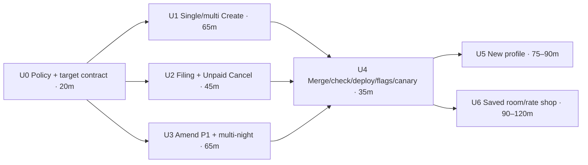

# Option A Speed Plan - Real-Email Centurion Pilot - Plan

## Goal Capsule

**Launch real-email HRCEN pilot: U0 → parallel U1/U2/U3 → U4 in the owner's 120–165m wall-clock target. Start U5/U6 immediately after U4 is live.** Outlook email → background lookup/quote/party prefill → staff edits → Go → guarded real HMS write → screenshot/fresh readback → pane result and unsent reply.

Current owner directive and [Option A handoff](../context/HANDOFF-2026-11-03-option-a-adversarial-override.md) replace this plan's previous units, requirements-only posture and the review's 360m single-fake-Create proposal. **Prepare the plan now; wait for owner “execute” before implementation/merge/deploy.** That go-ahead activates the current session's specified real-write/cutover authority. Staff Go remains mandatory. CMS sending stays off. No Hindsight.

Pinned planning sources:

- M: `origin/main@0da451edd5cbc6188d45fb05e619d5e2e12c97e0`.
- A: open [PR #987](https://github.com/kufupa/Zero/pull/987), `19c0cf1860bc11fadc138f779a1fe5dc20c2d156`.
- P: owner-supplied `.claude/worktrees/agent-a8d639a6e94efe62b`, HEAD M, uncommitted `AGENTS.md`, `PRODUCT.md`, `scripts/orch/merge-gate.sh`, `scripts/orch/test-orch.sh`. Its diff was inspected; execution self-test and adoption remain U0 work.

Line references below use M unless marked A. Root checkout is older and dirty; use clean isolated descendants of M. Preserve all other sessions and P's uncommitted work. At execution start verify refs/file ownership; reconcile changed refs rather than silently changing the baseline.

---

## Product Contract

### Summary

Tranche 1: existing-profile single/multi-room Create, voucher/POP PDF Filing, supported multi-night retained-rate date/adult Amend, Unpaid Cancel, existing native Quote and background prefill. Tranche 2: first-time guest profiles and saved-stay room/rate re-shopping. Reuse the shared Outlook/webmail pane and existing controls.

### Requirements

**Mail and prefill**

- R1. Keep eligible real-email triage, separate asks, company/agency quote terms and pre-stay self-mail exclusion. Background lookup/quote/party results prefill the pane; replies remain unsent.
- R2. Preserve shared Outlook/webmail behavior, exact selected-source identity and staff edits. Distinguish installed Outlook evidence from a mocked bridge.

**Writes**

- R3. Create for uniquely selected existing HRCEN guests on current/future dates with reviewed native guest/party/room/rate/guarantee. Multi-room remains sequential single-room writes under one Go, max eight; partial/uncertain results persist. U5 adds no-match profile creation.
- R4. File approved voucher/POP PDF bytes to the selected stay. Keep source hash, exact multipart match and fresh Documents metadata readback. No PDF re-download verification in Tranche 1.
- R5. Fix the second-Save Amend P1 and enable real multi-night retained-rate date/adult changes in U3. U6 adds saved-stay room/rate shop and non-retain pricing. No manual amounts; paid-stay expansion is outside this tranche.
- R6. Connect and enable Unpaid Cancel under `PANE_WRITE_CANCEL_UNPAID=on`. Bind the staff's native reason/note. Never accept a cancellation-penalty dialog or infer cancellation from HTTP success.
- R7. Bind source, target, approved values and exact outgoing POST; dispatch once, screenshot and freshly reread. UNKNOWN occupies its target only, never the hotel. No blind retry or automatic hold expiry.

**Execution**

- R8. Adopt P's lean policy: cut hard 500-line cap, empty `.ok` files and successful-Greptile merge blocker. Keep exact-head protection, known P0/P1 disposition and completed independent review before release. Launch Apex; use another reviewer when it does not finish.
- R9. Reuse Cloud tools and installed native Quote. Cut mandatory `/proc` bootId/pidNamespace proofs, private-socket PG abort rehearsals, PM2 `axm_monitor` freezes and speculative harness services. Keep native POST matchers and ordinary owned-session cleanup.
- R10. Keep `cms.send: false` and `sendHmsConfirmation: { kind: 'never' }`, pilot RDS out of tests, hooks/worktree ownership and approved bundle deploy. No non-installer GitHub Actions. Billing, groups/XLSX, OCR and custom amounts remain outside this slice.

Contract change note: R1–R10 keep their IDs; owner now approves real-write launch, Unpaid Cancel and staged U5/U6 coverage. Old U1–U8 meanings are replaced by the requested U0–U6 mapping.

---

## Planning Contract

### DAG, targets and checkpoints

Nominal Tranche 1 = **20 + max(65,45,65) + 35 = 120m**; **45m contingency** gives the approved **120–165m** window. These are owner working targets, not measured/calibrated completion statistics. Do not sum parallel lanes or revive the rejected 360m budget. Lane targets include focused checks; U4 includes the integrated release tail. U5/U6 start together after U4: 90–120m implementation critical path; their final affected-head check/deploy/proof tail remains explicit rather than silently counted as zero.

Checkpoints from “execute”: 20m U0 merged/shared contract ready; 65m U2 connected candidate; 85m U1/U3 integration-ready; 120m U4 launch target. On a miss, report exact failed boundary/head/remaining work and spend contingency on that blocker. At 165m report any missed launch; an ETA miss never permits guards to be waived or absent Save/readback to be called live. Continue scoped recovery with clear status, without adding unrelated work.

### Disjoint ownership and execution route

Coordinator executes U0/U4 and production commands. After U0 merges, dispatch three isolated workers from that same head using available collaboration tools; no new launcher/bootstrap. U5/U6 receive ownership after U4. Luna max suits bounded parameterization; coordinator/challenger handles native ambiguity and P1 review. Read every product diff and merge through updated `scripts/orch/merge-gate.sh`.

Path shorthand: **AI** = `apps/server-pilot/src/ai/`; **C** = `apps/server-pilot/tooling/hms-cloud/`; **D** = `apps/server-pilot/deploy/`; **mail** = `apps/mail/`.

| Unit | Owner | Owned files | Dependency | Target |
|---|---|---|---|---|
| U0 | Coordinator/shared | P's four files; AI `hms-labtest-dispatch.ts`, `pane-stay-save.ts`; C common `labtest-record.mjs`, `saved-stay-save-route-chain.mjs`, `saved-stay-combined-preimage.mjs` and common tests | Owner execute | 20m |
| U1 | Create worker | AI `pane-cloud-preview.ts`, `pane-create-cloud-input.ts`; C `guest-profile.mjs`, `create-reservation.mjs`, `booking-lookup-session.mjs`, `labtest-preimage.mjs`, `guest-stay-save.mjs`, `labtest-create-readback.mjs`, `batch-sibling-readback.mjs`, `create-positive-recovery.mjs`; Create-only tests | U0 merged | 65m |
| U2 | Filing/Cancel worker | AI `hms-approval.ts`, `run-ledger.ts`, `pane-hms-write.ts`, `pane-stay-cancel.ts`, `worker.ts`, `hms-labtest-attach-worker.ts`; `src/trpc/routes/hms-approval.ts`, `pane-stay-cancel.ts`; C `pane-attach-session.mjs`, document-specific `labtest-record.mjs`, `guest-stay-cancel.mjs`, `cancellation-preflight-session.mjs`, `guest-stay-cancel-preflight.mjs`, new `pane-cancel-session.mjs`; mail `components/nava-pane/blocks/booking-voucher-card.tsx`, `components/quote-workflow/approve-card.tsx`, `lib/quote-workflow/hms-write.ts`, `tests/approve-card.test.tsx`; attachment/cancel tests | U0 merged | 45m |
| U3 | Amend worker | A: AI `pane-cloud-amend.ts`, `pane-cloud-amend-readiness.ts`, `pane-cloud-amend-runner.ts`, `pane-cloud-amend-dispatch.ts`, `cloud-amend-price-projection.ts`, `hms-labtest-amend-worker.ts`; C `pane-amend-session.mjs`, `labtest-amend-save.mjs`, `labtest-amend-dispatch.mjs`, `labtest-amend-retain-proof.mjs`, `guest-stay-amend-adults.mjs`, `guest-stay-amend-date-room-rate.mjs`; mail `components/quote-workflow/amend-lookup-panel.tsx`, `lib/quote-workflow/cloud-amend-client.ts`, `tests/amend-find-panel.test.tsx`, `tests/cloud-amend-client.test.ts`; Amend-only server/native tests | U0 + A candidate | 65m |
| U4 | Coordinator/release | D `write-ec2-env.sh`, `write-ec2-remote-env.sh`, `parse-ec2-legacy-env.mjs`; AI `pane-stay-spawn-env.ts` if forwarding changes; durable env/config and release checks | U1/U2/U3 landed | 35m |
| U5 | Profile worker | U1's C `guest-profile.mjs`, `create-reservation.mjs`, AI `pane-create-cloud-input.ts`; profile-create test and existing no-match UI if needed | U4 live; U1 released | 75–90m |
| U6 | Rate-shop worker | U3's C `pane-amend-session.mjs`, `guest-stay-amend-date-room-rate.mjs` + its contract; AI Amend/price/dispatch/runner modules and existing amend controls if needed | U4 live; U3 released | 90–120m |

**U1/U2/U3 have zero editable-file overlap, including tests.** U0 generalizes common `labtest-record.mjs` read/created-record primitives, then hands the whole file to U2 for document-specific changes. U1/U3 consume it. Shared A hunks already touch `hms-approval.ts`, `run-ledger.ts`, `worker.ts`, approval route, shared mail approval/client files and common C files: coordinator assigns them to U0/U2 as above; U3 brings Amend-exclusive code without editing shared files. Rebase/reconcile A onto U0; do not overwrite U0/U2 with older A copies during merge. U2 owns dedicated Amend routing compatibility and shared UI integration. Resolve those A/U2 hunks in U4 and run the shared approval/client checks there; U2 need not pre-import unintegrated Amend modules. Newly discovered shared edits require ownership assignment before editing.

### Shared target/authority contract

- Saved stay target: `(HRCEN, canonical confirmation)`; verified native stay ID if confirmation unavailable. Do not use workItemId when a durable booking ID exists.
- Create target: `(HRCEN, normalized firstName, normalized lastName, arrival)`. Departure belongs to approved intent, not the conflict key: two proposed departures for the same guest/arrival still conflict. Multi-room resolves each room before the next sequential claim. Work-item fallback cannot bypass this key.
- Persist target scope in existing work-event intent; no new table/schema push. Derive legacy keys from sealed recovery/request/confirmation data; pair completions by holdId. Filter/validate active count and compute epoch within target. A's UNKNOWN cannot occupy B; B completion cannot change A epoch. Preserve global one-use grant replay protection with a grantId-scoped transaction lock or the existing locked grant row, plus the duplicate-grant check; target-local history alone cannot enforce it. Unattributable history gets its own work-item hold, not a hotel-wide refusal.
- Add a target-scoped wrapper in `pane-stay-save.ts` for independently owned Cloud sessions. Preserve native Quote/borrowed-browser property-lock semantics. Use the same key for protected preimage→claim→Save; revalidate after async preparation. Focused contract tests replace private-PG socket fault rehearsals.
- Server derives allowRealGuest from effective per-workflow on mode + verified HRCEN transport + staff approval. A client boolean grants nothing. Thread trusted mode and expected identity through helpers. Use property-local HRCEN todayIso consistently: valid Create/current-future Amend arrival ≥ today, departure > arrival. Filing/Cancel validate actual saved dates and may target already-started stays. Lab mode keeps Proof Labtest/2027+.

### Installed callers retained

**Create Go:** `apps/mail/lib/quote-workflow/pane-stay-bind.ts:298–306` → `src/trpc/routes/quote-workflow.ts:299–320,336–372` → `quoteWorkflow.previewStay/commitStay` → `AI/pane-cloud-preview.ts` → new Cloud Create. `commitStay` is this installed Go boundary. **Filing/Amend approval:** `src/trpc/routes/hms-approval.ts` → AI approval → dedicated run → `pane-hms-write.ts` / A's Amend runner. Keep their existing source/approval checks; no read-only viewer mutation or new auth bypass.

**Mounted Quote stays** `staff-quote-installation.ts` → `tooling/playwright-quote/fetch-quote.mjs`. No `C/quote-read.mjs` migration. Browser-bootstrap imports from the older directory do not make a new Cloud operation legacy.

---

## Implementation Units

### U0. Land policy and rescope dispatch — 20m

- **Owner:** coordinator. **Goal:** real identities and independent target dispatch available before fan-out. **Requirements:** R7–R10. **Dependencies:** owner execute. **Files:** U0 ownership row.
- **Approach:** integrate P's exact four-file policy diff (38 additions/66 deletions). Cut hard cap, `.ok` files and Greptile-success wait; retain exact head/known P0/P1 blockers and completed independent release review. Coordinate bundle release so partially integrated main is not automatically deployed.
- **Exact fixes:** AI `hms-labtest-dispatch.ts:18–25` names → `z.string().trim().min(1)`, HRCEN retained. `:101–102,124,158` active/epoch checks → target scope. Also rescope `:65–68` short advisory transaction key, `active.length > 1` corruption validation, `finishDispatch:169–190` and recovery `:247–273` by exact holdId/target. Preserve global one-use grant checks and append-only old event readability. Capture takes explicit target; each lane owns its callers.
- **Common readers:** generalize C `labtest-record.mjs:84–126,146–153` guarantee/date/name/options and common saved-state matcher assumptions before fan-out. Expected target identity/linked parties remain exact; fake note/name literals do not define production identity. Incorporate A's common saved-route/preimage changes here so U3 needs no concurrent common-file edit. U2 subsequently owns `currentLabtestDocumentRecord:36–71`.
- **Cut ceremony:** remove mandatory `/proc` writer identity admission/recovery requirement. Retain normal awaited session cleanup, one-use native handles and UNKNOWN holds; missing PID or time elapsed never proves an uncertain request failed.
- **Patterns to follow:** existing intent/resolution, native route handles, exact-head gate and existing PG lock implementation.
- **Test scenarios:** unrelated A/B admitted; same target excluded; B cannot alter A epoch; resolve correct hold among active targets; legacy keys readable; replay grant refused; real expected identity/guarantee readback exact.
- **Verification:** shell self-test and focused dispatch/lock/reader commands below. U0 merged contract is the workers' start boundary. No schema migration/private-PG rehearsal.

### U1. Real single/multi-room Create — 65m

- **Owner:** Create worker. **Goal:** existing real guest/current-future dates/native guarantee through installed Go. **Requirements:** R2,R3,R7,R9,R10. **Dependencies:** U0. **Files:** U1 ownership row.
- **Approach:** derive mode server-side, thread expected identity/dates through prepare/preimage/Save/readback/recovery. Preserve CMS false/never, native proof and sequential batch state. Current actual dispatcher also needs `PANE_CLOUD_CREATE_DISPATCH=on`; U4 sets it. No accidental earlier Create fallback.

| Exact source | Required fix |
|---|---|
| AI `pane-cloud-preview.ts:88,298–303,340–342,423` | Conditional today/lab date admission; target names/dates in recovery rows; real preview/commit only in trusted on mode. Remove mandatory process identity `:295–313`; update target epoch/claim `:459,487+`. |
| AI `pane-create-cloud-input.ts:42–46,86–88` | Real-mode identity and all valid HRCEN guarantees, mapped from actual native label/value evidence. Preserve never-send/CMS false at `:59–61,152,206`. |
| C `guest-profile.mjs:90–91,542,587–600` | Match proof names; any unique HRCEN selected candidate captures `{nativeId,firstName,lastName,record:draft.record,session:draft.session,token:randomUUID()}`. Native/visible identity and session-bound token remain verified before guarantee staging. |
| C `create-reservation.mjs:50,55,60–63,94,391,397,465–467,482–485` | Conditional real-guest/date hold; real native guarantees; remove mandatory process-identity capture; fake note literal only for fake guest; verifiedDraft binds target names/arrival instead of requiring Labtest. |
| C `create-reservation.mjs:628,647` | Pass `{firstName,lastName,arrival,departure,allowRealGuest}` to preimage/save/readback. |
| C `booking-lookup-session.mjs:413–415,543–550` | Thread expected names/mode into preimage; retain connected native dispatch callbacks. |
| C `labtest-preimage.mjs:111–112,160,175,205–206` | POST surname/filter/search fill use expectedLastName; result filtering uses expectedFirstName/LastName; real-date policy replaces 2027 floor in on mode. Preserve complete duplicate census. |
| C `guest-stay-save.mjs:236–247,558,620` | Verified native guarantee support, expected first/last in matchesSave and conditional date floor. Keep full approved POST, profile token and one-use Save. |
| C `labtest-create-readback.mjs:34,55,65` | Compare/read with expected first/last/guestName, not Proof/Labtest literals. |
| C `batch-sibling-readback.mjs:23–28` | Parameterize names/dates/mode; freshly verify prior siblings. |
| C `create-positive-recovery.mjs:25–26,29–30,51,68–69` | Parameterize intent/request/census/candidate identity/date/guarantee; remove mandatory process-identity proof; positive-only recovery, no blind retry. |

- **Guarantee evidence:** use AI `booking-draft.ts:266–343` and `tooling/playwright-quote/property-profiles/HRCEN.json` labels plus actual native code/display/submitted-value proof. Include owner examples NGI/GTDAGT/CC/6PM/COMP/PREPAID when genuinely present; do not invent undocumented code mappings. Existing verified writer supports NGI/GTDAGT; widening includes staging/matcher/readback, not just aliases.
- **Patterns to follow:** Cloud pickers, request binding and batch manifest. Eight-room cap/visible partial results retained; no auto-resume after uncertainty.
- **Test scenarios:** real name/today accepted only on; yesterday/off refused; unique profile/guarantee exact; wrong POST name blocked; one Go/two rooms separate confirmations; second uncertain stops later rooms; lost response no second Save.
- **Verification:** Create-focused native/server commands below and actual route→tool trace. No new-profile creation until U5.

### U2. Real Filing and Unpaid Cancel — 45m

- **Owner:** Filing/Cancel worker. **Goal:** approved real-stay attachments and unpaid cancellation reach Cloud executors. **Requirements:** R2,R4,R6,R7,R9,R10. **Dependencies:** U0. **Files:** U2 ownership row. New `C/pane-cancel-session.mjs` is the thin wrapper over existing saved-stay session/open/confirm/readback; reuse existing worker/ledger rather than creating another orchestration framework.

| Exact source | Required fix |
|---|---|
| AI `run-ledger.ts:52–54` | Worker on AND attach mode lab OR on; retain dedicated claimant ownership. U2 also integrates A's dedicated Amend routing hunks. |
| AI `hms-approval.ts:164–177,486–490,713–720` | Parameterize attachment grant's Labtest/date restriction from trusted attach mode; keep exact message/PDF hash/stay/source binding. |
| AI `pane-hms-write.ts:123–145,378–384,1450,1459–1461` | Generalize reread/binding guest/date guards; remove `|| allowRealGuest` Cloud refusal; pass approved guestName/trusted mode. |
| AI `pane-hms-write.ts:1149,1244+` | Target epoch/claim/lock and target names; remove mandatory writer-current checks `:1219,1253,1261`. |
| C `pane-attach-session.mjs:38–56,78–85,104,130,152` | All record/recovery guards use target guestName; remove real-mode refusal; 2027 floor only for lab; pass target identity/mode to Documents reader; ordinary close replaces `/proc` proof. |
| C `labtest-record.mjs:36–71` | Expected first/last/allowRealGuest from approved native preimage; do not split a display name to guess surname. Keep exact native/visible confirmation, guest ID, names, dates and CMS false. |
| C `stay360-document-attach.mjs:60–108,318–337` | Keep matchesDocumentMultipart, upload response and fresh document filename/code readback. No byte re-download implementation. |

- **Readback truth:** current fresh listing proves one matching filename/document code. It does not prove stored bytes, complete tree, total row-count delta or document type. Preserve approved upload bytes/hash and report that evidence accurately; do not add a broader proof project.
- **Cancel cannot be flags-only:** AI `pane-stay-cancel.ts:301–303` and `pane-hms-write.ts:961–975` explicitly refuse HRCEN. Runner `:1426–1459` only admits attach/legacy lab; current write claimant only takes attach prompt. Connect a bounded unpaid-Cancel executor and its prompt/claim routing inside U2; parameterize C `guest-stay-cancel.mjs` open/confirm target names and existing TEST/Test Reservations reason/body assumptions to the approved native reason/note. Reuse existing pane approval/payment/preimage and fresh saved-record session. Before the first possible cancellation effect, acquire U0 target claim and exact request guard. Both installed cancel entry points must reach the same guarded executor; never fall through to earlier unguarded HRCEN CLI.
- **Patterns to follow:** approved PDF/hash upload, saved-stay cancellation open/confirm and native body fence. Fresh unpaid classification required; paid/unknown/unsupported linked scope refuses. Preserve unrelated linked parties rather than blanking them.
- **Test scenarios:** attach on-mode target accepted; wrong hash/stay refused; upload uncertainty held; unpaid on reaches Cancel executor; paid/unknown refused; wrong reason/body rejected; penalty never accepted; uncertain cancellation rereads only. Return `cancel_penalty_pending` even if cancellation may already have applied.
- **Verification:** focused attachment/approval/cancel tests below. Add new executor routing/hold cases to the already-run `tests/pane-stay-cancel.test.ts`; extend `tests/saved-stay-cancellation-session.test.ts` for real-name/native reason matching. No PDF re-download, private PG abort rehearsal or PM2 freeze. Cancel executor is a U4 launch dependency; if missing, leave its flag held and report the miss, never call cancellation live.

### U3. Amend P1, real guest and multi-night retain — 65m

- **Owner:** Amend worker. **Goal:** real multi-night date/adult changes preserve approved price/target through both Saves. **Requirements:** R2,R5,R7,R9,R10. **Dependencies:** U0 + A. **Files:** U3 ownership row. Reconcile A's common hunks with assigned U0/U2 owners.

| Exact A source | Required fix |
|---|---|
| C `pane-amend-session.mjs:329–332` | retainRate snapshot/matches must require `unchangedLabtestRecord(postAvailability,retained,allowedRetainDelta)` AND generalized `retainReadbackMatches(input.approvedPrices,retained,selected,changes)` before second Save. Existing fresh snapshot cannot approve itself. |
| C `labtest-amend-save.mjs:305–312` | Actual second-Save continuation must enforce that guard; accept only expected retain-dialog choice/delta, never new user/native business fields. |
| C `pane-amend-session.mjs:77–177,339,354–360` | Parameterize identity/date/matchesCloudPaneAmendSave/unchanged checks; remove mandatory bindCloudAmendWriter process capture; departure>arrival plus every approved night, not one-night-only. |
| AI `pane-cloud-amend.ts:95–101,105–115` | Real preimage names/today admission and multi-night retained-rate supported scope. |
| AI `pane-cloud-amend-readiness.ts:10–12`; `pane-cloud-amend-runner.ts:16,92,174` | Worker on + mode lab OR on; target epoch/lock and trusted real mode into native/readback. Verify actual runner readiness checks after reconciliation. |
| AI `pane-cloud-amend-dispatch.ts:13–36,106–127` | Generalize native schema guest/date literals and claim names/target; remove mandatory bootId/pidNamespace/current-writer proof, retain source/approval/native request/evidence binding. |
| AI `cloud-amend-price-projection.ts`; C `labtest-amend-retain-proof.mjs`, `labtest-amend-save.mjs:26–37` | Multi-night approved price projection, availability and saved readback cover every night/currency; preserved values remain exact. |
| C `guest-stay-amend-adults.mjs:140–151`, `guest-stay-amend-date-room-rate.mjs:42–48` | Parameterize staging identity/date assumptions; retain existing safe unsaved/native sequence. No rate-shop expansion here. |

- **Approach:** owner expects localized ~15-line P1 guard; multi-night/identity/price propagation remains separately verified work within U3. Both Saves are one immutable approved compound action. U3 requests shared routing changes from U2; no shared-file edits.
- **Patterns to follow:** actual availability/retain sequence, native request matching, dedicated Amend worker and positive readback. Preserve partial/UNKNOWN; no retry after lost second response.
- **Test scenarios:** changed retained snapshot/second body blocked; valid expected continuation accepted; two/three nights each priced; missing/changed night refused; source/target stale; real on/off modes; lost response UNKNOWN.
- **Verification:** dedicated Amend native/server checks below and final-head P1 disposition. RetainRates=no and saved room/rate shop stay in U6.

### U4. Integrate, check, deploy and cut over flags — 35m

- **Owner:** coordinator/release. **Goal:** Tranche 1 on EC2 with effective flags/prefill and live connected readback. **Requirements:** R1–R10. **Dependencies:** U0–U3 landed, independent review complete, owner execute. **Files:** U4 ownership row.
- **Approach:** merge U1/U2/U3 via updated exact-head gate; fix valid P0/P1s, disposition invalid findings. Launch Apex without indefinite success wait; independent reviewer substitutes when needed. Freeze one integrated release SHA. Run one release validation batch: mail remote check once + server-pilot remote check once. Their shared remote checkout lock remains; these commands may queue sequentially. Changed source/head reruns affected checks only.
- **Env implementation:** D `write-ec2-env.sh:18,186–209`, `write-ec2-remote-env.sh:42–105,129` and `parse-ec2-legacy-env.mjs:63` do not accept/forward every requested key. Update durable writer/parser/remote whitelist and any required child forwarding. No `.env`/secret dump. U4 owns this delta before deployment/cutover.

Apply the following authorized values per workflow only after its executor and focused checks pass. Otherwise keep that workflow off, report the hold and keep independent work moving; no extra owner approval is required for the already-authorized cutover.

| Category | Authorized durable AND effective values on http, worker, ai-worker, remote-http |
|---|---|
| Prefill | `HMS_PREFETCH_ENABLED=1`, `HMS_JOB_QUEUE=on`, `HMS_AVAILABILITY_PREFETCH=on`, `HMS_QUOTE_PREPARE=true`, `PARTY_MATCH_V2=true` |
| Caps | `HMS_PREFETCH_PER_HOUR=60`, `HMS_GUEST_PREFETCH_PER_HOUR=60`, `HMS_AVAILABILITY_PER_HOUR=60`, `HMS_QUOTE_PREPARE_PER_HOUR=60` |
| Create | `PANE_WRITE_CREATE=on`, `PANE_HMS_LAB_CREATE_WORKER=on`, **`PANE_CLOUD_CREATE_DISPATCH=on`** (current actual gate) |
| Filing | `PANE_WRITE_ATTACH=on`, `PANE_HMS_LAB_ATTACH_WORKER=on` |
| Amend | `PANE_WRITE_AMEND=on`, `PANE_HMS_LAB_AMEND_WORKER=on`; explicit unpaid-route compatibility where required; paid mode off |
| Cancel | `PANE_WRITE_CANCEL_UNPAID=on`; paid cancel off |

- **Consumer check:** M has no Create consumer for `PANE_HMS_LAB_CREATE_WORKER`; it does not replace `PANE_CLOUD_CREATE_DISPATCH`. New Amend flags need durable/parser propagation. Require effective unpaused HMS lane and installed HRCEN transport/native Quote configuration. Caps=60 is not proof all mail is ready; observe admission→background result→pane prefill on canary. Keep automatic mail sends/CMS off.
- **Deploy:** coordinated clean `.worktrees/recover-parse-failure` checkout fast-forwarded to exact release main, then D `ops-deploy.sh` bundle sync. Preserve root/P/other session changes. No schema push/migration/hold bypass/alternate deployment route. Inspect any active deploy train and coordinate release so partly integrated main does not ship.
- **Test scenarios:** effective env matches durable source in four processes; exact SHA/bundle loaded; selected real email prefill survives edits/source switching; Go issues one native write and shows fresh verified result; reply remains unsent.
- **Verification:** both remote app receipts same integrated SHA, `/health`, four online PM2 process/env/SHA checks and one live selected-email→prefill→Go→native write→fresh readback trace. Final permitted fake booking remains the product completion check using generalized code/CMS off; it is a fixture, not the production identity schema. Real-name/date admission is exercised with representative read/prepare and focused contracts. No env-only workflow pass.
- **Exit:** Tranche 1 live with canary, or named workflow/flag held and launch miss reported. Immediately dispatch U5/U6 after U4 live.

### U5. Create first-time guest profiles — 75–90m

- **Owner:** profile worker. **Goal:** complete no-match guest can Create without manual HMS profile work. **Requirements:** R2,R3,R7,R9,R10. **Dependencies:** U4 live/U1 ownership released. **Files:** C `guest-profile.mjs`, `create-reservation.mjs`, AI `pane-create-cloud-input.ts:124–127`; focused profile-create test and existing UI if needed.
- **Approach:** complete `searchGuestProfiles` no_match → native New in LVGUESTS. Profile creation is a real write: exact reviewed identity/contact/body, duplicate recheck, staff Go, one-use dispatch and fresh native ID. Bind its unique session proof into existing Create; remove `prepared_guest_identity_required` only after identity exists. Ambiguous/truncated/existing results never trigger New.
- **Patterns to follow:** U1 proof/token and existing native request fence; current field controls.
- **Test scenarios:** existing match skips New; no-match creates once; ambiguous/truncated refuses; wrong profile POST blocked; lost response freshly read before booking; no duplicate on retry.
- **Verification:** profile/Create focused checks below, affected final-head remote checks/review/deploy, permitted profile→Create readback canary. CMS off.

### U6. Saved-stay Room/Rate Shop — 90–120m

- **Owner:** rate-shop worker. **Goal:** approved saved-stay room/rate re-shopping, including retainRates=no. **Requirements:** R2,R5,R7,R9,R10. **Dependencies:** U4 live/U3 ownership released. **Files:** U6 row and focused saved-popup tests.
- **Approach:** implement actual saved-form Room/Rate Shop search/select. C `guest-stay-amend-date-room-rate.md:44–53,123–175` describes loaded-store unsaved staging and unresolved picker cleanup; it does not establish the shop. Bind verified selected native IDs/current availability/nightly currency/taxes/prices to approved fields, then exact Save continuations and fresh readback. Preserve U3 P1 fix. No guessed IDs/manual amount/paid expansion.
- **Patterns to follow:** actual saved-popup endpoints/fields and U3 compound Save; reuse new-stay mechanics only after native parity is established.
- **Test scenarios:** saved popup selects expected IDs; changed ID/price refused; per-night multi-night match; retain=no uses current selected rate; failure causes no Save; unexpected second continuation blocked; lost response UNKNOWN.
- **Verification:** saved/amend focused commands below, affected final-head remote checks/review/deploy and permitted saved-stay re-shop canary. U5/U6 may share a release tail after stable candidates; never edit each other's files.

---

## Verification Contract

Commands from isolated repo roots. Before tests: `unset DATABASE_URL VITEST_ALLOW_PILOT_RDS TEST_DATABASE_URL`. Check active runs/load and preserve ≥20% CPU/RAM headroom; current workspace allows max three concurrent local targeted runs. No pilot RDS suite, repo-wide lint/format, private-PG rehearsal, red-first ritual or new test framework. Extend existing tests for changed identity/target/nightly-price behavior; remove stale assertions that require production fake-only guards.

| Unit | Minimal focused commands |
|---|---|
| U0 | `bash scripts/orch/test-orch.sh`; `bash -n scripts/orch/merge-gate.sh scripts/orch/test-orch.sh`; `pnpm -C apps/server-pilot exec vitest run --maxWorkers=1 tests/hms-labtest-dispatch-immutability.test.ts tests/pane-stay-save.test.ts`; `node --test apps/server-pilot/tooling/hms-cloud/labtest-record-guarantee.test.mjs` |
| U1 | `node --test apps/server-pilot/tooling/hms-cloud/create-reservation.test.mjs apps/server-pilot/tooling/hms-cloud/guest-stay-save.test.mjs apps/server-pilot/tooling/hms-cloud/batch-sibling-readback.test.mjs`; `pnpm -C apps/server-pilot exec vitest run --maxWorkers=1 tests/pane-create-cloud-input.test.ts tests/pane-cloud-preview.test.ts tests/create-session-dispatch-integration.test.ts` |
| U2 | `node --test apps/server-pilot/tooling/hms-cloud/pane-attach-session.test.mjs apps/server-pilot/tooling/hms-cloud/stay360-document-attach.test.mjs`; `pnpm -C apps/server-pilot exec vitest run --maxWorkers=1 tests/hms-approval.test.ts tests/hms-labtest-attach-worker.test.ts tests/pane-hms-write.test.ts tests/pane-stay-cancel.test.ts tests/saved-stay-cancellation-session.test.ts`; `pnpm -C apps/mail exec vitest run --maxWorkers=1 tests/approve-card.test.tsx` after shared A UI integration |
| U3 | A: `node --test apps/server-pilot/tooling/hms-cloud/pane-amend-session.test.mjs apps/server-pilot/tooling/hms-cloud/labtest-amend-retain-proof.test.mjs`; `pnpm -C apps/server-pilot exec vitest run --maxWorkers=1 tests/pane-cloud-amend.test.ts tests/pane-cloud-amend-dispatch.test.ts tests/pane-cloud-amend-runner-integration.test.ts`; `pnpm -C apps/mail exec vitest run --maxWorkers=1 tests/amend-find-panel.test.tsx tests/cloud-amend-client.test.ts` |
| U4 | `bash /home/orca/bin/remote-typecheck.sh <clean-release-worktree> --app mail`; then same worktree `--app server-pilot`; `bash -n apps/server-pilot/deploy/write-ec2-env.sh apps/server-pilot/deploy/write-ec2-remote-env.sh`; `node --check apps/server-pilot/deploy/parse-ec2-legacy-env.mjs`; if child forwarding changes, `pnpm -C apps/server-pilot exec vitest run --maxWorkers=1 tests/pane-stay-spawn-env.test.ts`; then health/env/canary |
| U5 | `node --test apps/server-pilot/tooling/hms-cloud/create-reservation.test.mjs apps/server-pilot/tooling/hms-cloud/booking-organization-guarantee.test.mjs apps/server-pilot/tooling/hms-cloud/guest-profile-create.test.mjs` (last file added with U5); `pnpm -C apps/server-pilot exec vitest run --maxWorkers=1 tests/pane-create-cloud-input.test.ts` |
| U6 | `node --test apps/server-pilot/tooling/hms-cloud/pane-amend-session.test.mjs apps/server-pilot/tooling/hms-cloud/pane-amend-availability-control.test.mjs`; `pnpm -C apps/server-pilot exec vitest run --maxWorkers=1 tests/pane-cloud-amend.test.ts tests/pane-cloud-amend-dispatch.test.ts` |

Reuse lane evidence at release only where relevant source/dependencies/config remain unchanged. Shared-helper/source changes rerun affected checks. Both app receipts identify the final integrated SHA; DB-backed suites skipped, never passed. Complete independent review before release; Apex success is not native proof or P1 disposition.

Native acceptance: exact source/target/approved request, one-use action, screenshot, fresh positive readback, honest partial/UNKNOWN. Filing proves submitted bytes and observed metadata, not saved-byte re-download. Live sessions verify HRCEN; penalty dialog never accepted; uncertain effects never retried blindly. Verify durable/effective environment before claiming enabled. Credentials stay out of logs and external review payloads.

---

## Definition of Done

**Tranche 1:** U0–U3 connected changes reviewed/merged; both final-release remote app checks pass; approved main bundle deployed; four-process env/SHA parity; background real-email prefill observed; connected native write/readback canary and final permitted fake booking complete. Real identities/current dates accepted by generalized tools; actual executors enabled for single/multi Create, Filing, supported multi-night retained-rate Amend and Unpaid Cancel. Quote remains native; replies unsent. Missing executor/readback is a named hold, never a flag-only pass.

**Tranche 2:** U5/U6 immediately follow U4, pass affected checks/review/deploy, and prove no-match profile→Create plus saved-stay room/rate re-shop. These are explicit fast-follow coverage, not hidden Tranche 1 completion claims. Deferred paid/linked/group/other scope remains named.

Plan preparation launches no implementation. **Ready to dispatch U0 when owner says “execute.”**

## Appendix

- Scope/authority: [Option A handoff](../context/HANDOFF-2026-11-03-option-a-adversarial-override.md).
- Pinned [dispatch](https://github.com/kufupa/Zero/blob/0da451edd5cbc6188d45fb05e619d5e2e12c97e0/apps/server-pilot/src/ai/hms-labtest-dispatch.ts#L18), [shared reader](https://github.com/kufupa/Zero/blob/0da451edd5cbc6188d45fb05e619d5e2e12c97e0/apps/server-pilot/tooling/hms-cloud/labtest-record.mjs#L36), [Create gate](https://github.com/kufupa/Zero/blob/0da451edd5cbc6188d45fb05e619d5e2e12c97e0/apps/server-pilot/src/ai/pane-cloud-preview.ts#L58), [Amend second-Save matcher](https://github.com/kufupa/Zero/blob/19c0cf1860bc11fadc138f779a1fe5dc20c2d156/apps/server-pilot/tooling/hms-cloud/pane-amend-session.mjs#L329).
- Source-only planning: no app test/live PMS action/flag change/merge/deploy ran. Owner reports M deployed; U4 rechecks runtime. Times are owner working targets, not new measured benchmarks. Three Luna-max source audits used; billed usage unavailable.
