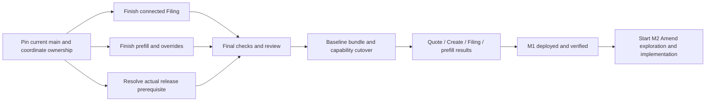

# Finish the real-email pilot with independent releases

## Goal Capsule

First delivery milestone M1: ship Quote, Create using an existing HMS guest profile, Filing, and automatic prefill/staff overrides. Owner's delivery budget is about 100–125 minutes from implementation kickoff; use 120 minutes as the operating target. This is a target, not a calibrated completion guarantee. Amend exploration, code, checks, flag changes and native probes start only after M1 is deployed and verified. Automatic New Profile creation remains deferred; Cancel is optional later.

Current owner instructions govern: minimal code, no new tests, no admin clicking, reuse working tools, parallelize independent work, expose HMS facts for staff decisions. Latest owner agrees Quote + existing-profile Create + Filing + prefill is the first milestone, independently of full Amend delivery. M2 retains date/occupancy/room/rate Amend as follow-on work; it is excluded from M1's resources and release dependencies. This plan does not replace another session's work or authorize implementation merely by existing.

The owner requested a fresh-session execution prompt: [copy-paste M1 goal](../context/PROMPT-2026-11-03-m1-ship.md). That goal authorizes the scoped work when submitted by the owner and ends at verified M1; it does not automatically execute M2.

Success means staff select a real email in Outlook, see source-bound details and read-only HMS results, edit the relevant fields, press Go, and receive a truthful native result. The shared pane serves Outlook and webmail. A merged change is not a deployed workflow; a manual handoff is not completion of that workflow.

## Product Contract

### Requirements

| ID | Staff capability required for this pilot |
|---|---|
| R1 | Selected email starts eligible analysis and read-only lookup/Quote automatically. Missing details remain editable. Switching email or editing a request invalidates the old approval. |
| R2 | Quote with existing company/agency rate tools; staff can edit stay/party details and rerun. Reuse the installed quote provider and existing reply/PDF components. Replies remain unsent. |
| R3 | Create a reservation for a selected existing HMS guest profile. If no profile exists, staff creates it in HMS and then resumes Nava using the existing-profile path. Automatic profile creation is outside this launch. |
| R4 | Sequential multi-room Create through the existing supported 1–8-room path. Display every confirmation and any partial or uncertain outcome. No blind retry of an uncertain room. |
| R5 | File the selected supported voucher/POP PDF into the selected stay's Documents. Show successful native upload and fresh Documents evidence. |
| R6 | M2, after M1 is live: Amend arrival/departure, adult/child occupancy, room type, and HMS rate plan, with native retain/reprice choices and editable staff input. Show what HMS supplies; do not build an independent pricing or payment-policy engine. R6 does not hold M1. |
| R7 | Each write binds selected source, current booking/profile, current staff request, and applicable native approval. Native Save is protected against stale/duplicate execution; fresh HMS readback determines the reported result. |
| R8 | No staff scripts, technical errors, dead controls, or automatic Nava email sends. Unsupported/ambiguous inputs explain the exact manual action and whether anything was saved. |

### In scope, deferred, and partial delivery

| In scope | Deferred from this launch |
|---|---|
| Real incoming emails; automatic read prefill; staff edits and Go | Cancel write workflow if unfinished; retain existing read/lookup information |
| Reservation Create using an existing HMS profile; supported sequential 1–8-room Create | Automatic New Profile creation; native group linking, large group/XLSX imports, billing/refunds |
| M2 after core deployment: date, occupancy, room-type and native rate-plan amendments | These Amend writes/exploration are excluded from M1; custom numeric nightly-price entry remains dropped |
| Current supported attachment parsing and PDF filing | New OCR/document-intake system or replacement quote provider |

Cancel may continue in spare capacity after Filing. Finish and enable it independently if ready; its absence does not delay other releases. This is an optional launch scope cut, not evidence that cancellation is inherently difficult or impossible.

### Acceptance examples

- An existing-guest booking email opens with extracted dates, party and stay choices. Staff correct dates, Go creates the approved rooms sequentially, and the pane lists confirmations/partial results.
- A booking for a guest with no HMS profile gets a clear manual-profile step. After staff creates the profile in HMS, Nava can use its existing-profile reservation path. Quote remains available without automatic profile creation.
- An amendment email opens with current HMS stay and requested changes. Staff choose dates/room/rate and native retain/reprice, approve the actual available proposal, and see the saved change read back.
- A voucher email shows the selected PDF and target stay. Go files those bytes to that stay; source change invalidates the approval.

## Planning Contract

### Current evidence, not claimed runtime readiness

| Area | Existing asset | Remaining delta |
|---|---|---|
| Main | `origin/main` = `dc26b38636cd37b6af90fd6cfbacdb5c7c2d545b` at this planning inspection; #988/#989/#990 merged | Final release checks, deployment and workflow enablement were absent from the audited run. No fresh production-health check performed here. |
| Quote/prefill | `nava-pane.tsx`, `use-staff-quote-autostart.ts`; Amend panel already uses `autoStartIfMissing` for a known confirmation | Verify actual source/worker/result admission. Do not rebuild automatic lookup. Unknown confirmation still requires staff identification. |
| Create | General identity/date and multi-room work on main via #989 | Release existing-profile reservation creation. New Profile Save is absent and now explicitly deferred; it is not an ETA or release dependency. |
| Filing | Clean U2 candidate `810e` at `64d1caf57`; upload/source-hash/readback tools already exist | Extract the connected Filing changes from the combined Filing/Cancel candidate. Main still has real-guest admission blockers. |
| Amend | Native adult/date staging and retained Save work in U3 candidate; latest fake extension readback preserved old nights and added one | Extension amount was unknown before that experimental Save; this is not the staff workflow. New-date/native pricing, child Save, room/rate shop and UI-to-runner integration remain incomplete. |
| Triage | Clean `08ae` candidate `b8e4e509`: separate current ask on pre-stay self-mail | Port the narrow behavior if needed; do not import the candidate's unrelated source/history expansions. |
| Release | Main's deploy script supports any clean checkout at current main; main's merge gate already removed `.ok`, hard size cap and successful-Greptile prerequisite | Use current scripts, not root's older versions. Resolve the existing canary/flag sequence concretely through the supported path; never fabricate evidence or bypass a denial. |

Source inspected: [deep retro](../research/2026-11-03-option-a-deep-retro/REPORT.md), [task ledger](../research/2026-11-03-option-a-deep-retro/TASK-LEDGER.md), [probe ledger](../research/2026-11-03-option-a-deep-retro/PROBE-LEDGER.md), current-main source and relevant candidate worktrees. The retro's eligibility recommendations belong to the historical run contract. They do not add a new automated business-decision project.

### What the room/rate investigation must establish after M1

"Native contract" means the actual HMS inputs, result and Save sequence for changing an existing reservation's room type or rate plan. Existing tools can read availability/quotes and stage form changes. Inspected room/rate paths still declare `prepareOnly` or `saveEligible:false`; a successful rate lookup does not establish a saved amendment.

The implementer needs three concrete facts: which native room/rate ID represents staff's selection; how that selection is applied to this saved reservation and what HMS returns; and which Apply/Save/retain-or-reprice sequence commits it with a readable result. Reuse current native helper code and captured output first. One focused unsaved preparation should capture any missing selection/request/result; implement that observed sequence, then use one authorized fake operation through the installed path with fresh readback. Investigation timeboxes are checkpoints, not a claim that a missing native path always takes 15 minutes.

Native HMS supplies the pricing facts and choices. Nava passes the staff-approved selection through its existing protected operation. Keep investigation focused on the missing selection/commit behavior; each attempt answers a named fact rather than broadening coverage.

### Ownership and real parallelism

| Proposed owner | Owns | Can start immediately |
|---|---|---|
| Coordinator/release | Clean release checkout, shared approval/worker routers, releases, direct pane-output checks | Release current useful main; source/admission and flag checks |
| Pane/prefill worker | Existing read autostart, staff edits, selected-source output; shared patches coordinated | Verify/fix actual prefill and editor gaps, not profile creation |
| Release-support worker | Supported flag/canary bootstrap path, final-head evidence and baseline integration defects | Diagnose the actual release prerequisite; no Amend exploration before M1 |
| Filing worker | Connected Filing extraction; optional Cancel later | Trim clean U2 to Filing |

Use Luna Max for wiring/read-only code inspection per owner preference. Escalate one genuinely unresolved native HMS contract to a stronger worker; do not create another parallel swarm. Four active owners fit current capacity. These are proposed implementation owners, not instructions to redirect the separate executing chat.

Protect existing work: root is dirty and behind main; `22ad` integration has 42 dirty paths, `ee01` U3 has 73. Those are live source candidates, not disposable branches. Coordinate transfer with their owner before editing them; otherwise read and port agreed patches into isolated current-main descendants. Clean `810e`/`aceb`/`d4c4` are not all at current main either.

Workers may edit agreed files in their own isolated current-main descendants, including shared-router patches. One coordinator owns the integration/release head, resolves overlap and reads each product diff. Never let concurrent workers edit the same shared checkout. Native read/unsaved sessions may overlap; writes to the same fake guest/confirmation serialize. During M1 all four roles support the baseline. Once M1 is verified, one worker can own native Amend and a separate read/unsaved explorer may assist; neither starts before that milestone. Preserve the separate active chat's work and coordinate ownership before any transfer; do not interrupt its processes by inference.

### Critical path and M1 timing

Owner's accepted first milestone is Quote + existing-profile Create + Filing + prefill/staff overrides. Use **120 minutes as the operating target within the requested 100–125-minute delivery budget**. This is an owner-scoped target, not a measured whole-milestone completion forecast or guarantee.

No U5 research, native staging, code, review, test runner, flag widening or integration may consume M1's queue. Amend is retained as the next milestone rather than deleted. The former Amend worker supports release prerequisites until M1 is complete. Cancel and New Profile creation also have no M1 work.

### Timing evidence now available

| Completed comparable | Observed time | Scope / limitation |
|---|---:|---|
| Earlier Create candidate `e01802c`: remote Mail/server-pilot checks | 81s + 115s = 196s | Two successful logged command walls; not evidence on current release head or future queue time |
| Earlier Filing candidate `d4273c7`: remote Mail/server-pilot checks | 87s + 49s = 136s | Two successful logged command walls; not evidence on current release head or future queue time |
| Same-day approved bundle deploy, `3395731` | 367s across 12 recorded steps; `ops-deploy ok` and readiness READY | One completed comparable; step sum does not capture every possible caller overhead or predict defects/queue waits |
| Audited U2 first implementation | About 29 min | Filing/Cancel coding mixed; not a completed staff delivery |

Sources: `/tmp/nava-u3-982-final-typecheck-mail-e01802c.log`, matching server log; `/tmp/nava-u6-typecheck-mail-d4273c7.log`, matching server-pilot log; `/tmp/nava-u9-interim-3395731-deploy.log:118-155`; [retro unit chronology](../research/2026-11-03-option-a-deep-retro/REPORT.md). Four successful typecheck commands, two candidate pairs, one completed deploy. No full comparable M1 was recovered, so no calibrated percentile or whole-delivery ETA is claimed.

Routine typechecks and bundle deployment appear small enough to fit the owner's budget. Integration/review rework and the unexercised flag/canary bootstrap path remain the main uncertainty. Native Amend uncertainty no longer affects M1.

### Baseline operating schedule

These are budget/checkpoint windows, not predictions that every task necessarily completes within the window. Short tasks move forward immediately. Existing checks/review begin on final applicable heads as soon as ready; do not spend time checking intermediate source merely to generate gate records.

| Target window | Coordinator/release | Filing worker | Pane/prefill worker | Release-support worker |
|---|---|---|---|---|
| T+0–15 | U1.1: ownership/current-main setup; inspect existing Create evidence | U3.1: extract connected Filing delta | U2.1: identify actual prefill/editor gap | U1.4: establish supported flag/canary/bootstrap path |
| T+15–45 | U1.2: prepare final checks/review/deploy; coordinate exact source | U3.2/U3.3: complete target-bound upload and result | U2.2/U2.3: current-ask/override/read-result wiring | U1-B only if needed: focused prerequisite correction; preserve truthful evidence |
| T+45–65 | Final product diffs, exact-head integration/merge; baseline freeze | U3.4: final-head checks/review | U2.4/U2.5: candidate output, final-head checks/review | Applicable check evidence, actual defect repairs, effective-environment preparation |
| T+65–90 | U1.3/shared U6.2: primary baseline bundle; supported cutover | Prepare exact upload/readback operation | Prepare selected-email auto-read/edit output | Verify durable/effective capabilities through existing supported path |
| T+90–105 | U1.5: installed Create and fresh native readback | U1.6: read-only Quote verification, separate verified session if route allows | U6-P.5: deployed prefill/source-switch/edit result | Resolve only concrete baseline verification failures |
| T+105–120 | Confirm exact deployed capabilities and staff-visible results | U6-F.4: installed Filing and fresh Documents result | Read/output support | Resolve only concrete baseline verification failures |
| T+120–125 | Report M1 complete or exact partial delivery/blocker | No scope widening | No scope widening | No scope widening |

Create and Filing fake writes are deliberately sequential for the same Labtest guest. Quote/prefill reads may overlap through verified sessions when existing routes permit. One baseline bundle is preferred when completed Filing/prefill slices are both ready; U1.3 and U6-F/P.2 refer to that same deployment and must not be counted or run twice. Earlier independently ready workflow releases remain allowed, but must not consume M1's launch budget unnecessarily.

### Deadline control and actual staff outcome

- T+15: name any source-ownership or flag/bootstrap blocker. Resolve baseline blockers before unrelated work. An unresolved prerequisite is a risk to the target, not a reason to start native Amend probes.
- T+45: show connected Filing/prefill candidates or exact remaining code defect. Keep required final-head checks/review active; do not launch new test writing or coverage campaigns.
- T+65: report actual shipping-head/check/review readiness. If external waits or a valid defect threaten the target, update that forecast explicitly.
- M1 proof includes selected real-email prefill and editable native Quote output; existing-profile Create with supported sequential rooms and truthful partial results; selected supported PDF filed to the exact stay with fresh Documents evidence. Replies remain unsent. New profiles have the explicit staff-in-HMS step.
- T+125: M1 is complete only if all four promised capabilities are deployed and verified. If a real blocker remains, ship independently ready capabilities through the supported path and report partial delivery; do not silently drop Filing or claim the target was achieved. No bypass, fabricated pass or blind retry to satisfy the clock.

### M2 starts after M1 is live

Amend exploration uses a fresh phase clock A+0. Pin the native source in A+0–10; room/rate read/unsaved inspection can run in A+10–25 alongside native date evidence, with the owner scope decision at A+25. Date-shift/new-night inspection remains separate. Subsequent U5 code, checks and native proof follow the existing dependencies. Full M2 completion ETA is unknown; this does not change M1's definition or release queue.

### Cuts and preserved requirements

| Cut or stop treating as authority | Why |
|---|---|
| Root PRODUCT's fixed deploy-worktree rule and old plan pointers | Current main already supports clean-main deployment and has newer work. |
| New tests, golden-set projects, broad replay, repeated equivalent checks | Owner requests fastest product work. Run existing applicable required checks once per relevant final source state. |
| Admin login/navigation, overlay repair, selector hunting | Use actual pane/route output and native receipts. No admin browsing for proof. |
| New `.ok` files, successful-Greptile-status waits, hard 500-line ceremony and duplicate full checks per PR | Main's script already removed the machine gates. Owner now explicitly aligned root AGENTS with one integrated final-release check and completed independent review fallback. |
| Copying numbered probe scripts or constructing synthetic varying-rate fixtures | One existing parameterized tool, one missing fact, one bounded attempt; no coverage campaign before useful release. |
| Custom tax/payment/rate-policy oracle | HMS supplies facts; staff supplies decisions. Do not build Nava accounting to launch reservations. |
| New PDF loader, generator or downloaded-byte proof framework | Existing source hash, target binding, upload and Documents evidence serve Filing. |
| Withholding all workflows until slowest one completes | Creates the audited failure's release coupling again. |

Keep exact guest/stay/source matching, staff approval, duplicate protection, fresh readback, truthful partial/unknown results, protected Save, current-main deploy and effective-worker configuration. These prevent wrong writes or a workflow that appears enabled but cannot run. Remove stale rules in a focused doc update after coordinating ownership; do not erase PRODUCT wholesale or overwrite root's unrelated edits.

## Implementation Units

Every unit below uses existing seams. Product line ranges are rough planning allowances from the inspected candidate sizes, **not measured final diffs or time estimates**. No new test/fixture lines planned. Measure actual diffs before review; do not split connected behavior into dormant helper PRs to satisfy a removed hard cap.

### U1. Prepare and release the baseline

- **Owner:** Coordinator/release.
- **Goal / Requirements:** Deliver M1 Quote and existing-profile Create alongside completed Filing/prefill; R1–R5, R7–R8.
- **Dependencies:** U2/U3 completed slices for full M1. U5 is excluded. An earlier ready-workflow release remains permitted, but does not complete M1 or justify delaying the baseline. Ownership and current executing-session deployment authority apply.
- **Files:** `deploy/ops-deploy.sh`, `deploy/write-ec2-remote-env.sh`, current effective env and existing release tools; paths relative to `apps/server-pilot`. Shared admissions owned by coordinator.
- **Approach / Patterns to follow:** Existing bundle-sync deploy and supported environment writer. No new wrapper. Allowance: 0–120 product/config lines if a concrete release defect appears; zero new test lines.

| Task | Focus cap | Concrete output |
|---|---:|---|
| U1.1 | 10 min | Pin a clean checkout to fetched current main; record included merged workflows and source owners. Read current-main policy/scripts. |
| U1.2 | 10 min | Confirm existing merged Create evidence and prepare exact affected-check/review commands. Launch checks on final applicable candidate heads, avoiding a gratuitous intermediate-main check that must be repeated. Report external queues separately. |
| U1.3 | 15 min | Execute the primary baseline bundle deploy once completed slices/checks permit; capture shipping/runtime SHA and health. Reuse this for U6-F/P.2 when they ship together; do not duplicate the same deployment. Checkpoint cap is not a process timeout. |
| U1.4 | 10 min | Release-support worker in the first 15 minutes: inspect the supported flag/canary/bootstrap sequence and durable/effective process settings. Identify a concrete prerequisite defect early for a narrowly reviewed fix; no invented evidence or replacement wrapper. |
| U1.5 | 15 min | Use exact selected-email pane/route output plus one approved fake Create on deployed code; verify edited request, confirmations and readback. Enable only proven workflow capabilities through supported writer. |
| U1.6 | 10 min | Verify deployed Quote separately: selected real-email source → automatic queued read → native rates/result → editable pane output. Create evidence alone does not establish Quote. |

- **Test scenarios:** Existing relevant checks only; wrong source/target, uncertain Save and actual worker admission matter. No new test suite.
- **Verification:** Deployed SHA + healthy services + effective env + exact-source output + real installed route/native fake readback. A code-only deploy is useful progress, not proof the workflow is on.

#### U1-B. Resolve a concrete baseline release prerequisite if found

- **Owner:** Release-support worker; coordinator integrates any source change.
- **Dependencies:** An actual defect identified by U1.4; conditional, not a mandatory new framework.
- **Files / Approach:** Existing deploy/environment/canary code only. U1-B.1: identify exact failing condition and smallest supported correction (10-minute checkpoint). U1-B.2: implement that focused correction and prepare final diff/evidence (15-minute checkpoint). If still unresolved, report the specific baseline blocker and revised target instead of borrowing time for Amend.
- **Test expectation / Verification:** Zero new tests. Preserve legitimate guest/write safeguards and truthful evidence. Applicable existing checks/review apply to the changed source; neither a fabricated receipt nor bypassed denial qualifies.

### U2. Finish prefill and editable staff input through existing components

- **Owner:** Pane/prefill worker in an isolated branch; coordinator owns final integration.
- **Goal / Requirements:** R1–R2, R7–R8. Opening email performs reads; Go performs writes.
- **Dependencies:** Current source-binding contract on main. Does not wait for U3–U5 native discovery.
- **Files:** `apps/mail/components/nava-pane/nava-pane.tsx`, `use-staff-quote-autostart.ts`, `components/quote-workflow/amend-lookup-panel.tsx`, relevant `src/ai/live-admission.ts`, `mail-triage.ts`, `existing-stay-information.ts`, `work-items.ts` in server-pilot.
- **Approach / Patterns to follow:** Reuse automatic known-confirmation find and current Quote queue. Port only the missing current-ask behavior from clean `08ae`. Allowance: 0–180 product lines; zero new test lines.

| Task | Focus cap | Concrete output |
|---|---:|---|
| U2.1 | 10 min | Compare exact selected-email route output with pane inputs: analysis, requested change, confirmation, dates, room/rate/party and running/ready states. Identify concrete missing fields only. |
| U2.2 | 15 min | Fix the single admission/current-ask defect if present. Preserve pre-stay existing-booking meaning; retain distinct current staff-actionable ask. |
| U2.3 | 15 min | Wire missing staff override or auto-read result into current editor/queue, with changed-request invalidation. No new panel or second source loader. |
| U2.4 | 10 min | Inspect candidate pane/source output for source switch and edited request; check automatic read admission and stale-result binding. This candidate check is not a deployed pass. |
| U2.5 | 10 min | Launch applicable final-head checks/review and submit the completed prefill slice to U6-P; deployed selected-source proof happens in U6-P.5. |

- **Test expectation:** No new tests, owner instruction. Existing targeted source/admission checks only if affected.
- **Verification:** Output from the deployed selected source and current shared render path; runtime writes remain separate. State any Outlook host interaction not exercised by this output check.

### U3. Ship connected real-guest Filing

- **Owner:** Filing worker in an isolated branch; coordinator owns final integration.
- **Goal / Requirements:** R5, R7–R8.
- **Dependencies:** Current main and agreed source-bound approval contract. Independent of Amend/Cancel; automatic New Profile creation is deferred.
- **Files:** `apps/mail/components/nava-pane/blocks/booking-voucher-card.tsx`, `lib/quote-workflow/voucher-filing-client.ts`; server `src/ai/hms-approval.ts`, `pane-hms-write.ts`, attach worker/admission/recovery; `tooling/hms-cloud/pane-attach-session.mjs`, `labtest-record.mjs`.
- **Approach / Patterns to follow:** Extract Filing from clean `810e`; exclude Cancel and unrelated Amend code. Existing source hash and native Documents evidence stay. Allowance: 120–350 product lines from the inspected attach/shared-router delta; zero new test lines.

| Task | Focus cap | Concrete output |
|---|---:|---|
| U3.1 | 10 min | Produce a Filing-only diff against current main and identify shared-router overlap for integration. |
| U3.2 | 15 min | Complete real-target admission and propagation through approval → worker → native upload; keep filename/type/source hash/selected stay bound. |
| U3.3 | 10 min | Check resulting upload/recovery output reports fresh Documents evidence and uncertainty accurately; final connected diff ready for review. |
| U3.4 | 10 min | Launch affected final-head checks/review; submit the connected Filing slice to the explicit U6-F release pipeline. External runner/review waits remain separate. |

- **Test expectation:** No new tests; reuse relevant attach/source checks once on final applicable state.
- **Verification:** Exact source/attachment/target; staff-approved upload; native result + fresh Documents entry. No PDF byte-redownload project.

### U4. Deferred: automatic New Profile creation

Owner explicitly removed this from the current launch. U4 has no active tasks, research, implementation, checks or release dependency. Preserve its unit ID for history. Staff may create a missing profile in HMS and resume Nava's existing-profile reservation path. This manual profile step is an explicit scope boundary, not a claim that automatic profile creation is finished.

### U5. M2 only: finish native date/occupancy and room/rate Amend

- **Owner:** One canonical Amend worker; coordinator applies shared UI/approval patches.
- **Goal / Requirements:** R6–R8. Finish the real native Save path, not merely selectors or read-only staging.
- **Dependencies:** M1 already deployed and verified, plus agreed U3 candidate ownership and existing source-binding on main. All U5 tasks/checks/probes are excluded from M1's budget. Dates and room/rate share the native session/DTO. Neither depends on Cancel; automatic New Profile creation is deferred.
- **Files:** `tooling/hms-cloud/pane-amend-session.mjs`, `guest-stay-amend-date-room-rate.mjs`, adult/child helpers, existing retained/native price helper; `src/ai/pane-cloud-amend.ts`, runner/price projection; `apps/mail/components/quote-workflow/amend-lookup-panel.tsx`, `saved-stay-amend-editor.tsx`, client.
- **Approach / Patterns to follow:** Reuse captured native request/Save sequence and native HMS pricing. Keep actual installed approval guards unless a focused reviewed product change replaces their semantics. Separate facts shown to staff from any proposed business eligibility classifier. No synthetic nightly arithmetic or pricing engine. Allowance: 250–650 additional/changed product lines beyond reused U3 assets, very low confidence for native shop; zero new test lines. Existing imported code is additional review surface, not counted as zero effort.

| Task | Focus cap | Concrete output |
|---|---:|---|
| U5.1 | 10 min | Pin agreed canonical U3 source; classify proven adult Save, observed date effect, unsaved children, and unconnected room/rate picker. DTO is agreed after native evidence, not assumed here. |
| U5.2 | 15 min | Read existing native output to identify target schedule/retain/reprice choice supplied by HMS. Distinguish an installed guard from a newly invented approval requirement. |
| U5.3 | 15 min | Address one missing new-date contract with one instrumented existing native read/unsaved prepare. Do not construct a synthetic varying-rate booking. Return actual source or exact unavailable fact. |
| U5.4 | 15 min | Agree the minimal request/result DTO from observed facts, then connect target/native choice to the existing approval and Save sequence. The same protected operation covers fresh state, expected dialog/request and Save. |
| U5.5 | 15 min | Finish date/adult end-to-end runner and truthful fresh readback. Preserve supported date changes; report novel-date limitations explicitly. |
| U5.6 | 15 min | After M1, at Amend-phase A+10–25: inspect one native saved-stay Room/Rate Shop selection in a separate verified read/unsaved session. Return selected IDs, native output and known/missing commit operation; no shared DTO edits or Save. |
| U5.7 | 15 min | Connect room/rate selection and retain/reprice to same native Save/readback route; catalog-only options do not count. |
| U5.8 | 15 min | Complete child-count/ages staging → Save/readback through that route, using native rules rather than invented prices. |
| U5.9 | 15 min | Pane worker after U5.4: mount current staff editors/options and exact request/result in an agreed isolated UI patch. Remove executable-looking controls for unsupported choices; these remain explicit feature gaps. |
| U5.10 | 10 min | Incorporate the agreed UI patch in the completed native slice and launch affected final-head checks/review. U6-A supplies deployed date/occupancy/room/rate proof; include representative child-age readback, not a combination matrix. |

- **Test expectation:** No new tests. Existing relevant native guard/source/result checks only; no varying-rate fixture suite.
- **Verification:** Email → current stay/request → staff edits/choice → installed route → guarded native Save → fresh result, including actual changed fields. Adult-only Save does not establish dates/room/rate support. A failed bounded native checkpoint blocks that feature case, not the other releases.

### U6. Release each ready connected slice

- **Owner:** Coordinator for final diff, merge, bundle and flags; workflow owner may collect permitted fake/read-only result in a verified session.
- **Goal / Requirements:** Turn ready Filing, prefill and Amend candidates into staff-visible deployed workflows; R1–R8 as applicable.
- **Dependencies:** Only that slice's final-head checks/review and actual current-main readiness. U6-F/P deliver M1, preferably through one shared baseline bundle when both are ready. U6-A is M2 and starts after verified M1. Reuse the same bundle/SHA/env evidence rather than performing U1.3 and U6-F/P.2 as duplicate deployments.
- **Files / Patterns:** Existing `scripts/orch/merge-gate.sh`, approved `apps/server-pilot/deploy/ops-deploy.sh`, existing environment writer and workflow result routes. No release framework/product code expected unless a concrete defect is found.
- **Approach:** U6-X.1 read diff/resolve overlap/merge (10-minute handling budget); U6-X.2 bundle deploy with exact SHA and health (15-minute checkpoint); U6-X.3 supported durable/effective-env cutover (10-minute handling budget); U6-F.4/U6-A.4 installed fake write and readback (15-minute checkpoint); U6-P.5 deployed selected-source automatic read/edit/switch output (10-minute handling budget). Each is separate and checks begin before coordinator availability. Actual runtime waits remain visible.
- **Test expectation:** Zero new tests. Reuse applicable required check evidence only when valid for the final source/head under supplied instructions.
- **Verification:** Exact deployed SHA, effective capabilities and actual installed-path result. Source-only or candidate checks do not complete U6. Preserve same-target write serialization and protected uncertain outcome.

## Verification Contract

Planning performed source/history/artifact reads only. No production calls, browser actions, test run, typecheck, deployment, flag change, guest write, commit or push performed by this plan author.

Execution writes **zero new tests**. Preserve existing hooks. Use current-main merge/deploy scripts; do not run root's stale hard-gate versions or `--no-verify`. Main's lean script does not check `.ok` records, size or successful Greptile status. Owner explicitly authorized cutting stale startup blockers; root AGENTS now uses integrated final-release checks and a completed independent review when Apex is unavailable/unfinished. Launch Apex on final PR code heads, validate available findings, fix valid P0/P1s and disposition invalid ones. Do not wait indefinitely for a successful bot status.

Applicable typechecks use `bash /home/orca/bin/remote-typecheck.sh <clean worktree> --app mail` and/or `--app server-pilot`, on final release source under the updated AGENTS. Prefer one integrated affected-app check, reusing passing evidence only when relevant source/dependencies/build configuration are unchanged and it still applies to that head. Existing focused workflow checks run once per changed relevant state. Respect runner locks/resource limits; unset `DATABASE_URL`, `VITEST_ALLOW_PILOT_RDS`, `TEST_DATABASE_URL` before tests; DB-backed suites skipped, never reported passed.

Startup cleanup completed at the owner's explicit request: PRODUCT.md owns product scope and write boundaries; AGENTS.md owns execution rules, the compact repo map and current plan/prompt links. Duplicate AGENT.md, START-HERE and current RUN-CONTRACT were removed, and CLAUDE.md imports only the two canonical files. Prior RUN-CONTRACT wording remains archived as history. These are local documentation changes, not a claim the runtime flag/canary prerequisite has been fixed.

For native gaps, first recover existing evidence. Use existing deterministic/native methods and direct pane/route output; no admin navigation. An unsaved inspection establishes staging only. One authorized fake write through the actual deployed workflow establishes that case only. Protect uncertain writes and re-read rather than retry. A checkpoint expiry never kills an in-flight Save or erases an uncertain outcome.

Record only compact release facts: shipping SHA, effective capabilities, completed workflow, exact missing fact, next bounded action. Native unknown: one named hypothesis per attempt; after two unsuccessful bounded attempts, change method or state the unresolved gap. No unattended numbered-probe loop and no new broad coverage requirement.

## Definition of Done

- **M1 done:** Quote, existing-profile Create, Filing and prefill/overrides are deployed, admitted by the effective processes and verified through actual selected-source/native results. Amend/New Profile/Cancel are not M1 requirements. Owner's 100–125-minute budget is a target; if an actual baseline blocker prevents completion, report partial delivery and the exact missing capability, never silently call M1 complete.
- Each released workflow has current main deployed, effective process admission, direct selected-source pane output, and an appropriate native fake operation/readback through the installed route.
- **M2/full plan done:** staff can perform R6's advertised date/occupancy/room/rate Amend in addition to M1. Missing profiles have the explicit manual HMS step. Any unimplemented/manual-only in-scope case is listed as a remaining gap; M1 delivery is not called the whole expanded plan finished.
- Existing-profile Create, Quote and Filing are released independently when ready. Optional Cancel never holds them or the remaining non-Cancel work.
- Staff requests control writes; wrong-source/target, duplicate/uncertain writes and partial outcomes remain protected and visible.
- No new tests, admin-clicking campaign, fixture-coverage project, bespoke pricing/accounting engine or replacement release framework.

Deferred scope: automatic New Profile creation, custom numeric rate entry, broader group imports and optional Cancel delivery. Amend is retained as M2 after baseline deployment. M1 timing uncertainty is limited to ownership/integration, required review queues, the actual flag/canary bootstrap path and verification failures; native Amend discovery no longer contributes to it.
