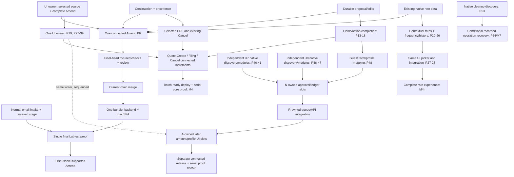

# Nava pilot: connected patches, not an eight-unit rebuild

**Final proposed execution plan, verified against the adversarial review.** Shared payload agreement S1–S12 is now settled in [design_draft.md](../../design_draft.md#shared-payload-agreement--final-design-execution-paused). Product implementation remains paused at the owner's explicit request after agreement presentation. Latest owner direction wins. One UI owner; next execution launches default to **GPT-6.1 Terra High**, with bounded Luna Max support and task-specific escalation below. One final design review, no EGM section gates. [Design/why](../../design_draft.md) · [Hosted pane/tool map](https://hermes.trynava.io/designs/nava-hms-pane-2026-11-04.html).

## Goal Capsule

Staff select an email once, get the correct HMS booking or complete supported new-booking form, edit it, approve an actual deterministic HMS action, and see its verified result. First release is **full supported Amend**, then Quote/Create/Filing/Cancel increments. The first pilot uses existing profiles and supported native rate codes. New profiles, numeric HMS nightly overrides and automatic recovery of ambiguous native holds are separate capabilities, not prerequisites.

Reuse working extraction, WorkItem events, native readers, Prepare/Go, target locks and readback. Redesign the UI freely; reuse orchestration rather than rewriting tools to suit the mock. Never call a backend-only date change complete staff parity.

## Product Contract

| IDs | Required behavior |
|---|---|
| R1–R4 | Exact selected inbound/body/pane identity; one effective supported action; every supported known form value filled; staff edits survive late reads, re-extraction and reload. Missing/ambiguous facts remain explicit. |
| R5–R8 | Typed/searchable rate code, code/meaning, native price/availability and honest freshness. Staff code wins. Frequency/party recommendation remains requested, but does not gate first Amend. Selected-room picker default; alternatives/nightly detail collapsed. |
| R9–R10 | Preserve Quote numeric override. Advertise an HMS numeric override only after native persistence/readback for that mode. |
| R11–R13 | Full supported current→proposed Amend; coherent other forms; material edits invalidate review; one Go. UNKNOWN stays held until genuinely reconciled. **Automatic renewed Go after a price-drift hold is deferred**; no false no-dispatch receipt. |
| R14–R16 | Same feature on webmail and shared Classic Outlook route; snapshot preview has explicit read-only behavior; deployed native proof; missing profiles excluded initially. Staff-PC installation/use remains separately untested. |

### Exact field coverage and interaction

| Workflow | Prominent fields → actual action |
|---|---|
| Amend | Exact booking/guest/status → requested current→editable proposed values → dates/nights, room, adults/children/ages → rate code, Keep/Reprice → guest first/last/email, booker name/contact → CMS send/message/recipient → native Review/Go/result. Agency/company/source/Track/guarantee/note read-only until native setters exist. |
| Create | Existing profile → dates → each room/type/occupancy/ages → native agency/company → rate/code/native price → source, Track, guarantee, reservation note → CMS → Go → sequential room results. Native status currently **Reserved**; no invented Tentative/provisional mode. |
| Quote | Parties/dates/rooms/occupancy/board/rate alternatives → native prices → optional Quote amount/reason → offer selection → existing PDF/Excel/unsent draft. Quote does not Save an HMS reservation. |
| Filing | Exact source/PDF → editable confirmation+arrival or surname+arrival → explicit native target → Review/Go → fresh Documents metadata. |
| Cancel | Exact booking/status → native policy/fee facts → reason/note → Go. Native fee acceptance requires its separate Go; free-cancel evidence never proves charged-cancel behavior. |

All workflows use one implementable 320–420px visual language. Required/requested/missing fields open; unchanged supported fields under More. Preserve draft undo/redo, saved recipient defaults, me/client/custom choices and document exports. Undo never reverses a saved HMS operation.

Hosted review: realistic pane on the right; examples, actual tool→field mappings and why/gaps outside it on the left; small outside Illustrative badge. No demo/compliance/process banner inside the staff UI.

## Planning Contract

### Verified adversarial findings: accept the defect, verify the proposed cure

| Finding | Verdict / final decision |
|---|---|
| F1 first-effect/price boundary | **Real hazard in the prior proposed retry design.** Current Amend claims before availability and marks possiblyDispatched there. Keep this fence; compare approved native prices before each applicable Save. Drift aborts Save, drains/closes and remains UNKNOWN. No amend extension to noDispatchSchema; no claim that browser closure releases native inventory. Later automatic renewal needs native hold-cleanup proof. |
| F2 early M2 Save | **Accepted. Delete the redundant baseline Save.** Fixture worker ingests only; existing ai-worker runs extraction. Native No/Extend mappings must be repaired/verified before the first live Save. Early checkpoint is unsaved Prepare; first Save follows the patched final release. No exported recoverAmend does not prove every hold permanently unrecoverable. |
| F3 ownership | **Some unit descriptions conflicted with the ownership table. Fixed below.** Display name pane-ui-20261104 maps to actual plan-ui-system-20261104 path. Historical RESEARCH.md is not executable authority. Tiny explicit surface props are allowed; a mandatory generic frame/framework is not. |
| F4 state/binding | **Real extension risk, not proof current state is corrupt.** Flat edit keys and nested state.stays native commits are separate. Workflow-only edits cannot invent quote stays. Preserve source helper signatures; no blind s_1 default or cross-lane signature migration. |
| F5 selection/surface | **Accepted.** Amend must not wait for Quote-only staffSource readiness. Keep actual source/content/transport/epoch guards. Cover both shared web and Outlook routes without demanding unavailable staff-PC testing. |
| F6 Create fields | **Supported fields only was already the design.** Keep Track/note contract and caps; align route/mapper. Do not invent guest title/comment writes to satisfy a broad parity label. |
| F7 U7/U8 | **New writes, already off core path.** Reviewer describes the wrong selected APIs: saved-nightly uses OSSTWZ Stay Wizard, profile New uses FSGSPF. Neither has a calibrated build ETA. |
| F8 selected PDF | **Accepted; already intended, now exact.** Bind chosen attachment through server extraction/cache/Prepare, not only a local file selector. |
| Schedule claims | **Reject calibrated/high-confidence labels.** Retro shows four enabled workflows with proof limits; late90m includes coding/fixes/deploy/proof. Neither our old188–343m scenario nor review6–9.5h is a calibrated core-pilot ETA. |

Decisive current-source anchors at pinned main: pane-amend-session.mjs:191–192,397–409,484–499; labtest-amend-dispatch.mjs:65–78; labtest-amend-save.mjs:380–386,588–615; pane-cloud-amend-runner.ts:219–222; hms-labtest-dispatch.ts:37–44; work-items.ts:508–550; nava-pane.tsx:2598–2614. [Actual overnight outcomes/timing](../research/2026-11-04-big-fat-4-hour-chat-retro.md) · [Measured candidate spans](../research/2026-11-04-nava-plan-readiness-review.md).

### One exclusive file owner; consumers do not become writers

| Lane / actual worktree | Exclusive scope |
|---|---|
| A · UI · /home/orca/orca/workspaces/zero/plan-ui-system-20261104 | **All apps/mail UI/client files**, including mail selection/bridge, nava-pane/pane-ui/approve-card, all quote-workflow components, lib/quote-workflow/use-work-item.ts, types.ts, session/binding/cloud-amend-client. Orca display: pane-ui-20261104. |
| B · /home/orca/orca/workspaces/zero/pane-prefill-20261104 | Server extraction schema/extract/inbound-run/worker; work-items.ts, work-items route, workflow-folders; pane-cloud-amend.ts source/schema; pane-create-cloud-input.ts mapper. Supplies payloads to A; never edits mail client hydration. |
| C · /home/orca/orca/workspaces/zero/pane-rates-20261104 | hms-availability/hms-jobs, rate-options/catalogue/quote-ready, staff rate history/recommendation/memory. Supplies rate data; **never edits picker components**. |
| N · /home/orca/orca/workspaces/zero/pane-native-actions-20261104 | Native Amend session/dispatch/save, Amend runner/dispatch/price projection; pane-cloud-preview.ts; voucher-find.ts; existing Cancel/native seams only if needed; hms-labtest-dispatch.ts is N-only and unchanged for first price-drift release. |
| R · current coordinator | Shared server quote-workflow.ts/hms-approval.ts API route integration; final-head checks/review, current-main merge, clean deploy, effective flags and **all Labtest Saves**. Product integration uses a clean main child, never dirty root. |
| U7 / U8 retained native worktrees | Later native modules/research only. Shared ledger edits go to N, API edits to R, UI edits to A; no shared-file ownership exception. New work defaults to Terra High. |

Prepared A/B/C/N chats were previously launched on Sol High; that describes their current launch history, not the new routing policy. On execution resume, use Terra High for workflow owners/coordinator and escalate an unresolved complex task directly to GPT-6.1 Sol XHigh. No Terra XHigh step; no Terra Max default. Sol receives a detailed evidence packet: objective/acceptance; exact repo/worktree/base/current/diff; relevant paths/functions/call chain/contracts; observed versus expected behaviour; exact errors and sanitized native evidence; every attempted fix/check with result and ruled-out hypothesis; current edits/operation/hold state; remaining unknowns; exclusive file ownership and next discriminator. Link original artifacts, include decisive excerpts, preserve ownership and write authority. Do not make Sol rediscover the previous attempts. Luna Max remains a cost-saving choice for bounded inventories/corpus extraction/mechanical patches, not an assumed latency improvement or independent authority over HMS writes. Owner can open and steer each Orca chat. R owns release/Save coordination, not access to workers.

**Every LLM prompt explicitly includes:** `Use $caveman ultra always for chat, progress, research and handoffs. Keep exact technical facts, code, evidence and blockers; cut filler. Code/commits/PR descriptions use normal language. Read /home/ubuntu/.agents/skills/caveman/SKILL.md; owner-selected ultra overrides its full/lite defaults. Carry this instruction into every child/delegated prompt.` No global skill modification. This policy update does not resume paused product execution.

Use at most three simultaneously active workers plus coordinator. Start A UI, B fields and N native fixes; C contextual-rate work takes N's slot after its first continuation/price patch. While C runs, R integrates N's completed patch. When B/C finish, their slots can run independent U7/U8 modules if those remain requested. One UI owner and one shared-file owner remain; idle conversations do not require concurrent active workers. No new contract PR or another planning round.

No K0 PR. First few minutes agree existing source/stay/room, edit-path and result shapes in Orca; start independent UI/data/native patches immediately. Shared type/route requests go to their owner. No parallel writers to the same file.

### Small data contract, no new store

- Effective field = persisted staff edit → attributed email proposal → matched native/profile baseline → explicit known default. Missing/conflicting identity requires a choice.
- Keep flat validated edit keys in WorkItem state. New nonstructural fields use requests[requestId].<allowlisted-field>; keep existing stays[SID] structural date/count/row paths and nested state.stays native outcomes. Request leaf edits never create a synthetic quote stay. Existing explicit added stays/removal tombstones remain respected. No new nested requests store or database table.
- First supported Amend uses the actual sole extraction stay or explicit selected stay. Ambiguity blocks; never invent s_1. Keep current source hash, revision, target and consumed-form guards. Broader per-stay completion and mixed-action routing follow without weakening these guards.
- Exact supported changes: arrival/departure, roomType/ratePlan, adults/children/childAges, retainRates yes/no, firstName/lastName/guestEmail/bookerName/bookerContact, cmsSend/messageId/recipient. false is a real edit. Field/object validators are bounded and path-specific, not arbitrary JSON.
- Source/target/price-affecting edits invalidate preparation/price/approval; late responses must match current source, revision, target, room/context/request. Keep prior operation result separate from a new draft.

The exact agreement is design_draft.md S1–S12: additive draftContractVersion/source/draftStays/workflowRequests/meta/unappliedEdits; source-ask request IDs stable across action correction; recordEvent source+expectedSeq validation; start/read rateCandidates DTO separate from legacy priced RateOption; typed action/operation results and invalidation. Implement those settled shapes rather than inventing a separate shared-package or universal executor. Native feasibility stays conditional at its named diagnostic; blocked replies are defined.

## Implementation Units

**Changed-line bands below are sizing hypotheses, not time estimates.** No deps/migrations/frameworks planned. Each patch is small enough to inspect and prove; tests extend existing suites only when meaningful. A patch may merge with adjacent patches into the one connected workflow PR.

### First connected Amend: bite-size patches

| Patch / unit / owner | Exact code change and primary files | Size / soft budget | Done signal |
|---|---|---|---|
| P01 · U1a · A | mail-list.tsx normal handleMailClick near1079–1108 retains clicked DB message ID; thread-display/mail.tsx/web-pane-bridge propagate the same selected inbound. Do not fix draft handler783. | 10–35 lines;5–10m | Row/body/bridge/pane agree; ambiguity gets real selection; stale navigation still rejected |
| P02 · U1b · A | nava-pane.tsx Amend selectionCurrent uses ready canonical selected source and existing session binding/epochs, without requiring Quote-only staffSource. WebPanePanel staff/snapshot semantics explicit if needed. | 15–40 lines;5–10m | Valid Amend can open once; source mismatch remains blocked on web and Outlook routes |
| P03 · U2b · B | work-items.ts + work-items route: extend strict Amend field edits, booleans and CMS payloads; no arbitrary JSON. Dates/occupancy paths already work. | 40–90 lines;5–10m | Rate/contact/CMS/Keep-Reprice edits persist; false accepted; invalid code/identity refused |
| P04 · U2b · B | parseFieldPath/aiValueAt/formStays project workflow fields on known stays without synthesizing quote rows or touching native state.stays commits. | 15–40 lines;5–10m | Workflow-only orphan keys add no stay; explicit added rows still work; tombstones win |
| P05 · U2a · B | Existing extraction schema/prompt/projection exposes explicit rate and guest/booker/CMS requests with attribution; reuse known dates/occupancy. Use supported effective action; broad classifier/folder rewrite not required for a valid first Amend. | 30–70 lines;5–10m | Email proposal complete where known; booker contact never guessed as guest; unresolved action/target visible |
| P06 · U2c · A | use-work-item.ts + Amend choices/editor hydrate effective fields and persist edits through existing WorkItem events. Replace local-only LocalAmendChoices; source switch clears old review. | 35–80 lines;5–10m | Reload and late native read preserve staff edits and current source |
| P07 · U3d · A; C data | Shared rate controls/RatePlanSelect: typed code + code/meaning, selected native price/status, collapsed detail. Reuse current options and native Prepare; no new rate service first. C supplies native labels/aggregate ordering where already available. | 40–90 lines;5–15m | Typed/clicked code reaches actual native changes.ratePlan; unchecked never shown unavailable/valid |
| P08 · U4a–b · A | AmendLookupPanel/SavedStayAmendEditor around exact target then current→requested; all supported fields accessible; CMS saved default and undo/redo retained; existing Review/Go/result wiring reused. | 60–140 lines;10–20m | Full supported form, not a date-only proof; each submitted value appears in Review |
| P09 · U4c · N | pane-amend-session.mjs matchesCloudPaneAmendSave: current No token not_needed vs Yes confirmed; correct confirmextendoverriderate. Verify current controller before live Save. | 2–8 lines;3–5m | Captured/native No/Yes/Extend requests accepted for correct business fields; wrong target/token rejected |
| P10 · U4d · N | Native beforeSave and continuation dispatch gates compare latest observed Reprice currency/total/average to approved native observation; missing/drift aborts before Save. Retain binds rate instruction/current basis, not an invented extension total. | 20–60 lines;5–15m | Drift/late callbacks dispatch zero reservation Saves; unchanged valid price continues |
| P11 · U4d/U6c · N+A | Keep first-effect claim before availability. Preserve UNKNOWN/spent grant after an effect; client disables retry and retains submitted target/result. No ledger negative-release extension or generic reconciliation rewrite. | 5–25 lines;3–5m | No false not_dispatched; no second Go on an unresolved operation; normal readback remains fresh |
| P12 · U1c/U6c · R | Existing fixture ingest → existing ai-worker extraction → workItems open/projection. One real-source unsaved backend Prepare; after final patched deploy one Labtest Save/fresh readback. No new harness/endpoint. | No product framework;10–20m prep overlaps code | Admission/message/extraction/workItem/source IDs linked; one native proof receipt, no baseline replay |

Patch budgets overlap; do not sum all rows into elapsed time. P03–05 execute while A does P01/P02 and N does P09/P10. P06/P07 consume B/C payloads; A can build P08 visual layout independently. R prepares source/targets/review while writers code. Native fixes and focused boundary checks must precede the first Save.

### Full remaining patch map: P13–P58

P01–P12 above cover first Amend. **The entire plan is P01–P58**, including requested rates/history, the other four workflows, both new native capabilities and delivery. Patch IDs are inspectable work chunks, **not58 PRs, reviews or approval gates**. Combine them into connected workflow increments. Future native patches remain conditional on their named contract discoveries; the core implementation-readiness metadata does not declare those contracts proven.

Paths below expand from repository root: **S**=`apps/server-pilot/src/ai/`; **API**=`apps/server-pilot/src/trpc/routes/`; **T**=`apps/server-pilot/tooling/hms-cloud/`; **Q**=`apps/mail/components/quote-workflow/`; **L**=`apps/mail/lib/quote-workflow/`; **M**=`apps/mail/components/nava-pane/`. `+` means a proposed new file, not an existing seam. Product/test bands estimate changed lines, not coding speed or mandatory test volume. Test bands are meaningful extensions where needed; reuse existing checks otherwise.

#### U2 remaining: complete fields, one effective action, durable handling

Single solution: a pure effective-work projection over existing source/extraction, flat staff edits and native outcomes. No new database/store or classifier rewrite. One effective primary action per selected stay; an explicit secondary Filing request remains a separate pending request.

| Patch / exclusive owner | Exact change and files; why | Depends on → observable done signal | Product/test lines |
|---|---|---|---|
| P13 · B | S extraction/schema.ts + extract.ts: remaining supported Create, Cancel and Filing facts with guest/booker/party attribution. Preserve stable stay/room IDs. Native IDs are lookup choices, not generated facts. | P05 → known supported facts present; missing facts remain missing | 50–100 /0–20 |
| P14 · B | S work-items.ts, work-item-revision.ts + API work-items.ts: validated edits for profile/party/business/room/CMS, Quote offer/amount/reason, Cancel reason/note, Filing file/target and action corrections. | P03/P04 → reload/undo preserves edits; false works; no phantom stays | 80–140 /0–30 |
| P15 · B | +S effective-work.ts; S work-items.ts: staff correction → applicable owner correction → extraction stay action → source action only for a unique target; legacy classifier is fallback. Project draftStays/workflowRequests separately from native stays. Request identity uses immutable source+stay+ask slot; action correction changes proposalDigest, not request ID. Selected attachment/target remain approval-bound. | P13/P14 → pane payload has one resolved primary action and explicit pending secondary requests; ambiguity stays visible | 70–130 /0–25 |
| P16 · B | apps/server-pilot/src/mail/workflow-folders.ts: operational JS/SQL use the same precedence and current-source edits before pagination/counting. Sole pending action uses its folder; differing pending actions use existing other-to-do with labels. Preserve automated-message exclusions. | P15 → folder, count and pane agree; no filtering after LIMIT | 40–90 /0–25 |
| P17 · B | S reservationist-task-completion.ts + work-items.ts: extend existing source-scoped completion with request/stay and approved-proposal digest. Only verified result or explicit dismissal satisfies its request; changed later asks reopen. | P15 → one completion leaves other stays/Filing requests pending; UNKNOWN never marks done | 60–110 /0–25 |
| P18 · B / N / R, split files | B owns S pane-cloud-amend.ts source guards and pane-create-source-loader.ts/pane-filing-source.ts. N owns runner/dispatch/preview/cancel consumers. R owns API quote-workflow.ts/hms-approval.ts contract. Carry selected request through existing bindings; preserve single active approval. | P15/P17, selected-PDF contract → terminal result satisfies exactly its source/request; old reviews cannot target another stay | 80–145 /0–30 |
| P19 · A | L types.ts/backend-bind.ts/use-work-item.ts/session.ts/pane-stay-bind.ts: consume effective draft, pending requests and native outcomes; persist every supported choice through WorkItem events. | P14/P15 payload; final wiring P18 → reload/late reads/source switch preserve correct edits; remaining asks accessible | 70–130 /0–25 |

#### U3 complete: contextual rate dropdown, frequency and agency recommendation

Single solution: extend existing queued availability reads, one thin rateCandidates route and one controlled picker. No new rate service or browser per keystroke. Existing public/all-room availability is insufficient evidence for a bound company's negotiated rate. First P07 validates the selected code; **P20–P28 supply the broader requested dropdown**.

| Patch / exclusive owner | Exact change and files; why | Depends on → observable done signal | Product/test lines |
|---|---|---|---|
| P20 · C | S hms-availability.ts/hms-jobs.ts: exact room, dates, occupancy/ages, board/currency, explicit typed code and verified agency/company references; property derives from transport. Context key and observation coverage in result. | Existing jobs → contextual request cannot silently become public/all-room | 40–75 /0–25 |
| P21 · C | S hms-cloud-availability-reader.ts: current roomTypes:all/empty partyContext becomes requested selected-room/verified-party context. Reuse native batch reader and guarded separate session; verify applied native IDs/coverage. One batch/context, one explicit typed-code check. If native adapter cannot apply context, return named unsupported context instead of public prices. | P20 → every advertised contextual price has matching native party/room/date evidence | 45–85 /0–30 |
| P22 · C | S rate-options.ts/hms-availability.ts: keep native code/meaning, board, dated amounts, currency, inventory, restrictions/reasons and coverage. DTO distinguishes available/unavailable/restricted/unchecked/failed; prices nullable. Missing row is not unavailable. | P21 → unpriced/restricted codes remain visible honestly; arithmetic average is labelled separately from native total | 40–80 /0–25 |
| P23 · N | T saved-stay-nightly-rates.mjs + S cloud-amend-price-projection.ts: align labels/daily observations with rate DTO, retaining native Prepare total and Keep/Reprice semantics. | P22 DTO/P10 → shared picker does not replace final Save-price approval | 20–45 /0–15 |
| P24 · R | API quote-workflow.ts rateCandidates: current source/stay/room guard, existing enqueue/status machinery, same-context dedup/cache. Five-minute display TTL; Refresh or Enter performs explicit read, no automatic retries/per-keystroke browser. Material edits invalidate; Prepare is still final authority. | P20–22 → stale or other-context prices rejected; one in-flight request/context | 35–65 /0–25 |
| P25 · C | +S pane-rate-recommendation.ts; T hms-booking-memory.mjs/hms-booking-memory-query.mjs: digest-cached private aggregates of distinct confirmations, separate full-source/E-Mail cohorts. Add runtime-readability transfer using existing bootstrap (R-owned deployment). | Existing snapshot → frequency uses892 distinct reads, not894 attempts or UI toggles; missing memory never blocks native picker | 60–100 /0–25 |
| P26 · C | S pane-rate-recommendation.ts/staff-rate-pick-history.ts/staff-quote-run.ts/quote-outcomes.ts: explicit staff/email code wins; otherwise verified bound-party history then E-Mail frequency/full-source fallback. Record actual prepared choice once. History recommends; native context validates entitlement. | P25 + native candidates/party identity → explain recommendation; unchanged Amend rate never switches automatically | 55–95 /0–25 |
| P27 · A | +L pane-rate-client.ts; L types.ts; Q stay-rate-choice.tsx/rate-plan-select.tsx: code left/meaning right, typed search, observation price/status and recommendation separate from selection. Request generation/context prevents late overwrite. | P22/P24; P26 enriches → Enter checks once; staff selection wins; unchecked code is visibly unchecked | 70–120 /0–30 |
| P28 · A | Q quote-workflow-panel.tsx/booking-card.tsx/amend-lookup-panel.tsx/rate-controls.tsx/stay-rate-grid.tsx: use same picker across all three forms, selected-room summary default, comparison/nightly detail collapsed. | P27 + durable forms → preserve alternatives, offers/exports, varying nightly rates and Quote-only amount override | 65–110 /0–25 |

Frequency basis: full892 distinct confirmation reads over20 codes; E-Mail492. Full leading counts NGOVDB279/BOTAB149/NCOR1B131/BAR91/NGOVB77/NCOR2B63. E-Mail order NGOVDB204/NCOR1B95/NGOVB63/NCOR2B52/BAR45; top five93.3%, not one code90%. Default reservation-email prior is the E-Mail cohort, full cohort remains fallback. GNC3B/GNC4B already exist in src/hms/rate-catalogue.ts; include actual native meanings/status, never invent eligibility. Existing extraction may propose a code; no new Mastra/LLM agent is needed solely to sort these candidates.

Keep a collapsed comparison view: room/board alternatives and differing nightly amounts cannot all be represented by one average dropdown row. Do not delete the comparison capability until those dimensions are still accessible.

#### U5 complete: Quote and Create

| Patch / exclusive owner | Exact change and files; why | Depends on → observable done signal | Product/test lines |
|---|---|---|---|
| P29 · A · Quote | Q quote-people-step.tsx/quote-stay-step.tsx/quote-workflow-panel.tsx/stay-rate-grid.tsx + L session.ts: freely redesign party→stay/room→rate/offer hierarchy. Preserve multiple room/board/rate choices and independent offer inclusion. | P19; first P07, richer P28 later → known fields editable; alternatives survive draft edits | 60–120 /0–25 |
| P30 · A · Quote output | Q rate-controls.tsx/quote-documents-step.tsx/document-review.tsx + M nava-pane.tsx/use-quote-pdf-job.ts: saved/custom/approved Quote amount and reason, PDF/Excel/unsent draft; invalidate obsolete outputs. | P29 → all outputs contain identical selected offers; Quote override never advertised as saved HMS rate | 35–75 /0–25 |
| P31 · B / N / R · Create mapping | B: S aop/create-prefill.ts/booking-draft.ts/pane-create-cloud-input.ts. N: S pane-cloud-preview.ts. R: API quote-workflow.ts. Align Track/note caps/defaults, existing native profile/party selection, all supported per-room inputs, native price and CMS/result payload. | P13/P14/P18 → reviewed effective input equals native mapper; no silently discarded supported value | 70–130 /0–30 |
| P32 · A · Create form | Q booking-card.tsx/quote-booking-host.tsx + L pane-stay-bind.ts/session.ts/use-work-item.ts: complete profile/name/dates/room/occupancy/ages/party/rate/source/Track/guarantee/note/booker/CMS form. Required fields open; rest under More. Market Segment/title/comments read-only where wrapper lacks setters. | P19/P31; P07 thenP28 → full supported editable form and native Review; late reads preserve edits | 90–170 /0–30 |
| P33 · A · CMS/rooms | Q booking-card.tsx/confirmation-recipient.tsx/batch-booking-review.tsx + L pane-batch-booking.ts: saved/default/custom recipient, editable CMS/history, existing sequential room execution and per-room receipts. | P32/P17 → one Go per approved operation; verified partial success preserved, uncertainty stops continuation | 35–80 /0–20 |

Current native Create status is Reserved. Tentative/provisional mode is not proven; do not promise it. Quote creates offers/documents; Create Saves HMS reservations and can use its CMS confirmation. Missing profile is an initial limitation until U8; unsupported title/guest comments are tool gaps, not fake editable controls.

#### U6 complete: Filing and Cancel

| Patch / exclusive owner | Exact change and files; why | Depends on → observable done signal | Product/test lines |
|---|---|---|---|
| P34 · N · PDF discovery | S voucher-find.ts/voucher-filing-file.ts/voucher-filing-bytes.ts: eligible PDF list; selected attachment belongs to exact source; selected bytes alone supply facts. Reuse SHA/extractor-version cache and byte revalidation. | Existing source authority → another PDF cannot supply selected target/guest facts | 40–90 /0–25 |
| P35 · R · Filing API | API quote-workflow.ts/hms-approval.ts: selected attachmentId through voucherFind, exact lookup and existing bindAttach/file digest/target. | P34/P18 → stale/foreign PDF rejected; discovery and approved bytes are identical | 20–45 /0–20 |
| P36 · A · Filing | Q voucher-find-card.tsx + M blocks/booking-voucher-card.tsx + L voucher-find.ts/voucher-filing-client.ts: file→editable confirmation/arrival or surname/arrival→explicit target→Review/Go/result. Changes clear dependent Review. | P14/P19/P35 → fresh Documents metadata tied to chosen PDF; remaining primary/secondary ask visible | 50–100 /0–25 |
| P37 · A · Cancel | Q amend-lookup-panel.tsx/approve-card.tsx + L amend-cancel.ts/cancel-write-state.ts: exact stay/status/policy/reason/note, native fee challenge with separate Go, recorded outcome. | P14/P19 + existing cancel API → no blanket free-cancel assumption; held operation cannot repeat | 45–90 /0–25 |
| P38 · N / R · Cancel boundary | N owns S pane-cloud-cancel.ts and existing native cancel tools; R owns API hms-approval.ts. Preserve challenge/state/result semantics and selected-request completion. Fix only a reproduced existing seam; no controller rebuild. | P18/P37 → fresh native status verifies result; charged-cancel capability advertised only with its own proof | 0–50 /0–20 |

#### Shared finish: coherent pane and honest outcomes

| Patch / exclusive owner | Exact change and files; why | Depends on → observable done signal | Product/test lines |
|---|---|---|---|
| P39 · A / N / R, split files | A: M nava-pane.tsx/pane-ui.tsx + L hms-write.ts/Q approve-card.tsx. N: native preview/Filing receipt projection. R: result route. Common header, supported field hierarchy, main action and typed result from recorded native receipt; preserve draft undo/redo and saved recipient across all forms. No generic form framework. | P08/P19/P29–38 → no dead controls/hidden required decision; success is readback; UNKNOWN retains submitted target/spent Go | 60–120 /0–20 |

#### U7 complete: real saved nightly amount override

U7 changes saved stay charges through OSSTWZ Stay Wizard, not OSRESV.RATE.SaveChanges. Single solution: separate exact saved-booking action with inclusive service-night range, one instructed amount/currency/native reason, explicit Go and dated readback. Different nightly amounts require separately reviewed ranges; do not invent an atomic bulk editor. No numeric Create-before-Save setter is assumed.

| Patch / exclusive owner | Exact change and files; why | Depends on → observable done signal | Product/test lines |
|---|---|---|---|
| P40 · native U7 worker, read-only | Existing T saved-stay-nightly-rates.mjs and retained U7 captures: one clean unsaved Wizard stage, lifetime block OSSTWZ.UpdateStayWizard, inspect OVER/range/reason/currency/authorization/native preview. | Known saved target; separate browser → observed contract or named missing seam; no Submit | 0/0 |
| P41 · native U7 worker | +T saved-stay-rate-override.mjs; reuse nightly reader. Prepare/restage Commit for exact saved stay and reviewed range/amount/reason; intercept actual UpdateStayWizard. Stale pre-Submit grid never becomes proposed authoritative total. | P40 → setter/readback contract executable; unexpected prompts or target drift stop | 100–170 /0–35 |
| P42 · N / R · approval/dispatch | N: +S pane-rate-override.ts and S hms-labtest-dispatch.ts; R: S hms-approval.ts. Distinct rate_override approval, existing saved-target aliases/lock, first effect/one Submit, drain and fresh every-night read. U7 worker does not edit ledger. | P41 → reviewed amount/range reaches one exact write; missing/uncertain result held | 100–170 /0–35 |
| P43 · N / B / R, split files | N +S hms-rate-override-worker.ts/run-ledger.ts; B worker.ts registration; R API hms-approval.ts Prepare/Go/status. Existing queue/admission; separate permission, never replay reservation. | P42 → only approved override queue dispatches; new capability remains off until proof | 50–100 /0–25 |
| P44 · A · interface | +Q rate-override-card.tsx; Q booking-card.tsx/saved-stay-amend-editor.tsx + L types.ts. Existing saved stay→dated current/proposed amount/range/native reason→separate Go/result; retain reservation success after override failure. | P42/P43 contract; A after core screens → UI expresses actual saved-only tool and price limits | 70–120 /0–25 |
| P45 · R · native proof | Existing bundle/admission commands; one deployed Labtest Submit and independent dated rates/subtotal/tax/fees/unchanged-field read. Compare requested and unaffected nights. | P41–44 → actual range coverage known; authorize advertised mode only; no claim all tax/package/supervisor cases | 0–20 /0 |

Historical evidence proves one inclusive night, zero tax/fees in that case. Uniform multi-night, manager authorization, nonzero-tax/package behavior and pre-Save Create amount setter remain unproven. P40 resolves unsaved contract; P45 resolves actual persistence for the advertised range. If uniform range cannot be proven, release the proven single-night mode and keep multi-night explicitly pending; do not call the entire U7 range requirement complete.

#### U8 complete: guest profile New, then independent reservation

Single solution: FSGSPF New with guest-attributed name/mobile/email, native Active code and consent off; duplicate review; profile Go→exact new ID readback→independent reservation Prepare/Go. No full guest census or inferred contact. Profile creation is distinct from the Mastra framework.

| Patch / exclusive owner | Exact change and files; why | Depends on → observable done signal | Product/test lines |
|---|---|---|---|
| P46 · native U8 worker, read-only | T guest-profile.mjs + retained U8 captures: one clean FSGSPF New stage; verify Active code, required visible fields, duplicate controls, paused Save mapping and observable ID-return contract. Save blocked. | Separate clean browser → observed native contract or named unknown; no speculative server-required claim | 0/0 |
| P47 · native U8 worker | +T guest-profile-create.mjs; reuse guest-profile.mjs correlated search and exact-ID fresh reader. Stage/restage New; explicit distinct-person decision bound to candidate digest; complete search coverage required. | P46 → existing ID selection or explicit distinct person; duplicate prompt never auto-confirms Save | 100–180 /0–35 |
| P48 · B · profile facts/state | S extraction/schema.ts/work-items.ts/pane-create-cloud-input.ts + API work-items.ts: guest-attributed mobile/email, selected/new exact profile ID through existing edits/mapper. Booker contact never substitutes. | P13/P14; may overlapP46 → missing guest contact visible; verified ID enters existing reservation flow | 50–90 /0–20 |
| P49 · N / R · identity/approval | N: +S pane-profile-create.ts and S hms-dispatch-target.ts/hms-labtest-dispatch.ts; R: S hms-approval.ts. Profile target without arrival/native ID before Save; normalized name plus verified contact aliases; distinct admission/approval. Resolve only returned exact profile ID with attributable dispatch evidence. | P47 → one profile write; shared phone serializes without proving same person; lost ID stays held | 120–200 /0–40 |
| P50 · N / B / R, split files | N +S hms-profile-create-worker.ts/run-ledger.ts; B worker.ts registration; R API quote-workflow.ts previewProfile/commitProfile/status. Defaults off independently of reservation permission. | P49 → only approved profile action dispatches; result never auto-Saves reservation | 50–90 /0–25 |
| P51 · A · profile interface | +Q profile-create-card.tsx; Q booking-card.tsx + L pane-stay-bind.ts/types.ts: candidates/distinct-person→editable required fields→profile Go→verified ID→separate reservation review. | P48/P50 contract; A after core → profile success remains visible after reservation failure | 70–120 /0–25 |
| P52 · N / R · recovery/proof | N pane-profile-create.ts/ledger exact-result handling; R one deployed distinguishable Labtest Save plus fresh exact-ID master read. Lost ID/name-only match cannot resolve UNKNOWN or trigger retry. | P47–51 → actual Save/prompt/ID behavior and required-data sufficiency proven for advertised mode | 50–90 /0–25 |

Visible mobile required on current New; one old profile with no mobile does not prove current server rules. Save response/duplicate semantics need P52. If ID-return cannot be attributed reliably, profile creation stays unavailable; name-only inference cannot satisfy the requirement. Native modules can be explored alongside core; shared ledger/API/UI changes wait their owners' slots.

#### Later automatic held-operation recovery

| Patch / exclusive owner | Exact change and files; why | Depends on → observable done signal | Product/test lines |
|---|---|---|---|
| P53 · N, diagnostic | Existing T pane-amend-session.mjs/native controller evidence and S pane-cloud-amend-runner.ts: inspect actual native staging-hold cleanup, request/claim timeline and writer quiescence. Existing readCloudPaneAmend checks fields, not release of inventory. No live write/ledger release in discovery. | P10/P11 → specific cleanup/no-effect evidence or explicit unsupported recovery path | 0/0 |
| P54 · N / R / A, conditional | N narrow recorded-operation reader/reconciler and ledger semantics; R endpoint; A existing result card. Successful attributable readback may settle result; automatic renewed Go only after proven native staging/claim cleanup. No generic retry framework. | P53 → no false negative receipt; unchanged booking alone never rearms; exact files/size finalized from observed cleanup contract | Unknown untilP53 |

#### Delivery patches: same four connected workflow increments, not per patch

| Patch / owner | Exact work | Dependency / done signal |
|---|---|---|
| P55 · R | Current-main clean integration. Amend P01–12; Quote→Create connected increment; Filing; Cancel. Shared triage/rate enrichments join ready connected increment; no K0/framework PR. Check existing candidate PR delta before rebuilding. | Final committed connected head; owners' payloads actually wired; no dirty root transplant |
| P56 · R + reviewer | Existing focused cases and remote final-head typecheck per touched app; Greptile Apex/fallback concurrently. Repeat only changed/failing/unresolved checks. | Both checks/review accepted; current-main merge-gate; no new CI/hook bypass |
| P57 · R | One clean bundle backend+mail; batch remaining ready increments without waiting on unfinished work. Verify backend SHA/health/flags and frontend staged artifact→served release/meta/assets. Existing private memory transfer ifP25 ready. | Actual intended UI and backend published; watcher behavior/old tabs distinguished |
| P58 · R, serial | Real-email unsaved tool stage→one deployed Labtest write/fresh read per changed advertised write. Amend→Filing→Cancel target queue, separate Create stay. U7/U8 separate proof slots. Close exact finished chats/remove clean merged or preserved worktrees through Orca. | Native business result documented in short outside state; only then required CANARY flag promotion; preserve all unmerged/later work |

### What can overlap, and what must wait

- Start A P01/P02/P08, B P03–05, N P09–11 and R source preparation together. C P20/P25 takes the first freed worker slot. Reuse the settled DTOs; visual work does not wait for a general architecture review.
- A is the one linked UI writer. B fields/projection, C rates/memory and N native fixes/PDF run alongside it. P19 consumes B contracts; P27 consumes C/R; P29/32/36/37 visual work can start before final payload wiring. Do not count A's same-file edits as concurrent.
- U7/U8 native discovery/modules use retained separate worktrees and browser sessions as core research slots finish. Default new work to Terra High; escalate only the unresolved boundary. They may overlap each other and core coding within the active-worker limit; N alone sequences their shared approval/ledger edits, R API edits, A UI integration. No requirement to wait for entire pilot before unsaved discovery.
- One coordinator owns final integration, merge/deploy and Labtest write slots. Reads/unsaved stages may overlap in separate browsers; no two lanes Save the same stay. Core proof is never cancelled by a native-tail worker.
- P54 automatic renewal depends on actual P53 cleanup evidence; it does not delay successful normal core actions. No entire-programme deadline is inferred from independent worktree count.

### Finite unknown-resolution checkpoints

| Unknown | Exact discriminator / owner | If unsupported |
|---|---|---|
| Current unmerged code duplicates our delta | R inspect candidate PR heads/files, compare to pinned main and owned dirty work before implementing that seam | Reuse only relevant compatible delta; never merge or overwrite another session blindly |
| Party-bound all-rate batch support | C P21 apply exact native party/room context and inspect applied IDs/coverage in one unsaved read | Named unavailable-context result; selected native Prepare remains usable; broader pricing requirement pending |
| Native rate labels/frequency memory runtime | C P22/P25 actual catalogue/aggregate + R runtime-readable digest check | Unknown label/status explicit; missing history does not block basic picker |
| Mixed requests/per-stay completion | B P15/P17 existing same-source multi-stay/secondary-Filing case | Show pending choices/requests; do not dispatch ambiguous target or mark whole email done |
| Uniform nightly override and preview authority | U7 P40 unsaved range/control observation, R P45 one applicable native Submit/read | Proven mode only; unsupported range remains pending; no authoritative invented total |
| Profile New required fields/duplicate/returned ID | U8 P46 paused native controller observation, R P52 exact distinguishable Save/read | Profile creation unavailable until attributable exact ID; existing-profile reservation remains usable |
| Native inventory/claim cleanup after aborted Reprice | N P53 concrete controller/hold evidence, beforeP54 code | UNKNOWN remains held; no automatic fresh Go |
| Charged cancellation | Existing fee-challenge response + R applicable charged branch proof | Advertise only proven cancellation branch, never equate free with charged |

Each diagnostic returns an observed contract or named gap at its first checkpoint; no numbered probe loop or whole-document review. Remaining unknowns are explicit conditional work, not omitted scope.

Open candidate metadata inspected without a date cutoff: PR1000 ea70d728 (Create pricing/startup tools), PR987 19c0cf18 (connected Amend plus its native tests), PR968 95108d81 (Create field mapper/tool). They are **unmerged** and not proof of deployed capability. Integration checks their compatible delta before duplicating work; preserve their owners' sessions. Initial core remains existing-profile five workflows; full completion additionally includes contextual rates/history, U7/U8 and any advertised automatic recovery. Hotel knowledge/reply expansion, broad finance, groups/import/OCR remain out of scope.

## Delivery, ETA and ceremony cuts

### Why this took longer, and where scoping stops

This planning round has produced research, a prototype and repaired documents, **not product patches**. Repeated design/review passes consumed elapsed time without advancing a released workflow. The overnight run did ship native workflow work; its268m and later fixes do not establish a universal per-feature duration. The remaining work is concentrated in selected-email identity, complete durable form values, native continuation/price boundaries and publishing the connected UI/backend change. Existing tool execution is reused.

EGM supplies design context and critique; it does not automatically produce an implementation schedule. A scoped patch must identify the current code seam, exact new behavior, exclusive file owner, consumed/produced payload and one observable done signal. P01–P58 map the full work; conditional native contracts have explicit diagnostic gates. Further general review is not a prerequisite. Diagnose any newly encountered unknown against its patch; update that patch and its dependent estimate, rather than restart whole-product planning.

### Actual critical path

### What we cut and what remains

| Cut now | Mechanism / gain |
|---|---|
| Baseline M2 Save/replay/reseed | Early unsaved stage only; one final changed-native Save. Removes redundant proof and target hazards |
| Forced backend then frontend PRs | One connected pane→route→tool Amend PR. No duplicated workflow gate wave |
| Duplicate typecheck/review/test runs | One pass per final SHA/app; SKIP_TYPECHECK=1 for same-SHA remote Vitest. Repeat only on changed head, failure or unresolved issue |
| Serial check then reviewer wait | Review immutable final head while focused checks run; both must pass before merge. Remote typecheck uses its existing lock; no competing queued copies |
| Deploy per patch/PR | Native fixes plus UI in one clean main bundle. Batch remaining ready workflow PRs into one deploy; do not wait on unfinished work only to batch |
| New scaffolding/context rounds | No RequestFrame framework, form store, new rate API/history setup, profile census or EGM approval rounds before first actual screen |
| Manual polling/duplicate live probes | One active release owner; existing native readers; no admin clicking campaign or numbered probe loops |

Keep current required final-head remote typechecks, focused checks, final Greptile Apex/fallback, exact-head current-main merge gate and deployed native readback. They check different things. merge-gate.sh itself is a small review-thread check plus squash merge, not a25m ceremony. No release-pipeline rewrite for this tranche.

**Deployment actually includes the UI:** ops-deploy.sh→deploy-ec2.sh builds server-pilot and mail SPA and publishes immutable nava-admin assets. Correlate shipping Git SHA to the staged frontend artifact and served assets; /pane-version.json release is a client-tree hash, and its build must match loaded nava-pane-build meta. The build defaults to a UUID, not Git SHA. Verify backend SHA/health separately. Do not mistake backend restart for a refreshed browser pane; old open tabs use the existing safe-boundary release watcher. No extra Vercel/Actions pipeline or installer rebuild for unchanged installer code.

### Task-derived working targets, not calibrated promises

| Segment | Working budget / why |
|---|---|
| A first full supported Amend candidate | 30–65m planning target = A P01+P02+P06+P07+P08; existing fields/clients/prototype reused. One UI writer; do not count these edits as concurrent |
| B first field/proposal seam | 20–35m target, concurrent with A/N. Existing dates/state reused |
| N continuation/price boundary | 20–35m target including focused boundary fixes; no new recovery ledger |
| C core rate data | 5–15m target; existing options, no history prerequisite |
| R intake/target/unsaved stage | 10–20m target during coding; first missing receipt gets diagnosis, not another fixture loop |
| Final connected candidate→usable Amend | Integration5–10 + max(checks8–18, review10–20) + merge2–5 + bundle9–15 + native proof5–10 =31–60m scenario |
| First supported Amend | max(A30–65,B20–35,N20–35,C5–15,R10–20)+31–60 =61–125m scenario, roughly1–2h target |
| Prior five-screen UI budget | First30–65 + Quote15–25 + Create20–35 + Filing10–20 + Cancel10–15 =85–160m. This was a reuse/basic-rate scenario; it did not individually size the now-explicit full U2/U3 work |
| Prior130–250m /2–4h headline | Withdraw as an entire-plan ETA. It covered a narrower five-workflow/basic-rate scenario and omitted full contextual rate/memory and new-native capabilities. It is not a calibrated forecast for P01–58 or proof that all P13–39 fit |
| Full core fields/triage/screens: P13–19/P29–39 | Completion ETA uncalibrated. B projection/action/completion and A full hydration have no matched end-to-end actual. Measure first candidate/field contract, then recompute the A/B/N/R critical chain;15–30m checkpoints continue |
| Full contextual rate/history: P20–28 | Completion ETA unknown until native contextual adapter P21 and first full payload/UI wiring are observed. It overlaps core; do not add the entire C lane serially or silently assume it is free |
| Native override/profile: P40–52 | Completion ETA unknown before P40/P46 controller contracts and applicable P45/P52 persistence proof. Native modules overlap; shared N/R/A integration and write slots serialize |
| Automatic renewal: P53–54 | Completion ETA unknown until native hold cleanup is proven. First normal-action pilot does not depend on it; held exceptions remain explicit |
| Entire P01–58 programme | No calibrated completion ETA. Owner-requested conditional numeric scenario follows below; unsupported native contracts can invalidate it. Update from actual coding/discovery receipts, not a lines-per-minute formula |

The first-Amend budgets are reduced-scope planning targets, **low confidence**, not P50/P80. Entire-plan completion is uncalibrated. The following owner-requested forecast supplies explicit hypotheses, not measured Terra High throughput. A failed native stage, held target, remote queue or rework changes the chain immediately; no guaranteed latest time. The owner's2–3h pilot goal remains a target to optimize toward, not permission to drop required fields or label the whole programme complete.

Measured comparators: source/UI14m14, partial Create22m34, Filing19m57, guard repair8m47, checks+fix9m48, bundle9m01, one native preview/Save5m57, reconciliation6m47. They establish candidate/stage order of magnitude, not a universal rate. Prior268m run had ten PRs, multiple deploys and late fixes; four main PRs merged by174m. Do not turn that into90m mandatory overhead or a claim only Create shipped.

### Owner-requested whole-scope forecast and cheaper routing

**Forecast:** first supported deployed Amend about1–2h; P01–39 five-workflow pilot including complete supported prefill, contextual rate candidates/history and redesigned UI about2.5–4.5h from execution resume. Entire retained P01–58 programme, including new profile/nightly capability and feasible requested recovery, about3.5–7h as an explicitly unvalidated favourable-contract scenario. No finite completion promise applies if a native capability/cleanup contract is unsupported. Planning/model-selection time already elapsed is not hidden inside a new execution clock.

Current source shows party pickers in Cloud hotel-availability.mjs, contextual staff Quote and history ranking already implemented; background runCloudAvailability sends partyContext:{}. P20–28 therefore connect/reuse these paths and adapt status/history projections, rather than rebuild an HMS pricing engine. Existing quote RateOption remains sellable-only; the richer candidate DTO must preserve not-checked/unavailable/error distinctions. This reuse is an estimate assumption to test at C's first unsaved stage, not proof of every negotiated rate.

| Exclusive lane / task group | Active task budget, min | Comparator and limits |
|---|---:|---|
| A P01–02 selected source | 5–10 | Existing source guard/selection seam; source/UI candidate14m14 is a broader comparator |
| A P06/P19 complete durable control wiring | 15–25 | Existing edit queue/history; no matched complete-form actual |
| A P07–08 Amend current→requested and supported controls | 20–30 | Existing editor/tool lifecycle; Create candidate22m34 is approximate, not same task |
| A P27–28 shared contextual picker | 15–25 | Reuse catalogue/native DTO; no matched complete contextual-picker actual |
| A P29–30 Quote and outputs | 12–20 | Existing offers/PDF/Excel, not rebuilding pricing |
| A P32–33 Create form/CMS/room results | 18–30 | Existing mapper/Create; candidate22m34 excludes later fixes/proof |
| A P36–37/P39 Filing and Cancel presentation | 18–30 | Existing native paths; Filing candidate19m57 excludes its release/recovery |
| B P05/P13 attributed extraction fields | 10–20 | Existing shared prompt/schema; no new agent architecture |
| B P03–04/P14 field paths, revision and provenance | 15–25 | Existing WorkItem JSON/event history; no matched full-field actual |
| B P15–18 effective action/folder/completion/source extension | 20–35 | Existing source-scoped completion and guards; no full mixed-request actual |
| B P31 Create mapper alignment | 8–15 | Existing mapper; narrow native guard repair8m47 is approximate |
| C P20–21 contextual adapter and one unsaved read | 15–30 | Existing Cloud party lookup/selection; batched contextual output still needs proof |
| C P22/P24 candidate status/price/API payload | 12–20 | Existing native observation/RateOption projection; R owns route edits |
| C P25–26 frequency and party recommendation | 10–20 | Existing memory and ranking; no trained memory or new service |
| N P09–11 native token/price/uncertainty boundaries | 20–35 | Guard8m47; new explicit price comparison more involved |
| N P34–35 selected PDF facts/bytes | 15–25 | Existing Filing; server-selected attachment delta, not new upload flow |
| N P38 required Cancel boundary repair | 5–10 | Existing small dialog/CMS fixes; no blanket Cancel rewrite |

A's serial total103–170m; B53–95m; C37–70m, starting after initial N20–35m (completion57–105m); N40–70m active, with slot rotation a conservative completion77–140m. R source/route work overlaps these lanes. C and later N work take freed slots; no four simultaneous workers plus coordinator. A usually determines the coding critical path. These budgets are per connected task group, not58 commits/PRs or a lines-per-minute formula.

Final still-uncompleted release work is integration5–10 + max(relevant checks8–18, final-head review10–20) + final merge2–5 + bundle9–15 + remaining three Labtest write/readbacks15–30 + Quote output4–6 =45–86m. Earlier connected workflow PR checks/reviews/merges and first Amend release overlap the later A/B/C work; do not add five full release waves serially. Preserve one connected workflow per PR; batch ready deployments where this avoids repeated builds without hiding independently ready product. The serial native attempts can fail and reopen code; a five/six-minute attempt is not a successful-proof SLA.

Core arithmetic: max(A103–170, B53–95, C57–105, N77–140) +45–86 =148–256m. Allow0–15m for a small demonstrated integration correction, giving rounded2.5–4.5h. The allowance is a planning assumption, not an empirical defect percentile; native uncertainty or a large missing seam can exceed it. No automatic speed discount for Terra High versus historical Terra Max. Reforecast from candidate/check/deploy receipts every15–30m.

Later conditional tasks remain distinct: U7 native controller/preview/fence/module and readback; U8 required fields/duplicate/returned-ID/module and readback; P53/P54 positive native cleanup before any renewal. They use freed B/C slots and overlap A's core work; A's extra controls, N's shared ledger integration, R routes/releases and native write slots serialize. A provisional extra1–2.5h after overlap yields the full3.5–7h scenario. That extra is not calibrated: Nov3 native Amend discovery39m39 plus escalated226m59 without a bounded release is counterevidence against confidently promising either new native flow. Unsupported cleanup cannot be converted into a retry by budgeting more minutes. Missing guest profile handling/nightly overrides remain off the initial pilot path.

Evidence: [candidate timestamps](../research/2026-11-04-nava-plan-readiness-review.md#measured-comparators--ai-elapsed-utc), independently rechecked source session/completion timestamps; [Nov3 actual deploy/proof/failure windows](../research/2026-11-03-evening-plan-retro-125-to-200min.md); [Nov3 worker task spans](../research/2026-11-03-option-a-deep-retro/TASK-LEDGER.md); [Nov4 four-workflow268m outcome](../research/2026-11-04-big-fat-4-hour-chat-retro.md); [Halloween PR latency11.8m](../research/halloween/2026-10-31-hms-cloud-build-retro.md), which excludes pre-PR coding. No matched Terra High/Max or Sol/Terra latency experiment exists in these records.

Model settings verified from official [Terra](https://developers.openai.com/api/docs/models/gpt-6.1-terra), [Sol](https://developers.openai.com/api/docs/models/gpt-6.1-sol), [Luna](https://developers.openai.com/api/docs/models/gpt-6-luna) pages and installed Orca worker-start help. Next default launch: --model gpt-6.1-terra --effort high; direct complex-task escalation: --model gpt-6.1-sol --effort xhigh. Every launch includes the explicit caveman-ultra instruction above. Luna Max standard API token rates are one tenth Terra's for the same uncached input/output volume; this is not a measured tenfold reduction in billed project cost. No documented evidence here establishes half intelligence or twice latency. The current coordinator model cannot be changed by editing this plan; use the chat model selector for the next turn/launch. Runtime extraction's Luna Max configuration is separate and unchanged.

### Checkpoints and lab coordination

- **M0 +5m:** exact owners/current main/base, small payloads. No framework milestone.
- **M1 +15–30m:** concrete source/UI/native boundary result; normally ingested pending Labtest source linked; no Save promised.
- **M2 +30–50m target:** connected candidate and unsaved native preparation, or named exact blocker. Old baseline-Save milestone deleted.
- **M3:** P01–12 first supported Amend after final check/review/merge/bundle/proof chain.
- **M4a–d:** each next15–30m brings a Quote/Create/Filing/Cancel candidate, effective-field/action payload, focused result or live proof; backend/rate work continues in parallel.
- **M4:** P13–19/P29–39 complete advertised five-workflow fields/state/source/results; selected-code native validation works. Full contextual dropdown/history remains separately M4h if unfinished; charged-cancel/Outlook-host limits explicit.
- **M4h:** P20–28 entire contextual rate/pricing/frequency/agency experience; no hidden public-context fallback.
- **M5 / M6:** P40–45 saved amount / P46–52 new exact profile ID capability, separately measured; either may finish first.
- **M7:** P53/P54 automatic held-operation recovery only if actual cleanup contract supports it. Unsupported recovery remains pending, never declared complete by browser closure.
- **Full plan:** M3/M4/M4h/M5/M6 and requested M7 delivered with P55–58 release/cleanup; report any conditional capability still pending. First pilot is a checkpoint, not full-plan completion.

R alone assigns and Saves targets. Candidate A1618525656-1 fresh-read HRCEN/Proof Labtest/2027+/Reserved and no claim; historical dates are not current evidence. A queue **Amend→readback→Filing→Documents read→Cancel→status read**. Create B uses independently verified profile and unique2028-02-16→18 request at next free slot. If unavailable/held, name the blocker; never borrow another lane/session target. All native writes serial even across targets; reads/unsaved stages use separate sessions.

One normal fake MIME request uses current Native booked dates and requested change, unique UIDL/Message-ID, existing transport admission. Ingest worker does not extract: link ai-worker extraction and WorkItem readiness. Do not Save until final patched head; do not replay a completed email. One short outside state records current slot/run/deployed SHA/receipt.

## Verification Contract

- Existing focused server tests: tests/hms-labtest-amend-save.test.ts, tests/work-items.test.ts and related touched-boundary suites. Existing mail tests: mail-row-selection, web-preview-selection, nava-pane-preview, confirmation-recipient and actual current Amend/editor/rate suites discovered with rg. The review's src/ai/__tests__/pane-cloud-amend.test.ts and tooling/hms-cloud/__tests__/pane-amend-session.test.ts paths do not exist at pinned main.
- Extend only meaningful cases: captured No/Yes/Extend controller requests; price drift/late callback zero-Save and held result; false CMS/staff-edit reload; orphan workflow edit/no phantom stay; exact-source and stale context; selected-PDF cache/rebind. No framework/coverage ritual.
- Tests unset DATABASE_URL, VITEST_ALLOW_PILOT_RDS, TEST_DATABASE_URL; targeted Vitest/node only; DB suites skipped/reported. At most3 concurrent runs with resource headroom. No pilot RDS tests/local tsc/tsgo/repo-wide lint/format.
- Remote typecheck final committed clean head for mail/server-pilot via /home/orca/bin/remote-typecheck.sh; same-SHA/app pass avoids duplicate remote Vitest typecheck. No automatic baseline recheck/force without a reason.
- Final head Greptile Apex; failure/stall→independent fallback, no indefinite wait. Valid P0/P1 fixed. Current-main scripts/orch/merge-gate.sh; no bypass.
- Clean-main ops-deploy.sh, backend SHA/health/effective four-process flags and served/loaded mail release verified. If promotion is needed: CANARY PASS workflow HRCEN sha after proof, existing env writer/restart; no redundant flag flip when effective values already correct.
- Actual email details unsaved native tool stage; then one final deployed Labtest Save/fresh business readback for changed write. CMS off on Labtest. Charged cancellation/native override need their own advertised-branch evidence.
- One narrow width/keyboard/source check on web and shared Outlook route; actual staff-PC usage not claimed. No admin UI testing campaign.

## Definition of Done

| Delivery | Complete means |
|---|---|
| M3 supported Amend | Correct selected source; complete supported editable proposal; code/price/native decision; edits durable; actual Go→Save→fresh business readback; drift/uncertainty blocks retry; deployed backend+served UI match intended release |
| M4 core pilot | Supported Quote/Create/Amend/Cancel/Filing on both shared surfaces; source/action/durable fields and native results; effective flags; missing-profile/charged-branch/host limits explicit; no prepare-only claim |
| M4h | Full contextual native rate dropdown/price/status, frequency and party recommendation; source/user override wins; no invented price/context/entitlement |
| M5/M6 | Advertised native saved amounts or newly created exact profile ID independently proven; not folded into core ETA |
| M7 | Positive native staging/claim cleanup and exact recorded-operation reconciliation support safe renewal; otherwise held behavior remains and recovery is pending |
| Entire plan | All requested capability milestones above delivered and exact finished worktrees/chats cleaned; any unproven conditional mode remains explicitly incomplete |

Cleanup after completed work: close exact owned finished chats; remove clean merged/preserved worktrees through Orca, sequentially. Preserve unmerged/untracked work and other sessions; no force deletion or blanket prune. Retained later native work remains until its output is preserved and owner no longer needs the chat.

**Owner pause after agreement:** do not start product coding, worker dispatch, HMS/DB actions, checks, commits or deployment after presenting S1–S12. Preserve prepared worktrees/chats for review. Once the owner resumes execution, start P01/P03/P09 in parallel and continue from the first incomplete patch. A missed checkpoint names its file/receipt and revised remaining path, never starts another unbounded plan review.
