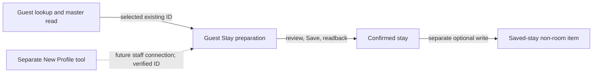

# HMS Guest Profile Foundations - Plan

**Status (2026-11-06):** The foundation landed in PR #1060. On deployed main
`23a878d47`, one Labtest Save and fresh exact-ID readback matched the supported
extra fields. The findings and gaps below describe the pre-implementation
baseline; the runner remains Labtest-only.

## Goal Capsule

Extend the existing HRCEN guest-profile tools with explicitly supplied title and contact details, starting with the native operations rather than a reservation UI rewrite. Preserve the current creator, readback and uncertain-write protections. The owner chose guest-profile foundations first; this does not make them a prerequisite for booking with an existing profile.

This plan updates the conclusions of the untracked Create Reservation UI checkpoint from worktree `54b6`. That checkpoint inspected commit `20e17dd`; this plan checks main at `7a3bf52`. Its original owner decisions about the eventual Create screen remain relevant, but the owner now wants the foundation work first. The original checkpoint and its active worktree remain untouched.

Planning is not authority to implement or deploy. Existing project rules and the owner's latest instructions govern execution. The supplied profile runner remains Labtest-only; a profile tool release is not a completed staff workflow.

---

## Product Contract

### Summary

A caller can find and read an existing guest profile, or prepare a new profile with the current required names and mobile plus optional guest-attributed title, additional phone and contact types. HMS supplies the available choices. The caller reviews the effective native values, and a trusted, authorized caller can save once and obtain a fresh exact-ID readback. Unknown or unproven fields stay unsupported.

### Evidence and scope

The current profile creator accepts `firstName`, `lastName`, `mobile` and optional `email`; it stages Active and four unchecked consent controls. It rejects additional guest keys. `prepareGuestProfile`, `createGuestProfile` and `readGuestProfile` already exist, with a separate Labtest-only runner and durable uncertain-attempt holds. Existing profile search and selection are separate operations. See [guest-profile-create.mjs](../../apps/server-pilot/tooling/hms-cloud/guest-profile-create.mjs), [guest-profile-runner.mjs](../../apps/server-pilot/tooling/hms-cloud/guest-profile-runner.mjs) and [guest-profile-create.md](../../apps/server-pilot/tooling/hms-cloud/guest-profile-create.md).

The [profile census](../research/halloween/memory-experiments/2026-11-05-guest-profile-field-census.md) observed title on 298 of 440 current profiles linked to E-Mail stays, an additional phone and phone type on 96, and an email type on 439. These are later master-profile observations, not proof of what a guest supplied or staff entered during booking. New-form controls were observed, but saving these extra fields is not yet proven.

The first extension is optional title. The next is optional additional phone, phone type and email type. Use only guest-attributed information or a staff choice. Do not derive title or gender from a name, copy the booker's contact into the guest profile, or assume a shared email identifies a person. Nationality, residence, address, DOB and ID/passport fields remain supplied-only candidates for a later, separately evidenced extension.

### Requirements

- R1. Preserve existing search, exact-ID read, prepare and create contracts for callers that omit the new fields, including omitted or null email meaning blank.
- R2. Expose current native title, phone-type and email-type codes and meanings, with honest option coverage. A code must be verified again on the new form before use.
- R3. Accept an explicit optional title code, additional guest phone, phone-type code and email-type code. Do not guess missing values or silently ignore unsupported inputs.
- R4. Preserve native defaults for omitted new fields, expose effective values in review and refuse a requested value or dependent default that cannot be verified. An explicit new-field null or clear is unsupported until its native meaning is proved.
- R5. Stage supported fields on the verified clean New form in the native order. After all dependent changes settle, compare every requested and reviewed effective field with the form and its submitted values.
- R6. Bind the approved requested values, relevant effective defaults and duplicate-name decision to the prepared review. Restage and compare before Save; changed values require review again.
- R7. Retain page-owned guards, trusted authorization, one-attempt dispatch, durable holds and independent exact-ID readback. Never infer a successful write from an HTTP response or retry an uncertain write blindly.
- R8. Require a fresh master read matching each supported new field as well as the existing names, mobile, blank-or-supplied email, Active status and four false consent values before reporting `created`.
- R9. Keep profile master data, reservation guest contact, booker contact and CMS recipient as separate values and operations. Existing-profile editing is not implied by this New Profile extension.
- R10. Use current project proof rules and existing focused tests. Do not add tests unless the owner asks.

### Acceptance examples

- AE1. An existing caller omits all new fields. Its current input, preview, replay journal and readback behavior remain valid.
- AE2. A caller requests a current native title code. Prepare returns the selected code, meaning and effective native values; a changed or unavailable code cannot produce an approved Save.
- AE3. A caller supplies a guest phone and explicit phone type. Both are staged, reviewed, bound to the Save and compared in a fresh master read. A type supplied without its associated contact is rejected as needing input.
- AE4. HMS supplies an email type by default. If email is present and no type was requested, show the observed native default; if it changes before dispatch, require a new review. Do not invent a default when the form does not establish one.
- AE5. A Save response is lost or readback cannot establish the new fields. Return uncertainty and retain the attempt and intent hold. Changing only title or contact type must not evade that hold.
- AE6. The profile is selected for an existing booking workflow. A profile's email is not automatically substituted for the stay's guest email, booker's contact or CMS recipient.

### Boundaries

This first plan covers the raw profile foundation and its Labtest proof. It does not authorize real-guest profile creation, add a profile editor, change Create Reservation, or imply that automatic New Profile is enabled in the pane. Product rules currently defer automatic New Profile; a later staff-facing proposal must include its own approval, identity, recovery and connected pane-to-tool design.

The owner's first-principles direction changes work order; it does not establish that profile-field expansion blocks the already existing-profile Create path. Other reservation gaps remain in the map below.

---

## Planning Contract

### Current foundations and remaining gaps

| Area | Available foundation | What still needs work |
| --- | --- | --- |
| Guest profile | Separate search/selection, exact-ID master read, raw New Profile prepare and Labtest creation | Title and contact-type writes are not proven; raw creation is not a staff-approved real-guest workflow. |
| A/R, Reason and Billing Reference | Current A/R lookup/selection and Reason dropdown exist. The native Create composite accepts these concepts in some paths. | The pane proof explicitly rejects all three; Billing Reference is marked `commit_only` during Prepare. Preserve the account identity, review, request binding and readback across the connected flow. |
| Charge room | Native new-stay selection and Labtest Save/readback support exist. | The higher-level Create contract does not expose the override, and real-guest override Save is unsupported. Select charge room before checking the rate. |
| Nightly price | A saved-stay native rate override can be prepared and committed for Labtest. | It is not a new-stay numeric price editor; current product scope defers typed native rate overrides. |
| Non-room items | Saved-stay ITEM catalogue, preparation, guarded writes and reconciliation exist. | A new reservation must first have a verified confirmation; follow-on item writes are sequential and can partially fail. PACK/MEAL catalogue reads do not establish their writes. |
| Deposit and guarantee | Guarantee selection has restricted unsaved proofs; saved-stay finance preflight exposes some displayed deposit values. | Determine which obligations are available and needed on a new stay. A displayed amount or selected guarantee does not prove payment or a supported payment write. |
| Guest contact and room preferences | A new-stay guest-email setter and some saved-stay readers exist. | A setter is not a complete Create or profile-update contract. Room assignment, Do Not Move, confidential rate and related writes still require native evidence. |
| Native group/block | Read-only group context exists. | Native group association is not established by sequential individual reservations; the current product defers it. |

Sources: [Create pane proof](../../apps/server-pilot/src/ai/pane-create-cloud-input.ts), [Create native validation](../../apps/server-pilot/tooling/hms-cloud/create-reservation.mjs), [booking session](../../apps/server-pilot/tooling/hms-cloud/booking-lookup-session.md), [rate and charge-room tools](../../apps/server-pilot/tooling/hms-cloud/native-price-overrides.md), [add-ons](../../apps/server-pilot/tooling/hms-cloud/stay360-addons.md) and [finance preflight](../../apps/server-pilot/tooling/hms-cloud/saved-stay-agent-session.md). These are source contracts and recorded observations, not proof of current deployment or staff availability.

The older [party study](../research/halloween/memory-experiments/2026-10-30-party-memory-and-lookups.md) found A/R on 138 of 492 E-Mail-source stays and a charge-room value on 134; 122 of those 134 differed from the booked room. The [field audit](../research/halloween/2026-11-01-hms-field-scope-audit.md) found Billing Reference on 163 of 892 and Reason for Stay on 309 of 892 saved snapshots. The later [bundle study](../research/halloween/2026-11-05-centurion-bundle-investigation.md) found 18 individual ITEM rows and no PACK rows in 891 complete current reads. These cohorts have different denominators and are not booking-time entry frequencies or hotel-wide demand estimates.

### Design decisions

- KTD1. Extend the current profile creator and runner instead of building a second profile writer. Keep profile lookup and existing-record reads separate from New Profile creation.
- KTD2. Add a narrow read-only operation for current New Profile choices for `title`, `phoneType` and `emailType`. Return native codes, labels and completeness; reject ambiguous or unavailable choices. Re-resolve supplied codes in the actual preparation session because a previous lookup is not proof that an option remains valid.
- KTD3. Use optional business inputs `titleCode`, `phoneNumber`, `phoneTypeCode` and `emailTypeCode` under `guest`. The additional phone is distinct from required `mobile`; contact types are native codes. A phone type without an additional phone or an email type without an email returns `needs_input`. Missing types retain and display verified native defaults; never create a synthetic default.
- KTD4. Retain the old normalized field shape and digest for inputs without new fields, so existing previews and journal records remain readable. For an extended request, bind the requested values, native effective values and duplicate decision to a versioned review. The trusted runner stores that reviewed snapshot with the claim; Save restages and compares it before dispatch. A digest or caller-supplied snapshot is data, not authorization.
- KTD5. Preserve the runner's existing intent key based on normalized property, first name, surname, mobile and email. Do not add the optional fields to that key: changing an optional value must not bypass an unresolved prior attempt. This is a conservative host-local hold, not a person identity or distributed exactly-once guarantee; changes to core identity values can still require separate reconciliation.
- KTD6. Extend the existing form and request checks only for established business fields. Compare method, origin, native operation, blank new-record identity, property context, approved values and consent controls; permit unrelated native form-field drift. Keep context/page guards in place and block service workers when routing provides the fence.
- KTD7. Use the existing exact-ID master reader's named Header observations for new-field readback. Missing, unread, ambiguous or changed values are not matches. Existing profile reads must continue to accept old records that lack today's required New-form mobile.
- KTD8. Refactor only a demonstrated common operation with identical semantics. Guest-master creation, unsaved Guest Stay selection and saved-stay add-on writes have different targets and lifecycles; do not wrap them in a general form or write framework merely because they all use Playwright.

### Profile operation contract

Keep the existing operation names and old input shapes. Add `listGuestProfileCreationOptions({propertyCode?, field})`, where `field` is `title`, `phoneType` or `emailType`. It opens the guarded New form and returns current `{code, label}` choices, observation time and coverage, or a structured unavailable/unsupported result. A later preparation rechecks the chosen code on its own form.

For requests containing at least one new field, `prepareGuestProfile` returns a version-2 review containing the normalized request, the verified effective values relevant to that request, the duplicate decision and a digest of that review. Unknown unrelated optional controls are reported as unknown; they do not become invented inputs. A type default that affects the supplied contact must be verified and reviewed.

The matching `createGuestProfile` call includes `expectedPreviewDigest` and the returned `expectedReview`; the runner validates that the digest matches the supplied review and normalized request, records that versioned review with the durable claim, and keeps the existing core-field intent key. The native operation restages the request and independently checks that its final effective values still match that review before it can dispatch. The trusted host still owns authorization. Old requests omit `expectedReview`, retain the version-1 digest and remain able to read version-1 journals. The runner must recognize both claim versions without rewriting old records.

### Native unknowns

Before advertising a field, inspect the actual New Profile control, native choices, default, validation, dependent changes and any field-change requests under the existing write fence. A visible control or an existing saved value does not prove it can be written. If HMS does not supply complete or unambiguous choices, return `unsupported` or `needs_input` for that field and retain its evidence; do not loosen the guard or declare it implemented. A successful Labtest Save and fresh readback are still required to prove persistence.

### Sequence and ownership

One implementation owner controls the shared profile files and journal contract. U1 establishes native behavior; U2 adds title; U3 adds contact fields using U2's mechanisms; U4 performs the final integrated proof. The single profile files and one Labtest identity are shared resources, so these units are sequential. Other teams' active UI, charge-room and add-on worktrees remain read-only context.

Estimated product changes are roughly 200–500 lines for U2 and 150–400 for U3, including guard and journal compatibility; U1 and U4 are primarily inspection and proof. These are broad planning ranges, not measured diffs. The existing creator and runner added roughly 880 source lines in PR #1051; that is a whole-tool comparison, not a calibrated delivery rate. No new tests are planned. Completion time is unknown without relevant timing evidence.

---

## Implementation Units

### U1. Establish the current New Profile field behavior

- **Owner:** implementing agent. **Requirements:** R2–R5. **Dependencies:** none.
- **Files:** inspect `apps/server-pilot/tooling/hms-cloud/guest-profile-create.mjs`, `guest-profile-create.md`, `guest-profile.mjs` and the profile census; use private temporary evidence outside Git. No product file change is required for the inspection itself.
- **Approach:** on a guarded clean HRCEN New form, inspect only title, additional phone, phone type and email type. Record current options, coverage, defaults, native input/submission values, dependencies and any requests caused by selection. Use real-email details only for unsaved preparation; never Save a real guest.
- **Patterns to follow:** existing `openNewProfile`, `profileForm`, `profileFieldMetadata`, read-only guard and current lookup behavior. Preserve named-field scope rather than pinning a count or complete request body.
- **Test scenarios:** option absent or incomplete; native default present or unread; unsupported or duplicate code; changing one field alters another; unexpected request or prompt.
- **Verification:** the session guard closes cleanly, the New form remains unsaved and evidence supports a specific field operation. If not, keep the affected field unsupported and do not start its Save implementation.

### U2. Extend the profile foundation with title

- **Owner:** implementing agent. **Requirements:** R1–R2, R4–R8. **Dependencies:** U1's verified title behavior.
- **Files:** modify `apps/server-pilot/tooling/hms-cloud/guest-profile-create.mjs` for options, input validation, staging, review, Save matching and fresh master comparison; modify `apps/server-pilot/tooling/hms-cloud/guest-profile-runner.mjs` for versioned reviewed claims while retaining old journal replay and intent holds; update `apps/server-pilot/tooling/hms-cloud/guest-profile-create.md` with the new contract and limitations.
- **Approach:** implement the narrow current-option read, then stage an explicitly chosen title. Keep old request and digest behavior byte-compatible when all new fields are omitted. Bind the selected title and all relevant native effective values to the extended review; restage and compare before the authorized request. Read the title by its named native field from the exact new profile.
- **Patterns to follow:** existing `profileBusinessFields`, `stageProfile`, `profileSaveMatches`, `matchesProfileReadback` and runner claim/reconciliation. Factor only shared internal code needed for these fields.
- **Test scenarios:** old request/journal replay, exact title selection, invalid or stale title, changed native default, mismatched request, unknown readback, duplicate prompt and uncertain dispatch. No new tests unless requested.
- **Verification:** existing focused profile tests pass; a real-detail unsaved preparation proves the native title path; a later deployed-head Labtest Save and fresh exact-ID readback prove the title without weakening holds.

### U3. Add guest contact types

- **Owner:** implementing agent. **Requirements:** R1–R9. **Dependencies:** U1's verified contact behavior and U2's reviewed-field mechanism.
- **Files:** modify the same `guest-profile-create.mjs`, `guest-profile-runner.mjs` and `guest-profile-create.md` files as U2; no new generic writer or profile editor.
- **Approach:** expose and revalidate the native phone/email type choices. Stage the explicit additional phone and any explicit types; record verified native defaults for omitted types. Validate combinations without treating mobile, guest email and booker contact as interchangeable. Re-read the final form after all changes, bind it to the approved review and independently compare each relevant master field.
- **Patterns to follow:** U2's versioned review, page guard, request match and existing exact-ID master observations. Preserve the original intent key even when an optional phone or type changes.
- **Test scenarios:** phone/type and email/type consistency, missing type/default, changed option, explicit blank/null, mismatched saved value, uncertain Save followed by changed optional fields, and an existing profile with no mobile.
- **Verification:** existing focused profile checks pass and native preparation/readback demonstrate each supported field. Existing checks provide regression evidence; they do not automatically cover new failure cases. Review those cases and report what remains unverified without adding tests or probe loops.

### U4. Verify the profile foundation and document the integration boundary

- **Owner:** implementing agent. **Requirements:** R1–R10. **Dependencies:** U2 and U3.
- **Files:** update `apps/server-pilot/tooling/hms-cloud/guest-profile-create.md` with verified inputs, native defaults, review and recovery behavior. Do not add a pane route or change the reservation wrapper in this unit.
- **Approach:** run the existing focused checks with database environment variables unset. Prove the real-detail unsaved preparation, then the permitted Labtest Save and independent readback on deployed main. Record the exact supported subset and preserve unresolved attempts.
- **Patterns to follow:** current `prepareGuestProfile`, trusted Labtest runner and independent `readGuestProfile`; the deployed-main procedure in `PRODUCT.md` and release rules in `AGENTS.md`.
- **Test scenarios:** old and extended inputs, explicit duplicates, changed reviewed values, mismatched or unread saved fields, uncertain dispatch and safe recovery. No new tests unless requested.
- **Verification:** report raw backend proof separately from pane integration, real-guest write authority, merge, deployment and any flag state. A verified profile does not mean a reservation was created.

---

## Verification Contract

- Run existing focused checks only, from `apps/server-pilot`, with `DATABASE_URL`, `VITEST_ALLOW_PILOT_RDS` and `TEST_DATABASE_URL` unset: `node --test --test-concurrency=1 tooling/hms-cloud/guest-profile-create.test.mjs tooling/hms-cloud/guest-profile-runner.test.mjs`. Check resource headroom and existing concurrent runs first. Do not add tests unless asked.
- On the final clean head, use `bash /home/orca/bin/remote-typecheck.sh <clean-worktree> --app server-pilot` when applicable to the changed app. Do not run local `tsc` or `tsgo`.
- Run the real tool with real-email details and stop before Save. Then perform one Proof Labtest Save on deployed main and independently reopen the exact resulting profile. No agent saves a real guest; staff Go is required for any future real-guest write.
- Serialize writes to the same Labtest profile and retain unresolved holds. Do not use pilot RDS, print credentials, perform numbered probe loops or claim a database-backed check that was skipped.
- If work becomes a PR, follow current project rules: final-head Greptile Apex or a permitted fallback, valid P0/P1 fixes, no hook bypass and deployed-main proof. A raw-only tool is not a completed pane-to-route-to-tool workflow.

---

## Definition of Done

- Existing profile consumers and old attempt records remain compatible. Each requested extra field has verified current options where applicable, staging, reviewed values, a guarded Save and matching fresh master readback. If a field cannot be proven, report it as unsupported and do not claim the requested scope is complete.
- Title, phone and email types are never guessed from a person's name or someone else's contact. Existing-profile lookup and reservation contact behavior remain independent.
- Existing focused checks and the appropriate remote check are reported accurately. Unsaved real-detail and Labtest proof are distinguished from real-staff and deployed-product readiness.
- The plan does not claim that profile expansion finishes Create Reservation. The separate A/R, billing, reason, charge-room and other reservation gaps remain visible for their own connected work.
