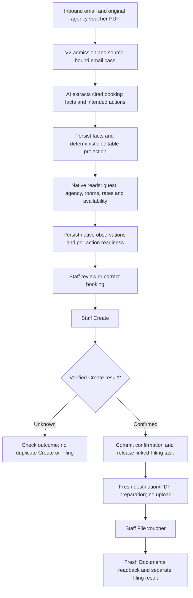

# V2 prefill and connected reservation actions - Plan

## Goal Capsule

Staff open one Centurion email case, see extracted email/PDF facts and the actions needed, correct only missing or ambiguous inputs, and approve the existing deterministic HMS tools.
An agency booking voucher can require Create followed by Filing; those actions share the same case and original PDF.
Quote and Create share booking facts and field conventions while preserving their different native operations and outcomes.
Keep existing HMS tools, source binding, write claims, operation receipts and positive-only reconciliation.

Execution posture: autonomous implementation and release, explicitly authorized by the owner after this plan is finalized on 2026-11-10. Finish all units through independently verified checkpoints; do not ask routine questions overnight.
Current source was inspected at e044e299 (#1164); it matches locally fetched origin/main.
Read-only SSM inspection confirmed http, worker, ai-worker and remote-http online at e044e299. Effective V2 arrival is on, legacy inbound triage is unset/disabled, inbound classifier is off, and Azure endpoint/key and GOTENBERG_URL are configured in all four. Presence is not proof of a successful model/converter request.
The reported prefill failures and pending outbound items have unconfirmed causes.
U1 is an executable diagnosis/checkpoint, not a precondition to begin independent source-preservation work. A flag/access/lease failure holds that runtime proof; it does not justify a product rewrite or prevent independent work.
Keep native tools and existing API/result shapes. No blanket rewrite, destructive cleanup or independent email sending is authorized. The owner's settled price policy is show the corporate-rate/voucher difference and let staff resolve it in HMS before Create; no numeric override.

---

## Product Contract

### Summary

The current pipeline has useful native operations but competing definitions of complete input across extraction, draft schema, editors and workflow compilers.
Persisting intermediate state is useful; presenting saved state as executable readiness is the problem to address.
A supported action must not be blocked merely because the same email has an unrelated attachment or second request.
An essential unresolved request must remain visible and cannot be silently omitted.

### Requirements

**Email case and prefill**

- R1. One source-bound WorkItem per selected email, containing facts, actions, native observations, staff overrides and durable results.
- R2. V2 quote/create/amend/cancel/services/filing remains independent of the removed inbound-triage feature pipeline; other remains a visible manual task.
- R3. Extract the current email, admitted prior context up to the source cutoff, and relevant PDF material. Preserve source citations, explicit zero and unknown values.
- R4. Save validated extraction before optional synthesis/native work can fail. The deterministic cited-fact projector wins both on synthesis success and fallback; synthesis may enrich unresolved relationships but cannot erase/change admitted facts, invent native identities, choose writes or waive approval.
- R5. Keep intermediate checkpoints and show per-action missing input, searching, prepared, completed, failed and uncertain states accurately.
- R6. Staff edits survive late reads, reload, source selection changes and recovery. Relevant edits invalidate the prepared action; unrelated work does not falsely approve or complete it.

**Booking inputs and linked actions**

- R7. Create and Quote use consistent dates, room count, per-room adults/children/ages, board, agency/company, rate code and requested-price presentation. Workflow-specific limits remain explicit.
- R8. An agency booking voucher conveying new-booking instructions proposes Create plus Filing of that original PDF. POP-only mail never implies Create. Existing-booking vouchers and contextual PDFs retain the current existing-stay/action rules.
- R9. Filing can point to a particular Create request/allocation before a confirmation exists. Only a verified successful Create receipt supplies its confirmation.
- R10. Pilot interaction is Create, then File voucher. The second step needs no copying of confirmation and no repeated staff destination search when the receipt is exact. Queueing a staff task does not authorize a background upload.
- R11. For multiple rooms, associate each filing with an explicit intended allocation/confirmed stay. Never select the first room by position or file to every stay silently.
- R12. Create success plus Filing failure remains a partial case: retry/check Filing only. Unknown Create results remain held until fresh reconciliation.
- R13. Keep manual New Profile creation already present in Create, with its own staff action and returned native guest ID. No automatic profile creation is required.
- R14. Prefetch the source-supported agency/company corporate rate and native price/availability at admission. Preserve voucher rate/total beside native rate code, currency, board and totals. Show a comparable difference when amount/unit/coverage is known; otherwise explain what cannot be compared. Staff resolve a difference in HMS before proceeding, then request a fresh native read/Prepare. No numeric override, silent voucher-price substitution, or stale-price Save.

**Workflow completion**

- R15. Quote supports its product outputs: an unsent cover email, PDF and Excel from the same priced facts. Implement V2 unavailable-inventory handling with the evidence rules in R24; the retained legacy decline helper is not proof of an active V2 path. Alternatives require staff selection. Do not silently replace this with text-only output.
- R16. An unrelated requested allowance or other action can be recorded for separate handling and must not block a supported room quote once staff explicitly separate it.
- R17. Amend, Cancel and Filing let staff resolve explicit included/excluded stays in the pane. Unsupported material requests remain explained and separable where valid.
- R18. Cancel displays the native booking/status, reason choices and any penalty before cancellation. Background work may read/prepare; staff approve every write and any additional fee acceptance.
- R19. Add-On exposes the exact native target/item, dates, quantity and price requirements. Verify whether zero price is valid in native HMS before altering the current positive-price restriction.
- R20. Never show JSON pointers/internal guard text as the staff instruction. Return a field label, human explanation and correction action.
- R21. Webmail and Outlook use the same active pane; saved completion cannot be undone by editing the draft.
- R22. Warm reads and unsaved preparation start before staff open the pane where supported inputs/identities are sufficiently resolved. Opening loads saved results immediately; only missing/ambiguous/stale inputs cause further work. Show lookup/preparation status and native capture time rather than promising every email is already ready.
- R23. Keep the native guarantee, sourceOfBusiness, reservation note and editable CMS controls. All Labtest preparations/writes explicitly use cmsSend=false; do not weaken the Labtest guard or change real-booking CMS defaults globally.
- R24. Never name the company in the quote cover; retain current blanked-company behavior. Add a V2 one-line decline only for current, sufficiently complete native evidence of unavailable requested inventory. Unknown/truncated/failed reads never imply fully booked; partial shortage is not proof the whole hotel is sold out.
- R25. Preserve existing pre-stay never-Create and source/mailbox guards instead of reimplementing them. Manual New Profile remains a separate flag-gated real write; do not expand it into automatic profile creation.
- R26. After each affected workflow's deployed-main Labtest Save/fresh readback, record CANARY PASS <workflow> HRCEN <sha>; verify effective flags in all four processes. Never manufacture a canary or widen a flag before proof.
- R27. Complete every unit, including the remaining workflow repairs. Checkpoints split integration/release risk; they do not defer U7 or replace the full requested outcome with the minimum slice.

### Scope Boundaries

Keep the six existing executable kinds, native tools and V2 tRPC namespace.
No inbound-triage redesign or outbound-queue cleanup in this scope.
No new pricing/accounting engine, generic DAG runner, generic task queue, generic readiness DTO family, automatic guest writer or OCR subsystem.
PDF extraction continues using existing text/vision support; expose partial coverage and align accepted PDF-size handling.
A single combined Create-and-file button is a later interaction option, not needed for the linked two-step pilot.
Native numeric price override, image filing and unbounded group booking remain separate capability work.

---

## Planning Contract

### Current file trail

- Admission: [live-admission.ts](../../apps/server-pilot/src/mail/ingest/live-admission.ts), line 536, independently offers eligible inbound mail to V2.
- Arrival/queue: [reservation-workflow-v2-arrival.ts](../../apps/server-pilot/src/ai/reservation-workflow-v2-arrival.ts), [run-ledger.ts](../../apps/server-pilot/src/ai/run-ledger.ts), and [worker.ts](../../apps/server-pilot/src/ai/worker.ts).
- Source/model service: [reservation-workflow-v2-prefill-service.ts](../../apps/server-pilot/src/ai/reservation-workflow-v2-prefill-service.ts), line 57, loads source and invokes [reservation-workflow-v2-prefill.ts](../../apps/server-pilot/src/ai/reservation-workflow-v2-prefill.ts).
- Current model routing: Azure Responses through [extraction/extract.ts](../../apps/server-pilot/src/ai/extraction/extract.ts), configured gpt-6-luna; source uses high reasoning when the environment does not override it. Live routing was not rechecked.
- Persistence: service lines 78-81 save proposal/observations/review requirements/errors; the returned extraction object is not included in that seed. Background native checks follow at lines 155-163.
- State: [reservation-workflow-v2-state.ts](../../apps/server-pilot/src/ai/reservation-workflow-v2-state.ts), [db/schema/work.ts](../../apps/server-pilot/src/db/schema/work.ts), and [db/schema/mail.ts](../../apps/server-pilot/src/db/schema/mail.ts). The canonical case is WorkItem.state.reservationWorkflowV2 JSONB; work_event records history and ai_workflow_run records queued runs.
- Pane: [reservation-pane-host.tsx](../../apps/mail/components/nava-pane/reservation-pane-host.tsx) -> [reservation-workspace.tsx](../../apps/mail/components/reservation-pane/reservation-workspace.tsx) -> [reservation-pane.tsx](../../apps/mail/components/reservation-pane/reservation-pane.tsx).
- API: [trpc/routes/reservation-workflow-v2.ts](../../apps/server-pilot/src/trpc/routes/reservation-workflow-v2.ts), with source-bound WorkItem/revision/sequence inputs.
- Infrastructure: EC2 backend processes and Postgres/S3 according to [aws-resources.md](../../apps/server-pilot/deploy/aws-resources.md). This VPS holds the checkout. No live database, storage or deployed environment was inspected for this plan.

### Recommended vertical flow



### Technical decisions

- KTD1. Keep one case, not one independent database draft per action. Existing request/allocation/document IDs describe the actions within that case.
- KTD2. Keep checkpoint saves. Distinguish persisted extraction from successful preparation and successful HMS writes.
- KTD3. Export pure compiler issues using existing result fields and preparation views. Project those issues in client/views and remove conflicting pane heuristics. Keep lookup readiness, preparation freshness, staff approval and write result separate; no new generic readiness module/DTO.
- KTD4. Keep the cited-fact projector in prefill.ts and use existing shared field components. Quote prices/produces artifacts; Create selects a guest, stages Check Availability and saves a reservation. Add no standalone booking-input framework.
- KTD5. The allocation union exists but no host producer currently emits a usable dependent Filing document. Implement that producer, configure-command target union and Filing compiler/resolver in existing files. Preserve a document owned by its Filing request, exact PDF identity and an allocation-keyed dependency. Convert it to the Filing request's explicit saved-target hint from verified Create evidence, then obtain Filing's own workflow=filing native observation; a Create observation cannot substitute for it.
- KTD6. Persist the association before Create and resolve against an exact succeeded operation's observationRefs, requestId and allocationId. Ordinary success and [recordRecoveredCreate](../../apps/server-pilot/src/ai/pane-cloud-preview.ts) at line 921 have different observation shapes: recovered lacks requestDigest/prepareObservationRef and carries recovered=true. Accept only their verified common identity/confirmation/readback fields with shape-specific checks. Do not require ordinary-only fields or take the first successful Create. Fresh Filing lookup remains mandatory. A derived resolver avoids a new queue-release writer; audit both recovery producers.
- KTD7. Keep the original attachment ID/source ref, intended document kind and Create allocation association. Never use AI-estimated or pane-supplied confirmation as proof of a new booking.
- KTD8. Background preparation never fabricates staff document review or an approval. File Go records approval of the displayed PDF and exact destination, then follows the existing native upload/readback path.
- KTD9. Add compatible optional saved-state fields only if existing target refs/observations cannot represent readiness/facts. Default absent fields for old drafts; do not require a new SQL queue/table. Prefill complete means the bounded background phase finished, not that every action can Go: omitted/partial checks, native preparation, evidence freshness and staff approval remain separate.
- KTD10. Requested unsupported changes need an explained decision. An unrelated second action can be separated; an essential booking/pricing change cannot be silently dropped.

### Concrete gaps and acceptance direction

| Workflow | Source-supported gap | Required resolution |
|---|---|---|
| Prefill | Synthesis fallback drops occupancy and other cited facts; service seed omits the raw validated extraction. | Persist extraction in seed/checkpoint and project it authoritatively after either synthesis result; classify model/validation/native/persistence failures separately. |
| Create | Schema allows more allocations/longer strings than native compilation; guestOptIn=true is rejected; requested totals are not fully reconciled. | Match native field constraints, keep unsupported opt-in explicit and editable/separable, reconcile rooms and occupant totals before Prepare. |
| Quote | Per-room occupancy and known child ages/count are necessary; named agency needs native identity. | Ask concrete allocation/identity questions and retain extracted values. Unknown child count is not zero. |
| Quote | UI permits twelve children; native staffQuote childrenAges permits six. | Enforce the actual native per-room cap consistently; explain/reallocate unsupported scenarios instead of late generic failure. |
| Quote | Other allowance handling still blocks generation; differing date windows require separate native quote runs. | Explicit independent follow-up handling and clear per-date quote actions in the same case. Preserve essential pricing dependencies. |
| Quote | Pane gates to text-only despite backend PDF/Excel builders; PDF needs GOTENBERG_URL. | Wire outputs end to end and prove the deployed converter. Keep incomplete output separate from successful pricing. |
| Cancel | Any document/service ref blocks preparation, even contextual refs; reason choices wait for staff lookup/prepare. | Separate context from execution dependencies and move safe native target/reason reading earlier. |
| Amend | Broad/excluded scope and unsupported changes can block with no complete editing path. | Explicit native target selection/splitting plus in-place explanation/removal/separate handling. |
| Add-On | Unsaved-room background work cannot produce a final target; dates/quantity/positive price required. | Wait for verified Create receipt where needed, then use native saved-stay reads. Check zero-price capability before changing limits. |
| Filing | Needs its own saved-target link; broad/excluded scope stalls; one PDF up to 10 MiB. | Add dependent target resolution and scoped selection. Show accepted-file and extraction-coverage limits honestly. |

These are code findings, not a claim that every listed path failed in production.
The exact affected Cancel draft and Quote screenshot source were not inspected.
An attachment shown in the pane does not prove it caused the reported cancellation error.

### Concurrent work to preserve

Open PR metadata was checked without a date cutoff.
#1151 preserves Quote occupancy on fallback; #1154 adjusts occupancy labels; #1149 proposes manual/text-only document handling and depends on draft #1144.
Integrate source-preservation changes from [#1151](https://github.com/kufupa/Zero/pull/1151) before extending projection. Fetch and verify the current reviewed PR head; origin/pr-1151 was stale at a21f39b while GitHub reported 22162aaf during review. Do not cherry-pick a stale ref or clobber the occupancy fix. The patch still leaves parties empty, so it is a starting point, not complete projection.
Do not silently adopt text-only [#1149](https://github.com/kufupa/Zero/pull/1149)/[#1144](https://github.com/kufupa/Zero/pull/1144) as a substitute for R15.
[#1155](https://github.com/kufupa/Zero/pull/1155), [#1150](https://github.com/kufupa/Zero/pull/1150), [#1143](https://github.com/kufupa/Zero/pull/1143) and draft [#1145](https://github.com/kufupa/Zero/pull/1145) overlap Add-On target/UI/background work.
Draft [#1146](https://github.com/kufupa/Zero/pull/1146) and [#1139](https://github.com/kufupa/Zero/pull/1139) overlap background/source fencing.
[#1135](https://github.com/kufupa/Zero/pull/1135) and [#1131](https://github.com/kufupa/Zero/pull/1131) overlap guest creation recovery/labels.

Read-only worktree inventory found dirty Quote-picker and arrival/Add-On worktrees, plus the separate agent-arch checkout.
Their owners/activity are not established; preserve them and inspect relevant diffs before assigning writers.
Seabass must remain available to the other session; implementation should use isolated worktrees based on fresh main.

The separate 2026-11-07 evidence-to-prefill plan in agent-arch is an ordinary Amend reuse slice. Preserve its source/time/identity/Prepare-versus-Go decisions and applicable work; this owner's latest request adds Create/voucher and Quote repair. Arrival enqueue is already on main and is not rebuilt. #1163 disables triage through source plus runtime switch; setting LEGACY_INBOUND_TRIAGE_PIPELINE=on can revive it, so verify that switch stays disabled. #1164 changes dashboard presentation only.

### File manifest

Initial change boundary: 34 existing product files; no mandatory new module. Add target-scope-picker.tsx only if U7 cannot reuse the current exact-target controls cleanly. The manifest is a hot-path map, not a demand to edit every file or rewrite all of them at once.
This is a planned change boundary, not a measured diff or a claim that every file requires full replacement.
Rewrite projection, readiness and editor sections; retain native write, identity, receipt and recovery machinery.
U1 may identify an additional failure-specific file; record that delta before implementation.

| Existing file | Units | Intended change |
|---|---|---|
| [apps/server-pilot/src/ai/reservation-workflow-v2-contract.ts](../../apps/server-pilot/src/ai/reservation-workflow-v2-contract.ts) | U2,U3 | Extend compatible facts/readiness/dependent-target contracts; keep six executable kinds. |
| [apps/server-pilot/src/ai/reservation-workflow-v2-prefill.ts](../../apps/server-pilot/src/ai/reservation-workflow-v2-prefill.ts) | U2 | Rewrite extraction-to-form projection and fallback; preserve cited facts and voucher intent. |
| [apps/server-pilot/src/ai/reservation-workflow-v2-prefill-service.ts](../../apps/server-pilot/src/ai/reservation-workflow-v2-prefill-service.ts) | U1,U2 | Keep validated extraction checkpoint; report exact failure stage; preserve worker fencing. |
| [apps/server-pilot/src/ai/reservation-workflow-v2-arrival-checks.ts](../../apps/server-pilot/src/ai/reservation-workflow-v2-arrival-checks.ts) | U3,U7 | Schedule only applicable native reads/preparations and record honest per-action readiness. |
| [apps/server-pilot/src/ai/reservation-workflow-v2-state.ts](../../apps/server-pilot/src/ai/reservation-workflow-v2-state.ts) | U2,U3,U5 | Persist facts, readiness and linked filing state with current revisions/events. |
| [apps/server-pilot/src/ai/reservation-workflow-v2-draft-commands.ts](../../apps/server-pilot/src/ai/reservation-workflow-v2-draft-commands.ts) | U4,U7 | Support explicit allocation and stay-scope resolution; keep stable row identities. |
| [apps/server-pilot/src/ai/reservation-workflow-v2-tools.ts](../../apps/server-pilot/src/ai/reservation-workflow-v2-tools.ts) | U3,U4,U5 | Align Create compilation and commit dependent filing with verified Create receipt. |
| [apps/server-pilot/src/ai/reservation-workflow-v2-quote.ts](../../apps/server-pilot/src/ai/reservation-workflow-v2-quote.ts) | U3,U6 | Align Quote compilation/readiness and supported output generation. |
| [apps/server-pilot/src/ai/reservation-workflow-v2-amend.ts](../../apps/server-pilot/src/ai/reservation-workflow-v2-amend.ts) | U3,U7 | Align Amend scope, supported changes, fresh prepare and reasoned blockers. |
| [apps/server-pilot/src/ai/reservation-workflow-v2-cancel.ts](../../apps/server-pilot/src/ai/reservation-workflow-v2-cancel.ts) | U3,U7 | Distinguish contextual refs from additional work; expose cancellation preview/reasons. |
| [apps/server-pilot/src/ai/reservation-workflow-v2-filing.ts](../../apps/server-pilot/src/ai/reservation-workflow-v2-filing.ts) | U3,U5,U7 | Resolve Create dependencies, retain fresh destination/PDF checks and filing receipt. |
| [apps/server-pilot/src/ai/reservation-workflow-v2-services.ts](../../apps/server-pilot/src/ai/reservation-workflow-v2-services.ts) | U3,U7 | Align service target/quantity/date/price validation and staff-resolvable issues. |
| [apps/server-pilot/src/trpc/routes/reservation-workflow-v2.ts](../../apps/server-pilot/src/trpc/routes/reservation-workflow-v2.ts) | U3,U5,U6,U7 | Publish readiness and dependent-target commands through existing V2 API. |
| [apps/server-pilot/src/ai/quote-workflow-synced-selection.ts](../../apps/server-pilot/src/ai/quote-workflow-synced-selection.ts) | U2 | Make selected PDF extraction coverage/limits explicit; preserve existing source cutoff. |
| [apps/mail/components/reservation-pane/reservation-pane.tsx](../../apps/mail/components/reservation-pane/reservation-pane.tsx) | U3,U4,U5,U6,U7 | Replace primary-action gating and present ordered steps within one email case. |
| [apps/mail/components/reservation-pane/reservation-workspace.tsx](../../apps/mail/components/reservation-pane/reservation-workspace.tsx) | U3 | Load source-bound saved state; poll real phase/freshness; retain retry/partial state. |
| [apps/mail/components/reservation-pane/use-reservation-workbench.ts](../../apps/mail/components/reservation-pane/use-reservation-workbench.ts) | U3,U4,U5,U6,U7 | Use server readiness; preserve staged edits; manage linked tasks and unsent outputs. |
| [apps/mail/components/reservation-pane/shared/native-pickers.tsx](../../apps/mail/components/reservation-pane/shared/native-pickers.tsx) | U3,U4,U6,U7 | Consistent native ID/code selection and visible ambiguity handling. |
| [apps/mail/components/reservation-pane/shared/stay-fields.tsx](../../apps/mail/components/reservation-pane/shared/stay-fields.tsx) | U3,U4,U7 | Inline field issues, workflow-specific limits and consistent review/checkbox controls. |
| [apps/mail/components/reservation-pane/editors/create-editor.tsx](../../apps/mail/components/reservation-pane/editors/create-editor.tsx) | U4,U5 | Shared booking fields, allocation totals and queued voucher UI; retain New Profile. |
| [apps/mail/components/reservation-pane/editors/quote-editor.tsx](../../apps/mail/components/reservation-pane/editors/quote-editor.tsx) | U6 | Shared booking fields, allocation questions, native prices and supported outputs. |
| [apps/mail/components/reservation-pane/editors/amend-editor.tsx](../../apps/mail/components/reservation-pane/editors/amend-editor.tsx) | U7 | Resolve exact included/excluded stays and editable supported changes. |
| [apps/mail/components/reservation-pane/editors/cancel-editor.tsx](../../apps/mail/components/reservation-pane/editors/cancel-editor.tsx) | U7 | Show native stay, reason options and penalty; remove raw/internal blockers. |
| [apps/mail/components/reservation-pane/editors/addons-editor.tsx](../../apps/mail/components/reservation-pane/editors/addons-editor.tsx) | U7 | Resolve targets and expose dates/quantity/native item/price fields. |
| [apps/mail/components/reservation-pane/editors/filing-editor.tsx](../../apps/mail/components/reservation-pane/editors/filing-editor.tsx) | U5,U7 | Show waiting/ready dependent filing, chosen PDF and returned confirmation. |
| [apps/mail/components/reservation-pane/editors/create-quote-editor.module.css](../../apps/mail/components/reservation-pane/editors/create-quote-editor.module.css) | U4,U6 | Keep Create/Quote shared layout and controls usable in narrow panes. |
| [apps/mail/components/reservation-pane/editors/other-editors.module.css](../../apps/mail/components/reservation-pane/editors/other-editors.module.css) | U5,U7 | Consistent target selection, checkbox and native-result controls. |
| [apps/mail/lib/reservation-workflow/client.ts](../../apps/mail/lib/reservation-workflow/client.ts) | U3,U5,U6 | Consume readiness/field issues and dependent filing commands; retain source guards. |
| [apps/mail/lib/reservation-workflow/types.ts](../../apps/mail/lib/reservation-workflow/types.ts) | U3,U5,U6 | Publish typed readiness/dependency/output projections. |
| [apps/mail/lib/reservation-workflow/views.ts](../../apps/mail/lib/reservation-workflow/views.ts) | U3,U4,U5,U6,U7 | Map saved native receipts/options and explicit action states to the pane. |
| [apps/mail/components/reservation-pane/use-quote-output.ts](../../apps/mail/components/reservation-pane/use-quote-output.ts) | U6 | Enable existing supported Quote outputs and preserve unsent draft recovery. |
| [apps/mail/components/reservation-pane/quote-output-panel.tsx](../../apps/mail/components/reservation-pane/quote-output-panel.tsx) | U6 | Display/download PDF and Excel plus editable unsent cover email. |
| [apps/mail/lib/reservation-workflow/quote-output.ts](../../apps/mail/lib/reservation-workflow/quote-output.ts) | U6 | Align supported output selection, bytes/metadata and recoverable partial results. |
| [apps/mail/components/reservation-pane/reservation-pane.module.css](../../apps/mail/components/reservation-pane/reservation-pane.module.css) | U3,U5 | Ordered case layout, status and primary-action controls. |

| Additional hot-path dependency | Disposition |
|---|---|
| [reservation-workflow-v2-guest.ts](../../apps/server-pilot/src/ai/reservation-workflow-v2-guest.ts) | Audit manual-profile flags/readback; change only for an evidenced defect. |
| [pane-cloud-preview.ts](../../apps/server-pilot/src/ai/pane-cloud-preview.ts) | Audit recordRecoveredCreate and normal/recovered parity; keep existing recovery writer unless a required common proof field is absent. |
| [reservation-workflow-v2-arrival.ts](../../apps/server-pilot/src/ai/reservation-workflow-v2-arrival.ts) | Reuse existing admission/enqueue; inspect run/flag/source behavior in U1. |
| [extraction/extract.ts](../../apps/server-pilot/src/ai/extraction/extract.ts) | Inspect Azure adapter/invoke errors and existing PDF vision; change only for the actual U1 failure. |
| [existing-stay-information.ts](../../apps/server-pilot/src/ai/existing-stay-information.ts) | Reuse pre-stay never-Create and current-source rules unchanged. |
| [reservation-pane-host.tsx](../../apps/mail/components/nava-pane/reservation-pane-host.tsx) | Verify both source-bound mounts and available quote-attachment capabilities. |
| [pane-hms-write.ts](../../apps/server-pilot/src/ai/pane-hms-write.ts) | Trace any reused native write/review boundary; do not replace it for schema convenience. |
| [write-ec2-remote-env.sh](../../apps/server-pilot/deploy/write-ec2-remote-env.sh) | Inspect source/effective env and canary protection; use existing wrapper for authorized flag changes. |

The three formerly proposed server modules are folded into prefill.ts, existing compilers/client views, and filing.ts/state.ts. File extraction is a reversible implementation choice only if a concrete duplicated pure function warrants it; no generic framework.

### Adversarial review disposition

| Review finding | Decision and reason |
|---|---|
| Do not one-shot U1-U8 | Accept bounded releases and independently verified checkpoints. Reject dropping U7: owner explicitly wants all accepted workflows completed autonomously. |
| U1 could be only ops | Accept diagnosis before attributing failure. Current effective flags/config are present on all four processes; historical failures still need stage/lease evidence. Do not change working flags speculatively. |
| Allocation union is not a working Filing path | Accept producer, configure/compiler, fresh Filing lookup, PDF identity/review and separate Go work. Existing schema only reduces the new contract needed. |
| Recovered Create shape differs | Accept variant-specific receipt validation. Common succeeded-operation metadata does not imply identical observation fields. |
| Persist extraction and let projector win on success | Accept explicit seed/checkpoint persistence and always-on source projection; integrate #1151 without losing its current-source occupancy protection. |
| Quote builders already exist | Accept removing the pane gate and wiring existing outputs; keep email/PDF/Excel scope and verify converter capability. |
| Fold new server modules | Accept helpers in existing source/compilers/views/Filing; no generic layer or mandatory new DTO. |
| Add omitted hot-path files | Add them to dependency inspection. Reject mandatory edits to every named file: preserve existing pre-stay, arrival enqueue, profile writer and recovery unless evidence requires a change. |
| CMS-off and allocation-keyed proof | Accept explicit Labtest CMS off, normal/recovered variants, multi-room order and independent filing result. |
| Existing tests are not V2 proof | Accept no new tests; run relevant existing native/shared checks and disposable actual API/pane proofs per unit. |
| PRODUCT omissions | Add POP-only never-Create, guarantee/source/CMS preservation, company omission, properly evidenced decline, child compiler cap and per-workflow canary. |
| Old Amend plan is contradicted | Preserve its source/identity/Prepare-versus-Go safety decisions. Latest owner expands scope; do not revive the old slice as a cap or rebuild completed admission. |

### Reuse and archive boundary

Keep native Create, guest-profile, Quote, Amend, Cancel, services and attachment tools under tooling/hms-cloud.
Keep the proven shared party/stay/native Quote helpers under tooling/playwright-quote where active V2 imports them.
Keep mail/S3 stores, WorkItem/work_event/run-ledger, source resolver, reply-draft persistence and output builders.
The old nava-pane/quote-workflow editor tree is not the active V2 production mount, but some helpers and non-V2 extraction remain active.
Do not delete whole older directories by name.
Archive a replaced product module only after its active callers have moved and its remaining consumers are understood.
New Profile source is retained: create-editor.tsx:299 and reservation-workflow-v2-guest.ts:119.
The UI has + New and Create profile & check price; the booking tool subsequently uses the resulting existing profile ID.

---

## Autonomous Execution Mandate

Owner explicitly authorized finishing this plan and executing it while asleep on 2026-11-10. Continue through all units and release checkpoints until Definition of Done is verified or a true external/safety blocker prevents progress. No routine permission questions, no stopping after the first three PRs, no waiting for an arbitrary morning checkpoint.

### Authority and working rules

- Use an isolated managed worktree off freshly fetched main. Seabass's only plan edit is retained; never reset/stash/overwrite/delete/interrupt other sessions or their dirty Quote/Add-On trees. One owner integrates shared source/API files; root serializes all Labtest writes.
- Reversible implementation choices and scoped diagnosis/fixes are authorized. Follow the accepted outcomes and choose the smallest working existing seam. A different implementation may replace a proposed helper, but cannot silently remove a requirement or native safety boundary.
- Read-only runtime metadata, effective environment, logs, source-bound real-email native reads and unsaved preparation are allowed. Clearly labeled synthetic ingestion/saved pane cases may be used as requested; do not run tests against pilot RDS or modify unrelated mail.
- Labtest writes use Proof Labtest, 2027+ stays, cmsSend=false and fresh readback. Agents never Save real guests. Real writes remain staff Go in the pane. Filing Go approves the displayed PDF and exact verified destination; background preparation cannot impersonate staff review.
- Merge/deploy through reviewed feature PRs and a clean fetched main checkout using existing ops wrappers. Existing owner authorization in PRODUCT.md applies to proven HRCEN workflow switches after their exact deployed-SHA canary; do not ask again for those already-authorized actions. No speculative flag changes, no re-enabled inbound triage, no independent sends or destructive cleanup.
- Model routing follows the owner: bounded independent Luna 6 xhigh workers; root integrates and escalates difficult correctness reviews as needed. Use available project-required Greptile review first and an independent available reviewer on failure/stall. No fabricated dollar cost or completion ETA when telemetry/comparable timings are unavailable.
- Keep one short execution state outside the repo, containing unit/release heads, checks, pending native proof and resume point. Git/PRs contain implementation evidence. Do not add new plans, retros, ledgers or test suites during execution.

### Infrastructure and proof rules

| Resource | Existing path/identity |
|---|---|
| EC2 | i-008f737974a9ba9b3, af-south-1 |
| Runtime checkout | /home/ubuntu/repos/zero |
| RDS | nava-zero-mail-pilot, Postgres; read-only metadata/synthetic cases only as scoped above |
| Mail objects | nava-zero-mail-845242190536-af-south-1, private S3 |
| Deployment | apps/server-pilot/deploy/ops-deploy.sh from clean fetched main |
| Environment/restart | write-ec2-remote-env.sh --m1-only and ops-restart.sh, with existing canary protection |
| Remote typecheck | /home/orca/bin/remote-typecheck.sh <clean-worktree> --app mail or server-pilot |
| Runtime inspection | existing ssm-run-command.sh; print selected non-secret fields only |

Never run Vitest against pilot/production RDS, set VITEST_ALLOW_PILOT_RDS=1, or source production environment into tests. Unset DATABASE_URL, TEST_DATABASE_URL and VITEST_ALLOW_PILOT_RDS before every test. Use existing focused tests only; no local tsc/tsgo, repo-wide lint/format or GitHub Actions. Preserve project CPU/RAM headroom. Do not force-push main, bypass hooks or weaken identity/write/readback/uncertainty guards.

### Failure and checkpoint loop

Implement a bounded release -> run applicable existing checks and disposable API proof -> review final head -> fix verified failures -> rerun affected proof -> merge/deploy -> verify runtime -> native Labtest/fresh readback -> record real workflow canary -> continue next release.
Diagnose failures by stage and mechanism before fixing. Preserve successful earlier work and all uncertain-operation holds. An uncertain write is reconciled with fresh HMS before another write; never blind retry.
Missing native/runtime access, external outage, human-only staff-PC verification, or unsafe/irreversible ambiguity may hold the affected proof. Continue independent authorized units and explain the exact missing evidence. Coding/typecheck success without deployment/native proof is not Done.
Seven hours is a target, not permission to stop at partial work or declare an unproven success. Final report names shipped SHA/PRs, completed workflows, checks/native results, and any true blockers or unresolved production limitations.

---

## Implementation Units

### Units, owners and dependencies

Proposed ownership describes implementation lanes, not work already assigned.
One server integration owner edits contract/state/routes; one UI owner edits pane/client files.
Workflow/native lanes provide scoped logic changes and evidence through those owners.
Parallel isolated work can start on independent existing seams; integrate shared contract/state/router/client changes sequentially. Do not turn a generic DTO redesign into the prerequisite for every workflow.

| Unit | Proposed owner | Dependency | Delivery |
|---|---|---|---|
| U1 | Runtime/integration | None | Identify the failed prefill stage; distinguish it from unrelated pending outbound items. |
| U2 | Prefill/data | Independent source work; U1 runtime proof | Persist facts and always-on deterministic supported-action projection. |
| U3 | Server integration + UI owner | Per-workflow compiler/input requirements | Export existing issues/preparation views and repair readiness alongside each workflow. |
| U4 | Booking lane + UI owner | U2 plus Create-specific U3 | Consistent Create/Quote booking inputs, corporate-rate/voucher comparison and Create completeness. |
| U5 | Filing lane + server/UI owners | U2 plus Filing/Create-specific U3 | Producer, allocation dependency, compiler, recovered parity, fresh lookup and separate File Go. |
| U6 | Quote lane + server/UI owners | U2 for reliable facts; output gate work independent | Full native pricing and existing unsent email/PDF/Excel output path. |
| U7 | Action lanes + server/UI owners | Relevant existing contracts, scoped U3 repairs | Cancel/Amend/Add-On/Filing target and capability alignment; stays in full execution scope. |
| U8 | Release/proof owner | Each candidate release; final all units | Per-release checks/review/deploy/native proof, then fresh end-to-end final verification. |

### Release checkpoints

| Release | Units/scope | Mandatory checkpoint before declaring it delivered |
|---|---|---|
| PR1 | U1/U2, bounded U3: facts survive and remain authoritative | Current failing stage recorded; valid extraction saved; both successful and failed synthesis retain cited occupancy/parties/PDF facts; untouched staff edits/source fences. |
| PR2 | U6 outputs: remove email-only pane gate, reuse existing builders | Native priced source produces an unsent cover plus correct PDF/Excel; verify converter runtime and recoverable partial output. |
| PR3 | U5: Create then File voucher | Host producer creates allocation-keyed dependency; normal/recovered Create resolve it; CMS-off Labtest Save/readback followed by original-PDF filing/readback. |
| PR4 | Remaining U3/U4/U6: booking completeness and warm corporate-rate lookup | Inline native constraints/occupancy/agency issues; source prices beside native rate/total; mismatch requires HMS resolution plus fresh preparation. |
| PR5+ | U7: remaining supported action repairs in bounded workflow PRs | Context PDF no longer blocks Cancel; exact scopes and native controls resolve in place; each changed write has its own native proof. |
| Final | U8 across the integrated current main | Effective flags/runtime SHA, no new prefill regression, both pane mounts, all accepted requirements and honest recovery evidence. |

These are integration checkpoints, not human permission stops. Continue through all releases after each gate. A failing unrelated unit does not require reverting a proven release; a failing shared source/write boundary prevents dependent release until fixed. Existing PRs may be integrated instead of duplicated after head/diff/review verification.

### U1. Identify the failing prefill boundary

- Goal: understand the reported failure after retry before attributing it to a UI or model problem.
- Requirements: R4,R5.
- Dependencies: none; source analysis and safe read-only runtime evidence.
- Files: prefill-service.ts, prefill.ts; inspect arrival.ts, extraction/extract.ts, worker.ts/run-ledger.ts/state.ts, effective flags and saved error/phase data.
- Approach: correlate one failed run's message, source/evidence hash, generation, phase and error stage; compare a prior failure. Examine extraction, synthesis, native lookup, persistence and worker lease alternatives. A generic exhausted-retry label is insufficient.
- Patterns to follow: existing reservation_v2_model_call logging and run metrics; do not expose credentials or rewrite unrelated outbound processing.
- Test scenarios: failure before validated extraction; synthesis failure with valid extraction; interrupted native check; source changed during work.
- Verification: read effective environment in http/worker/ai-worker/remote-http; correlate model-call outcomes and one failed run with its persisted stage errors and claim/lease. Flag-off/null-adapter/expired-lease hypotheses require evidence before any code or ops fix. No new tests. Missing runtime evidence holds the live conclusion, not independent product work.
- Size: failure-specific product diff unestimated until evidence isolates the boundary.

### U2. Preserve extraction and project editable booking facts

- Goal: one reliable cited fact set shared by actions; known facts survive failure of a later stage.
- Requirements: R1-R4,R7,R8,R14.
- Dependencies: U1 observations orient the failure policy; U2 source design can proceed independently.
- Files: prefill.ts, prefill-service.ts, contract.ts, state.ts and quote-workflow-synced-selection.ts. No booking-input.ts.
- Approach: add optional typed extraction to the existing seed/saved draft using the existing extraction schema; carry generated.extraction through service seed and state installation. Checkpoint validated facts under the existing claim/source/job fence before later work; never overwrite staff fields/reviews or make the checkpoint look prepared. Extend the existing projector with #1151 occupancy preservation and cited parties/guest/date/room/board/money/document fields. Apply those source facts after successful synthesis too, preserving enriched unresolved associations without allowing conflicting synthesis values to win. Invalid extraction is never salvaged as trusted facts. Derive agency-booking-voucher Create+Filing only for the current intended booking, never POP-only or pre-stay information.
- Patterns to follow: existing evidence registry, admission checks, source cutoff and staff overrides; model proposes facts/intent, host binds native IDs.
- Test scenarios: scanned/text PDF, source-cited zero children, uncertain room distribution, synthesis unavailable, contextual cancellation PDF, voucher referring to an existing booking, selected PDF outside extraction budget.
- Verification: existing synced-selection checks plus disposable source/fallback runs; inspect stored case and original attachment reference. No new tests.
- Size: provisional 150-350 changed product lines, based on replacing fallback/projection slices rather than rewriting the 1,708-line prefill module.

### U3. Make readiness consistent across server and pane

- Goal: one definition of what the next native operation needs, with concrete correction controls.
- Requirements: R5,R6,R20,R21.
- Dependencies: U2 shared fact projection.
- Files: existing workflow compiler modules, V2 route and pane/workspace/workbench/client/types/views; contract/state/arrival-checks only for needed compatible fields. No readiness.ts.
- Approach: reuse/export existing compiler issue/result fields and current preparation views. Map labels/corrections in views/client rather than returning raw JSON pointers. Keep candidate search possible from partial hints; only price/stage when that native operation's inputs and identities are ready. Reuse current saved observations/prices before starting new reads. Prefill phase completion, input-valid, prepared, reviewed, succeeded and unknown are distinct; Go still revalidates source/input/prepared evidence.
- Patterns to follow: existing source/generation/job fences, semantic digests, native preparation views and idempotent receipts.
- Test scenarios: opening during generation/checks; missing child count; unrelated field edited during lookup; changed dates invalidate price; source switch; uncertain write; prepare timeout retains fields.
- Verification: actual V2 API responses and shared pane projection with disposable cases; remote typechecks on final clean head. Existing tests do not by themselves establish V2 correctness.
- Size: provisional 200-450 changed product lines.

### U4. Align Create and Quote booking fields

- Goal: the same booking facts mean the same thing in both forms, with explicit native differences.
- Requirements: R7,R13,R14.
- Dependencies: U3.
- Files: prefill.ts, contract.ts, tools.ts, native-pickers.tsx, stay-fields.tsx, Create/Quote editors and create-quote-editor.module.css; inspect guest.ts without expanding its write capability.
- Approach: reuse current shared field conventions. Show one per-room allocation table, cited totals and mismatches. Bound fields to the actual workflow tool. Give guestOptIn an explicit unsupported/manual correction rather than an immutable hidden blocker. Retain New Profile and adults controls. Display voucher requested prices separately from actual HMS price/code.
- Patterns to follow: existing guest selection/create receipt, typed/native rate picker, Create Check Availability and current multi-room sequential Save.
- Test scenarios: one/eight/over-eight rooms; per-room versus whole-booking occupancy; excessive field length; opt-in request; profile not found then manual New; price mismatch.
- Verification: existing native Create/guest suites and real-email unsaved native preparation. Numeric Create override is not asserted.
- Size: provisional 150-350 changed product lines.

### U5. Connect Create to Filing in the same case

- Goal: after Create, staff see File this PDF to the actual new confirmation without copying/searching again.
- Requirements: R8-R12,R21.
- Dependencies: U3,U4.
- Files: prefill.ts producer, contract.ts, state.ts, tools.ts, filing.ts, route, Create/Filing editors, workbench/client/types/views and layout styles. Inspect pane-cloud-preview.ts recordRecoveredCreate. No create-filing.ts.
- Approach: create an owned Filing request/document tied to original attachmentId/sourceRef and exact Create requestId/allocationId before Save. Extend configureFiling/compiler to represent waiting dependency instead of demanding a confirmation. Resolve only a matching succeeded Create operation and its referenced complete observation: normal and recovered shapes each require source/generation/property/allocation identity, valid confirmation and native readback. Do not require recovered results to supply requestDigest/prepareObservationRef. Convert to a stable saved-target hint for this Filing request and invoke fresh native Filing lookup; its observation must use workflow=filing. Prepare reads and verifies the selected PDF without pretending staff review occurred. Staff File Go reviews the displayed original PDF/destination and authorizes upload. Normal/recovered/partial/multi-room outcomes remain independently durable.
- Patterns to follow: document targetRefs allocation/saved_target union, tools.ts persistOperationResultInTransaction, existing filing source/PDF/target checks and positive-only recovery.
- Test scenarios: normal success; pane reload between actions; Create unknown; Create confirmed but filing preparation/upload fails; repeated filing task release; room 2 saved after room 1; unrelated/cross-source PDF; source changed after Save.
- Verification: explicitly set cmsSend=false before every Proof Labtest preparation/Save. One deployed-main Labtest Create/readback followed by filing of the selected Labtest PDF and fresh Documents listing. Exercise ordinary and recovered receipt shapes in disposable API cases, including Room 2 succeeding before Room 1. Retry only the unfinished operation. Documents metadata readback does not prove stored-byte equality.
- Size: provisional 150-350 changed product lines.

### U6. Complete Quote pricing and outputs

- Goal: a supported request reaches native rates and produces the agreed unsent outputs without internal validation surprises.
- Requirements: R7,R15,R16,R20.
- Dependencies: U3,U4.
- Files: quote.ts, quote-editor.tsx, reservation-pane.tsx, native-pickers.tsx, client/views/types, use-quote-output.ts, quote-output-panel.tsx, lib/quote-output.ts and shared CSS.
- Approach: kill quoteNeedsTextOutput gate and reuse existing artifact/draft builders first. Preserve/allocate cited occupancy; find native agency early; add six-child cap to compiler as well as UI; use the same price-ready inputs. An explicit staff separate-follow-up decision creates an other-task and allows the supported room quote without losing the ask. Split differing date pairs into quote actions within one email case rather than inventing combined-price logic. Retain company omission. Current V2 has no fully-booked decline path; add an unsent one-line decline only from complete current evidence that requested inventory cannot be accommodated. Proven partial shortage, unknown/truncated counts or reader failure cannot imply hotel-wide sold out. No automatic alternative selection. Check actual GOTENBERG availability and recover output-specific failures independently of pricing.
- Patterns to follow: staff-quote-workflow.ts, existing native rate reads, current artifact/draft receipts, GOTENBERG PDF builder and quoteWorkbookForStays.
- Test scenarios: screenshot fields missing; explicitly no children; unknown ages; named agency ambiguous; twelve-child whole-party input; unsupported allowance separated; differing dates; fully booked; PDF converter unavailable; Excel succeeds/PDF fails; price edit/refresh/reload invalidates stale output.
- Verification: actual native read-only pricing plus unsent email/PDF/Excel byte/total/source checks. No reservation Save or email Send during Quote proof.
- Size: provisional 200-450 changed product lines. Native tools and renderer implementation remain reused.

### U7. Align remaining workflow scopes and controls

- Goal: resolve explicit targets and capabilities in place instead of backend rejection with no usable control.
- Requirements: R17-R20.
- Dependencies: relevant scoped U3 changes; independent of Quote output wiring after shared contracts settle. U7 is sequenced after the first vertical proof, not deferred from execution.
- Files: draft-commands.ts, amend.ts, cancel.ts, services.ts, filing.ts, arrival-checks.ts, corresponding editors, client/views/types and other-editors.module.css. Add target-scope-picker.tsx only for demonstrated reusable control need.
- Approach: expose included/excluded stays and split unsupported broad scopes into explicit native targets. Preserve contextual document/service evidence without treating it as a write dependency. Read native cancellation options before Go where existing tools allow. Keep essential unsupported changes blocked with a visible manual/separate decision. Read Add-On item/date/quantity/price constraints and verify zero-price behavior before changing it.
- Patterns to follow: existing native lookup/prepare/execute and one-use claims, fee acceptance as a second staff action, saved-target helpers.
- Test scenarios: contextual PDF on Cancel; genuine linked filing/add-on request; group/exclusion; unresolved native target; amendment reprice; changed reason/fee; unsaved Create Add-On target; zero price; PDF over 10 MiB/image input.
- Verification: existing focused native suites; real-email unsaved Prepare and deployed Labtest Save/readback for each affected write. One cancellation without fees does not prove the charged-cancel path.
- Size: provisional 200-500 changed product lines across action modules and editors.

### U8. Integrate and prove the shared pilot flow

- Goal: the deployed source-bound pipeline and both pane mounts can complete supported work with honest recovery.
- Requirements: R1-R21.
- Dependencies: U5,U6,U7.
- Files: no new product files planned; use existing deployment/typecheck/test/fixture/native-proof entry points.
- Approach: integrate each proven bounded release on fresh main in isolated worktrees; root owns shared-file integration and all Labtest writes. Run focused checks and final-head PR review, deploy via ops-deploy.sh, confirm runtime SHA/health/effective flags in all four PM2 processes, then run native Labtest proof. Record each workflow's exact CANARY PASS after fresh readback; use the existing environment writer/restart only for authorized needed switches. Keep real guest operations unsaved. Continue through every remaining unit rather than stopping after PR3.
- Patterns to follow: AGENTS.md and PRODUCT.md deployment/flag/canary rules. No GitHub Actions except existing installer workflows, no heavy local typecheck.
- Test scenarios: source-to-case identity, saved prefill loading, every primary action, partial outputs, Create/Filing recovery, stale preparation, both UI surfaces.
- Verification: the contract below. No unsupported live behavior is advertised as complete.
- Size: no product harness planned; integration/rework delta depends on final heads.

The bands above are rough planning estimates of additions plus deletions, not measured changes or a completion-time forecast.
They overlap where units share files and must not be summed into a precise final diff.
No new test-file changes are planned under current workspace instructions.
Seven hours is the owner's overnight target, not a calibrated completion estimate or permission to skip proof. Completion time remains unknown until U1 and the first integrated vertical proof establish the actual remaining work. Do not stop merely because a time target passed; report verified partial deployment and remaining blockers honestly if any true blocker prevents completion.

---

## Verification Contract

### Synthetic email and native proof are different evidence

The owner's usual RDS synthetic email can show the actual saved pane case.
A direct message insert does not prove inbound admission/queueing.
The existing worker fixture path is [mail/ingest/worker.ts](../../apps/server-pilot/src/mail/ingest/worker.ts), line 831: WORKER_FIXTURE_SPEC accepts UIDL:path pairs and ingests fixture MIME.
The fixture worker runs ingestOnce and persistInboundMessage with ingestSource live-pop3, and store.ts:955 calls admission using verified-pop3 evidence. It can therefore exercise ingestion/admission/queue synthetically when normal source/flag checks pass; it does not prove actual POP3 delivery or BCC provenance.
Direct DB insertion bypasses ingestion/admission, but the pane ensure route can separately enqueue pane-requested prefill when enabled. Label that as pane-triggered proof, not inbound-trigger proof.
Use a clearly labeled, uniquely identified synthetic booking voucher/PDF through the existing fixture ingestion path for the synthetic pipeline case; explicitly exercise ensure/prefill for a direct-insert pane case.
Existing confirmation-only and invoice-only fixtures are not a complete Create-to-voucher scenario. Do not run ai-triage-live-gate.sh: it seeds broader data and changes PM2 state for the removed triage path.
Record synthetic pipeline and pane/preparation results separately from proof of real BCC arrival.
Use an actual already-ingested eligible inbound source for the separate arrival/read-only native check.
No fixtures or runtime mutations were used during planning. During authorized execution, use only the labeled/scoped synthetic cases and existing safe ingestion/API paths described above; independent sends and RDS-backed tests remain prohibited.

| Proof | Required result |
|---|---|
| Synthetic Quote source | Stored facts retain room/child/agency data; missing inputs have field controls; no raw pointers. |
| Synthetic voucher source | One case contains Create and its original-PDF Filing dependency; requested rate/total stay visible. |
| Reload | Same message/WorkItem/source binding and edits/results; no duplicate dependent task. |
| Real-source unsaved tools | Existing guest/party/rate/availability/target/PDF operations prepare correctly; no HMS Save. |
| Labtest Create + Filing | Verified confirmation releases only its linked task; original PDF is filed there; both results persist separately. |
| Recovery | Unknown Create prevents duplicate Save; failed Filing does not rerun Create; fresh reconciliation precedes any uncertain retry. |
| Quote artifacts | Native pricing is current; unsent cover, PDF and Excel agree on source/price; converter failure leaves usable partial results. |
| Remaining writes | Each affected workflow has its own unsaved real-source proof and deployed Labtest Save/readback. |
| Shared surfaces | Same V2 readiness/actions on webmail and Outlook host; narrow controls usable; real staff-PC add-in remains unverified until observed. |

### Existing focused commands

Run only suites relevant to changed dependencies, with database variables unset; no new tests are required by this plan.
The following are existing native/shared suites, not full V2 integration coverage:

Additional existing adjacent checks, selected only where their dependency was changed: apps/server-pilot/tests/pane-filing-preview-route.test.ts, pane-filing-source-lock.test.ts, voucher-filing-receipt.test.ts, env.test.ts, pane-hms-write.test.ts; tooling/hms-cloud/create-positive-recovery.test.mjs, guest-profile-create.test.mjs and stay360-document-attach.test.mjs. The private Postgres create-recovery suite is skipped without a disposable test database. Existing mail pane-edits/nava-pane tests target retained shared/legacy behavior and must not be counted as active V2 proof.

```bash
env -u DATABASE_URL -u VITEST_ALLOW_PILOT_RDS -u TEST_DATABASE_URL node --test apps/server-pilot/tooling/hms-cloud/create-reservation.test.mjs apps/server-pilot/tooling/hms-cloud/guest-profile-create.test.mjs
env -u DATABASE_URL -u VITEST_ALLOW_PILOT_RDS -u TEST_DATABASE_URL node --test apps/server-pilot/tooling/hms-cloud/pane-attach-session.test.mjs apps/server-pilot/tooling/hms-cloud/stay360-document-attach.test.mjs
env -u DATABASE_URL -u VITEST_ALLOW_PILOT_RDS -u TEST_DATABASE_URL pnpm -C apps/server-pilot exec vitest run tests/quote-workflow-synced-selection.test.ts tests/staff-quote-workflow.test.ts tests/quote-workbook.test.ts
bash /home/orca/bin/remote-typecheck.sh <clean-worktree> --app mail
bash /home/orca/bin/remote-typecheck.sh <clean-worktree> --app server-pilot
```

Check available resources before local test runs.
DB-backed suites remain skipped unless a permitted non-pilot test database is explicitly provided; report that limit.
Existing tests in the retained legacy pane do not prove the active V2 editor.
Use disposable in-memory/API scenarios and the actual synthetic saved pane for changed V2 behavior; do not commit a new testing framework.
For deployment use that final main checkout's ops-deploy.sh, then observe actual runtime SHA/flags/health.
Run the project-required final-head PR review and fix valid P0/P1 findings.
Planning included selected read-only PM2 effective-environment/checkout inspection. No tests, fixture injection, HMS calls, flag edits, restart or deployment ran while finalizing the plan. Execution proof follows the owner's separate explicit authorization above.

---

## Definition of Done

- The deployed V2 code independently admits eligible inbound email and preserves facts from its selected email/PDF.
- Supported actions expose every input needed by their real native tool, and background checks produce truthful readiness.
- Staff can Create and then file the original voucher to the returned confirmed booking without copying identifiers.
- Quote produces the agreed unsent email/PDF/Excel with native price evidence, company omission, evidence-based unavailable-inventory handling and recoverable output failures.
- Amend, Cancel, Add-On and Filing resolve supported exact scopes and show actionable issues for unsupported inputs.
- Every write preserves explicit staff approval, idempotency, fresh readback and uncertain-result holds.
- Both shared pane mounts use the same final contract; actual deployed SHA and effective workflow flags are verified.
- Corporate-rate/voucher comparisons load from warm native observations where ready; any mismatch requires staff HMS resolution and fresh preparation. POP-only and existing pre-stay information never cause Create.
- Each affected workflow has its actual deployed-main Labtest canary after Save/readback; every Labtest uses CMS off.
- All required existing focused checks and native proofs are recorded as passed or explicitly still pending.

