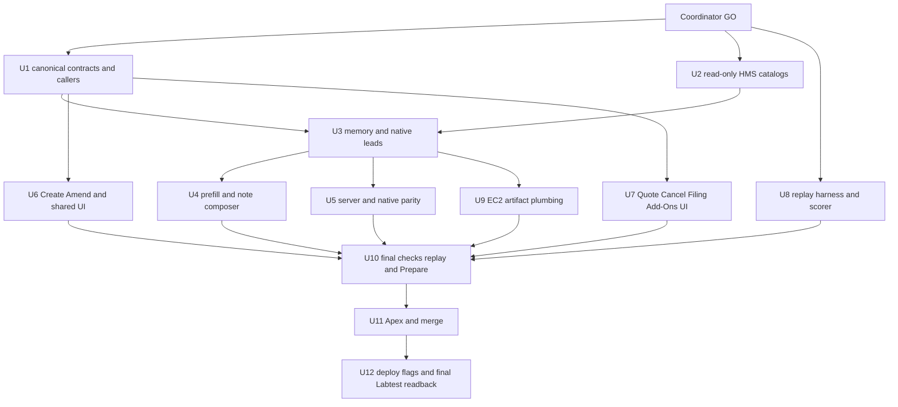

# Centurion Prefill Tiers 1-4 and Infor HMS Parity - Plan

## Goal Capsule

Deliver Create, Amend, Quote, Cancel, Filing and Add-Ons panes that use Infor field names, show native choices/prices, preserve staff edits, and prefill the Tier 1-4 fields from current mail, verified memory and deterministic HMS catalogs.
For example, an agency email should suggest the guest, agency and eligible organization, derive Meal Plan from the selected Rate Plan, compose an editable payer/cap/request note, and preserve both booker contacts through Prepare, staff Save and fresh HMS readback.

- **Authority:** current assignment and owner decisions, then `AGENTS.md` / `PRODUCT.md`, then the 2026-11-13 decision brief. Older plans and draft patches are evidence, not approval.
- **Authority gate:** the coordinator approved GO after adversarial review on 2026-11-13, with the five adjustments incorporated below. Execute through merge, deployment, flags and readback without another approval roundtrip inside the approved scope.
- **Approved Amend pricing protocol (2026-11-13):** use two explicit staff Go actions only for callback-gated/repricing changes, including child ages/count, saved Agency/Organization/A/R, and any other change whose exact HMS price requires a potentially persisting callback. Ordinary Amend edits with exact read-only Prepare pricing remain single-Go. Prepare never dispatches persisting callbacks. First Go claims durably, records exact beforeimages, applies guarded callbacks and reprices without Save; persist the callback state and exact fresh native price before returning `needs_review`. Staff review that price; second Go re-verifies desired fields and the exact reviewed price, then Saves and fresh-reads. Reconcile persisted effects on retries and reapply only missing callbacks, with another exact price check. Never present an old or indicative total as the authoritative price for changed occupancy/payers.
- **Approved Retain capability exception (2026-11-13):** native Retain confirmation follows an initial Save and sends another Save; no verified read-only route supplies final retained tax/total after changed callbacks. Preserve explicit `rateHandling="retain"` and block genuinely changed child count/ages, Booking Agency, Organization, A/R or Guarantee callbacks in Prepare and Execute with `status="unsupported"`, `fields:["rateHandling"]`. Show plain guidance to choose Reprice in Infor or split the changes in HMS. Ordinary Retain and verified same-child/party/guarantee no-ops remain single-Go and unblocked. Never silently switch to Reprice or infer retained totals; report this narrow native capability gap in the final result.
- **Execution:** planner delegates every source read, edit, scrape, check and merge through `spawn_agent`; no manual merge work in the planner context. Luna `high` handles reads; Terra `xhigh` handles hard code/merges; Terra `high` handles bounded edits/checks/deployment.
- **Protection:** never modify `3164/agent-arch` or `zero/agent-arch`, reset/stash another session, or adopt unrelated open PRs. Each Phase 2 writer uses its own worktree/branch; one Terra merge owner integrates released lane commits.
- **Tail owner:** Terra verification/release lanes complete review, merge, deploy, memory provisioning, process flags and final readback after GO. Escalate an actual authorization/external-access blocker; never claim a skipped or failed gate passed.

---

## Product Contract

### Requirements

**A. Catalogs and memory**

- R1. Read and normalize HRCEN master catalogs: Booking Agencies including `ta1commission`, Organizations, A/R Accounts, Rate Plans, Room Types, Track/Sub Segment, Guarantee Types, Source of Business and CMS Messages. Preserve IDs, codes, meanings, property, provenance, capture time and coverage; a loaded lookup grid is not a complete directory. Coordinator-approved coverage exception (2026-11-13): v12 contains 95/95 response-correlated Rate Plan identities from the native Hotel Availability criteria picker, with its initial Nov-13–27 context retained; no accessible administration master or static Meal Plan configuration was found. State this R1 property-master/configuration gap explicitly, retain scoped observations and never promote them into generic Rate Plan-to-Meal Plan mappings.
- R2. Unblock verified Organization/Agency-to-A/R associations, confidence defaults and `ingestStayObservation()` without future-mail leakage. Keep current catalog identity data separate from time-bound learned stay/outbound evidence; a post-Oct-29 Messages read may verify present behavior but cannot become earlier-mail replay memory.
- R3. Provision versioned private JSON/JSONL catalog/memory artifacts locally and on EC2, carry explicit path settings into all four required PM2 processes, and prove checksums plus runtime loading. Bundle deployment alone is insufficient.

**B. Naming and model surfaces**

- R4. Use `Organization` / `organization`, `Meal Plan` / `mealPlan` / `requestedMealPlan`, `Room Type for Charge` / `roomTypeForCharge`, and `Primary Booking Agency` / `bookingAgency` across mail, server-pilot, prompts, contracts, projectors and bindings. Retire application `Company`, `parties.company`, `Board`, `requestedBoard`, `Charged room type` and `parties.agency`; keep actual HMS keys `company`, `mealplan`, `roomtypecharge`, `ta1` at the native boundary.
- R5. Leave sealed gold unchanged. Only the offline scorer may silently map its legacy `company` gold/metric representation to canonical application `organization`; preserve historical metric names and denominators. At persisted DB/stored-draft read boundaries only, hydrate old `company`/`board` keys into canonical fields before Zod validation so existing rows remain readable. All active UI/API/LLM contracts and new writes use canonical names; do not expose legacy aliases there.
- R6. Remove dead, constant, derived and desk-only fields from active LLM schemas/prompts, including the brief's approximately 45-field inventory. Derive native constants and `mealPlan` deterministically while retaining genuinely requested `requestedMealPlan`; count actual model-exposed removals rather than forcing a quota.

**C. Tier 1**

- R7. Resolve Arrival/Departure years from the current message and receipt time, parse `28 Sep 2026`, support Amend `shift_dates` / `shift_departure`, and prevent quoted group/section dates from leaking into the current stay.
- R8. Rank at most three Guest Profiles by normalized name/email/mobile, expose `suggestedRef` for an unambiguous verified candidate, and retain staff selection. Never blindly create a Guest Profile during reservation Save; explicit profile creation remains a separate action.
- R9. Auto-select Primary Booking Agency only at confidence/purity `>=0.80`; otherwise offer top three. Auto-select Organization only for exact sender evidence `>=0.80`; multi-client agency domains always require a top-three dropdown choice. Rank Room Types using eligible memory `>=0.80`, explicit mail cues and live stock, not regex alone.
- R10. Use HMS's draft-bound Meal Plan computation on Prepare/Quote and bind that result again on Go; keep `requestedMealPlan` separate. Coordinator-approved native scope (2026-11-13): `rateplanchange` depends on the full draft, so unscoped static defaults fail closed. A verified selected pair is evidence only for its exact draft and is not a property-wide configuration. Remove only verified active V3 rate/meal shredders and give Create/Amend typed code plus dropdown, code/meaning, native availability/price and staff edits. Preserve edited choices through later recommendation refreshes. Before Prepare, R11 handles null actual Meal Plan using the requested cue and staff-editable note.
- R11. Compose Reservation Note in two layers: deterministic base payer/meal template and memory dinner cap at `>=0.80`, then Luna's explicit email cap override and verbatim special requests. Provide seven presets, an `Awaiting payment - ` toggle and an unlocked textarea on Create and Amend; do not duplicate ordinary special requests into `issues[]` or silently truncate notes.

**D. Tier 2**

- R12. Prefill A/R Account from verified cross-entity evidence and remove a guard only if it blocks a valid selected account. Never prefill Refund Account on a new stay. Extract Billing Reference verbatim with a 4,000-character source contract and support Amend. Require selected A/R when present; the observed editable HMS field allows 50 characters, so preserve longer source values and show actionable validation before any write rather than truncating or bypassing the native limit.
- R13. Default Guarantee Type from high-confidence memory or voucher/POP cues, and TA Commission from verified agency directory evidence `>=0.90`. Repair Track lookup, selection shape and server submit, with an eligible rate-plan/Track mapping.
- R14. Preserve Booker Name, Email and Mobile separately in Create/Amend contracts and UI, and losslessly at the actual native booker controls/readback. Filter guest placeholder/shared-contact noise; copy booker details into guest fields only when the source explicitly identifies them as guest contacts.
- R15. Default CMS Message to editable `'03'`, use confirmed booker email as the recipient hint and add the Amend picker. Show an informational Auto Transfer memory hint only; add no Auto-Transfer Playwright writer.

**E. Tier 3 and Tier 4**

- R16. Always obtain live native Availability/pricing and show a yellow ZAR quoted-versus-native drift alert. Default Adults to `1` and Children to `0` only when absent; support Amend `childAges`; keep Room Type for Charge blank on Create unless staff explicitly selects it. Coordinator-approved native-capability exception (2026-11-13): single saved stays have no editable room-count operation. Preserve extracted Amend `roomCount` visibly; `Keep current` / `op === NONE` permits other fields to Save, while an active count request blocks Prepare/Save at its exact paths with `amend_room_count_requires_separate_reservations` and directs staff to choose rooms to add or cancel through separate Create/Cancel workflows. Do not offer roomCount in `+ Change` or claim native quantity writes.
- R17. Verify confirmation acceptance/rejection in Cancel, Filing, Add-Ons and Amend, including both Filing sites; align actual inconsistent behavior without blindly inverting already-correct validators. Quote must submit `Government` and `staffAllowanceType` successfully.
- R18. Expose Filing `requestedName` / `requestedDescription`, preserve them through projector and native preparation, and align `kind` across schema, UI and supported native attachment operations. Preserve PDF/Excel quote outputs; do not substitute a text-only path.
- R19. Accept Add-Ons `startDate === endDate`, reject reversed dates, preserve service fields through projection, and align editor `maxLength` to verified native limits.
- R20. Port and verify both identified cancellation semantics: last-day shortening is Amend, and an already-cancelled booking does not receive a duplicate Cancel. Bind completion evidence to the same booking; unrelated cancellation text cannot suppress a current request. Keep Cancel penalty's existing second-Go requirement.
- R21. Remove the misleading marketing-opt-in control or expose the actual supported HMS Terms and Conditions behavior. `guestoptin4` is not marketing consent; its current native boundary accepts false only, so this work must not enable true writes.
- R22. Never show `Luna` or other implementation/model names in staff-facing UI. Prove Organization/Agency-to-A/R, Rate Plan-to-Meal Plan, agency commission, Track, Billing Reference and both note layers using authentic late-Oct real-email unsaved Prepare with original trusted receipt timestamps, static verified master catalogs and strictly prior observations. Separately prove the post-Oct-30 cutoff using an explicitly labelled Labtest/non-corpus input `arrivedAt >= 2026-10-31` and the final deployed Nov-13 Labtest Save/readback with runtime memory loading.

**Acceptance examples**

- AE1. An agency domain with multiple organizations yields ranked organizations but no automatic organization selection; a selected organization can lead to its verified A/R account without selecting Refund Account.
- AE2. A DBB note uses the eligible payer/default cap; explicit `R350` in current mail overrides the cap and a halaal/water/transfer request survives verbatim. Staff edits survive Prepare and readback; preset/prefix toggles do not erase them without an explicit replacement action.
- AE3. A dated older message cannot learn a payer/cap from a later stay snapshot or outbound reply. A present-day catalog read can supply native identity/options but is not retroactive behavioral evidence.
- AE4. `Cancel last day of accommodation` shortens departure; `has been cancelled` suppresses repeat Cancel only with same-booking identity evidence. These match corpus failures; the pause record does not prove they were the reviewer's two unnamed variants.
- AE5. A same-day Add-On, both booker contacts, a native-valid Billing Reference with selected A/R, and a custom Filing name/description survive backend Prepare and supported Labtest readback. A 301-4,000-character source Billing Reference remains intact in the draft and produces explicit 50-character native validation; no shortened reference is written.

---

## Planning Contract

**Verified starting point:** clean `kufupa/centurion-tier1-4` HEAD `3de4d2d7`, parents PR #1182 `92a0f8a19` and main `8d754f9b2`.
Relevant Quote/Add-On PRs remain open and some conflict with main; inspect fresh remote heads at integration time, preserve their work, and do not merge them merely because they overlap this scope.

**Load-bearing source facts:**

- Mail types import `reservation-workflow-v2-contract.ts`; canonical contract migration must finish before parallel field work. Core mail seams are `reservation-pane.tsx`, `shared/native-pickers.tsx`, `shared/stay-fields.tsx`, `lib/reservation-workflow/views.ts`, `use-reservation-workbench.ts` and `client.ts`.
- `reservation-workflow-v2-native-leads.ts:169` blocks cross-role A/R candidates. Its `source.arrivedAt` cutoff is message arrival, and the default PMS snapshot was captured `2026-10-30T00:42:32Z`; do not bypass capture-time eligibility to improve a replay score.
- Current native catalog lookups do not paginate; agency commission and Rate Plan-to-Meal Plan directories are absent. `ingestStayObservation()` and a dedicated Stay360 Messages reader are also absent; reuse `buildHmsBookingMemory` / `loadHmsBookingMemory` and `openStay360RecordTab`.
- Booker extraction already separates email/mobile but projection collapses them into `bookerContact`. Trace `caller` / `udfchar06` and actual limits before choosing native serialization; do not invent a native field or silently discard either contact.
- Note limits disagree: contract 4,000, compiler/native binding 2,000. Use the verified native 2,000-character limit consistently and show validation rather than truncation. Billing Reference retains the requested 4,000-character source cap, but live editable Create and saved-Amend controls both expose a 50-character native limit; UI and write validation must reflect that distinction.
- Cancel/Add-Ons/Amend validators are currently positive; Filing's two checks are looser. V2 lacks the cited `explicitNativeCode` shredder symbol; inspect active prompt/parity/legacy paths before deleting code based on an older head.
- `write-ec2-remote-env.sh --m1-only` reads durable `.env.production`, accepts no flag-value arguments, and currently omits memory path variables. Ignored data survives bundle checkout but is not transferred; U9 supplies the missing provisioning/configuration seam.

**Technical choices:**

- KTD1. Freeze canonical draft/command contracts first, migrate every caller in one wave, then fork dependent lane worktrees. Keep legacy persisted-row hydration solely at storage-read boundaries. Do not deploy an intermediate schema/consumer mismatch.
- KTD2. Keep the prefill prompt, source-intent recovery, ranking and note projection with one hard-code owner. Memory/native leads own their separate files and export agreed shapes before the prefill lane begins.
- KTD3. Use property-scoped private JSON/JSONL artifacts with provenance and confidence denominators; retain the clean `ingestStayObservation()` seam for future verified observations. Keep temporal validation per evidence source; never infer historical field state solely from a stay arrival date.
- KTD4. Seed the note family from the census: DBB agent, Settle Direct, BB agent, DBB company, BB company, BB prepaid, DBB prepaid. Six frequent literal families are observed; the requested DBB prepaid preset is a deterministic sibling, not a claimed seventh observed literal. Historical `461/491` coverage and R210/R300/R350 counts are evidence, not universal price policy.
- KTD5. Reuse existing native steps, particularly Check Availability before Save. Verify business fields and fresh readback rather than whole native request bodies, field-key sets/counts or admin-UI campaigns.
- KTD6. A single compatible integration PR is the default. Approximately 500 LOC is guidance, not a cap; cohesive 1,000-1,200 LOC PRs are allowed. Split only if the pieces are independently usable and splitting does not delay shipping; each final PR head still needs review. Diff size and elapsed completion time are unmeasured, so no numeric forecast is claimed.

**Ownership epochs:** U1 is the sole product-file writer during canonical migration; U2 reads HMS/private catalogs and U8 owns its disjoint replay harness/private scorer from GO, concurrently with U1.
After U1 releases its committed interface, U3/U6/U7 can run concurrently in isolated worktrees; U4/U5 wait for U3, and U9 waits for U3's artifact/path contract.
U6 alone owns shared UI helpers, both shared CSS modules and `TargetSearch`; U7 consumes those exports without modifying them.
U5 alone owns common native/compiler files; U2 owns no source files, and U3 does not edit writer files.
A lane needing another owner's file sends its required delta to that owner or waits for explicit transfer; no concurrent edits/cherry-picks to the same file.

---

## Implementation Units

Paths below are repo-relative; `AI` means `apps/server-pilot/src/ai`, `HMS` means `apps/server-pilot/tooling/hms-cloud`, `MAIL` means `apps/mail/components/reservation-pane`, and `MLIB` means `apps/mail/lib/reservation-workflow`.
The unit table is the file-ownership boundary after U1; source additions stay inside the owning unit's named directory and may not expand across another unit's files without transfer.

| ID / lane | Deps | Owner / model + effort | Owned files or artifacts | Brief |
|---|---|---|---|---|
| U1 canonical foundation | GO | Hard code, `gpt-6.1-terra` `xhigh` | Exclusive migration across `apps/mail`, `apps/server-pilot`; especially `AI/reservation-workflow-v2-contract.ts`, `MLIB/types.ts` | Canonical names, complete command shapes, all caller migrations; release ownership afterward |
| U2 catalog discovery | GO | Cheap reads/HMS, `gpt-6-luna` `high` | Assigned private catalog capture artifacts only; source read-only | Complete/scope catalog extraction and native mapping evidence |
| U3 memory unblock | U1,U2 | Hard code, `gpt-6.1-terra` `xhigh` | `AI/reservation-workflow-v2-native-leads.ts`, `party-index.ts`, `pane-rate-recommendation.ts`, `booking-code-rules.ts`; `HMS/hms-booking-memory.mjs`, `booking-lookup-session.mjs`, catalog/observation reader additions | Cross-entity defaults, cutoff, normalized artifacts, ingest seam |
| U4 prefill and note | U1,U3 | Hard code, `gpt-6.1-terra` `xhigh` | `AI/reservation-workflow-v2-prefill.ts`, `reservation-workflow-v2-prefill-service.ts`, `AI/extraction/schema.ts`, `AI/extraction/extract.ts`, `AI/stay-date-anchoring.ts`; dedicated note-composer addition | Tier1-4 deterministic/extraction projection and draft patch |
| U5 backend/native parity | U1,U3 | Hard code, `gpt-6.1-terra` `xhigh` | `AI/reservation-workflow-v2-tools.ts`, `reservation-workflow-v2-quote.ts`, `reservation-workflow-v2-filing.ts`, `reservation-workflow-v2-services.ts`, cancellation implementation; `HMS/create-request-binding.mjs`, `guest-stay-*.mjs`, `lookup.mjs`, `hotel-availability.mjs`, existing readers/dispatch exports excluding all U3-owned memory/session/catalog/observation files | Writer/compiler parity, native pickers, field preservation |
| U6 core pane redesign | U1 | Hard UI, `gpt-6.1-terra` `xhigh` | `MAIL/editors/create-editor.tsx`, `amend-editor.tsx`, `MAIL/shared/*`, `MAIL/reservation-pane.tsx`, both editor CSS modules, `MLIB/views.ts`, `MLIB/client.ts`, `MAIL/use-reservation-workbench.ts`; preset UI addition | Create/Amend, shared pickers, pricing, editable note |
| U7 auxiliary panes | U1 | Hard UI, `gpt-6.1-terra` `xhigh` | `MAIL/editors/quote-editor.tsx`, `cancel-editor.tsx`, `filing-editor.tsx`, `addons-editor.tsx` | Quote/Filing/Add-Ons/Cancel behavior and field coverage |
| U8 replay/scorer | GO | Bounded tools, `gpt-6.1-terra` `high` | `apps/server-pilot/scripts/wave1-prefill-replay/{cache.ts,read-budget.ts,run.ts,runtime.ts,v2.ts}`; private isolated scorer copy only | Start immediately: port harness, isolate scorer and prepare baseline92a0f8a19 |
| U9 runtime artifacts | U3 | Bounded deploy plumbing, `gpt-6.1-terra` `high` | `apps/server-pilot/deploy/` env/start allowlists and scoped memory-sync helper; private release artifacts | Atomic non-Git sync, durable path propagation to four processes |
| U10 verification | U4-U9 | Verifier, `gpt-6.1-terra` `high`; Luna readback `high` | No product edits; generated required replay outputs outside Git | Clean-head checks, paired50, unsaved real-email Prepare |
| U11 integration/review/merge | U1 for setup; U10 for final merge | Hard merge/Apex fixes, `gpt-6.1-terra` `xhigh` | Owned integration worktree/branch; fixes transferred to source owners | Integrate lane commits, review exact heads, land main with hooks |
| U12 deploy and proof | U11 | Deployer, `gpt-6.1-terra` `high`; Luna independent readback `high` | Runtime release, private artifacts, required canary input only | Clean-main bundle, sync, flags, Labtest/readback, PM2 proof |

### U1. Freeze canonical contracts and migrate callers

- **Goal / Requirements:** R4-R6, R12-R19, R21. One compatible set of names and field shapes for all consumers.
- **Dependencies / Files:** GO; exclusive migration ownership described above. U11's merge worker creates/checks isolated lane worktrees, without disturbing either protected worktree.
- **Approach / Patterns:** keep U1 tight: canonical app/native-boundary names, complete draft/command shapes and mechanical caller migration, then release the interface promptly. Include separate booker contacts, Billing Reference 4,000, Amend note/rate/room/CMS/occupancy/party fields, Quote staff allowance, Filing name/description/kind and same-day Add-On shapes. Hydrate legacy persisted keys before Zod only in DB/stored-draft readers, without active API aliases or legacy new writes. Leave behavioral projection/composer work to later lanes.
- **Test scenarios / Verification:** no new tests. Confirm old application names have no live consumers, native keys remain intact, and offline gold is untouched; release a committed interface before parallel writers start. Existing fixture callers needing migration are changed only as existing checks require, without adding cases.

### U2. Capture read-only master catalogs

- **Goal / Requirements:** R1-R3, R9-R10, R13, R15. Verified options and provenance rather than partial-search guesses.
- **Dependencies / Files:** GO; only assigned private artifacts. Reader code requests go to U3/U5; U2 never edits application or tool source.
- **Approach / Patterns:** dependencies were repaired by the coordinator: workspace root and server-pilot node_modules point to `8c31`, with `fflate@0.8.2` loadable; mail node_modules points to `/home/ubuntu/projects/zero/apps/mail/node_modules`. Preserve these links and never run pnpm install through them into the shared project. Only an isolated lane needing its own install may remove its own dependency symlinks first. Verify one session startup, then use bounded catalog extraction and close every own session. Follow `lookup.mjs`, `guest-stay-room-rate.mjs`, dropdown/CMS/source readers and the proven legacy Track picker. Enumerate coverage/pagination and agency commission; derive rate/meal mapping from native records rather than code heuristics.
- **Test scenarios / Verification:** no new tests. Record counts/property/capture time/coverage, not raw guest data in chat. If Messages helps, have U3 implement the bounded reader over `openStay360RecordTab`, verify spooler filtering and keep post-Oct-29 reads separate from replay memory. Failure to read a required catalog remains an unresolved delivery gate.

### U3. Normalize memory and unblock native leads

- **Goal / Requirements:** R1-R3, R8-R13, R15. Auditable, time-eligible recommendations and a working A/R cross-entity seam.
- **Dependencies / Files:** U1,U2; exclusive memory/native-leads files from table. Give U9 a versioned artifact inventory and explicit path contract.
- **Approach / Patterns:** replace the role-equality A/R blocker with verified Organization/Agency association lookup; preserve exact-sender/multi-client distinctions and confidence denominators. Retain snapshot/message cutoffs and use older eligible records when present; do not treat missing timestamps as past evidence. Add `ingestStayObservation()` around the existing memory builder with property/identity/provenance normalization and repeatable deduplication. Keep suggested choices separate from staff selections.
- **Test scenarios / Verification:** no new tests; existing party/rate-memory suites plus replay AE1/AE3. Verify missing memory is visible and provisioning resolves it; never mask failure by unconditional defaults or by preselecting Refund Account.

### U4. Implement source recovery, Tier prefill and note layers

- **Goal / Requirements:** R6-R16,R19-R20. Correct current-message extraction with deterministic native defaults and editable note output.
- **Dependencies / Files:** U1,U3; prefill/extraction/date/note files only. All contract changes are requested through the foundation/integration owner after interface release.
- **Approach / Patterns:** port the `3164` 33-addition/12-deletion patch selectively: nested `unrecognized_keys`, meal negation, `partialStayCancellation`, same-booking cancelled checks and group/section date clearing. Review the `documents`-to-all-`pdfs` source-ref widening; eligibility requires current-source identity and chronology, not attachment presence. Use ranked native candidates, directory defaults, contact noise filtering and deterministic Rate Plan-to-Meal Plan binding; preserve human overrides.
- **Note details:** implement seven presets and prefix as explicit composition controls; layer-one payer/cap confidence `>=0.80`, layer-two explicit Luna cap and verbatim requests. Record source special requests once; genuine unresolved ambiguity may remain an issue. Align note cap to 2,000, retain line feeds and use validation rather than truncation. Never derive a dinner cap from quoted total price.
- **Test scenarios / Verification:** no new tests. Existing date/note checks, paired50 note/date/party dimensions, AE2/AE4, and current-message negation/cancel examples. Inventory removed active LLM fields: derived `nights`/weekdays/mealplan; constants ZAR/HRCEN/English/9000/0.00/Legacy Lifestyle; blank tax/promotion/resort/turndown/cleaning/contract/UDF fields; social/`.`/2099/date-of-birth/ID-scan/internal-user placeholders. Remove only actual model-exposed desk/constant fields, preserving deterministic downstream native values.

### U5. Preserve fields through backend and native operations

- **Goal / Requirements:** R8,R10,R12-R21. A field is complete only when the backend accepts, prepares, writes where supported and reads it back.
- **Dependencies / Files:** U1,U3; shared tools/native writer ownership from table. Catalog/observation additions owned by U3 are consumed through its released exports.
- **Approach / Patterns:** complete native Track picker shape `{lookupCode, display}` and submit, agency commission, A/R/Billing Reference and Create/Amend booker/CMS/note/occupancy mappings. Probe actual booker controls without Save; preserve email and mobile losslessly in verified native fields or composite contact text within native limits. Repair Quote Government/staff allowance, Filing requested metadata/kind projector, and Services' `startDate >= endDate` rejection so equality works.
- **Callback-gated Amend execution:** keep the first-Go callback runner isolated from Save with a retained deny-Save fence and an explicit host return before Save. The trusted caller owns durable authority, issued contexts, current beforeimages, declared row-correlated Agency commission effects, final desired business values, guarded native repricing, and durable price/callback review state. Treat failures after a dispatched callback as possibly partial; do not claim atomicity or duplicate an already persisted effect during recovery. Native repricing follows callbacks and any other requested fields that affect price; a helper that only previews child ages does not establish total/tax.
- **Verification:** no new tests. Use existing focused bindings/booker/save/quote/filing/services/cancel checks and real backend Prepare. Inventory precisely which HMS writers changed for U12; business-field before/after checks must not pin complete native bodies. Keep guest-profile creation explicit, Terms false-only, Refund absent on new Create, CMS send off for Labtest and Auto Transfer informational.

### U6. Redesign shared Create and Amend workflows

- **Goal / Requirements:** R4,R7-R17,R19,R21. Native field order, complete coverage, readable choices and preserved edits.
- **Dependencies / Files:** U1; core UI/shared styles/command plumbing only. Announce shared exported helpers to U7; retain `TargetSearch` API compatibility until consumers migrate.
- **Approach / Patterns:** redesign freely around deterministic HMS preparation order. Show top-three profiles/parties/room choices, typed native codes/dropdowns/meanings, native availability and yellow ZAR drift. Add the two-layer note controls and unlocked textarea to both workflows; all Tier2 fields, Amend rate/room/CMS pickers and occupancy, blank Create charge type, and informational Auto Transfer hint. Correct Terms labeling without offering an unsupported write.
- **Two-Go UI:** reuse the existing Cancel `needs_review` / second-Go pattern for the approved callback cases. Explain in plain language that step one applies details and returns the exact fresh HMS price for review before final Save. Bind the review to the precise input and selected target scope; invalidate it on edits. After saving a reviewed target, stop the batch before starting another target's callbacks under the same click. Keep ordinary single-Go workflows unchanged.
- **Native unsupported choices:** preserve source values visibly and offer Keep current for unsupported saved-field clears rather than offering refused clear operations. Map the approved Retain callback blocker to the Rate handling field without warning on verified no-ops.
- **Verification:** no new tests. Existing saved-stay/amend finder/lookup/note suites and code-level command/view projection checks. Both Outlook/webmail use `ReservationPaneHost` -> `ReservationWorkspace` -> the same pane; verify the shared artifact, and prove HMS tools through the backend rather than pane-click campaigns.

### U7. Complete Quote, Cancel, Filing and Add-Ons panes

- **Goal / Requirements:** R4,R10,R17-R20. All requested auxiliary fields reach commands and projectors.
- **Dependencies / Files:** U1; four editor files only. Shared helper/style requests go to U6, not concurrent edits.
- **Approach / Patterns:** Quote canonical parties/Meal Plan and Government/staff allowance; Filing requested metadata/kind; same-day Add-On dates/limits. Check all named confirmation sites and both Filing checks against valid and malformed confirmations; use shared validation where it reduces divergence. Preserve second Go for Cancel penalty.
- **Verification:** no new tests. Existing relevant mail filing/amend/quote checks and backend unsaved projection. Do not rename a correct native strategy code merely to change its label, or introduce text-only Quote substitutes.

### U8. Port identical replay and offline gold adaptation

- **Goal / Requirements:** R5 plus paired50 verification. Comparable sealed evidence without editing protected worktrees or gold.
- **Dependencies / Files:** GO; begin in parallel with U1/U2. Copy the five untracked harness files read-only from `3164` into the owned replay worktree and prepare an isolated baseline at92a0f8a19 immediately. Use an isolated private scorer copy; no edits to shared historical `scorer/final-code`.
- **Approach / Patterns:** retain runner selection/seal checks, model/read-budget isolation and manifests. Map canonical app `organization` to legacy offline `company` where necessary; do not alter gold files or production contracts for scoring. Freeze scorer/harness version, selection/seal hashes and eligible memory inputs for both heads.
- **Verification:** no new tests. Run harness preflight, confirm 50 identical selected IDs, no writes/no pilot RDS/no gold exposure to extraction. Prepare baseline at `92a0f8a19` in an isolated worktree using the same harness support, then candidate at final reviewed code head; do not operate in `3164` or missing legacy `992a` paths.

### U9. Add durable non-Git provisioning and env support

- **Goal / Requirements:** R3. The deployed feature loads exactly the reviewed private memory/catalog inputs.
- **Dependencies / Files:** U3; deployment/env/start plumbing only, not memory readers or product schemas.
- **Approach / Patterns:** add a scoped artifact-sync helper using existing authenticated SSM/private bundle-transfer plumbing. Stage a versioned manifest and checksums, copy only approved property artifacts, then atomically activate the owned runtime paths; preserve unrelated ignored data. Add `HMS_MEMORY_PMS_PATH`, `HMS_MEMORY_OUTBOUND_PATH`, `HMS_MEMORY_DATA_DIR` and relevant `PARTY_INDEX_PATH` settings to durable writers/remote allowlists. Update BOTH shell `REMOTE_COMMON_ALLOWLIST` and inline JS `common = new Set([...])` inside `validate_remote_env_file`; update `parse-ec2-legacy-env.mjs` and `M1_ONLY_*` as needed. Resolve remote repo/data root from deploy configuration, not a guessed local path.
- **Verification:** no new tests. Confirm remote checksums, ownership/readability, persistence through bundle deploy/restart and successful runtime memory/catalog loading. Existing `.env.production` values and secrets must survive scoped changes; do not print raw env, use a broad default rewrite, or manually edit remote overlays.

### U10. Check the integrated candidate and prove unsaved preparation

- **Goal / Requirements:** every product requirement, using the Verification Contract below.
- **Dependencies / Files:** U4-U9; no product writes. Source owners fix failures in their own branches, then the merge owner produces a new clean head.
- **Approach / Verification:** remote typecheck both apps, existing focused checks, paired50 field comparison and authentic late-Oct real-email backend Prepare with no Save, retaining original trusted receipt timestamps and strictly prior observation eligibility. Cover Organization/Agency-to-A/R, Rate Plan-to-Meal Plan, `ta1commission`, Track, Billing Reference and both note layers. Separately label post-Oct-30 backend projection inputs as Labtest/non-corpus, then prove cutoff/runtime loading through final deployed Nov-13 Labtest Save/readback. Report measured gains and all missing/wrong/unresolved regressions; a field without scored slots needs native proof, not an invented score. Prepare precedes any live Labtest Save.

### U11. Review exact heads and merge through hooks

- **Goal:** reviewed compatible code on main; owns initial lane isolation and all integration/merge work.
- **Dependencies / Files:** setup after U1; final merge after U10. Integration worktree only; valid findings go to file owners or are fixed after explicit ownership transfer.
- **Approach / Verification:** open a cohesive PR against main that includes ancestor #1182 (`92a0f8a19`), run `greptile review --apex --json` from the committed exact PR head (CLI has no PR argument). If Apex fails/stalls, immediately use an independent Terra `xhigh` reviewer with the same diff and requirement contract. Fix valid P0/P1, explain invalid findings and rerun affected gates/review after changes. Merge via `bash scripts/orch/merge-gate.sh <PR>`; never `--no-verify` or bypass hooks. Reconcile fresh main changes before the final review, not after it without re-verification. After landing, inspect/reconcile #1182's state cleanly as superseded by this PR; do not separately land a stale ancestor PR.

### U12. Deploy, provision, prove and finish

- **Goal:** final deployed main SHA, effective flags and independently verified Labtest results.
- **Dependencies / Files:** U11; release/runtime artifacts only. Terra performs writes; Luna reads in a separate session after each serialized Save.
- **Approach / Verification:** follow the ordered release contract below, including clean-main typechecks, bundle deploy, U9 artifact sync, canary-gated flag changes, all-four-process env proof, changed-writer Labtests and final Create/Amend smoke. Send the coordinator exactly one `worker_done` only when all required gates pass, with SHAs, replay deltas, confirmation numbers, runtime identity and flag states; otherwise report failed outcome/blocker honestly.

---

## Verification Contract

**Local and remote checks**

1. Inspect installed commands/package scripts and resource load before running checks. Unset `DATABASE_URL`, `VITEST_ALLOW_PILOT_RDS` and `TEST_DATABASE_URL`; never test pilot RDS. Keep at most three concurrent local focused runs across harnesses and at least 20% CPU/RAM headroom; narrow or use approved remote checks if capacity is tight. No new tests, repo-wide lint/format, local `tsc`/`tsgo` or GitHub Actions.
2. On a clean committed final head run `bash /home/orca/bin/remote-typecheck.sh <clean-worktree> --app mail` and the same command with `--app server-pilot`. Existing focused suites only; use `bash /home/orca/bin/remote-vitest.sh <clean-worktree> server-pilot tests/<existing-file>.test.ts` when useful. `SKIP_TYPECHECK=1` is valid only after a pass for the identical SHA and app. Report DB-backed suites skipped.
3. Select checks by touched behavior, not the whole list: server existing date anchoring, party index/rate catalog, Create binding/save/booker, Quote/staff extras, Filing and cancellation suites; mail `reservation-note.test.ts`, `saved-stay-amend-editor.test.tsx`, `amend-find-panel.test.tsx`, `amend-lookup-panel.test.tsx`, `voucher-filing-client.test.ts`; native `.mjs` existing cases via `node --test`. Resolve actual paths from the package before invoking.
4. Make `scripts/check-entity-literals.mjs` pass by fixing introduced entity literals; do not increase the baseline unnecessarily. Only for a legitimate reviewed baseline change, from `apps/server-pilot` run `node scripts/check-entity-literals.mjs --print-baseline` into a temp file, validate it, then replace `scripts/entity-literals-baseline.json`. Never redirect directly into that baseline file.

**Paired 50-email replay**

- Frozen historical baseline: `92a0f8a19`, R7 `194/240`, 20 missing, 23 unresolved, 3 wrong, zero exceptions/prefill failures. Note `0/16`; legacy `company` `11/13`. This is historical evidence, not a current-head result.
- Evidence root: `/home/orca/.local/share/zero/research/halloween/prefill-wave1-20261112-195632`; immutable `evidence/selection.json`, `evidence/expectations.jsonl` and the sealed input set. Selection SHA256 `29e2f5485817e9b13bb28d2101d401b643e7c849689e375456e76a50625f3194`; seal SHA256 `85b843119b44f5d4974ead0a16dca3149dc905a534ce283d3557daef06a1186a`.
- Runner supports exactly one of `--preflight` / `--run`, plus `--selection`, `--seal`, `--concurrency` and, for run, both `--confirm-selection-sha256` / `--confirm-seal-sha256`. Use `pnpm exec tsx scripts/wave1-prefill-replay/run.ts` from each server-pilot checkout after verifying help/source; keep replay concurrency bounded by capacity and read-budget rules. `FRESH_REPLAY_ROOT` writes `runs/<run-id>/{results.jsonl,manifest.json,summary.json}` outside Git.
- Score both runs using the same isolated copy of `scorer/final-code/rescore.ts`: `pnpm exec tsx <isolated-rescore.ts> wave-one <selection.json> <expectations.jsonl> <results.jsonl> <manifest.json>`. Validate the same cases/denominators and alias behavior first; never reuse the missing R8 release pin or write into protected worktrees.
- Report historical-to-candidate and fresh-baseline-to-candidate exact totals plus per-field missing/unresolved/wrong changes, especially note, organization/company, dates, party and meal/rate dimensions. Aggregate should improve above historical 194/240 with no unexplained critical-field regression or exceptions. Explain model variation if fresh baseline differs from R7.
- The corrected fresh baseline on `92a0f8a19` completed 50/50 with zero exceptions/prefill/native-incomplete failures and all source/evidence hashes matching R7; its valid score is `179/240` (24 missing, 32 unresolved, 5 wrong). Historical R7 remains `194/240`. Validate each run against its actual pinned launch selection, since audited workflow labels changed after the historical launch; do not alter gold or score against observed output labels. Frozen metadata does not freeze live HMS responses or model sampling, so report both observed comparisons and their limits without claiming an isolated causal code effect.
- `ar_account` and `native_rate_code` have no required scored slots in the 240 denominator. Report their observed coverage and native Prepare/readback separately; do not manufacture gain denominators or alter sealed gold to add them. Cover both AE4 cancellation examples and explicitly report any remaining variants.

**Review, live proof and ordered autonomous release**

1. Produce unsaved backend Prepare on authentic late-Oct email details for affected workflows, preserving original receivedAt; inspect staff business fields and stop before Save. Use static verified native masters and observations captured strictly before the original mail. The captured real corpus ends `2026-10-29T16:05:33Z`; November ingest objects are synthetic, and MIME Date is not arrival evidence. Separately label the `>=2026-10-31` projection case as Labtest/non-corpus and verify live memory loading on the final deployed Nov-13 Labtest Save/readback. No fabricated receipt timestamps or pilot-RDS tests.
2. Complete exact-head Apex/fallback review and candidate gates, merge with hooks, then have the merge owner obtain a clean main checkout with `HEAD == fetched origin/main` and no deploy HOLD. Re-run both remote app typechecks on the final merge SHA; repeat focused tests/replay only when integration changes, findings or unresolved concerns justify them.
3. Deploy from that clean main checkout using `bash apps/server-pilot/deploy/ops-deploy.sh`. Do not add `--migrate` without a real migration requirement; do not use rollback/quiesce bypasses. Verify bundle/build marker/runtime SHA and health/readiness/VPN checks.
4. Run U9's scoped non-Git catalog/memory sync, verify manifest checksums and runtime paths, then restart through `bash apps/server-pilot/deploy/ops-restart.sh` as needed. No destructive DB/volume operations, secret output or unrelated data cleanup.
5. Read existing effective flags before changing them. Persist only intended changes through supported durable env plumbing, run `apps/server-pilot/deploy/write-ec2-remote-env.sh --m1-only` as `ubuntu` on EC2, then `ops-restart.sh`; never hand-edit common/admin overlays. Current writer reads `.env.production`, so U9 must make the targeted durable update path safe before using it; the broad `write-ec2-env.sh` default rewrite is not a narrow flag setter.
6. For changed HMS writers, perform a fresh Labtest Save and independent readback for each affected workflow on the deployed final SHA. Always include one final smoke Create/Amend Save on that SHA; pure UI/prefill/memory changes skip redundant multi-workflow ceremony. Labtest arrival/departure are 2027+, CMS send off, property HRCEN, and writes to one confirmation/Labtest stay are serialized. Use a newly created Labtest as the Amend target when both smoke paths are exercised. Preserve Cancel penalty second Go and native send-off behavior.
7. If Create is off, use only the existing narrow Labtest bootstrap `PANE_WRITE_CREATE=lab` plus `PANE_CLOUD_CREATE_DISPATCH=on`; verify script admission rather than assume an exemption. Enabling/widening a flag to `on` requires fresh `CANARY PASS <workflow> HRCEN <40-character-deployed-SHA>` in `NAVA_CANARY_PASS_FILE` (default `/tmp/mh1024/CANARY.txt`). Use actual successful workflow proofs, never a fabricated record. Amend lab activation still needs its canary; if its guard prevents authorized proof, report the exact bootstrap blocker rather than bypass it.
8. Enable only the working authorized workflow flags with their exact final-SHA canaries, refresh overlays/restart, then fresh-read the final Labtest stay and verify flags/identity from each `http`, `worker`, `ai-worker`, `remote-http` process. Compare checkout SHA, `dist/.nava-build-commit`, actual `NAVA_BUILD_COMMIT`, selected flag keys and memory paths; extract an allowlist from actual process environments rather than printing raw `pm2 env` / `pm2 jlist`.
9. Finish with concrete PR/merge/runtime SHAs, both replay totals/deltas and coverage caveats, focused check results/skips, Labtest confirmations/readback outcomes, artifact checksum/loading proof and four-process flag states. Keep at most one short execution state outside Git; required replay artifacts are generated output, not new plans/retros/ledgers/handoff docs.

---

## Definition of Done

- R1-R22 are implemented across active contracts, prompts, projection, panes and supported native operations, with the explicitly approved R16 single-stay room-count exception above; all acceptance examples are accounted for and explicit staff edits survive Prepare/Save/readback. The active room-count request remains visible and blocked, while `Keep current` permits unrelated edits. Legacy persisted drafts hydrate safely; staff-facing UI contains no model names.
- Catalog completeness/coverage and temporal provenance are known, with the approved R1 static Rate Plan master/configuration gap stated explicitly. Selected agency commission and Organization-to-A/R defaults are verified; actual Meal Plan is bound to the native computation for the specific draft rather than inferred from code names or unscoped observations. Local and deployed memory are available through the retained ingest seam.
- Clean final heads pass remote typecheck for both apps and applicable existing focused checks; no new tests, bypassed hooks, pilot-RDS tests or unsupported true Terms/Auto-Transfer writes are introduced.
- Paired50 demonstrates exact measured improvement with critical regressions resolved and zero replay exceptions; unscored A/R/rate coverage is labeled honestly. Cancellation semantics are source-bound.
- Final PR head has Apex or documented fallback review, valid P0/P1 resolved, and main is deployed with exact runtime identity. Required final-SHA Labtest Saves/readbacks, artifact loading and all-four-process effective flags are verified.
- Callback-gated Amend first Go performs no Save and durably returns the exact repriced state for review; second Go saves only the verified desired fields and reviewed price. Retry reconciliation prevents duplicate persisted callbacks. Ordinary exact-price Amend remains single-Go, and a reviewed target's Save does not start another target's apply phase implicitly.
- Explicit Retain plus genuinely changed callbacks is visibly unsupported under the approved native capability exception, with exact field attribution; ordinary and verified no-op Retain amendments remain supported.
- The final report states the real corpus's Oct-29 cutoff and distinguishes authentic-mail Prepare from labelled Labtest/non-corpus clock proof. Native Billing Reference is checked against the observed editable 50-character limit; the 4,000-character source contract never authorizes native truncation or validation bypass.
- Remove abandoned experimental code and active app legacy aliases introduced during this work; retain only the approved persisted-reader hydration and offline sealed-gold adapter. Preserve sealed fixtures and every other session's files. Coordinator receives one truthful final completion message.

---

## Appendix

Decision-critical external inputs (read-only):

- `/home/orca/.local/share/zero/research/halloween/v2-v3-retro-20261112/2026-11-13-tier1-4-decision-brief.md` (authority); `02-hms-field-census-and-roi.md:354` (note families/limits).
- `/home/orca/.codex/worktrees/3164/agent-arch` (paused prefill diff and five untracked harness files); never modify it.
- Frozen scorer `.../scorer/rescores/wave1-fixed50-2026-11-13T00-14-23-109Z-e26836a4/summary.json`, `STATE.json`, `diagnostics/field-loss-examples.json:814` and `:920` (historical scores/inferred cancellation examples).
- Repo anchors: `AI/reservation-workflow-v2-prefill.ts` (`projectCurrentExtraction`, `bindGuestProfileObservations`, `applyDefaultCmsSendPolicy`), `AI/reservation-workflow-v2-native-leads.ts:169`, `AI/reservation-workflow-v2-tools.ts` (`compileReservationWorkflowV2Create`), `HMS/hms-booking-memory.mjs` (`buildHmsBookingMemory`), `HMS/create-request-binding.mjs`, `apps/server-pilot/deploy/{ops-deploy.sh,write-ec2-remote-env.sh,sync-ec2-git-bundle.sh}`.

**Current evidence limit:** the Phase1 missing-fflate startup failure was repaired by the coordinator through dependency symlinks; preserve those links and do not install through them. Both earlier attempts exited without opening a browser session. U2 must now verify live read-only HMS reachability/catalog coverage. No EC2 runtime/flag/artifact state is claimed; U12 independently establishes those facts.
