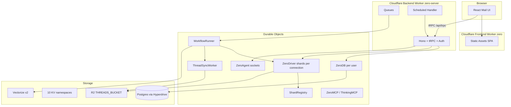

# Zero Email — Zero-Context Handoff

**Purpose:** Bootstrap a new LLM agent with **no access to prior chat history**. This document consolidates user intent, codebase facts (with paths), research conclusions, branch state, and next steps.

**Repo root:** `c:\Users\gamin\Desktop\projs\emails hotels uis\zero`  
**Last updated:** 2026-06-29 (from autonomous planning + refactor session)  
**Related plans (Cursor):**
- `C:\Users\gamin\.cursor\plans\cloudflare-beginner-migration-audit_cd1edeb5.plan.md` (latest synthesis)
- `C:\Users\gamin\.cursor\plans\cloudflare-beginner-migration-audit_85b769ee.plan.md` (full resource inventory)
- `C:\Users\gamin\.cursor\plans\cloud-swap-cost-plan_5e5557cc.plan.md` (cost / hybrid strategy)

**Prior chat transcript (optional deep history):**  
`C:\Users\gamin\.cursor\projects\c-Users-gamin-Desktop-projs-emails-hotels-uis-zero\agent-transcripts\fb6d5eb0-a550-4cd6-8273-9aba2469a275\fb6d5eb0-a550-4cd6-8273-9aba2469a275.jsonl`

---

## 1. What the user wants (consolidated)

Read this section first. It is the product direction, not just infra.

### 1.1 Completed / delivered in prior session

| Item | Status | Notes |
|------|--------|-------|
| FE-demo → full-stack refactor on **`FE-demo-refactor`** branch | **Done & committed** | User said: work **only** on `FE-demo-refactor`, **never** touch `FE-demo` branch |
| Rename `hotel` → `hosted` everywhere appropriate | **Done** on refactor branch | Phase A of refactor plan |
| Local demo run (`pnpm dev:demo:frontend`) | **Verified working** | Frontend-only demo |
| PR `FE-demo-refactor` → `main` | **Requested** | Created via GitHub API (`gh` not available in agent env) |
| Kill local dev servers | **Done** | User asked to stop all local processes |
| Architecture plan for **present** stack | **Done** | User asked for current-state documentation before scaling plan |
| Cloudflare beginner audit + AWS/Azure swap research | **Done** (research) | **Docs not yet written to repo** — see §8 |
| 50-user performance / AI automation scaling plan | **Researched, not executed** | User said "DONT PLAN IT YET" for scaling limits initially, then asked for scaling research later |

### 1.2 Active goals (not yet done)

1. **Write production-readiness docs** (4 files) from cloud audit — see §8.
2. **Eventually:** performant multi-user FE + BE for ~**50 concurrent hotel-group users** with AI email automation.
3. **Refactor leftovers** on `FE-demo-refactor` (if still open on that branch):
   - Normalize `VITE_PUBLIC_MAIL_API_MODE=hotel` → `hosted` in mail-mode + tests
   - `isUnsupportedFeatureError` + hosted-mode banner/disabled UX (Phase D — intentional stub for later features)
   - ESLint cleanup buckets on `@zero/mail`
   - Final test/build/lint gates + rollout doc evidence

### 1.3 Explicit user constraints (do not violate)

- **Do not operate on `FE-demo` branch** — leave it alone.
- **Do not commit** unless user asks.
- **Do not full-migrate off Cloudflare** without strong reason — hybrid + credits is recommended (§7).
- User is **not a cloud/infra expert** — explanations must be plain English with tables.
- User may have **AWS/Azure credits** — best spent on AI + Postgres, not rewriting Durable Objects.

---

## 2. Repo orientation (30 seconds)

### 2.1 Monorepo layout

| Path | Package | Role |
|------|---------|------|
| `apps/mail` | `@zero/mail` | React Router 7 SPA, Tailwind, Shadcn, TanStack Query, Jotai |
| `apps/server` | `@zero/server` | Hono + tRPC on Cloudflare Workers, Drizzle, Better Auth |
| `packages/*` | shared | ESLint config, CLI (`nizzy`), tsconfig, testing |
| `scripts/` | — | `run-frontend-local.mjs`, `cleanup-dev-processes.mjs` |
| `docs/superpowers/plans/` | — | Many FE-demo refactor plans (2026-04-xx) |

**Tooling:** `pnpm` workspaces + `turbo`. Root scripts in `package.json`.

### 2.2 Git branches (as of handoff)

| Branch | Notes |
|--------|-------|
| `FE-demo-refactor` | **Main refactor worktree.** ~232 files vs `main`, includes hosted rename, demo gates, dev scripts. Remote: `origin/FE-demo-refactor`. Recent commits include `a81c0bf3 refactor(dev): hosted shell rename...` |
| `FE-demo` | **Do not touch** per user |
| `FE-demo-minimal` | Was checked out in planning workspace when handoff written — may lag refactor branch |
| `main` | Production baseline |
| `staging` | `origin/HEAD` points here |

**Agent action:** For refactor continuation, `git checkout FE-demo-refactor` (or use existing worktree).

### 2.3 Deployed URLs (from wrangler)

| Env | Frontend | Backend API |
|-----|----------|-------------|
| local | `http://localhost:3000` | `http://localhost:8787` |
| staging | `https://staging.0.email` | `https://sapi.0.email` |
| production | `https://0.email` | `https://api.0.email` |

Config: `apps/mail/wrangler.jsonc`, `apps/server/wrangler.jsonc` (`vars.VITE_PUBLIC_*`).

---

## 3. Tech stack (verified in repo)

### 3.1 Frontend (`apps/mail`)

| Layer | Technology | Key files |
|-------|------------|-----------|
| Framework | React 19 + React Router 7 | `apps/mail/react-router.config.ts`, `apps/mail/app/routes.ts` |
| Build | Vite + Cloudflare plugin | `apps/mail/vite.config.ts` |
| Styling | TailwindCSS + Shadcn | `apps/mail/components/ui/` |
| Server state | TanStack Query v5 + persist (idb-keyval) | `apps/mail/providers/query-provider.tsx` |
| Client state | Jotai | various hooks |
| API | tRPC client (`@trpc/client` v11) | `apps/mail/providers/query-provider.tsx` |
| Auth client | Better Auth | `apps/mail/lib/auth-client.ts` |
| Deploy | Cloudflare Workers **static assets** | `apps/mail/wrangler.jsonc` (`assets.directory: ./build/client/`) |
| Editor | TipTap / Novel | compose components |
| Monitoring | Sentry (tunnel via backend) | `apps/mail/app/root.tsx` |

### 3.2 Backend (`apps/server`)

| Layer | Technology | Key files |
|-------|------------|-----------|
| Runtime | **Cloudflare Workers** | `apps/server/src/main.ts`, `apps/server/wrangler.jsonc` |
| HTTP | Hono | `apps/server/src/main.ts` |
| API | tRPC v11 | `apps/server/src/trpc/index.ts`, `apps/server/src/trpc/routes/*` |
| Auth | Better Auth | `apps/server/src/lib/auth.ts` |
| DB ORM | Drizzle + PostgreSQL | `apps/server/src/db/`, `apps/server/src/db/schema` |
| DB connection | **Hyperdrive** binding | `apps/server/src/env.ts` → `getPostgresConnectionString()` |
| Stateful compute | **8 Durable Object classes** | See §5 |
| Async | Queues (3), Workflows (2), Cron | `apps/server/wrangler.jsonc`, `apps/server/src/main.ts` |
| Blob storage | R2 `THREADS_BUCKET` | thread JSON |
| Vector search | Vectorize (2 indexes) | embeddings / summaries |
| AI | Workers AI binding + Vercel AI SDK v4 | OpenAI, Anthropic, Groq, Perplexity deps in `apps/server/package.json` |
| Rate limits | Upstash Redis | `apps/server/src/trpc/trpc.ts`, `apps/server/src/lib/services` |
| Observability | OpenTelemetry → Axiom, Datadog hooks | wrangler `vars.OTEL_*`, `DD_*` |
| Error tracking | Sentry ingest proxy | `apps/server/src/main.ts` `/monitoring/sentry` |
| Functional errors | Effect library | shard aggregation in `server-utils.ts` |

### 3.3 tRPC router map

Defined in `apps/server/src/trpc/index.ts`:

`ai`, `bimi`, `brain`, `categories`, `connections`, `cookiePreferences`, `drafts`, `labels`, `mail`, `notes`, `shortcut`, `settings`, `user`, `templates`, `meet`, `logging`

**Heaviest routes for mail product:** `mail.ts`, `brain.ts`, `ai/*`, `label.ts`, `drafts.ts`.

---

## 4. Architecture — how requests flow

### 4.1 High-level diagram



### 4.2 Mail read path

1. Browser → tRPC `mail.*` → `apps/server/src/trpc/routes/mail.ts`
2. `getActiveConnection()` → `getZeroDB(userId)` → Postgres for connection record  
   - **File:** `apps/server/src/lib/server-utils.ts` (`getZeroDB`, `getActiveConnection`)
3. `getThreadsFromDB(connectionId)` → `getZeroAgent(connectionId)` → **`ZeroDriver` shard** (not `ZeroAgent`!)  
4. If multi-shard: `ShardRegistry` lists shards → aggregate via `aggregateShardDataEffect`  
5. Full thread bodies: R2 `THREADS_BUCKET` at key `${connectionId}/${threadId}.json`  
   - **Files:** `apps/server/src/routes/agent/sync-worker.ts`, `apps/server/src/routes/agent/index.ts`

### 4.3 Gmail push / sync path

1. Gmail Pub/Sub → `POST /a8n/notify/:providerId` → `thread_queue.send()`  
   - **File:** `apps/server/src/main.ts`
2. Queue consumer → `WorkflowRunner` DO (`apps/server/src/pipelines.ts`)
3. Uses KV `gmail_history_id`, `gmail_processing_threads` for incremental sync + locks
4. `ThreadSyncWorker` fetches full thread → R2; `ZeroDriver` updates SQLite metadata
5. Optional: Workflows `SyncThreadsCoordinatorWorkflow` / `SyncThreadsWorkflow` for bulk folder sync  
   - **Files:** `apps/server/src/workflows/sync-threads-*.ts`
6. AI pipeline may upsert Vectorize + call `env.AI`  
   - **File:** `apps/server/src/thread-workflow-utils/workflow-functions.ts`

### 4.4 Live updates / AI chat path

1. `getZeroSocketAgent(connectionId)` → **`ZERO_AGENT` / `ZeroAgent`** DO  
   - **File:** `apps/server/src/lib/server-utils.ts` L541-544
2. `sendDoState()` broadcasts mailbox counts/size to connected clients via `ZeroAgent.broadcastChatMessage`  
   - **File:** `apps/server/src/lib/server-utils.ts` L501-538
3. AI chat uses Cloudflare Agents patterns in `apps/server/src/routes/agent/index.ts` (`ZeroAgent` class)

---

## 5. Cloudflare resource inventory (authoritative)

**Single source of truth for bindings:** `apps/server/wrangler.jsonc`  
**Type definitions for all bindings:** `apps/server/src/env.ts`  
**DO class exports:** `apps/server/src/main.ts` L1271-1282

### 5.1 Two Cloudflare deployables

| Worker name | App | Entry | Config |
|-------------|-----|-------|--------|
| `zero` | Frontend static assets | built `apps/mail/build/client/` | `apps/mail/wrangler.jsonc` |
| `zero-server` | Backend API + DO exports | `apps/server/src/main.ts` | `apps/server/wrangler.jsonc` |

### 5.2 Durable Objects — CRITICAL NAMING TRAP

| Wrangler binding | Class | Plain English | Primary code |
|----------------|-------|---------------|--------------|
| `ZERO_DRIVER` | `ZeroDriver` | Per-shard mailbox SQLite cache + Gmail driver | `apps/server/src/routes/agent/index.ts` |
| `ZERO_AGENT` | `ZeroAgent` | Live WebSocket + AI chat session | same file |
| `SHARD_REGISTRY` | `ShardRegistry` | SQLite table of shard IDs per connection | same file |
| `ZERO_DB` | `ZeroDB` | Per-user Postgres RPC facade | `apps/server/src/main.ts` |
| `WORKFLOW_RUNNER` | `WorkflowRunner` | Gmail webhook processor | `apps/server/src/pipelines.ts` |
| `THREAD_SYNC_WORKER` | `ThreadSyncWorker` | Fetch one thread → R2 | `apps/server/src/routes/agent/sync-worker.ts` |
| `ZERO_MCP` | `ZeroMCP` | MCP tool server for mail | `apps/server/src/routes/agent/mcp.ts` |
| `THINKING_MCP` | `ThinkingMCP` | Sequential-thinking MCP tool | `apps/server/src/lib/sequential-thinking.ts` |

**Naming trap (read carefully):**

```typescript
// apps/server/src/lib/server-utils.ts
export const getZeroAgent = async (connectionId) => {
  // Returns ZERO_DRIVER shard client via dormroom — NOT ZeroAgent class!
  const shardId = await getActiveShardId(connectionId);
  return getShardClient(connectionId, shardId);
};

export const getZeroSocketAgent = async (connectionId) => {
  // Returns actual ZERO_AGENT / ZeroAgent DO stub
  return env.ZERO_AGENT.get(env.ZERO_AGENT.idFromName(connectionId));
};
```

Most of the codebase calls `getZeroAgent()` for **mail operations**. Only realtime/chat uses `getZeroSocketAgent()`.

**Sharding:** `MAX_SHARD_SIZE = 8192 MB` in `server-utils.ts` L17. New shard created when registry shards are full.

### 5.3 Queues

| Binding | Queue name (prod) | Purpose | Producer/consumer refs |
|---------|-------------------|---------|------------------------|
| `thread_queue` | `thread-queue-prod` | Gmail webhook async processing | `main.ts` consumer, webhook producer |
| `subscribe_queue` | `subscribe-queue-prod` | Gmail watch setup/renewal | `lib/auth.ts`, `trpc/routes/brain.ts` |
| `send_email_queue` | `send-email-queue-prod` | Delayed/scheduled send | `trpc/routes/mail.ts` |

### 5.4 Workflows

| Binding | Class | Purpose |
|---------|-------|---------|
| `SYNC_THREADS_WORKFLOW` | `SyncThreadsWorkflow` | Sync one page of threads |
| `SYNC_THREADS_COORDINATOR_WORKFLOW` | `SyncThreadsCoordinatorWorkflow` | Loop pages, spawn child workflows |

**Production flag:** `DISABLE_WORKFLOWS=true` in **production** `vars` (`wrangler.jsonc` L623). Staging has `false`. Local has `true`.

### 5.5 KV namespaces (10)

All declared in `apps/server/wrangler.jsonc` per env. Usage map:

| Binding | Purpose | Example code |
|---------|---------|--------------|
| `gmail_history_id` | Last Gmail history ID | `pipelines.ts` |
| `gmail_processing_threads` | Sync locks / cooldowns | `pipelines.ts`, `trpc/routes/mail.ts`, `lib/bulk-delete.ts` |
| `subscribed_accounts` | Brain/Gmail subscription on/off | `trpc/routes/brain.ts`, `lib/factories/google-subscription.factory.ts` |
| `connection_labels` | AI label prefs | `trpc/routes/brain.ts` |
| `prompts_storage` | Custom AI prompts | `lib/brain.ts`, `pipelines.effect.ts` |
| `gmail_sub_age` | Watch renewal timestamp | `google-subscription.factory.ts`, `main.ts` scheduled |
| `pending_emails_status` | Scheduled send cancel state | `trpc/routes/mail.ts`, `main.ts` |
| `pending_emails_payload` | Scheduled email body | same |
| `scheduled_emails` | Schedules >12h (beyond queue delay) | same |
| `snoozed_emails` | Snooze wake times | `trpc/routes/mail.ts`, `routes/agent/index.ts` |

### 5.6 R2, Vectorize, Hyperdrive, AI

| Resource | Binding / name | Purpose | Code |
|----------|----------------|---------|------|
| R2 | `THREADS_BUCKET` → bucket `threads` (prod) | Full thread JSON blobs | `sync-worker.ts`, `routes/chat.ts`, `agent/index.ts` |
| Vectorize | `VECTORIZE` → `threads-vector` | Thread-level summary embeddings | `thread-workflow-utils/workflow-functions.ts`, `trpc/routes/brain.ts` |
| Vectorize | `VECTORIZE_MESSAGE` → `messages-vector` | Message-level embeddings | `workflow-functions.ts` |
| Hyperdrive | `HYPERDRIVE` | Postgres pooler | `env.ts`, all `createDb()` paths |
| Workers AI | `AI` | Embeddings, summaries, labels | `workflow-functions.ts`, `routes/agent/tools.ts` |
| Cron | `0 0 * * *`, `0 * * * *` | Daily + hourly scheduled tasks | `main.ts` `scheduled()` — subscription renewal, long-term scheduled mail, snooze prep |

### 5.7 Production feature flags (wrangler vars)

| Var | Production value | Effect |
|-----|------------------|--------|
| `DISABLE_WORKFLOWS` | `"true"` | Bulk sync workflows disabled in prod |
| `DISABLE_CALLS` | `"true"` | Voice/call endpoints off |
| `THREAD_SYNC_LOOP` | `"true"` | Sync loop enabled |
| `THREAD_SYNC_MAX_COUNT` | `"60"` | Sync batch cap |
| `USE_OPENAI` | (secrets) | Model provider selection in agent paths |
| `AUTORAG_ID` | `""` | AutoRAG disabled unless set |

---

## 6. Frontend demo / hosted modes

### 6.1 Demo runtime gate (CRITICAL)

**File:** `apps/mail/lib/demo/runtime.ts`

```typescript
export const FORCE_FRONTEND_ONLY_DEMO = true;  // hard-coded — blocks ALL real backend

export function isFrontendOnlyDemo() {
  if (FORCE_FRONTEND_ONLY_DEMO) return true;
  // ... env-based fallback
}
```

When `isFrontendOnlyDemo()` is true:
- `query-provider.tsx` returns **mock tRPC client** (`createDemoTrpcClient`) instead of real HTTP client (L178-180)
- Hooks across mail app branch to `lib/demo/local-actions` (notes, settings, summary, attachments, etc.)

**To test real multi-user backend:** set `FORCE_FRONTEND_ONLY_DEMO = false` and use env `ZERO_DEMO_MODE` / `ZERO_DEMO_FRONTEND_ONLY` via scripts.

### 6.2 Dev scripts

**File:** `scripts/run-frontend-local.mjs`

| Command (root `package.json`) | Behavior |
|-------------------------------|----------|
| `pnpm dev:demo:frontend` | `--frontend-only --demo-frontend-only` → sets `ZERO_DEMO_MODE=1`, `ZERO_DEMO_FRONTEND_ONLY=1`, may skip backend |
| `pnpm dev:frontend` | `--frontend-only` |
| `pnpm devfull` | `--full` → starts backend if unreachable |
| `pnpm dev:backend` | `scripts/run-backend-local.mjs` |
| `pnpm cleanup:dev` | kills dev processes |

Backend probe URL: `${VITE_PUBLIC_BACKEND_URL}/api/public/providers`

### 6.3 tRPC client config

**File:** `apps/mail/providers/query-provider.tsx`

- `httpBatchLink` with **`maxItems: 1`** — batching effectively **disabled** (extra HTTP round-trips at scale)
- 5s fetch timeout
- Query cache persisted to IndexedDB per `connectionId`
- Credentials: `include` (cookie auth)

### 6.4 Hosted vs demo (refactor branch)

On `FE-demo-refactor`, terminology was renamed **`hotel` → `hosted`**.  
Current `FE-demo-minimal` branch has `apps/mail/lib/admin-dashboard/access.ts` with `AdminSource = 'demo' | 'hosted'`.

Refactor branch added **mail-mode** concepts (`legacy` / `hosted` / `demo`) — grep `FE-demo-refactor` for `mail-mode` files if not on current branch.

**Phase D (intentional stub):** `isUnsupportedFeatureError` + hosted-mode banner for features coded later — may not exist on all branches yet (grep found no implementation on `FE-demo-minimal`).

---

## 7. Cloud / cost conclusions (research — not yet in repo docs)

### 7.1 Recommendation

**Do NOT full-migrate off Cloudflare for 50-user pilot.**

| Strategy | Verdict |
|----------|---------|
| Keep Cloudflare Workers + DO + Queues + Workflows + R2 + Vectorize | **Yes** — code is built around this |
| Spend AWS/Azure credits on **AI** (Bedrock / Azure OpenAI) | **Yes** — highest ROI, lowest rewrite |
| Optionally move **Postgres** to Azure PG / RDS behind Hyperdrive | **Maybe** — test latency first |
| Full AWS or Azure replacement | **Only if** procurement/compliance mandates it |

### 7.2 Cost bands (50 concurrent users, platform only — excludes LLM tokens)

| Stack | Low | Normal pilot | Heavy |
|-------|-----|--------------|-------|
| **Cloudflare** (current) | $10–30/mo | $10–60/mo | $100–250/mo |
| **AWS** full replacement | $45–180/mo lean | $100–500/mo | $600–1400/mo if OpenSearch-heavy |
| **Azure** full replacement | $140–220/mo lean | — | $430–550/mo+ with Front Door Premium + AI Search |

**What actually dominates bill:** OpenAI/Anthropic/Azure OpenAI tokens ($50–500+/mo heavy use), Postgres ($25–150/mo), not Cloudflare infra.

### 7.3 Hardest migration pieces (no 1:1 cloud equivalent)

1. **`ZeroDriver` + `ShardRegistry`** — DO SQLite mail cache + sharding
2. **`ZeroAgent`** — WebSocket + chat + broadcast
3. **Workflows** — `SyncThreadsCoordinatorWorkflow` long-running orchestration

**Easiest swaps:** frontend static hosting, KV → DynamoDB/Table Storage, R2 → S3/Blob, cron → EventBridge/Timer.

### 7.4 AWS ↔ Azure ↔ Cloudflare quick map

| Cloudflare | AWS | Azure |
|------------|-----|-------|
| Workers | Lambda + API Gateway | Functions / Container Apps |
| Durable Objects | DynamoDB + Lambda/ECS + WebSockets | Durable Entities + Cosmos + SignalR |
| Queues | SQS | Service Bus / Storage Queues |
| Workflows | Step Functions | Durable Functions |
| KV | DynamoDB | Table Storage / Cosmos |
| R2 | S3 | Blob Storage |
| Vectorize | pgvector / OpenSearch | Azure AI Search (~$74/mo Basic) |
| Hyperdrive | RDS Proxy + Aurora | Azure PostgreSQL Flexible |
| Workers AI | Bedrock | Azure OpenAI |
| Static assets | Amplify / S3+CloudFront | Static Web Apps |

Official pricing URLs listed in `cloudflare-beginner-migration-audit_85b769ee.plan.md` §Sources Used.

---

## 8. Pending documentation deliverables

Research is complete; **these files do not exist in repo yet.** Write them when user approves execution:

| File | Content |
|------|---------|
| `docs/production-readiness/cloudflare-resource-map.md` | One section per CF service: plain English, code refs, AWS/Azure equivalent, what breaks if removed |
| `docs/production-readiness/cloud-cost-comparison.md` | Low/normal/heavy bands, unknowns checklist, AI cost dominance |
| `docs/production-readiness/hybrid-cloud-plan.md` | Keep CF + route AI/Postgres to credits |
| `docs/production-readiness/aws-full-migration-contingency.md` | Only-if-required playbook |
| `docs/production-readiness/azure-full-migration-contingency.md` | Only-if-required playbook |

**This handoff file** (`ZERO-CONTEXT-HANDOFF.md`) is the meta-document; the four above are user-facing audit docs.

---

## 9. Scaling to 50 users — findings (planning only)

Not executed. Key bottlenecks identified:

| Area | Issue | Where |
|------|-------|-------|
| Frontend | `FORCE_FRONTEND_ONLY_DEMO=true` prevents real load test | `apps/mail/lib/demo/runtime.ts` |
| Frontend | tRPC `maxItems: 1` disables batching | `query-provider.tsx` L187 |
| Backend | `DISABLE_WORKFLOWS=true` in prod | `wrangler.jsonc` production vars |
| Backend | Per-connection DO fanout on multi-shard mailboxes | `server-utils.ts` `aggregateShardDataEffect` |
| Backend | Gmail/Microsoft API rate limits | provider factories, sync pipelines |
| Backend | AI cost unbounded per sync/thread | `workflow-functions.ts`, `trpc/routes/ai/*` |
| Ops | Unknown: DO active duration, queue volume, R2 size | **Must measure in staging** |

**Suggested next execution phase (after docs):**
1. Flip demo flag off in staging branch only
2. Enable workflows in staging (already `false` disabled only in prod)
3. Add queue concurrency limits + DLQ
4. Add provider rate limit middleware (partial exists via Upstash in `trpc/trpc.ts`)
5. Raise `maxItems` on tRPC batch link after testing
6. Load smoke: 50 simulated users against staging API

---

## 10. How to run locally (quick reference)

```bash
# From repo root
pnpm install

# DB (optional for full stack)
pnpm docker:db:up
pnpm db:push

# Frontend-only demo (what user verified)
pnpm dev:demo:frontend

# Full stack (frontend + backend if backend reachable)
pnpm devfull

# Backend only
pnpm dev:backend

# Cleanup stuck processes (Windows-friendly)
pnpm cleanup:dev

# Tests
pnpm --filter=@zero/mail test   # if configured
pnpm test
```

**Backend local requirements** (from `main.ts` error hints): `pnpm nizzy sync`, `pnpm db:push`, Hyperdrive local config, Upstash Redis URL for rate limits.

---

## 11. Key files index (grep starting points)

| Topic | Path |
|-------|------|
| All CF bindings | `apps/server/wrangler.jsonc` |
| Env / binding types | `apps/server/src/env.ts` |
| Worker entry, queues, cron, exports | `apps/server/src/main.ts` |
| DO mail engine | `apps/server/src/routes/agent/index.ts` |
| DO utilities / naming trap | `apps/server/src/lib/server-utils.ts` |
| Gmail pipeline | `apps/server/src/pipelines.ts` |
| Thread sync workflow | `apps/server/src/workflows/sync-threads-workflow.ts` |
| Coordinator workflow | `apps/server/src/workflows/sync-threads-coordinator-workflow.ts` |
| Thread → R2 worker DO | `apps/server/src/routes/agent/sync-worker.ts` |
| Mail tRPC | `apps/server/src/trpc/routes/mail.ts` |
| AI brain tRPC | `apps/server/src/trpc/routes/brain.ts` |
| Vector/AI workflow steps | `apps/server/src/thread-workflow-utils/workflow-functions.ts` |
| Auth + subscribe queue | `apps/server/src/lib/auth.ts` |
| Rate limiting | `apps/server/src/trpc/trpc.ts` |
| Demo gate | `apps/mail/lib/demo/runtime.ts` |
| tRPC + mock client | `apps/mail/providers/query-provider.tsx` |
| Frontend deploy | `apps/mail/wrangler.jsonc` |
| Dev orchestration | `scripts/run-frontend-local.mjs` |
| Root scripts | `package.json` |

---

## 12. Unknowns — must measure, not guess

- Emails synced per user per day
- AI calls per incoming thread / per user session
- Average R2 thread JSON size (attachments?)
- `ZeroAgent` WebSocket active minutes vs hibernated
- Queue messages per hour at peak
- Gmail/Microsoft 429 rate under hotel load
- Vector upsert count during sync
- Actual Postgres host (Supabase? Neon? RDS?) — check deployment secrets / Hyperdrive dashboard, not in repo

---

## 13. Suggested first actions for a new agent

**If continuing cloud audit docs:**
1. Read §5 and §7 of this file (skip re-auditing wrangler unless config changed)
2. Write the 4 files in §8 using templates in `cloudflare-beginner-migration-audit_85b769ee.plan.md` Task 1–4
3. Do not commit unless user asks

**If continuing FE refactor:**
1. `git checkout FE-demo-refactor` (not `FE-demo`)
2. Read `docs/superpowers/plans/2026-05-03-fe-demo-full-refactor-final-rollout.md`
3. Run `pnpm --filter=@zero/mail test`, lint, build
4. Address §1.2 leftovers (hosted rename normalization, unsupported UX, eslint)

**If starting 50-user performance work:**
1. Read §9
2. Confirm with user: staging target, mail provider (Gmail vs M365), AI usage expectations
3. Create new execution plan — do not change prod `DISABLE_WORKFLOWS` without explicit approval

---

## 14. Risks the prior agent flagged

| Risk | Severity | Detail |
|------|----------|--------|
| Durable Object lock-in | High | Full AWS/Azure migration = multi-week rewrite of mail cache + sockets |
| Misread `getZeroAgent` | Medium | Debugging wrong DO class wastes hours |
| Prod workflows disabled | Medium | Bulk sync path untested in production config |
| Demo flag hard-coded | Medium | All local testing may not reflect real backend |
| AI cost explosion | High | Token spend >> infra; needs per-tenant budgets |
| Azure AI Search / OpenSearch floor cost | Medium | Fixed ~$74–350/mo can exceed entire CF bill |
| Cross-cloud Postgres latency | Medium | Hyperdrive → external Azure PG needs staging proof |
| Exa MCP rate limits | Low | Hit during research; use WebSearch/WebFetch fallback |

---

## 15. FE-demo-refactor PR context

User requested PR from `FE-demo-refactor` → `main`. Agent used GitHub API (`curl`) because `gh` CLI unavailable. Verify on GitHub whether PR merged or open before duplicating work.

Large refactor scope (~232 files): demo mail UI, folder maps, dev scripts, eslint/paraglide ignores, hosted rename, extensive `docs/superpowers/plans/*` additions.

---

*End of handoff. Start with §1 (user intent), §5 (Cloudflare facts), §6 (demo gates), §7 (cloud recommendation).*
