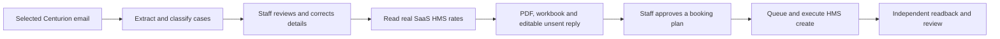

# 47 overnight — retrospective and continuation

**Verdict:** The run picked the right first workflow and built useful quote and safety foundations, but did not deliver a proven live Centurion workflow. Its main result is an unmerged, partially verified body of work that needs a much tighter path to release.

Snapshot: 29 October 2026, 12:15–12:31 UTC. Times below are UTC, also UK local time on that date. The original coordinator was interrupted, and related workers continued afterwards. Recheck current heads, owners and runtime before acting.

**Resume:** [Current branches and PRs](#5-what-exists-to-reuse) → [quote-first shipping sequence](#6-fastest-sensible-continuation). First coordinate the existing HMS and integration owners; a child was still active at the snapshot.

## 1. What the owner wanted

The owner first asked for an adversarial review of another chat's plan: **get as many features working end to end as quickly as possible**, with a four-hour aim. They then made this chat the coordinator: “ur the new chat then … u are it.” At 03:24 they narrowed the target to the Centurion mailbox and its new SaaS HMS, accepted seven hours if needed, and allowed new files or edits to existing scripts. They wanted to sleep without further routine decisions. They also explicitly allowed PR pushes despite Vercel previews and removed the invented staff-hours restriction. [S:12, 357, 457, 806]

The plan translated that into **live quote first**, then one safely approved Labtest booking, followed by higher-value multi-room/Add-On cases, amend and lab-only cancel when earlier steps permit. Payment remained a later workflow. This ordering matches the project product priority. The plan added “or longer if needed”; the owner explicitly mentioned four to seven hours, but did not state a hard stop at seven. [Execution plan](../plans/2026-10-29-002-centurion-four-hour-execution.md), [product](../../PRODUCT.md)

Nava is a staff-facing reservationist, not a standalone booking website. Staff stay in Outlook or webmail; both use the existing pane. Infor HMS is the system of record. The intended path is:



Company/agency contract rates matter most; eligibility, each night's price and the total must be correct. The intended quote is prepared in the background with reads; staff may click to generate the PDF. Nava does not send the reply. A quote PDF is also not proof of an HMS-native provisional quote. Existing pane, job and HMS code provide building blocks; their existence does not establish a complete workflow. Staff were not using Nava because it was incomplete, per the owner's 29 October correction. [Product](../../PRODUCT.md), [pane details](../context/PRODUCT-DETAIL.md#pane-staff), [execution plan](../plans/2026-10-29-002-centurion-four-hour-execution.md)

The front door skips automated/channel/spam mail while keeping human travel-agent requests in scope. The hotel's own pre-stay self-mail describes an existing booking and must never offer create. The longer-term booking design is one staff approval for a displayed plan covering the relevant rooms and hotel-native actions, with an honest result for each step. Multi-room, Add-Ons, native confirmation and payment need actual property-specific observation and readback; a partial result is not a completed booking. [First-wave product contract](../plans/2026-10-29-001-feat-centurion-overnight-first-wave-plan.md#product-contract)

## 2. Outcome versus promise

| Intended outcome | Evidence at the end of this chat | Practical value |
|---|---|---|
| Live Centurion quote from selected mail | The coordinator reported **no live Centurion workflow proven end to end** and no deployment of this work. The SaaS read remained blocked. [S:35180] | **Not delivered.** No verified live company/agency rate, nightly-price comparison, or staff-surface journey from this run. |
| Email → quote → unsent draft | A disposable-database server journey reached the real queued worker and persisted an unsent draft. The extraction model, HMS price, PDF conversion and attachment storage were controlled fixtures. [S:23876, 25297]; [test at candidate SHA](https://github.com/kufupa/Zero/blob/e844d0737/apps/server-pilot/tests/staff-quote-route.test.ts#L862) | **No staff value yet.** The baseline already tested quote queueing, execution and PDF generation separately; this adds an integration regression test, not a new live feature. It is worth preserving only if the related path is safely shipped. [Baseline tests](https://github.com/kufupa/Zero/blob/d65040ec7/apps/server-pilot/tests/staff-quote-route.test.ts#L298) |
| Representative commercial quote | The synthetic fixture used BAR, empty company/agency fields and an adult-only case. [Test source](https://github.com/kufupa/Zero/blob/e844d0737/apps/server-pilot/tests/staff-quote-route.test.ts#L133) | **Limited business proof.** It did not establish the contract-rate workflow that supplies the highest ROI. |
| One approved Labtest booking | [#693](https://github.com/kufupa/Zero/pull/693) adds a reviewed one-room plan helper, but its PR says it is not connected to the reservation route or UI. [#690](https://github.com/kufupa/Zero/pull/690) still records a validated P1 in unknown-save recovery. | **Foundation, not a booking.** No independently read-back live create was demonstrated by this chat. |
| Multi-room, native Add-Ons, amend, cancel and payment | The execution plan kept these in scope after quote/create. The final status claimed no live end-to-end workflow. [S:583, 35180] | **Not established by this run.** Existing code or earlier experiments are not this run's end-to-end proof. |
| Safety and pane work | Review uncovered real stale-price, wrong-property, case identity, child-occupancy, draft and guest-edit risks. [#705](https://github.com/kufupa/Zero/pull/705), [#712](https://github.com/kufupa/Zero/pull/712) and [#716](https://github.com/kufupa/Zero/pull/716) document examples. | **Potentially valuable reusable changes**, subject to dependency, review and final-head verification. They are not yet a shipped feature. |

The PR bodies and chat report test results; this retrospective did **not** rerun those tests or inspect production. Counts from different commits and suites cannot be added into one release pass.

**Value accounting:** zero live workflows were proven by the chat, and zero of the 24 related PRs opened during the run had merged by the snapshot. The synthetic journey and safety candidates have only conditional value: someone must review, integrate, verify and ship them before staff benefit. There is no defensible percentage of useful code until that work is done; do not preserve a change merely because the run spent time on it.

## 3. The clock: busy throughout, but the critical path stayed blocked

Elapsed time is measured from the owner's 03:24 scope clarification. The four- and seven-hour points were about 07:24 and 10:24 respectively.

| Time | Elapsed | What happened |
|---|---:|---|
| 03:24–03:29 | 0–5 min | Coordinator adopted existing workers, chose quote first, and told the owner they could sleep. [S:470, 484, 583, 806] |
| 03:53 | 29 min | A fresh SaaS login encountered a request-policy denial. The live quote was unproven. [S:2570] |
| 04:15–04:53 | 51–89 min | A later login diagnostic identified a third-party support script; public documentation suggested a ServiceNow widget, but did not establish this tenant's exact request was safe or necessary. [S:4198, 6968] |
| 05:50–06:09 | 2h27–2h45 | Longest gap between coordinator updates: **18m 05s**. A child finished at 05:58:49, and 30 child messages were recorded together at 06:08:54. Work continued in child lanes; the reason for the coordinator gap is unknown. [S:11432–11652] |
| 06:20 | 2h56 | First reported synthetic selected-email → quote → PDF → unsent-draft pass. HMS was simulated. [S:12478] |
| 06:35 | 3h11 | The coordinator identified a separate missing proof: the SaaS availability inquiry's read-only request contract. Resolving the login asset alone would not prove pricing. [S:13351] |
| 07:24 | 4h | The four-hour target time passed with synthetic evidence and draft slices, but no verified live quote. The team continued fixes and review. [S:16650, 17120] |
| 09:05–09:29 | 5h41–6h05 | The synthetic journey expanded to the real queue/worker, then actual extraction persistence with a fake model answer. [S:23876, 25297] |
| 10:23 | 6h59 | A broad pane run reported 153 passed, 28 failed and 2 skipped. A later Outlook subset went green; it did not establish the combined pane as ready. [S:28899, 32192] |
| 11:37–11:56 | 8h13–8h32 | A broader pane run reported 328 passed and 11 failed. At wake-up the coordinator reported no live end-to-end workflow or deployment, then the turn was interrupted before its promised full breakdown. [S:33924, 35180, 35210] |

There were **238 coordinator status outputs** from 03:24:37 to 11:55:56: median gap **1m 50s**, maximum **18m 05s**. Six of 237 gaps were at least five minutes. This was not an eight-hour silent stall. The coordinator also had 34 context compactions and sent 497 inter-agent messages; these show coordination activity, not how much time or money it cost. Five Terra Max child agents were started across the run, alongside adopted existing workers. Actual model spend is unavailable. [S: session event records]

At 10:04 the coordinator said the seven-hour window was already past. Measured from the 03:24 scope instruction it still had about 19 minutes; it may have used an earlier start. The owner had not made seven hours a hard stop, but future reports should state the chosen start and checkpoint times explicitly. [S:27725]

## 4. What went well, and what went wrong

**Right workflow, weak delivery focus.** Quote-first matched both the owner's speed goal and the product's ROI. The coordinator challenged the earlier precise ETA, reused existing pane/runners, adopted active workers and kept unsafe writes and sends held. It clearly distinguished synthetic evidence from live proof at the end. [S:350, 484, 12478, 35180]

**The main dependency stayed open.** The live SaaS path hit a policy denial in the first half-hour and remained unresolved at wake-up. The approved test machine also stalled or saturated at several points, and later HMS probes could not proceed while another Centurion driver held the browser. Those are concrete constraints, but the record does not establish that they alone explain the missed outcome. [S:3136, 13351, 27660, 28404, 35148]

**The fallback was useful but became a growing integration project.** The original review proposed a synthetic fallback after 45 minutes without a safe live price. The team did build it, and real defects justified several fixes. However, successive source-identity, stale-quote, recovery, guest and draft cases expanded into a large dependency stack while the live proof and final integrated checks remained open. A bounded first case, explicit holds for unsupported cases, and an earlier decision about which independently releasable slices matter to that case could reduce the next run's work. This is a proposed improvement, not proof that live access would have worked within four hours. [S:350, 12842, 19017, 24396, 33924]

**Reviews found substantive risks, not just polish.** Examples include a source change during Outlook attachment handoff, a recovery hold that can prevent staff editing a changed reread, and child/rate information that could price the wrong stay. Cutting valid P0/P1 fixes or relaxing the guard would not be a safe shortcut. The better trade is to define one supported path, explicitly hold what is outside it, and finish its applicable gates. [#705](https://github.com/kufupa/Zero/pull/705), [#712](https://github.com/kufupa/Zero/pull/712), [#698](https://github.com/kufupa/Zero/pull/698)

Some review work also addressed problems in the proposed changes themselves: #698's draft carries a cross-property P1 that #700 tries to correct, and #712's new recovery fence can itself leave staff unable to edit a changed case. Finding and fixing those issues matters, but it is not the same as removing a pre-existing production defect or delivering a new feature. [#698](https://github.com/kufupa/Zero/pull/698), [#712](https://github.com/kufupa/Zero/pull/712)

**The evidence was occasionally overstated and later corrected.** The original quote probe did not record the denied request's destination. A separate login diagnostic later identified a support script; the transcript corrected the earlier implication that both denials were the same. The script's necessity was not proven. [#688](https://github.com/kufupa/Zero/pull/688), [S:29952]

**Passing slices did not make the combined head green.** The coordinator caught a remote wrapper that could return success despite failing tests, and some focused suites passed. Later broad pane runs still failed, and some PRs had skipped database tests or lacked checks on their final head. The shared remote host's stalls and queueing matter, but their total delay was not measured. [S:1942, 4858, 27660, 33924]; [#697](https://github.com/kufupa/Zero/pull/697)

## 5. What exists to reuse

GitHub showed the 24 related PRs **#693–#716** created during this run as open drafts at 12:15 UTC. Some came from workers already active before this coordinator took over. Earlier related PRs #688–#692 were also open; #691 was not a draft. The table is a starting inventory, not a merge order or an assertion that all these changes were authored by this chat.

| Artifact and snapshot | What it contributes | Hold / next check |
|---|---|---|
| [#688](https://github.com/kufupa/Zero/pull/688), `1eb131819` | SaaS date controls, guarded reader and focused tests. | Draft; PR reports 618/622 wider Node tests, a separate denied login resource and an unverified availability request. Its evidence does not prove a current live quote. |
| [#691](https://github.com/kufupa/Zero/pull/691), `475f820c5` | Requires an explicit create mode and removes an automatic, uninspected cancellation path. | Open and not a draft, but its body says tests and typecheck are in progress. The successful GitHub “Greptile Review” check is not proof of the required Apex result. Do not assume the pane uses this CLI. |
| [#692](https://github.com/kufupa/Zero/pull/692), `59049f9fa` | Monitored property lease and child-process supervision. | Draft; its PR says the pane is not wired and the caller must supply a trusted complete lock-identity set. Its live read stopped before Search. |
| [#694](https://github.com/kufupa/Zero/pull/694), `a30d5301c` | Saved child-occupancy and source fence. | Draft; its exact-head Apex reported three valid P1s. The PR names #697 and the pane prerequisite as remedies, but needs rebase, current-head checks and renewed review before merge. |
| [#697](https://github.com/kufupa/Zero/pull/697), `ede5827b9` | Selected-email identity and stale quote polling. | Draft; optional identity is not yet enforced downstream; 24 DB tests were skipped. Final merge gate remains. |
| [#698](https://github.com/kufupa/Zero/pull/698) → [#700](https://github.com/kufupa/Zero/pull/700) → [#701](https://github.com/kufupa/Zero/pull/701) → [#702](https://github.com/kufupa/Zero/pull/702) → [#704](https://github.com/kufupa/Zero/pull/704) → [#705](https://github.com/kufupa/Zero/pull/705) | Child occupancy, property and rate eligibility, saved source/party binding, and quote-draft preflight. | An unmerged dependency chain. #698 records a valid cross-property P1 and missing final-head checks; #700 carries a correction. #705 explicitly remains held on the Outlook cross-tab handoff race. |
| [#699](https://github.com/kufupa/Zero/pull/699), `0f581a095` | Staff child-count and age controls, with save before quote. | A sibling of #700 based on #698, not automatically part of that linear chain. Its PR says exact-head checks were in progress and the separate #694 fence is needed for the full path. |
| [#712](https://github.com/kufupa/Zero/pull/712), `3ba94fdb5` | Versioned source cursor and recovery fences. | Its PR reports an exact-head P1: changed rereads can leave staff unable to edit/reset. Safe recovery and raw-source identity remain open. |
| [#693](https://github.com/kufupa/Zero/pull/693) and [#690](https://github.com/kufupa/Zero/pull/690) | One-room immutable plan helper and unknown-save fence. | Helper is not wired to route/UI; #690 has an unresolved availability P1 and identity/reconciliation gaps. Neither proves a booking. |
| [#710](https://github.com/kufupa/Zero/pull/710), `eff561ca5`; [#714](https://github.com/kufupa/Zero/pull/714), `37460c844` | Small standalone safety holds: unsafe prior-quote reuse, and waiting for an aborted quote child to close. | Useful candidates if they serve the chosen release. #714 covers the child only, not browser/lease safety; its PR reports a rate-limited Vercel preview. Recheck all gates and current status. |
| [#715](https://github.com/kufupa/Zero/pull/715), `3b4d8b67b`; [#716](https://github.com/kufupa/Zero/pull/716), `f10a3b690` | Extraction-source witness and guest-edit recovery. #716 reports 229 focused plus 9 rendered checks and Apex on its head. | Both target an unmerged integration checkpoint. #715 does not enforce the witness across the entire quote/draft path; #716 does not prove live booking or complete webmail integration. |
| [Integration snapshot `e844d0737`](https://github.com/kufupa/Zero/compare/d65040ec7...e844d0737) | Preserves the combined journey and many safety fixes; includes [the queued journey test](https://github.com/kufupa/Zero/blob/e844d0737/apps/server-pilot/tests/staff-quote-route.test.ts#L862). | Against locally cached `origin/main` `d65040ec7`: 198 commits, 180 files, 20,423 insertions and 1,426 deletions; approximately 7,516 product-line changes using the gate's file exclusions. Includes inherited work and tests. It is an integration snapshot, not one reviewable PR or final-head release evidence. |

At 12:15, **11 of these 24 PRs** had a Vercel failure linking to its build-rate-limit page; 13 had a successful Vercel status. This is preview status, not product-test evidence. Check current branch protection and the normal merge gate; the owner had explicitly authorized pushes despite previews.

Local three-dot diffs using the merge gate's exclusions gave #698 **500** product lines and #700 **494** at the heads above. GitHub's total changed lines include tests and documentation. The PR audit found none of #693–#716 over 500 product lines at the observed heads. Verify the current base, head and actual gate result before drawing a merge conclusion. The existing rule prohibits stacking a feature on an unmerged PR **over** the product-line cap; these measurements do not establish a violation. [Merge gate](../../scripts/orch/merge-gate.sh)

The observed GitHub **base-branch** relationships are:

```text
main → #697 → #698 → #700 → #701 → #702 → #704 → #705 → #713
#698 → #699                     #700 → #706; #700 → #707 → #711
#702 → #703                     #704 → #708, #709
main → #689 → #696 → #712       main → #690 → #695
main → #693, #694, #710, #714   integration checkpoint → #715, #716
```

Arrows describe PR bases, not proof that a slice can be merged independently. In particular, #694 is a separate saved-source fence and #699 supplies the pane control that #698's hold requires. Follow each PR's current holds and retest after any rebase.

**Work continued after the coordinator stopped.** At 12:31, the original coordinator was idle while its approval-integration child was still active on booking/quote case binding and a cross-hotel race in [its worktree](/home/orca/.codex/worktrees/feb6/recover-parse-failure); its checked-out `codex/cen-booking-quote-conflict-eabe-20261029` ref had advanced from `164b490bb` at 11:59 to `82e2439fd` at 12:15. Two other children had finished: `f1c6e803f` binds stored reads to a staff account, with tests and typechecks pending; `7f2db104b` offers an unchanged-source web reread while holding changed reads, attachments and Outlook, also with checks pending and two reported integration conflicts. These are local candidates, not released behavior. Do not overwrite or assume ownership; check the live session and refs first. [Child logs: policy/stored reads](/home/orca/.codex/sessions/2026/10/29/rollout-2026-10-29T03-26-16-01a185b1-ad2b-72a0-9155-e64c3dacf71c.jsonl), [quote/re-read](/home/orca/.codex/sessions/2026/10/29/rollout-2026-10-29T03-26-18-01a185b1-b763-7833-b298-3102a4430d56.jsonl), [approval integration](/home/orca/.codex/sessions/2026/10/29/rollout-2026-10-29T03-58-24-01a185cf-172a-7df3-b9fa-7f4ae7fb8688.jsonl).

## 6. Fastest sensible continuation

These are proposed timeboxes and checkpoints, not a delivery forecast or authorization for production actions. Start the live-read diagnosis immediately and reassess by 45 minutes if it has not produced a safe price.

1. **First 15 minutes: re-establish ownership and one exact target.** Check current main, live worktrees, related PR heads, active HMS driver and hotel lock. Adopt work only after its owner is known. Pick one selected Centurion email, one property and one explicitly supported stay. Preserve the existing pane on both surfaces. Record the candidate SHA, actual blockers and the four-/seven-hour checkpoints.
2. **Immediately: put the live quote on the critical path.** Assign one bounded HMS owner to inspect existing receipts and distinguish the unidentified original denial, the later support-widget request and the availability inquiry contract. The relevant code is [request policy](https://github.com/kufupa/Zero/blob/1eb131819/apps/server-pilot/src/hms/request-policy.ts), [quote guard](https://github.com/kufupa/Zero/blob/1eb131819/apps/server-pilot/tooling/playwright-quote/quote-request-guard.mjs) and [quote reader](https://github.com/kufupa/Zero/blob/1eb131819/apps/server-pilot/tooling/playwright-quote/fetch-quote.mjs). Establish the required origin, method, property, criteria and read-only behavior from approved evidence; make only a narrowly reviewed policy change if justified. Never bypass a denial or overlap the property's browser. If the path remains blocked, record the exact missing evidence and stop repeating the same probe.
3. **In parallel, cut the smallest safe quote slice.** Use `e844d0737` and the PRs as inventories, not as a bulk merge. Retain the selected-email, occupancy, rate/party and draft protections necessary for this one case; hold unsupported or ambiguous cases visibly, with a staff recovery path. Check the existing PR dependencies and validated P1s before choosing which slices to rebase or split. Do not let a stream of lower-priority cases indefinitely postpone an integrated, reviewable head.
4. **Prove the result that staff need.** On the final integrated SHA, run the approved remote tests and separate typechecks; inspect actual summaries and skipped tests. Obtain final-head Apex, validate P0/P1 findings, read each product diff, respect the product-line gate and merge through the project gate. Verify both staff surfaces, a real read-only SaaS quote against independent HMS evidence for the property, occupancy, rate eligibility, each night and total, and the PDF/workbook plus editable unsent reply. Use a company/agency case when available; a BAR smoke test is not contract-rate evidence. Before a pilot deployment, verify applicable owner authority in that executing session, use the approved [deploy path](../../PRODUCT.md#hard-rules), and confirm the final SHA and staff bundle reload.
5. **Only then advance the first booking.** Connect #693 or its successor to the actual pane, route, monitored property lease and existing job; resolve #690's unknown-save hold. Use the always-allowed Labtest exception in `PRODUCT.md`: a fake Proof Labtest guest and a 2027+ stay. Approve the plan, suppress unapproved sends, and independently read back identity, dates, occupancy, agency/rate and nightly charges. Real-guest writes and actual sends require applicable owner authority in the executing session. Expand to rooms, Add-Ons and later workflows only after this proof.

For product readiness, use production-equivalent real-mail inputs and independent truth data. The ≥10-thread exact quote-price bar in [product details](../context/PRODUCT-DETAIL.md#done-this-is-the-overnight-gate) is a **proposed** bar, not a blanket owner-approved target. The separately accepted ≥85% quote recall / ≥100 independent outbound-grounded rows applied to the 20 October plan; verify its scope before reuse. A single live smoke test, merge or deployment is progress, not the product-done gate.

## 7. Lessons for the next overnight run

- **Measure outcomes, not busyness.** Track one live proof, one integrated head, the blocker owner, evidence and next check. Keep background safety work scoped to what unlocks that proof.
- **Keep genuine safety and usability together.** A hold that prevents wrong pricing but leaves an older email impossible to recover is not a finished staff workflow. The run's exploratory sample found 15 room rows in 11 older analyses without an explicit child count; that small historical sample does not estimate the current extractor's frequency. [S:12685]; [#712](https://github.com/kufupa/Zero/pull/712)
- **Use independently releasable slices.** Avoid building a long chain of nearly cap-sized drafts before the base is safe. A green child PR on an unmerged checkpoint is useful evidence, not a releasable feature.
- **Require evidence for the exact head and surface.** Record the real test summary, skipped count, typecheck and review SHA separately. A passing subset or success exit from a wrapper cannot stand in for the combined pane and server.
- **Make the unattended handoff durable.** Record the active owner, next action, current SHA, holds and last verified evidence at milestones. The 18-minute gap and eventual interruption show why a stream of updates alone is a weak handoff; the gap's cause is unconfirmed.
- **Use narrow agents.** One owner for the live property, one for integration, and bounded specialists where parallel work is independent. Return specific evidence and stop; more messages or reviews are not equivalent to more delivered workflows.

## 8. Evidence and limits

- **Primary session [S]:** Codex thread `01a185a5-e14d-7de1-a4bd-7e41ab6c662a`, [local JSONL](/home/orca/.codex/sessions/2026/10/29/rollout-2026-10-29T03-13-23-01a185a5-e14d-7de1-a4bd-7e41ab6c662a.jsonl). `S:n` above means JSONL line `n`. The file contains credentials and other private material; do not copy its raw contents into shared artifacts.
- **Independent checks in this retro:** read-only GitHub PR metadata/bodies, local Git refs/diffs and the candidate test source, plus the product and plan files linked above. Three bounded GPT-6 Luna Max agents examined the session, PRs and product. PR statuses are a time-stamped snapshot. No live HMS, production deployment check, test rerun or external message was performed; audit model costs are unavailable.
- **Strongest alternative:** the live policy/lease constraints and real safety defects may have made the requested four-to-seven-hour outcome impossible even with better prioritization. The record supports a prioritization problem and an unresolved blocker; it cannot isolate their causal shares.
- **95 threshold not met** for current production readiness, actual model cost, the cause of the 18-minute coordinator gap, or a reliable ETA. The historical outcome and the listed artifacts are supported, with the stated limits.
