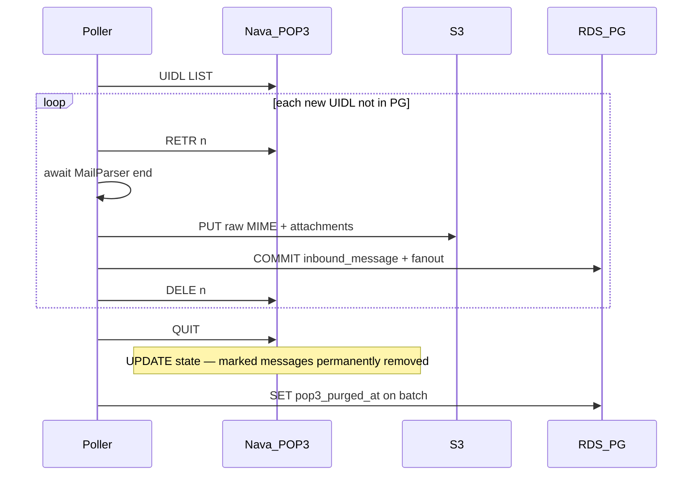

# EC2 Pilot Backend Implementation Plan

> **For agentic workers:** REQUIRED SUB-SKILL: Use superpowers:subagent-driven-development (recommended) or superpowers:executing-plans to implement this plan task-by-task. Steps use checkbox (`- [ ]`) syntax for tracking.

**Goal:** Ship `apps/server-pilot/` — a fresh Node backend on EC2 that ingests Centurion mail via POP3, stores it in RDS PG + S3, sends via the client's on-prem SMTP server, and serves the existing `apps/mail` FE without touching `apps/server/`.

**Architecture:** Collapse Cloudflare's 4 storage layers (Postgres metadata, DO SQLite thread index, R2 message blobs, 10 KV namespaces, 2 Vectorize indexes) into **20 app PG tables + S3 + pg-boss**. Drop Gmail/OAuth artifacts; do not replicate KV/Vectorize 1:1. Keep FE tRPC contract via a `connections` shim and `ParsedMessage` mapper.

**Tech Stack:** Node 22, Hono, `@hono/node-server`, tRPC, Drizzle ORM, Better Auth (email+password, JWT plugin kept), pg-boss, node-pop3, mailparser, nodemailer, AWS RDS PG 15+, S3, PM2, nginx.

## Global Constraints

- Branch: `EC2-pilot` cut from `main` HEAD. `apps/server/` untouched.
- Backend folder: `apps/server-pilot/`.
- Auth: copy-and-strip [`apps/server/src/lib/auth.ts`](apps/server/src/lib/auth.ts); IT seeds 50 users with temp passwords; keep `jwt()` plugin + `mail0_jwks`.
- No Gmail, no Cloudflare Workers/DOs/KV/Vectorize/R2/Hyperdrive.
- No AWS SES — outbound via client's on-prem SMTP (`:587` STARTTLS, exact host TBD at kickoff).
- **Mail server:** Legacy Hotels runs a local on-prem **POP3/SMTP mail server** (vendor unknown — not assumed to be Exchange). IT BCCs Centurion mail to `Nava@` before workstation POP.
- **Server retention:** IT enforces **7-day retention** on the mail server, then wipes. `Nava@` is ephemeral; **RDS PG + S3 is the system of record**. If ingest is down >7 days, un-pulled mail is lost on the server side.
- No IMAP — POP3 download-and-delete (RFC 1939): RETR → persist → DELE → QUIT. Treat pilot like prod: `Nava@` is a drain mailbox, not an archive.
- POP3 safety: write-then-DELE ordering (R1) — PG+S3 commit before DELE; `(transport_id, pop3_uidl)` UNIQUE is crash-recovery dedup, not the primary skip mechanism.
- Single ingest worker only (PM2 `instances: 1`, no cluster on ingest) — two pollers racing the same `Nava@` session causes duplicate RETR.
- Pilot scope: shared `Nava@` mailbox, Centurion-only, ~50 VPN users, ~1k emails/day.
- Vector search: deferred — no pgvector; `brain.generateSummary` returns null.
- Drafts: local `mail0_draft` table (user decision).
- RDS PG version: **15+** (for `UNIQUE NULLS NOT DISTINCT` if needed; prefer NOT NULL fan-out instead).
- App schema = 20 tables. pg-boss adds its own `pgboss` schema (~7 tables) — not counted in 20.

---

## Schema audit summary (verified)

### 16 existing Postgres tables → pilot disposition

| Table | Verdict | Pilot action |
|---|---|---|
| `mail0_user` | KEEP modified | Drop `phoneNumber*`; rename `defaultConnectionId` → `defaultStaffMemberId` |
| `mail0_session` | KEEP | Verbatim |
| `mail0_account` | KEEP modified | Email+password only (`providerId='credential'`) |
| `mail0_verification` | KEEP | Verbatim |
| `mail0_jwks` | KEEP | Verbatim (JWT plugin retained in auth strip) |
| `mail0_oauthApplication/AccessToken/Consent` | DROP | MCP OAuth server not shipped |
| `mail0_userHotkeys` | DROP | No FE reads |
| `mail0_earlyAccess` | DROP | Dead |
| `mail0_connection` | DROP | → `mailbox_transport` + `staff_member` + connections shim |
| `mail0_summary` | DROP | Orphaned; Vectorize was source |
| `mail0_note` | KEEP | `threadId` = `thread_root_id` |
| `mail0_userSettings` | KEEP modified | Replace Gmail `searchValue` in default categories |
| `mail0_writingStyleMatrix` | KEEP modified | PK/FK → `staff_member_id` |
| `mail0_emailTemplate` | KEEP | Verbatim |

**7 dropped, 9 kept, 11 new = 20 app tables.**

### Non-Postgres layers → pilot replacement

| Layer | Drop | Replace with |
|---|---|---|
| DO SQLite `threads/labels/thread_labels` | Yes | `mail_thread` + `message_recipient.labels[]` |
| R2 `THREADS_BUCKET` | Yes | S3 raw MIME + parsed columns |
| KV `gmail_*` (4) | Yes | POP3 poll + DELE-on-success + `(transport_id, pop3_uidl)` dedup |
| KV send/snooze (4) | Yes | `mail_scheduled_email`, `mail_snooze`, pg-boss |
| KV `prompts_storage`, `connection_labels` | Yes | `mail_prompt`, `staff_member.label_config` |
| Vectorize (2) | Yes | Deferred (stub `brain.generateSummary`) |

---

## Pilot schema fixes (from Claude + codebase review)

1. **Remove `mail_thread.has_unread`** — unread is per-staff via `message_recipient.is_unread`.
2. **`message_recipient.staff_member_id NOT NULL`** — fan out one row per matched staff on ingest; no NULL "global inbox" row (avoids PG NULL-in-UNIQUE bug).
3. **Add `thread_root_id` to `outbound_message`** — sent replies must appear in `mail.get` timeline.
4. **`writingStyleMatrix.staffMemberId` PK** — explicit in schema; update `writing-style-service.ts` + `ai/compose.ts` + post-send in `mail.ts`.
5. **`UNIQUE(staff_member_id, thread_root_id)` on `mail_snooze`**.
6. **Indexes:** `(staff_member_id, is_archived)`, `(thread_root_id)`, `(transport_id, pop3_uidl)`, `mail_thread(latest_received_at DESC)`.
7. **`inbound_message.pop3_purged_at`** — nullable timestamp set after successful QUIT for the ingest session that DELE'd this message (audit trail that Nava@ was drained).

---

## POP3 production ingest policy (R1 — write-then-DELE)

`Nava@` is a BCC sink: IT forwards Centurion mail here; we are the sole consumer. Production behavior = **download-and-delete**, not leave-on-server.

### Per-message ordering (RFC 1939)



| Step | Rule | If it fails |
|---|---|---|
| 1 | `UIDL` → skip UIDLs already in PG | Safe — already ingested |
| 2 | `RETR` → parse → await `'end'` + all S3 PUTs | No DELE; message stays on Nava@ |
| 3 | PG transaction COMMIT | No DELE until commit succeeds |
| 4 | `DELE n` (marks, does not purge yet) | Message still on server until QUIT |
| 5 | `QUIT` after all successful DELEs | Purges all marked messages from Nava@ |

**Crash recovery:** disconnect before `QUIT` → RFC 1939: DELEs are discarded, messages reappear on next poll. `(transport_id, pop3_uidl)` UNIQUE prevents duplicate PG rows. Re-ingest is safe.

**What changes vs RETR-only:** we no longer rely on full UIDL diff every poll to avoid re-processing a growing mailbox. Nava@ stays near-empty between polls. Poll cost stays low.

**7-day server wipe (user clarification):** even if our `DELE`/`QUIT` fails occasionally, IT's mail server purges messages older than 7 days anyway. That is a backstop, not a substitute for correct ingest — mail we never pulled is gone forever after day 7. **Monitor ingest health:** alert if `last_polled_at` on `mailbox_transport` is stale >1h, or if `Nava@` UIDL count grows unexpectedly.

**IT kickoff checks (vendor-agnostic):**
1. POP3 host/port/TLS + SMTP host/port/TLS + credentials for `Nava@`.
2. Auth scheme — likely **basic auth** on on-prem POP3/SMTP; validate at kickoff (not OAuth).
3. What happens on POP3 `QUIT` after `DELE`? RFC-compliant servers remove messages permanently; some servers soft-delete to a trash folder. If soft-delete, `Nava@` may still accumulate until the 7-day wipe — acceptable for pilot but note in ops runbook.
4. Confirm BCC rule: all Centurion pilot mail hits `Nava@` before any workstation POPs it.

**Outbound mail:** sent via SMTP does not appear in `Nava@` POP3 inbox; `outbound_message` table is still required for Sent-folder / thread view.

---

## All 28 `mail.*` procedures — disposition

| Procedure | Pilot action |
|---|---|
| `suggestRecipients` | Port — query `inbound_message.from_addr` + `outbound_message.to_addrs` history |
| `forceSync` | Stub — POP3 poller is sync; return `{ success: true }` |
| `get` | Port — UNION inbound+outbound → `ParsedMessage[]` via mapper |
| `listThreads` | Port — `mail_thread` JOIN `message_recipient` by staff + folder |
| `markAsRead/Unread` | Port — update `message_recipient.is_unread` |
| `markAsImportant`, `toggleImportant`, `bulkMarkImportant`, `bulkUnmarkImportant` | Port — labels array on `message_recipient` |
| `modifyLabels` | Port — labels array |
| `toggleStar`, `bulkStar`, `bulkUnstar` | Port — STAR label in array |
| `deleteAllSpam` | Port — delete threads where labels contains SPAM |
| `send` | Port — nodemailer + optional pg-boss delay |
| `unsend` | Port — cancel `mail_scheduled_email` + pg-boss job |
| `delete`, `bulkDelete` | Port — soft-delete or archive via labels |
| `bulkArchive`, `bulkMute` | Port — labels / `is_archived` |
| `getEmailAliases` | Port — return `staff_member.email_addresses` |
| `snoozeThreads`, `unsnoozeThreads` | Port — `mail_snooze` + pg-boss |
| `getMessageAttachments` | Port — S3 via `attachment` table |
| `processEmailContent` | Port verbatim — HTML sanitizer, no backend deps |
| `getRawEmail` | Port — S3 `raw_eml_path` |
| `verifyEmail` | Stub — return `{ valid: true }` for pilot |

---

## File structure

```
apps/server-pilot/
├── package.json
├── drizzle.config.ts
├── ecosystem.config.cjs
├── src/
│   ├── main.ts
│   ├── env.ts
│   ├── db/schema/{auth,app,mail,index}.ts
│   ├── lib/
│   │   ├── auth.ts
│   │   ├── s3.ts
│   │   ├── queue.ts
│   │   ├── parsed-message-mapper.ts
│   │   ├── pop3/{poller,parser,thread-stitch,fanout}.ts
│   │   ├── smtp/sender.ts
│   │   └── driver/{types,pop3-mail-manager}.ts
│   ├── trpc/{index,trpc,routes/*.ts}
│   └── workers/{ingest,cron,ws}.ts
└── tests/
```

---

### Task 1: Branch + scaffold

**Files:** Create `apps/server-pilot/package.json`, `src/main.ts`, `src/env.ts`; modify root `pnpm-workspace.yaml`.

- [ ] **Step 1:** `git checkout -b EC2-pilot main`
- [ ] **Step 2:** Create package with deps listed in Global Constraints
- [ ] **Step 3:** `GET /health → { ok: true }` on port 8788
- [ ] **Step 4:** `pnpm install && pnpm --filter @zero/server-pilot dev` — expect health 200
- [ ] **Step 5:** Commit: `feat: scaffold apps/server-pilot`

---

### Task 2: Schema (20 tables)

**Files:** `src/db/schema/auth.ts`, `app.ts`, `mail.ts`, `index.ts`; `tests/schema-fk.test.ts`

**Interfaces:** Exports all 20 tables; `writingStyleMatrix.staffMemberId` is PK; no `connection` table; `outboundMessage.threadRootId` present; `inboundMessage.pop3PurgedAt` present; no `mailThread.hasUnread`.

- [ ] **Step 1: Write failing test**

```typescript
import { describe, it, expect } from 'vitest';
import * as schema from '../src/db/schema';

const EXPECTED = [
  'user','session','account','verification','jwks',
  'note','userSettings','writingStyleMatrix','emailTemplate',
  'mailboxTransport','staffMember','mailThread','inboundMessage',
  'messageRecipient','attachment','outboundMessage','mailDraft',
  'mailSnooze','mailScheduledEmail','mailPrompt',
];

describe('pilot schema', () => {
  it('exports exactly 20 tables', () => {
    const tables = Object.keys(schema).filter(k => !k.endsWith('Relations'));
    expect(tables.sort()).toEqual(EXPECTED.sort());
  });
  it('writingStyleMatrix PK is staffMemberId only', () => {
    expect(schema.writingStyleMatrix.staffMemberId).toBeDefined();
    expect((schema.writingStyleMatrix as any).connectionId).toBeUndefined();
  });
  it('outboundMessage has threadRootId', () => {
    expect(schema.outboundMessage.threadRootId).toBeDefined();
  });
  it('inboundMessage has pop3PurgedAt for DELE audit', () => {
    expect(schema.inboundMessage.pop3PurgedAt).toBeDefined();
  });
});
```

- [ ] **Step 2:** Run test — FAIL
- [ ] **Step 3:** Implement schema per audit + fixes above
- [ ] **Step 4:** `pnpm drizzle-kit generate && drizzle-kit migrate`
- [ ] **Step 5:** Run test — PASS
- [ ] **Step 6:** Commit: `feat: pilot schema 20 tables`

---

### Task 3: S3 storage (before POP3)

**Files:** `src/lib/s3.ts`; test: `tests/s3.test.ts` (mock client)

**Interfaces:** `putRawEml(key, buf)`, `putAttachment(key, buf)`, `getObject(key)`, `getSignedUrl(key)`

- [ ] **Step 1:** Implement S3 wrapper with env `S3_BUCKET`, `AWS_REGION`
- [ ] **Step 2:** Unit test with mocked `@aws-sdk/client-s3`
- [ ] **Step 3:** Commit: `feat: s3 mime storage`

---

### Task 4: Auth copy-and-strip + seed

**Files:** `src/lib/auth.ts`, `scripts/seed-users.ts`, `tests/auth-config.test.ts`

- [ ] **Step 1:** Failing test — `emailAndPassword.enabled === true`; no dub/twilio/redis/phone plugins; `jwt()` plugin present
- [ ] **Step 2:** Copy auth files; apply ADR strip; **keep** `jwt()` plugin
- [ ] **Step 3:** Mount `/api/auth/*`
- [ ] **Step 4:** Seed script: 50 users + `staff_member` rows + bcrypt password
- [ ] **Step 5:** Commit: `feat: pilot auth`

---

### Task 5: POP3 ingest + fan-out + thread stitch (production DELE)

**Files:** `src/lib/pop3/{thread-stitch,fanout,parser,poller}.ts`, `src/workers/ingest.ts`, `tests/thread-stitch.test.ts`, `tests/pop3-ordering.test.ts`

**Interfaces:**
- `computeThreadRootId(headers): string`
- `fanOutRecipients(message, staff[]): MessageRecipientInsert[]`
- `ingestOnce(transportId): Promise<{ ingested: number; purged: number }>`

- [ ] **Step 1: Write failing thread-stitch tests**

```typescript
// tests/thread-stitch.test.ts
import { computeThreadRootId } from '../src/lib/pop3/thread-stitch';

it('uses first References Message-ID as root', () => {
  expect(computeThreadRootId({
    messageId: '<c@x.com>',
    references: '<a@x.com> <b@x.com>',
    inReplyTo: '<b@x.com>',
  })).toBe('<a@x.com>');
});
it('synthesizes Message-ID when header missing', () => {
  expect(computeThreadRootId({ subject: 'No-ID mail' })).toMatch(/^<synth-/);
});
```

- [ ] **Step 2:** Run test — FAIL; implement `thread-stitch.ts` + `fanout.ts`
- [ ] **Step 3: Write failing ordering test (production DELE)**

```typescript
// tests/pop3-ordering.test.ts — mock POP3 client recording command order
it('DELE only after PG commit, QUIT last', async () => {
  const log: string[] = [];
  const mockPop3 = makeMockPop3({ log });
  await ingestOnce('transport-1', { pop3: mockPop3, db: mockDb, s3: mockS3 });
  const deleIdx = log.indexOf('DELE 1');
  const commitIdx = log.indexOf('PG_COMMIT');
  const quitIdx = log.lastIndexOf('QUIT');
  expect(commitIdx).toBeGreaterThan(-1);
  expect(deleIdx).toBeGreaterThan(commitIdx);
  expect(quitIdx).toBeGreaterThan(deleIdx);
});
it('does not DELE when PG commit fails', async () => {
  const log: string[] = [];
  const mockDb = failingDb();
  await expect(ingestOnce('transport-1', { db: mockDb, log })).rejects.toThrow();
  expect(log).not.toContain('DELE 1');
  expect(log).not.toContain('QUIT');
});
```

- [ ] **Step 4:** Run ordering test — FAIL; implement `poller.ts`:
  1. `UIDL` → skip known UIDLs
  2. per message: `RETR` → parse → S3 PUT → PG commit → `DELE`
  3. `QUIT` → set `pop3_purged_at` on ingested rows
  4. on any per-message failure: skip DELE for that message, continue batch, still `QUIT` only if zero partial failures OR use `RSET` + retry next cycle (document choice: **skip DELE on failure, QUIT without purging failed messages**)
- [ ] **Step 5:** Run all Task 5 tests — PASS
- [ ] **Step 6:** Commit: `feat: pop3 ingest with production DELE`

---

### Task 6: pg-boss (before send/scheduling)

**Files:** `src/lib/queue.ts`, `src/workers/cron.ts`

- [ ] **Step 1:** Install pg-boss; queues: `send_email`, `snooze_wake`
- [ ] **Step 2:** Worker handlers stubbed
- [ ] **Step 3:** Commit: `feat: pg-boss setup`

---

### Task 7: ParsedMessage mapper + mail.get/listThreads

**Files:** `src/lib/parsed-message-mapper.ts`, `src/trpc/routes/mail.ts` (partial), `tests/parsed-message-mapper.test.ts`

**Interfaces:** `toParsedMessage(inbound|outbound, recipient, attachments): ParsedMessage`

- [ ] **Step 1:** Test maps all 14 required ParsedMessage fields including `tags`, `tls`, `processedHtml`, `blobUrl`
- [ ] **Step 2:** JOIN message_recipient (active staff), attachment, processEmailHtml for `processedHtml`
- [ ] **Step 3:** `mail.get` — UNION inbound + outbound by `thread_root_id`, sorted by time
- [ ] **Step 4:** `mail.listThreads` — per-staff unread from `message_recipient`, not `mail_thread`
- [ ] **Step 5:** Commit: `feat: mail read path`

---

### Task 8: Connections shim + remaining mail mutations

**Files:** `src/trpc/routes/connections.ts`, extend `mail.ts`

**Interfaces:** `connections.getDefault()` returns `{ id, email, name, picture, createdAt, providerId: 'pop3_smtp' }` where `id = staffMemberId`

- [ ] **Step 1:** Implement shim backed by `staff_member` + `user.defaultStaffMemberId`
- [ ] **Step 2:** Port mark read/unread, labels, star, archive, snooze procedures
- [ ] **Step 3:** Commit: `feat: connections shim + mail mutations`

---

### Task 9: SMTP send + drafts + scheduled

**Files:** `src/lib/smtp/sender.ts`, `src/trpc/routes/drafts.ts`, `mail.send/unsend`

- [ ] **Step 1:** nodemailer via on-prem SMTP; write `outbound_message` with `thread_root_id`
- [ ] **Step 2:** `mail_draft` CRUD
- [ ] **Step 3:** `mail.send` undo window → `mail_scheduled_email` + pg-boss `startDate`
- [ ] **Step 4:** Commit: `feat: smtp send + drafts + scheduled`

---

### Task 10: Remaining tRPC routes

**Files:** Port `settings`, `notes`, `templates`, `brain` (partial), `ai/compose`, `user`; stub `labels`, `meet`, `bimi`; drop `shortcut`

- [ ] **Step 1:** Replace `activeConnectionProcedure` → `activeStaffMemberProcedure`
- [ ] **Step 2:** Update `writing-style-service` to use `staffMemberId`
- [ ] **Step 3:** `brain.generateSummary` → null; prompts from `mail_prompt`
- [ ] **Step 4:** Export `AppRouter` matching FE imports
- [ ] **Step 5:** Commit: `feat: port remaining trpc`

---

### Task 11: Minimal WebSocket sync (FE cache invalidation)

**Files:** `src/workers/ws.ts`, wire in `main.ts`

**Rationale:** FE `ai-sidebar.tsx` uses ZeroAgent WS for `Mail_Get`, `Mail_List`, `Do_State` invalidation. Full AI chat can follow later; pilot needs sync broadcasts.

- [ ] **Step 1:** Hono WebSocket on `/ws/agent/:staffMemberId`
- [ ] **Step 2:** After mail mutations, broadcast `{ type: 'Mail_Get'|'Mail_List', threadId? }`
- [ ] **Step 3:** Stub chat messages with "AI deferred for pilot" or disable send in FE
- [ ] **Step 4:** Commit: `feat: ws sync shim`

---

### Task 12: FE wiring

**Files:** [`apps/mail/providers/query-provider.tsx`](apps/mail/providers/query-provider.tsx), [`vite.config.ts`](apps/mail/vite.config.ts), login pages

- [ ] **Step 1:** `VITE_PUBLIC_BACKEND_URL=http://localhost:8788`; `@zero/server` → `apps/server-pilot`
- [ ] **Step 2:** Email+password login form; remove dead forgot-password link
- [ ] **Step 3:** E2E: login → inbox → thread → draft → send → snooze → attachment; **ingest acceptance:** send test mail to Centurion BCC path → appears in Nava → ingested → `pop3_purged_at` set → Nava@ mailbox empty on next manual POP3 check
- [ ] **Step 4:** Commit: `feat: FE wired to server-pilot`

---

### Task 13: EC2 deploy

**Files:** `ecosystem.config.cjs`, `deploy/nginx.conf`, `deploy/.env.example`

- [ ] **Step 1:** PM2: 2 HTTP + **1 ingest (singleton, `instances: 1`)** + 1 cron + 1 ws
- [ ] **Step 2:** nginx reverse proxy + `ip_hash` for ws
- [ ] **Step 3:** Document env vars: `DATABASE_URL`, `S3_BUCKET`, `POP3_HOST/PORT/USER/PASS`, `SMTP_HOST/PORT/USER/PASS`, `BETTER_AUTH_SECRET`, `NODE_EXTRA_CA_CERTS` (corporate CA if TLS MITM). Ops runbook: 7-day server retention, ingest staleness alert if `last_polled_at` >1h.
- [ ] **Step 4:** Commit: `feat: EC2 deploy config`

---

## GSTACK REVIEW REPORT

**Claude review (Opus, max effort):** REJECT → addressed as APPROVE_WITH_CHANGES below.

| Claude blocker | Disposition |
|---|---|
| NULL in UNIQUE on message_recipient | **Closed** — NOT NULL fan-out per staff |
| ParsedMessage mapping incomplete | **Closed** — Task 7 dedicated mapper |
| outbound missing from thread view | **Closed** — `thread_root_id` on outbound |
| connections.getDefault dropped | **Closed** — Task 8 shim preserves shape |
| ZeroAgent WS missing | **Closed** — Task 11 minimal sync WS |
| 26 vs 28 procedures | **Closed** — full table above |
| mail_thread.has_unread global | **Closed** — column removed |
| Task ordering (S3/pg-boss) | **Closed** — Tasks 3, 6 reordered |
| POP3 RETR-only (no DELE) | **Revised** — user decision: production download-and-delete; R1 write-then-DELE ordering in Task 5 |

**Self-verified against repo:** mail.ts has 28 procedures; 9 FE files use `useActiveConnection`; JWT plugin at auth.ts:171 kept; ParsedMessage 14 required fields at types.ts:118-135.

**Verdict:** APPROVE_WITH_CHANGES (this document).

**Lift estimate:** 3–5 weeks (Week 3 = WS shim + remaining tRPC; agent AI chat full port deferred).

---

## Execution handoff

Plan saved to `docs/superpowers/plans/2026-06-30-ec2-pilot-schema-and-backend.md`.

**Two execution options:**

1. **Subagent-Driven (recommended)** — fresh subagent per task, review between tasks
2. **Inline Execution** — batch tasks with checkpoints in this session

Which approach?
