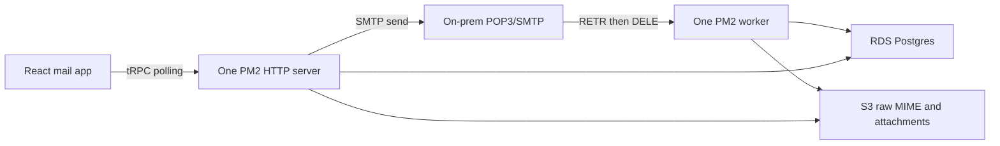

# EC2 Production Backend Human Review

> SUPERSEDED: This review was written against the incorrect shared `Nava@` assumption. Use `docs/superpowers/plans/2026-06-30-ec2-production-per-user-mailbox-plan-v3.md` for the corrected per-user mailbox plan.

Source plan: `docs/superpowers/plans/2026-06-30-ec2-production-backend-implementation-plan-v2.md`

Purpose:

- Help only developer/tech lead review plan before build.
  - Focus: why decisions exist, what can break, what must be confirmed.
  - Not focus: re-list every task.

## One-Screen Summary

- We are building real production backend, not pilot throwaway.
  - Pilot = smaller user/data rollout on same architecture.
  - Target = 50 VPN users, 15,000 emails/day, no second backend rewrite.

- New backend lives beside old backend.
  - New path: `apps/server-pilot/`
  - Old Cloudflare backend: `apps/server/` untouched.
  - Branch: `EC2-pilot` from `FE-demo-minimal`.

- Big replacement:
  - Cloudflare Workers/DO/KV/R2/Queues/Gmail/OAuth/Vectorize out.
  - EC2 Node/Hono/tRPC, PM2, RDS Postgres, S3, POP3/SMTP in.

- Biggest non-negotiable:
  - POP3 data loss prevention.
    - Store raw MIME + DB row first.
    - Only then `DELE`.
    - Only after `QUIT` treat server delete as final.

- Biggest product assumption:
  - Shared inbox state.
    - Read/unread/star/labels shared across 50 users.
    - No private per-user mailbox state unless product says needed.

## Architecture Mental Model

- One app server handles user requests.
  - Hono + tRPC.
  - Session-cookie auth.
  - DB-backed mail reads/mutations.

- One worker owns background work.
  - POP3 ingest every 30s.
  - Snooze wake cron.
  - CloudWatch metrics.
  - Must be exactly one worker for `Nava@`.

- Frontend stays mostly same.
  - It still imports `@zero/server/*`.
  - `apps/server-pilot` must mimic old package exports and router shape.
  - Missing router/export = frontend build break.

## Decision Ledger

| Decision | Why | Constraint/Risk That Forced It | Human Check |
|---|---|---|---|
| New `apps/server-pilot/` | Isolate migration, avoid breaking existing Cloudflare backend | Current FE depends on old server contracts | Accept duplicate backend during migration? |
| EC2 + RDS + S3 | Fewer moving parts than Cloudflare-native stack for this client/on-prem mail | One dev, AWS credits, on-prem POP3/SMTP | Confirm AWS account/region/network available |
| One PM2 HTTP + one PM2 worker | Simple ops, avoids cross-process POP3 races | Two workers could delete same mailbox messages | Confirm PM2 config cannot scale worker above 1 |
| RDS Postgres as system of record | Client mail server deletes after 7 days | Losing ingest means losing history | Backup/restore must be tested before go-live |
| S3 for raw MIME/attachments | PDFs and MIME blobs not good in Postgres | Storage growth can become expensive | Lifecycle policy required |
| POP3 download-and-delete | Matches production mailbox drain behavior | Wrong order can delete mail before persistence | Must pass manual POP3 kickoff test |
| React Query polling, no WebSocket | Avoid WS cross-process/session complexity | Freshness delayed up to 30s | Confirm users can tolerate 30s refresh |
| No `pg-boss` | Undo/snooze do not need full queue | Queues add ops burden for one dev | Re-add only if delayed jobs expand |
| Browser-side undo send | Avoid server queue for 15s undo | Browser close during undo window cancels send | Confirm acceptable product behavior |
| Better Auth email/password only | Strip OAuth/JWT/provider complexity | Need local user management | Confirm user provisioning flow |
| Shared thread state | Avoid 750k/day per-user state writes | Agents cannot have private unread/star labels | Confirm with client before build |
| Safe AI stubs | Keep frontend type-compatible while dropping AI scope | Buttons may appear but return no-op/empty | Decide hide vs no-op for AI UI |

## What We Removed

- Removed because one-dev production backend needs less surface:
  - WebSockets.
    - Risk avoided: sticky sessions, cross-process sync, Redis dependency.
  - `pg-boss`.
    - Risk avoided: queue migration/monitoring/dead-letter ops.
  - JWT/JWKS/bearer/MCP auth.
    - Risk avoided: unused auth modes and secret rotation burden.
  - OAuth/social providers.
    - Risk avoided: provider setup and callback bugs.
  - `message_recipient`.
    - Risk avoided: 50x write amplification.
  - `mail_scheduled_email`.
    - Risk avoided: second job system.
  - AI/vector/search stack.
    - Risk avoided: product complexity before inbox works.

- Removed things can come back only with trigger:
  - Redis/Valkey:
    - Add if real-time AI/chat becomes production requirement.
  - Per-user message state:
    - Add if 50 agents require private unread/star/labels.
  - Scheduled send:
    - Add if send-later over undo window becomes product requirement.
  - AI compose/search:
    - Add if release must include AI buttons.

## Highest-Risk Areas

| Risk | Why It Matters | Mitigation In Plan | Still Need Human Review |
|---|---|---|---|
| POP3 data loss | `DELE` can permanently remove only copy on server | Write S3 + PG before `DELE`; UIDL unique index; `pop3_purged_at` | Test with real mail server behavior |
| POP3 server quirks | On-prem server may not behave like Gmail/Exchange | Kickoff checks: `UIDL`, `RETR`, `DELE`, `RSET`, 500-message session | Need sample mailbox + IT window |
| Heavy PDFs slow ingest | 10s/message cannot hit 15k/day with one worker | Capacity gate blocks go-live if slow | Measure real PDF corpus early |
| Frontend contract mismatch | FE typed against old `@zero/server` | Contract tests + all router roots + deep imports | Build `apps/mail` after every backend slice |
| Shared state surprise | Read/unread shared may surprise agents | Explicit assumption Q1 | Need product/client signoff |
| Auth provisioning | 50 users seeded, email/password only | Seed script, Better Auth stripped config | Need password reset/change story |
| S3 cost/storage growth | Attachments can be GB/day | Lifecycle policy + raw metadata in DB | Need retention policy agreed |
| RDS bottleneck | Postgres stores parsed bodies, not metadata only | `t4g.small+`, indexes, pool limit | Watch CPU/storage during 1k/day test |
| Worker singleton failure | If worker dead, inbox stale; if two workers, races | PM2 one worker + alarms | Need process monitor and runbook drill |
| Send semantics | SMTP send immediate after browser delay | `mail.unsend` no-op after send | Need UX copy: undo cancels before send only |

## Product Assumptions To Approve

- Q1: Shared inbox state.
  - Default: keep shared `mailThread.isUnread`, labels, star, important.
  - User impact:
    - If one agent marks read, everyone sees read.
    - If one agent archives, shared inbox changes.
  - Change cost if wrong:
    - Add `message_recipient` or `thread_user_state`.
    - More tables, more writes, more UI semantics.
  - Recommendation:
    - Approve only if Legacy Hotels wants team-shared inbox behavior.

- Q2: AI compose/search deferred.
  - Default: safe stubs keep FE compiling.
  - User impact:
    - AI features may be absent/disabled/no-op.
  - Change cost if wrong:
    - Need provider keys, prompt flow, usage controls, vector/search storage.
  - Recommendation:
    - Hide AI UI for first production backend unless client paid for AI now.

- Q3: No explicit send-later.
  - Default: only 15s browser undo.
  - User impact:
    - No scheduled email for later hours/days.
  - Change cost if wrong:
    - Add `scheduled_at`, worker send loop, failure/retry model.
  - Recommendation:
    - Keep out unless client explicitly asked.

- Q4: 30s polling acceptable.
  - Default: inbox list/thread refetch every 30s and on focus.
  - User impact:
    - New emails may appear up to 30s late.
  - Change cost if wrong:
    - Redis/Valkey pub/sub or SSE/WS.
  - Recommendation:
    - Confirm with operations: hotel email does not need sub-second updates.

- Q5: POP3 download-delete is desired.
  - Default: drain `Nava@`, make RDS/S3 system of record.
  - User impact:
    - Mail server mailbox near-empty after ingest.
  - Change cost if wrong:
    - Switch to copy-only/retry retention model.
  - Recommendation:
    - Confirm in writing with client IT.

## Technical Constraints Driving Shape

- One developer constraint.
  - Prefer boring infra.
    - PM2 over container orchestration.
    - Postgres tables over queues where enough.
    - Polling over WebSockets.
  - Avoid features needing 24/7 specialist ops.

- On-prem POP3/SMTP constraint.
  - Cannot assume Gmail history IDs, labels, OAuth refresh, webhooks.
  - Must build own:
    - UIDL dedupe.
    - Thread stitch.
    - MIME archive.
    - SMTP outbound row tracking.

- 7-day mail retention constraint.
  - Ingest failures become data-loss risk after 7 days.
  - Alarms are not optional.
  - Backups are not optional.

- 15k/day constraint.
  - Average 10.4/minute looks easy.
  - Burst + PDFs are real unknown.
  - Plan capacity gate catches this before 50-user rollout.

- Existing frontend constraint.
  - Backend cannot expose "nice new API" first.
  - Must satisfy current `AppRouter`, package exports, deep imports.
  - Contract parity is build gate.

## Review Checklist For Tech Lead

- POP3:
  - Confirm real server supports stable `UIDL`.
    - If no stable UIDL, duplicate prevention plan changes.
  - Confirm `DELE` persists only after `QUIT`.
    - RFC says yes; server must be tested.
  - Confirm 500-message session does not timeout.
    - If timeout, lower cap or optimize parse/store.
  - Confirm raw `RETR` string binary handling preserves attachments.
    - Test with real PDF.

- Database:
  - Confirm shared state acceptable.
    - Otherwise schema must change before implementation.
  - Confirm indexes match list queries.
    - `transport_id`, folder/archive, latest timestamp, unread.
  - Confirm backups:
    - Automated snapshots.
    - Restore drill.
    - Storage autoscaling max.

- S3:
  - Confirm bucket lifecycle.
    - Raw MIME and PDFs likely grow fast.
  - Confirm object keys use DB ids.
    - No `Message-ID` as key.
  - Confirm private access model.
    - Signed URLs or server proxy only.

- Frontend:
  - Confirm demo mode default off.
  - Confirm `@zero/server` alias points to `server-pilot`.
  - Confirm AI UI behavior.
    - Hide disabled features or tolerate safe stubs.
  - Confirm polling UX.

- Auth:
  - Confirm 50 user list/source.
  - Confirm password creation/reset procedure.
  - Confirm VPN-only enough for access control.
  - Confirm session cookie settings for HTTPS domain.

- Ops:
  - Confirm EC2/RDS/S3 region.
  - Confirm VPC/VPN path to on-prem mail server.
  - Confirm CloudWatch alarms routed to actual human.
  - Confirm PM2 restart on reboot.
  - Confirm nginx TLS story if not behind VPN TLS terminator.

## Gates Before Build Should Start

- Must answer before implementation:
  - Shared vs private read/unread/labels?
  - AI UI hidden or no-op?
  - Send-later out?
  - POP3 delete-after-ingest confirmed?
  - AWS region/account/VPC path confirmed?

- Can answer during early implementation:
  - Exact staff seed list.
  - Final hostname.
  - Exact S3 lifecycle durations.
  - CloudWatch alarm notification target.

- Must answer before go-live:
  - Real PDF ingest speed.
  - 1,000-message drain under 30 minutes.
  - 15,000/day simulation no backlog growth.
  - RDS restore drill successful.
  - Manual POP3 mailbox near-empty after worker run.

## Red Flags While Implementing

- Any task starts changing `apps/server/`.
  - Stop. Plan says old backend untouched.

- Any POP3 path calls `DELE` before S3 + PG commit.
  - Stop. Data-loss bug.

- Any worker config has `instances > 1`.
  - Stop. Two workers can race mailbox deletion.

- Any FE code renames tRPC procedures.
  - Stop. Plan says preserve frontend contract.

- Any backend skips deep import exports.
  - Stop. FE may build-break outside obvious `@zero/server/*` paths.

- Any new queue/Redis/WS appears.
  - Stop. Scope creep unless specific trigger met.

- Any schema adds per-user message fan-out.
  - Stop. Only if shared state rejected.

- Any S3 key uses email `Message-ID`.
  - Stop. Header collisions/invalid chars possible.

## Recommended Review Decisions

| Question | Recommended Answer | Why |
|---|---|---|
| Branch? | `EC2-pilot` from `FE-demo-minimal` | Already done; clean scope |
| Shared inbox state? | Approve if team inbox | Saves 50x writes and complexity |
| AI in release? | Hide/defer | Backend core more important |
| WebSockets? | No | 30s polling enough unless real-time product need |
| Queue? | No | Undo/snooze simple enough without it |
| RDS size? | `t4g.small` minimum | `t4g.micro` too tight for parsed bodies and 50 users |
| EC2 size? | `m6i.xlarge` | Enough headroom for Node + parse + build simplicity |
| Attachment storage? | S3 blob only | Searchability deferred; data retention preserved |

## Final Human Read

- Plan is strong because it optimizes for:
  - data durability,
  - frontend compatibility,
  - low operational load,
  - clear scale gates.

- Plan is risky where real world enters:
  - POP3 server behavior,
  - PDF-heavy ingest speed,
  - shared mailbox semantics,
  - one-developer ops burden.

- Best next move:
  - Approve/deny product assumptions first.
  - Then implementation can proceed task-by-task with contract tests first.

