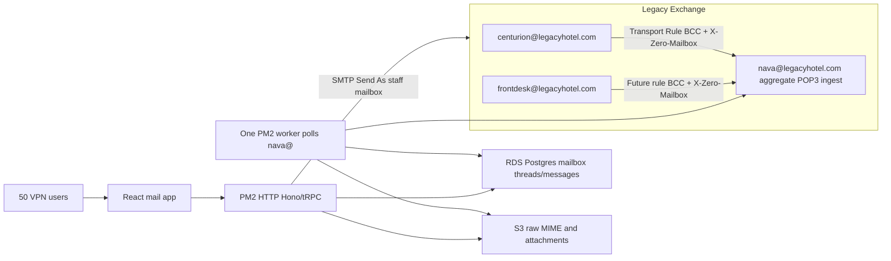

# EC2 Production Backend Plan V3: Exchange Aggregate Ingest With Per-Mailbox Isolation

Supersedes:

- `docs/superpowers/plans/2026-06-30-ec2-production-backend-implementation-plan-v2.md`
- `docs/superpowers/plans/2026-06-30-ec2-production-human-loop-review.md`

Core correction:

- V2 mistake: assumed one shared `Nava@` inbox and shared thread state.
- V3 truth: one Exchange copy mailbox can be the POP3 input, but storage/viewing/sending are per staff mailbox.
  - Pilot uses same production shape: Exchange copies Centurion mail into `nava@` and stamps `X-Zero-Mailbox: centurion@legacyhotel.com`.
  - Production adds more Exchange rules with different `X-Zero-Mailbox` values.
  - User logs in -> sees only mailboxes granted through `mailboxAccess`.
  - Personal inboxes have one owner access row.
  - Shared inboxes have multiple member/owner access rows.
  - Admin users get explicit admin access rows.
  - User sends only from a mailbox they can access.
  - Drafts/automation belong to the target mailbox/thread, not the aggregate `nava@` mailbox.
  - Read/unread/star/labels/snooze/archive are mailbox-scoped so shared inbox users see the same state.

## 95% Confidence Notes

- Local plan audit found shared-state assumptions in:
  - global constraints,
  - production diagram,
  - schema section,
  - seed script,
  - mail read queries,
  - mail mutations,
  - worker loop,
  - runbook,
  - human review file.

- External POP3/BCC check found key routing constraint:
  - BCC recipients usually absent from email headers.
  - POP3 does not expose SMTP envelope recipient.
  - One aggregate POP3 mailbox cannot reliably route BCC mail to 50 users unless server adds `Delivered-To`, `X-Envelope-To`, `X-Original-To`, or equivalent.
  - Best Exchange shape for this project: one aggregate POP3 ingest mailbox `nava@` plus Exchange Transport Rules that stamp `X-Zero-Mailbox` before BCC/copy.
- `mailboxTransport` means staff mailbox identity row in this plan.
  - Existing name kept for frontend/server continuity.
  - Conceptual boundary: `staff_mailbox`.
  - It is not the POP3 source for inbound during pilot; `nava@` is the source.
  - It now owns the staff/mailbox fields directly.
  - `staffMember` is cut from V3 because access is modeled directly through `mailboxAccess`.
  - Shared inboxes are first-class: multiple users can access one `mailboxTransport`.
  - Ship roles: `owner`, `member`, `admin`.
  - Do not use `delegate` terminology in V3; call shared-inbox helpers `member`.

- Scaling/front-end review found three plan blockers to close before build:
  - Existing `apps/mail` persisted React Query cache is keyed by `connectionId`; current root passes `null`, so shared-browser users can share cached mail.
  - Existing thread hooks set `refetchIntervalInBackground` but do not set `refetchInterval`; the 30-second polling claim is not implemented yet.
  - Existing deployment notes do not specify static SPA hosting or TLS termination, while Better Auth expects an HTTPS origin.

## Updated Mental Model



- One PM2 worker still ok.
  - It polls one aggregate Exchange copy mailbox: `nava@`.
  - Isolation happens after parse by trusted `X-Zero-Mailbox`.
  - Prevents ops sprawl while preserving per-staff-mailbox isolation.

- One HTTP server still ok.
  - Every mail query/mutation proves `ctx.userId` has `mailboxAccess` to `ctx.activeTransportId`.

- One frontend still ok.
  - Existing tRPC/router contract preserved.
  - Backend now scopes data correctly.
  - One static React build is served to all 50 VPN users.
  - Browser cache/session state must be scoped or cleared so shared workstations do not leak one staff inbox to the next login.

## Revised Decision Ledger

| Decision | V3 Choice | Why | Risk |
|---|---|---|---|
| Inbound model | Exchange Transport Rule copies to `nava@` and stamps `X-Zero-Mailbox` | Pilot and prod use same backend shape | IT must implement header stamping correctly |
| Ingest mailbox | `mailIngestMailbox` row for `nava@` POP3 | Separate source mailbox from staff mailbox identity | Must not confuse `nava@` with user-visible inbox |
| Thread state | On `mailThread`, scoped by `transportId` | Personal inboxes stay private; shared inboxes share state | Must enforce `mailboxAccess` in every query |
| Message storage | One `message` row per Exchange-copied mailbox delivery | Same guest email copied for 2 mailboxes becomes 2 mailbox rows | More storage than deduped MIME, but access simpler |
| POP3 worker | One PM2 worker polls `nava@` | Simple ops, no workstation mailbox clash | `nava@` must receive only stamped app copies |
| Credentials | One inbound POP3 secret for `nava@`; outbound SMTP via service account or per-mailbox creds | Fewer inbound creds, correct send-as model | Send As permissions need IT setup |
| SMTP send | Use selected allowed mailbox identity | Correct From/account semantics for personal/shared inboxes | Prevent arbitrary `fromEmail` spoofing |
| Drafts | `mailDraft.createdByUserId` + `threadId` + `transportId` | Shared mailbox drafts can be shared, with actor audit | Automation must know target mailbox |
| Labels | `mailLabel.transportId` | Labels follow mailbox state | Need default labels per mailbox |
| Notes/templates/settings | Per-user | Existing product expectation | None new |
| BCC routing | Required `X-Zero-Mailbox` owner marker | Aggregate POP3 loses BCC recipient otherwise | Missing marker writes `mailIngestQuarantine`, not user inbox |
| Frontend hosting | One HTTPS nginx site serves the built SPA and proxies `/api/*` to Node | All 50 users use one URL over VPN | TLS/static hosting must be explicit, not assumed |
| Frontend cache | Disable persisted query cache for production, or key it by `userId + activeTransportId`; always clear on logout/session expiry | Prevent shared-browser privacy leak | Existing `connectionId=null` cache key is unsafe |
| Freshness | Real React Query polling: `refetchInterval: 30_000` plus focus refetch | Replaces WebSocket without infra | Existing code has background flag but no interval |
| Hardware | EC2 `m6i.xlarge` for nginx + Node HTTP + worker; RDS at least `t4g.medium` for prod-shaped pilot | Avoid DB memory/CPU-credit bottleneck before app bottleneck | `t4g.small` only acceptable for dev/smoke unless load test proves safe |

## Product Assumptions Now Fixed

- Q1 fixed: personal and shared mailbox state.
  - Personal mailbox state is private because only owner has access.
  - Shared mailbox state is shared because members access same `transportId`.
  - Do not add shared `Nava@` thread state.

- Q2 fixed: AI compose/search deferred.
  - Hide AI UI or return safe no-op until mail core works.

- Q3 fixed: send-later out.
  - Browser 15s undo only.

- Q4 fixed: 30s polling acceptable.
  - Implement real React Query polling with `refetchInterval: 30_000`.
  - Also refetch on window focus.
  - Re-add Redis/Valkey + WebSocket only if users need sub-10s freshness or live AI streaming.

- Q5 updated: POP3 delete-after-ingest applies only to dedicated app copy mailbox.
  - `nava@` drains independently.
  - RDS/S3 becomes system of record for copied app mail.
  - Safe because `nava@` is a dedicated app copy mailbox, not Centurion's Outlook mailbox.
  - Do not poll/delete Centurion's real mailbox.
  - Do not build app-side 7-day retention logic; Exchange already handles its own server retention and the app drains `nava@` after persistence.

## Hard Requirement From BCC Reality

- Accepted topology:
  - One aggregate app copy mailbox: `nava@legacyhotel.com`.
  - Exchange Transport Rule per mailbox identity.
  - Rule copies/BCCs to `nava@`.
  - Rule stamps trusted owner marker:
    - `X-Zero-Mailbox: centurion@legacyhotel.com`
    - later `X-Zero-Mailbox: frontdesk@legacyhotel.com`
  - Worker polls only `nava@`.
  - Header value maps copy to `mailboxTransport`.

- Fallback topology:
  - One copy mailbox per mailbox identity if old Exchange cannot stamp headers.
    - `nava-centurion@legacyhotel.com`
    - `nava-frontdesk@legacyhotel.com`
  - Mailbox polled maps target `mailboxTransport`.

- Rejected topology:
  - One aggregate mailbox with BCC copies and no envelope header.
  - Reason:
    - BCC recipient absent by design.
    - POP3 cannot recover SMTP envelope.
    - Routing would be guesswork -> privacy breach risk.

- Risk topology:
  - Poll users' primary production mailboxes with `DELE`.
  - Reason:
    - Successful ingest deletes server copy.
    - Other mail clients may never see it.
  - Accept only if app becomes sole client/system of record for those accounts.

## Exchange IT Implementation Guide

Pilot target:

- Source mailbox: `centurion@legacyhotel.com`
- Aggregate app mailbox: `nava@legacyhotel.com`
- Required copied-message header: `X-Zero-Mailbox: centurion@legacyhotel.com`

### Exchange 2010 UI Path

- Open `Exchange Management Console`.
- Go to `Organization Configuration`.
- Open `Hub Transport`.
- Open `Transport Rules`.
- Create `New Transport Rule`.
- Rule name:
  - `Zero - Copy Centurion to Nava`
- Condition:
  - `sent to people`
  - select `centurion@legacyhotel.com`
- Actions:
  - `set header with value`
    - header: `X-Zero-Mailbox`
    - value: `centurion@legacyhotel.com`
  - `Blind carbon copy (Bcc) the message to addresses`
    - address: `nava@legacyhotel.com`
- Enable rule.
- Send test message to Centurion.
- Export raw message from `nava@`.
- Confirm raw headers include:

```text
X-Zero-Mailbox: centurion@legacyhotel.com
From: <original sender>
To: <original visible recipient>
Subject: <original subject>
Message-ID: <original message id>
```

### Exchange 2013+ UI Path

- Open `Exchange Admin Center`.
- Go to `mail flow`.
- Open `rules`.
- Click `+`.
- Choose `Create a new rule`.
- Click `More options`.
- `Apply this rule if...`
  - `The recipient is...`
  - select `centurion@legacyhotel.com`
- `Do the following...`
  - `Modify the message properties > set a message header`
    - `X-Zero-Mailbox`
    - `centurion@legacyhotel.com`
  - `Add recipients > to the Bcc box`
    - `nava@legacyhotel.com`
- Save.

### Exchange Management Shell Path

Pilot rule:

```powershell
New-TransportRule `
  -Name "Zero - Copy Centurion to Nava" `
  -SentTo "centurion@legacyhotel.com" `
  -SetHeaderName "X-Zero-Mailbox" `
  -SetHeaderValue "centurion@legacyhotel.com" `
  -BlindCopyTo "nava@legacyhotel.com"
```

Verify:

```powershell
Get-TransportRule "Zero - Copy Centurion to Nava" | Format-List
```

Production hardening rule before adding more staff mailboxes:

```powershell
New-TransportRule `
  -Name "Zero - Strip External Mailbox Marker" `
  -FromScope NotInOrganization `
  -RemoveHeader "X-Zero-Mailbox"
```

Reason:

- External sender can create fake `X-Zero-Mailbox`.
- Exchange must remove external value.
- Exchange then adds trusted internal value in staff-specific copy rule.
- Pilot still uses `X-Zero-Mailbox` now so backend shape matches production.

### If Header Stamping Fails

Fallback:

- Create one copy mailbox per staff mailbox:
  - `nava-centurion@legacyhotel.com`
  - `nava-frontdesk@legacyhotel.com`
- Rule:
  - mail to `centurion@legacyhotel.com` -> BCC `nava-centurion@legacyhotel.com`
  - mail to `frontdesk@legacyhotel.com` -> BCC `nava-frontdesk@legacyhotel.com`
- Backend owner mapping:
  - mailbox polled determines owner.

Rejected fallback:

- one `nava@` BCC without `X-Zero-Mailbox`.
- Reason: works only while Centurion is the only copied mailbox; creates production rewrite later.

### Journaling

Use only if IT already has clean journaling configured.

- Transport Rule preferred.
- Journaling may wrap original message in journal report.
- Journaling can require Exchange Enterprise CAL for targeted/premium rules.
- Journaling parser adds avoidable complexity.

## Exchange Outbound Send Guide

Pilot target:

- Web app sends as `centurion@legacyhotel.com`.
- Web app never sends as `nava@legacyhotel.com`.

Preferred Exchange setup:

- Create service account:
  - `nava-app@legacyhotel.com`
- Grant Send As on Centurion mailbox:

```powershell
Add-ADPermission `
  -Identity "Centurion" `
  -User "DOMAIN\nava-app" `
  -ExtendedRights "Send As"
```

Backend behavior:

- authenticate to SMTP as `nava-app`.
- set `From: centurion@legacyhotel.com`.
- set `To` from inbound `Reply-To`, else inbound `From`.
- set reply headers:

```text
In-Reply-To: <original Message-ID>
References: <existing References plus original Message-ID>
```

Alternative Exchange setup:

- Dedicated Receive Connector for app server IP.
- Restrict remote IP to EC2/VPN address.
- Allow relay only from that IP.
- Backend still enforces allowed From list.
- Do not modify default Exchange receive connectors.

## Schema Revamp

Still avoid `message_recipient`.

Reason:

- We are not storing one shared message and fanning out per-recipient state.
- We are storing each Exchange-copied staff mailbox delivery as that mailbox's message.
- State lives on mailbox-scoped thread/message rows.
  - Personal inbox: one owner user has access, so state is effectively private.
  - Shared inbox: multiple users have access, so read/star/label/snooze/archive state is shared.
- We are not keeping a separate `staffMember` table.
  - `staffMember` only duplicated user/mailbox identity and made access semantics ambiguous.
  - User-to-mailbox access is modeled explicitly through `mailboxAccess`.
- We are not keeping AI prompt schema in the mail-core rewrite.
  - `mailPrompt` is deferred with AI drafting.
  - Add it later with the actual AI UX and route shape.
- We are not keeping a separate snooze table.
  - `mailThread` already owns mailbox thread state.
  - Store snooze as nullable `mailThread.snoozedUntil`.

### Access Role Decision

Use mailbox-level roles, not a `delegate` role:

| Role | Use | Can Read/Write Mail | Can Send As Mailbox | Can Manage Access |
|---|---|---:|---:|---:|
| `owner` | personal mailbox owner or shared mailbox responsible manager | yes | yes | yes, for that mailbox |
| `member` | shared inbox participant, e.g. Centurion worker | yes | yes | no |
| `admin` | production admin/support user | yes | yes | yes, across granted mailboxes |

- Best fit for current product:
  - manager has `owner` on shared Centurion inbox.
  - Centurion worker has `member` on shared Centurion inbox.
  - each user may also have `owner` on their personal inbox.
  - admin user has `admin` rows across all target mailboxes.
- Why not `delegate`:
  - In Exchange/Outlook language, delegate often means special "act on behalf of" semantics.
  - Product need is simpler: shared inbox membership.
  - `member` reads cleaner in UI, schema, tests, and seed CSV.
- Shared state rule:
  - `mailThread`, `message`, `mailLabel`, and shared `mailDraft` rows are scoped by `transportId`.
  - Personal privacy comes from access cardinality, not separate row shape.

### Tables

Use 16 app tables. Count stays lean because V3 adds aggregate ingest, quarantine, and admin access, while cutting `staffMember`, `mailSnooze`, and `mailPrompt`.

| Table | V3 Ownership |
|---|---|
| `user` | Auth user |
| `session` | User session |
| `account` | Credential login |
| `verification` | Better Auth |
| `note` | `userId`, `threadId` |
| `userSettings` | `userId` |
| `emailTemplate` | `userId` |
| `mailIngestMailbox` | aggregate POP3 source, e.g. `nava@` |
| `mailIngestQuarantine` | unmapped copied mail, never user-visible |
| `mailboxTransport` | staff mailbox address, owner marker value, outbound send config |
| `mailboxAccess` | explicit owner/member/admin access to mailbox transports |
| `mailLabel` | `transportId` |
| `mailThread` | `transportId`, shared/private mailbox state fields |
| `message` | `transportId`, `threadId` |
| `attachment` | via `messageId`, inherits message owner |
| `mailDraft` | `transportId`, `threadId`, `createdByUserId` |

### Critical Columns

- `mailIngestMailbox`
  - `id`
  - `email`
  - `displayName`
  - `pop3Host`, `pop3Port`, `pop3Tls`
  - `secretRef`
  - `pollEnabled`
  - `lastPolledAt`
  - `lastSuccessfulPollAt`
  - `uidlBacklog`

- `mailIngestQuarantine`
  - `id`
  - `ingestMailboxId`
  - `pop3Uidl`
  - `rawEmlKey`
  - `ownerHeaderValue`
  - `reason`
  - `createdAt`

- `mailboxTransport`
  - `id`
  - `email`
  - `displayName`
  - `ownerHeaderValue`
  - `mailboxType`
  - `inboundEnabled`
  - `smtpHost`, `smtpPort`, `smtpSecure`
  - `outboundSecretRef`
  - `sendAsMode`
  - `isDefault`

- `mailboxAccess`
  - `id`
  - `userId`
  - `transportId`
  - `role`
  - `createdAt`
  - Roles:
    - `owner`
    - `member`
    - `admin`
  - `owner`: primary user for personal mailbox or manager/responsible person for shared mailbox; can read/write/send and manage member access for that mailbox.
  - `member`: shared-inbox participant; can read/write/send in the shared mailbox; cannot manage access.
  - `admin`: production admin/support user; can access all granted mailboxes and manage access.
  - Avoid `delegate` wording because `member` is clearer for shared inboxes.

- `mailThread`
  - `transportId`
  - `threadRootId`
  - `labels[]`
  - `isUnread`
  - `isStarred`
  - `isImportant`
  - `isArchived`
  - `snoozedUntil`
  - `latestMessageAt`

- `message`
  - `transportId`
  - `ingestMailboxId`
  - `threadId`
  - `direction`
  - `pop3Uidl`
  - `ownerHeaderValue`
  - `pop3PurgedAt`
  - `rawEmlKey`
  - parsed body/address fields
  - SMTP message id for outbound

### Critical Indexes

```typescript
mailboxTransportOwnerHeaderUnique:
  uniqueIndex('mailbox_transport_owner_header_uidx')
    .on(table.ownerHeaderValue)

mailboxAccessUserTransportUnique:
  uniqueIndex('mailbox_access_user_transport_uidx')
    .on(table.userId, table.transportId)

mailboxAccessUserRoleIdx:
  index('mailbox_access_user_role_idx')
    .on(table.userId, table.role)

messageIngestUidlUnique:
  uniqueIndex('message_ingest_uidl_uidx')
    .on(table.ingestMailboxId, table.pop3Uidl)
    .where(sql`${table.direction} = 'inbound'`)

mailThreadTransportListIdx:
  index('mail_thread_transport_list_idx')
    .on(table.transportId, table.isArchived, table.latestMessageAt)

mailThreadSnoozeWakeIdx:
  index('mail_thread_snooze_wake_idx')
    .on(table.snoozedUntil)
    .where(sql`${table.snoozedUntil} IS NOT NULL`)

mailThreadTransportRootUnique:
  uniqueIndex('mail_thread_transport_root_uidx')
    .on(table.transportId, table.threadRootId)

messageTransportThreadIdx:
  index('message_transport_thread_idx')
    .on(table.transportId, table.threadId)

mailLabelTransportNameUnique:
  uniqueIndex('mail_label_transport_name_uidx')
    .on(table.transportId, table.name)

quarantineIngestIdx:
  index('mail_ingest_quarantine_ingest_idx')
    .on(table.ingestMailboxId, table.createdAt)
```

## Ingest Revamp

- Worker flow:
  - Connect POP3 to `nava@` only.
  - `nava@` credentials live in env or Secrets Manager.
  - `UIDL -> RETR -> parse -> S3 PUT -> PG commit -> DELE -> QUIT`.
  - Read `X-Zero-Mailbox`.
  - Map `X-Zero-Mailbox` to `mailboxTransport`.
  - Store rows with mapped `transportId`.
  - Access control happens through `mailboxAccess`, not message-row `userId`.
  - Missing/unknown/ambiguous owner marker -> quarantine, no user visibility.

- Message header parsing:
  - `X-Zero-Mailbox` is routing owner only.
  - `From` remains original sender.
  - `Reply-To` remains preferred reply target.
  - `To` and `Cc` remain original visible recipients.
  - `Bcc` usually absent and never used for ownership.
  - `Message-ID`, `References`, and `In-Reply-To` remain thread headers.
  - body and attachments remain unchanged.

- Cycle cap:
  - `POP3_MAX_MESSAGES_PER_CYCLE=500`.
  - No multi-transport POP3 concurrency needed for default plan.
  - Worker singleton still required so two processes do not drain `nava@` concurrently.

- Per-message failure:
  - Skip `DELE` for failed message.
  - Continue same mailbox batch.
  - Do not `RSET` after successful deletes unless aborting before deletion marks.

- Duplicate safety:
  - `(ingest_mailbox_id, pop3_uidl)` unique for raw `nava@` replay protection.
  - `(transport_id, message_id_header)` is not unique because copied messages can share headers.
  - Already-stored UIDLs still get `DELE` to drain replay after crash.

- Metrics:
  - `LastSuccessfulPollAgeSeconds` for `nava@`.
  - `UidlBacklog` for `nava@`.
  - `IngestCycleMs`.
  - `Ingested`.
  - `Failed`.
  - `QuarantinedMissingOwner`.

## Router Revamp

- tRPC context:
  - `userId`
  - `activeTransportId`
  - `transportEmail`
  - `accessRole`

- Ownership rule:
  - Every mailbox route first proves `mailboxAccess.userId = ctx.userId`.
  - Every thread/message query includes `transportId = ctx.activeTransportId`.
  - Shared inbox users with `member` or `owner` access see the same mailbox state.
  - Admin routes require a `mailboxAccess` row with `role = admin` for the target mailbox.
  - Admin read-all routes are explicit, audited, and tested separately.
  - Never trust client-supplied thread id alone.

### Reads

- `mail.listThreads`
  - Verify `mailboxAccess(ctx.userId, ctx.activeTransportId)`.
  - `WHERE transport_id = ctx.activeTransportId`.
  - folder/label filters on mailbox labels.

- `mail.get`
  - Verify `mailboxAccess(ctx.userId, ctx.activeTransportId)`.
  - Load thread by `id + ctx.activeTransportId`.
  - Load messages by same mailbox scope.
  - Load attachments through owned message ids.

- `connections.list`
  - Return mailboxes from `mailboxAccess` for current user.
  - Personal + shared inboxes both appear here.
  - Admin-only mailbox picker still reads `mailboxAccess`; it does not list all transports by default.

### Mutations

- `markAsRead`, `markAsUnread`, `toggleStar`, `toggleImportant`
  - Verify `member`, `owner`, or `admin` access.
  - Update mailbox-scoped `mailThread`.

- `modifyLabels`, `bulkArchive`, `bulkDelete`, `snoozeThreads`
  - Verify `member`, `owner`, or `admin` access.
  - Update mailbox-scoped `mailThread`.
  - `snoozeThreads` writes nullable `mailThread.snoozedUntil`; no `mailSnooze` row.

- `drafts.*`
  - Verify `member`, `owner`, or `admin` access.
  - `transportId = ctx.activeTransportId`.
  - `createdByUserId = ctx.userId`.
  - Drafts belong to the mailbox/thread and record who created them.

- `notes.*`, `templates.*`, `settings.*`
  - User-scoped only.

### Admin Access

- `mailboxAccess`:
  - `owner` row for personal mailbox owner or shared mailbox responsible owner.
  - `member` rows for shared inbox users.
  - `admin` rows for production admin users across target mailboxes.

- Admin behavior:
  - Admin can select a target `transportId` only if `mailboxAccess` permits it.
  - Admin read routes load target mailbox data by target transport owner scope.
  - Admin mutations that affect another mailbox require explicit admin procedure names and audit logging.
  - Do not silently let normal user routes become cross-mailbox routes.

### Send

- `mail.send`
  - Verify `member`, `owner`, or `admin` access to `ctx.activeTransportId`.
  - Use selected mailbox's `mailboxTransport` send config.
  - Pilot preferred path: authenticate as `nava-app`, send as `centurion@legacyhotel.com` via Exchange Send As permission.
  - Reject `fromEmail` not matching current transport/allowed aliases.
  - Reply target: inbound `Reply-To` if present, else inbound `From`.
  - Reply threading: set `In-Reply-To` and append `References`.
  - Insert outbound `message` with `transportId`, `threadId`, and `sentByUserId`.
  - Update that mailbox's `mailThread`.

- `mail.unsend`
  - Still safe no-op after server send.
  - Browser 15s undo remains before SMTP call.

## Frontend Impact

- Keep same `AppRouter`.
- Keep same `@zero/server/*` exports.
- No frontend route renames.
- Host one frontend build for all users:
  - Build `apps/mail` once.
  - Serve static assets from nginx over HTTPS.
  - Reverse-proxy `/api/*` to the Node/Hono server.
  - `BETTER_AUTH_URL` must match the HTTPS URL users open.
  - Users access one VPN/internal URL, e.g. `https://nava.legacy.local`.
- UI behavior changes by auth scope:
  - user login determines allowed mailbox list.
  - mailbox switcher selects active personal/shared inbox.
  - inbox list returns only active mailbox rows after access check.
  - send uses selected mailbox send-as config.
  - shared inbox drafts/state are shared at mailbox level and record actor user where needed.
- Required frontend safety changes before production-shaped pilot:
  - Disable persisted React Query cache for live/prod mode, or key it by `userId + activeTransportId`.
    - Recommended default: disable live persisted query cache for this internal VPN tool.
    - Keep persistence only for demo/offline mode if needed.
  - On logout, session expiry, and `X-Zero-Redirect` to login:
    - call `queryClient.clear()`;
    - clear the IndexedDB query cache;
    - clear active thread/search URL state if it can point at private mail.
  - Implement actual polling:
    - set `refetchInterval: 30_000` on live thread list queries;
    - set `refetchOnWindowFocus: true`;
    - keep `refetchIntervalInBackground` only if ops wants background tabs to keep inboxes hot.
  - Remove or hide old OAuth multi-connection/account-switch UI.
    - V3 identity is app user from session plus allowed mailbox list from `mailboxAccess`.
    - Mailbox switching selects another permitted `transportId` server-side and invalidates mailbox-scoped queries.

- Add/verify tests:
  - User without Centurion access cannot see Centurion thread.
  - User without Centurion access cannot mutate Centurion thread by id.
  - User without Centurion access cannot send from `centurion@legacyhotel.com`.
  - Centurion login cannot fetch Front Desk attachment.
  - Centurion shared inbox members both see messages stamped `X-Zero-Mailbox: centurion@legacyhotel.com`.
  - Centurion shared inbox members see same read/archive/label/snooze state.
  - Missing/unknown `X-Zero-Mailbox` messages do not appear in any inbox.
  - Admin user can access Centurion and Front Desk only through explicit admin access backed by `mailboxAccess`.
  - Non-admin user cannot call admin routes or enumerate all mailboxes.
  - Shared-browser test: Centurion logs in, sees thread, logs out; Front Desk logs in in same browser context and never sees Centurion cached data.
  - Polling test: incoming thread appears without manual refresh within the configured interval.

## Seed/Provisioning Revamp

- Old seed wrong:
  - one `nava-pop3-smtp` transport,
  - 50 users attached to it.

- New seed:
  - one app ingest mailbox config for `nava@`.
  - 50 users.
  - `mailboxTransport` rows for personal and shared mailbox identities.
  - personal mailbox: one `owner` access row.
  - shared mailbox: one `owner` access row plus one or more `member` rows.
  - admin `mailboxAccess` rows for the production admin user across all target transports.
  - one pilot row for Centurion first.
  - outbound secret refs or send-as permissions per staff mailbox.

Example:

```text
manager-user -> mailboxAccess owner -> transport-centurion -> X-Zero-Mailbox centurion@legacyhotel.com
centurion-worker-user -> mailboxAccess member -> transport-centurion
manager-user -> mailboxAccess owner -> transport-manager-personal -> X-Zero-Mailbox manager@legacyhotel.com
frontdesk-user -> mailboxAccess owner -> transport-frontdesk -> X-Zero-Mailbox frontdesk@legacyhotel.com
admin-user -> mailboxAccess admin -> transport-centurion
admin-user -> mailboxAccess admin -> transport-frontdesk
...
```

- Required input before production:
  - staff name,
  - login email,
  - mailbox email,
  - `X-Zero-Mailbox` value,
  - SMTP send-as mode,
  - secret ref,
  - enabled flag,
  - mailbox type: `personal` or `shared`,
  - owner users,
  - member users,
  - admin users who should receive `mailboxAccess` rows.

## Capacity Revamp

- Hardware target:
  - EC2: `m6i.xlarge` = 4 vCPU / 16 GiB.
    - Runs nginx static frontend, Node/Hono HTTP process, singleton worker, PM2, logs/metrics agent.
    - Enough as default if HTTP handlers stay mostly I/O-bound and PDFs/attachments stream to S3.
  - RDS Postgres: use at least `t4g.medium` for production-shaped pilot.
    - `t4g.small` (2 vCPU / 2 GiB) is dev/smoke only unless load tests prove it safe.
    - Prefer `t4g.large` before 50-user go-live if CPU credits, memory, DB pool waits, or autovacuum pressure show up.
  - S3 serves raw MIME and attachments; app does not proxy PDF downloads through Node.

- Total volume means delivered mailbox copies, not pre-BCC source messages.
  - If one source email is BCCed to 10 user mailboxes, that is 10 delivered copies.
  - If old 15,000/day number meant pre-BCC source messages and many are copied to many users, real delivered-copy volume may be much higher.

- Target volume: 15,000 delivered copies/day.
  - Average: 10.4/min aggregate.
  - If evenly split: 300/day/user.
  - Real split may be uneven.

- One worker can handle aggregate volume if parse/store stays under about 1s/message.
  - Single `nava@` POP3 stream at 1s/message theoretical > 15k/day.
  - Real limit may be PDF parse time or Exchange POP3 latency.

- New bottleneck:
  - one aggregate mailbox can accumulate all copied mail.
  - Mitigation:
    - 30-second poll,
    - 500-message cycle cap,
    - backlog alarm,
    - tune parser/S3 writes before adding extra workers.

- HTTP/API concurrency:
  - 50 users share one HTTP process by default.
  - Expected traffic is mostly tRPC reads, mutations, and presigned S3 URL generation.
  - Required load test before go-live:
    - 50 authenticated sessions polling thread lists every 30s;
    - 10 concurrent users opening thread details;
    - 5 concurrent sends;
    - worker ingest running in background;
    - p95 API latency under 1s for list/get;
    - no sustained DB pool wait;
    - no 5xx burst.

- Go-live block:
  - If heavy PDFs average 10s/message and concurrency must stay 1, capacity fails.
  - If delivered-copy volume is 50x source volume, capacity/storage plan must be recalculated.
  - If RDS CPU credits drain, memory pressure appears, or `DB_POOL_MAX=10` causes waits under 50-user load, resize RDS before go-live.
  - If HTTP p95 degrades while worker ingests PDFs, move PDF parse to bounded worker concurrency or isolate worker process resources before go-live.
  - Fix before go-live:
    - increase safe concurrency,
    - optimize attachment handling,
    - split ingest only by creating multiple Exchange copy mailboxes if one `nava@` cannot drain safely.

## Runbook Revamp

- Alarms now for `nava@` plus owner mapping:
  - `nava@` stale > 15 min,
  - UIDL backlog grows 3 polls,
  - failed messages > threshold,
  - quarantined missing/unknown owner > 0.

- Manual checks:
  - Create Centurion Exchange Transport Rule first.
  - Send test PDF email to Centurion.
  - Confirm `nava@` raw MIME includes `X-Zero-Mailbox: centurion@legacyhotel.com`.
  - Confirm Centurion owner and member users see message.
  - Confirm user without Centurion access cannot see message.
  - Confirm admin user sees Centurion only through admin route backed by `mailboxAccess`.
  - Confirm logout clears browser mail cache on shared workstation.
  - Confirm `nava@` drains only after persisted.
  - Confirm cross-user thread id access fails.

## Acceptance Gates

- Build gates:
  - `apps/mail` typechecks against `apps/server-pilot`.
  - All deep imports resolve.
  - All router roots exist.
  - `apps/mail` production build is served by nginx over HTTPS.
  - `/api/trpc` and `/api/auth/*` proxy to Node with cookies preserved.

- Isolation gates:
  - User without matching `mailboxAccess` cannot list/get/mutate another mailbox.
  - Attachment signed URL/proxy checks mailbox access.
  - Drafts scoped by `transportId` and record `createdByUserId`.
  - Labels scoped by `transportId`.
  - Shared inbox state is visible to all members of that mailbox.
  - SMTP from spoof rejected.
  - Browser cache does not leak across logout/login on the same browser profile.
  - Query cache is disabled for live mode or keyed by `userId + activeTransportId`.
  - At least one owner `mailboxAccess` row exists for every transport.
  - Member `mailboxAccess` rows work for shared inbox users.
  - Admin access works only for users with explicit `mailboxAccess.role = admin`.
  - Non-admin cannot enumerate or select all transports.

- Ingest gates:
  - `nava@` POP3 config seeded.
  - Centurion `mailboxTransport` seeded with `X-Zero-Mailbox`.
  - 1,000 total backlog drains under 30 min.
  - 15,000/day simulation no aggregate backlog growth.
  - missing owner marker quarantines.
  - Already-stored UIDL replay drains mailbox.
  - HTTP load test passes while ingest simulation runs.

- Ops gates:
  - Secrets Manager populated.
  - RDS backup/restore tested.
  - S3 lifecycle enabled.
  - PM2 reboot restart verified.
  - CloudWatch alarms routed to human.
  - RDS CPU credit, memory, connection count, and pool wait alarms configured.

## Implementation Task Delta From V2

| V2 Area | V3 Change |
|---|---|
| Global constraints | Replace shared `Nava@` state with aggregate `nava@` ingest plus per-mailbox owner marker |
| Schema | Cut `staffMember`, `mailSnooze`, and `mailPrompt`; add `mailboxAccess`; make `mailboxTransport` mailbox identity; make mail state mailbox-scoped by `transportId`; add actor columns like `createdByUserId` / `sentByUserId`; add owner header mapping |
| Seed | Create `nava@` ingest config plus personal/shared mailbox transports, owner/member/admin access rows, Centurion first |
| POP3 client | Connect to aggregate `nava@` secret, not real staff mailboxes |
| Worker | Poll aggregate `nava@`; route by `X-Zero-Mailbox`; quarantine if missing |
| Store | Persist inbound with `transportId`; access checked through `mailboxAccess` |
| Read routes | Verify `mailboxAccess`, then filter by `ctx.activeTransportId` |
| Mutations | Mailbox access guard every update/delete |
| Connections | Return current user's personal/shared/admin mailboxes |
| Send | Use selected mailbox send config, reject spoofed from |
| Drafts | Store per transport/thread with `createdByUserId` |
| Snooze | Store on `mailThread.snoozedUntil`, not a separate `mailSnooze` table |
| Admin | Explicit `mailboxAccess` owner/member/admin rows; no delegate terminology in V3 |
| Frontend cache | Disable live query persistence or key by `userId + activeTransportId`; clear cache on logout/session expiry |
| Frontend hosting | Add nginx static SPA hosting over HTTPS plus `/api/*` proxy to Node |
| Polling | Add real 30s React Query interval and focus refetch |
| Capacity | Recalculate for delivered copies; use RDS `t4g.medium` minimum for prod-shaped pilot |
| Tests | Add cross-user isolation tests everywhere, including shared-browser cache test and 50-user HTTP load test |
| Runbook | `nava@` ingest alarms, owner-marker quarantine checks, browser cache check, and cross-user isolation checks |

## Do Not Simplify Away

- Mailbox access checks on every mail path.
- `X-Zero-Mailbox` owner marker on every copied inbound message.
- Quarantine for missing/unknown/ambiguous owner marker.
- Single-worker `nava@` POP3 drain.
- POP3 write-then-delete ordering.
- `(ingest_mailbox_id, pop3_uidl)` unique index.
- S3 keys based on DB ids.
- `pop3_purged_at` after `QUIT`.
- Full frontend `AppRouter` compatibility.
- Secrets Manager refs, not plaintext mailbox passwords in DB.
- Cross-user negative tests.
- Explicit `mailboxAccess` rows for owner/member/admin access.
- Admin routes separate from normal mailbox routes.
- Logout/session-expiry cache clear.
- Live query cache disabled or keyed by `userId + activeTransportId`.
- One HTTPS frontend host with explicit static asset serving.
- Real `refetchInterval: 30_000` polling.
- 50-user HTTP load gate with worker running.

## Defaults Accepted For Build

- Mail topology:
  - Can Exchange Transport Rule BCC Centurion mail to `nava@`?
  - Can Exchange Transport Rule set `X-Zero-Mailbox: centurion@legacyhotel.com`?
  - Can Exchange strip external `X-Zero-Mailbox` before adding internal values when multi-user production begins?
  - If header stamping fails, can IT create per-staff copy mailboxes like `nava-centurion@`?
  - Default: assume Transport Rule BCC plus header stamping works; keep per-staff copy mailboxes as fallback.

- User mapping:
  - Default: users map to one or more mailboxes through `mailboxAccess`.
  - Personal mailbox: one `owner`.
  - Shared mailbox: one `owner` plus one or more `member` rows.
  - Admin access: `admin` rows for each mailbox the admin can access.
  - No `staffMember` table in default schema.
  - `mailboxTransport` stores mailbox identity/config, not user ownership.
  - No `delegate` wording in V3; shared-inbox users are `member`.
  - Pilot seeds Centurion first.
  - Production requires final mailbox/access CSV before seed/runbook expansion.

- Automation:
  - Default: automation cannot create a draft unless it has explicit `transportId` and `threadId`.
  - If no target mailbox is known, automation does nothing and logs/quarantines the job.
  - Human-triggered drafts record `createdByUserId`.
  - AI drafting prompt storage is out of this BE rewrite.
  - No `mailPrompt` table until AI drafting ships.

- Sending:
  - Default: service account `nava-app@` with Exchange Send As per staff mailbox.
  - Shared aliases are disabled unless later added as an explicit allowlist.
  - Users cannot pick arbitrary `fromEmail`.

- Retention:
  - Default: no app-side 7-day retention logic.
  - Exchange/server retention is handled outside the app.
  - App drains `nava@` after S3/Postgres persistence.
  - S3 lifecycle still required for app-owned raw MIME and attachments.
  - Capacity number means 15,000 delivered mailbox copies/day unless client later says otherwise.

- Frontend:
  - Default: one hosted SPA for all users.
  - Default: nginx terminates HTTPS, serves static assets, and proxies `/api/*` to Node.
  - Default: mailbox switcher lists permitted personal/shared/admin mailboxes from `mailboxAccess`.
  - Default: live query persistence disabled; if kept, key by `userId + activeTransportId`.
  - Default: 30s polling plus focus refetch; no WebSocket.

- Hardware:
  - Default: EC2 `m6i.xlarge`.
  - Default: RDS `t4g.medium` minimum for production-shaped pilot; resize before 50-user go-live if load test says so.

## Recommended V3 Answer

- Build aggregate Exchange ingest plus per-staff mailbox storage now.
  - Correct product semantics.
  - Still avoids `message_recipient` fan-out.
  - Keeps one-dev ops simple.

- Implement shared inboxes as mailbox access, not duplicated user inboxes.
  - `mailboxTransport` = mailbox identity.
  - `mailboxAccess` = who can use it.
  - `mailThread/message/label/draft` = mailbox state.
  - Personal inbox is just a mailbox with one owner.
  - Shared inbox is the same mailbox with owner/member/admin rows.

- Treat aggregate BCC mailbox as valid only with `X-Zero-Mailbox`.
  - Pilot uses Centurion marker too, so production scale does not require backend redesign.

- Treat frontend cache isolation as part of security, not polish.
  - Shared workstations are likely in hotel ops.
  - Server-side ownership is not enough if stale IndexedDB cache can show prior user's inbox.

- Treat `m6i.xlarge` as plausible but gated.
  - Do not trust inherited V2 sizing.
  - Prove 50-user HTTP load plus active ingest before go-live.

## Pilot Checklist

- IT:
  - create/confirm `nava@legacyhotel.com`.
  - enable POP3 for `nava@`.
  - create Exchange Transport Rule for Centurion.
  - set `X-Zero-Mailbox: centurion@legacyhotel.com`.
  - BCC/copy to `nava@legacyhotel.com`.
  - create `nava-app@legacyhotel.com` service account or equivalent SMTP relay path.
  - grant Send As for `centurion@legacyhotel.com`.

- Backend:
  - seed `mailIngestMailbox` for `nava@`.
  - seed `mailboxTransport` for Centurion with `ownerHeaderValue = centurion@legacyhotel.com`.
  - seed `mailboxAccess` owner row for Centurion manager/responsible user.
  - seed `mailboxAccess` member row for Centurion worker user.
  - seed personal mailbox rows/access rows where pilot needs them.
  - seed `mailboxAccess` admin row for production admin user if pilot includes admin review.
  - ingest only messages with known `X-Zero-Mailbox`.
  - quarantine missing/unknown marker.
  - send as Centurion, never `nava@`.
  - use RDS `t4g.medium` or larger for production-shaped pilot.

- Frontend/deploy:
  - build one `apps/mail` SPA for all users.
  - serve it over HTTPS from nginx.
  - proxy `/api/*` to Node/Hono.
  - disable live query persistence or scope it by `userId + activeTransportId`.
  - clear query cache and IndexedDB on logout/session expiry.
  - add real 30s polling and focus refetch.
  - hide old OAuth account-switcher UI unless it is rewritten as transport switching with cache clear.

- Acceptance:
  - raw `nava@` copy has `X-Zero-Mailbox`.
  - `From`, `To`, `Cc`, `Reply-To`, `Message-ID`, `References`, body, attachments preserved.
  - manager and Centurion worker both see copied Centurion message.
  - user without Centurion access cannot see copied Centurion message.
  - reply goes from Centurion to original sender.
  - `nava@` drains only after S3 and Postgres commit.
  - missing owner marker quarantines.
  - admin can view Centurion via admin route only when `mailboxAccess` permits it.
  - non-admin cannot enumerate/select all mailboxes.
  - Centurion logout then Front Desk login in same browser shows no Centurion cached data.
  - 50-user HTTP load test passes while worker ingests mail.

