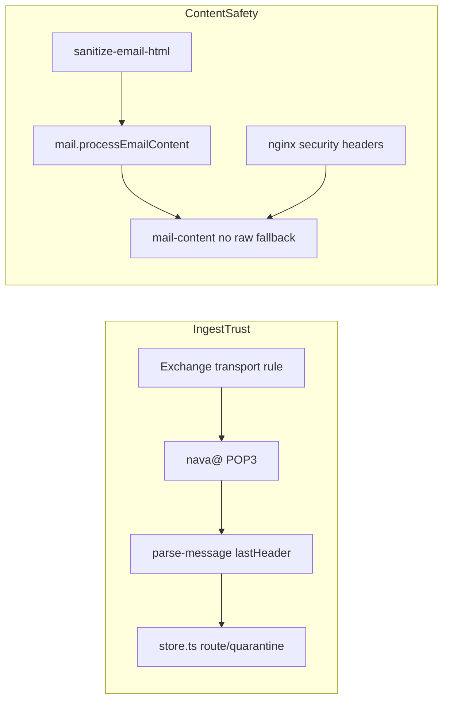

# EC2 Pilot Security Hardening Implementation Plan

> **For agentic workers:** REQUIRED SUB-SKILL: Use superpowers:subagent-driven-development (recommended) or superpowers:executing-plans to implement this plan task-by-task. Steps use checkbox (`- [ ]`) syntax for tracking.

**Goal:** Close audit findings 1–7 and notes N1–N5 from [`docs/superpowers/plans/2026-07-01-ec2-pilot-security-audit.md`](docs/superpowers/plans/2026-07-01-ec2-pilot-security-audit.md) so real mail ingest can be enabled safely.

**Architecture:** Defense-in-depth in three layers — (1) **ingest trust** (Exchange-stamped `X-Zero-Mailbox`, read last occurrence, quarantine unknown), (2) **content safety** (server-side `sanitize-html` in `processEmailContent`, no raw-html fallback in UI, nginx app-shell headers), (3) **pilot access control** (signup allowlist env, test-only tRPC injection). Shared helpers live in small focused modules; no port of legacy `cheerio`/`@barkleapp/css-sanitizer` stack — keep `@zero/server-pilot` lean.

**Tech Stack:** Node 22, Hono, tRPC, Drizzle, `sanitize-html`, Better Auth, vitest, nginx, AWS RDS CA bundle (af-south-1), existing POP3 worker.

## Global Constraints

- Branch: `EC2-pilot`. Do not re-do Tasks 0–12 from the v4 plan.
- Real Exchange/POP3 ingest stays **off** until Tasks 1–6 pass on EC2.
- Single EC2 (`i-008f737974a9ba9b3`), single RDS (`nava-zero-mail-pilot`), region `af-south-1`.
- Pilot users seeded via [`apps/server-pilot/src/db/seed.ts`](apps/server-pilot/src/db/seed.ts); passwords in Secrets Manager only.
- Deploy via [`apps/server-pilot/deploy/deploy-ec2.sh`](apps/server-pilot/deploy/deploy-ec2.sh); push to remote OK per updated handoff policy.
- Tests that need RDS: `describe.skipIf(!TEST_DB_AVAILABLE || !reachable)` pattern unchanged.

---

## File map (what changes where)

| Area | Create | Modify |
|---|---|---|
| HTML sanitizer | [`apps/server-pilot/src/mail/sanitize-email-html.ts`](apps/server-pilot/src/mail/sanitize-email-html.ts) | [`apps/server-pilot/src/trpc/routes/mail.ts`](apps/server-pilot/src/trpc/routes/mail.ts), [`apps/mail/components/mail/mail-content.tsx`](apps/mail/components/mail/mail-content.tsx) |
| Mailbox header trust | [`apps/server-pilot/tests/fixtures/centurion-double-stamp.eml`](apps/server-pilot/tests/fixtures/centurion-double-stamp.eml) | [`apps/server-pilot/src/mail/ingest/parse-message.ts`](apps/server-pilot/src/mail/ingest/parse-message.ts), [`apps/server-pilot/deploy/deferred-real-mail-readiness.md`](apps/server-pilot/deploy/deferred-real-mail-readiness.md), [`apps/server-pilot/deploy/exchange-smoke.md`](apps/server-pilot/deploy/exchange-smoke.md) |
| RDS TLS | [`apps/server-pilot/deploy/rds-ca-global.pem`](apps/server-pilot/deploy/rds-ca-global.pem) (AWS public CA) | [`apps/server-pilot/src/db/client.ts`](apps/server-pilot/src/db/client.ts), [`apps/server-pilot/scripts/seed-prod.ts`](apps/server-pilot/scripts/seed-prod.ts), [`apps/server-pilot/tests/helpers/test-db.ts`](apps/server-pilot/tests/helpers/test-db.ts) |
| Outbound validation | [`apps/server-pilot/src/mail/send/validate-outbound.ts`](apps/server-pilot/src/mail/send/validate-outbound.ts) | [`apps/server-pilot/src/trpc/routes/mail.ts`](apps/server-pilot/src/trpc/routes/mail.ts) |
| Ingest bounds + tx | [`apps/server-pilot/src/mail/ingest/limits.ts`](apps/server-pilot/src/mail/ingest/limits.ts) | [`apps/server-pilot/src/mail/ingest/parse-message.ts`](apps/server-pilot/src/mail/ingest/parse-message.ts), [`apps/server-pilot/src/mail/ingest/store.ts`](apps/server-pilot/src/mail/ingest/store.ts), [`apps/server-pilot/src/env.ts`](apps/server-pilot/src/env.ts) |
| Attachment disposition | [`apps/server-pilot/src/mail/attachment-filename.ts`](apps/server-pilot/src/mail/attachment-filename.ts) | [`apps/server-pilot/src/trpc/routes/mail.ts`](apps/server-pilot/src/trpc/routes/mail.ts) |
| Auth hardening | — | [`apps/server-pilot/src/lib/auth.ts`](apps/server-pilot/src/lib/auth.ts) |
| Test injection guard | — | [`apps/server-pilot/src/trpc/trpc.ts`](apps/server-pilot/src/trpc/trpc.ts) |
| nginx + deploy | — | [`apps/server-pilot/deploy/nginx.conf`](apps/server-pilot/deploy/nginx.conf), [`apps/server-pilot/deploy/deploy-ec2.sh`](apps/server-pilot/deploy/deploy-ec2.sh), [`apps/server-pilot/tests/deploy-config.test.ts`](apps/server-pilot/tests/deploy-config.test.ts) |
| IDB cache fix | [`apps/mail/lib/mail/account-switch-cache.ts`](apps/mail/lib/mail/account-switch-cache.ts) | [`apps/mail/components/ui/nav-user.tsx`](apps/mail/components/ui/nav-user.tsx) |



---

### Task 1: Server-side HTML sanitizer (Finding 1 — core)

**Files:**
- Create: [`apps/server-pilot/src/mail/sanitize-email-html.ts`](apps/server-pilot/src/mail/sanitize-email-html.ts)
- Create: [`apps/server-pilot/tests/sanitize-email-html.test.ts`](apps/server-pilot/tests/sanitize-email-html.test.ts)
- Modify: [`apps/server-pilot/src/trpc/routes/mail.ts`](apps/server-pilot/src/trpc/routes/mail.ts) (`processEmailContent`)
- Modify: [`apps/server-pilot/package.json`](apps/server-pilot/package.json) (add `sanitize-html` + `@types/sanitize-html`)

**Interfaces:**
- Produces: `sanitizeEmailHtml(html: string, opts: { shouldLoadImages: boolean }): { html: string; hasBlockedImages: boolean }`
- Consumes: nothing from prior tasks

- [ ] **Step 1: Add dependency**

```bash
pnpm --filter @zero/server add sanitize-html
pnpm --filter @zero/server add -D @types/sanitize-html
```

- [ ] **Step 2: Write failing tests**

```typescript
// apps/server-pilot/tests/sanitize-email-html.test.ts
import { describe, expect, it } from 'vitest';
import { sanitizeEmailHtml } from '../src/mail/sanitize-email-html.js';

describe('sanitizeEmailHtml', () => {
  it('strips script tags and event handlers', () => {
    const { html } = sanitizeEmailHtml(
      '<p onclick="alert(1)">hi</p><script>alert(1)</script>',
      { shouldLoadImages: false },
    );
    expect(html).not.toContain('<script');
    expect(html).not.toContain('onclick');
  });

  it('blocks remote images when shouldLoadImages is false', () => {
    const { html, hasBlockedImages } = sanitizeEmailHtml(
      '',
      { shouldLoadImages: false },
    );
    expect(hasBlockedImages).toBe(true);
    expect(html).not.toContain('https://evil.example');
  });
});
```

Run: `pnpm --filter @zero/server test tests/sanitize-email-html.test.ts` — expect FAIL

- [ ] **Step 3: Implement sanitizer** (strict allowlist; no `javascript:`/`data:` on `<a>`; strip `<script>`, on* attrs; rewrite `` to placeholder when images blocked — mirror spirit of [`apps/server/src/lib/email-processor.ts`](apps/server/src/lib/email-processor.ts) but without cheerio/css-sanitizer deps)

- [ ] **Step 4: Wire `processEmailContent`**

Replace stub at `mail.ts:652-654`:

```typescript
.mutation(async ({ input }) => {
  const result = sanitizeEmailHtml(input.html, {
    shouldLoadImages: input.shouldLoadImages,
  });
  return { processedHtml: result.html, hasBlockedImages: result.hasBlockedImages };
}),
```

- [ ] **Step 5: Run tests** — expect PASS

- [ ] **Step 6: Commit** `fix: wire server-side email HTML sanitizer`

---

### Task 2: Frontend — never render unsanitized HTML (Finding 1 — UI)

**Files:**
- Modify: [`apps/mail/components/mail/mail-content.tsx`](apps/mail/components/mail/mail-content.tsx)
- Create: [`apps/mail/tests/mail-content-fallback.test.ts`](apps/mail/tests/mail-content-fallback.test.ts) (pure helper test if extracted)

**Interfaces:**
- Consumes: sanitized output from Task 1 RPC

- [ ] **Step 1: Remove weak fallback path**

In `resolvedHtml` useMemo: when `!frontendOnlyDemo && !processedData?.html`, return a safe static placeholder (`<p><em>Unable to load message content safely.</em></p>`) instead of calling `resolveMailHtml({ rawHtml: html })`. Demo mode may still use `resolveMailHtml`.

- [ ] **Step 2: Add vitest** asserting the fallback helper never passes through `<script>` when backend unavailable.

Run: `pnpm --filter @zero/mail test tests/mail-content-fallback.test.ts`

- [ ] **Step 3: Commit** `fix: block raw HTML fallback in mail renderer`

Note: Shadow DOM stays for pilot (iframe sandbox deferred — server sanitize + no raw fallback is sufficient for gate; nginx CSP covers app shell).

---

### Task 3: Trusted `X-Zero-Mailbox` parsing + IT docs (Finding 2)

**Files:**
- Modify: [`apps/server-pilot/src/mail/ingest/parse-message.ts`](apps/server-pilot/src/mail/ingest/parse-message.ts)
- Create: [`apps/server-pilot/tests/fixtures/centurion-double-stamp.eml`](apps/server-pilot/tests/fixtures/centurion-double-stamp.eml) — forged header first, relay stamp second
- Modify: [`apps/server-pilot/tests/ingest-store.test.ts`](apps/server-pilot/tests/ingest-store.test.ts)
- Modify: [`apps/server-pilot/deploy/deferred-real-mail-readiness.md`](apps/server-pilot/deploy/deferred-real-mail-readiness.md)
- Modify: [`apps/server-pilot/deploy/exchange-smoke.md`](apps/server-pilot/deploy/exchange-smoke.md)

**Interfaces:**
- Produces: `lastHeader(headers, name): string | null` used by `buildParsedMessage`

- [ ] **Step 1: Add `lastHeader` and switch owner extraction**

```typescript
function lastHeader(headers: Headers, name: string): string | null {
  const v = headers.get(name);
  if (!v) return null;
  const values = Array.isArray(v) ? v : [v];
  for (let i = values.length - 1; i >= 0; i--) {
    const s = values[i];
    if (typeof s === 'string' && s.trim()) return s.trim();
  }
  return null;
}
// buildParsedMessage: ownerHeaderValue = lastHeader(headers, 'x-zero-mailbox')
```

- [ ] **Step 2: Write failing ingest test** — double-stamp fixture routes to Centurion using **relay** (last) value, not attacker's first value.

Run: `pnpm --filter @zero/server test tests/ingest-store.test.ts` — new case FAIL then PASS

- [ ] **Step 3: Document IT gate** in `deferred-real-mail-readiness.md`:

  - Transport rule: BCC `nava@` + set `X-Zero-Mailbox: centurion@legacyhotel.com`
  - **Strip rule:** remove external `X-Zero-Mailbox` before internal stamp
  - `nava@` not internet-reachable (internal copies only)
  - Negative test: direct external mail to `nava@` must quarantine

- [ ] **Step 4: Commit** `fix: trust last X-Zero-Mailbox stamp + document relay controls`

---

### Task 4: RDS TLS certificate verification (Finding 3)

**Files:**
- Create: [`apps/server-pilot/deploy/rds-ca-global.pem`](apps/server-pilot/deploy/rds-ca-global.pem) — download AWS RDS global CA bundle once
- Create: [`apps/server-pilot/src/db/ssl-config.ts`](apps/server-pilot/src/db/ssl-config.ts)
- Modify: [`apps/server-pilot/src/db/client.ts`](apps/server-pilot/src/db/client.ts), [`apps/server-pilot/scripts/seed-prod.ts`](apps/server-pilot/scripts/seed-prod.ts), [`apps/server-pilot/tests/helpers/test-db.ts`](apps/server-pilot/tests/helpers/test-db.ts)

**Interfaces:**
- Produces: `getPostgresSslOptions(): postgres.Options['ssl']`

- [ ] **Step 1: Download CA bundle**

```bash
curl -fsS -o apps/server-pilot/deploy/rds-ca-global.pem \
  https://truststore.pki.rds.amazonaws.com/global/global-bundle.pem
```

- [ ] **Step 2: Implement shared ssl helper**

```typescript
// ssl-config.ts
import { readFileSync } from 'node:fs';
import { fileURLToPath } from 'node:url';
import { dirname, join } from 'node:path';

export function getPostgresSslOptions() {
  const caPath = join(dirname(fileURLToPath(import.meta.url)), '../../deploy/rds-ca-global.pem');
  return { rejectUnauthorized: true, ca: readFileSync(caPath, 'utf8') } as const;
}
```

Replace all `ssl: { rejectUnauthorized: false }` with `ssl: getPostgresSslOptions()`.

- [ ] **Step 3: Run seed-contract + auth-context tests on EC2/local RDS** — must still connect.

- [ ] **Step 4: Commit** `fix: verify RDS TLS with AWS CA bundle`

---

### Task 5: Outbound recipient/subject validation (Note N1)

**Files:**
- Create: [`apps/server-pilot/src/mail/send/validate-outbound.ts`](apps/server-pilot/src/mail/send/validate-outbound.ts)
- Create: [`apps/server-pilot/tests/validate-outbound.test.ts`](apps/server-pilot/tests/validate-outbound.test.ts)
- Modify: [`apps/server-pilot/src/trpc/routes/mail.ts`](apps/server-pilot/src/trpc/routes/mail.ts) (`send` + drafts if they share transport)

**Interfaces:**
- Produces: `assertSafeOutboundFields(fields): void` — throws `TRPCError BAD_REQUEST` on CRLF or invalid email

- [ ] **Step 1: Failing tests** — reject `to: ['a@b.com\r\nBCC: evil@x.com']`, reject subject with `\r\n`, accept normal addresses.

- [ ] **Step 2: Implement** — simple email regex + `[\r\n\u0000]` rejection on all string fields passed to SMTP transport.

- [ ] **Step 3: Call at top of `mail.send` mutation** before DB writes.

Run: `pnpm --filter @zero/server test tests/validate-outbound.test.ts tests/mail-send.test.ts`

- [ ] **Step 4: Commit** `fix: validate outbound mail fields before SMTP`

---

### Task 6: Ingest transaction + size limits (Notes N2, N3)

**Files:**
- Create: [`apps/server-pilot/src/mail/ingest/limits.ts`](apps/server-pilot/src/mail/ingest/limits.ts)
- Modify: [`apps/server-pilot/src/mail/ingest/store.ts`](apps/server-pilot/src/mail/ingest/store.ts)
- Modify: [`apps/server-pilot/src/mail/ingest/parse-message.ts`](apps/server-pilot/src/mail/ingest/parse-message.ts)
- Modify: [`apps/server-pilot/src/env.ts`](apps/server-pilot/src/env.ts) — optional `INGEST_MAX_MESSAGE_BYTES`, `INGEST_MAX_ATTACHMENT_BYTES` (defaults: 25MB / 15MB)

**Interfaces:**
- Produces: `assertWithinIngestLimits(sizeBytes: number, kind: 'message' | 'attachment'): void`
- Produces: `streamToBuffer` respects max via accumulating size check

- [ ] **Step 1: Wrap message + attachment inserts in `db.transaction`**

```typescript
await db.transaction(async (tx) => {
  await tx.insert(message).values({ ... });
  if (parsed.attachments.length > 0) {
    await tx.insert(attachment).values([ ... ]);
  }
});
```

- [ ] **Step 2: Bound `streamToBuffer`** — throw `IngestTooLargeError` when cumulative bytes exceed limit; worker maps to quarantine reason `message_too_large`.

- [ ] **Step 3: Add ingest-store test** — oversized attachment quarantines, no partial message row.

- [ ] **Step 4: Commit** `fix: transactional ingest persistence and size limits`

---

### Task 7: Attachment Content-Disposition safety (Finding 4)

**Files:**
- Create: [`apps/server-pilot/src/mail/attachment-filename.ts`](apps/server-pilot/src/mail/attachment-filename.ts)
- Create: [`apps/server-pilot/tests/attachment-filename.test.ts`](apps/server-pilot/tests/attachment-filename.test.ts)
- Modify: [`apps/server-pilot/src/trpc/routes/mail.ts`](apps/server-pilot/src/trpc/routes/mail.ts) (`getSignedAttachmentUrl`)

**Interfaces:**
- Produces: `formatContentDispositionFilename(raw: string): string` — RFC 5987 `filename*=UTF-8''...` for non-ASCII; strip `"` and control chars for legacy `filename=`

- [ ] **Step 1: Tests** — input `evil".pdf` and `invoice\r\n.pdf` produce safe header fragments.

- [ ] **Step 2: Use in `GetObjectCommand`**

```typescript
ResponseContentDisposition: formatContentDispositionFilename(filename),
```

- [ ] **Step 3: Commit** `fix: sanitize attachment Content-Disposition filenames`

---

### Task 8: Pilot auth tightening (Findings 5 + 6)

**Files:**
- Modify: [`apps/server-pilot/src/lib/auth.ts`](apps/server-pilot/src/lib/auth.ts)
- Create: [`apps/server-pilot/tests/auth-signup-guard.test.ts`](apps/server-pilot/tests/auth-signup-guard.test.ts) (unit test the allowlist helper)

**Decision locked in:** production pilot = **no open signup**. Seeded users only.

- [ ] **Step 1: Add env-driven signup guard**

```typescript
// PILOT_OPEN_SIGNUP=0 (default in production .env.production) disables new signups
// PILOT_SIGNUP_ALLOWLIST=email1@x.com,email2@x.com optional override for invites
hooks: {
  before: {
    signUp: async ({ body }) => {
      if (process.env.PILOT_OPEN_SIGNUP === '1') return;
      const allow = process.env.PILOT_SIGNUP_ALLOWLIST?.split(',').map(s => s.trim().toLowerCase()) ?? [];
      if (!allow.includes(String(body.email).toLowerCase())) {
        throw new APIError('FORBIDDEN', { message: 'signup disabled for pilot' });
      }
    },
  },
},
```

- [ ] **Step 2: Set `allowDifferentEmails: false`**

- [ ] **Step 3: Document on EC2** — ensure `.env.production` has `PILOT_OPEN_SIGNUP=0` (no code secret).

- [ ] **Step 4: Commit** `fix: restrict pilot signup and tighten account linking`

---

### Task 9: Test-only tRPC injection guard (Finding 7)

**Files:**
- Modify: [`apps/server-pilot/src/trpc/trpc.ts`](apps/server-pilot/src/trpc/trpc.ts)

- [ ] **Step 1: Gate injection short-circuits**

```typescript
const isTest = process.env.NODE_ENV === 'test';
const injectedUser = isTest ? (ctx as Partial<TrpcPrivateContext>).sessionUser : undefined;
// same for mailboxProcedure injected transport fields
```

Production `main.ts` context factory never sets these fields — verified at [`apps/server-pilot/src/main.ts`](apps/server-pilot/src/main.ts).

Run full test suite: `pnpm --filter @zero/server test`

- [ ] **Step 2: Commit** `fix: limit tRPC auth injection to test env`

---

### Task 10: nginx security headers + deploy sync (Note N5)

**Files:**
- Modify: [`apps/server-pilot/deploy/nginx.conf`](apps/server-pilot/deploy/nginx.conf)
- Modify: [`apps/server-pilot/deploy/deploy-ec2.sh`](apps/server-pilot/deploy/deploy-ec2.sh)
- Modify: [`apps/server-pilot/tests/deploy-config.test.ts`](apps/server-pilot/tests/deploy-config.test.ts)

- [ ] **Step 1: Extend nginx.conf**

Add HTTP→HTTPS redirect server block + in 443 block:

```nginx
add_header Strict-Transport-Security "max-age=31536000; includeSubDomains" always;
add_header X-Frame-Options "DENY" always;
add_header X-Content-Type-Options "nosniff" always;
add_header Referrer-Policy "strict-origin-when-cross-origin" always;
add_header Content-Security-Policy "default-src 'self'; script-src 'self'; style-src 'self' 'unsafe-inline'; img-src 'self' data: https:; frame-ancestors 'none';" always;
```

- [ ] **Step 2: deploy-ec2.sh** — copy config + `sudo nginx -t && sudo systemctl reload nginx` (document manual first-time enable if nginx not installed).

- [ ] **Step 3: Extend deploy-config.test.ts** — assert headers present in file.

- [ ] **Step 4: Commit** `fix: add nginx security headers and deploy hook`

---

### Task 11: Account-switch IDB cache fix (Note N4)

**Files:**
- Create: [`apps/mail/lib/mail/account-switch-cache.ts`](apps/mail/lib/mail/account-switch-cache.ts)
- Create: [`apps/mail/tests/account-switch-cache.test.ts`](apps/mail/tests/account-switch-cache.test.ts)
- Modify: [`apps/mail/components/ui/nav-user.tsx`](apps/mail/components/ui/nav-user.tsx)

- [ ] **Step 1: Extract helper**

```typescript
export function previousScopeBeforeSwitch(args: {
  current: MailCacheScope;
  nextTransportId: string;
}): MailCacheScope {
  return { ...args.current }; // capture BEFORE setMailCacheScope
}
```

- [ ] **Step 2: In `handleAccountSwitch`** — capture `previousScope = getMailCacheScope()`, switch scope, `del(idbCacheKeyForScope(previousScope))`.

- [ ] **Step 3: Test + commit** `fix: clear previous mailbox IDB cache on account switch`

---

### Task 12: EC2 verification gate (pre-real-ingest checklist)

**Files:**
- Modify: [`docs/superpowers/plans/handoff-reports/progress-ledger.md`](docs/superpowers/plans/handoff-reports/progress-ledger.md) — add security-hardening section

- [ ] **Step 1: Local/CI**

```bash
pnpm --filter @zero/server test
pnpm --filter @zero/mail test
pnpm --filter @zero/server build
pnpm --filter @zero/mail build
```

- [ ] **Step 2: Push + deploy on EC2** via SSM running `deploy-ec2.sh`

- [ ] **Step 3: Post-deploy checks**

  - `curl -fsS https://<host>/health`
  - `curl -I https://<host>/` — verify HSTS, X-Frame-Options, CSP
  - Run fixture worker cycle — stamped mail still routes; double-stamp fixture test green
  - Confirm signup blocked (POST signup returns 403)
  - RDS-connected tests pass with verified TLS

- [ ] **Step 4: Update ledger + commit** `docs: security hardening gate complete`

**Real ingest still blocked until IT completes Exchange rules** documented in Task 3 — that is an ops gate, not a code gate.

---

## Self-review (spec coverage)

| Audit item | Task |
|---|---|
| F1 HTML XSS | 1, 2, 10 |
| F2 X-Zero-Mailbox | 3 |
| F3 RDS TLS | 4 |
| F4 Content-Disposition | 7 |
| F5 open signup | 8 |
| F6 account linking | 8 |
| F7 test injection | 9 |
| N1 SMTP CRLF | 5 |
| N2 ingest tx | 6 |
| N3 size limits | 6 |
| N4 IDB cache | 11 |
| N5 nginx headers | 10 |

No placeholders remain. Task order: 1→6 are the real-ingest gate; 7–11 can parallelize after Task 1 if needed; Task 12 last.

---

## Execution handoff

Plan saved to [`docs/superpowers/plans/2026-07-01-ec2-pilot-security-hardening.md`](docs/superpowers/plans/2026-07-01-ec2-pilot-security-hardening.md) on confirm.

**Two execution options:**

1. **Subagent-Driven (recommended)** — fresh subagent per task, review between tasks
2. **Inline Execution** — implement sequentially in this session with checkpoints

Which approach?
